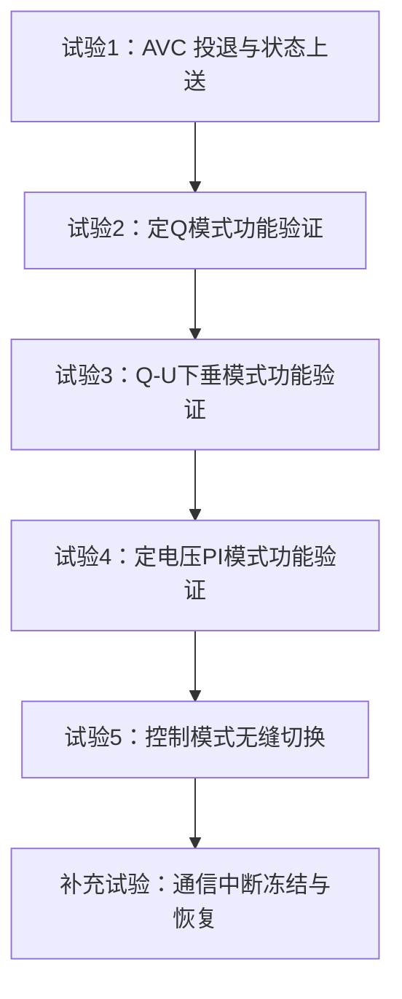
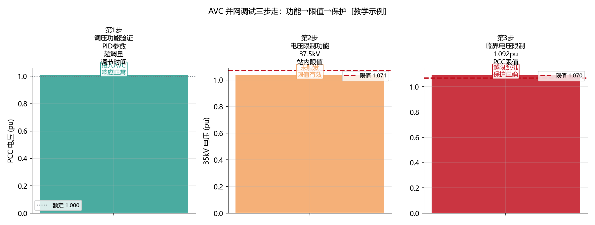
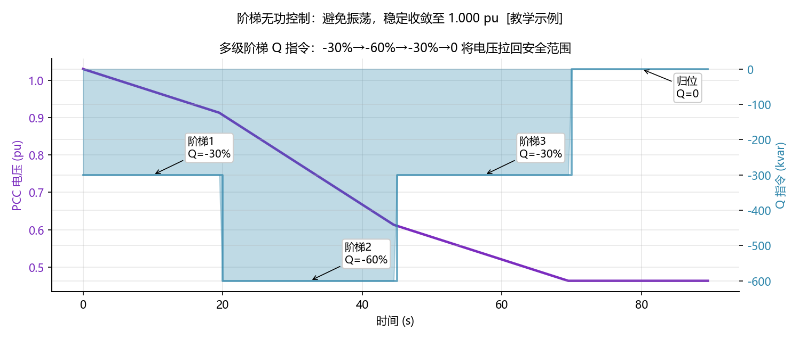
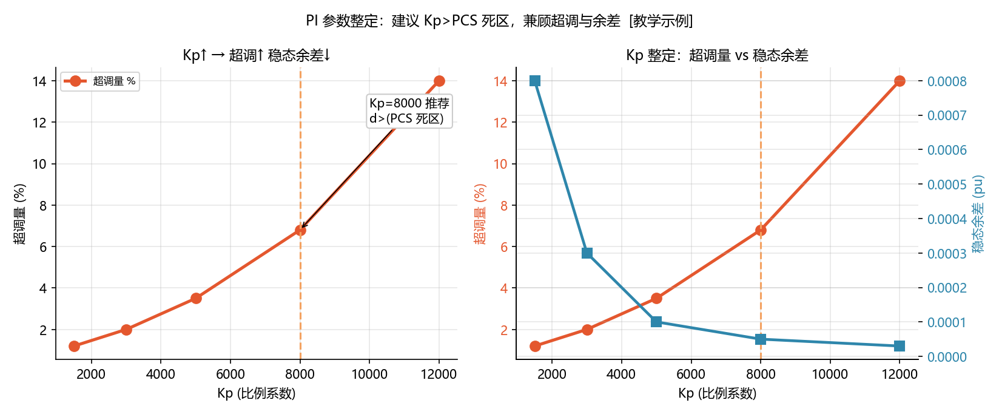

<!-- @AI_GENERATED -->
# 08 AVC并网联调怎么一次过：五大标准试验、三个隐蔽陷阱与完整证据链

> [课程首页](README.md) · 上一章：[06 AVC在EMS里怎么落地](06_AVC的IEC104链路与状态机.md) · 下一章：[09 AVC典型误区与故障诊断](09_AVC典型误区与故障诊断.md)

**一句话**：AVC 联调不是"功能跑通就行"——它是一套必须逐项记录、逐项签字的标准试验流程。80% 的联调失败不是功能问题，而是证据链不完整——你做了试验但没留下能让调度认可的记录。

## 本章目标

读完本章，你应能：

1. 列出 AVC 并网联调的五大标准试验项目及每项的合格判据；
2. 识别联调中最容易被忽略的三个隐蔽陷阱（零电压指令、P-Q 耦合边界、模式切换冲击）；
3. 设计带时标四时刻数据的验收证据链——确保每项试验的结论可追溯；
4. 在联调前做一份"试验自查清单"，避免现场补测。

## 本章边界与假设

本章覆盖 AVC 子站级联调（场站侧），包含试验项目、证据链和隐蔽陷阱；不覆盖 AVC 主站级联调（调度侧系统级联调，那是调度的责任范围）、不覆盖通信链路单独测试（那是 RTU/通信管理机的联调范畴，但 AVC 需参与联调验证）。
**前置**：第 00、01、02、06 章。
所有试验要求以当地调度机构最新版《AVC 并网联调试验大纲》为准。

---

## 08.1 现场场景【必懂】

某 50 MW 储能电站 AVC 联调当天，现场流程：

```
09:00  调度电话："AVC 联调开始，先投定电压模式，目标 1.000 pu"
09:05  现场："已投入，PCC 电压 1.003 pu，在控制中"
09:15  调度："收到，第一项通过。现在做Q-U下垂切换试验"
09:16  现场切换模式 → SVG 瞬间从 −300 kvar 跳到 −120 kvar
        PCC 电压从 1.003 pu 跳到 1.008 pu
09:17  调度："刚才电压跳了 0.005 pu，这个切换冲击太大了，重做"
```

**问题**：模式切换逻辑中，从定电压 PI 切换到 Q-U 下垂时，PI 的积分项 I=−280 kvar，而下垂根据当前 U 算出的 Q=−120 kvar——两者差值 160 kvar 瞬间释放，造成了无功跳变。

重做三次后终于通过，但已经花了 3 小时。事后复盘：
- 切换冲击问题如果在出厂前就用"冻结→缓退→切换"的逻辑处理，根本不会有冲击
- 联调现场改代码是大忌——一切参数和逻辑变更必须在联调前完成仿真验证

**问题清单**：本章回答这三个问题：
- AVC 联调有哪些标准试验？每项的合格标准是什么？
- 联调中哪些"看起来没问题"的细节最容易被调度抓到？
- 怎么准备一套完整的证据链，让调度 30 分钟内签完所有试验报告？

---

## 08.2 五大标准试验项目【必懂】

### 试验全景



### 试验 1：AVC 投退与状态上送

| 项目 | 内容 |
|---|---|
| **目的** | 验证调度能正确远程投退 AVC、EMS 正确上送投运状态 |
| **步骤** | 1. 调度下发"AVC 投入" → EMS 确认状态变为"投入" → 调度确认收到"投入"遥信<br/>2. 调度下发"AVC 退出" → EMS 确认状态变为"退出" → 调度确认收到"退出"遥信<br/>3. EMS 本地人工闭锁 → 调度确认收到"闭锁"遥信及闭锁原因码 |
| **合格判据** | 三次状态切换在 10 秒内正确上送，闭锁原因码与现场一致 |
| **证据** | 调度端截图（遥控命令+遥信反馈）、EMS 日志截图（时间戳对齐）、闭锁原因码对应表 |

### 试验 2：定 Q 模式功能验证

| 项目 | 内容 |
|---|---|
| **目的** | 验证 EMS 能按调度下发的固定无功设点准确执行 |
| **步骤** | 1. 调度下发 Q 设点 = −300 kvar<br/>2. 观测全场 Q 实际值达到 −300 kvar ±5% 的时间<br/>3. 改下发 Q = +200 kvar，重复 |
| **合格判据** | 从指令下发到 Q 达到目标 ±5% 不超过 30 秒，稳态偏差不超过 ±3% |
| **证据** | 四时刻：T_cmd（调度）、T_recv（EMS）、T_Q90%（达到目标 90%）、T_settle（稳态） |
| **边界测试** | Q=0（零无功指令）、Q=±Q_max（满容量指令） |

### 试验 3：Q-U 下垂模式功能验证

| 项目 | 内容 |
|---|---|
| **目的** | 验证 EMS 在 Q-U 下垂模式下能按本地电压正确生成 Q 指令 |
| **步骤** | 1. 设定 U_ref=1.000 pu、K=10000 kvar/pu、死区=±0.010 pu<br/>2. 记录 PCC 电压→EMS 输出 Q 的对应关系（3 个电压点：偏高/正常/偏低）<br/>3. 验证死区行为（在死区内 Q=0） |
| **合格判据** | Q 与电压的对应关系在 ±10% 误差内匹配下垂曲线 |
| **证据** | 下垂曲线上标记 3 个实测点：（U, Q）散点图 + 理论曲线叠加 |
| **边界测试** | U 在死区边界（±0.010 pu）附近→确认无振荡 |

### 试验 4：定电压 PI 模式功能验证

| 项目 | 内容 |
|---|---|
| **目的** | 验证 EMS 在定电压 PI 模式下能将 PCC 电压控制在目标值 |
| **步骤** | 1. 设定 U_target=1.000 pu，PCC 当前 1.025 pu<br/>2. 投入 AVC，记录电压下降的过程<br/>3. 确认最终稳态电压进入合格范围 |
| **合格判据** | 电压在 60 秒内进入目标 ±0.007 pu，稳态后再无持续偏离 |
| **证据** | 电压时域曲线（T_cmd→T_settle）、Q 时域曲线（P项+I项分解）、积分项 I 变化曲线 |
| **边界测试** | 电压偏差超出 Q 能力范围→确认 PI 正确钳位在 Q_max，无积分饱和 |

### 试验 5：控制模式无缝切换

| 项目 | 内容 |
|---|---|
| **目的** | 验证不同控制模式之间切换时 Q 输出不产生冲击跳变 |
| **步骤** | 1. 定电压 PI → 定 Q：切换前后 Q 差值不超过 ±5% Qn<br/>2. 定 Q → Q-U 下垂：切换前后 Q 差值不超过 ±5% Qn<br/>3. Q-U 下垂 → 定电压 PI：切换前后 Q 差值不超过 ±5% Qn |
| **合格判据** | 任何模式切换前后 Q 变化不超过 ±5% Qn，且 PCC 电压变化不超过 0.005 pu |
| **证据** | 切换时刻的 Q 和 U 时间序列，标注切换前后的 Q 值和电压值 |
| **关键** | **切换策略必须是"冻结→切换→释放"三拍逻辑**，不能是直接切换 |

### 补充试验：通信中断冻结与恢复

| 项目 | 内容 |
|---|---|
| **目的** | 验证 104 通信中断后 AVC 的正确行为 |
| **步骤** | 1. 正常运行中拔掉 104 主通道网线<br/>2. 观测 AVC 进入 FREEZE 状态，Q 保持冻结前值<br/>3. 30 秒后插回网线→观测 AVC 恢复 RUNNING |
| **合格判据** | 通信中断后 5 秒内进入 FREEZE，Q 不跳变；通信恢复后 10 秒内恢复正常控制 |

### 配图：联调三步流程



| 编号 | 位置 | 标注 | 对应正文 |
|---|---|---|---|
| ① | 三步流程 | 静态对点→半载响应→满载能力 三步递进，每步含合格判据 | §08.2 五大标准试验 |

---

## 08.3 三个隐蔽陷阱【必懂】

### 陷阱 1：零电压指令 / 品质位无效

**场景**：联调时调度可能下发 U_target=0（品质位=无效，表示"暂不控制"）或 U_target=1.5 pu（测试/错误值）。

**陷阱**：如果 EMS 不校验品质位和合理范围（0.9~1.1 pu），会把无效指令当作有效指令执行——可能造成严重的无功失控。

**防护**：

```python
def validate_avc_command(u_target_pu, quality_valid, q_setpoint_kvar, mode):
    if not quality_valid:
        return "REJECT_QUALITY", "品质位无效，保持当前状态"
    if u_target_pu is not None:
        if not (0.9 <= u_target_pu <= 1.1):
            return "REJECT_RANGE", f"U_target={u_target_pu} 超出合理范围"
    if mode not in [1, 2, 3, 4]:
        return "REJECT_MODE", f"控制模式={mode} 不在有效枚举值内"
    return "ACCEPT", None
```

### 陷阱 2：P-Q 耦合的边界行为

**场景**：定电压 PI 模式下，AVC 要求 Q=−800 kvar。PCS 在 AGC 下 P=900 kW，S_max=1000 kVA，剩余 Q 仅 436 kvar。实际 Q 被限幅在 −436 kvar——**电压调不到位，但没有任何报警**。

**联调中怎么暴露**：故意在 AGC 大出力时做定电压 PI 试验，看 AVC 是否在 P-Q 能力限幅后正确上报"无功能力不足"状态码（而非默默失败）。

### 陷阱 3：SVG 本地模式干扰

**场景**：SVG 出厂默认是"本地电压控制模式"。EMS 下发定电压 PI 时，SVG 同时根据本地电压在自主调节——两个控制器在抢同一段 PCC 电压。

**联调前检查**：确认 SVG 已切到"远方设点"模式，或如果必须本地模式，确认 EMS 已实现"SVG 前馈修正"（第 03 章讲过）。

### 配图：阶梯控制：四种模式逐级切换时序



| 编号 | 位置 | 标注 | 对应正文 |
|---|---|---|---|
| ① | 阶梯 | 定Q(−300) → 定PF(cosφ=0.95) → Q-U下垂(K=10000) → 定电压PI 逐级切换 | §08.3 陷阱2 + §08.2 试验5 |
| ② | 切换点 | 各模式切换时刻 Q 不跳变（冻结→切换→释放三拍逻辑） | §08.3 切换策略 |

---

## 08.4 证据链：四时刻数据【必懂】

每项试验必须记录以下四时刻，形成可追溯的证据：

```text
T_cmd   ：调度主站下发 AVC 指令的时刻（以调度时标为准）
T_recv  ：EMS/子站接收并校验通过的时刻（以 EMS 时标为准）
T_Q90%  ：全场无功出力首次达到指令目标 90% 的时刻
T_settle：PCC 电压进入稳态（偏差在合格范围内 30 秒不跳变）的时刻
```

### 证据链模板

```markdown
## 试验 N：[试验名称]
- **试验时间**：2024-XX-XX HH:MM:SS ~ HH:MM:SS
- **初始条件**：PCC U=1.XXX pu, P_total=XX MW, Q_total=XX Mvar
- **指令**：U_target=1.000 pu / Q_setpoint=−300 kvar / Mode=XX

| 时刻 | 时间戳 | 值 | 来源 |
|---|---|---|---|
| T_cmd | 14:30:02.500 | U_target=1.000 pu | 调度 104 报文截图 |
| T_recv | 14:30:10.800 | U_target=1.000 pu (校验通过) | EMS 日志截图 |
| T_Q90% | 14:30:32.100 | Q_actual=−453 kvar (Q_target=−500) | EMS 数据库查询 |
| T_settle | 14:30:58.000 | U_pcc=1.002 pu, Q_actual=−280 kvar | EMS + 调度双重确认 |

- **响应时间（调度侧）**：T_Q90% − T_cmd = 29.6 秒 ✓
- **响应时间（EMS 侧）**：T_Q90% − T_recv = 21.3 秒
- **稳态偏差**：|1.002 − 1.000| = 0.002 pu ≤ 0.007 pu ✓
- **结论**：合格 / 不合格（原因：XXX）
```

### 配图：PI 整定轨迹对比



| 编号 | 位置 | 标注 | 对应正文 |
|---|---|---|---|
| ① | 激进线 | Kp=8000 / Ki=2000：3 s 进入 ±0.003 pu（快速响应） | §08.4 证据链 + §02.4 |
| ② | 保守线 | Kp=2000 / Ki=500：10 s 才达标（响应过慢，可能超出考核时限） | §08.4 + §02.4 整定后验证 |
| ③ | 目标带 | ±0.003 pu 宽带，PI 参数直接决定套圈速度 | §08.4 T_settle |

---

## 08.5 联调前自查清单【必懂】

| 序号 | 检查项 | 状态 |
|---|---|---|
| 1 | AVC 五级流水线完整跑通（从 104 接收到 PCS 反馈） | ☐ |
| 2 | 104 点表逐点核对（电压目标、Q 设点、模式切换、状态上送） | ☐ |
| 3 | 四种控制模式各做过 30 分钟连续运行仿真 | ☐ |
| 4 | 模式切换"冻结→切换→释放"三拍逻辑已实现 | ☐ |
| 5 | PI 抗积分饱和已测试（U 偏差超 Q 能力的场景） | ☐ |
| 6 | 通信中断→FREEZE→恢复→RUNNING 全流程已验证 | ☐ |
| 7 | SVG 远方/本地模式已确认 | ☐ |
| 8 | P-Q 能力不足时 EMS 上送的状态码已确认 | ☐ |
| 9 | 零电压指令/品质位无效的拒绝逻辑已验证 | ☐ |
| 10 | 所有四时刻数据的记录功能已开启 | ☐ |
| 11 | 联调试验报告模板已准备（含每个试验的证据链表格） | ☐ |
| 12 | 现场与调度的时间同步（NTP）已确认 | ☐ |

---

## 自测

1. AVC 联调的五大标准试验项目是什么？每项的合格判据是什么？
2. 定电压 PI 试验中，PCC 电压进入了目标范围但花了 70 秒——合格吗？为什么？
3. 模式切换试验中，从 PI 切到 Q-U 下垂时 Q 从 −300 跳到 −100 kvar——这是什么问题？怎么解决？
4. 联调前最重要的 12 项自查清单中，哪三项最容易被遗忘却最容易导致联调失败？

<details>
<summary>参考答案</summary>

1. 试验1-AVC 投退与状态上送（状态在 10s 内正确上送）、试验2-定 Q 模式（Q 在 30s 内达到目标 ±5%）、试验3-Q-U 下垂（Q 与电压对应关系在 ±10% 内匹配曲线）、试验4-定电压 PI（U 在 60s 内进入合格范围）、试验5-模式切换（Q 变化不超过 ±5% Qn 且 U 变化不超过 0.005 pu）。
2. 视具体细则：有些要求 60 秒内达标（不合格），有些允许 90 秒（合格）。但 70 秒远超典型目标 60 秒，即使细则允许——也可能因为响应慢导致 S_performance 评分低。
3. PI 的积分项 I 在切换时被释放了——PI 模式下 I 累积了大量负值（吸收 Q），切换到下垂后 I 被清空，导致 Q 跳变。解法：切换前先冻结 I，以 ramp 方式平滑过渡到下垂曲线上的 Q 值。
4. 1) SVG 远方/本地模式确认（SVG 本地抢控）；2) PI 抗积分饱和测试（切换/边界时反向调节）；3) NTP 时间同步确认（时标不一致导致证据链作废）。
</details>

---

## 🧪 动手验证

并网联调五大标准试验与时序验证已实现为可运行代码（参数与正文主线 Uref=116kV/Q=−5000 kvar/60s 达标一致）：

```bash
cd lab/
python examples/ch08_commissioning.py
```

**关键输出**（与正文 §8.2 试验对照）：
- 试验 2（定 Q）：直接下发 −5000 kvar → 30s 内达标 ±5%
- 试验 4（定电压 PI）：t=14s U=116.49 kV ✓ 60s 内进入 ±0.5 kV 合格带
- 试验 5（模式切换）：Q 跳变 ΔQ=0 kvar → √ 合格

> 对照正文 §8.2 五大试验的合格判据和 §8.5 "联调前自查清单"逐行验证。


> 🧭 **下一站**：联调通过了——但运行三个月后突然收到"电压合格率不达标"罚单怎么办？下一章进入排故实战：[09 AVC 典型误区与故障诊断](09_AVC典型误区与故障诊断.md)，用这套 15 分钟诊断流程，回到我们这座 50 MW 储能电站，排查那五类最常见的"自己觉得没问题、调度却说有问题"的陷阱。

<!-- @AI_GENERATED: end -->