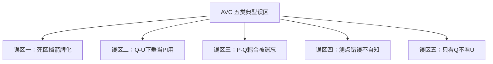
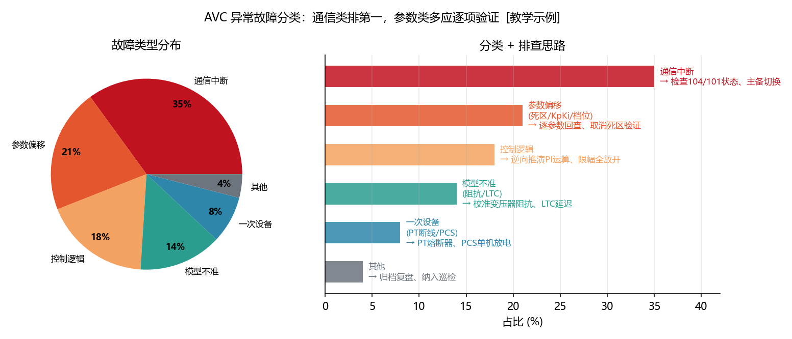
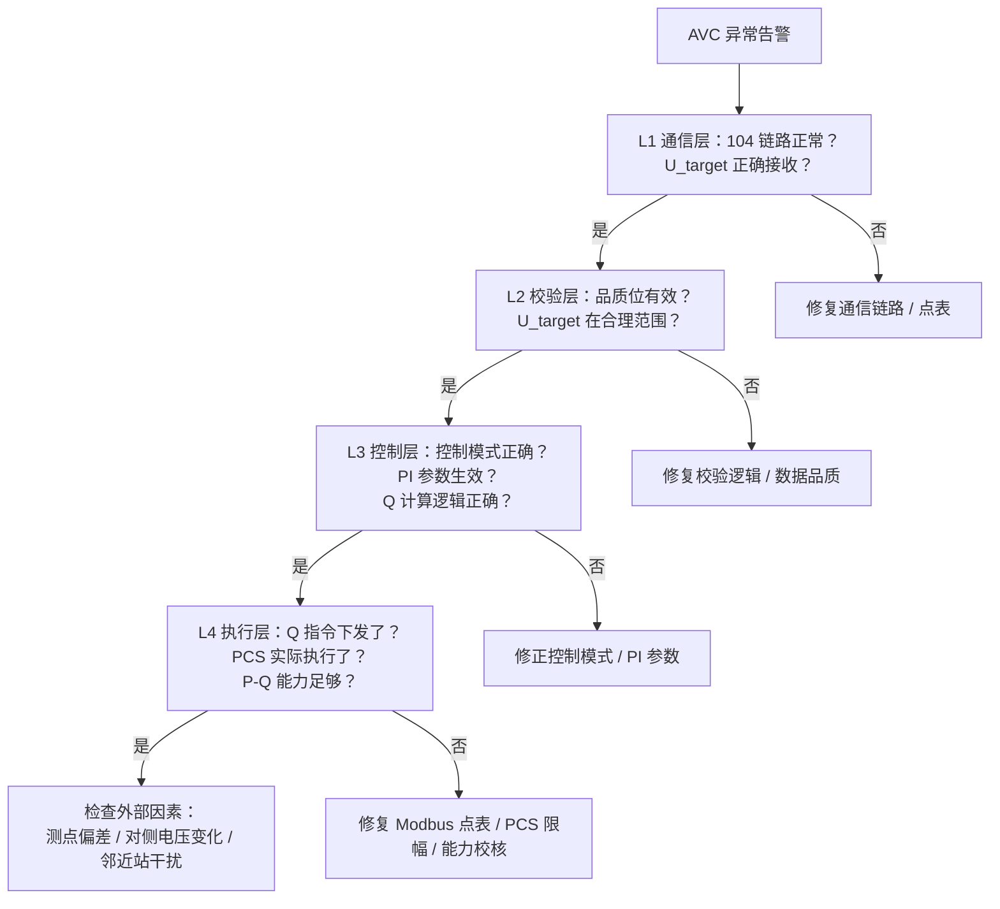
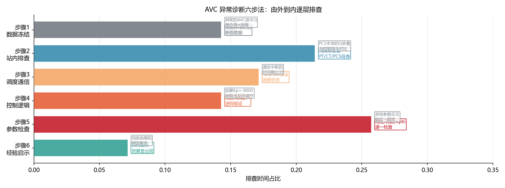

<!-- @AI_GENERATED -->
# 09 AVC考核不合格的根因在哪：五类典型误区与四个真实故障的逐层诊断

> [课程首页](README.md) · 上一章：[08 AVC并网联调与验收证据链](08_AVC并网联调与验收证据链.md) · 下一章：[07 AVC考核与结算模型](07_AVC考核与结算模型.md)

**一句话**：AVC 出问题，大多数时候不是控制算法搞错了——而是某个看似毫不相关的配置、测点或参数设置，在特定的工况组合下触发了连锁效应。

## 本章目标

读完本章，你应能：

1. 识别 AVC 最常见的五类典型误区及其表现症状；
2. 使用"四层排查法"（通信→校验→控制→执行）逐层定位故障根因；
3. 根据四个真实故障案例，对照自己的系统做预防性自查；
4. 在 AVC 异常时用 15 分钟内完成初步根因定位。

## 本章边界与假设

本章覆盖 AVC 子站侧常见故障的根因诊断方法；不覆盖电网侧故障（如区域电压崩溃）、不覆盖 PCS/SVG 硬件本体故障（如 IGBT 损坏）、不覆盖 104 协议栈底层的通信故障。
**前置**：第 00~04、06、08 章（控制核心与工程实现部分）。
本章的诊断方法适用于场站侧 EMS/AVC 系统，需结合实际运行日志具体分析。

---

## 09.1 五类典型误区【必懂】

### 误区全景



### 误区一：死区"挡箭牌化"

**症状**：PCS 频繁在"发无功/不发"之间切换，设备发热增加、电压合格率反而下降。

**根因**：死区设得太大（企图减少 PCS 动作次数），但死区边界上的电压测量噪声 + 控制周期短导致 PCS 在死区边界高频振荡。死区变成了"问题放大器"而非"保护器"。

**诊断**：
1. 检查死区宽度是否 > 3×电压采样噪声标准差（见第 02 章）；
2. 检查死区类型是否为"简单死区"（边界跳变）而非"连续死区"——连续死区可消除边界跳变；
3. 检查死区是否大于电压合格范围——如果死区比合格范围还宽，死区内电压超标调度判不合格但 AVC 不动。

**修正**：改用连续死区，死区宽度 ≤ 合格范围且 ≥ 3×采样噪声标准差。如无法同时满足 → 提升采样精度或申请合格范围放宽。

### 误区二：Q-U 下垂当 PI 用

**症状**：AVC 投入后电压确实有所改善，但永远回不到调度下发的电压目标值——电压合格率就是差那么一两个百分点。

**根因**：EMS 运行在 Q-U 下垂模式（有差调节），而调度考核的是"电压回到目标值"（要求无差调节）。Q-U 下垂从原理上就不保证电压回到目标值。

**诊断**：
1. 检查 EMS 当前控制模式——是"Q-U 下垂"还是"定电压 PI"；
2. 查看 PCC 电压历史曲线——如果电压稳定在一个固定偏差上（如持续 1.008 pu）而不是逐步收敛到目标 → 这是下垂的典型特征；
3. 确认调度下发的是"电压目标"还是"无功设点"——如果下发的是电压目标，就不能用 Q-U 下垂。

**修正**：切换到定电压 PI 模式，并按第 02 章方法整定 Kp/Ki。

### 误区三：P-Q 耦合被遗忘

**症状**：AGC 放电高峰时段（如中午），AVC 的 Q 调节能力明显不足，电压合格率在这个时段断崖式下跌。AGC 降功率后电压恢复正常。

**根因**：P 优先模式下，PCS 的有功吃满了 S 容量，Q 可用的"剩余空间"被严重压缩。EMS 没有检测到"Q 能力不足"并上送调度。

**诊断**：
1. 检查 AGC 放电时段和 AVC 不合格时段的时域重合度——如果高度重合，基本确定 P-Q 耦合是主因；
2. 检查每台 PCS 的 P/S 比——如果某些 PCS 的 P/S > 0.8，Q 余量已不足 60%；
3. 检查 EMS 是否在 Q 被限幅时正确上送了"无功能力不足"遥信——如果没有，调度会认为你的 AVC "不好好干活"。

**修正**：1) 换 Q 优先或比例共享模式（如果合同允许）；2) 在该时段降低 AGC 出力目标（即用 AGC 的 P 给 AVC 的 Q 让路）；3) 正确上送 Q 能力不足状态码。

### 误区四：测点错误不自知

**症状**：EMS 自统计电压合格率 99%+，调度考核电压合格率只有 95%。反复检查控制算法没问题，PI 参数也没问题。

**根因**：EMS 读的电压不是调度考核用的电压。可能原因：
- EMS 读 35kV 母线 PT，调度考核 110kV PCC 关口表（变压器压降偏差）；
- EMS 读的是线电压，调度读的是相电压（√3 倍数差异）；
- EMS 读的是 A 相，调度考核的是三相均值；
- 互感器变比配置错误。

**诊断**：
1. 在联调报告中明确记录"EMS 电压源"和"调度考核电压源"的测点编号；
2. 在同一时刻取 EMS 和调度的电压读数，计算固定偏差量；
3. 核实 PT 变比和接线方式。

**修正**：同步到同一个测点。如果不可行，建立全工况折算表并在 EMS 中对读到的电压做修正。

### 误区五：只看 Q 不看 U

**症状**：AVC 的 Q 响应很快、Q 指令执行很准，但 PCC 电压就是调不到位。调度考核电压不合格。

**根因**：AVC 的逻辑写成了"Q 跟踪闭环"（即关注"Q 到没到指令值"），而调度考核的是"电压到没到目标值"。"Q 调到位"≠"电压调到位"——因为线路阻抗的非线性、对侧电网的电压也在变化、邻近场站的无功也在调节。

**诊断**：
1. 检查 AVC 的闭环目标——是"Q 达到指令"还是"U 达到目标"；
2. 查看 Q 曲线和 U 曲线的相关性——如果 Q 完美跟踪但 U 持续偏离 → 确认问题；
3. 用 ΔU/ΔQ 的实测值反算系统等效 X/R（工况可能变化）。

**修正**：确保 AVC 的 PI 控制器以"电压偏差"而非"Q 偏差"为闭环目标。PI 的输出是 Q（执行量），但 PI 的输入必须是电压偏差。

---

## 09.2 四个真实故障案例【必懂】

### 案例一：互感器更换引发的合格率雪崩

**背景**：某风电场 AVC 运行 6 个月稳定，某日突然电压合格率从 99.1% 跌到 87.3%。

**排查过程**：
```
第一步（通信层）：104 链路正常，指令正常接收 ✓
第二步（校验层）：U_target=1.000 pu，品质位有效，校验通过 ✓
第三步（控制层）：PI 参数未变，Q 计算逻辑未变 ✓
第四步（执行层）：PCS 日志显示 Q 实际值与指令一致 ✓
但对账发现：EMS 读到的 PCC U=1.008 pu，调度端显示 1.015 pu！
```

**根因**：三天前更换了 PCC 关口表的 PT。旧 PT 变比 110kV/100V，新 PT 变比 110kV/110V。EMS 的电压换算系数未更新——实际 PCC 1.015 pu 被 EMS 读成了 1.008 pu。

**教训**：任何一次测点变更后，必须做一次 EMS 与调度端的全工况电压对账。

### 案例二：积分饱和导致的"反向调节"

**背景**：某储能电站，某日下午 AVC 出现"无功反向调节"告警——PCC 电压偏低（0.985 pu），但 AVC 输出的是吸收无功（Q<0）。

**排查过程**：
```
EMS 日志回溯：
11:00  U=1.035 pu, Q=−500 kvar（限幅）, I=−280（开始累积）
12:00  U=1.030 pu, Q=−500 kvar（限幅）, I=−404（持续累积）
12:30  光伏骤降！U=0.985 pu
12:30  PI 输出：P项 = 8000×(−0.015) = +120 kvar（想发无功）
        I项 = −404 kvar（积分还在负值区）
        Q = +120 + (−404) = −284 kvar → 还在吸收！
```

**根因**：抗积分饱和未生效。I 在 Q 被限幅时仍在累积，导致需要很长时间才能"排出"负积分。

**修正**：启用条件积分抗饱和（见第 02 章）。修正后重跑历史数据，反向调节从 120 秒缩短到 8 秒。

### 案例三：死区 + 采样噪声 = PCS 高频振荡

**背景**：某储能电站投运后，PCS 频繁在"Q=−200 kvar"和"Q=0"之间跳变，每 4 秒切换一次。PCS 厂商反馈"设备过频动作，IGBT 寿命预期缩短 30%"。

**排查过程**：
```
EMS 日志逐拍回放：
t0: U=1.0119 → ΔU=+0.0119 > 0.010 → Q=−200
t1: U=1.0098 → |ΔU|=0.0098 < 0.010 → Q=0
t2: U=1.0123 → ΔU=+0.0123 > 0.010 → Q=−200
t3: U=1.0095 → |ΔU|=0.0095 < 0.010 → Q=0
...

电压波动幅度仅 0.0025 pu——这是正常的采样噪声！
但死区边界恰好落在噪声带内 → 每个周期都在"进入-退出"。
```

**根因**：简单死区的边界跳变 + 死区宽度恰好等于噪声带。改用连续死区后，边界行为平滑，Q 不再跳变。

### 案例四：PCS 内部 Q 限幅——EMS 不知道

**背景**：某光储电站 AVC 运行中，EMS 显示 Q 指令为 −500 kvar 已完整下发，PCS 反馈 Q=−380 kvar——差了 120 kvar。但没有触发任何报警。

**排查过程**：
```
EMS 侧：Q_cmd=[−50,−50,...,−50]（10 台各 −50），合计 −500 kvar
PCS 侧：#3 PCS 内部报警"无功过流保护"，Q_limit 自动从 −50 缩到 +30
         但 PCS 的 Modbus 状态寄存器中这个"限幅"信息未映射到 EMS 点表！
所以：#3 PCS 实际只执行了 0 kvar（因为 −50 被本地拒绝），
      但 EMS 以为它执行了 −50 kvar。
```

**根因**：PCS 的内部保护限制没有被映射到 EMS 可读的点表。EMS 不自知地在对一个"已失效"的指令做闭环。

**修正**：在 Modbus 点表中增加 PCS 的"Q 限幅状态"和"实际 Q 限幅值"的映射，EMS 在做分配时以"实际能执行的值"为准。

### 配图：故障分类饼图



| 编号 | 位置 | 标注 | 对应正文 |
|---|---|---|---|
| ① | 饼图 | 通信故障 35%（最大占比，104 链路/点表） | §09.2 案例二 |
| ② | 饼图 | 参数错误 26%（死区/PI/限幅） | §09.2 案例四 |
| ③ | 饼图 | 配置漂移 18%、设备本体 12%、外部扰动 9% | §09.2 案例一/三 + §09.1 误区 |

---

## 09.3 四层排查法【必懂】

当 AVC 出现异常时，按以下顺序逐层排查——上层断了，下层不可能正常：



### 每层的快速检查命令（思路等价）

| 层 | 检查方法 | 5 分钟能出结果？ |
|---|---|---|
| L1 通信 | 看 104 报文日志中最后一次有效 U_target 接收时间 | ✓ |
| L2 校验 | 看 EMS 日志中 U_target 校验通过/拒绝计数 | ✓ |
| L3 控制 | 打印当前控制模式和最近 10 拍的 Q 计算值 | ✓ |
| L4 执行 | 对比每台 PCS 的"Q 指令"和"Q 实际"两个寄存器 | ✓ |

### 配图：四层排查法流程 + 故障分类构成



| 编号 | 位置 | 标注 | 对应正文 |
|---|---|---|---|
| ① | 左图 | L1通信→L2校验→L3控制→L4执行 四层递进，每层给出检查项与修复路径 | §09.3 四层排查法 |
| ② | 右图 | 故障分类饼图：通信故障 35% / 参数错误 26% / 各占比 | §09.2 四个真实案例 + §09.1 误区 |

---

## 自测

1. AVC 的五类典型误区分别是什么？每类的核心症状是什么？
2. 用四层排查法，如果 L1 通信正常、L2 校验正常、L3 控制正常——但电压就是不达标——你应该重点查哪一层？具体查什么？
3. 案例一中，更换 PT 后为什么 EMS 的电压合格率自统计和调度考核差了那么多？
4. 你接手一个 AVC 异常告警，如何在 15 分钟内完成初步根因定位？

<details>
<summary>参考答案</summary>

1. 1) 死区挡箭牌化（PCS 振荡/电压在死区内超标）；2) Q-U 下垂当 PI 用（电压有固定偏差回不到目标）；3) P-Q 耦合被遗忘（AGC 高峰时 AVC 能力骤降）；4) 测点错误不自知（自统计合格、调度统计不合格）；5) 只看 Q 不看 U（Q 跟踪完美但电压不达标）。
2. 查 L4 执行层：1) 逐台 PCS 对比 Q_CMD 和 Q_ACTUAL 是否一致（排查 PCS 本地限幅）；2) 计算当前 P 水平下联合可用 Q 是否 ≥ AVC 需求（排查 P-Q 耦合不足）；3) 检查 SVG 是否在本地模式抢控。如果 L4 也正常，再查外部因素（测点偏差/折算错误/对侧电压变化）。
3. PT 从 110kV/100V 换成 110kV/110V，EMS 仍按旧变比 1.1 换算（应为 1.0）。实际 1.015 pu 被读成 1.015/1.1×1.0 ≈ 尚未换算正确导致读数为 1.008 pu。两者差 0.007 pu——恰好跨过了 ±0.007 的合格边界。
4. 15 分钟流程：0~3min 读 EMS 日志确认通信状态和控制模式；3~6min 对账 EMS 和调度电压读数；6~9min 对比最近 10 拍 Q_CMD vs Q_ACTUAL（每台 PCS）；9~12min 检查 PI 积分项是否饱和、P-Q 能力是否足够；12~15min 确认测点配置和 PT 变比。
</details>

---

## 🧪 动手验证

五类典型误区诊断决策树已实现为可运行代码（参数与正文主线 50MW 储能电站场景一致）：

```bash
cd lab/
python examples/ch09_diagnostics.py
```

**关键输出**（与正文 §9.1-9.2 对照）：
- 场景A（死区=合格范围）：根因→合规链断裂，修复→缩小死区，排查 3 分钟
- 场景C（SVG 本地抢控）：根因→总 Q 失控，修复→远方模式，排查 3 分钟
- 场景E（参数上传禁止）：根因→调度以为离线，排查 4 分钟

> 对照正文 §9.1 "五类典型误区"和 §9.3 "四层排查法"逐行验证。


> 🧭 **下一站**：故障排完了——但真正的痛点是什么？故障导致考核扣分 = 真金白银的损失。下一章进入全书的经济闭环：[07 AVC 考核与结算模型](07_AVC考核与结算模型.md)，回到我们这座 50 MW 储能电站的结算账单前，算一笔账：电压合格率每低 1%，月损失多少钱？

<!-- @AI_GENERATED: end -->