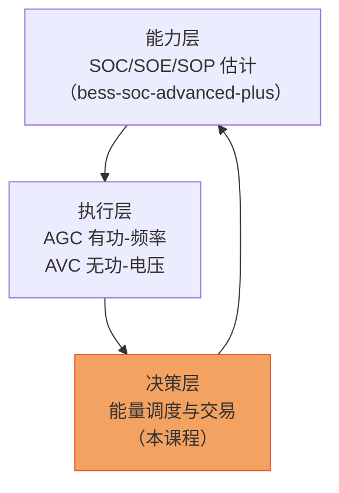

<!-- @AI_GENERATED -->
# 00 能量调度闭环链路：EMS 名字里的 Energy Management

> [课程首页](README.md) · 下一章：[01 峰谷套利](01_峰谷套利.md)

**一句话**：前几门课程教的是"电池怎么健康地、正确地出力"（SOC/SOP 能力估计、有功-频率、无功-电压），本章补上 EMS 的字面核心——**在正确的时机、以正确的价格，决定充还是放、放多少**，也就是"能量调度"。

## 本章目标

读完本章，你应能：

1. 说出能量调度在 EMS 整体架构里所处的位置和上下游依赖；
2. 画出"感知 → 决策 → 执行 → 评估"的能量调度闭环；
3. 明确本课程贯穿的 50MW/100MWh 储能电站主线场景与统一方向约定；
4. 理解"能力（能干什么）"与"决策（该干什么）"是两个独立环节。

## 本章边界与假设

本章只建立课程地图与概念框架，不展开任何具体算法（分时套利、可行域、LP 排程等分别在第 01、04、05 章）。**前置**：无，建议先读完 `ems-python-learning` 与 `bess-soc-advanced-plus`。

---

## 00.1 能量调度在 EMS 里的位置【必懂】

一座储能电站的 EMS 大致分为三层能力，它们解决的是**不同层次**的问题：

- **能力层**回答"电池现在能干什么"：SOC 多少、还能充/放多少能量、能持续多少功率。
- **执行层**回答"怎么按要求出力"：接到功率/电压指令后，PCS 怎么快速、准确地执行。
- **决策层**回答"今天该干什么、赚多少钱"：综合电价、负荷、光伏、市场信息，给出充放电排程。

能量调度是决策层，它**依赖**能力层给出的可行边界，**驱动**执行层去落地指令。三者是闭环，不是流水线。

> **软件类比**：能力层像"资源监控"（还剩多少内存/CPU），执行层像"API 网关"（把请求转发给正确的服务），决策层像"调度器/编排器"（这个任务该在哪个节点、什么时候跑最划算）。决策层不关心 PCS 内部怎么调，只关心"什么时候、以什么价格、派多少活"。
> **类比失效点**：软件调度错了大不了任务慢一点；储能调度错了要么放不出去（越限）、要么亏钱（在低价时段放电），且电池的循环寿命是**不可再生的消耗品**。

---

## 00.2 贯穿主线场景【必懂】

本课程所有章节共用同一个场景，参数见 [附录B](附录B_符号规范.md)：

| 参数 | 值 | 说明 |
|---|---|---|
| 额定功率 P_nom | 50 MW | 充/放对称 |
| 额定能量 E_nom | 100 MWh | LFP 电芯 |
| SOC 工作范围 | 10%~90% | 可用能量 E_avail = 80 MWh |
| 充电/放电效率 | 0.95 / 0.95 | 往返效率 ≈ 0.90 |
| 分时电价 | 谷 0.35 / 平 0.70 / 峰 1.20 元/kWh | 见附录B B.4 |

> **为什么固定 SOC 在 10%~90% 而不是 0~100%**：SOC 两端是电池寿命的"禁区"。满放（0%）会损伤负极，满充（100%）会加速析锂。实际电站几乎都会限制在 10%~90% 区间，所以"可用能量"只有额定 100 MWh 的 80%，即 80 MWh。这是本课程所有收益手算的起点。

### 统一方向约定（全课程唯一真相）

| 量 | 约定 |
|---|---|
| 功率 P | **放电为正**（P>0 向电网输出），充电 P<0 |
| 能量 E | 收益计算取**幅值**（非负），方向由上下文表达 |
| SOC | 0~1（正文用 %） |

完整约定见 [附录B](附录B_符号规范.md)。后续章节所有手算、概念实现、`lab/ems_lab/` 模块均以此为准。

---

## 00.3 能量调度的决策闭环【必懂】

一次完整的能量调度决策是这样一个循环：

- **感知（第 01~04 章）**：拿到分时电价、需量、光伏出力、当前 SOC。
- **决策（第 04~08 章）**：在 SOC/SOP 可行域内，用 LP/贪心给出日前排程，再日内滚动修正，叠加辅助服务容量。
- **执行**：把功率计划下发给 PCS（执行细节已在 AGC/AVC 课程覆盖，本课程不重复）。
- **评估（第 09 章）**：把"计划收益 vs 实际收益"的偏差归因到电价误差、能量不足等环节，反哺下一轮计划。

这个闭环对应本课程章节结构：第 01~03 章讲收益来源（为什么值得调），第 04 章讲能力边界（能怎么调），第 05~06 章讲决策算法（怎么调最优），第 07~08 章讲市场进阶，第 09 章讲闭环复盘。

---

## 自测

1. 为什么说"能力层"和"决策层"是两个独立环节？举例说明它们之间需要传递什么信息。
2. 本课程主线场景中，为什么可用能量是 80 MWh 而不是 100 MWh？
3. 能量调度决策闭环的四个环节分别是什么？"反馈修正"发生在哪两个环节之间？

参考答案

1. 能力层只回答"电池现在能放多少/充多少"（可行边界），决策层回答"在边界内该放多少、什么时候放"（目标函数）。两者通过"可行域"这个接口传递：决策层必须拿到 `feasible_p` 给出的功率上下限，否则可能排出一个放不出去的"越限计划"（详见第 04 章）。
2. 因为 SOC 工作范围被限制在 10%~90%，只有额定能量的 80%（100×0.8=80 MWh）可被调度。0~10% 和 90%~100% 是保护电池寿命的"禁区"。
3. 感知、决策、执行、评估。反馈修正发生在"评估 → 决策"之间：第 09 章的偏差归因结果反哺第 05 章的日前排程参数。

---

## 🧪 动手验证

本章无代码实验。请在脑中走一遍主线场景：SOC=90% 时"还能放多少能量？"，SOC=10% 时"还能充多少能量？"——这两个问题正是第 04 章 [可行调度域](04_可行调度域.md) 要形式化的内容。答案都是 80 MWh（=90%−10% 的能量跨度）。

> 🧭 **下一站**：知道了"为什么要做能量调度"，第一个最赚钱也最简单的场景来了——分时电价。谷段充电、峰段放电，一天能赚多少？价差决定了这门生意做不做得成。下一章 [01 峰谷套利](01_峰谷套利.md)。

<!-- @AI_GENERATED: end -->