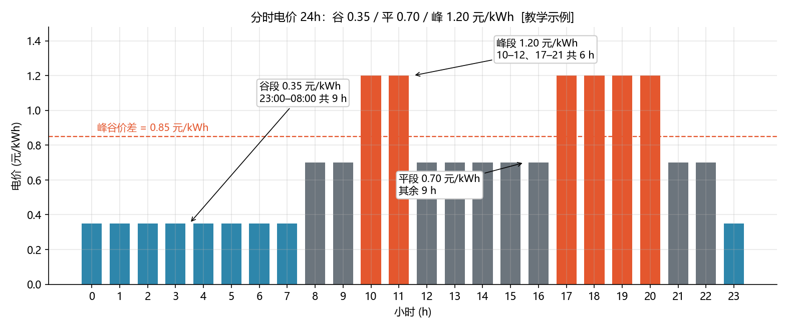
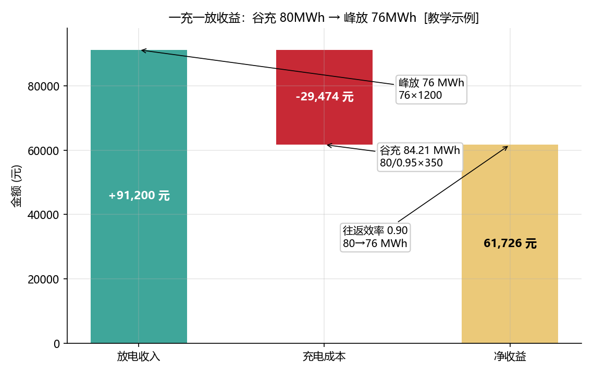

<!-- @AI_GENERATED -->
# 01 峰谷套利：谷充峰放，一天能赚多少

> [课程首页](README.md) · 上一章：[00 能量调度闭环链路](00_能量调度闭环链路.md) · 下一章：[02 需量管理](02_需量管理.md)

**一句话**：峰谷套利是储能最直接的商业模式——谷段低价充电、峰段高价放电赚价差；但真正决定盈亏的不是价差，而是被**往返效率**吃掉的那部分能量。

## 本章目标

读完本章，你应能：

1. 读懂分时电价表，识别峰/平/谷时段与峰谷价差；
2. 手算一充一放的收益，正确区分"电池侧能量"与"并网侧能量"；
3. 理解往返效率对套利的双重侵蚀（充进要损耗、放出还要损耗）；
4. 判断一个电价结构下套利是否划算（盈亏平衡价差）。

## 本章边界与假设

本章只做"谷充峰放"的单次套利，充/放功率不随时间变化，SOC 在 10%~90% 内满幅使用（可用 80 MWh）。不涉及需量、光伏、多次循环（分别在第 02、03、05 章）。**前置**：第 00 章。所有电价以当地分时电价政策为准。

---

## 01.1 现场场景【必懂】

我们这座 50MW/100MWh 储能电站接入某省分时电价：谷段 0.35 元/kWh、平段 0.70 元/kWh、峰段 1.20 元/kWh（见 [附录B B.4](附录B_符号规范.md)）。

值班员小张在 EMS 上看了一晚上，问了一个最朴素的问题："我凌晨 3 点充上 80 MWh，上午 11 点放掉，到底赚了多少钱？"

这个问题看似简单，但隐藏了两个容易算错的地方。先说清一个基准：这里的 **80 MWh 是"电池侧"能量**（SOC 从 10% 充到 90% 的跨度，见第 00 章主线场景），充放电两侧的效率损耗都发生在"电池 ↔ 电网"之间：

1. **充进去的电不是全部存得下**：充电效率 0.95，要往电池存进 80 MWh，必须从电网多吸收 80/0.95 ≈ **84.21 MWh**。
2. **存下来的电也不是全部放得出**：放电效率 0.95，电池放出 80 MWh，并网只有 80×0.95 = **76 MWh**。

如果你直接拿"价差 × 80 MWh"算，会高估收益——因为并网侧真正卖出的是 76 MWh，而买电成本却要按 84.21 MWh 算。这就是本章要纠正的核心直觉。

---

## 01.2 分时电价与套利结构【必懂】

### 分时电价表

本课程统一使用以下电价结构（与 `lab/ems_lab/tariff.py` 的 `PRICES` 完全一致）：

| 时段 | 时间 | 电价（元/kWh） | 小时数 |
|---|---|---|---|
| 谷 | 23:00–08:00 | 0.35 | 9 |
| 平 | 08:00–10:00、12:00–17:00、21:00–23:00 | 0.70 | 9 |
| 峰 | 10:00–12:00、17:00–21:00 | 1.20 | 6 |

峰谷价差 = 1.20 − 0.35 = **0.85 元/kWh**。

### 配图：分时电价 24h



| 编号 | 位置 | 标注 | 对应正文 |
|---|---|---|---|
| ① | 谷段 | 0.35 元/kWh，23:00–08:00 共 9 h | §01.2 分时电价表 |
| ② | 峰段 | 1.20 元/kWh，10–12、17–21 共 6 h | §01.2 |
| ③ | 平段 | 0.70 元/kWh，其余 9 h | §01.2 |
| ④ | 虚线 | 峰谷价差 0.85 元/kWh | §01.2 |

---

## 01.3 一充一放的收益手算【必懂】

### 为什么需要

套利收益 = 放电收入 − 充电成本。但"充"和"放"发生在电池侧与并网侧之间，中间隔着两层效率，必须逐层换算，不能直接拿价差乘能量。

### 能量流三步换算

用主线场景：谷段给电池充入 80 MWh（电池侧），峰段全部放出。

```text
第 1 步（充电）：电池存入 E_store = 80 MWh
    从电网吸收 E_grid = E_store / η_chg = 80 / 0.95 = 84.21 MWh

第 2 步（放电）：电池放出 80 MWh
    并网输出 E_out = 80 × η_dis = 80 × 0.95 = 76.00 MWh

第 3 步（收益）：
    充电成本 = E_grid × 0.35 = 84.21 × 350 元/MWh = 29473.68 元
    放电收入 = E_out × 1.20  = 76.00 × 1200 元/MWh = 91200.00 元
    净收益   = 91200.00 − 29473.68 = 61726.32 元
```

> 单位换算提醒：正文电价用"元/kWh"便于心算（0.35），代码 `schedule.py` 用"元/MWh"（350）。1 元/kWh = 1000 元/MWh，两者数值一致，只是量纲不同。

### 概念实现（三层代码体系 · 第一层）

```python
ETA_CHG = 0.95
ETA_DIS = 0.95

def stored_from_grid(e_grid: float) -> float:   # 充电：电网 → 电池
    return e_grid * ETA_CHG

def out_from_stored(e_store: float) -> float:   # 放电：电池 → 并网
    return e_store * ETA_DIS

e_store = 80.0                                   # 电池侧充入 80 MWh
e_grid  = e_store / ETA_CHG                      # 84.21 MWh（电网吸收）
e_out   = out_from_stored(e_store)               # 76.00 MWh（并网输出）

cost    = e_grid * 350.0                         # 29473.68 元
revenue = e_out * 1200.0                         # 91200.00 元
profit  = revenue - cost                         # 61726.32 元
```

### 配图：一充一放收益瀑布



| 编号 | 位置 | 标注 | 对应正文 |
|---|---|---|---|
| ① | 放电收入 | 峰放 76 MWh × 1200 = 91200 元 | §01.3 第 2、3 步 |
| ② | 充电成本 | 谷充 84.21 MWh × 350 = 29474 元 | §01.3 第 1、3 步 |
| ③ | 净收益 | 61726 元，往返效率 0.90 使 80→76 MWh | §01.3 第 3 步 |

---

## 01.4 往返效率为什么是"双倍侵蚀"【必懂】

### 为什么需要

很多人以为"效率 90% 只损失 10% 的钱"，其实往返效率对**收益**的侵蚀远大于 10%，因为它同时作用在充电量和放电量两侧。

### 效率对收益的放大效应

```text
往返效率 η_rt = η_chg × η_dis = 0.95 × 0.95 = 0.9025 ≈ 0.90

名义套利价差：0.85 元/kWh
实际每充入 1 kWh 电网电量，最终并网输出 = 1 × η_rt = 0.9025 kWh

单 kWh 实际收益 = 0.9025 × 1.20 − 1 × 0.35
                = 1.083 − 0.35 = 0.733 元/kWh
```

换句话说：名义价差 0.85 元/kWh，扣除效率损耗后，实际每 kWh 只能赚约 0.73 元，**效率吃掉了约 14% 的毛利**。

### 盈亏平衡价差

令"充电 1 kWh 的成本"等于"放电 1 kWh 的收入"，可解出**最小可套利价差**：

```text
谷价 / η_rt ≤ 峰价
0.35 / 0.9025 ≈ 0.388 元/kWh
```

即当峰价高于 0.388 元/kWh 时套利才有正收益。当前峰价 1.20 元/kWh，远高于平衡点，套利空间充足。

> **软件类比**：往返效率像数据库写放大——你以为只写了一份数据，实际 WAL、索引、压缩都额外消耗了 IO。写放大让"名义吞吐"和"实际吞吐"差一个数量级，往返效率让"名义价差"和"实际毛利"差一个系数。
> **类比失效点**：写放大可以用缓存/批量写缓解，往返效率是电池电化学决定的硬约束，软件无法绕开——你只能**减少无效循环**（别在价差不足时充放），不能改变单次循环的效率。

---

## 01.5 一充一放 vs 两充两放【了解】

峰谷套利一天可以只做一次（谷充峰放），也可以做两次（谷充峰放 + 平充峰放）。两充两放的收益在第 05 章 [日前优化排程](05_日前优化排程.md) 详细展开，这里先给结论：

| 模式 | 充能来源 | 单段收益 | 日收益 |
|---|---|---|---|
| 一充一放 | 谷充（0.35）→ 峰放（1.20） | 61726 元 | 61726 元 |
| 两充两放 | 谷充→峰放；平充（0.70）→峰放 | 61726 + 32253 元 | 93979 元 |

第二段（平充峰放）价差只有 0.50 元/kWh，收益明显低于第一段（0.85 元/kWh），但"平充"用掉的是平段电量、不影响谷段，所以在电价结构允许时叠加第二段仍有价值。代价是**每天多消耗一次循环寿命**——第 09 章会把循环寿命成本算进净收益。

---

## 自测

1. 谷充 80 MWh（电池侧）、峰放 76 MWh（并网侧），往返效率 0.90，峰谷价差 0.85 元/kWh，单日收益是多少？
2. 为什么"效率 90% 只损失 10%"是错误直觉？请给出本场景下效率吃掉的毛利比例。
3. 若谷价 0.40 元/kWh、峰价 1.10 元/kWh、往返效率 0.90，这套利还划算吗？

<details>
<summary>参考答案</summary>

1. 充电成本 = 80/0.95 × 350 = 29473.68 元；放电收入 = 76 × 1200 = 91200 元；收益 = 61726.32 元。注意充电成本必须用"电网吸收侧" 84.21 MWh 计算，不能直接用 80。
2. 因为效率同时作用在充电（80→存入）和放电（存→并网）两侧：往返效率 0.90 意味着每从电网取 1 kWh，最终并网只输出 0.90 kWh。名义价差 0.85 元/kWh，实际收益 0.9025×1.20−0.35 = 0.733 元/kWh，效率吃掉了约 (0.85−0.733)/0.85 ≈ 14% 的毛利。
3. 盈亏平衡峰价 = 0.40/0.90 ≈ 0.444 元/kWh，实际峰价 1.10 > 0.444，仍划算。单 kWh 实际收益 = 0.90×1.10 − 0.40 = 0.59 元/kWh。
</details>

---

## 🧪 动手验证

分时电价查询与一充一放收益已实现为可运行代码（参数与正文主线一致）：

```bash
cd lab/
python examples/ch01_arbitrage.py
```

**关键输出**（与正文 §01.3 手算对照）：
- `price_at(10)` → `1.2`，`period_at(10)` → `peak`
- `one_cycle(80.0)["profit"]` → `61726.315...` 元

> 逐字段对照 §01.3 手算：`e_grid`=84.21、`e_out`=76.00、`cost`=29473.68、`revenue`=91200.00、`profit`=61726.32。

> 🧭 **下一站**：套利赚的是"价差"，但工商业用户还有一笔更隐蔽的电费——**需量电费**。储能不只是靠卖电赚钱，还能帮你削掉负荷尖峰、省下按最大需量收的那笔钱。下一章 [02 需量管理](02_需量管理.md)。

<!-- @AI_GENERATED: end -->