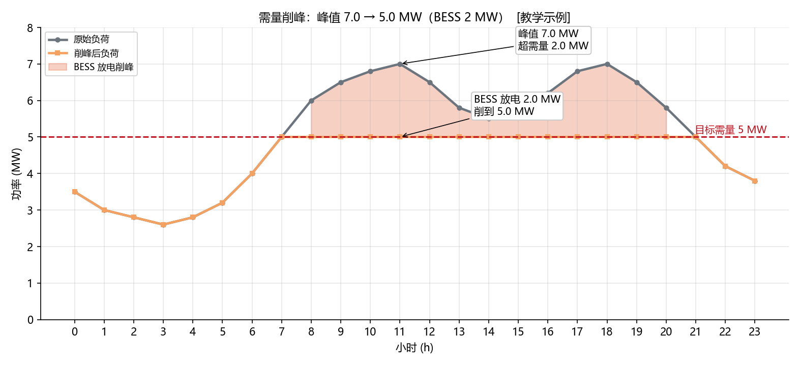

<!-- @AI_GENERATED -->
# 02 需量管理：储能削峰省下的那笔"看不见的电费"

> [课程首页](README.md) · 上一章：[01 峰谷套利](01_峰谷套利.md) · 下一章：[03 光储协同](03_光储协同.md)

**一句话**：工商业用户的电费里有笔"按最大需量收费"的钱——储能不用卖一度电，只要在负荷尖峰时放电削掉那几分钟的峰值，就能省下整月按需量计算的费用。

## 本章目标

读完本章，你应能：

1. 说清"需量"与"电量"的区别，以及需量电费的计费口径；
2. 手算储能削峰前后的最大需量与电费节省；
3. 理解削峰功率与储能额定功率、需量目标之间的约束关系；
4. 识别"削峰失败"（BESS 功率不够或电量耗尽）的边界条件。

## 本章边界与假设

本章聚焦"最大需量 + 储能削峰"的单目标优化，暂不叠加分时套利（二者在第 08 章 [辅助服务叠加](08_辅助服务叠加.md) 一起讨论）。**前置**：第 00、01 章。需量计费口径以当地供电营业规则为准。

---

## 02.1 现场场景【必懂】

我们电站隔壁是一座机械加工厂，配变容量 8 MVA，月用电量约 300 万 kWh。工厂拿到电费单发现：**电量电费**（按 kWh 算）和**需量电费**（按 kW 算）几乎一样多。

厂长不解："我们用电不算多，为什么还有这么一大笔'基本电费'？"

供电公司解释：需量电费按**本计费周期内的最大 15 分钟平均功率**（最大需量）收取，单价 40 元/kW·月。工厂车间每天上午 11 点有几台大电机同时启动，负荷冲到 7 MW，虽然只持续十几分钟，但整月的需量电费就按 7 MW 计——哪怕其他时间负荷只有 3 MW。

**问题清单**：本章回答：
- 需量电费到底怎么算？为什么一个 15 分钟的尖峰能决定整月的费用？
- 储能怎么削这个尖峰？削峰需要多少功率、多少电量？
- 削峰省下的钱，值不值得为此牺牲储能的部分套利容量？

---

## 02.2 需量的定义与电费计算【必懂】

### 需量 vs 电量

| 概念 | 单位 | 含义 | 计费方式 |
|---|---|---|---|
| 电量 | kWh | 一段时间累计消耗的能量 | 按 kWh 单价乘 |
| 需量 | kW（或 MW） | 计费周期内的**最大平均功率**（通常 15 min 滑动平均） | 按峰值 kW 乘单价 |

关键区别：**电量关心"一共用了多少"，需量关心"某一瞬间用得有多猛"**。一个只持续 15 分钟的 7 MW 尖峰，电量贡献很小，但需量贡献是决定性的。

### 需量电费公式

```text
需量电费（元/月） = 最大需量（MW）× 1000 × 需量单价（元/kW·月）
```

### 手算：工厂的需量电费

```text
最大需量 = 7.0 MW
需量单价 = 40 元/kW·月

需量电费 = 7.0 × 1000 × 40 = 280000 元/月
```

### 概念实现（三层代码体系 · 第一层）

```python
def peak_demand(load_mw: list) -> float:
    return max(load_mw)                        # 15min 均值序列的最大值

def demand_charge(peak_mw: float, price_per_kw_month: float = 40.0) -> float:
    return peak_mw * 1000.0 * price_per_kw_month

load = [3.0, 5.0, 7.0, 6.0]                    # 15min 平均功率（MW）
peak = peak_demand(load)                        # 7.0 MW
fee  = demand_charge(peak, 40.0)                # 280000 元/月
```

---

## 02.3 储能削峰：把尖峰"切"到目标值【必懂】

### 为什么需要

既然需量按峰值收费，那只要在尖峰时刻用储能**放电补一部分负荷**，让"电网看到的功率"不超过某个目标值，就能压低最大需量、省下整月的需量电费。

### 削峰功率的计算

储能放电功率应正好补上"负荷超出目标需量"的部分，但受储能额定功率上限约束：

```text
BESS 放电功率 = min(P_bess_max, max(0, load − target_demand))
```

`[教学示例]`：目标需量 5 MW，BESS 放电上限 2 MW。

| 时点 | 负荷（MW） | 超出目标部分 | BESS 放电（MW） | 削峰后（MW） |
|---|---:|---:|---:|---:|
| t0 | 3.0 | −2.0（未超） | 0.0 | 3.0 |
| t1 | 5.0 | 0.0 | 0.0 | 5.0 |
| t2 | 7.0 | 2.0 | 2.0 | **5.0** |
| t3 | 6.0 | 1.0 | 1.0 | **5.0** |

削峰后最大需量 = 5.0 MW（原 7.0 MW）。

### 电费节省

```text
削峰前需量电费 = 7.0 × 1000 × 40 = 280000 元/月
削峰后需量电费 = 5.0 × 1000 × 40 = 200000 元/月
月节省 = 80000 元/月
```

储能只是每天尖峰时放几十分钟电（电量很少），就省下整月 8 万元的需量电费——这就是"看不见的电费"的杠杆效应。

### 概念实现（三层代码体系 · 第一层）

```python
def shave(load_mw: list, p_bess_max: float, target_demand: float) -> list:
    out = []
    for load in load_mw:
        excess = load - target_demand
        out.append(min(p_bess_max, max(0.0, excess)))
    return out

def shaved_peak(load_mw: list, bess_discharge: list) -> float:
    return max(max(0.0, l - b) for l, b in zip(load_mw, bess_discharge))

load = [3.0, 5.0, 7.0, 6.0]
bess = shave(load, 2.0, 5.0)         # [0.0, 0.0, 2.0, 1.0]
new_peak = shaved_peak(load, bess)   # 5.0 MW
```

### 配图：需量削峰



| 编号 | 位置 | 标注 | 对应正文 |
|---|---|---|---|
| ① | 峰值点 | 负荷 7.0 MW 超出目标需量 2.0 MW | §02.3 手算表 t2 |
| ② | 填色区 | BESS 放电 2.0 MW，把尖峰削到 5.0 MW | §02.3 削峰功率 |
| ③ | 虚线 | 目标需量线 5.0 MW | §02.3 电费节省 |

---

## 02.4 削峰的边界条件【必懂】

### 为什么需要

削峰不是"想削多少削多少"，受两个硬约束卡住：

1. **功率约束**：BESS 放电功率有上限 P_bess_max。如果尖峰超出目标需量的部分 > P_bess_max，削不到位。
2. **能量约束**：削峰要持续放电，SOC 会下降。如果尖峰持续太久，可用能量耗尽，后面削不动。

### 功率不足的后果

```text
尖峰负荷 = 9.0 MW，目标需量 = 5.0 MW，需削 4.0 MW
但 BESS 放电上限 = 2.0 MW

实际削后 = 9.0 − 2.0 = 7.0 MW（仍超出目标 2.0 MW）
```

此时最大需量只能压到 7.0 MW，省不到目标值。**结论**：削峰功率需求决定了 BESS 的额定功率下限——你想削多少，BESS 至少得有多大。

### 能量不足的后果

削峰放电的能量 = 削峰功率 × 持续时间。`[教学示例]` 尖峰持续 2 小时、削峰功率 2 MW，则需放出 4 MWh。若当前可用能量（SOC 余量）不足 4 MWh，削到一半就没电了。

```text
可用能量 = (SOC − SOC_min) × E_nom = (0.15 − 0.10) × 100 = 5 MWh
削峰需 4 MWh < 5 MWh → 够用
但若 SOC 只剩 0.12，可用 = 2 MWh < 4 MWh → 不够，削峰提前终止
```

> **软件类比**：需量削峰像 CDN 的"峰值带宽削峰"——用边缘缓存把回源带宽的瞬时尖峰抹平，从而把带宽费用从"按峰值计费"降到更低档。缓存容量（能量）和缓存带宽（功率）就是你的两个硬约束。
> **类比失效点**：CDN 缓存不够最多是回源多跑一点流量（多花钱）；储能能量不够会直接导致削峰中断、最大需量反弹，整月电费白省一场。

---

## 自测

1. 某用户负荷序列（15min 均值）为 [4, 6, 8, 5] MW，目标需量 6 MW，BESS 放电上限 2 MW。削峰后的最大需量是多少？
2. 为什么"一个 15 分钟的尖峰"能决定整月需量电费？
3. 尖峰负荷 10 MW、目标需量 6 MW，但 BESS 额定功率只有 3 MW——削峰结果如何？要完整削到目标需量，BESS 至少需要多大功率？

<details>
<summary>参考答案</summary>

1. shave 后放电 = [0, 0, 2, 0] MW（t2 超出 2 MW 全部削掉），削峰后 = [4, 6, 6, 5]，最大需量 = 6 MW。注意 t1 的 6.0 恰好等于目标，不触发放电。
2. 因为需量电费按"计费周期内最大 15min 平均功率"一次性计费，峰值 7 MW 和 3 MW 的唯一区别就是那个尖峰，但整月都按 7 MW 收 280000 元。尖峰的电量贡献虽小，需量贡献却是决定性的。
3. 需削 4 MW 但只有 3 MW 功率，削后 = 10−3 = 7 MW（仍超目标 1 MW）。要完整削到 6 MW，BESS 额定功率至少 4 MW。
</details>

---

## 🧪 动手验证

需量削峰已实现为可运行代码（参数与正文主线一致）：

```bash
cd lab/
python examples/ch02_demand.py
```

**关键输出**（与正文 §02.2/02.3 手算对照）：
- `peak_demand(load)` → `7.0`，`demand_charge(7.0, 40.0)` → `280000.0`
- `shave(load, 2.0, 5.0)` → `[0.0, 0.0, 2.0, 1.0]`，`shaved_peak(...)` → `5.0`

> 🧭 **下一站**：套利和需量管的都是"电价/电费"，但储能还有第三个价值——**服务新能源**。光伏电站出力忽高忽低，怎么用储能把这条"锯齿曲线"抹平成一条能申报的平滑计划？下一章 [03 光储协同](03_光储协同.md)。

<!-- @AI_GENERATED: end -->