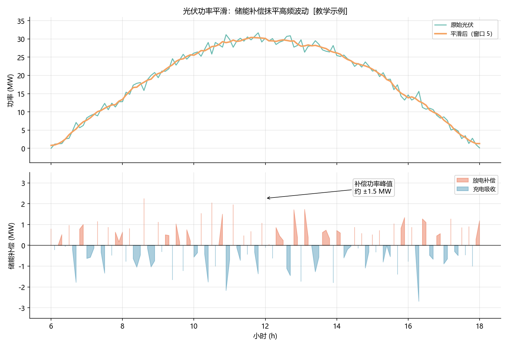

<!-- @AI_GENERATED -->
# 03 光储协同：用储能把"锯齿曲线"抹平

> [课程首页](README.md) · 上一章：[02 需量管理](02_需量管理.md) · 下一章：[04 可行调度域](04_可行调度域.md)

**一句话**：光伏出力随云层忽高忽低，直接并网会带来考核罚款——储能的作用是在"高频波动"上做补偿，把原始出力抹成一条可申报的平滑计划曲线。

## 本章目标

读完本章，你应能：

1. 用半正弦函数建模"晴天的理想光伏曲线"；
2. 手算滑动平均平滑后的曲线与储能补偿功率；
3. 区分"平滑补偿"与"套利充放"在功率方向上的不同目的；
4. 用跟踪误差衡量"计划 vs 实际"的偏离。

## 本章边界与假设

本章聚焦"功率平滑"这一种光储协同价值，不涉及弃光、超配、限功率等政策问题。**前置**：第 00、01 章。光伏曲线为理想化简化模型（半正弦 + 噪声），真实曲线受辐照度、温度、云层影响更复杂。

---

## 03.1 现场场景【必懂】

我们电站西侧并了一座 30 MW 光伏电站。某个多云天，EMS 屏幕上光伏出力曲线像"锯齿"一样在 5 MW 到 28 MW 之间快速抖动——一片云飘过来，出力几秒内就掉十几 MW。

调度值班员打来电话："你们申报的计划是 20 MW，现在实际 8 MW，偏差 12 MW，按考核规则要罚款。给你们 15 分钟，把出力稳回计划值。"

光伏自己稳不了（它由天决定），能稳的只有储能。**本章要解决的问题**：储能怎么算出一个"补偿功率"，把光伏的锯齿抹平？

> **核心直觉**：平滑的本质是"储能吃掉高频分量"。原始出力 = 平滑计划 + 储能补偿，二者之和恒等于原始出力——储能补偿就是"原始减去平滑"的差值。

---

## 03.2 光伏曲线建模【必懂】

### 半正弦模型

晴天的理想光伏出力近似一个"半正弦"：6:00 日出从 0 爬升，12:00 达到峰值，18:00 日落归 0。

```text
P_pv(t) = P_peak × sin( π × (t − 6) / 12 )，  6 ≤ t ≤ 18
P_pv(t) = 0，                                其他时刻
```

### 手算三个关键时刻

```text
t = 6：sin(0) = 0        → 0 MW（日出）
t = 12：sin(π/2) = 1     → 30 MW（正午峰值）
t = 20：超出 6~18 范围   → 0 MW（夜晚）
```

### 概念实现（三层代码体系 · 第一层）

```python
import math

def pv_curve(t_hour: float, peak_mw: float = 30.0) -> float:
    if 6.0 <= t_hour <= 18.0:
        return peak_mw * math.sin(math.pi * (t_hour - 6.0) / 12.0)
    return 0.0

pv_curve(6.0)   # 0.0
pv_curve(12.0)  # 30.0
pv_curve(20.0)  # 0.0
```

> **为什么是半正弦而不是三角波**：太阳高度角在日出日落时段变化快、正午变化慢，正弦函数的第一段导数从大到小，恰好近似这一物理规律。三角波是直线，无法体现"正午爬升变缓"。

---

## 03.3 功率平滑与储能补偿【必懂】

### 为什么需要

光伏的高频抖动（云层）叠加在低频理想曲线上。储能想要抹平的只是**高频抖动**，而不是把理想曲线也抹掉。滑动平均恰好是一个"低通滤波器"：窗口越宽，保留的频率越低，曲线越平。

### 滑动平均与储能补偿

```text
平滑曲线 smooth[i] = 窗口内原始出力的平均值
储能补偿 bess[i] = smooth[i] − pv[i]
  · bess > 0：平滑后高于原始 → 储能放电补上
  · bess < 0：平滑后低于原始 → 储能充电吸收
```

### 手算：五拍序列，窗口 3

用简化序列 `[1, 2, 3, 4, 5]`（单位任意，理解为功率 MW 即可），窗口 3：

| 位置 i | 窗口范围 | 平滑值 smooth | 储能补偿 = smooth − 原始 |
|---:|---|---:|---:|
| 0 | [1, 2] | (1+2)/2 = 1.5 | 1.5 − 1 = **+0.5** |
| 1 | [1, 2, 3] | (1+2+3)/3 = 2.0 | 2.0 − 2 = **0.0** |
| 2 | [2, 3, 4] | (2+3+4)/3 = 3.0 | 3.0 − 3 = **0.0** |
| 3 | [3, 4, 5] | (3+4+5)/3 = 4.0 | 4.0 − 4 = **0.0** |
| 4 | [4, 5] | (4+5)/2 = 4.5 | 4.5 − 5 = **−0.5** |

> 边界处窗口只有 2 个元素（没有越界数据），所以 i=0、i=4 的平滑值取的是 2 个数的平均，而非 3 个。这就是 `moving_average` 里 `lo = max(0, i−half)`、`hi = min(n, i+half+1)` 的作用。

**观察**：中间三个点（i=1,2,3）恰好落在趋势线上，补偿为 0；只有两端的"拐点"（i=0 向上凸、i=4 向下凹）需要储能补偿。**平滑只对"偏离趋势"的点做功，这正是低通滤波的意义**。

### 概念实现（三层代码体系 · 第一层）

```python
def moving_average(series, window):
    out, half, n = [], window // 2, len(series)
    for i in range(n):
        lo, hi = max(0, i - half), min(n, i + half + 1)
        out.append(sum(series[lo:hi]) / (hi - lo))
    return out

def bess_for_smoothing(pv_series, window):
    smooth = moving_average(pv_series, window)
    return [s - p for s, p in zip(smooth, pv_series)]

bess_for_smoothing([1, 2, 3, 4, 5], 3)  # [0.5, 0.0, 0.0, 0.0, -0.5]
```

### 配图：光伏功率平滑



| 编号 | 位置 | 标注 | 对应正文 |
|---|---|---|---|
| ① | 上图 | 原始光伏（含噪声）在半正弦理想曲线上抖动 | §03.2 半正弦模型 |
| ② | 上图 | 平滑后曲线（窗口 5）抹掉高频抖动 | §03.3 滑动平均 |
| ③ | 下图 | 储能补偿峰值约 ±1.5 MW（噪声幅度） | §03.3 储能补偿 |
| ④ | 下图 | 补偿功率正负交替：放电补、充电吸 | §03.3 bess 符号约定 |

---

## 03.4 计划跟踪误差【必懂】

### 为什么需要

平滑曲线要作为"申报计划"上送调度，实际出力与计划的偏差就是**跟踪误差**，这是考核罚款的直接来源。跟踪误差 = 实际 − 计划。

```python
def track_error(planned, actual):
    return [a - p for a, p in zip(actual, planned)]
```

### 手算

```text
计划 [100, 100]，实际 [98, 103]
track_error = [98−100, 103−100] = [−2.0, +3.0]
```

- −2.0：实际比计划少 2 MW（欠发，储能应放电补上）
- +3.0：实际比计划多 3 MW（超发，储能应充电吸收）

> **方向约定再确认**：跟踪误差用"实际 − 计划"，与储能补偿用"平滑 − 原始"是**两个不同的问题**。前者衡量"计划履行情况"，后者是"补偿功率指令"。二者符号方向恰好相反时不要混淆——跟踪误差是**结果度量**，储能补偿是**控制手段**。

> **软件类比**：功率平滑像视频流的"缓冲/降采样"——把抖动的高频帧率平滑成稳定的输出。滑动平均就是那个"低通滤波器"。
> **类比失效点**：视频缓冲只会"滞后"，不会产生能量成本；储能的每次补偿充放都消耗循环寿命，且补偿能量有限（SOC 到底了就没法再吸/放）。

---

## 自测

1. `pv_curve(9)` 是多少？（峰值 30 MW，半正弦从 6:00 到 18:00）
2. `moving_average([1, 2, 3, 4, 5], 3)` 的结果是什么？为什么首尾两个值是"2 个数的平均"？
3. 储能补偿功率为负（−0.5）意味着什么物理动作？
4. 计划 100 MW、实际 103 MW，跟踪误差是多少？储能该充电还是放电？

<details>
<summary>参考答案</summary>

1. `30 × sin(π × (9−6)/12) = 30 × sin(π/4) = 30 × 0.7071 ≈ 21.21 MW`。
2. `[1.5, 2.0, 3.0, 4.0, 4.5]`。首尾 i=0、i=4 的窗口越界，只剩 [1,2] 和 [4,5] 两个元素，所以除以 2；中间三个位置窗口完整（3 个元素），除以 3。
3. 负补偿 = 平滑后低于原始出力，说明原始出力偏高，储能需要**充电吸收**多余功率。
4. 跟踪误差 = 103 − 100 = +3 MW，实际超发，储能应**充电吸收** 3 MW 把并网出力拉回计划。
</details>

---

## 🧪 动手验证

光伏曲线与平滑补偿已实现为可运行代码（参数与正文主线一致）：

```bash
cd lab/
python examples/ch03_smoothing.py
```

**关键输出**（与正文 §03.2/03.3/03.4 手算对照）：
- `pv_curve(9)` → `21.213...`，`pv_curve(12)` → `30.0`
- `moving_average([1,2,3,4,5],3)` → `[1.5, 2.0, 3.0, 4.0, 4.5]`
- `bess_for_smoothing([1,2,3,4,5],3)` → `[0.5, 0.0, 0.0, 0.0, -0.5]`
- `track_error([100,100],[98,103])` → `[-2.0, 3.0]`

> 🧭 **下一站**：前三章讲的都是"收益来源"——套利、需量、平滑，各有各的算钱方式。但它们都有一个共同前提：**储能得"放得出、充得进"**。SOC 一旦触底，什么计划都白搭。下一章 [04 可行调度域](04_可行调度域.md) 把"能干什么"的边界严格定义出来。

<!-- @AI_GENERATED: end -->