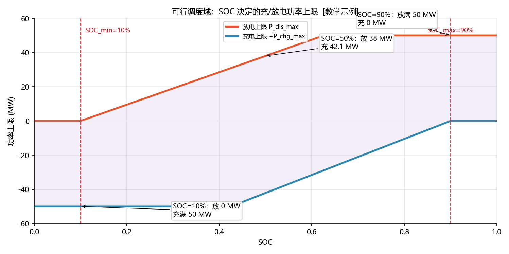

<!-- @AI_GENERATED -->
# 04 可行调度域：储能"能干什么"的严格边界

> [课程首页](README.md) · 上一章：[03 光储协同](03_光储协同.md) · 下一章：[05 日前优化排程](05_日前优化排程.md)

**一句话**：所有排程算法的前提，是先算清储能此刻"最多能放多少、最多能充多少"——这个由 SOC 和额定功率共同决定的区间，就是**可行调度域**。

## 本章目标

读完本章，你应能：

1. 由当前 SOC 手算"可放能量"与"可充能量"；
2. 把能量约束换算成"本时段的功率上限"，并与额定功率取较小值；
3. 用单步 SOC 递推公式验证充/放电一个时段后的新 SOC；
4. 理解为什么可行域会随 SOC 变化——它是**动态**的。

## 本章边界与假设

本章只定义"物理可行边界"，不做优化（不回答"该放多少最赚钱"）。**前置**：第 00、01 章。约定沿用 [附录B](附录B_符号规范.md)：放电为正、SOC 0~1、能量 MWh、功率 MW、充放效率 0.95。

---

## 04.1 现场场景【必懂】

前面几章算收益时，都默认储能"想充 80 MWh 就充、想放 80 MWh 就放"。但实际调度中，EMS 每分钟都要面对一个现实问题：

"现在 SOC 是 23%，下一个小时，我最多能放多少功率？如果放多了，SOC 会不会跌破 10% 的下限？"

这就是**可行调度域**要回答的问题。它是一切优化算法的**输入约束**：排程算法（第 05 章）只能在这个域内找最优解，绝不能排出一个 SOC 放不出来的"越限计划"。

---

## 04.2 可用能量：SOC 决定的两侧余量【必懂】

### 可放能量与可充能量

```text
可放能量 E_dis = (SOC − SOC_min) × E_nom     # 还能放出多少
可充能量 E_chg = (SOC_max − SOC) × E_nom     # 还能充进多少
```

两个值都是**非负幅值**（方向由上下文表达，见附录B）。

### 手算三个关键 SOC

E_nom = 100 MWh，SOC_min = 10%，SOC_max = 90%。

| SOC | 可放能量 E_dis | 可充能量 E_chg | 解读 |
|---|---:|---:|---|
| 90% | (0.90−0.10)×100 = **80** | (0.90−0.90)×100 = **0** | 满电：只能放，充不进了 |
| 50% | (0.50−0.10)×100 = **40** | (0.90−0.50)×100 = **40** | 中间：两侧各 40 |
| 10% | (0.10−0.10)×100 = **0** | (0.90−0.10)×100 = **80** | 空电：只能充，放不出了 |

### 概念实现（三层代码体系 · 第一层）

```python
def available_energy(soc, e_nom=100.0, soc_min=0.10, soc_max=0.90):
    e_discharge = (soc - soc_min) * e_nom
    e_charge    = (soc_max - soc) * e_nom
    return e_discharge, e_charge

available_energy(0.90)  # (80.0, 0.0)
available_energy(0.50)  # (40.0, 40.0)
available_energy(0.10)  # (0.0, 80.0)
```

---

## 04.3 可行功率：能量换算到"本时段功率上限"【必懂】

### 为什么需要

可用能量是"总量"，但调度指令给的是"功率"（MW）。要把能量换算成"本时段（dt 小时）能持续多久的功率"，还要除以时长、并除以效率（放电损耗使并网功率打折扣，充电损耗使吸收更多电网功率）。

```text
放电功率上限 P_dis_max = min( P_nom,   E_dis × η_dis / dt )
充电功率上限 P_chg_max = min( P_nom,   E_chg / η_chg / dt )
```

外层 `min(P_nom, ...)` 表示：即使 SOC 很充足，功率也不能超过额定功率 50 MW。

### 手算：SOC=50%，dt=1h

```text
E_dis = 40 MWh → 放电上限 = min(50, 40×0.95/1) = min(50, 38.0)  = 38.0 MW
E_chg = 40 MWh → 充电上限 = min(50, 40/0.95/1) = min(50, 42.105) = 42.105 MW
```

**关键观察**：SOC=50% 时，放电上限（38 MW）与充电上限（42.1 MW）都**低于**额定功率 50 MW——因为 40 MWh 能量撑不起"满功率 1 小时"（放满 50 MW×1h 需要 50/0.95≈52.6 MWh 可放能量，但只有 40 MWh）。**能量约束在 SOC 中间段就会先于功率约束生效**。

### 三个 SOC 的完整可行域

| SOC | P_dis_max | P_chg_max | 约束生效者 |
|---|---:|---:|---|
| 90% | min(50, 80×0.95) = **50** | min(50, 0) = **0** | 充电侧能量为 0 |
| 50% | min(50, 38.0) = **38** | min(50, 42.1) = **42.1** | 两侧能量都受限 |
| 10% | min(50, 0) = **0** | min(50, 80/0.95) = **50** | 放电侧能量为 0 |

### 概念实现（三层代码体系 · 第一层）

```python
def feasible_p(soc, dt_h, p_max=50.0, e_nom=100.0,
               soc_min=0.10, soc_max=0.90, eta_chg=0.95, eta_dis=0.95):
    e_discharge, e_charge = available_energy(soc, e_nom, soc_min, soc_max)
    p_dis_max = min(p_max, e_discharge * eta_dis / dt_h)
    p_chg_max = min(p_max, e_charge / eta_chg / dt_h)
    return p_dis_max, p_chg_max

feasible_p(0.90, 1.0)  # (50.0, 0.0)
feasible_p(0.50, 1.0)  # (38.0, 42.105...)
feasible_p(0.10, 1.0)  # (0.0, 50.0)
```

### 配图：可行调度域



| 编号 | 位置 | 标注 | 对应正文 |
|---|---|---|---|
| ① | SOC=50% | 放 38 MW、充 42.1 MW（能量受限） | §04.3 手算表 |
| ② | SOC=90% | 放满 50 MW、充 0 MW | §04.3 三个 SOC 表 |
| ③ | SOC=10% | 放 0 MW、充满 50 MW | §04.3 三个 SOC 表 |
| ④ | 两条虚线 | SOC 工作范围 10%~90% | §04.2 可放/可充能量 |

---

## 04.4 单步 SOC 递推【必懂】

### 为什么需要

可行域算出来的是"此刻能不能放"，但调度还要知道"放完之后 SOC 变多少"，才能预测下一个时段的可行域。SOC 递推就是连接"当前可行域 → 下一时刻可行域"的桥梁。

```text
放电（p > 0）：SOC_new = SOC − p × dt / η_dis / E_nom
充电（p < 0）：SOC_new = SOC + |p| × η_chg × dt / E_nom
```

### 手算

```text
充电：SOC=10%，p=−50 MW（充电 50 MW），dt=1h
  ΔSOC = 50 × 0.95 / 100 = +0.475
  SOC_new = 0.10 + 0.475 = 0.575

放电：SOC=90%，p=+50 MW（放电 50 MW），dt=1h
  ΔSOC = −50 / 0.95 / 100 = −0.5263
  SOC_new = 0.90 − 0.5263 = 0.3737
```

> **为什么放电 ΔSOC 比充电 ΔSOC 大**（0.5263 vs 0.475）：放电时并网输出 50 MW，但电池要放出的能量是 50/0.95 ≈ 52.6 MWh（因为放电损耗），所以 SOC 掉得更快；充电时电池只存进 50×0.95 = 47.5 MWh，SOC 涨得慢。**效率损耗让"放电更费电、充电更省电"**，方向相反但都源自同一对效率。

### 概念实现（三层代码体系 · 第一层）

```python
def step_soc(soc, p_mw, dt_h, e_nom=100.0, eta_chg=0.95, eta_dis=0.95):
    if p_mw >= 0:
        delta = -p_mw * dt_h / eta_dis / e_nom      # 放电
    else:
        delta = -p_mw * eta_chg * dt_h / e_nom       # 充电（p_mw<0）
    return min(1.0, max(0.0, soc + delta))

step_soc(0.10, -50.0, 1.0)  # 0.575
step_soc(0.90,  50.0, 1.0)  # 0.3737...
```

> **软件类比**：可行调度域像数据库的"配额/资源水位"——连接池能借多少连接、磁盘还能写多少，都是"当前水位决定上限"。SOC 就是储能的水位。
> **类比失效点**：数据库水位满了可以扩容或等待，储能 SOC 到底了就是**物理没电**，只能等外部充电，且每次深充深放都在消耗电池寿命——这个代价是软件资源池没有的。

---

## 自测

1. SOC=35%，E_nom=100 MWh，工作范围 10%~90%，可放能量和可充能量各是多少？
2. 接上题，dt=1h，η=0.95，放电上限和充电上限各是多少？（P_nom=50 MW）
3. 为什么 SOC=50% 时，放电上限只有 38 MW 而非 50 MW？
4. SOC=50%，放电 20 MW 持续 1 小时，新 SOC 是多少？

<details>
<summary>参考答案</summary>

1. 可放 = (0.35−0.10)×100 = 25 MWh；可充 = (0.90−0.35)×100 = 55 MWh。
2. 放电 = min(50, 25×0.95/1) = 23.75 MW；充电 = min(50, 55/0.95/1) ≈ 57.89 → 取 50 MW（额定功率上限生效）。
3. 因为 SOC=50% 时可用能量只有 40 MWh，放满 50 MW×1h 需 50/0.95≈52.6 MWh 可放能量，能量不够，所以被能量约束压到 40×0.95=38 MW。
4. ΔSOC = −20×1/0.95/100 = −0.2105，新 SOC = 0.50−0.2105 = 0.2895。
</details>

---

## 🧪 动手验证

可行调度域与 SOC 递推已实现为可运行代码（参数与正文主线一致）：

```bash
cd lab/
python examples/ch04_feasible.py
```

**关键输出**（与正文 §04.2/04.3/04.4 手算对照）：
- `available_energy(0.5)` → `(40.0, 40.0)`
- `feasible_p(0.5, 1.0)` → `(38.0, 42.105...)`
- `feasible_p(0.9, 1.0)` → `(50.0, 0.0)`，`feasible_p(0.1, 1.0)` → `(0.0, 50.0)`
- `step_soc(0.1, -50, 1)` → `0.575`，`step_soc(0.9, 50, 1)` → `0.3737...`

> 🧭 **下一站**：现在我们知道储能"能干什么"了，接下来要回答"怎么干最赚钱"——把电价、可行域、效率都塞进一个优化问题，自动排出明天的充放电计划。下一章 [05 日前优化排程](05_日前优化排程.md)。

<!-- @AI_GENERATED: end -->