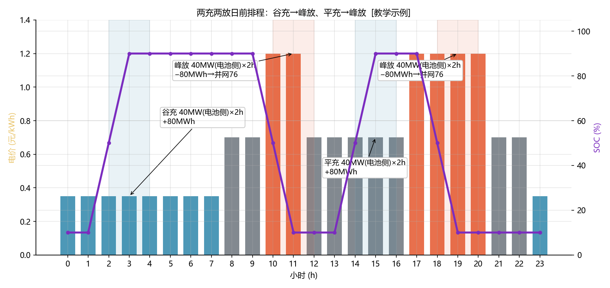

<!-- @AI_GENERATED -->
# 05 日前优化排程：把明天的充放电"排"出来

> [课程首页](README.md) · 上一章：[04 可行调度域](04_可行调度域.md) · 下一章：[06 日内滚动修正](06_日内滚动修正.md)

**一句话**：日前排程是在"电价 × 可行域"的约束下，决定未来 24 小时每一小时充还是放、充放多少，使得**总收益最大化**。

## 本章目标

读完本章，你应能：

1. 手算两充两放的收益，理解第二段（平充峰放）为何价值低于第一段；
2. 说明为什么分时电价下的套利问题"贪心即最优"；
3. 写出日前排程的线性规划（LP）形式（目标 + 约束）；
4. 理解 SOC 连续性与功率上下限如何进入约束。

## 本章边界与假设

本章用**确定性日前电价**（已知且不变）做排程，不考虑预测误差（第 06 章）和辅助服务容量占用（第 08 章）。**前置**：第 01、04 章。充/放功率在各自时段内恒定。

---

## 05.1 现场场景【必懂】

每天下午 17:00 前，交易员小刘要向上级提交一份**明日 24 小时充放电计划表**，报给调度做安全校核。他手里有三样东西：

1. 明日的分时电价表（谷 0.35 / 平 0.70 / 峰 1.20 元/kWh）；
2. 储能当前 SOC（今晚收工前约 10%）；
3. 可行调度域规则（SOC 10%~90%，P_nom 50 MW，往返效率 0.90）。

他要回答："明天几点充、充多少、几点放、放多少，才能赚最多？"

---

## 05.2 从一充一放到两充两放【必懂】

### 一充一放（第 01 章回顾）

谷段（0.35）充 80 MWh，峰段（1.20）放 76 MWh：

```text
收益 = 76×1200 − 80/0.95×350 = 91200 − 29474 = 61726 元
```

### 两充两放：为什么还能再赚一段

分时电价一天有**两个峰段**（10–12 和 17–21）和**两个低价段**（谷 0.35、平 0.70）。除了"谷充→峰放"，还可以做"平充→峰放"：

```text
第一段（谷充峰放）：价差 0.85 元/kWh → 61726 元
第二段（平充峰放）：价差 0.50 元/kWh → 32253 元
合计 ≈ 93979 元
```

第二段价差只有 0.50 元/kWh，收益自然低于第一段，但平段电价（0.70）仍显著低于峰段（1.20），且平段充电不影响谷段那段，所以在可行域允许时值得叠加。

### 两充两放收益手算

```text
第一段：
  充电成本 = 80/0.95 × 350 = 29473.68 元
  放电收入 = 76 × 1200       = 91200.00 元
  第一段收益 = 61726.32 元

第二段：
  充电成本 = 80/0.95 × 700 = 58947.37 元
  放电收入 = 76 × 1200       = 91200.00 元
  第二段收益 = 32252.63 元

合计 = 61726.32 + 32252.63 = 93978.95 ≈ 93979 元
```

> **注意**：两段都用满 80 MWh（可用能量）。这意味着一天要完成**两次完整循环**——电池循环寿命的消耗也是两倍，第 09 章会把循环成本计入净收益，届时"多赚一段"的真实价值会被重新评估。

### 概念实现（三层代码体系 · 第一层）

```python
def _calc(e_stored, buy_price, sell_price, eta_chg=0.95, eta_dis=0.95):
    e_grid  = e_stored / eta_chg
    e_out   = e_stored * eta_dis
    return dict(e_grid=e_grid, e_out=e_out,
                cost=e_grid*buy_price, revenue=e_out*sell_price,
                profit=e_out*sell_price - e_grid*buy_price)

def two_cycle(e_avail=80.0, p_valley=350.0, p_flat=700.0, p_peak=1200.0):
    first  = _calc(e_avail, p_valley, p_peak)
    second = _calc(e_avail, p_flat,  p_peak)
    return dict(first=first, second=second,
                profit=first["profit"] + second["profit"])

two_cycle(80.0)["profit"]   # 93978.95 元
```

### 配图：两充两放排程

> **功率假设（配图 SOC 轨迹）**：为画出一天的 SOC 轨迹，本章假设充/放电按**电池侧**功率 40 MW 恒定进行，2 h 完成一次满幅循环（电池侧 80 MWh，SOC 10%↔90%）。对应并网侧功率为：充电 40/0.95 ≈ 42.1 MW、放电 40×0.95 = 38 MW。收益结算仍按 §05.2 的 84.21 MWh（并网充）与 76 MWh（并网放）——"40 MW"是电池侧功率，"84.21 / 76 MWh"是并网侧能量，二者不矛盾。



| 编号 | 位置 | 标注 | 对应正文 |
|---|---|---|---|
| ① | 2–4 点 | 谷充 40MW(电池侧)×2h = +80MWh（SOC 10%→90%） | §05.2 第一段 |
| ② | 10–12 点 | 峰放 40MW(电池侧)×2h = −80MWh（并网输出 76MWh） | §05.2 第一段 |
| ③ | 14–16 点 | 平充 40MW(电池侧)×2h = +80MWh | §05.2 第二段 |
| ④ | 18–20 点 | 峰放 40MW(电池侧)×2h = −80MWh（并网输出 76MWh） | §05.2 第二段 |

---

## 05.3 贪心为什么就是全局最优【必懂】

### 为什么需要

直觉上"低价买、高价卖"就是套利，但为什么不用更复杂的算法？关键在于分时电价套利问题的结构——它满足**贪心选择的两个条件**：

1. **电价分段常数**：电价只分谷/平/峰三档，同一档内价格相同，不存在"在谷段内部还要挑哪个小时更便宜"的精细问题。
2. **可行域"满充满放"最优**：在往返效率固定、无循环成本时，把可用能量在最低价段**全部**充入、在最高价段**全部**放出，一定不劣于部分充放。

### 贪心策略

```text
步骤 1：找出全部可用的"充电时段"（价格低的时段，如谷、平）
步骤 2：找出全部可用的"放电时段"（价格高的时段，如峰）
步骤 3：按价差从大到小配对（谷→峰 价差 0.85 优先，平→峰 价差 0.50 次之）
步骤 4：每对配满可用能量，直到能量或时段用完
```

### 为什么不需要穷举

穷举 24 小时的充放电组合是指数级的（每时刻 3 种状态：充/放/停）。但上述贪心在**无循环成本、无爬坡约束、效率恒定**时被证明等价于全局最优——因为收益函数关于"充电量"和"放电量"是**线性**的，且各时段相互独立，最优解必然落在"最低价充满 + 最高价放满"这个角点解上。

> **软件类比**：这像背包问题里的"按单位价值排序贪心"——当物品可分割（能量可连续）时，贪心就是最优解，不必上动态规划。
> **类比失效点**：一旦加入**循环寿命成本**（每次充放都折旧）或**爬坡约束**（功率不能突变），收益函数不再线性、时段不再独立，贪心就退化为"近似解"，需要靠 LP/MILP 精确求解。

---

## 05.4 线性规划（LP）形式【必懂】

### 决策变量与目标

把 24 小时离散为 24 个时段，每个时段两个变量：

```text
P_dis[t] ≥ 0：t 时段放电功率（并网侧，MW）
P_chg[t] ≥ 0：t 时段充电功率（电网侧，MW）

目标：max  Σ_t ( P_dis[t]×价格[t] − P_chg[t]×价格[t] ) × dt
```

### 约束

```text
① 功率互斥（同一时刻不能既充又放）：
     P_dis[t] × P_chg[t] = 0   （可用互补约束或整数变量表达）

② 额定功率上限：
     0 ≤ P_dis[t] ≤ 50， 0 ≤ P_chg[t] ≤ 50

③ SOC 连续性与上下限：
     SOC[t+1] = SOC[t] + (η_chg×P_chg[t] − P_dis[t]/η_dis) × dt / E_nom
     0.10 ≤ SOC[t] ≤ 0.90

④ 首末 SOC 约束（可设定"明日开始/结束都在 10%"以便每日循环）：
     SOC[0] = SOC[24]
```

### 用一句话概括 LP 的意义

LP 把"怎么排最赚钱"从**拍脑袋**变成**机器可解**：目标函数写清"钱"，约束写清"物理边界"，求解器自动找到全局最优。第 06 章就是在这个 LP 基础上，用"滚动"应对电价预测不准的问题。

---

## 自测

1. 两充两放的合计收益是多少？第二段（平充峰放）为什么只有第一段的一半左右？
2. 为什么本章的分时套利问题"贪心即最优"？什么条件破坏后贪心不再最优？
3. LP 约束里，SOC 连续性方程中为什么充电项是 `+η_chg×P_chg`，放电项是 `−P_dis/η_dis`？
4. 若明天只允许做一充一放（谷充峰放），SOC 从 10% 开始，最后应回到多少才能"每日循环"？

<details>
<summary>参考答案</summary>

1. 合计 93978.95 元。第二段价差 0.50 元/kWh 只有第一段 0.85 元/kWh 的约 59%，收益自然约一半（32253 vs 61726）。
2. 因为电价分段常数、收益函数线性、时段独立，最优解必在"最低价充满 + 最高价放满"的角点上。加入循环寿命成本（收益非线性）或爬坡约束（时段耦合）后，贪心退化为近似解。
3. 充电：电网吸收 P_chg，电池只存进 η_chg×P_chg（损耗）；放电：电池放出 P_dis/η_dis 才能并网输出 P_dis（多放以补偿损耗）。二者方向相反、系数位置不同。
4. 应回到 10%。SOC[0] = SOC[24] 使储能每天起点一致，才能日复一日循环调度。
</details>

---

## 🧪 动手验证

一充一放与两充两放已实现为可运行代码（参数与正文主线一致）：

```bash
cd lab/
python examples/ch05_schedule.py
```

**关键输出**（与正文 §05.2 手算对照）：
- `first.profit` → `61726.315...`，`second.profit` → `32252.631...`
- `profit` → `93978.947...` 元

> 🧭 **下一站**：日前排程用的是"预测电价"，可现实里平段可能突然涨过峰段（比如临时缺电）。计划排好了，电价却变了，怎么办？下一章 [06 日内滚动修正](06_日内滚动修正.md) 教你如何在日内根据最新价格重排。

<!-- @AI_GENERATED: end -->