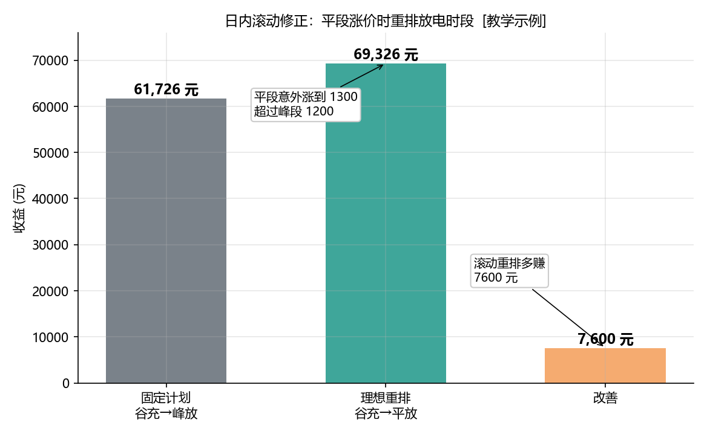
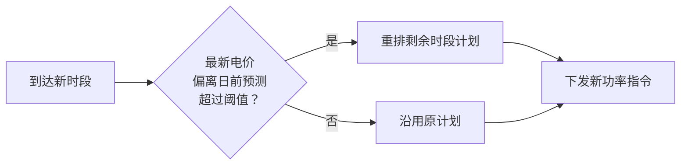

<!-- @AI_GENERATED -->
# 06 日内滚动修正：电价变了，计划也得跟着变

> [课程首页](README.md) · 上一章：[05 日前优化排程](05_日前优化排程.md) · 下一章：[07 现货市场](07_现货市场.md)

**一句话**：日前排程用的是"预测电价"，日内电价会变——滚动修正就是用最新价格不断重排，抢在电价变化时调整充放电时段，把预测误差造成的收益损失抢回来。

## 本章目标

读完本章，你应能：

1. 手算"固定计划"与"理想重排"的收益差；
2. 理解为什么固定计划在价格反转时会亏掉价差；
3. 用 MAPE 量化预测误差；
4. 说明滚动修正的触发时机与收益改善来源。

## 本章边界与假设

本章用**简化三时段**（谷、平、峰各一段）说明滚动修正逻辑，不做 24 小时完整滚动。**前置**：第 01、05 章。约定电价用元/MWh（代码内），正文用元/kWh（心算），两者数值一致。

---

## 06.1 现场场景【必懂】

昨天下午，交易员小刘按预测电价排好了今天的计划：凌晨谷段（350 元/MWh）充电，晚上峰段（1200 元/MWh）放电。

结果今天上午 9 点，某大机组临时跳闸，**平段电价从预测的 700 元/MWh 猛涨到 1300 元/MWh，超过了峰段**。调度软件弹出告警："平段 A 现价 1300，高于计划放电时段 B 的峰段价 1200。"

小刘面临抉择：**按原计划等到峰段放电（卖 1200），还是立刻在平段 A 放电（卖 1300）？**

滚动修正的回答是：**立刻重排，把放电时段从 B 挪到 A**——因为 1300 > 1200，早卖更贵。

---

## 06.2 固定计划 vs 理想重排【必懂】

### 问题建模

三个候选放电时段（充电恒用谷段），日前预测价与实际价如下：

| 时段 | 预测价（元/MWh） | 实际价（元/MWh） | 变化 |
|---|---:|---:|---|
| 谷（充电） | 350 | 350 | 不变 |
| A（平） | 700 | **1300** | 意外大涨 |
| B（峰） | 1200 | 1200 | 不变 |

### 固定计划：按预测价选时段

固定计划用**预测价**选"买哪段、卖哪段"：预测价最低是谷（350），最高是 B 峰（1200），所以计划"谷充 → B 放"。但按**实际价**结算：

```text
充电成本 = 80/0.95 × 350 = 29473.68 元
放电收入 = 76 × 1200       = 91200.00 元
固定计划收益 = 61726.32 元
```

### 理想重排：按实际价选时段

如果早知道实际价，最高价是 A（1300）而非 B（1200），应"谷充 → A 放"：

```text
充电成本 = 80/0.95 × 350 = 29473.68 元
放电收入 = 76 × 1300       = 98800.00 元
理想重排收益 = 69326.32 元
```

### 收益改善

```text
改善 = 理想重排 − 固定计划 = 69326.32 − 61726.32 = 7600 元
```

**这 7600 元就是"没做滚动修正"的损失**——固定计划在 A 段（1300）还在等 B 段（1200），白白错过更高的卖价。滚动修正的意义正是抢回这笔钱。

### 概念实现（三层代码体系 · 第一层）

```python
def _best_pair(prices):
    buy  = min(range(len(prices)), key=lambda i: prices[i])
    sell = max(range(len(prices)), key=lambda i: prices[i])
    return buy, sell, prices[buy], prices[sell]

def arbitrage_profit(prices, e_avail=80.0):
    _, _, buy_p, sell_p = _best_pair(prices)
    return 76.0 * sell_p - (e_avail/0.95) * buy_p      # 简化（e_out=76）

def fixed_plan_profit(forecast, actual, e_avail=80.0):
    buy_h, sell_h, _, _ = _best_pair(forecast)          # 按预测选时段
    return 76.0 * actual[sell_h] - (e_avail/0.95) * actual[buy_h]  # 按实际结算

forecast = [350, 700, 1200]
actual   = [350, 1300, 1200]
arbitrage_profit(actual)       # 69326.32（理想）
fixed_plan_profit(forecast, actual)  # 61726.32（固定）
```

### 配图：固定计划 vs 理想重排



| 编号 | 位置 | 标注 | 对应正文 |
|---|---|---|---|
| ① | 固定计划柱 | 谷充→峰放，收益 61726 元 | §06.2 固定计划 |
| ② | 理想重排柱 | 谷充→平放（1300），收益 69326 元 | §06.2 理想重排 |
| ③ | 改善柱 | 滚动重排多赚 7600 元 | §06.2 收益改善 |

---

## 06.3 量化预测误差：MAPE【必懂】

### 为什么需要

滚动修正的触发频率取决于"预测有多准"。要量化预测误差，最直观的指标是 MAPE（平均绝对百分比误差）：

```text
MAPE = (1/n) × Σ |(实际 − 预测)/实际| × 100%
```

### 手算

```text
forecast = [100, 200]，actual = [110, 180]
MAPE = ( |10/110| + |20/180| ) / 2 × 100%
     = ( 0.0909 + 0.1111 ) / 2 × 100% ≈ 10.10%
```

### 本场景的 MAPE

```text
forecast = [350, 700, 1200]，actual = [350, 1300, 1200]
MAPE = ( |0/350| + |600/1300| + |0/1200| ) / 3 × 100%
     = ( 0 + 0.4615 + 0 ) / 3 × 100% ≈ 15.38%
```

> **MAPE 的陷阱**：当实际值为 0 时分母为 0，MAPE 会爆炸（或需跳过）。本实现 `mape` 里用 `if a != 0.0` 跳过实际为 0 的点，且**分母按有效点数计**（而不是总点数），否则跳零后会低估误差。实践中电价、负荷几乎不为 0，问题不大；但处理光伏夜间出力（恒为 0）时要小心。

### 概念实现（三层代码体系 · 第一层）

```python
def mape(forecast, actual):
    total = 0.0
    count = 0
    for f, a in zip(forecast, actual):
        if a != 0.0:
            total += abs((a - f) / a)
            count += 1
    return (total / count * 100.0) if count else 0.0

mape([100, 200], [110, 180])   # 10.10
mape(forecast, actual)          # 15.38
```

---

## 06.4 滚动修正的工程要点【必懂】

### 触发时机



### 三个工程约束

1. **执行提前量**：PCS 功率爬坡需要时间，滚动重排必须提前一个"执行提前量"下发，不能等到要放电那一刻才改。
2. **重排频次上限**：每次重排都有通信/计算成本，且频繁切换充放状态会加速老化，需设最小重排间隔。
3. **收益改善门槛**：只有当"新计划的收益改善 > 切换成本"时才值得重排，否则沿用原计划更划算。

> **软件类比**：滚动修正像"在线算法的重调度"——任务来了先按预测资源排，运行中资源变了就 re-balance。区别在于储能的重调度有**物理爬坡**和**循环寿命**两类额外成本。
> **类比失效点**：软件 re-balance 几乎零成本、可高频触发；储能每次切换充放方向都有 PCS 损耗和寿命代价，所以必须设阈值和最小间隔。

---

## 自测

1. 本场景中"固定计划"和"理想重排"收益各是多少？改善是多少？
2. 为什么固定计划会错过 A 段的 1300 高价？
3. 用 MAPE 计算 forecast=[10, 20]、actual=[12, 25] 的误差。
4. 滚动修正为什么不能"每一分钟都重排一次"？

<details>
<summary>参考答案</summary>

1. 固定 61726.32 元、理想 69326.32 元、改善 7600 元。计算见 §06.2。
2. 因为固定计划按**预测价**（700 vs 1200）选了"B 峰放"，日内 A 段涨到 1300 时计划没有跟着改，仍在等更低的 1200，错过 1300 的高价。理想重排按实际价选最高段 A（1300）。
3. MAPE = ( |12−10|/12 + |25−20|/25 ) / 2 × 100% = ( 0.1667 + 0.2 ) / 2 × 100% ≈ 18.33%。
4. 因为 PCS 功率爬坡有物理时间（需执行提前量）、频繁切换充放会加速电池老化、每次重排有通信计算成本。只有当收益改善超过切换成本时才值得重排。
</details>

---

## 🧪 动手验证

滚动修正与 MAPE 已实现为可运行代码（参数与正文主线一致）：

```bash
cd lab/
python examples/ch06_rolling.py
```

**关键输出**（与正文 §06.2/06.3 手算对照）：
- `fixed_plan_profit(f,a)` → `61726.315...`，`arbitrage_profit(a)` → `69326.315...`
- 差值 → `7600.0`
- `mape(f,a)` → `15.384...`

> 🧭 **下一站**：滚动修正用的是"分时电价"这种相对固定的价格。但如果储能要参与**现货市场**，价格每分钟都在变，报价决策完全不同——你不再被动等电价，而要主动报价。下一章 [07 现货市场](07_现货市场.md)。

<!-- @AI_GENERATED: end -->