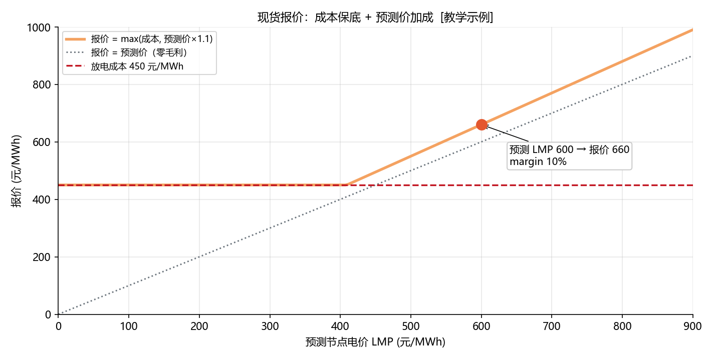
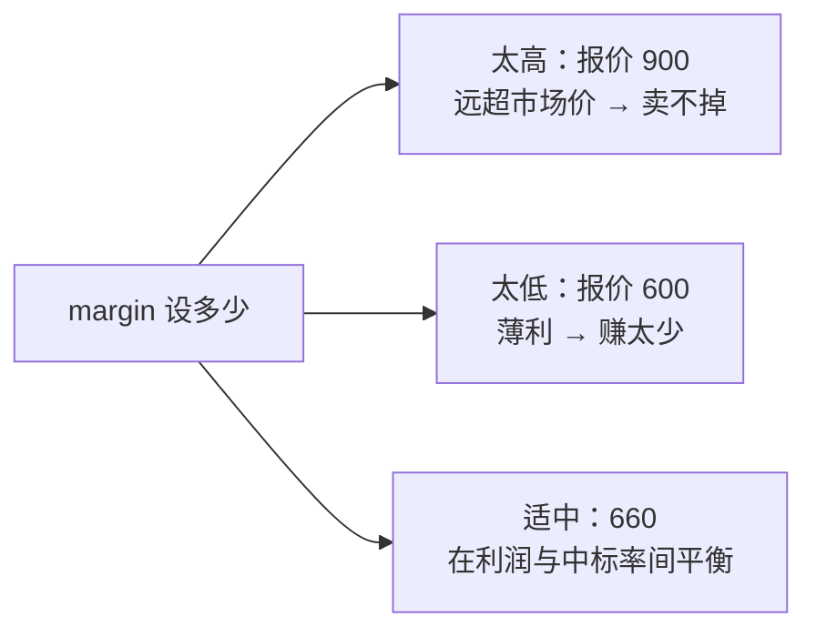

<!-- @AI_GENERATED -->
# 07 现货市场：从"等电价"到"报价格"

> [课程首页](README.md) · 上一章：[06 日内滚动修正](06_日内滚动修正.md) · 下一章：[08 辅助服务叠加](08_辅助服务叠加.md)

**一句话**：分时电价是"给定价格被动套利"，现货市场是"你主动报价、价高者得"——报价的核心公式只有一个：**成本保底，预测价加成**。

## 本章目标

读完本章，你应能：

1. 理解放电的"成本"由哪些部分组成（机会成本/LCOS）；
2. 判断"预测价高于成本才放电"的决策逻辑；
3. 手算报价 = max(成本, 预测价×(1+margin))；
4. 理解 margin 的作用与"报价过高卖不掉、报价过低亏本"的权衡。

## 本章边界与假设

本章只讲**单时段放电报价**决策，不涉及报量曲线、日前/实时两阶段耦合、风险对冲等高级机制。**前置**：第 01、06 章。价格单位统一为元/MWh（现货市场惯例）。

---

## 07.1 现场场景【必懂】

我们电站拿到了现货市场准入资格。与分时电价不同，现货市场的价格（节点电价 LMP）每 15 分钟出一次清，**你报什么价、报多少量，直接决定你能不能中标**。

交易员小刘要回答两个问题：

1. 下一个时段，我**该不该放电**？
2. 如果放电，我**报多少钱**？

直觉上"报得越高越赚"，但如果报价高于市场清出价，就卖不掉（失去收入）；报得太低，又可能亏本卖。这里有个成本底线。

---

## 07.2 放电成本：报价的"地板价"【必懂】

### 成本构成

储能放电不是零成本的。每一度电放出去，背后都有成本：

| 成本项 | 含义 |
|---|---|
| 充电成本（机会成本） | 充这一度电时花的钱，或"现在不卖、留着以后卖"的机会成本 |
| 循环退化成本 | 每充放一次电池容量衰减的折价（LCOS 的一部分） |
| 运维/效率损耗 | 充放双向效率损耗摊到每 MWh 的成本 |

本章把三者合并成一个简化值：**放电成本 = 450 元/MWh**（教学示例）。

### 决策逻辑

```text
预测 LMP > 放电成本  → 放电有利可图 → 报价
预测 LMP ≤ 放电成本  → 放一次亏一次 → 不放电
```

这就是"成本地板"：**报价无论如何不能低于 450 元/MWh**，否则越卖越亏。

---

## 07.3 报价公式：成本保底 + 预测价加成【必懂】

### 为什么需要

确定了"能不能放"，还要定"报多少"。报价太低浪费利润空间，太高又卖不掉。一个实用的启发式公式：

```text
报价 = max( 成本， 预测 LMP × (1 + margin) )
```

- `margin`（加成率）是利润空间：预测价 600、margin 10% → 加成后 660。
- `max(成本, ...)` 保证报价**不低于成本地板**：即使预测价很低，报价也绝不跌破 450。

### 手算

```text
场景 A：成本 450，预测 LMP 600，margin 10%
  报价 = max(450, 600×1.1) = max(450, 660) = 660 元/MWh
  决策：600 > 450 → 放电

场景 B：成本 450，预测 LMP 400，margin 10%
  报价 = max(450, 400×1.1) = max(450, 440) = 450 元/MWh
  决策：400 ≤ 450 → 不放电（报价虽算得出，但决策已否决）
```

### 概念实现（三层代码体系 · 第一层）

```python
def should_discharge(forecast_lmp, cost_per_mwh):
    return forecast_lmp > cost_per_mwh

def bid_price(cost_per_mwh, forecast_lmp, margin=0.1):
    return max(cost_per_mwh, forecast_lmp * (1.0 + margin))

should_discharge(600.0, 450.0)   # True
should_discharge(400.0, 450.0)   # False
bid_price(450.0, 600.0, 0.1)     # 660.0
bid_price(450.0, 400.0, 0.1)     # 450.0
```

### 配图：现货报价



| 编号 | 位置 | 标注 | 对应正文 |
|---|---|---|---|
| ① | 数据点 | 预测 LMP 600 → 报价 660（margin 10%） | §07.3 场景 A |
| ② | 实线 | 报价 = max(成本, 预测价×1.1)，成本以下被"托底" | §07.3 报价公式 |
| ③ | 虚线 | 放电成本 450 元/MWh（地板价） | §07.2 放电成本 |
| ④ | 点线 | 报价 = 预测价（零毛利参考线） | §07.3 margin 的作用 |

---

## 07.4 margin 的权衡【必懂】

> **工程惯例提示**：储能单站容量相对于整个现货市场通常很小，是**价格接受者（price-taker）**——报什么价基本不影响出清价。因此"预测价×(1+margin)"里的 margin 实际取值往往接近 0：报接近成本/预测价即可中标，margin 主要作为应对预测偏差的缓冲或少量利润空间。真正需要较大 margin 的是有市场力（份额足够大、能影响出清）或参与竞价博弈的场景。本章 margin=10% 仅为教学示例。

margin 直接决定报价的激进程度，是一把双刃剑：

| margin | 报价（预测 600） | 结果 |
|---:|---:|---|
| 0% | 600 | 利润薄，中标概率高 |
| 10% | 660 | 利润适中，中标概率中等 |
| 50% | 900 | 利润高，但很可能卖不掉 |



> **软件类比**：报价像拍卖出价——出价低于保留价（成本地板）就亏本，出价远高于对手就流拍。margin 就是你在"多赚一点"和"卖得出去"之间的风险偏好参数。
> **类比失效点**：软件拍卖失败可以无限次重试；储能放电失败意味着**错过这个时段的出清**（过了就没了），且电池 SOC 持有也有时间成本。

---

## 自测

1. 放电成本 450 元/MWh，预测 LMP 500 元/MWh，该不该放电？
2. 接上题，margin=10%，报价是多少？
3. 预测 LMP 300 元/MWh、成本 450，`bid_price` 返回多少？为什么这个报价"无意义"？
4. margin 从 10% 提高到 50%，会带来什么风险？

<details>
<summary>参考答案</summary>

1. 500 > 450，该放电。
2. `max(450, 500×1.1) = max(450, 550) = 550 元/MWh`。
3. `max(450, 300×1.1) = max(450, 330) = 450 元/MWh`。虽然公式返回 450，但 `should_discharge(300, 450)` 为 False——决策已否决放电，所以这个报价不会被使用。
4. 报价从 660 涨到 900，利润空间变大，但高于市场清出价的概率大增，很可能卖不掉（中标失败），错过该时段的放电机会。
</details>

---

## 🧪 动手验证

现货报价决策已实现为可运行代码（参数与正文主线一致）：

```bash
cd lab/
python examples/ch07_bidding.py
```

**关键输出**（与正文 §07.3 手算对照）：
- `should_discharge(600,450)` → `True`，`should_discharge(400,450)` → `False`
- `bid_price(450,600,0.1)` → `660.0`，`bid_price(450,400,0.1)` → `450.0`

> 🧭 **下一站**：现货报价假设储能"全部容量都用来套利"。但储能还能同时赚调频、调压的钱——问题是 50 MW 容量怎么在套利和辅助服务之间切分？下一章 [08 辅助服务叠加](08_辅助服务叠加.md)。

<!-- @AI_GENERATED: end -->