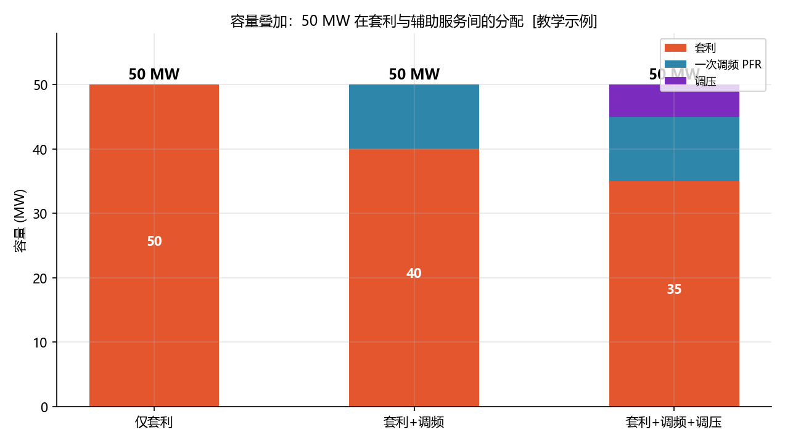
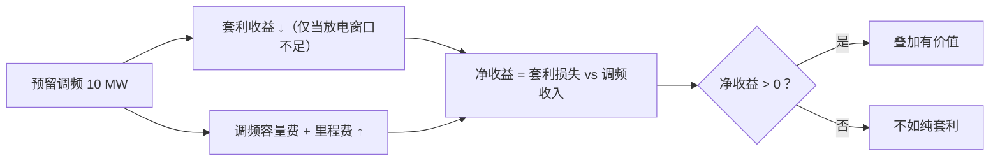

<!-- @AI_GENERATED -->
# 08 辅助服务叠加：50 MW 怎么切给套利、调频、调压

> [课程首页](README.md) · 上一章：[07 现货市场](07_现货市场.md) · 下一章：[09 经济性后评估](09_经济性后评估.md)

**一句话**：储能只有一个额定功率 50 MW，却想同时赚套利、一次调频、调压三份钱——叠加的本质是**按优先级顺序切分这 50 MW 容量**，剩余容量才留给套利。

## 本章目标

读完本章，你应能：

1. 说明储能可同时参与哪些电力市场/服务；
2. 手算"容量叠加"的切分结果；
3. 理解为什么调频/调压优先级高于套利（容量是硬约束）；
4. 认识叠加的收益上限与"备而不用"的机会成本。

## 本章边界与假设

本章只做**容量切分**（静态分配），不涉及各类服务的实时控制算法（已在 AGC/AVC 课程覆盖）。**前置**：第 01、07 章，建议先读 `ems-primary-frequency-regulation` 与 `ems-avc-regulation`。

---

## 08.1 现场场景【必懂】

我们这座 50 MW 储能电站的 PCS 额定功率是 50 MW——这是**所有用途共享的总容量**。现在有三种可能的赚钱方式：

| 服务 | 收益模式 | 功率需求特点 |
|---|---|---|
| 套利（能量市场） | 峰谷价差 | 需要"真放电"，占用功率且消耗能量 |
| 一次调频 PFR | 备用容量费 + 里程费 | 大部分时间只**备用**，偶尔快速小功率响应 |
| 调压（无功） | 电压支撑补偿 | 占用变流器容量，与有功共用视在功率 |

调度中心要求我们**预留 10 MW 做一次调频备用**（这是考核要求，必须优先满足），站里还想再预留 5 MW 做调压。剩下的容量才能做套利。

问题很简单：**50 − 10 − 5 = 35 MW**，还剩 35 MW 套利——但"按什么顺序切、切多少、切多了会怎样"，值得仔细算。

> **一个必须先说清的简化**：调频是有功（单位 MW）、调压是无功（单位 Mvar），严格说二者**不能直接相减**——它们共用的是变流器的**视在功率** `S`，满足 `S² = P² + Q² ≤ S_nom²`（矢量合成，见 AVC 课程的 `pq_domain`）。本章为聚焦"容量切分"的教学主线，把调压折算为**等效有功容量占用**（1 Mvar 调压 ≈ 占用 1 MW 有功容量），按标量切分。读者只需记住：真实电站做叠加时要用**视在功率预算**，而非有功+无功简单相加。

---

## 08.2 叠加的优先级顺序【必懂】

### 为什么调频/调压优先

容量叠加遵循一个原则：**刚性义务 > 弹性套利**。

```text
调频备用（PFR）：电网调度下达的考核要求，不满足会被扣罚 → 刚性
调压（VOLT）：电压合格率考核，同样刚性 → 刚性
套利（ARB）：赚多赚少是"弹性收益"，可让位于刚性义务 → 弹性
```

因此切分顺序固定为：先满足 PFR，再满足调压，**剩余全部给套利**。

### 切分规则

> 沿用 08.1 的简化：调压按等效有功占用计，与 PFR 在同一标量维度上相减。

```text
PFR       = min(需求, P_nom)
调压      = min(需求, P_nom − PFR)
套利      = P_nom − PFR − 调压
```

### 手算三种场景

P_nom = 50 MW：

| 场景 | PFR 需求 | 调压需求 | 套利余量 | 计算 |
|---|---:|---:|---:|---|
| 仅套利 | 0 | 0 | **50** | 50 − 0 − 0 |
| 套利+调频 | 10 | 0 | **40** | 50 − 10 − 0 |
| 套利+调频+调压 | 10 | 5 | **35** | 50 − 10 − 5 |

### 概念实现（三层代码体系 · 第一层）

```python
def capacity_split(p_nom=50.0, pfr_reserve=10.0, volt_reserve=0.0):
    pfr = min(pfr_reserve, p_nom)
    volt = min(volt_reserve, p_nom - pfr)
    arbitrage = p_nom - pfr - volt
    return dict(pfr=pfr, volt=volt, arbitrage=arbitrage, total=p_nom)

capacity_split(50.0, 10.0, 0.0)
# {'pfr': 10.0, 'volt': 0.0, 'arbitrage': 40.0, 'total': 50.0}
capacity_split(50.0, 10.0, 5.0)
# {'pfr': 10.0, 'volt': 5.0, 'arbitrage': 35.0, 'total': 50.0}
```

### 配图：容量叠加



| 编号 | 位置 | 标注 | 对应正文 |
|---|---|---|---|
| ① | 仅套利柱 | 套利 50 MW（全容量） | §08.2 手算表 |
| ② | 套利+调频柱 | PFR 10 + 套利 40 = 50 MW | §08.2 手算表 |
| ③ | 套利+调频+调压柱 | PFR 10 + 调压 5 + 套利 35 = 50 MW | §08.2 手算表 |

---

## 08.3 "备而不用"的机会成本【必懂】

### 为什么需要

调频备用预留的 10 MW，大部分时间**并没有真的在放电**——它只是"随时准备响应"。但这 10 MW 一旦被预留，套利就少 10 MW 的充放能力，这部分损失就是**机会成本**。

### 机会成本量化

预留 10 MW 调频后，套利放电功率上限从 50 → 40 MW。但这里要避免一个**常见错误直觉**：套利收益取决于**能量（MWh）**，而不是功率（MW）。可用能量 80 MWh 没有变，峰段 4 h × 40 MW = 160 MWh 仍远大于 80 MWh——所以在本课程主线场景下，功率从 50 降到 40 MW **并不会**减少套利能量收益，只是把 80 MWh 放完的时间从 1.6 h 拉长到 2 h（仍落在峰段内）。

真正的机会成本出现在两种情形：

1. **放电窗口不足**：当"峰段时长 × 剩余功率 < 可用能量"时，功率预留才会转化为能量收益损失。例如峰段只剩 1 h，40 MW 只能放 40 MWh，损失 40 MWh 对应的收益；
2. **时段错位与循环寿命**：调频备用期间该容量无法参与充放，且被实际调用的充放会额外消耗循环寿命。

因此"预留 10 MW 就损失 20% 套利收益"是**错误直觉**——只有功率约束真正限制了能量放完时，机会成本才与预留功率成比例。这部分机会成本要用调频的**备用容量费 + 里程费**来弥补，否则叠加反而不划算。

### 叠加的净收益判断



> **软件类比**：容量叠加像云资源的"预留实例 + 按需实例"混搭——预留一部分给"随时可能来的任务"（调频），其余按需跑"弹性任务"（套利）。预留多了浪费，预留少了考核不达标。
> **类比失效点**：云资源预留不达标最多是延迟/排队，储能调频备用不达标会被电网**直接考核扣款**，且调频响应还有秒级时序要求（AGC 课程已详述）。

---

## 自测

1. P_nom=50，PFR 需求 15 MW、调压需求 8 MW，套利余量多少？
2. 为什么切分顺序是"先调频、再调压、最后套利"？
3. 预留 10 MW 调频备用，但实际一天内调频只实际响应了 20 分钟——这 10 MW 的"闲置"成本是什么？
4. 若 PFR 需求 60 MW 超过额定 50 MW，`capacity_split` 会返回什么？

<details>
<summary>参考答案</summary>

1. PFR = min(15, 50) = 15；调压 = min(8, 50−15) = 8；套利 = 50−15−8 = 27 MW。
2. 调频和调压是电网考核的刚性义务（不满足扣罚），套利是弹性收益（赚多赚少）。容量是硬约束，必须优先满足刚性义务，剩余再给弹性收益。
3. 这 10 MW 被预留期间无法用于套利。但机会成本不一定等于"预留功率占比 × 套利收益"：只要峰段窗口足够长、40 MW 仍能放完 80 MWh 可用能量，套利能量收益就不受影响。真正的机会成本是"放电窗口不足导致能量放不完"以及"调频响应带来的额外循环寿命损耗"，需要调频容量费+里程费来弥补，否则纯套利更划算。
4. `pfr = min(60, 50) = 50`，`volt = min(..., 50−50) = 0`，`arbitrage = 0`——全部容量被 PFR 占满，套利余量为 0。这暴露了"需求超过额定容量"时叠加的物理极限。
</details>

---

## 🧪 动手验证

容量叠加已实现为可运行代码（参数与正文主线一致）：

```bash
cd lab/
python examples/ch08_stack.py
```

**关键输出**（与正文 §08.2 手算对照）：
- `capacity_split(50,10,0)` → `{'pfr':10,'volt':0,'arbitrage':40,'total':50}`
- `capacity_split(50,10,5)` → `{'pfr':10,'volt':5,'arbitrage':35,'total':50}`
- `capacity_split(50,60,0)` → `{'pfr':50,'volt':0,'arbitrage':0,'total':50}`

> 🧭 **下一站**：套利、调频、调压的钱都算明白了，但"计划赚的钱"和"实际赚的钱"总对不上——是电价预测错了，还是能量没放足？最后一章 [09 经济性后评估](09_经济性后评估.md) 教你做收益复盘与偏差归因，把每一分钱的去向查清楚。

<!-- @AI_GENERATED: end -->