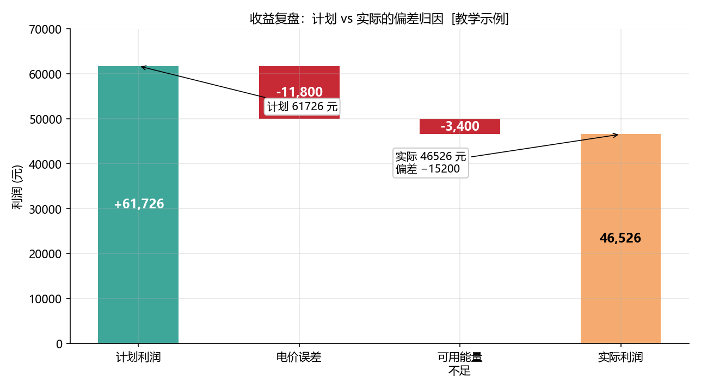
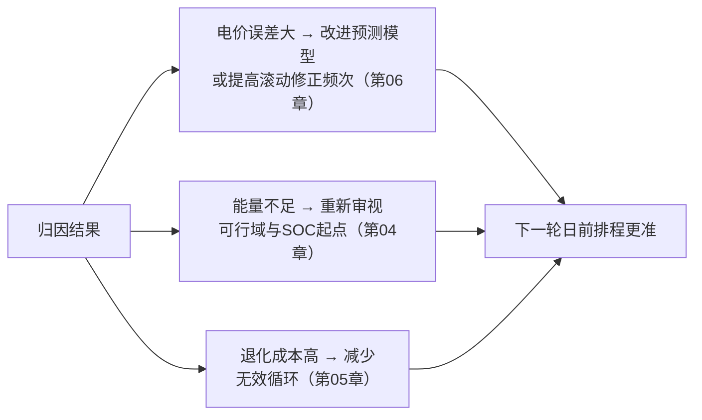

<!-- @AI_GENERATED -->
# 09 经济性后评估：计划赚 6 万，实际只赚 4 万，差在哪

> [课程首页](README.md) · 上一章：[08 辅助服务叠加](08_辅助服务叠加.md)

**一句话**：收益复盘的核心不是"算出赚了多少"，而是把"计划利润 vs 实际利润"的偏差**逐项归因**到电价误差、能量不足、退化成本等具体因素上，让每一分钱的去向可解释。

## 本章目标

读完本章，你应能：

1. 手算"净收益 = 收入 − 成本 − 退化成本"；
2. 把总偏差拆解为若干因素的贡献之和；
3. 理解"残差"的含义与"归因闭合"（残差≈0）的意义；
4. 说明后评估结果如何反哺下一轮排程。

## 本章边界与假设

本章做**事后**归因（已知实际值），不做预测。**前置**：第 01、05、06 章。退化成本为简化常数（本章取 5000 元），实际应按循环次数×单位退化成本精算。

---

## 09.1 现场场景【必懂】

月初复盘会上，交易员小刘汇报："上月计划利润 6 万多元，实际只到 4 万 6，差了 1 万 5。哪去了？"

财务反问："是电价预测错了？还是能量没放足？还是电池退化成本没算进去？"

如果小刘答不上来，下个月还是同一批"坑"。**本章要解决的问题**：把这一万五的偏差，逐项拆到可量化的因素上，做到"总偏差 = 各因素之和"，即**归因闭合**。

---

## 09.2 净收益：把退化成本算进来【必懂】

### 为什么需要

前几章算的都是"毛收益 = 收入 − 成本"，但储能每循环一次，电池都在退化——这是**真实成本**，必须从收益里扣掉，才是真正的"净赚"。

```text
净收益 = 收入 − 成本 − 退化成本
```

### 手算

```text
收入 = 91200 元，成本 = 29474 元，退化成本 = 5000 元
净收益 = 91200 − 29474 − 5000 = 56726 元
```

对比：不计退化时毛收益 = 91200 − 29474 = 61726 元，扣掉退化后只剩 56726 元——**退化成本吃掉了约 5000 元的真实利润**。这正是第 05 章埋下的伏笔：两充两放循环次数翻倍，退化成本也翻倍，"多赚一段"的真实价值要重新审视。

### 概念实现（三层代码体系 · 第一层）

```python
def net_profit(revenue, cost, degradation):
    return revenue - cost - degradation

net_profit(91200.0, 29474.0, 5000.0)   # 56726.0
```

---

## 09.3 偏差归因：把总偏差拆开【必懂】

### 为什么需要

只知道"差了一万五"没用，必须知道**差在哪些因素、各差多少**。归因模型把总偏差分解为若干因素贡献之和：

```text
总偏差 = 实际利润 − 计划利润
       = 电价误差贡献 + 能量不足贡献 + 其他因素 + 残差
```

### 手算：两个因素的归因

```text
计划利润 = 61726 元
实际利润 = 46526 元
总偏差   = 46526 − 61726 = −15200 元

电价误差贡献（预测价偏高，实际卖少了）= −11800 元
能量不足贡献（SOC 不足，放得少了）      = −3400 元

验证：−11800 + (−3400) = −15200 = 总偏差 ✓
残差 = −15200 − (−15200) = 0  → 归因闭合
```

**归因闭合**意味着：这两个因素**完全解释**了偏差，没有遗漏的原因。如果残差很大，说明还有"没找到的因素"（比如设备故障、限电、漏报）没被纳入模型。

### 概念实现（三层代码体系 · 第一层）

```python
def attribution(planned_profit, actual_profit, factors):
    gap = actual_profit - planned_profit
    explained = sum(factors.values())
    residual = gap - explained
    return dict(factors=factors, gap=gap, explained=explained,
                residual=residual, check=abs(residual) < 1e-6)

attribution(61726.0, 46526.0, {"price": -11800.0, "energy": -3400.0})
# gap=-15200, explained=-15200, residual=0.0, check=True
```

### 配图：收益归因瀑布图



| 编号 | 位置 | 标注 | 对应正文 |
|---|---|---|---|
| ① | 计划利润柱 | 计划 61726 元 | §09.3 计划利润 |
| ② | 电价误差柱 | −11800 元（预测价偏高） | §09.3 归因 |
| ③ | 能量不足柱 | −3400 元（SOC 不足放少了） | §09.3 归因 |
| ④ | 实际利润柱 | 实际 46526 元，偏差 −15200 | §09.3 总偏差 |

---

## 09.4 后评估如何反哺下一轮【必懂】

归因不是"算完就完"，而是**闭环反馈**的输入（呼应第 00 章的决策闭环）：



| 归因发现 | 反哺动作 | 对应章节 |
|---|---|---|
| 电价误差贡献大 | 换更好的预测、加大滚动修正 | 第 06 章 |
| 能量不足贡献大 | 调整 SOC 起点/可行域参数 | 第 04 章 |
| 退化成本占比高 | 减少低价值循环、优化两充两放 | 第 05 章 |

> **软件类比**：收益归因像 A/B 实验的"指标归因"——总指标变化拆到"曝光、转化、客单价"各环节，找出最值得优化的杠杆。
> **类比失效点**：软件指标可以实时观测、无限回放；储能收益归因依赖**事后电量/电价结算数据**（往往延迟数天），且能量不足与电价误差可能互相纠缠（SOC 不足时恰好赶上高价段），归因需要更谨慎地解耦。

---

## 自测

1. 收入 91200、成本 29474、退化成本 5000，净收益是多少？
2. 计划利润 61726、实际 46526，电价误差 −11800、能量不足 −3400，残差是多少？归因是否闭合？
3. 如果残差不是 0 而是 −3000，说明什么？
4. 归因发现"能量不足贡献大"，应反哺哪个环节？

<details>
<summary>参考答案</summary>

1. 91200 − 29474 − 5000 = 56726 元。
2. 残差 = −15200 − (−11800 − 3400) = 0，归因闭合（check=True）。
3. 残差 −3000 说明还有约 3000 元的偏差**未被已列因素解释**，存在遗漏原因（设备故障、限电、漏报等），需要补充归因因素或排查数据。
4. 反哺第 04 章可行域与 SOC 起点设定——检查是否 SOC 起点过低/可行域参数过于乐观，导致计划了放不出的能量。
</details>

---

## 🧪 动手验证

净收益与偏差归因已实现为可运行代码（参数与正文主线一致）：

```bash
cd lab/
python examples/ch09_backtest.py
```

**关键输出**（与正文 §09.2/09.3 手算对照）：
- `net_profit(91200, 29474, 5000)` → `56726.0`
- `r['gap']` → `-15200.0`，`r['explained']` → `-15200.0`，`r['residual']` → `0.0`，`r['check']` → `True`

> 🧭 **下一站**：到这里，能量调度闭环走完了——从感知（电价/负荷/光伏/SOC）到决策（可行域+排程）、执行、评估归因。建议回到 [课程首页](README.md) 查看完整课程地图，或进阶阅读 [附录C](附录C_函数速查.md) 系统回顾全部 `ems_lab` 函数。

<!-- @AI_GENERATED: end -->