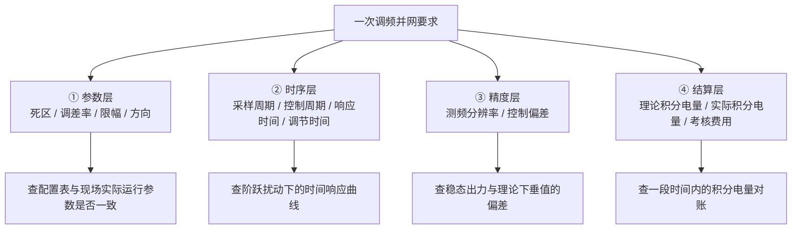

<!-- @AI_GENERATED -->
# 00 PFR闭环链路：一次调频到底在考核什么

> 所属层面：导航层 · 全课程地图
> [课程首页](README.md) · 下一章：[01 PFR标准与频差响应](01_PFR标准与频差响应.md)

**一句话**：一次调频不是"频率低了就多发点电"，而是一套**有死区、有调差率、有限幅、有方向、有时限、有积分电量考核**的并网义务；EMS 要做的是把这条义务变成一条可计算、可记录、可被调度复核的控制链路——**本质上，频率控制是一个分布式 PID：一次调频是 P（比例有差），虚拟惯量是 D（微分瞬时），AGC 是 I（积分无差）**。


<details>
<summary>📋 前置知识自检（30 秒，不会也没关系，点开看看）</summary>

如果你看到"一次调频是 P（比例有差）"这句话感到陌生，先花 30 秒过一遍下面三个概念。**不需要任何公式就能看懂**：

| 概念 | 直觉解释 | 在本课程中的对应 |
|---|---|---|
| **P — 比例（有差）** | "偏差越大，出力越大"，但永远剩一点偏差归不了零。就像踩油门：车速比目标慢 10 km/h 踩深一点，差 5 km/h 踩浅一点，但只要靠油门维持车速，就永远差一点。 | **一次调频**：频率低多少就多发多少 MW，但频率永远回不到 50.00 Hz。 |
| **I — 积分（无差）** | "只要还有偏差，我就一直加码，直到偏差消失"。就像定速巡航：车速比目标慢 5 km/h，它不仅踩油门，还会越踩越深，直到车速刚好等于目标。 | **AGC（二次调频）**：频率低了不只多发，还会持续修正，最终把频率拉回 50.00 Hz。 |
| **D — 微分（瞬时）** | "变化越快，反应越猛"，但只在变化的瞬间起作用。就像刹车踩死那一瞬间的冲击力——只跟"踩下去的速度"有关，跟"踩多深"无关。 | **虚拟惯量**：频率跌落速度越快，瞬时支撑越大，但频率稳住后消失。 |

```text
频率偏差 Δf = 50.00 - 49.90 = 0.10 Hz

一次调频（P）： 动力 = K_p × 0.10          → 永远剩一点偏差
AGC（I）：       动力 = K_i × 0.10 × 持续秒数 → 最终偏差归零
虚拟惯量（D）：   动力 = K_d × df/dt         → 仅在频率变化瞬间起作用
```

> 💡 **读完这个折叠块就可以继续了。全书需要你真正记住的"控制理论"只有这一件事：**一次调频是按比例出力的，永远有差，所以考核不查"频率恢复了没有"，只查"你该出多少力、出了没有"**。

</details>

## 本章目标

读完本章，你应能：

1. 说出一次调频在并网验收中被检查的四个层面（参数、时序、精度、结算）；
2. 区分"算法算对了"和"考核通过了"这两件不同的事；
3. 建立本课程的整体学习地图，知道每一章解决哪个环节。

## 从一个考核不合格事件说起【必懂】

某 100 MW / 200 MWh 光储电站，一次调频功能上线首月，调度下发的考核结果是这样的：

| 考核项 | 结果 | 现场初判 |
|---|---|---|
| 调频死区 | 合格 | 参数与细则一致 |
| 调差率 | 合格 | 参数与细则一致 |
| 响应滞后时间 | 合格 | PCS 本地实现，约 0.3 s |
| 调节时间 | 合格 | 约 8 s 稳定 |
| **调频控制偏差** | **不合格** | "算法明明是对的" |
| **积分电量** | **多次不足** | 不明原因 |

现场工程师查了三天，最后发现三件互不相干的事：

1. **死区类型口径不一致**：EMS 按"连续型"（平移）死区实现，考核按"截断型"（削平）计算理论出力。每次频率刚越过死区，实际出力都比理论值少 `死区宽度 × K`，被判偏差超标。
2. **频率数据冻结**：一次通道中断后，电表上送的频率停在 49.92 Hz（死区外）。EMS 没有识别"数值长时间不变"，持续按 49.92 Hz 计算，储能一直放电。
3. **方向约定未统一**：新接入的 PCS 以"充电为正"，接入层漏了符号换算，联调时发现频率下降反而充电。

这三件事没有一件属于"算法难"，全部属于**口径与链路**问题。

> **软件类比**：这很像对接第三方支付——签名算法（=下垂公式）从来不是问题，问题在于金额单位是分还是元、退款符号是正还是负、回调里"成功"字段的枚举值是 `SUCCESS` 还是 `1`。**接口契约错了，逻辑再对也是错的**。

---

## 一次调频被检查的四个层面【必懂】

把并网要求拆开看，调度与试验单位其实在检查四件不同的事：



| 层面 | 谁在查 | 典型证据 | 常见失败原因 |
|---|---|---|---|
| 参数层 | 调度 / 试验单位 | 参数配置表、装置定值单 | EMS 配置与 PCS 实际参数不一致 |
| 时序层 | 试验单位 | 带时标的频率-出力曲线 | 控制周期过长、通信延迟、滤波延迟 |
| 精度层 | 调度（月度考核） | 理论出力与实际出力对比 | 死区类型口径不一致、测频分辨率不足 |
| 结算层 | 调度（结算中心） | 积分电量对账表 | 数据冻结、丢点、时标错位 |

**这四层是串联的**：参数层错了，后三层全部失真；时序层不达标，精度层不可能达标；精度层不稳，结算层一定扣钱。所以本课程也按这个顺序展开。

---

## 为什么单独立一门课【必懂】

频率与下垂的基础原理，在[入门课程第 15 章](../ems-python-learning/15_频率与一次调频.md)已经讲过。但那一章讲的是**"物理上应该怎么调"**，而工程上真正卡住人的是**"电网要求你怎么调、按什么口径算你调对了"**。

两者的差别可以用一句话概括：

| 视角 | 关心的问题 |
|---|---|
| 物理视角（入门课程） | 频率为什么跌、储能能补多少、最低点能抬高多少 |
| 并网视角（本课程） | 死区取多少、调差率取多少、几秒内必须到 90%、偏差几个百分点算不合格 |

同一个下垂公式，在两种视角下的"正确"标准完全不同。物理上合理的响应，可能因为**死区类型**或**积分电量口径**被判不合格。

---

## 学习地图【必懂】


| 章节 | 如果你只想解决一个问题 | 建议读法 |
|---|---|---|
| 01 | 不理解为什么突然要改一次调频 | 通读 |
| 02 | 要写代码实现下垂计算 | 精读 + 手算 |
| 03 | 场站同时有风电和光伏 | 精读 |
| 04 | 响应时间总是不达标 | 精读 + 做时序预算 |
| 05 | 项目在特定省份 | 对照查阅 |
| 06 | 要做架构设计 | 精读 |
| 07 | 月度考核被扣钱 | 精读 |
| 08 | 要做并网试验 | 精读 |
| 09 | 上线前做自查 | 通读，逐条对照 |

---

## 本课程的统一约定【必懂】

为了避免混淆，全课程采用以下约定（与入门课程附录 B 一致）：

| 项目 | 约定 | 说明 |
|---|---|---|
| 额定频率 fn | 50 Hz | 国内同步电网 |
| 频率偏差 Δf | `f − fn` | 频率低为负 |
| 功率方向 | 放电 / 向电网送电为正 | 频率低 → 出力增量为正 |
| 调差率符号 | δ | 规程常用百分数，如 2%、3% |
| 下垂系数 K | `Pn / (δ × fn)` | 单位 MW/Hz |
| 限幅 | 以额定有功 Pn 的百分比表示 | 如 ±10% Pn |
| 时间 | 秒（s），统一时钟 | 频率与出力必须同一时标 |

> **注意**：不同厂家资料里，"调差率"有时用 δ、有时用 σ、有时直接给"调差系数 %"，而"限幅"有时写"最大调节量"、有时写"功率限幅"。**读到任何一份细则，第一步都是先确认它用的是哪套符号、以谁的额定值为基准**。附录 A 给出了对照表。

---

## 自测

1. 一次调频的并网要求可以拆成哪四个层面？各自最常见的失败原因是什么？
2. "算法算对了"和"考核通过了"为什么可能不一致？请举一个具体例子。
3. 如果你接手一个省网的一次调频改造项目，第一件要拿到的资料是什么？

<details>
<summary>参考答案</summary>

1. 参数层（配置与现场实际不一致）、时序层（控制周期与延迟）、精度层（口径不一致、测频分辨率不足）、结算层（数据冻结、丢点、时标错位）。
2. 因为考核按规程定义的**理论出力**计算，而算法按自己的理解计算。例如 EMS 用连续型死区，考核按截断型，两者在死区边缘的理论值相差 `死区宽度 × K`，算法再准也会被判偏差超标。
3. 项目所在电网的**现行调度规程与并网协议**（含一次调频实施细则、考核办法），而不是厂家通用说明书或国标原文。国标是下限，省网细则才是现场执行的版本。

</details>

<!-- @AI_GENERATED: end -->
