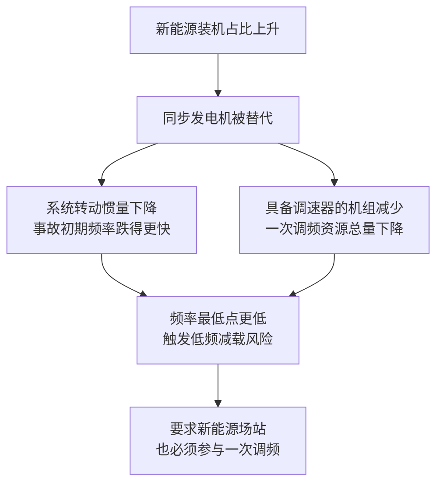
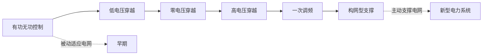
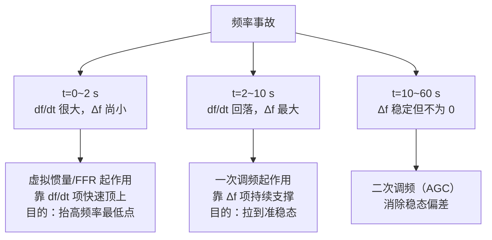
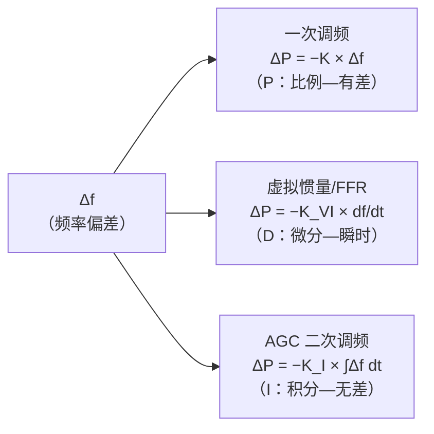

<!-- @AI_GENERATED -->
# 01 一次调频的功能定位与调控原理

> 所属层面：全四层概述（参数层→时序层→精度层→结算层的基础逻辑）
> [课程首页](README.md) · 上一章：[00 课程导读](00_课程导读.md) · 下一章：[02 四个基本参数](02_四个基本参数.md)

**一句话**：一次调频从"火电的天然能力"变成"新能源场站的并网义务"，只用了不到十年；推动这件事的是新能源占比上升后**系统惯量与调频资源同时减少**的物理现实，以及随之而来的一整套标准与考核体系。

## 本章目标

读完本章，你应能：

1. 说清楚为什么新能源占比高之后，系统更需要一次调频；
2. 理清国内一次调频要求的政策与标准脉络（试点 → 区域细则 → 行标 → 国标）；
3. 区分"标准要求什么"与"省网细则要求什么"，知道该以哪一份为准。

## 为什么新能源越多，越需要一次调频【必懂】

### 调频资源的两个变化

传统电网的调频能力来自同步发电机：转子有惯量，调速器有下垂。新能源大量接入后，发生两件事：



用摇摆方程可以直接看出第一件事（详见[入门课程 15.3](../ems-python-learning/15_频率与一次调频.md)）：

```text
df/dt = fn × ΔP / (2H)
```

H 越小，同样的功率缺口下频率跌得越快。风光的电力电子接口不与电网同步，不天然提供惯量，**只能靠控制策略主动模拟**。

不同类型的电源，其惯性常数差异巨大——这直接决定了事故初期频率下跌的速率：

| 电源类型 | H (s) | 物理含义 |
|---|---|---|
| 火电 (300 MW) | 3~5 | 满功率下转子储存的动能可单独维持发电机运行 3~5 秒 |
| 水电 | 1~3 | 转子较轻，惯量较小 |
| 光伏 (无储能) | 0 | 通过逆变器并网，不存在与电网同步的转动惯量 |
| 双馈风电 | 0（隐式） | 转子经变流器与电网解耦，不天然贡献惯量 |

当火电被替代后，系统总 H 下降，同样的 ΔP 下 df/dt 成倍增大。这就是为什么备用容量可能没变，但频率事故的最低点却更低、低频减载的风险更大——**惯量池的水位在持续下降**。

### 光伏已经大到不能忽视

技术报告给出的数据（2022 年底）：

| 指标 | 数值 | 含义 |
|---|---|---|
| 光伏累计装机 | 3.92 亿千瓦 | 已成为国内第二大电源 |
| 占总装机比例 | 15.3% | 超过风电的 14.3% |
| 趋势 | 占比逐年提高 | 调频资源的结构性缺口持续扩大 |

在这个体量下，"新能源不参与调频"已经不是一个可选项——它意味着全网可用的快速调频资源被削掉了一大块。

> **软件类比**：这像一个系统从"每台机器都自带限流器"变成"大量无状态代理接入"。代理本身不消耗资源、扩缩容很快，但它们不承担限流，于是控制平面必须**主动给代理下发限流规则**，否则一次突发流量就会打穿整个系统。

---

## 国内政策与标准脉络【了解】

一次调频要求在国内的落地，大致经历了"试点 → 区域细则 → 行业标准 → 国家标准"四步。技术报告中的梳理如下：


| 阶段 | 文件 / 事件 | 关键内容 | 对 EMS 的影响 |
|---|---|---|---|
| 试点 | 2016 年西北电网试点 | 新能源参与电网一次调频的可行性验证 | 首次出现"场站侧需要本地调频"的需求 |
| 推广 | 华东、东北、山西等 | 逐步进入实用化阶段，形成区域技术指标 | 出现**区域差异化的参数版本** |
| 行标 | DL/T 1870《电力系统电源协同调度技术规范》`[国标/行标]` | 明确新能源场站应具备参与电网**快速调频**能力 | 从"可选项"变为"应具备" |
| 国标 | GB/T 40595《并网电源一次调频技术规定及试验导则》`[国标/行标]` | 针对光伏发电等并网电源提出一次调频要求与试验方法 | 统一了**术语、指标定义与试验方法** |

此外，国外在新能源参与调频方面开展得更早，新能源入网标准中已明确新能源场站并网点应具备一次调频功能。这部分内容对国内标准的制定有参考作用，但**具体参数不可直接套用**——欧洲、澳洲、英国的电网结构与机组构成与中国差别很大。

### 标准与细则的关系【必懂】

这是最容易搞错的一点。三层文件的约束力完全不同：

| 文件层级 | 约束力 | 作用 | 能否直接用于现场整定 |
|---|---|---|---|
| 国家标准（GB/T） | 强制或推荐 | 给出术语、指标定义、试验方法 | 不能，通常只给范围 |
| 行业标准（DL/T） | 行业约束 | 提出"应具备"的能力要求 | 不能，不给具体数值 |
| 省网调度细则 | **现场执行** | 给出具体死区、调差率、限幅、考核办法 | **能，且只能用它** |

> **工程经验**：做方案评审时，如果对方拿出国标说"死区应该是 ±0.03 Hz"，这句话大概率是不成立的——国标通常不规定这么细，**具体数值来自省网细则**。反过来，如果对方拿出省网细则，那就必须逐条对照，因为考核是按它执行的。

---

## 一次调频与二次调频的边界【必懂】

新能源场站参与调频后，经常有人问："既然一次调频已经能加出力了，为什么还要 AGC？"这两件事解决的是不同问题：

| 维度 | 一次调频 | 二次调频（AGC） |
|---|---|---|
| 谁决定出力 | 场站自己，看本地频率 | 调度主站，看区域控制偏差 |
| 需要通信吗 | 不需要 | 需要调度远动通道 |
| 响应时间 | 秒级 | 数十秒到分钟级 |
| 能否消除频率偏差 | **不能**，留有稳态偏差 | **能**，把频率拉回 50 Hz |
| 在 EMS 中的形态 | 叠加型增量 ΔP | 覆盖型基点 P_AGC |
| 考核方式 | 调频控制偏差、积分电量 | 调节速率、响应时间、调节精度 |

一次调频之所以"不能"把频率拉回 50 Hz，是因为下垂控制的出力与频率偏差成正比：功率重新平衡时，必须**保留一个非零的频率偏差**来维持这部分出力。这部分偏差只能由 AGC 消除（详见[入门课程第 16 章](../ems-python-learning/16_AGC与调度考核.md)）。

**对 EMS 的直接后果**：一次调频增量与 AGC 基点是**相加**关系，不是替换关系。这一点在[06 章](06_EMS侧实现.md)的指令合成里会具体展开。

---

## 光储电站为什么是重点对象【必懂】

技术报告在"总结与展望"里给出了光伏并网技术的演进路径，这条路径解释了为什么光储电站的一次调频要求越来越严：



储能在这条路径上有独特位置：它既有电力电子的快速响应能力（百毫秒级），又有双向调节能力（可从满充切到满放），因此在一次调频里通常承担"快速顶上"的角色。但它的短板也很明确——**能量有限**，一次调频会消耗 SOC。

> **一句话总结**：一次调频对储能是"能力优势 + 能量约束"的组合。参数设置得越激进（调差率越小、限幅越大），响应越好但越容易把电放空。这就是[03 章](03_风光差异化与多资源协同.md)要讲的"协同"问题的根源。

---

## 一次调频与虚拟惯量的边界【必懂】

随着新能源场站的控制能力越来越强，行业内出现了一个重要的概念分化，而这个分化直接影响 EMS 的功能设计：

| 控制模式 | 英文 | 输入信号 | 输出逻辑 | 响应时间 | 典型场景 |
|---|---|---|---|---|---|
| 一次调频（PFR） | Primary Frequency Regulation | **频率偏差 Δf** | ΔP ∝ −Δf（下垂/比例） | 秒级 | 频率已偏离后的稳态支撑 |
| 快速频率响应（FFR） | Fast Frequency Response | **频率变化率 df/dt** | ΔP ∝ −df/dt（微分/惯性模拟） | 百毫秒级 | 频率正在快速下跌时的"刹车" |
| 虚拟惯量 | Virtual / Synthetic Inertia | **df/dt** | ΔP ∝ −df/dt，模拟转子动能释放 | <100 ms | 事故初期、频率最低点到来之前的阻抗 |

它们的控制表达式完全不同：

```text
一次调频（PFR）：   ΔP_pfr  = −K_droop × Δf           （比例控制，有差）
虚拟惯量（VI）：    ΔP_vi   = −K_inertia × df/dt      （微分控制，瞬时）
快速频率响应（FFR）：ΔP_ffr  = −K_droop × Δf − K_inertia × df/dt  （比例+微分）
```

### 为什么这个区分对 EMS 至关重要



**核心认知**：

- 一次调频解决的是"频率掉下去了，需要撑住"的问题（有差调节）
- 虚拟惯量/FFR 解决的是"频率正在往下掉，需要立刻刹住"的问题（瞬时阻抗）
- **两者在事故时间轴上各管一段，互不替代**

| 维度 | 一次调频（PFR） | 虚拟惯量/FFR | 对 EMS 的影响 |
|---|---|---|---|
| 是否需要死区 | 必须，防止频繁动作 | 通常不需要（只在 df/dt 足够大时触发） | PFR 参数里要有死区，FFR 参数里要有 df/dt 阈值 |
| 能量来源 | 持续消耗（储能 SOC 下降） | 瞬时释放（类似电容放电） | PFR 需要 SOC 管理，FFR 需要短暂过载能力 |
| 考核方式 | 积分电量、完成率 | 惯量支撑效果、RoCoF 抑制幅度 | 两套完全不同的考核体系 |
| 在标准中的定位 | GB/T 40595 明确规定 | 国标正在制定中，部分省网试点 | 功能需要可配置开启/关闭 |

### 当前国内的落地现状

| 现状 | 说明 |
|---|---|
| GB/T 40595-2021 | 只规定了一次调频（PFR），**尚未包含虚拟惯量/FFR 的独立要求** |
| 南网最新企标 | 已提出"新能源应具备惯量响应能力"的方向性要求 |
| 国网部分省网 | 试点场站要求储能同时具备 PFR 和 FFR 两种模式 |
| 技术报告 | 将两者统称为"快速频率响应"，但在参数设置上已经隐含区分 |

> **对 EMS 开发的实际含义**：如果你的产品只做了一次调频（ΔP ∝ −Δf），在南网最新项目中可能需要加一个"快速频率响应模式"（ΔP ∝ −Δf − K × df/dt）。**架构上应预留 df/dt 的输入通道和对应的控制分支**，即使当前项目不要求。

---

## 频率控制是一个分布式 PID【必懂】

如果把电网频率控制看成一个完整的反馈系统，三次调频恰好对应 PID 的三个环节：



| 环节 | 对应功能 | 数学本质 | 物理直觉 |
|---|---|---|---|
| P（一次调频） | 阻止频率继续恶化 | 出力∝偏差大小 | 频率掉得越深，所有发电机调速器开得越大 |
| D（虚拟惯量） | 减缓频率下跌速度 | 出力∝偏差变化率 | 频率刚开始掉就立刻顶上，争取时间 |
| I（AGC） | 消除稳态偏差 | 出力∝偏差累积 | 只要频率还有偏差就持续加出力，直到回到 50 Hz |

**三个环节各自不可替代的原因**：

- **P 只靠偏差触发**，注定有稳态误差——功率平衡必须保留一个非零 Δf 来维持 ΔP。这就是为什么一次调频不能把频率恢复到 50 Hz（第二章会细算）。
- **D 只看变化率**，只在 df/dt 大的极短时间内起作用（事故前 2 秒），频率稳定后 df/dt→0，VI 出力自动归零——这就是它不需要死区的物理原因。
- **I 慢但彻底**——通过累积偏差，最终能把 Δf 归零。但它的时间尺度是分钟级，事故前几秒指望不上。

> **这个框架的价值**：它把本课程后续讲到的"四个参数""死区类型""积分电量考核"统一到一个大脑模型下——你始终知道自己在调整的是 P 环节的哪个参数，以及它为什么不能替代 D 和 I 的功能。

---

## 构网型控制与一次调频的关系【深入了解】

<details>
<summary>构网型（Grid-Forming）不是一次调频的简单升级</summary>

上一节的 PID 框架讲的是跟网型（Grid-Following）下的频率控制分工。构网型控制把 P 和 D **内嵌进了变流器的物理特性**，不需要单独写代码。核心区别如下：

| 维度 | 跟网型（Grid-Following） | 构网型（Grid-Forming） |
|---|---|---|
| 控制范式 | PLL 锁相跟踪电网，跟随者 | 自建电压相角，独立电压源 |
| 一次调频实现 | 在 PLL 跟踪的基础上**叠加**下垂增量 | 下垂本身就是内部频率-有功回路，**天然内嵌** |
| 死区概念 | 需要显式配置 | 被摇摆方程的自然阻尼替代 |
| 惯量来源 | 靠 df/dt 前馈模拟（需显式编程） | 摇摆方程本身就含惯量项（J × dω/dt） |
| 考核指标 | t0.1/t0.9/积分电量 | 惯量时间常数 H_eq、阻尼比 ζ、频率最低点 |
| EMS 的角色 | 参数下发、状态监视、数据上送 | 与一次调频类似，但参数类型完全不同（J、D、电压参考） |

**关键认知**：构网型控制的"一次调频"不需要单独写代码——它的**内部频率-有功下垂回路就是一次调频**，但效果表现为连续的、无死区的物理过程，而不是"检测到越死区 → 启动 → 计算 ΔP"的离散逻辑。

对 EMS 的影响：

- 构网型场站的"调频参数"不再是一组死区/调差率/限幅，而是虚拟惯量 J、阻尼系数 D、电压参考 V_ref
- EMS 的"参数一致性校验"对象从"四个参数"变成"J/D/V_ref"
- 考核体系完全不同，积分电量可能被"惯量响应效果评估"替代

> **对当前教材的定位**：本教材以跟网型新能源场站的一次调频为主。构网型的内容在入门课程 15.10 有初步介绍，将来需要单独开一门课。

</details>

## 自测

1. 为什么新能源占比上升会让系统对一次调频的需求变强？请从惯量和资源两个角度回答。
2. 国标、行标、省网细则分别约束什么？现场整定应该以哪一份为准？
3. 一次调频为什么不能把频率恢复到 50 Hz？它对 EMS 的指令结构有什么影响？

<details>
<summary>参考答案</summary>

1. 惯量角度：新能源通过电力电子并网，转子不与电网同步，系统总转动惯量 H 下降，同样缺口下 RoCoF 更大、最低点更低。资源角度：具备调速器的同步机组被替代，参与一次调频的机组总量减少，需要新能源场站补上这部分快速调频能力。
2. 国标给出术语、指标定义与试验方法（通常只给范围）；行标提出"应具备"的能力要求；省网细则给出具体数值与考核办法。现场整定必须以**项目所在电网现行的省网调度细则与并网协议**为准。
3. 因为下垂出力与频率偏差成正比，功率平衡时必须保留一个非零偏差来维持出力，所以只能停在低于 50 Hz 的准稳态。对 EMS 的影响是：一次调频是**叠加在基点上的增量**，不是替换基点的指令。

</details>

<!-- @AI_GENERATED: end -->