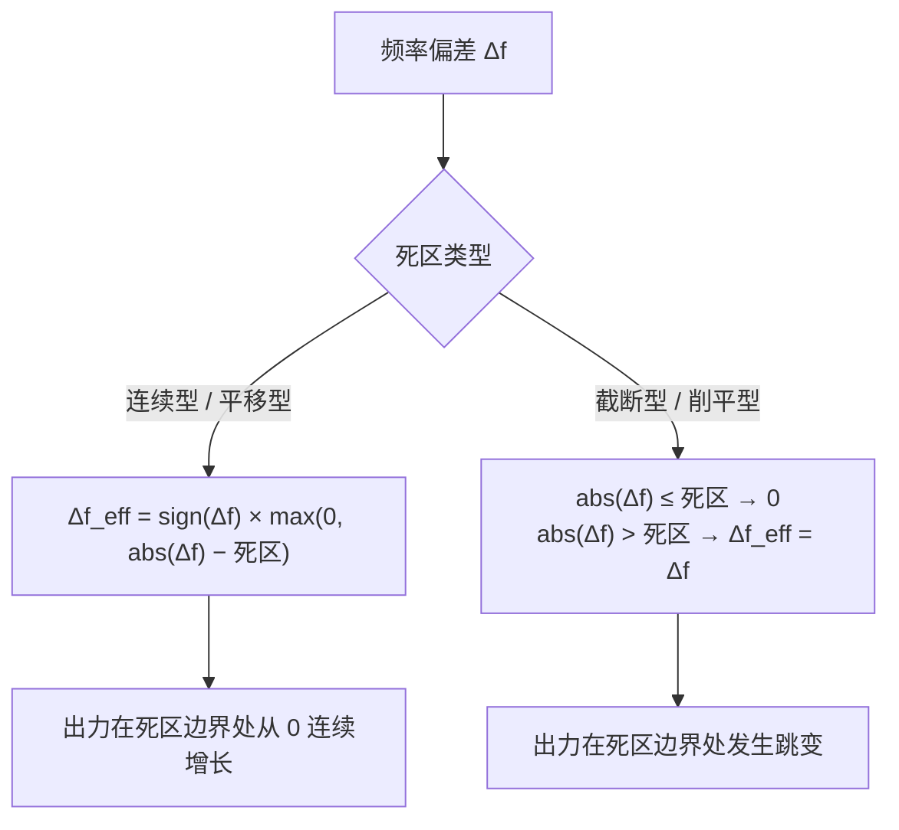
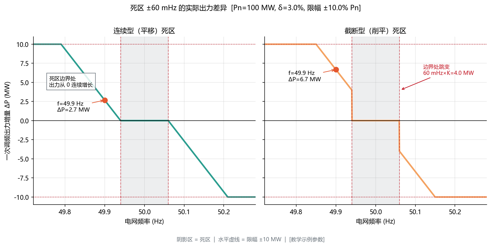
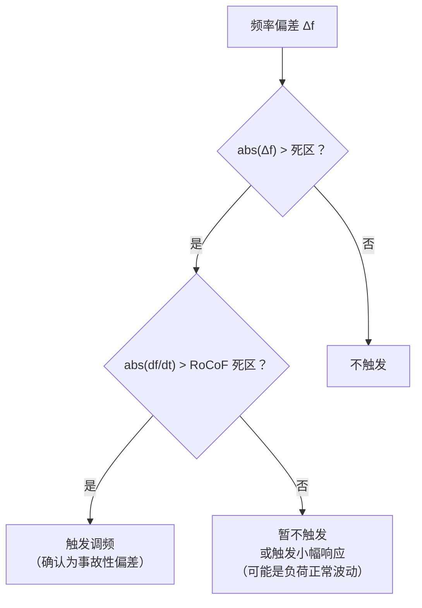
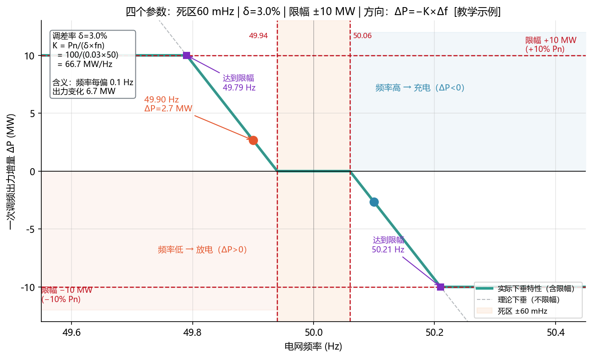

<!-- @AI_GENERATED -->
# 02 四个基本参数：死区、调差率、限幅、方向

> 所属层面：① 参数层
> [课程首页](README.md) · 上一章：[01 一次调频的功能定位与调控原理](01_业务背景与标准沿革.md) · 下一章：[03 风光差异化与多资源协同](03_风光差异化与多资源协同.md)

**一句话**：一份一次调频细则不管写得多复杂，落到代码里只有四个参数——**死区决定"什么时候动"，调差率决定"动多少"，限幅决定"最多动多少"，方向决定"往哪动"**。

## 现场场景【必读】

周二下午，你接到项目经理的电话："调度的 monthly report 出来了，我们那个 100 MW 光储电站一次调频的**调频控制偏差**这一项挂了。现场说功率曲线看起来没问题，参数也跟细则对得上，不知道怎么回事。"

你打开考核原始数据：几十次频率事件中的"理论出力"与"实际出力"对比图，偏差最大的都是在频率刚越过 ±0.06 Hz 死区的那几秒——理论值 6.7 MW，实际只有 2.7 MW。偏差差得整整齐齐，恰好是 **4.0 MW**。

你突然想起一个月前在配置工具里选的那个下拉框：死区模式——「连续型」还是「截断型」。当时顺手选了个默认。现在面对这份月度考核不合格报告，**你必须在明天之前搞清楚这 4.0 MW 的差值到底意味着什么**。

## 本章目标

读完本章，你应能：

1. 把规程里"死区 ±0.06 Hz、调差率 3%、限幅 10% Pn"翻译成可直接编码的公式；
2. 区分连续型（平移）死区与截断型（削平）死区，并算出两者的出力差；
3. 说清楚"不预留备用"对 EMS 能力校验的影响。

## 参数一：死区【必懂】

### 死区的作用

死区是一段**不动作的频率区间**。频率落在死区内，一次调频出力为零。设置死区的理由有三个：

| 理由 | 说明 |
|---|---|
| 避免频繁动作 | 电网频率日常在 50 Hz 附近小幅波动，无死区会导致机组/变流器持续微调 |
| 保护机械设备 | 对风电机组尤其重要，频繁变桨会加剧桨叶与变桨机构磨损 |
| 区分扰动与噪声 | 测频本身有噪声，死区可以滤掉测量抖动 |

技术报告给出的取值（新能源场站）`[汇报口径]`：

| 电源类型 | 死区 | 备注 |
|---|---|---|
| 风电 | ±0.1 Hz | 相对宽，与机械磨损约束对应 |
| 光伏 | ±0.06 Hz | 相对窄，发挥电力电子快速调节优势 |

### 两种死区实现方式【必懂】

这是最容易出错的地方。同一个"死区 ±0.06 Hz"，有两种完全不同的实现：



用图看更直观（横轴频率，纵轴出力增量）：



**图中标注对照表**：

| 标注 | 含义 | 对应参数 |
|---|---|---|
| 灰色阴影带 | 死区 ±60 mHz | width = 0.06 Hz |
| 红色虚线 | 死区边界 | f = 49.94 / 50.06 Hz |
| 水平虚线 | 限幅 ±10 MW | ±10% Pn |
| 右图红色跳变标注 | 死区边界处跳变 = K×死区 = 4.0 MW | 截断型特有 |
| 蓝色圆点 | 工作点 f=49.90 Hz | 对应文中的算例 |
| 左图绿色框 | 连续型：边界处连续增长 | 与截断型的本质区别 |

> **如何核对这些数值**：执行 `python figures/ch02_droop.py`，输出 JSON 中 `numbers` 清单包含图中所有关键数值，对照本表逐项确认。

**手算对比**：以光伏为例，`Pn = 100 MW`、`δ = 3%`、死区 `±0.06 Hz`、限幅 `±10% Pn = 10 MW`。

先算下垂系数：

```text
K = Pn / (δ × fn) = 100 MW / (0.03 × 50 Hz) = 66.67 MW/Hz
```

再算当前频率 `f = 49.90 Hz`（`Δf = −0.10 Hz`）：

| 步骤 | 连续型 | 截断型 |
|---|---|---|
| 原始偏差 Δf | −0.10 Hz | −0.10 Hz |
| 过死区后 Δf_eff | −(0.10 − 0.06) = **−0.04 Hz** | **−0.10 Hz**（不削减） |
| × (−K) | 0.04 × 66.67 = **+2.67 MW** | 0.10 × 66.67 = **+6.67 MW** |
| 限幅 ±10 MW | +2.67 MW | +6.67 MW |

**两者相差 4.0 MW**，恰好等于 `死区宽度 × K = 0.06 × 66.67 = 4.0 MW`。

这个差值就是[00 章](00_课程导读.md)里那个"调频控制偏差不合格"事件的根因：EMS 按连续型算，考核按截断型算，**每次频率刚越过死区，实际出力都比理论值少一个"死区宽度 × K"**。

> **工程结论**：死区类型**不是实现细节，而是考核口径**。必须逐条确认细则原文用的是"平移"还是"削平"，并在配置项里显式记录。

### 死区宽度如何影响结果

| 死区 | 优点 | 缺点 |
|---|---|---|
| 宽（如 ±0.1 Hz） | 抗噪、少动作、保护机械 | 小扰动不响应，考核可能判"应动未动" |
| 窄（如 ±0.06 Hz） | 响应灵敏、小扰动也参与 | 动作频繁，测量噪声可能引起抖动 |

技术报告对风电取 ±0.1 Hz、对光伏取 ±0.06 Hz，正是这个取舍的体现（详见[03 章](03_风光差异化与多资源协同.md)）。

### 频率变化率（RoCoF）死区【参考】

除了频率幅值死区，实践中还有一个同等重要的概念——**频率变化率死区（RoCoF deadband）**。这是一次调频的"第二道门"：

| 维度 | 频率幅值死区 | RoCoF 死区 |
|---|---|---|
| 检测量 | f 偏离 fn 的绝对值 | df/dt 的绝对值 |
| 目的 | 滤除小幅正常波动 | 区分"负荷波动"与"真实故障" |
| 典型取值 | 0.033~0.1 Hz | 0.03~0.1 Hz/s |
| 判据关系 | 必要条件 | 辅助确认条件 |

> **df/dt 是什么**：`df/dt` 是频率的变化速度，单位是"Hz 每秒"。类比开车：Δf 是"你离目的地还有多远"（位移），df/dt 是"你现在的车速"（速度）。频率从 50 Hz 跌到 49.9 Hz，如果用了 10 秒，df/dt = −0.01 Hz/s（缓慢漂移）；如果只用了 0.3 秒，df/dt ≈ −0.33 Hz/s（陡降，大概率是机组跳闸）。

#### 为什么需要 RoCoF 死区



RoCoF 死区解决的核心问题是：**"频率偏了 0.07 Hz"这个事实本身，无法告诉你这是因为一条 500 kV 线路跳了（需要全力以赴），还是因为某个大工业负荷正常启停（不需要储能拼尽全力）**。

| 场景 | Δf | df/dt | 应如何响应 |
|---|---|---|---|
| 大机组跳闸 | −0.15 Hz | **−0.3 Hz/s**（很陡） | 全力放电 |
| 工业负荷启停 | −0.12 Hz | **−0.02 Hz/s**（平缓） | 适度响应 |
| 频率在死区边缘慢漂 | −0.07 Hz | ≈ 0 Hz/s | 不应大动 |

#### 两种使用方式

| 方式 | 做法 | 适用 |
|---|---|---|
| 独立 RoCoF 死区 | 过频率死区**且**过 RoCoF 死区才动作 | 储能等需要珍惜有限能量的资源 |
| RoCoF 修正下垂系数 | 过频率死区后，根据 RoCoF 大小**调整等效 K 值** | 要求响应连续、不希望有"开关式"判断的场景 |

方式二更精细：RoCoF 大时自动增大 K（等效于调小调差率），让出力更猛；RoCoF 小时保持原 K 值。这在南网最新的新能源并网技术导则中已有体现。

#### 对 EMS 的影响

| 影响 | 说明 |
|---|---|
| 测频环节必须输出 df/dt | 不是只测 f，还要算变化率（通常用滑动窗差分） |
| 参数配置新增一项 | `rocof_deadband_hz_per_s` 或 `rocof_k_factor` |
| 考核可能涉及 | 部分细则已开始要求"RoCoF 条件下的响应验证" |
| 与暂态防护的区别 | RoCoF 死区是**控制策略的一部分**，暂态防护是**可靠性防护**；前者调整响应强度，后者决定是否闭锁 |

> **注意**：RoCoF 死区不是 GB/T 40595 的强制要求，但已在多个省网最新细则中出现（尤其是含储能的场站），且被行业广泛视为后续标准修订的方向。**即使当前项目细则没有要求，在架构上预留 df/dt 计算能力也是明智的**。

---

## 参数二：调差率【必懂】

### 定义

调差率 δ 描述下垂的"陡峭程度"：

```text
      Δf / fn
δ = ───────────
      ΔP / Pn
```

含义：**频率变化额定频率的 δ 时，出力变化 100% 额定功率**。

| δ | 频率变化多少才出满力 | 特点 |
|---|---|---|
| 2% | 50 × 2% = 1 Hz | 响应"激进"，同样频差下出力大 |
| 3% | 50 × 3% = 1.5 Hz | 相对温和 |
| 5% | 2.5 Hz | 很温和，出力小 |

### 为什么叫"调差率"

这个名字来自同步发电机调速器的物理特性——**有差调节**（droop control）：

同步发电机的调速器控制阀门开度。当负荷增加时：
1. 发电机转速（频率）下降
2. 调速器检测到转速下降，增大阀门开度，增加机械功率
3. 转速在新的、略低的平衡点重新稳定

这个"新的平衡点比原来的转速低一点"就是**差值（droop）**。调差率 δ 量化了这个差值的比例——δ=5% 意味着从空载到满载，转速（频率）下降 5%。

在新能源场站里，我们没有实体调速器，但**用下垂公式模拟了同样的物理行为**。对 EMS 工程师而言，理解"调差率不只是一个公式系数，而是同步发电机调速器工作特性的数学概括"，就能明白：

- δ 太小（如 0.5%）：相当于"几乎无差调节"，频率稍有变化就出全力——对系统是好的，但设备受不了，且与周围机组不匹配时可能导致**功率振荡**
- δ 太大（如 10%）：相当于"对频率不敏感"，系统有缺口时顶不上去——考核不及格
- δ = 2%~3%（新能源典型值）：电子设备的灵敏度优势刚好补上机械惯量的不足

技术报告的取值 `[汇报口径]`：

| 电源类型 | 调差率 |
|---|---|
| 风电 | 2% |
| 光伏 | 3% |

### 换算下垂系数

代码里更方便用**下垂系数 K**（单位 MW/Hz）：

```text
K = Pn / (δ × fn)
```

**手算**：`Pn = 100 MW`、`δ = 2%`、`fn = 50 Hz`：

```text
K = 100 / (0.02 × 50) = 100 MW/Hz
```

即频率每偏差 0.1 Hz，出力变化 10 MW。

> **易错点**：K 与 Pn 成正比、与 δ 和 fn 成反比。当场站扩容（Pn 变化）或细则修订（δ 变化）时，K 必须重算。**把 K 当常量硬编码是典型事故来源**——场站从 100 MW 扩到 150 MW 后，实际下垂特性会比规程要求弱 33%。

---

## 参数三：限幅【必懂】

限幅是一次调频出力的上下界，防止在极端频率下无限制调节。

```text
ΔP = clamp(−K × Δf_eff, −限幅, +限幅)
```

技术报告给出的限幅 `[汇报口径]`：风电与光伏均为 **10% Pn**。

### 达到限幅的频率点【必懂】

限幅决定了"满出力"的频率点，这个点必须能算出来，用于核对特性曲线：

| 电源 | δ | 死区 | 达到 10% Pn 的频率偏差 |
|---|---|---|---|
| 风电 | 2% | ±0.1 Hz | `0.1 + 10/100 = 0.2 Hz` → 49.8 Hz / 50.2 Hz |
| 光伏 | 3% | ±0.06 Hz | `0.06 + 10/66.67 = 0.06 + 0.15 = 0.21 Hz` → 49.79 Hz / 50.21 Hz |

这与技术报告"多调频资源快速调频参数设置方案"曲线中 ±0.2 Hz 附近的折点是一致的。

### 两个容易被忽略的边界条件【必懂】

技术报告还给出了两条运行约束，它们直接影响 EMS 的能力计算：

| 场景 | 约束 | 对 EMS 的含义 |
|---|---|---|
| 电网**高频**扰动 | 有功功率降至额定负荷的 **10%** 时可不再向下调节 | 向下调节有下限，不能无限减出力 |
| 电网**低频**扰动 | 按实时运行工况参与快速响应，**不提前预留有功备用** | 向上调节受当前实际出力限制，没有预留裕度 |

第二条尤其关键。它意味着：**光伏在中午满发时，理论上没有向上调节空间**。如果 EMS 直接按下垂公式算出"应发 +8 MW"，而当前出力已接近逆变器上限，这 8 MW 根本出不来，考核就会判偏差。

所以 EMS 里必须有一步**能力校验**：

```text
ΔP_可执行 = clamp(ΔP_理论, 可向下调节空间, 可向上调节空间)
其中：
  可向上调节空间 = min(逆变器/PCS 上限 − 当前出力, 一次调频限幅)
  可向下调节空间 = max(当前出力 − 最低运行出力, −一次调频限幅)
```

这部分与[入门课程第 05c 章（功率能力模型）](../ems-python-learning/05c_功率能力与能力模型.md)的 SOP 概念相通，但一次调频的时间尺度更短，通常直接用实时可调容量而不是长时能力。

---

## 参数四：方向【必懂】

方向是四个参数里唯一"看起来简单、出错最多"的。

### 正确的方向约定

```text
ΔP = −K × Δf_eff
```

| 频率状态 | Δf | ΔP | 物理含义 |
|---|---|---|---|
| 频率低（49.9 Hz） | 负 | **正** | 多发 / 放电 |
| 频率高（50.1 Hz） | 正 | **负** | 少发 / 充电 |

公式里的**负号**是方向约定的全部。少了这个负号，频率低时储能反而充电，会直接加剧事故。

### 方向出错的三种典型形态

| 形态 | 表现 | 根因 |
|---|---|---|
| 符号反了 | 频率低 → 充电 | 代码里漏了负号 |
| PCS 方向约定不同 | 频率低 → 充电 | 新 PCS 以"充电为正"，接入层未换算 |
| 并网点与机端混淆 | 出力方向对，但功率测点错了位置 | 用了并网点功率做反馈，站用电未补偿 |

第二种最常见。技术报告在"直流送端近区参数优化"部分也强调过设备方向约定的重要性——不同厂家的装置对"充/放"、"发/用"的正方向定义并不统一。

**唯一可靠的验证方式**：上线前做**频率阶跃试验**，人为把频率信号从 50 Hz 阶跃到 49.9 Hz，观察出力是否**增加**（详见[08 章](08_试验验证与并网联调.md)）。

---

## 四个参数的完整计算链【必懂】

把四个参数串起来，一次调频的计算只有五步：



**图中标注对照表**：

| 标注 | 含义 | 数值 |
|---|---|---|
| 绿色实线 | 实际下垂特性（含限幅） | K = 66.67 MW/Hz |
| 灰色虚线 | 理论下垂（不限幅） | 超出 ±10 MW 后被削平 |
| 橙色阴影 | 死区 ±60 mHz | 频率在 49.94~50.06 之间不动作 |
| 红色水平虚线 | 限幅 ±10 MW | ±10% Pn |
| 紫色方点 | 达到限幅的频率点 | 49.79 Hz / 50.21 Hz |
| 蓝色圆点 | 工作点 f=49.90 Hz | ΔP = +2.67 MW（连续型） |
| 蓝色箭头 | f=50.10 Hz | ΔP = −2.67 MW（充电方向） |
| 浅蓝/浅红区域 | 充/放电方向区 | 频率高→充电（ΔP<0），频率低→放电（ΔP>0） |
| 左上角公式框 | 调差率定义与 K 值推导 | K = Pn/(δ×fn) = 100/(0.03×50) = 66.67 |

> **验证一致性**：`numbers` 清单 = [49.79, 49.90, 50.00, 50.21, 60, 66.67, 100, 3, 10]，对照图中标注逐项匹配。

计算流水线：


```text
Δf      = f − fn
Δf_eff  = 死区处理(Δf)
ΔP_raw  = −K × Δf_eff          K = Pn / (δ × fn)
ΔP_lim  = clamp(ΔP_raw, −限幅, +限幅)
ΔP_out  = clamp(ΔP_lim, −可向下空间, +可向上空间)
```

### 逐拍算例【必懂】

以光伏 `Pn = 100 MW`、`δ = 3%`、连续型死区 `±0.06 Hz`、限幅 `±10 MW`：

| 拍 | 频率 | Δf | Δf_eff | −K×Δf_eff | 限幅后 |
|---|---:|---:|---:|---:|---:|
| 0 | 50.00 Hz | 0 | 0 | 0 | 0 |
| 1 | 49.95 Hz | −0.05 | 0（死区内） | 0 | **0** |
| 2 | 49.90 Hz | −0.10 | −0.04 | +2.67 MW | +2.67 MW |
| 3 | 49.85 Hz | −0.15 | −0.09 | +6.00 MW | +6.00 MW |
| 4 | 49.79 Hz | −0.21 | −0.15 | +10.00 MW | +10.00 MW（限幅） |
| 5 | 49.70 Hz | −0.30 | −0.24 | +16.00 MW | **+10.00 MW**（限幅） |
| 6 | 50.10 Hz | +0.10 | +0.04 | −2.67 MW | −2.67 MW |

注意第 1 拍：频率已经偏离 0.05 Hz，但仍在死区内，**出力必须为零**。这是"应动未动"和"不应动而动"两类考核问题的分界线。

第 5 拍：频率继续下跌，但出力不再增加——限幅已经生效。此时若考核要求"按理论下垂值出力"，就需要在细则里确认**考核是否也承认限幅**（正常情况下是承认的，理论出力同样受限幅约束）。

---

## 死区与限幅的交互【深入】

<details>
<summary>死区边界处的斜率与限幅顺序</summary>

连续型死区在边界处斜率为 0，这意味着**刚越过死区时出力增长很慢**：

```text
dΔP/dΔf = 0        （死区边界处）
dΔP/dΔf = −K       （越过死区后）
```

这对"响应时间"指标有直接影响：频率刚越过死区时，出力变化量极小，很难被判定为"已开始变化"（详见[04 章](04_性能指标体系与时序分解.md)的 t0.1 定义）。

截断型死区在边界处直接跳到 `−K × 死区`，响应更"突然"，但会造成指令阶跃，对 PCS 的冲击更大。

**运算顺序必须固定**：死区 → 乘 K → 限幅 → 能力校验。如果先限幅再过死区，或先乘 K 再处理死区，结果都会偏离规程定义的理论值。

</details>

<details>
<summary>为什么规程给的限幅是"额定有功的百分比"</summary>

用 Pn 的百分比而不是绝对值，是为了让不同容量的场站具有**一致的相对调节能力**。一个 10 MW 和一个 100 MW 的场站，都提供 10% Pn 的调频能力，对电网而言"相对贡献"相同。

但这带来一个副作用：**场站容量变化时必须重算所有以 Pn 为基准的量**（K、限幅绝对值、考核理论值）。工程上通常把 Pn 和 δ 作为配置项，在启动时统一计算派生量，而不是硬编码。

</details>

---

## 自测

1. 光伏 `Pn = 50 MW`、`δ = 3%`、死区 `±0.06 Hz`、限幅 `±10% Pn`，K 是多少？限幅绝对值是多少？
2. 上题配置下，频率 49.92 Hz，连续型与截断型死区各自的出力是多少？差多少？
3. 为什么"不提前预留有功备用"会让 EMS 必须做能力校验？
4. 一个 100 MW 场站扩容到 150 MW，如果代码里的 K 没有更新，实际下垂特性相当于调差率变成了多少？

<details>
<summary>参考答案</summary>

1. `K = 50 / (0.03 × 50) = 33.33 MW/Hz`；限幅 `10% × 50 = 5 MW`。
2. `Δf = −0.08 Hz`。连续型：`Δf_eff = −(0.08 − 0.06) = −0.02`，`ΔP = 33.33 × 0.02 = 0.67 MW`。截断型：`ΔP = 33.33 × 0.08 = 2.67 MW`。相差 `2.0 MW = 0.06 × 33.33`，即"死区宽度 × K"。
3. 因为低频扰动时向上调节受当前实际出力限制。满发时光伏没有上调空间，若 EMS 直接按理论下垂值下发，实际出力达不到目标，考核会判偏差。必须在指令生成前用实时可调容量做校验。
4. K 保持不变（100 MW/Hz），但新 Pn = 150 MW，反推 `δ = Pn / (K × fn) = 150 / (100 × 50) = 3%`。也就是实际调差率从 2% 变成 3%，**下垂特性变弱 50%**，同样的频率偏差下出力只有规程要求的 2/3。

</details>

> 💻 **动手实验**：运行 `python lab/ch02_droop_compare.py` 验证本章连续型与截断型死区的 4.0 MW 差值，并观察状态机在频率穿越死区时的状态转移。

<!-- @AI_GENERATED: end -->