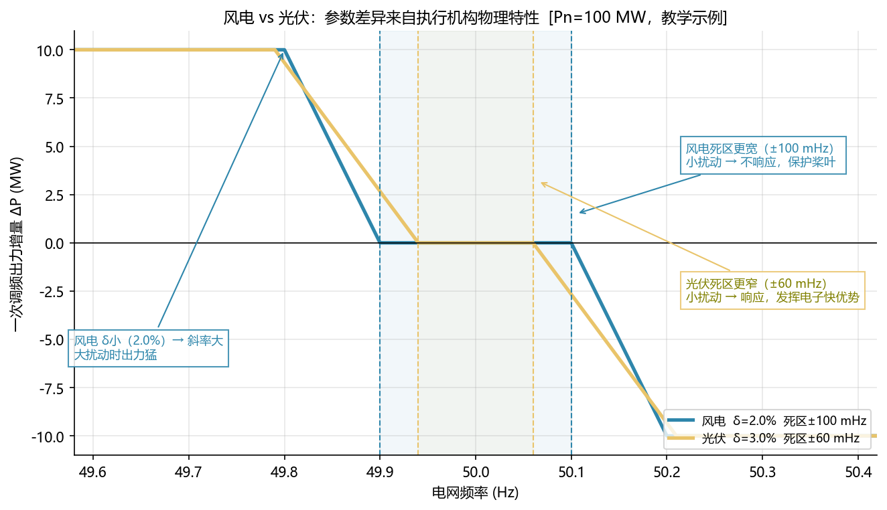
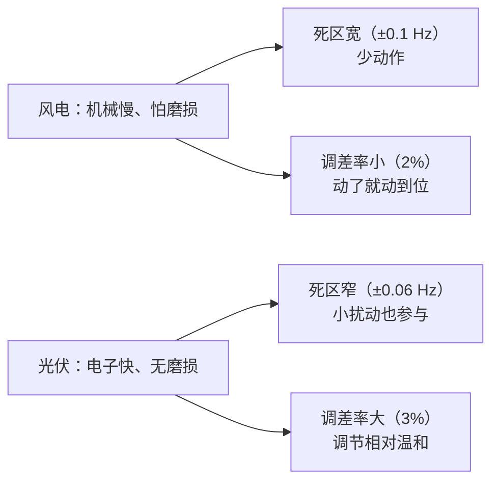
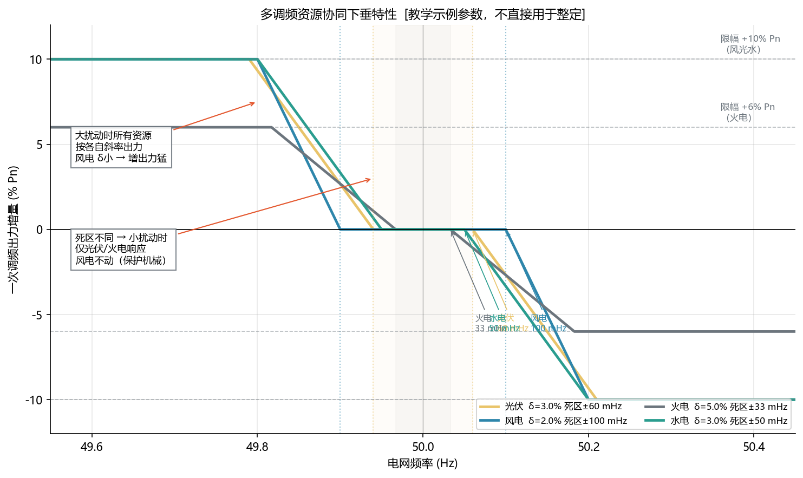
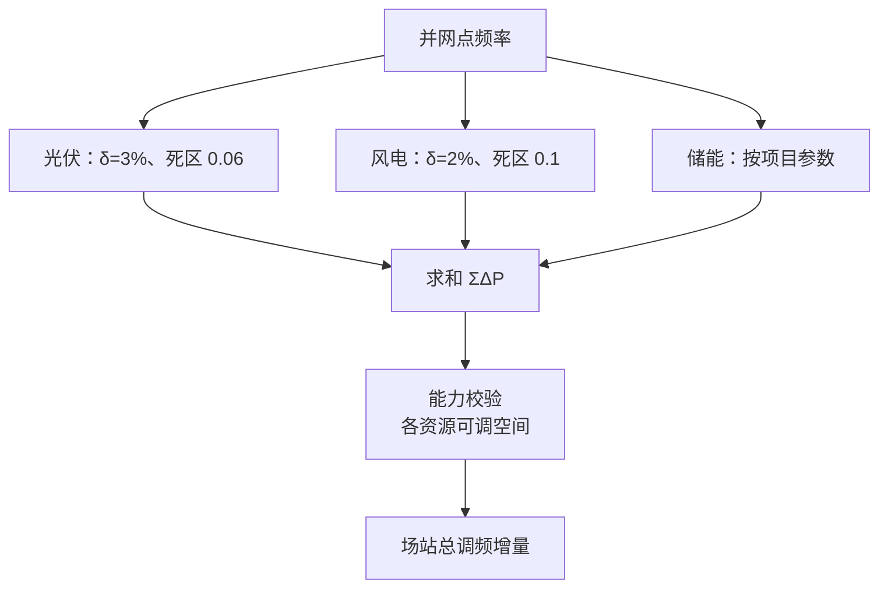
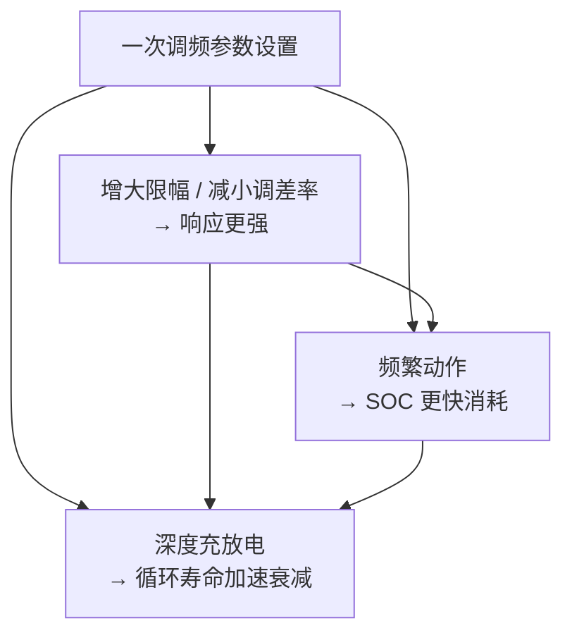

<!-- @AI_GENERATED -->
# 03 PFR多资源协同：风光储差异化策略

> 所属层面：① 参数层（差异化）
> [课程首页](README.md) · 上一章：[02 PFR核心参数](02_PFR核心参数与调差特性.md) · 下一章：[04 PFR时序分解与贡献率](04_PFR时序分解与贡献率.md)

**一句话**：风电和光伏用两套不同的死区与调差率，不是标准"偏心"，而是**机械磨损与电力电子快响应两种物理约束的必然结果**；而多资源协同要解决的，是让这些不同的响应特性在同一个电网里不互相抵消。

## 现场场景【必读】

同一座华东 100 MW 储能电站还配套了 60 MW 光伏和 40 MW 风电——也就是说，一次调频要同时管三个资源。周五的远程联调会议上，调度中心发来一组对比数据：

> "你们场站在今天 14:23 的频率事件中，场站总出力变化量只有 1.6 MW。按 100 MW 场站总容量和 δ=3% 来算，理论值应该是 2.67 MW。差了 40%。"

现场工程师回了一句："不可能。我们严格按照风电 δ=2%、光伏 δ=3% 来配置的，参数核对过三遍了。"

调度回了一句："那为什么 49.90 Hz 时风电出力是 0？"

沉默了三秒，你意识到：**49.90 Hz 与 50 Hz 差了 0.1 Hz，恰好等于风电的死区宽度**。风电在死区边界上纹丝不动，整个场站的调频能力只剩光伏在扛。而调度是按"场站一体"的视角来衡量总响应的——**他能看到的只有并网点的总功率变化，看不到你里面风电有没有出力**。

这就是多资源协同的核心课题：不是每个资源各自跑对参数就够了，**你必须让场站的合成响应看起来像一台"等值机组"**。

## 本章目标

读完本章，你应能：

1. 解释为什么风电死区比光伏宽、调差率比光伏小；
2. 读出多资源协同曲线中各类型电源的限幅与折点；
3. 在混合场站（风 + 光 + 储）里正确合成一次调频增量，避免内部抵消。

## 为什么风电和光伏参数不同【必懂】

技术报告给出的参数对照 `[汇报口径]`：

| 参数 | 风电 | 光伏 | 差异方向 |
|---|---|---|---|
| 一次调频死区 | ±0.1 Hz | ±0.06 Hz | 风电更宽 |
| 调差率 | 2% | 3% | 风电更"陡"（同等频差下出力更大） |
| 功率限幅 | 10% Pn | 10% Pn | 相同 |

初看有点矛盾：风电死区**更宽**（小扰动不响应），但调差率**更小**（大扰动时出力更猛）。这不是随意组合，背后是两条不同的物理约束。



**图中标注对照表**：

| 标注 | 含义 | 数值 |
|---|---|---|
| 蓝色曲线 | 风电 δ=2%, 死区 ±100 mHz | K=100 MW/Hz |
| 黄色曲线 | 光伏 δ=3%, 死区 ±60 mHz | K=66.67 MW/Hz |
| 蓝色阴影区 | 风电死区（更宽） | ±100 mHz |
| 黄色阴影区 | 光伏死区（更窄） | ±60 mHz |
| 标注 "风电死区更宽…保护桨叶" | 宽死区的设计意图 | 小扰动不响应 |
| 标注 "风电 δ小→斜率大" | 大扰动时出力更猛 | 补偿机械响应慢 |
| 标注 "光伏死区更窄…电子快优势" | 窄死区的设计意图 | 小扰动也参与 |

> **验证一致性**：执行 `python figures/ch03_multi.py`，对照输出的 `numbers` 清单与图中标注。

### 风电的约束：机械磨损

风电机组调频要动的是**变桨机构**和**转速控制**：

| 环节 | 特点 | 后果 |
|---|---|---|
| 变桨执行机构 | 机械液压/电动，动作有磨损 | 频繁小幅动作会缩短寿命 |
| 桨叶载荷 | 出力调整伴随载荷波动 | 长期频繁调节加剧疲劳 |
| 响应速度 | 受变桨速率限制，通常秒级 | 无法做到电力电子级的快 |

所以对风电：**死区设宽**，让日常小幅频率波动不触发变桨；**调差率设小**，一旦真的发生大扰动，就尽快把出力调到位（因为机械动作慢，只能靠"动作幅度大"来补偿"动作速度慢"）。

技术报告的原话是："避免电网小扰动下风机频繁动作造成的风机桨叶磨损，同时大扰动下，对大电网频率快速恢复起到积极作用。"

### 光伏的约束：能量与辐照

光伏调频靠的是**逆变器的有功指令**，没有机械环节：

| 环节 | 特点 | 后果 |
|---|---|---|
| 执行机构 | 纯电力电子，百毫秒级 | 可以频繁、精确动作 |
| 调节代价 | 几乎无机械损耗 | 死区可以设窄 |
| 向上能力 | 受当前辐照与逆变器容量限制 | 满发时没有上调空间 |

所以对光伏：**死区设窄**，把电力电子的快速响应优势用起来；**调差率设大（3%）**，相对温和，避免在辐照波动时频繁大幅调整、也避免快速耗尽可调裕度。

### 一句话对照



> **设计哲学**：参数不是"越灵敏越好"，而是**匹配执行机构的物理特性**。给机械系统配电子级的灵敏度，只会加速磨损；给电子系统配机械级的迟钝，则浪费了它唯一的核心优势。

> **本章的定位声明**：本章展开介绍了火电、水电、风电、光伏、储能的调频参数与物理限制，目的是让你理解**电网侧各资源的协同逻辑**。对以新能源/储能为主的 EMS 开发者来说，**火电/水电参数不需要你在 EMS 里直接配置**，但需要你理解：为什么新能源的调差率按 2%~3% 设、死区按 mHz 级设——这些数字不是随便定的，是电网把所有资源排在一起后分配给新能源的"职责边界"。

---

## 多资源协同曲线【必懂】

技术报告给出的"多调频资源快速调频参数设置方案"曲线，把光伏、风电、水电、火电放在同一张下垂特性图上：



**图中标注对照表**：

| 标注 | 含义 | 数值 |
|---|---|---|
| 黄色曲线（光伏） | δ=3%, 死区 ±60 mHz, 限幅 ±10% Pn | K=66.67 MW/Hz |
| 蓝色曲线（风电） | δ=2%, 死区 ±100 mHz, 限幅 ±10% Pn | K=100 MW/Hz |
| 灰色曲线（火电） | δ=5%, 死区 ±33 mHz, 限幅 ±6% Pn | K=40 MW/Hz |
| 绿色曲线（水电） | δ=3%, 死区 ±50 mHz, 限幅 ±10% Pn | K=66.67 MW/Hz |
| 标注框 "小扰动时仅光伏/火电响应" | 对应死区差异的分工 | Δf < 0.06 Hz |
| 标注框 "大扰动时所有资源" | 风电 δ 小→出力猛 | Δf > 0.1 Hz |

> **重要声明**：上图是[教学示例]，火电死区 ±0.033 Hz、各资源的精确限幅点需以项目适用细则为准。

### 协同的两条理由

技术报告给出采用差异化设置方案的两条理由：

1. **避免小扰动下的无效动作**：差异化设置可避免电网小扰动下风机频繁动作造成的桨叶磨损，同时在大扰动下对大电网频率快速恢复起到积极作用；
2. **统筹各类型电源的快速调频能力**：能够较好统筹各类型电源快速调频能力，完成各类型机组快速调频行为的协同配合。

第二条尤其重要。如果所有电源都用同一套激进参数，小扰动时全网一起动，机械设备被反复折腾；如果都用同一套迟钝参数，大扰动时补不上缺口。**差异化参数本质上是把"灵敏度"分配给合适的资源**。

---

## 混合场站的一次调频合成【必懂】

现实中的光储电站、风光储一体化电站，场站内往往有多个类型的调节资源。这时 EMS 面对的问题变成：**一个并网点频率，如何分配给内部多个资源**。

### 三种合成策略

| 策略 | 做法 | 优点 | 缺点 |
|---|---|---|---|
| 统一计算 | 按场站总 Pn 与统一参数算一个 ΔP，再按容量比例分配 | 实现简单，口径统一 | 忽略了资源特性差异，机械资源被过度使用 |
| 分类计算 | 每个资源按自己的死区、调差率单独算 ΔP，再求和 | 贴合协同曲线，各资源特性保留 | 需要维护多套参数，配置复杂 |
| 分类计算 + 能力校验 | 分类计算后，按各自可调空间裁剪，再求和 | 最接近真实可行出力 | 实现最复杂，需实时能力数据 |

技术报告的多资源协同方案对应**分类计算**的思路。工程上通常采用第三种，因为必须处理"理论值出不来"的情况。

### 合成时的三个坑【必懂】



| 坑 | 表现 | 根因 |
|---|---|---|
| 内部抵消 | 场站总出力没变，但内部光伏减、储能增 | 各资源方向约定不一致 |
| 基准混淆 | 分配结果与理论值系统性偏差 | 用场站总 Pn 算 K，却按单资源 Pn 限幅 |
| 重复计数 | 总增量超过理论值 | 储能既参与一次调频又响应 AGC，两者叠加未去重 |

**第一个坑最隐蔽**：如果光伏逆变器以"发电为正"、储能 PCS 以"充电为正"，两者求和时符号相反，场站总出力会出现"内部循环"——光伏多发 5 MW、储能充 5 MW，并网点净出力不变，但一次调频考核判"未响应"。

**第二个坑是量纲问题**：K 必须与限幅用同一个 Pn 基准。如果用场站总 Pn 算 K，再用单机 Pn 算限幅，结果会小一个数量级。

### 分配示例【必懂】

设场站由 60 MW 光伏 + 40 MW 风电组成，总 Pn = 100 MW。频率跌至 49.90 Hz（`Δf = −0.10 Hz`）。

**分类计算**：

| 资源 | Pn | δ | K | 死区 | Δf_eff | ΔP_raw | 限幅 | ΔP 输出 |
|---|---:|---:|---:|---:|---:|---:|---:|---:|
| 光伏 | 60 MW | 3% | 40 MW/Hz | 0.06 | −0.04 | +1.60 MW | ±6 MW | **+1.60 MW** |
| 风电 | 40 MW | 2% | 40 MW/Hz | 0.1 | −0.00 | +0.00 MW | ±4 MW | **0 MW** |
| 合计 | 100 MW | — | — | — | — | — | — | **+1.60 MW** |

注意风电这一行：`Δf = −0.10 Hz` 恰好等于风电死区 0.1 Hz，**出力为零**。如果误用光伏的死区给风电算，就会得到 `40 × 0.04 = 1.6 MW` 的错误增量，场站总出力会超出理论值 1.6 MW。

这个例子说明：**差异化参数不只是"参数不同"，它会改变场站在特定频率下的响应行为**。

---

## 储能在一次调频中的定位与角色【必懂】

技术报告的多资源协同曲线没有单独画储能，但储能的实际作用需要单独说明：

| 维度 | 储能的特点 | 对参数的影响 |
|---|---|---|
| 响应速度 | 百毫秒级，比风电快得多 | 死区可以设窄 |
| 调节方向 | 双向，可从满充切到满放 | 上下空间通常都充足 |
| 能量约束 | 受 SOC 限制，持续能力有限 | 需要考虑能量预算，不能只看功率 |
| 机械损耗 | 无 | 可以频繁动作 |

工程上储能常见两种定位：

1. **作为独立调频资源**：按自己的参数计算 ΔP，与风光并列求和；
2. **作为"补差资源"**：先算风光能出多少，差额由储能补齐。

第二种在混合场站里更常见，因为它能让场站整体响应更接近理论下垂特性。但它带来一个必须处理的问题：**储能的能量会被持续消耗**。如果频率长时间偏低，风光已到限幅、储能持续放电，SOC 会一直下降，直到触及下限退出调频。

这部分与[入门课程 15.9（SOC 管理）](../ems-python-learning/15_频率与一次调频.md)的结论一致：一次调频的能量预算是必须提前设计的，不能靠"跑到没电再说"。

---

## 深入：为什么调差率与限幅要一起看【深入】

<details>
<summary>只调调差率、不改限幅的后果</summary>

调差率决定"斜率"，限幅决定"天花板"。两者组合决定了达到限幅的频率点：

```text
达到限幅的频率偏差 = 死区 + 限幅值 / K
                  = 死区 + 限幅值 × δ × fn / Pn
```

以风电 `Pn = 100 MW`、`δ = 2%`、`限幅 = 10 MW` 为例：`0.1 + 10 × 0.02 × 50 / 100 = 0.1 + 0.1 = 0.2 Hz`。

如果只把调差率从 2% 改到 3%（更温和），限幅不变：

```text
K = 100 / (0.03 × 50) = 66.67 MW/Hz
达到限幅点 = 0.1 + 10 / 66.67 = 0.1 + 0.15 = 0.25 Hz
```

也就是**到达满出力的频率点从 0.2 Hz 推后到 0.25 Hz**，在大扰动下响应更慢。反之，若只把限幅从 10% 改到 6%（更保守），斜率不变但天花板降低，达到限幅点提前到 `0.1 + 6/100 = 0.16 Hz`。

**结论**：改任何一个参数，都要重新核对整条特性曲线的折点，并在试验中验证（[08 章](08_PFR并网联调验收.md)）。

</details>

<details>
<summary>为什么火电限幅只有 6% Pn</summary>

火电机组的调节能力受两个物理限制：

1. **向上**：受锅炉蓄热与主蒸汽压力限制，短时间内大幅增出力会拖垮汽轮机参数；
2. **向下**：受**最低稳燃负荷**限制，不能无限减出力，否则锅炉熄火。

这两条限制都比储能的"SOC 约束"更硬——储能至少还能通过能量管理提前准备，火电的机械与热力惯性无法靠软件规避。所以火电在一次调频里的限幅通常比其他资源更小，承担"持续但幅度有限"的角色。

</details>

---

## 储能调频的容量-能量-寿命三角【必懂】

储能是一次调频里最灵活的资源，但它有三个互锁的约束，共同构成一个"三角"：**容量（功率上限）⇄ 能量（SOC 续航）⇄ 寿命（循环衰减）**。调任何一项，另外两项都会受影响。



### 三个维度逐一展开

#### ① PCS 过载能力：调频的隐藏储备

多数功率转换系统（PCS）支持**短时过载**，这是普通下垂公式没有利用的"隐藏储备"：

| PCS 过载能力 | 持续时间 | 对应的一次调频窗口 |
|---|---|---|
| 1.1 pu | 10 min | 覆盖绝大多数一次调频事件 |
| 1.2 pu | 1 min | 覆盖严重事故的初期 |
| 1.5 pu | <10 s | 仅可用于 FFR/虚拟惯量 |

> **工程含义**：如果 PCS 额定 50 MW，1.1 pu 过载能力意味着短时可以提供 55 MW 的上调空间。这 5 MW 不会被记录为 Pn 的 10%，但在考核系统里，理论值 ΔP_theory 仍按 Pn=50 MW 算，多出来的 5 MW 不会让积分电量加分——**所以过载能力只能用来"解决突发能力不足"，不能用来"提高考核成绩"**。

EMS 如果要利用过载能力：

- 必须在 PCS 温度、器件应力可承受范围内
- 建议只在"频率跌到接近低频减载阈值"的极端场景才释放
- 释放后降额冷却时间需明确记录

#### ② SOC 恢复策略：从"调完就跑"到"可控回归"

SOC 在一次调频中持续偏离中位是正常现象，危险的是**从来不恢复**：

| 情况 | SOC 变化 | 风险 |
|---|---|---|
| 连续多次低频事件 | SOC 持续下降 | 接近下限 → 失去上调能力 |
| 连续多次高频事件 | SOC 持续上升 | 接近上限 → 失去下调能力 |
| 中长期漂移 | SOC 偏离 50% 中位 | 某一方向的调频能力持续削弱 |

恢复策略的核心问题是**什么时候恢复、以多大速率恢复**：

```text
策略一：频率回死区后立即恢复（被动）
  → 问题：频率刚稳定就反向出力，可能造成二次扰动

策略二：滞后恢复 + 限速率（推荐）
  → 频率稳定在死区内 ≥ N 分钟（如 5 min）后启动恢复
  → 以低速率（如 0.05~0.1 pu/min）缓慢回到 SOC 中位
  → 恢复过程中如果频率再次越死区，立即中止恢复、归回调频

策略三：利用电价低谷充电恢复（经济最优）
  → 结合电力市场信号，在低电价时段恢复 SOC
  → 需要 EMS 同时接入调频与电力市场两个业务模块
```

| 策略 | 对一次调频的影响 | 适用场景 |
|---|---|---|
| 被动恢复 | 可能引发二次扰动，不建议 | — |
| 滞后 + 限速率 | 安全但慢，半小时才能恢复 5% SOC | 绝大多数场景 |
| 经济恢复 | 不影响调频，但需要市场接口 | 参与现货市场的储能电站 |

> **一条经验**：不管用哪种策略，恢复过程中**产生的一切出力变化都必须有独立标记**，不能混进一次调频的积分计量——否则考核系统会认为这是一次"反向调频动作"。

#### ③ 不同电池化学体系的影响

| 特性 | 磷酸铁锂（LFP） | 三元锂（NMC） | 对一次调频参数的影响 |
|---|---|---|---|
| 标称倍率 | 0.5~1C | 0.5~2C | 影响可用限幅（不能超过持续倍率对应的功率） |
| 循环寿命 | 4000~6000 次 | 2000~3000 次 | LFP 更能承受频繁动作，可设更窄死区 |
| 日历衰减 | ~2%/年 | ~3%/年 | 投产 5 年后可用容量变化需更新 Pn |
| 内阻增长 | 缓慢 | 较快（尤其高 SOC 下） | 内阻大时实际出力可能略低于指令值 |

**工程结论**：LFP + 一次调频是一组合适的搭配（寿命长、倍率适中）；NMC 机组如果参与一次调频，建议把死区设宽 20%~30%，以减少不必要的浅循环。

### 深入：多机并联的功率摆动风险【深入了解】

<details>
<summary>为什么多个调频资源同时投入可能出现低频振荡</summary>

当多个具备下垂控制的电源（储能 PCS、风机变流器、光伏逆变器）并联运行时，各资源的响应速度不同（储能毫秒级、光伏秒级、风电数秒级），在频率穿越死区后可能出现**出力在你我之间来回摆动**的低频振荡（0.1~2 Hz）。这是一种经典的电力系统稳定问题。


| 风险来源 | 机制 | 对策 |
|---|---|---|
| 响应速度差 | 快资源（储能）先动→频率回缩→慢资源才动→总出力短暂过冲 | 分类计算时给快资源加 ramp rate 限速 |
| δ 设置不一致 | 某资源 δ 太小（太敏感），小幅频率波动就大幅出力 | 同场站内各资源 δ 差异不超过 1 个百分点 |
| 死区边界抖动 | 频率刚出死区就被出力拉回，反复穿越 | mindwell 防抖（≥2 s 连续越死区才判有效） |
| 通信延迟差异 | GOOSE 直连 vs Modbus 轮询的时差造成出力时刻错位 | 关键资源统一用 GOOSE，非关键资源用同一种轮询周期 |

> **工程经验**：大多数现场出现功率摆动时，首因不是"算法写错"，而是储能 PCS 的 ramp rate 设得太高（例如每秒 100% Pn）。给储能 PCS 加一个 0.5~1 秒的 ramp rate（即每秒最多增/减 50%~100% 限幅值），通常就能消除。

</details>

### 三角总结

| 你要什么 | 参数怎么设 | 代价 |
|---|---|---|
| 响应更快 | 死区更窄 | SOC 消耗加速 |
| 出力更大 | 调差更小 + 限幅更大 | SOC 消耗更快、循环寿命缩短 |
| 延寿 | 死区更宽 + 限幅缩小 | 响应变弱、考核可能不过 |

**这三个目标不能同时最优。EMS 的参数整定本质上是在三角里找一个项目能接受的点。**

---

## 自测

1. 为什么风电死区更宽但调差率更小？请从执行机构特性解释。
2. 60 MW 光伏 + 40 MW 风电，频率 50.08 Hz，按分类计算策略，各资源出力是多少？
3. 混合场站出现"总出力不变、内部光伏减储能增"，最可能是什么问题？
4. 如果只把风电调差率从 2% 调到 3%、限幅保持 10% Pn，达到限幅的频率点会怎么变？

<details>
<summary>参考答案</summary>

1. 风电靠变桨机构和转速控制调节，动作慢且有机械磨损，所以死区设宽以减少日常小幅动作；一旦发生大扰动，由于机械动作慢，只能靠更大的动作幅度（更小的调差率）来补偿速度不足，尽快把出力调到位。光伏是纯电力电子执行，无磨损、响应快，所以死区可以设窄，同时用较大的调差率保持温和调节。
2. `Δf = +0.08 Hz`。光伏死区 0.06，`Δf_eff = +(0.08 − 0.06) = +0.02`，`K = 60/(0.03×50) = 40 MW/Hz`，`ΔP = −40 × 0.02 = −0.8 MW`（减出力）。风电死区 0.1，`0.08 < 0.1`，出力为 0。合计 −0.8 MW。
3. 方向约定不一致。光伏以"发电为正"、储能以"充电为正"，求和时符号相反，导致场站内部出现功率循环，并网点净出力不变。
4. `K` 从 100 MW/Hz 降到 66.67 MW/Hz，达到限幅点从 `0.1 + 0.1 = 0.2 Hz` 推后到 `0.1 + 0.15 = 0.25 Hz`，大扰动下响应变慢。

</details>

> 💻 **动手实验**：运行 `python lab/ch03_multi_resource.py` 对比风光储三类资源在同一频率扰动下的差异化出力分配与混合场站合成策略。

<!-- @AI_GENERATED: end -->
