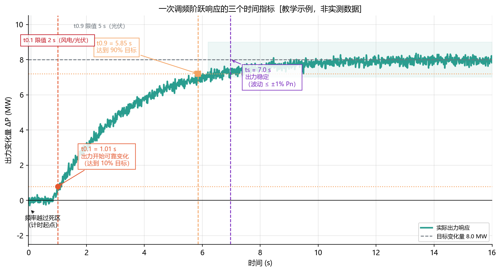
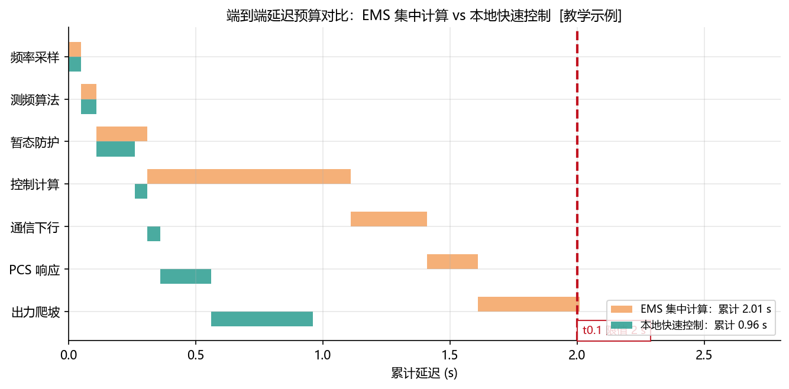
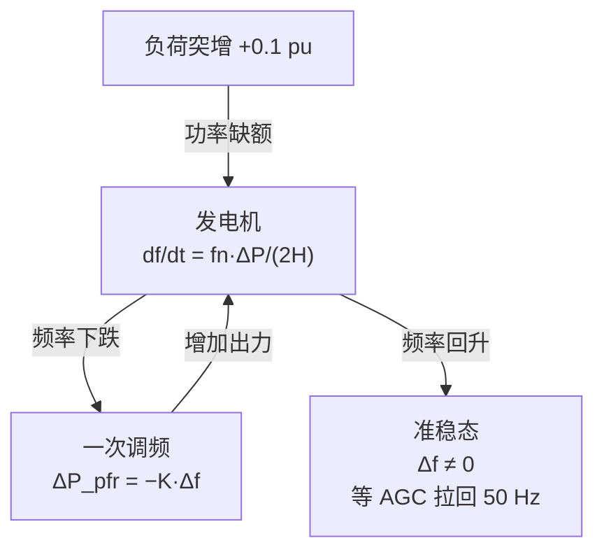

<!-- @AI_GENERATED -->
# 04 PFR时序分解与贡献率算法

> 所属层面：② 时序层 + ③ 精度层
> [课程首页](README.md) · 上一章：[03 PFR多资源协同](03_PFR多资源协同策略.md) · 下一章：[05 PFR跨区考核适配](05_PFR跨区考核适配.md)

**一句话**：一次调频的六个性能指标不是"六条并列要求"，而是**一条时间链上的六个检查点**——测频、采样、计算、下发、执行、稳定，任何一环慢下来，后面的指标都会连带失守。

## 现场场景【必读】

并网试验当天，试验单位把频率信号从 50.00 Hz 阶跃到 49.90 Hz。旁边示波器亮着，工程师盯着秒表。三十秒后，试验负责人抬起头：

"你们的 t0.9 超了。光伏限值是 5 秒，你们实际用了 7.2 秒。"

你有点困惑——控制代码你是看过的，`primary_freq_delta` 函数执行时间不到 1 ms，怎么整个链路的响应会到 7 秒？

打开时序日志才发现问题不是出在"计算"上：

- 频率通过 Modbus TCP 从电表到 EMS，采集周期 500 ms（不是设想的 100 ms）
- 暂态防护窗口设了 300 ms 的"连续确认"逻辑
- 计算出的 ΔP 指令在通信队列里等了 200 ms
- PCS ramp rate 设得保守，从 0 爬到 5 MW 花了 3 秒

**每一步单独看都"没毛病"，加起来就是 7.2 秒。**六项指标分散在不同的子系统里，只有画出端到端时序图，才能看到预算到底被谁吃光了。

## 本章目标

读完本章，你应能：

1. 列出六项性能指标及其限值，并说明每一项卡在链路的哪一环；
2. 区分 t0.1、t0.9、ts 三个时间指标的定义与用途；
3. 做一份端到端延迟预算，判断一次调频该放在 EMS 还是 PCS。

## 六项指标全貌【必懂】

技术报告给出的新能源场站快速频率响应性能要求 `[汇报口径]`：

| 序号 | 指标 | 要求 | 卡在链路哪一环 |
|---|---|---|---|
| ① | 调频控制偏差 | 风电 ±2% Pn 以内；光伏 ±1% Pn 以内 | 计算口径与能力校验 |
| ② | 测频精度 | 频率测量分辨率不大于 0.003 Hz | 频率采集与算法 |
| ③ | 频率采样周期 | 不大于 100 ms | 采集与通信 |
| ④ | 暂态过程要求 | 应能躲过单一路短路故障引起的瞬时频率突变 | 滤波与防误动 |
| ⑤ | 有功控制周期 | 不大于 1 s | 控制循环 |
| ⑥ | 响应性能 | 响应滞后 t0.1、响应时间 t0.9、调节时间 ts | 全链路 |


注意箭头的方向：**偏差是最后一个指标，也是所有前序环节的"总成绩"**。前面任何一环出问题，最终都会表现为"控制偏差超标"。

---

## 测频精度与调频控制偏差（指标①②）【必懂】

### 测频精度：0.003 Hz 意味着什么

频率测量分辨率不大于 **0.003 Hz**。换算成"每秒采样点"的直觉：

| 分辨率 | 相对 50 Hz 的比例 | 对应死区 ±0.06 Hz 的"刻度数" |
|---|---|---|
| 0.003 Hz | 0.006% | 0.06 / 0.003 = **20 格** |
| 0.001 Hz | 0.002% | 60 格 |

也就是说，死区边界附近有 20 个可分辨的刻度。如果测频分辨率只有 0.01 Hz，死区边界就只有 6 格，**边界附近的判断会非常粗糙**，容易出现"刚越死区但算不出小出力"的现象。

> **工程含义**：0.003 Hz 的精度要求，意味着不能用"数周波数"的粗糙方法测频，必须用**带时标的定点采样 + 过零插值或 DFT 相位法**。这一点在[06 章](06_PFR控制链路实现.md)会具体讲。

### 调频控制偏差：光伏比风电更严

| 电源 | 控制偏差要求 | 为什么更严 |
|---|---|---|
| 风电 | ±2% Pn | 机械调节本身有滞后与超调 |
| 光伏 | ±1% Pn | 电力电子可精确跟踪，没有理由偏差大 |

这里有个容易忽略的推论：**控制偏差是按 Pn 的百分比算的，不是按当前出力算的**。一个 100 MW 光伏场站，±1% Pn = ±1 MW；如果当前只出力 20 MW，1 MW 的偏差相当于当前出力的 5%——**相对误差在低出力时被放大**。

所以低辐照、低出力时段，控制偏差更容易超标。这也是很多场站"晴天考核合格、阴天考核不合格"的原因之一。

---

## 采样周期与控制周期（指标③⑤）【必懂】

### 采样周期 ≤100 ms 与控制周期 ≤1 s

这两个数字的差距（10 倍）说明一件事：**采集可以快，但控制不必那么快**。

| 环节 | 周期要求 | 典型实现 | 说明 |
|---|---|---|---|
| 频率采样 | ≤100 ms | 20 ms（每工频周波）或 50 ms | 保证 t0.1 判断有足够分辨率 |
| 有功控制 | ≤1 s | 200 ms ~ 1 s | 控制指令刷新周期 |

为什么控制周期允许到 1 s？因为 t0.1 的限值是 2 s，控制周期 1 s 仍在预算内。但要注意：**1 s 是上限，不是目标**。如果控制周期取满 1 s，剩余预算只有 1 s 留给通信与执行。

### 周期与指标的关系

```text
t0.1 预算 = 采样延迟 + 计算延迟 + 通信延迟 + 执行延迟
采样延迟 ≤ 1 个采样周期（≤100 ms）
计算延迟 ≤ 1 个控制周期（≤1 s）
```

如果采样周期取 100 ms、控制周期取 1 s，仅这两项就占用了 `1.1 s`，**留给通信与 PCS 执行的只剩 0.9 s**。这对 EMS 集中计算方案是相当紧的（见本章末的延迟预算）。

---

## 指标④：暂态过程要求【必懂】

### 什么是"瞬时频率突变"

单一路（单相）短路故障时，故障点附近的电压波形会短时畸变，测频装置可能算出**虚假的频率跳变**——实际电网频率没有变，但测量值瞬间跳了几十甚至几百毫赫兹。

如果一次调频不做防护，就会因为一次短路故障误动作：瞬间大幅增/减出力，故障切除后又立刻反向，形成**出力震荡**。

技术报告的要求是：**新能源场站快速频率响应功能应能躲过单一路短路故障引起的瞬时频率突变**。

### 三种防护手段

| 手段 | 做法 | 代价 |
|---|---|---|
| 时窗确认 | 频率越死区后需持续 N 个采样周期才动作 | 增加 t0.1 延迟 |
| 变化率限制 | 频率变化率超过阈值时暂不响应 | 对真实快速事故也延迟 |
| 质量位校验 | 电压跌落/畸变时置数据无效，暂停调频 | 需要设备提供质量位 |

这三种手段都**用时间换可靠性**，而 t0.1 只有 2 s 的预算。工程上常见组合是"短时窗确认（2~3 个采样周期，约 100~300 ms）+ 质量位校验"。

> **关键取舍**：防护窗口越长越可靠，但吃掉 t0.1 预算。这个参数必须在试验中实测验证，不能凭经验定（[08 章](08_PFR并网联调验收.md)）。

---

## 指标⑥：三个时间指标的精确含义【必懂】

这三个指标名字相近、含义完全不同，是最容易混淆的部分。



**图中标注对照表**：

| 标注 | 含义 | 数值（示例） |
|---|---|---|
| 绿色实线 | 实际出力响应（一阶 + 时延 + 噪声） | τ=2.5 s, delay=0.8 s |
| 灰色虚线 | 目标变化量 8 MW | 对应限幅以内 |
| 橙色水平虚线 | t0.9 参考线（目标 90%） | 7.2 MW |
| 橙色水平虚线（低） | t0.1 参考线（目标 10%） | 0.8 MW |
| 红色虚线 | t0.1 = 2.02 s | 限值 2 s |
| 橙色虚线 | t0.9 = t 时刻 | 限值 5 s（光伏） |
| 紫色虚线 | ts = 稳定时刻 | 限值 15 s |
| 绿色稳定带 | 波动 ≤ ±1% Pn 区间 | ±1 MW |

> **注意**：上图是[教学示例]模拟曲线，τ 与 delay 取自教学参数，**不是实测数据**。每个项目的实际响应特性必须以阶跃试验实测为准。

### 定义与限值

| 指标 | 定义 | 风电 | 光伏 |
|---|---|---|---|
| 响应滞后时间 t0.1 | 自频率越过调频死区开始，到发电出力**可靠地向调频方向开始变化**所需的时间 | ≤ 2 s | ≤ 2 s |
| 响应时间 t0.9 | 自频率超出调频死区开始，至有功功率调节量达到**调频目标值与初始功率之差的 90%** 所需时间 | ≤ 12 s | ≤ 5 s |
| 调节时间 ts | 自频率超出调频死区开始，至有功功率**达到稳定**（波动不超过额定出力 ±1%）的最短时间 | ≤ 15 s | ≤ 15 s |

### 限值是怎么定出来的【了解】

技术报告给出了这些限值的实测依据（试点新能源场站阶跃扰动实测平均值）：

| 指标 | 实测依据 | 定值 |
|---|---|---|
| t0.1 | 风电平均 2.35 s，光伏平均 2.14 s | 均取 ≤2 s（略严于实测均值） |
| t0.9 | 风电平均约 12 s，光伏平均 4.2 s | 风电 ≤12 s，光伏 ≤5 s |
| ts | 实测有功功率平均波动为额定出力的 0.71%，正常出力波动约 1%；达到稳定的时间风电、光伏均在 15 s 内 | 均取 ≤15 s |

这段依据说明了两件事：

1. **风电的 t0.9（12 s）远宽于光伏（5 s）**，这不是标准偏心，而是机械变桨的速度决定的；
2. **ts 的判据是"波动 ≤1% Pn"**，而这个 1% 恰好与"正常出力波动"的量级相同——也就是说，**判据本身就承认出力有约 1% 的自然波动**。

### ts 判据带来的实际困难【必懂】

如果正常出力波动就是 1% Pn，那么"波动不超过 ±1% Pn"这个判据在噪声较大时很容易被判为"未稳定"。实际工程上要注意：

| 问题 | 表现 | 应对 |
|---|---|---|
| 测量噪声大 | ts 被反复重算，永远不"稳定" | 用滑动窗口统计，而不是逐点比较 |
| 出力本身在变 | 风速/辐照变化导致出力漂移，被判未稳定 | 区分"调频响应"与"自然波动"的频段 |
| 限幅后无法达到目标 | 目标变化量达不到，90% 判据失效 | 用**实际可执行目标**计算 90%，而非理论目标 |

第三条最关键：如果理论目标 +8 MW 但可上调空间只有 3 MW，那么"90% 目标"到底按 8 MW 还是 3 MW 算？**必须按可执行目标算**，否则 t0.9 永远不可能达标。这一点要与调度提前确认口径（[07 章](07_PFR积分电量结算.md)）。

---

## 端到端延迟预算【必懂】

把六项指标串成一条链路，做一次延迟预算。以下数值为 `[教学示例]`，用于演示方法，不是实测值：



**图中标注对照表**：

| 标注 | 含义 | 数值 |
|---|---|---|
| 橙色堆叠条 | EMS 集中计算方案的各环节延迟 | 累计 2.01 s |
| 绿色堆叠条 | 本地快速控制方案的各环节延迟 | 累计 0.96 s |
| 红色竖线 | t0.1 限值 2 s | — |
| 七大环节 | 频率采样→测频算法→暂态防护→控制计算→通信下行→PCS响应→出力爬坡 | — |

> **结论**：EMS 集中计算方案的总延迟已逼近 2 s 红线，其中"控制计算"和"通信下行"是主要贡献项。本地快速控制将这两项压缩到 50 ms 级别，总预算回到安全区间。

| 环节 | 延迟 | 依据 |
|---|---|---|
| 频率采样 | ≤100 ms（取平均 50 ms） | 指标③ |
| 测频算法窗口 | 20~100 ms | 全周波 DFT 或滑动窗口 |
| 暂态防护确认 | 100~300 ms | 指标④的时窗 |
| 控制计算 | 200 ms~1 s | 指标⑤ |
| EMS → PCS 通信 | 100~500 ms | 协议与网络 |
| PCS 内部响应 | 100~300 ms | 设备特性 |
| 出力建立（ramp） | 数百 ms~数秒 | 变流器速率限制 |
| **合计（t0.1 前）** | **约 0.6~2.2 s** | 对比限值 2 s |

### 用贯穿式案例走一遍【必懂】

为了让"延迟预算"从概念落地到数值，下面用贯穿式教学案例（`Pn = 100 MW` 光伏，`δ = 3%`，死区 `±0.06 Hz`）取一组典型配置走一遍完整链路：

| 环节 | 本例取值 | 说明 |
|---|---|---|
| ① 频率采样 | 100 ms | 取上限，保守预算 |
| ② 测频 DFT（2 周波） | 40 ms | 每工频周波 20 ms × 2 |
| ③ 暂态防护（3 周期确认） | 300 ms | 3 × 100 ms 采样周期 |
| ④ 控制计算 | 200 ms | EMS 侧控制循环 |
| ⑤ EMS → PCS 通信 | 200 ms | 104 规约或 Modbus TCP |
| ⑥ PCS 内部响应 | 150 ms | 典型逆变器指令跟踪 |
| ⑦ 出力 ramp（至 90% 目标 6 MW） | ~2.0 s | 以 3 MW/s 爬坡到 6 MW 的 90% ≈ 5.4 MW |
| **①~⑥ 累加（t0.1 前）** | **0.99 s** | 距离 2 s 红线尚有 1.01 s 余量 |
| **+ ⑦ 到 t0.9（出力达 90%）** | **≈ 2.99 s** | 对比光伏 t0.9 限值 5 s，仍有裕度 |

> **关键结论**：本例中，①~⑥ 五项纯延迟合计 ≈ 1.0 s，第⑦项 ramp 时间 ≈ 2.0 s，总 t0.9 ≈ 3.0 s —— 距 5 s 限值尚有余量，但 **控制周期、通信延迟、防护窗口三者中任何一项若取上限（如控制周期 1 s + 通信 500 ms），即接近临界值**。这就是 ch06 建议把一次调频放到本地快速控制装置的原因。

结论很直接：**EMS 集中计算方案处在预算边缘**。如果控制周期取 1 s、通信 500 ms，仅这两项就 1.5 s，加上采样与防护必然超 2 s。

### 两种部署方案

| 方案 | 延迟 | 优点 | 缺点 | 适用 |
|---|---|---|---|---|
| EMS 集中计算 | 大（1~2 s+） | 逻辑集中，与其他功能仲裁方便 | 难满足 t0.1 | 响应要求宽松的项目 |
| 本地快速控制（PCS/专用装置） | 小（100~300 ms） | 延迟小，易满足 t0.1 | EMS 需知道本地实际出力 | 大多数新能源场站 |

技术报告在"直流送端近区参数优化"部分讨论的快速调频，实际也是按**本地快速实现**的思路设计的。EMS 在本地方案中的职责是：

| EMS 职责 | 说明 |
|---|---|
| 参数下发与一致性 | 保证 EMS 配置与 PCS 实际运行参数一致 |
| 投退控制 | 远方投入/退出一次调频 |
| 状态监视 | 监视本地调频是否动作、动作量多少 |
| 事件记录 | 记录频率、理论出力、实际出力（带统一时标） |
| 数据上送 | 供调度考核与结算 |

> **注意最后一项**：即使一次调频在 PCS 里执行，**考核用的数据仍然要由 EMS 记录和上送**。所以"功能放在 PCS 里"不等于"EMS 可以不管"。

---

## 深入：t0.1 的"可靠地开始变化"如何判定【深入】

<details>
<summary>判据本身就是一个工程问题</summary>

"出力可靠地向调频方向开始变化"这句话没有给出量化判据。实际试验中常见的几种判定方式：

| 判据 | 定义 | 问题 |
|---|---|---|
| 超过噪声带 | 出力变化量超过正常波动的若干倍（如 3 倍标准差） | 噪声大时判得晚 |
| 超过固定阈值 | 出力变化量超过 Pn 的某百分比（如 0.5%） | 小目标时判不出来 |
| 斜率判据 | 出力变化率超过阈值 | 对阶跃响应不友好 |

由于连续型死区在边界处斜率为 0（[02 章](02_PFR核心参数与调差特性.md)），**频率刚越死区时出力增长极慢**，用"变化量阈值"判定 t0.1 会偏保守。这就是为什么技术报告把 t0.1 定在 2 s——它必须能容纳"出力从零开始缓慢爬升"的阶段。

**实践建议**：在试验前与试验单位确认 t0.1 的判定方法，并把它写进试验方案，避免事后争议。

</details>

<details>
<summary>为什么光伏 t0.9 是 5 s 而风电是 12 s</summary>

t0.9 是"达到 90% 目标变化量"的时间。对光伏，出力变化靠逆变器有功指令，爬升速率通常可达每秒数十个百分点 Pn，几秒内即可到位。对风电，出力变化要经过变桨执行机构，且受风况约束——即使变桨到位，实际捕获的风功率也需要时间跟上。

技术报告的实测均值（风电约 12 s、光伏 4.2 s）正好反映了这个物理差距。定值时分别取 ≤12 s 与 ≤5 s，给实测留了很小的余量。

**对 EMS 的含义**：如果项目是风光储混合场站，t0.9 应按**最慢资源**（风电）还是**各资源分别考核**来定？这一点必须在细则里确认，因为它决定了 ts/t0.9 的计算是"场站级"还是"资源级"。

</details>

---

## 频率动态的闭环视角【深入】

<details>
<summary>ΔP 发出去之后，电网频率会怎么变？——从开环计算到闭环系统</summary>

到目前为止，我们把一次调频描述为"频率→ΔP"的开环计算。但真实电网中，ΔP 又反过来影响频率——事故发生时，频率和出力是**同时演化**的。

### 单机系统的闭环动态

取一台简化同步发电机（H=4 s），施加 0.1 pu 负荷阶跃：



```text
t = 0−：  f = 50 Hz，P = 0.5 pu（所有功率标幺值以 Pn 为基准）
t = 0+：  负荷突增到 0.6 pu，功率缺口 ΔP = −0.1 pu
         df/dt = 50 × (−0.1) / (2×4) ≈ −0.625 Hz/s
t = 2s：  f ≈ 48.75 Hz，一次调频 ΔP_pfr ≈ +K×0.75 ≈ 50 MW（以 K=66.67 MW/Hz 估算）
         缺口缩小到 ≈ 0.05 pu，df/dt 放缓
t = 10s： f ≈ 49.85 Hz，一次调频 ΔP_pfr ≈ +K×0.15 ≈ 10 MW
         系统停在准稳态——缺口大部分被一次调频补上，但频率没有回到 50 Hz
t = 30s+：AGC 开始动作，逐步将频率拉回 50 Hz
```

### 两个关键认知

| 认知 | 说明 |
|---|---|
| 一次调频不能把频率拉回 50 Hz | P 控制有稳态误差——功率平衡后必须保留一个非零 Δf |
| K 越大，准稳态偏差越小 | 同样 0.1 pu 缺口，K=100 MW/Hz 时 Δf≈0.05 Hz，K=50 MW/Hz 时 Δf≈0.1 Hz |

### 频域视角（可选）

用 Laplace 域看这个闭环会更简洁。电网频率对负荷扰动的响应：

```text
          Δf(s)                   −fn
G(s) = ────────── = ─────────────────────────────
        ΔPe(s)      (2Hs + D) + fn·K + fn·K_inertia·s
```

- 分母中的 `fn·K`：提高了系统的**同步力矩系数**（K 越大，稳态偏差越小——P 的作用）
- 分母中的 `fn·K_inertia·s`：增大了系统的**有效惯量**（K_inertia 越大，RoCoF 越小——D 的作用）
- 分母中的 `2Hs`：发电机的**自然惯量**（火电退役后这个项变小——需要 VI 补上）

> **教学目的**：这个闭环视角让学生从"会用公式"跃迁到"理解物理"。不再觉得一次调频是一段孤立的代码，而是一个闭环反馈系统的一环。

</details>

## 自测

1. 六项指标中，哪一项是"总成绩"？为什么？
2. 测频分辨率 0.003 Hz 相对于死区 ±0.06 Hz 有多少个刻度？分辨率降到 0.01 Hz 会有什么后果？
3. t0.1、t0.9、ts 分别衡量什么？为什么风电的 t0.9 限值比光伏宽？
4. 某项目控制周期取 1 s、通信延迟 500 ms、采样周期 100 ms，仅这三项占多少延迟？还能满足 t0.1 ≤ 2 s 吗？
5. "不提前预留备用"与 t0.9 的 90% 判据冲突时，应该怎么处理？

<details>
<summary>参考答案</summary>

1. 调频控制偏差。因为测频、采样、控制周期、暂态防护、响应时间这五项，最终都会体现在"实际出力与理论出力的偏差"上，偏差超标往往是前序环节问题的表现。
2. `0.06 / 0.003 = 20` 格。分辨率降到 0.01 Hz 后只有 6 格，死区边界附近的判断变粗，刚越死区的小出力算不出来，容易出现"应动未动"或"动了但偏差大"。
3. t0.1 衡量"多久开始动"，t0.9 衡量"多久到 90%"，ts 衡量"多久稳定下来"。风电 t0.9 宽是因为变桨执行机构慢，且出力受风况约束，实测均值约 12 s；光伏靠逆变器指令，实测约 4.2 s。
4. `1.0 + 0.5 + 0.1 = 1.6 s`，只剩 0.4 s 给测频算法、暂态防护和 PCS 执行，**基本不可能满足 t0.1 ≤ 2 s**。必须缩短控制周期或改为本地快速控制。
5. 应与调度确认按**可执行目标**（受实时可调容量限制后的目标）计算 90%，否则满发或接近限幅时 t0.9 永远无法达标。这一口径要写进试验方案和考核确认单。

</details>

> 💻 **动手实验**：运行 `python lab/ch04_performance.py` 计算不同 PCS 场景下的 t0.1 / t0.9 / ts 时序指标，验证端到端延迟预算是否满足考核要求。

<!-- @AI_GENERATED: end -->
