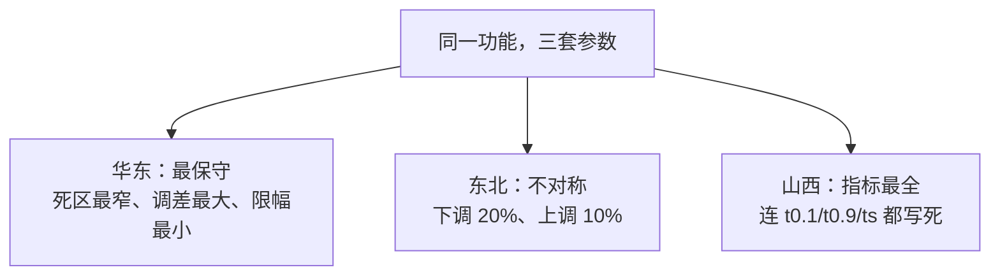
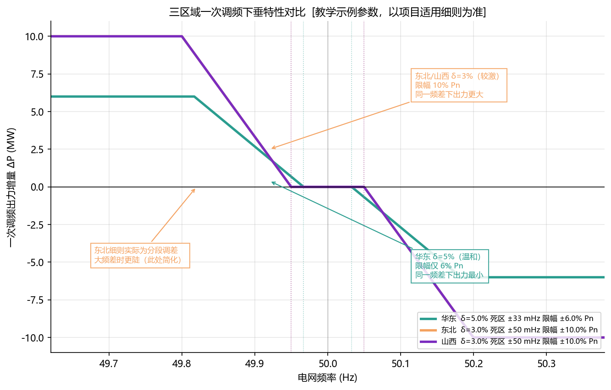

<!-- @AI_GENERATED -->
# 05 PFR跨区考核细则适配

> 所属层面：① 参数层（区域差异）
> [课程首页](README.md) · 上一章：[04 PFR时序分解与贡献率](04_PFR时序分解与贡献率.md) · 下一章：[06 PFR控制链路实现](06_PFR控制链路实现.md)

**一句话**：同一个"一次调频"功能，在华东、东北、山西三份细则里的死区、调差率、限幅、时间指标**几乎每一项都不同**；EMS 必须把这些做成**可配置参数 + 版本管理**，而不是写死在代码里。

## 现场场景【必读】

你的 EMS 产品在华东两个场站跑了一年，一次调频考核全部合格。销售部拿下了东北某场站的新合同，项目经理想当然地说"同一套软件，换个配置文件就能上线"。

三周后，现场发来东北细则的考核数据：**偏差不合格**。

你翻出配置——参数导入了东北的死区 ±0.05 Hz 和调差率 2%~5%，看起来没问题。但用代码逐项走了一遍，发现了三处你不知道的差异：

1. 东北的限幅是**不对称的**——下调 20%、上调 10%，而你的代码里限幅只有一对 `(limit_up, limit_down)`，但限幅的逻辑根本没有处理不对称场景；
2. 东北的高频段用 δ=2%、低频段用 δ=5%，是**分段调差**，而你只做了单段；
3. 数据里出现频率高于 50.25 Hz 时，你的程序按上限幅 10% 卡住，而东北要求下调可达 20%。

结果：你的"通用方案"在华东合格，在东北不合格。**同一套公式，换上三套不同的数字，就是三种不同的考核结果。**

## 本章目标

读完本章，你应能：

1. 对照华东、东北、山西三份细则，说出各自的死区、调差率、限幅差异；
2. 用调差率与限幅反算特性曲线的折点，验证细则给出的曲线；
3. 设计一套支持多区域参数切换的 EMS 配置结构。

## 三份细则的对照【必懂】

以下数据引自技术报告引用的三份区域文件 `[汇报口径]`：

| 项目 | 华东 | 东北 | 山西 |
|---|---|---|---|
| 文件 | 华东监能市场〔2019〕30 号 | 东北监能市场〔2019〕115 号 | 调系字〔2020〕54 号 |
| 发文单位 | 国家能源局华东监管局 | 国家能源局东北监管局 | 国网山西省电力公司电力调度控制中心 |
| 文件性质 | 区域并网运行 + 辅助服务管理实施细则 | 区域并网运行 + 辅助服务管理实施细则 | 新能源场站一次调频改造通知 |
| 频率死区 | 50 ± **0.033 Hz** | 50 ± **0.05 Hz** | 50 ± **0.05 Hz** |
| 调差系数 | **4% ~ 6%** | **2% ~ 5%** | **2% ~ 3%** |
| 最大负荷限幅 | **±6% Pn** | 下调 **20%**、上调 **10%** | **10% Pn** |
| 响应滞后 t0.1 | —（未单列） | —（未单列） | **≤ 3 s** |
| 响应时间 t0.9 | — | — | 风电 ≤12 s、光伏 ≤5 s |
| 调节时间 ts | — | — | 均 ≤15 s |
| 控制偏差 | — | — | **±1%** |
| 适用对象 | 区域并网发电厂（含风光） | 区域并网发电厂（含风光） | 接入 **35 kV 及以上**的新能源场站，含配调调度的分布式场站 |

> **"——"的含义**：技术报告的对照页没有列出该项，不代表细则里没有。实际项目必须查阅细则原文，不能以本表为准。

### 三个区域的关键差异



| 差异点 | 华东 | 东北 | 工程影响 |
|---|---|---|---|
| 死区最窄 | 0.033 Hz | 0.05 Hz | 华东对小扰动最敏感，动作最频繁 |
| 调差最大 | 4%~6% | 2%~5% | 华东下垂最"平"，同频差下出力最小 |
| 限幅最小 | ±6% Pn | 20%/10% | 华东总调节量最小，但折点位置可能更近 |
| 不对称限幅 | 对称 | **不对称** | 东北必须分别配置上下限 |

**这三者不是矛盾，而是同一套逻辑在不同电网结构下的不同取值**：华东电网机组密集、调频资源相对充足，可以让新能源"少出点力、动得勤一点"；东北电网新能源占比高、调峰压力大，需要更大的调节幅度，且向下调节空间比向上更充裕（所以下调 20%、上调 10%）。



**图中标注对照表**：

| 标注 | 含义 | 数值 |
|---|---|---|
| 绿色曲线 | 华东 δ=5%, 死区 ±33 mHz, 限幅 ±6% Pn | 最温和 |
| 橙色曲线 | 东北 δ=3%, 死区 ±50 mHz, 限幅 ±10% Pn | 较激进 |
| 紫色曲线 | 山西 δ=3%, 死区 ±50 mHz, 限幅 ±10% Pn | 与东北同参数 |
| 标注 "华东 δ=5% 温和" | 华东同一频差下出力最小 | — |
| 标注 "东北/山西 δ=3%" | 同一频差下出力更大 | — |
| 标注 "东北实际为分段调差" | 大频差时低频段 δ=5%、高频段 δ=2%，此处简化为单段 | — |

> **重要**：上图教学示例将东北简化为单段 δ=3%。东北细则实际为分段调差（低频 δ=5%、高频 δ=2%）+ 不对称限幅（20%/10%），不可直接用本图做整定。

---

## 用公式验证细则给出的曲线【必懂】

细则通常附一条"一次调频特性参数曲线"。这条曲线不是画着好看的，它必须能用"死区 + 调差率 + 限幅"三个数算出来。**如果算不出来，说明你对参数的理解有偏差**。

### 华东：δ=5%、死区 0.033、限幅 6% Pn

```text
K = Pn / (0.05 × 50) = 0.4 Pn/Hz
达到限幅所需的频率偏差 = 限幅 / K = 0.06 Pn / (0.4 Pn/Hz) = 0.15 Hz
折点频率 = 50 ± (0.033 + 0.15) = 50 ± 0.183 Hz
```

即 **49.817 Hz / 50.183 Hz**，与技术报告曲线上的标注完全一致。

### 东北：分段调差 + 不对称限幅

东北的曲线是**分段**的：低频段用 δ=5%，高频段用 δ=2%。

| 段 | 调差率 | 计算 | 结果 |
|---|---|---|---|
| 低频（上调） | δ = 5% | `K = Pn/2.5 = 0.4 Pn/Hz`；`0.4 × 0.25 = 0.10 Pn` | 49.7 Hz 处达 **10% Pn** |
| 高频（下调） | δ = 2% | `K = Pn/1.0 = Pn/Hz`；`1.0 × 0.2 = 0.20 Pn` | 50.25 Hz 处达 **20% Pn** |

死区 `49.95~50.05 Hz`（±0.05），与曲线标注一致。此外曲线还标出**最小出力 10% Pn**（对应 48.0 Hz），这就是[02 章](02_PFR核心参数与调差特性.md)提到的"降至额定负荷的 10% 可不再向下调节"。

### 验证的意义


这一步在项目初期花 30 分钟，能避免后期几个月的返工。**最容易出错的三种情况**：

| 情况 | 表现 | 排查方向 |
|---|---|---|
| 基准混淆 | 折点算出来差一倍 | 限幅是按 Pn 还是按当前出力？调差是按 fn 还是按 100？ |
| 分段遗漏 | 曲线对不上但单段能对上 | 细则用了分段调差（如东北的 5% + 2%） |
| 方向不对称 | 高低频折点不对称 | 限幅上下限不同（如东北 20%/10%） |

---

## GB/T 40595-2021 与三份细则的逐条对照【必懂】

一次调频的国标（GB/T 40595-2021）给出了**骨架性要求**，各省细则在此基础上填充**具体数值**。理解这种"骨架 + 填充"的关系，是参数整定的基础。

| GB/T 40595-2021 条款 | 要求类别 | 骨架内容 | 华东填充 | 东北填充 | 山西填充 |
|---|---|---|---|---|---|
| 频率死区 | 功能要求 | 应设置频率死区，避免频繁动作 | ±0.033 Hz | ±0.05 Hz | ±0.05 Hz |
| 调差率 | 参数范围 | 推荐 2%~6% | 4%~6% | 2%~5%（分段） | 2%~3% |
| 一次调频限幅 | 功能要求 | 应设置一次调频出力限幅 | ±6% Pn | 下调 20%、上调 10% | 10% Pn |
| 响应滞后时间 | 性能指标 | 从频率越死区到开始响应的时间 | —（未单列） | —（未单列） | ≤3 s（比国标推荐<2s 更宽松） |
| 响应时间 | 性能指标 | 达到目标变化量 90% 的时间 | — | — | 风电 ≤12s、光伏 ≤5s |
| 调节时间 | 性能指标 | 进入稳定带的时间 | — | — | ≤15 s |
| 控制偏差 | 考核指标 | 实际与理论的偏差 | — | — | ±1%（比国标风电 ±2% 更严） |
| 试验方法 | 验证要求 | 阶跃扰动法 | 阶跃扰动 | 阶跃扰动 | 阶跃扰动 |
| 数据处理 | 实施规范 | 频率与出力应带时标记录 | 按并网协议 | 按并网协议 | 按调度通知 |

> **"——"含义**：技术报告对照页未列出，不代表细则没有。实际项目必须查细则原文。

### 从对照表得出的三个结论

1. **国标规定"有没有"（功能），细则规定"是多少"（参数）**：EMS 代码里不能写死任何数值，每一项参数都必须是可配置的，且必须与细则文号绑定。
2. **省网细则可以在国标基础上收紧或放宽**：山西 t0.1=3 s 比国标的 2 s 宽松，但控制偏差 ±1% 比国标的"风电 ±2%"更严。这种差异化说明参数不是"从国标抄下来就行"。
3. **国标没有规定的东西，细则可能会加**：更窄的死区、分段调差、不对称限幅等细节都是细则补充的，EMS 架构必须有扩展空间。

### 对照表的工程用途

| 用途 | 做法 |
|---|---|
| 新项目参数整定 | 先找对应省网细则 → 再对照本表确认国标框架 → 逐项填入配置 |
| 参数核对 | 把现场配置逐项填入"填充"列 → 标记与细则不一致的项 → 逐项复核 |
| 代码功能检查 | 确认 EMS 代码里没有写死的参数 → 确认每个参数都有对应的配置项 |
| 归档材料 | 把这张表填好后放进验收证据链 |

---

山西细则在技术报告里被单独列出，因为它有三个值得注意的地方。

### ① 时间指标写得最细

| 指标 | 山西 | 技术报告的通用要求 |
|---|---|---|
| t0.1 | ≤ 3 s | ≤ 2 s |
| t0.9 风电 | ≤ 12 s | ≤ 12 s |
| t0.9 光伏 | ≤ 5 s | ≤ 5 s |
| ts | ≤ 15 s | ≤ 15 s |
| 控制偏差 | ±1% | 风电 ±2%、光伏 ±1% |

**注意 t0.1**：山西给 3 s，比报告的 2 s 宽松；而控制偏差给 ±1%，比报告的"风电 ±2%"更严。**宽松与严格混在一起**，说明细则不是简单照抄国标，而是按本省实测情况调整。

对 EMS 的含义：如果你的产品按"±2%"设计风电偏差，在山西就会判不合格。

### ② 明确的改造范围

山西细则写明了改造对象：**接入 35 kV 及以上电压等级的新能源场站，包含配调调度的分布式新能源场站**。

这条对工程实施影响很大：

| 影响 | 说明 |
|---|---|
| 存量场站改造 | 不是新建项目才需要，已有场站也要改 |
| 分布式也要改 | 配调调度的分布式场站纳入范围，数量多、单体小 |
| EMS 部署方式 | 分布式场站往往没有完整 EMS，可能需要独立快速控制装置 |

### ③ 一条防"调频导致脱网"的约束

山西细则明确："不得因一次调频导致停机或脱网"。

这条约束看似多余，实际有明确场景：如果一次调频指令让出力降到逆变器最低稳定出力以下，或者让风机进入停机保护，就会触发脱网——**调频动作本身变成了事故源**。

对 EMS 的含义是必须在指令生成时加**运行边界约束**：

```text
ΔP_out = clamp(ΔP_theory, 下限约束, 上限约束)
下限约束：max(当前出力 − 最低稳定出力, −限幅)
上限约束：min(设备上限 − 当前出力, +限幅)
```

这就是[02 章](02_PFR核心参数与调差特性.md)里"能力校验"的完整形态。

---

## 送端近区的额外要求【了解】

技术报告在"直流送端近区参数优化"部分还提到一类特殊场景：**直流送端近区的新能源场站**。

以青海为例，依据是国网青海省电力公司部室文件（调度字〔2020〕23 号）及其附件《青海电网新能源发电技术要求》《青豫直流送端近区新能源机组测试及数据说明》。这类要求与普通一次调频的差别在于：

| 维度 | 普通一次调频 | 直流送端近区 |
|---|---|---|
| 主要矛盾 | 频率支撑 | 直流换相失败引起的**电压扰动** |
| 核心指标 | 下垂出力、响应时间 | 低/高电压穿越、动态无功电流 |
| 考核方式 | 积分电量 | 穿越能力测试与数据核验 |

技术报告在这一部分给出的关键参数是：

| 项目 | 要求 | 说明 |
|---|---|---|
| 低穿动态无功电流 | `ΔIq_LVRT ≥ K1 × (U_LV − U_T) × In`，K1 推荐 1.5 | 低穿期间需动态无功支撑 |
| 低穿有功电流系数 | K2 = 1 | 低穿期间维持故障前有功电流 |
| 故障后功率恢复速率 | ≥ 3 倍额定功率/秒 | 电压恢复后快速回到故障前出力 |
| 高穿动态无功电流 | `ΔIq_HVRT ≤ K3 × (U_HV − U_T) × In`，K3 ≥ 1.5 | 高穿期间吸收无功 |
| 高低电压连续穿越 | 需具备连续穿越能力 | 应对直流连续换相失败 |

> **为什么单独提这件事**：因为送端近区场站的"一次调频"往往与"电压支撑"耦合——换相失败会造成电压与频率的连续扰动，场站需要在同一时间段内同时满足穿越要求与调频要求。**只做频率下垂、不管电压穿越，在送端近区是不完整的**。

---

## EMS 的多区域参数配置设计【必懂】

面对多套细则，EMS 不能靠"改代码换版本"，必须做成配置。一个可落地的结构：

```text
frequency_regulation:
  region: "shanxi_2020"            # 区域版本标识
  deadband_hz: 0.05                # 死区半宽
  deadband_mode: "cut"             # 连续型 shift / 截断型 cut
  droop_ratio: 0.02                # 调差率 δ
  droop_segments:                  # 分段调差（东北场景）
    - {f_low: 49.7, f_high: 49.95, droop: 0.05}
    - {f_low: 50.05, f_high: 50.25, droop: 0.02}
  limit_up_ratio: 0.10             # 上调限幅（占 Pn）
  limit_down_ratio: 0.20           # 下调限幅（占 Pn）
  min_output_ratio: 0.10           # 最低运行出力
  t01_limit_s: 3.0
  t09_limit_s: 12.0                # 风电
  ts_limit_s: 15.0
  deviation_limit_ratio: 0.01      # 控制偏差
  pn_mw: 100.0                     # 场站额定有功
```

### 配置项的四条设计原则

| 原则 | 理由 | 反例 |
|---|---|---|
| 所有以 Pn 为基准的量都存**比例**，不存绝对值 | 容量变化时自动适配 | 硬编码 "限幅 = 10 MW" |
| 死区类型显式存储 | 考核口径差异 | 只存宽度，代码里默认连续型 |
| 上下限分别配置 | 东北等区域不对称 | 只存一个"限幅" |
| 每个参数带**版本与来源** | 便于追溯与审计 | 配置里只有数值，没有出处 |

第三条和第四条最容易被忽略。东北的"下调 20%、上调 10%"如果用单一"限幅 10%"，向下调节能力会被砍掉一半，考核直接判偏差。

### 参数版本管理


**关键点**：参数配置包必须与**细则文号和生效日期**绑定。当细则修订时，只需新增一个配置包，而不是修改代码。这也是[08 章](08_PFR并网联调验收.md)形成验收证据的基础。

---

## 深入：为什么区域差异这么大【深入】

<details>
<summary>从电网结构看参数差异</summary>

三个区域的差异可以这样理解：

| 区域 | 电源结构特征 | 参数取向 |
|---|---|---|
| 华东 | 负荷中心，本地机组密集，外来电比例高 | 调频资源相对充足，让新能源"小幅、勤动"，所以死区窄、调差大、限幅小 |
| 东北 | 新能源占比高，供热机组多，调峰困难 | 需要更大的调节幅度，且向下空间更充裕（热电机组有最低出力约束），所以下调 20%、上调 10% |
| 山西 | 新能源快速发展，存量场站多，分布式占比上升 | 需要覆盖存量与分布式，所以改造范围写得细、指标写得全 |

**一句话**：参数是电网结构的"投影"。看到一个区域的参数，大致能推断出它的电源结构和调频压力。

</details>

<details>
<summary>分段调差为什么会出现</summary>

东北用 δ=5%（低频段）+ δ=2%（高频段）的分段设计，原因在于**高频率与低频率的调节代价不对称**：

- 低频（缺电）时需要**增加**出力，这要消耗备用容量，代价高，所以用更陡的下垂（δ=5%）让出力增长更慢、更谨慎；
- 高频（多电）时需要**减少**出力，代价相对低（弃风弃光本来就要发生），所以用更缓的下垂（δ=2%）让减出力更快、更积极。

这种"不对称设计"在新能源高占比电网里越来越常见，也是 EMS 必须支持分段配置的原因。

</details>

---

## 自测

1. 华东的死区、调差率、限幅分别是多少？用公式反算折点频率，是否与 49.817/50.183 Hz 一致？
2. 东北的限幅为什么是"下调 20%、上调 10%"而不是对称的？对 EMS 配置有什么要求？
3. 山西细则里 t0.1 给 3 s（比通用要求的 2 s 宽松），但控制偏差给 ±1%（比风电的 ±2% 更严），这说明什么？
4. 为什么"不得因一次调频导致停机或脱网"这条约束必须在指令生成时处理？

<details>
<summary>参考答案</summary>

1. 死区 ±0.033 Hz、调差率 4%~6%、限幅 ±6% Pn。取 δ=5%：`K = Pn/(0.05×50) = 0.4 Pn/Hz`，达到 6% Pn 需 `0.06/0.4 = 0.15 Hz`，折点 `50 ± (0.033+0.15) = 50 ± 0.183 Hz`，与 49.817/50.183 一致。
2. 因为高频时减少出力代价低（本来就是弃风弃光场景），低频时增加出力要消耗备用、代价高，所以向下调节空间给得更大。对 EMS 的要求是**上下限必须分别配置**，不能用单一限幅值。
3. 说明细则不是简单照抄国标，而是按本省实测与电网需求调整：时间上留了余量（可能与本地设备实际响应能力有关），但精度上要求更严（电力电子资源占比较高、可精确跟踪）。EMS 必须按项目适用细则取值，不能按"通用要求"设计。
4. 因为一次调频指令若让出力低于设备最低稳定出力或触发保护，会导致逆变器/风机脱网，**调频动作本身变成事故源**。必须在指令生成阶段做运行边界约束，而不是指望设备自己兜底。

</details>

> 💻 **动手实验**：运行 `python lab/ch05_regional.py` 对比华东/东北/山西三套区域参数在 49.90 Hz 处的出力差异，验证"参数是电网结构的投影"。

<!-- @AI_GENERATED: end -->
