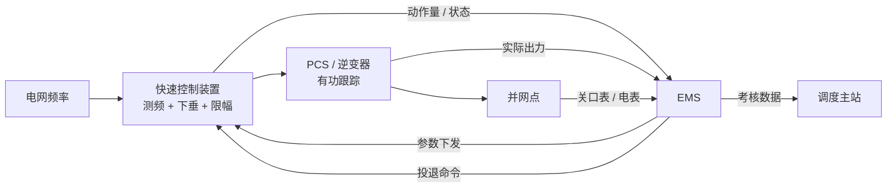
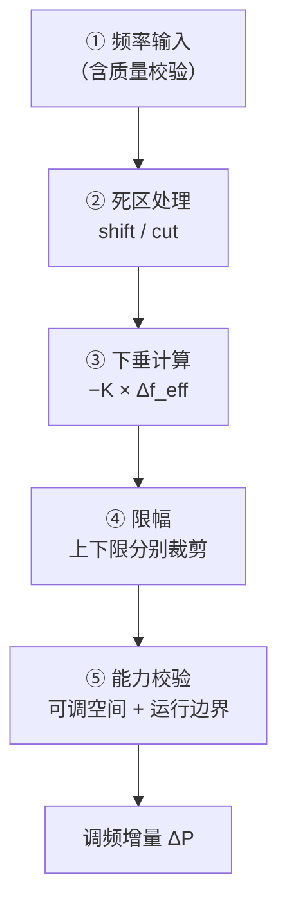
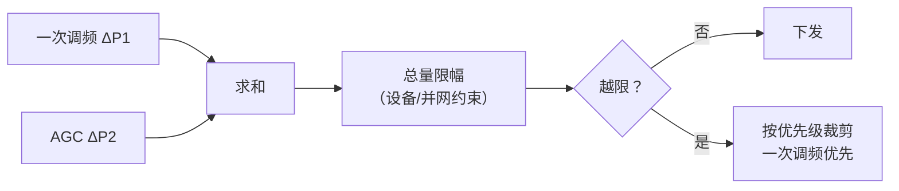
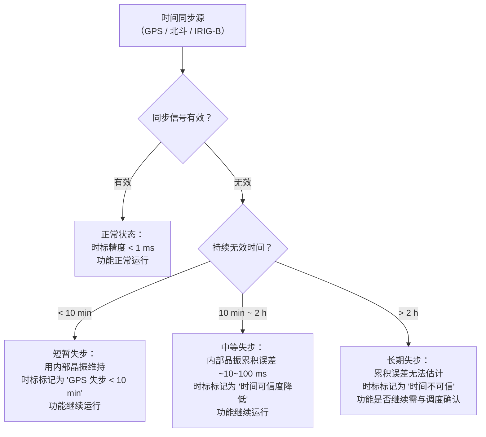
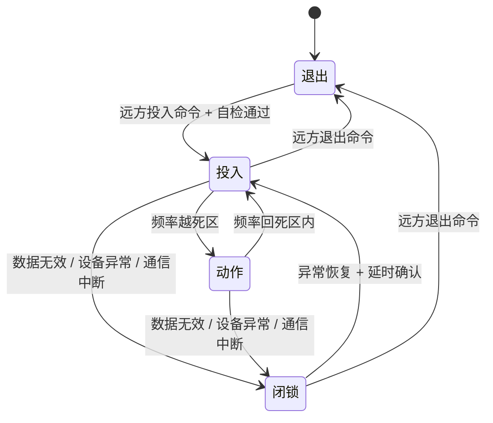
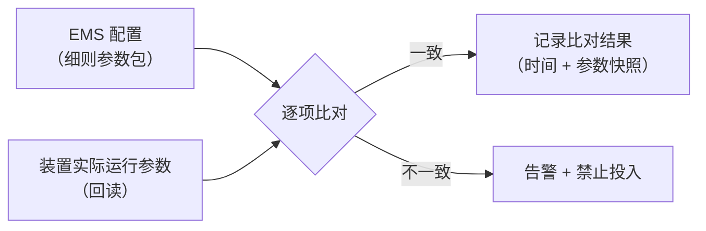
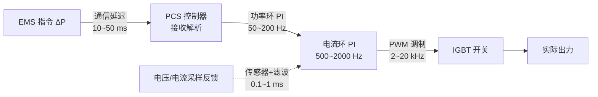

<!-- @AI_GENERATED -->
# 06 EMS 侧实现：测频、计算、下发与状态机

> 所属层面：全四层整合（参数→时序→精度→结算的代码落地）
> [课程首页](README.md) · 上一章：[05 区域细则差异对照](05_区域细则差异对照.md) · 下一章：[07 考核结算与积分电量法](07_考核结算与积分电量法.md)

**一句话**：EMS 的一次调频功能是一条**五步流水线**（测频 → 死区 → 下垂 → 限幅 → 能力校验）加一个**状态机**（投入、动作、闭锁、恢复），再配一套**可对账的数据记录**；缺了任何一块，功能都过不了考核。

## 现场场景【必读】

凌晨 2:47，EMS 告警：一次调频功能自动闭锁。你被值班电话叫醒，远程登录排查。

告警前的三分钟，PCS 上报了一次"通信超时"（104 规约的 `t3` 定时器超时）。但你的代码处理这种异常的逻辑只有一行：

```python
f_hz = last_valid_read
```

频率值停留在 49.87 Hz——恰好略过死区，恰好触发了一个小增量指令（约 1.3 MW）。PCS 在通信恢复后收到这个指令并执行了。但此时的真实频率早已回到 50.01 Hz（死区内）。

一分钟后，系统自动检测到"频率值异常长时间不变"，触发闭锁。但那一分钟的放电记录已经被写入考核文件。

**这不是算法 bug。这是异常处理逻辑的缺失。** 当频率数据不可信时，最安全的动作不是"用上次有效值继续算"，而是**进入安全状态并记录原因**。这就是状态机的存在意义——它保证"坏数据不出坏指令"。

## 本章目标

读完本章，你应能：

1. 划清 EMS、PCS、专用快速控制装置在一次调频中的职责边界；
2. 实现从频率输入到调频增量输出的完整计算链，并处理能力校验；
3. 设计一次调频状态机，覆盖投入、闭锁、异常与恢复；
4. 明确考核数据的记录要求（采样率、时标、字段）。

## 职责边界【必懂】

先明确一件事：**一次调频的执行环通常不在 EMS 里**（原因见[04 章](04_性能指标体系与时序分解.md)的延迟预算）。但这不等于 EMS 没有职责。

| 环节 | 执行主体 | 说明 |
|---|---|---|
| 频率测量 | 快速控制装置 / PCS / 独立测频单元 | 采样周期 ≤100 ms，分辨率 ≤0.003 Hz |
| 下垂计算 | 快速控制装置 / PCS | 要求 t0.1 ≤2 s，通常本地实现 |
| 出力执行 | PCS / 逆变器 | 有功指令跟踪 |
| 参数下发 | **EMS** | 保证装置参数与细则一致 |
| 投退控制 | **EMS** | 远方投入/退出 |
| 状态监视 | **EMS** | 动作量、闭锁原因、异常告警 |
| 数据记录 | **EMS** | 频率、理论出力、实际出力，统一时标 |
| 数据上送 | **EMS** | 供调度考核与结算 |



> **常见误解**："一次调频在 PCS 里做，EMS 就不管了"。事实是：**考核数据由 EMS 记录和上送**。装置做得再好，EMS 记录错一个时标，考核照样不合格。

---

## 测频环节【必懂】

### 频率从哪来

| 来源 | 精度 | 延迟 | 可靠性 | 适用 |
|---|---|---|---|---|
| 关口表 / 电表 | 高（0.2S 级） | 大（1~5 s，取决于上送周期） | 高 | **考核数据**，不用于控制 |
| 测控装置 / PMU | 高 | 中（10~100 ms） | 高 | 控制 + 记录 |
| PCS 自身测频 | 中 | 小（<10 ms） | 中 | 本地快速控制 |
| 保护装置频率 | 高 | 小 | 高 | 参考 |

**关键区分**：**考核用的频率和控制用的频率可以不同源**。

- 控制要快 → 用 PCS 本地测频或 PMU；
- 考核要对账 → 用关口表或调度认可的测点。

如果两者用同一个源，一旦该源中断，控制与考核会同时失效；如果不同源，要保证**两者偏差在允许范围内**（否则出现"我按 49.92 动作，考核说当时是 49.95"的争议）。

### 测频算法要点

要满足 0.003 Hz 的分辨率，常用方法：

| 方法 | 原理 | 分辨率 | 延迟 |
|---|---|---|---|
| 过零插值 | 检测电压过零点并线性插值 | 可达 0.001 Hz 级 | 约 1 个周波（20 ms） |
| DFT 相位差 | 相邻周波相位差换算频率 | 高 | 约 2 个周波 |
| 锁相环（PLL）跟踪 | 跟踪相位并输出频率 | 高 | 有跟踪时间常数 |
| 计数法 | 固定时间内数周波 | 低 | 取决于窗口 |

**不要用"1 秒内数了多少个周波"这类方法**：分辨率只有 1 Hz 量级，完全无法满足 0.003 Hz。

### 数据质量校验【必懂】

测频数据必须做质量校验，否则会出现[00 章](00_课程导读.md)里的"频率冻结"事故：

| 校验 | 判据 | 处理 |
|---|---|---|
| 超时 | 超过 N 个周期未更新 | 置无效，调频闭锁 |
| 数值冻结 | 连续 M 个周期数值完全不变 | 置可疑，告警 |
| 越限 | 超出合理范围（如 45~55 Hz） | 置无效 |
| 跳变 | 单周期变化超过阈值 | 结合电压质量位判断是否为故障引起 |
| 质量位 | 装置上送的质量标志 | 无效时闭锁 |

"数值冻结"这一条最容易被漏掉——**一个恒定的 49.92 Hz 看起来完全合法**，但真实电网频率不可能长时间一动不动。

> ⚠️ **谐波对测频的隐蔽干扰**：逆变器自身产生的 3/5/7 次谐波可能污染测频信号。DFT 算法理论上能滤除整数次谐波，但前提是**采样频率严格同步**于基波。当电网频率偏离 50 Hz 而采样率未跟随调整时，DFT 出现"频谱泄漏"——谐波分量渗入基波相位计算，导致测频结果出现周期性波动。这在事故期间（频率大幅偏移 + 谐波含量增大）尤为严重：**自己的逆变器正在发谐波，自己的测频又被谐波干扰**，构成隐蔽的正反馈。对策：① 采样率同步跟踪基波频率；② 加窗（Hanning）抑制泄漏；③ 在频率偏移超过 ±0.5 Hz 时切换为备用测频方案。

## 计算链实现【必懂】

### 五步流水线



### 代码实现

```python
# lab/ems_lab/freq_primary.py（节选）
from dataclasses import dataclass


@dataclass
class PrimaryFreqConfig:
    f_nominal_hz: float = 50.0
    deadband_hz: float = 0.05
    deadband_mode: str = "cut"          # shift / cut
    droop_ratio: float = 0.02
    limit_up_ratio: float = 0.10        # 上调限幅（占 Pn）
    limit_down_ratio: float = 0.20      # 下调限幅（占 Pn）
    p_rated_mw: float = 100.0
    min_output_ratio: float = 0.10      # 最低运行出力（占 Pn）


def deadband_shift(delta_f, deadband):
    if abs(delta_f) <= deadband:
        return 0.0
    return delta_f - deadband if delta_f > 0 else delta_f + deadband


def deadband_cut(delta_f, deadband):
    return 0.0 if abs(delta_f) <= deadband else delta_f


def capability_window(p_now_mw, cfg, p_max_mw):
    up = max(0.0, min(p_max_mw - p_now_mw, cfg.limit_up_ratio * cfg.p_rated_mw))
    down = max(0.0, min(p_now_mw - cfg.min_output_ratio * cfg.p_rated_mw,
                       cfg.limit_down_ratio * cfg.p_rated_mw))
    return up, down


def primary_freq_delta(f_hz, p_now_mw, p_max_mw, cfg):
    delta_f = f_hz - cfg.f_nominal_hz
    if cfg.deadband_mode == "shift":
        effective = deadband_shift(delta_f, cfg.deadband_hz)
    else:
        effective = deadband_cut(delta_f, cfg.deadband_hz)

    k = cfg.p_rated_mw / (cfg.droop_ratio * cfg.f_nominal_hz)
    delta_p = -k * effective                       # 频率低 → 正增量 → 放电

    delta_p = max(-cfg.limit_down_ratio * cfg.p_rated_mw,
                  min(delta_p, cfg.limit_up_ratio * cfg.p_rated_mw))

    up, down = capability_window(p_now_mw, cfg, p_max_mw)
    return max(-down, min(delta_p, up))
```

### 数值跟踪：用贯穿式案例逐行验证【必懂】

取贯穿式教学案例的参数 —— `Pn = 100 MW`、`δ = 3%`、死区 `±0.06 Hz`（截断型；02 章用连续型教学两侧差异，本章起用截断型对接考核口径）、限幅 `±20 MW`、当前出力 `P_now = 30 MW`、可调上限 `P_max = 100 MW` —— 当 `f = 49.90 Hz` 时，下面是 `primary_freq_delta()` 每一步的中间值：

| 步骤 | 变量 | 计算/值 | 说明 |
|---|---|---|---|
| ① 输入 | `f_hz` | 49.90 Hz | 实测电网频率 |
| ② Δf 原始 | `delta_f` | 49.90 − 50.00 = −0.10 Hz | 频率偏差 |
| ③ 死区裁剪 | `effective` | −0.10 Hz | 截断型：|Δf|>0.06，不削减 |
| ④ K 计算 | `k` | 100/(0.03×50) = 66.67 MW/Hz | 下垂系数 |
| ⑤ ΔP（取反） | `delta_p` | −66.67 × (−0.10) = +6.667 MW | 频率低→放电为正 |
| ⑥ 限幅裁剪 | `delta_p` | max(−20, min(+6.667, +20)) = +6.667 MW | 未触及 ±20 MW 限幅 |
| ⑦ 能力校验 | `up` | min(100−30, 20) = 20 MW | 可上调空间充足 |
|  | `down` | min(30−10, 20) = 20 MW | 可下调空间充足 |
| ⑧ 最终输出 | `result` | max(−20, min(+6.667, +20)) = **+6.667 MW** | 理论值 = 可执行值 |

> **为什么记录两步值**：ΔP_theory = +6.667 MW（限幅后），ΔP_exec = +6.667 MW（能力校验后）。二者相等说明当前条件下没有物理限制。如果 P_now = 95 MW，则 up = min(5, 20) = 5 MW，ΔP_exec 会被裁剪到 5 MW——此时考核系统按理论值 6.667 MW 算，而实际只出了 5 MW，完成率骤降到 75%。这就是为什么 ch07 反复强调"只记录最终值无法证明算法正确"。

### 三个实现细节【必懂】

| 细节 | 做法 | 理由 |
|---|---|---|
| 限幅在能力校验之前 | 先按规程裁剪，再按物理能力裁剪 | 保证"理论值"与"可执行值"可分开记录 |
| 记录两个值 | 存 `delta_p_theory` 与 `delta_p_exec` | 考核按理论值算，能力不足时需说明 |
| 上下限分别处理 | 两个独立参数 | 东北等区域不对称（[05 章](05_区域细则差异对照.md)） |

**第二条尤其重要**。如果只记录最终可执行值，考核时无法区分"算法算错了"和"物理上出不来"——前者是软件问题，后者是资源问题，责任完全不同。

---

## 与 AGC 的指令合成【必懂】

一次调频增量与 AGC 基点是**相加**关系（[01 章](01_业务背景与标准沿革.md)）：

```text
P_total = clamp(P_agc_base + ΔP_primary, 运行下限, 运行上限)
```

但直接相加会带来三个问题：

| 问题 | 场景 | 处理 |
|---|---|---|
| 重复调节 | AGC 与一次调频同时要求增出力 | 限幅裁剪后按优先级分配 |
| 反向抵消 | AGC 要求减、一次调频要求增 | 按细则规定执行（多数要求一次调频优先） |
| 总和越限 | 两者相加超过设备上限 | 总量裁剪，但需记录被裁掉的部分 |

### 优先级设计

技术报告没有直接规定优先级，工程上常见做法：



**为什么一次调频优先**：一次调频响应的是全网频率事件，优先级高于经济性调度指令；如果被 AGC 挤掉，可能加剧频率问题。但这一点必须与调度确认，不同区域口径可能不同。

---

## 通信协议选型【必懂】

一次调频的通信链路涉及"频率信号下行"和"考核数据上行"两个方向，它们的实时性要求完全不同，因此**协议选型不能一刀切**。

### 三个典型通道

| 通道 | 方向 | 关键协议 | 延迟特征 | 应用 |
|---|---|---|---|---|
| 频率采集 | 装置 → EMS | **IEC 61850 GOOSE** / Modbus TCP | <5 ms（GOOSE 组播） | 本地快速测频 |
| 遥测遥信 | EMS → 调度 | **IEC 60870-5-104** | 100 ms~1 s（与 polling 周期相关） | 运行数据上送 |
| 调度指令 | 调度 → EMS | **IEC 60870-5-104**（遥控） | 同遥测 | 远方投退 |
| 考核数据 | EMS → 调度 | **104 / 文件传输** | 非实时 | 月度积分电量对账 |

### GOOSE（IEC 61850）的特殊性

GOOSE 是当前新能源场站一次调频**频率信号传输**中最值得关注的协议，因为它有三个特性专门解决了一次调频的痛点：

| 特性 | 含义 | 对一次调频的好处 |
|---|---|---|
| **组播（Multicast）** | 发布者无需知道订阅者是谁 | 测频装置输出 GOOSE，EMS、PCS、录波器可同时接收，无额外延迟 |
| **无连接** | 不建 TCP 连接，直接发包 | 无握手延迟，延迟可降至 <5 ms |
| **快速重传** | 状态变化时以 1/2/4/8 ms 间隔重复发送 | 即使丢一帧，下一帧马上到，信息不丢 |

相比之下，Modbus TCP 需要 polling（轮询），延迟由轮询周期决定，通常在 50~200 ms。对于 FFR/虚拟惯量这种百毫秒级控制，Modbus TCP 的延迟**本身就占了整条链路预算的一大块**。

### 104 规约的两个关键参数

104 规约（IEC 60870-5-104）有三个定时器直接影响数据传输可靠性：

| 参数 | 含义 | 典型值 | 对一次调频的影响 |
|---|---|---|---|
| t1 | 发送方等待确认的超时 | 15~60 s | 超时后链路断开 → 链路重建期间数据丢失 |
| t2 | 接收方发送确认的间隔 | 10~30 s | 过大可能触发发送方 t1 超时 |
| t3 | 空闲链路测试间隔 | 20~60 s | 空闲时用于维持链路活性 → 一度中断后自动恢复 |

**一个常见的陷阱**：有些场站的网络不稳定导致 t1 频繁超时，104 链路反复断开重建。在重建的几秒钟内，EMS 无法上送遥测——这段时间如果恰好发生频率事件，数据就丢了。

> **工程建议**：频率采集用 GOOSE（本地）、调度通信用 104（远程）。不要把 Modbus TCP 的轮询延迟误认为是测频环节的固有延迟。

### 双通道冗余设计

对于高可靠性要求的场站（尤其是储能为调频主力），建议频率信号走**双通道**：

```text
主通道：GOOSE（组播，<5 ms，本地）
备通道：104 转发（用于 EMS 的独立校验）
双通道输出：同时输出但不做选优
校验：两通道差值 > 阈值 → 告警但不闭锁
```

双通道的**核心目的不是"一个断了换另一个"**（那种切换延迟本身就超过 t0.1 预算），而是**通过校验两路数据一致性来检测通道故障**。

---

## 时间同步失效的后备策略【必懂】

062 章的"双值记录"和"统一时标"都依赖时间同步。但当 GPS/北斗信号丢失时（这在偏远场站不罕见），EMS 必须有一套明确的后备逻辑。

### 同步失效的四个问题

| 问题 | 需要回答 |
|---|---|
| 一次调频功能是否继续运行？ | 继续运行or闭锁？ |
| 内部时钟能维持多久的可用精度？ | 依赖晶振的漂移速率 |
| 记录的数据时标怎么标记？ | 标"不可信"还是推估？ |
| 考核系统如何对待时标不精确的数据？ | 可能被忽略或按最不利原则判定 |

### 推荐策略



| 时间同步状态 | 晶振累积误差（量级） | 一次调频功能 | 数据标记 |
|---|---|---|---|
| 正常同步 | <1 ms | 正常运行 | 时标可信 |
| 失步 <10 min | 数 ms | 正常运行 | GPS 失步 |
| 失步 10 min~2 h | 10~100 ms | 正常运行 | 时间精度降低 |
| 失步 >2 h | >100 ms（不可预测） | 取决于项目策略 | 时间不可信 |

### 为什么不能直接闭锁

直接闭锁等于放弃了"利用本地晶振继续工作"的能力。10 分钟以内，好的恒温晶振（OCXO）漂移在 5~10 ms 量级，对于 1 s 采样间隔的积分电量来说，这个误差在千分之一量级——完全不影响考核结果。**直接闭锁反而会让场站在那一段时间失去一次调频能力**。

> **两种时间源都掉是严重故障**，但"功能停掉"比"时标不准"的后果更直接（必定考核不合格）。**建议策略：功能不闭锁，时标记为不可信，派人修复同步源**。

---

## 状态机设计【必懂】

一次调频不是"一直开着"的功能，它需要明确的状态与闭锁逻辑。



### 状态定义

| 状态 | 含义 | 出力行为 |
|---|---|---|
| 退出 | 未投入一次调频 | 不响应频率 |
| 投入 | 已投入，频率在死区内 | 增量保持 0 |
| 动作 | 已投入，频率越死区 | 按计算值出增量 |
| 闭锁 | 投入但因异常暂停 | 增量**平滑退出到 0** |

### 闭锁的五种触发条件【必懂】

| 触发 | 判据 | 恢复条件 |
|---|---|---|
| 频率数据无效 | 超时 / 越限 / 质量位异常 | 连续有效 N 个周期 |
| 频率数据冻结 | 连续 M 个周期数值不变 | 数值发生变化且通过校验 |
| 设备异常 | PCS 故障、通信中断 | 设备复归 |
| 越限异常 | 频率超出合理范围（如 <45 或 >55 Hz） | 频率回到合理范围 |
| 人工闭锁 | 检修、试验需要 | 人工解除 |

**"平滑退出到 0"很重要**：如果闭锁瞬间把增量直接清零，相当于给电网一个功率阶跃，可能引发二次扰动。正确做法是**按斜坡把增量降到 0**（例如 1~3 s 内线性退出）。

### 恢复时的抖动防护

闭锁恢复后如果立刻响应，而频率恰好在死区边缘，会出现"动作 → 闭锁 → 恢复 → 动作"的反复抖动。防护手段：

| 手段 | 做法 |
|---|---|
| 恢复延时 | 异常消失后延时 3~5 s 才恢复 |
| 迟滞 | 恢复判据比闭锁判据更严（如闭锁 49.0 Hz、恢复 49.2 Hz） |
| 频率稳定性判据 | 恢复前要求频率变化率低于阈值 |

---

## 数据记录与上送【必懂】

考核与结算完全依赖 EMS 记录的数据（[07 章](07_考核结算与积分电量法.md)）。记录要求：

| 项目 | 要求 | 说明 |
|---|---|---|
| 采样间隔 | 1 s（建议支持 100 ms） | 与考核周期匹配 |
| 时标 | 统一时钟（NTP / 北斗 / IRIG-B） | 与调度主站对时 |
| 关键字段 | 频率、理论增量、可执行增量、实际出力、状态、闭锁原因 | 缺一不可 |
| 存储周期 | ≥ 考核回溯期（通常 ≥ 3 个月） | 便于争议复核 |
| 掉电保持 | 关键事件不丢 | 事故后仍需复盘 |

### 字段设计示例

```text
ts               频率时标
f_hz             实测频率
deadband_hz      当前生效死区
delta_p_theory   按规程算出的理论增量（MW）
delta_p_exec     能力校验后的可执行增量（MW）
p_actual         实际出力（MW）
status           投入 / 动作 / 闭锁 / 退出
block_reason     闭锁原因码
```

**为什么要记录 `deadband_hz` 和 `delta_p_theory`**：当出现考核争议时，需要能还原"当时用的是哪套参数、按哪套口径算的理论值"。如果只记录频率和出力，事后无法证明 EMS 的计算是正确的。

---

## 一致性校验【必懂】

EMS 与装置参数不一致，是参数层考核失败的典型原因（[00 章](00_课程导读.md)）。上线时必须做一次自动比对：



| 比对项 | 数据来源 | 常见不一致原因 |
|---|---|---|
| 死区 | EMS 配置 vs 装置回读 | 装置保留上次定值未刷新 |
| 死区类型 | EMS 配置 vs 装置设置 | 装置只支持一种类型，与细则不符 |
| 调差率 | EMS 配置 vs 装置回读 | 装置按"调差系数"另一套定义换算 |
| 限幅（上/下） | EMS 配置 vs 装置回读 | 装置只支持对称限幅 |
| Pn 基准 | EMS 配置 vs 装置设置 | 扩容后未更新 |

**建议**：把比对结果与参数快照一起存证，作为验收材料的一部分（[08 章](08_试验验证与并网联调.md)）。

---

## 深入：一次调频与安自装置的协同【深入了解】

<details>
<summary>一次调频不是孤岛——它与第三道防线有明确边界</summary>

电网的频率防线分四层：


一次调频（第二层）和低频减载/高频切机（第四层）之间有三条明确的工程边界：

### 边界一：频率门槛

| 频率区间 | 谁在动作 | 对 EMS 的含义 |
|---|---|---|
| 49.8~50.2 Hz（±0.2） | 正常一次调频 | 按参数表正常计算增量 |
| 49.0~49.5 Hz | 一次调频 + AGC 全力调出 | 此时 EMS 应**放开所有非安全限幅** |
| 48.0~49.0 Hz | 一次调频接近限幅饱和 | 低频减载首轮**即将启动** |
| <48.0 Hz | 低频减载已动作 | EMS 应感知减载信号，不应对已被切除的负荷继续出调频 |

### 边界二：一次调频限幅不能替代低频减载

这条很容易被误用。有人以为"把一次调频限幅设到 50% Pn，低频减载就可以少切负荷"——这是错的：

- 一次调频是**有差调节**，不能把频率拉回 50 Hz
- 低频减载是**系统级**的紧急措施，按频率绝对值分轮次切负荷
- 一次调频顶多延缓频率下跌速度，不能替代减载

**EMS 正确的做法**：

```text
正常频率（>49.5 Hz）：限幅 = 细则规定的值（如 10%/20% Pn）
接近安自动作门槛（49.0~49.5 Hz）：EMS 可选放开限幅到物理上限（但需事先与调度确认）
安自动作后（<48.0 Hz）：减载已发生，EMS 按减载后的实际系统状态重新评价
```

### 边界三：安自动作后 EMS 的感知

当低频减载动作时，并网点的频率和功率会发生突变。EMS 如果没有感知到"这是减载引起的"，可能会做出错误的调频动作：

- 频率骤升（减载后供需恢复）→ EMS 可能判定为"高频事件"而出力缩减，反而让频率二次下跌
- 并网点出力突变 → 可能是本场站被切除部分负荷而不是调频偏差

**建议**：如果场站与安自装置有通信链路，让 EMS 接收"低频减载动作"信号，打出闭锁标记、冻结当前事件记录，避免误判断。如果没有通信链路，退而求其次——用"频率在 1 s 内变化超过 0.5 Hz"作为大扰动事件标记，不予考核自评。

</details>

---

## 深入：一次调频与 SOC 的协同【深入】

<details>
<summary>能量预算怎么做</summary>

一次调频持续放电会消耗 SOC。粗算方法（`[教学示例]`）：

```text
持续时间 T 内消耗能量 = ΔP × T
若 ΔP = 5 MW，持续 10 min → 5 × (10/60) h = 0.833 MWh
```

对 200 MWh 的电站，这是 0.4% SOC；但对 10 MWh 的小型电站，这是 8.3% SOC——**同样的调频事件，对小容量电站的影响大一个数量级**。

工程上要设三条约束：

| 约束 | 说明 |
|---|---|
| SOC 下限保护 | 低于下限时停止一次调频向上调节，避免放空 |
| 恢复策略 | 频率恢复后按允许速率回充，不能瞬间大功率充电 |
| 记录 | 记录因 SOC 限制被削减的增量，作为考核争议依据 |

这部分与[入门课程 15.9](../ems-python-learning/15_频率与一次调频.md)的 SOC 管理一致。

</details>

<details>
<summary>为什么不要用"最后一次有效值"填补坏数据</summary>

有些实现为了"避免出力跳变"，在数据无效时用最后一次有效值继续计算。这在稳态下没问题，但在故障时是危险的：

- 如果最后一次有效值是死区外的（如 49.92 Hz），填补会**持续输出调频增量**，与真实频率无关；
- 如果频率已经恢复，填补会**延迟退出调频**，造成反向偏差。

正确做法是：数据无效时**按斜坡退出增量**（见状态机的闭锁处理），而不是保持最后值。

</details>

---

## 深入：频率测量原理【深入了解】

<details>
<summary>为什么能测到 0.003 Hz？——DFT 相位法的工程直觉</summary>

第 04 章提到主流测频装置精度可达 0.003 Hz。这个精度并非靠加长采样窗口获得，而是**相位法**的功劳。

### 1. DFT 测频的基本思路

对 50 Hz 系统，取一个 20 ms（正好一个工频周波）的电压采样窗口做 DFT：

```text
基波相位 θ = arctan(Im/Re)
频率 f = (1 / 2π) × dθ/dt
```

关键在于：**频率信息隐藏在相位的导数里**，不是直接量幅值。

### 2. 为什么 20 ms 窗口能分辨 0.003 Hz

> 采样间隔 = 20 ms，相邻两帧的相位差 Δθ = 2π × Δf × 0.02

如果频率偏移 Δf = 0.003 Hz，则相邻帧的相位差约为 0.000377 rad。

高性能 ADC 在满量程 ±10V 下可分辨 μV 级电压，对应相位分辨能力足以达到 0.001°（约 0.000017 rad），远小于 0.003 Hz 对应的相位差。因此**硬件的相位分辨能力不是瓶颈，瓶颈在谐波和噪声**。

### 3. 影响精度的三个因素

| 因素 | 机制 | 对策 |
|---|---|---|
| 谐波畸变 | 3/5/7 次谐波混入基波相位计算 | DFT 天然滤除整数次谐波（前提：严格同步采样） |
| 间谐波/次同步振荡 | 非整数倍频率分量导致 DFT 泄漏 | 加窗（Hanning）+ 插值校正 |
| 频率突变时的暂态 | 频率跳变瞬间，两个窗内的信号不对齐 | 卡尔曼跟踪 / 锁相环（PLL）自适应 |

### 4. 工程选型要点

| 方案 | 精度 | 响应速度 | 适用场景 |
|---|---|---|---|
| DFT + 相位差 | ~0.003 Hz | ~40 ms | 测频装置主流方案 |
| 过零检测 | ~0.01 Hz | ~20 ms | 简单但抗谐波能力弱 |
| 卡尔曼滤波 | ~0.002 Hz | ~20 ms | 高性能需求，计算量大 |
| PLL 锁相环 | ~0.005 Hz | ~10 ms | 快速响应场景（构网型） |

### 5. 测频数据异常的典型表现

```text
正常：50.001 → 49.998 → 49.995 → 49.991（频率连续下降）
异常：
  ① 跳变型：50.00 → 49.92 → 50.01 → 49.88（相邻采样间隔内跳变 >0.1 Hz 需怀疑）
  ② 冻结型：49.92 → 49.92 → ...（连续≥3 帧不变）
  ③ 噪声型：49.97 → 50.03 → 49.98 → 50.02（方差突然增大，可能是电磁干扰）
```

EMS 侧应对三种异常分别做校验：跳变→rocof 门槛、冻结→重复值计数、噪声→滑动方差门槛。

</details>

---

## 深入：PCS 有功控制内环解析【深入了解】

<details>
<summary>从 ΔP 指令到 IGBT 开关——PCS 内部的 300 ms 去哪了</summary>

### 1. PCS 有功控制链路

EMS 下发 ΔP 后，PCS 内部经历以下环节：



### 2. 各环节延时预算

| 环节 | 典型延时 | 解释 |
|---|---|---|
| 通信接收 | 10~50 ms | 取决于协议（GOOSE <5 ms, Modbus TCP ~20 ms, 104 ~50 ms）和轮询周期 |
| 功率外环 | 5~20 ms | PI 控制周期通常 100~200 μs，但 ramp rate 限幅是主要限速因素 |
| 电流内环 | 0.5~2 ms | 带宽高（500~2000 Hz），不是瓶颈 |
| 传感器+滤波 | 0.1~1 ms | 霍尔传感器 + 硬件低通滤波 |
| **合计** | **100~300 ms** | 与第 04 章的时序预算吻合 |

### 3. Ramp Rate——PCS 响应速度的真正瓶颈

绝大多数 PCS 的功率环带宽在 50~200 Hz（对应 5~20 ms 响应），但**有功 ramp rate**（功率变化速率限制）才是端到端延迟的决定因素：

```python
# 伪代码：PCS 内部功率指令跟踪
ramp_rate = 50.0  # %Pn/s，典型值
if abs(target_p - current_p) > ramp_rate * dt:
    current_p += sign(target_p - current_p) * ramp_rate * dt
```

| 场站规模 | ramp rate 典型值 | ΔP=5MW 时所需时间 |
|---|---|---|
| 大型电站 (>100MW) | 50~100% Pn/s | 0.5~1.0 s |
| 中型电站 (20~100MW) | 20~50% Pn/s | 1~5 s |
| 小型/分布式 | 10~20% Pn/s | 5~10 s |

> **关键认知**：小型电站虽然 K 值小（出力少），但 ramp rate 也更慢，**实际 t0.9 可能比大型电站更长**。不要用"电站小所以响应快"的反直觉假设。

### 4. 功率指令叠加时的优先级

PCS 同时收到多个功率指令（AGC 基准 + 一次调频增量 + SOC 恢复），内部有优先级仲裁：

```text
优先级：一次调频 > SOC 保护 > AGC 基准 > SOC 恢复
```

这意味着：
- 一次调频增量始终叠加在 AGC 基准之上
- SOC 到达下限时，一次调频的向上调节被限制（但不会禁止向下调节）
- SOC 恢复只能在非调频时段执行，且速率受 ramp rate 限制

</details>

---

## 深入：通信协议实战排查手册【深入了解】

<details>
<summary>GOOSE 收不到？104 链路断？——逐层排查指南</summary>

### GOOSE 通信故障排查

GOOSE（IEC 61850-8-1）是一次调频测频装置到 EMS/PCS 的高速通信方式。

**故障现象与排查步骤**：

| 现象 | 排查步骤 | 工具 |
|---|---|---|
| GOOSE 完全收不到 | ① 检查交换机 VLAN 配置 ② 检查 MAC 地址（01-0C-CD-01-xx-xx） ③ 检查 GOOSE 的 APPID 是否匹配 | Wireshark, 交换机 CLI |
| GOOSE 偶尔丢帧 | ① 检查网络负载（GOOSE 是组播，过多会导致拥塞） ② 检查 IGMP Snooping 是否正确配置 ③ 检查 minTime/maxTime 参数 | Wireshark, iperf |
| GOOSE 收到但数据解析失败 | ① 检查 GOOSE 数据集定义（FCDA）是否一致 ② 检查 GOOSE 控制块引用名（GoCBRef） ③ 检查配置版本号（ConfRev） | SCL 文件比对工具 |
| GOOSE 时标不准 | ① 检查 PTP/IEEE 1588 对时状态 ② 检查交换机是否支持透明时钟 | ptp4l, phc2sys |

**快速验证命令（Wireshark 过滤器）**：

```text
goose.appid == 0x1001          # 按 APPID 过滤
goose.gocbRef contains "PFR"   # 按控制块引用过滤
goose.stNum > 0                # 只看状态号变化的帧
```

### IEC 60870-5-104 通信故障排查

104 协议是 EMS 与调度主站之间的常用远动协议。

**故障现象与排查步骤**：

| 现象 | 排查步骤 | 工具 |
|---|---|---|
| 链路频繁断连 | ① 检查 t1/t2/t3 参数（t1 超时通常 15~30s） ② 检查网络延迟（ping 延迟应 <100 ms） ③ 检查防火墙是否允许 2404 端口 | ping, telnet, netstat |
| 数据刷新慢 | ① 检查总召唤周期（通常 15 min） ② 检查突发传输是否启用 ③ 检查是否使用了"变化上送"而非全量上送 | IEC 调试工具 |
| DID 冲突 | ① 检查两个主站是否分配了相同的公共地址 ② 检查站址（ASDU 地址）是否与主站配置一致 | 配置对比 |

**104 测试帧示例（用 IEC 测试工具发送）**：

```text
启动链路：68 04 07 00 00 00
链路确认：68 04 0B 00 00 00
时钟同步：68 14 02 00 00 00 67 01 06 00 01 00 00 00 00 00 xx xx xx xx xx xx xx
```

### Modbus TCP 轮询延迟排查

Modbus TCP 常用于 EMS 与 PCS 之间的内部通信。

| 解决的问题 | 方法 |
|---|---|
| 轮询延迟过大 | 将一次调频相关的寄存器放到同一段连续地址，减少读取次数 |
| 多 PCS 并发读取 | 用多线程/多连接替代轮询，或改用 GOOSE 替代 Modbus |
| 数据类型错配 | 检查 32 位浮点数的大小端序（Big-endian vs Little-endian），这是最常见的 PCS 对接坑 |
| 寄存器地址偏移差 1 | 不同厂家对"起始地址"的定义差 1（0-indexed vs 1-indexed），对接时务必确认 |

</details>

---

## 自测

1. 一次调频的执行环为什么通常不放 EMS？EMS 的职责有哪些？
2. 为什么记录时要同时保存 `delta_p_theory` 与 `delta_p_exec`？
3. 闭锁时"直接清零"与"斜坡退出"有什么区别？哪个更安全？
4. 频率数据"数值冻结"为什么必须单独校验？它会造成什么后果？

<details>
<summary>参考答案</summary>

1. 因为 EMS 集中计算方案的端到端延迟（采样 + 控制周期 + 通信 + 执行）往往超过 t0.1 ≤2 s 的预算。EMS 的职责是参数下发、投退控制、状态监视、数据记录与上送，以及一致性校验。
2. 考核按规程定义的理论值计算，而实际可执行值受设备能力与运行边界限制。只记录可执行值，事后无法区分"算法错误"与"物理能力不足"，责任归属和整改方向都会失准。
3. 直接清零相当于给电网一个功率阶跃，可能引发二次扰动；斜坡退出让增量平滑降到 0，更安全。正确做法是按 1~3 s 斜坡退出。
4. 因为一个恒定的、看起来合法的频率值（如 49.92 Hz）会让系统持续按错误频率计算调频增量，而真实电网频率不可能长期完全不变。若不校验，会出现"频率源中断后仍持续放电"的事故。

</details>

> 💻 **动手实验**：运行 `python lab/ch06_full_chain.py` 模拟频率斜坡→死区穿越→状态转移→PCS 响应的完整控制链路。

<!-- @AI_GENERATED: end -->