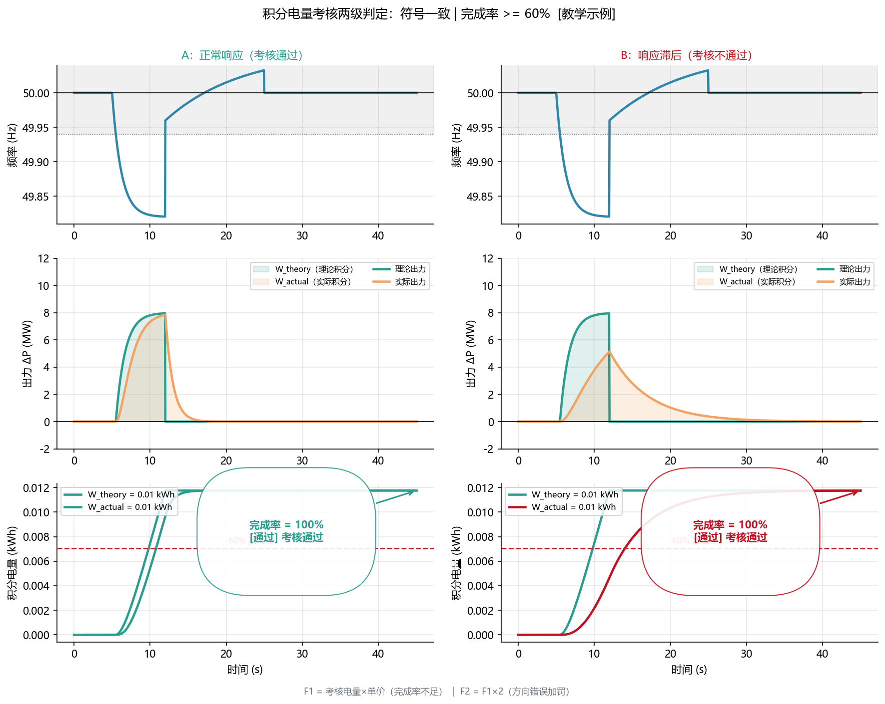
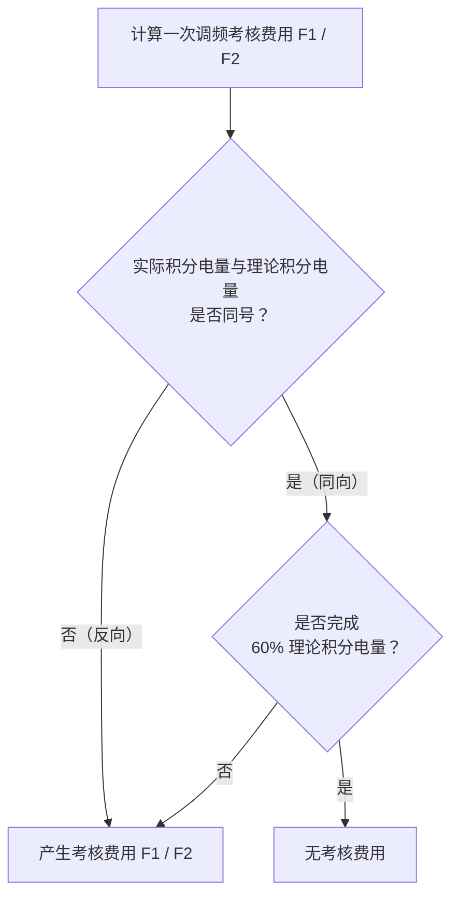
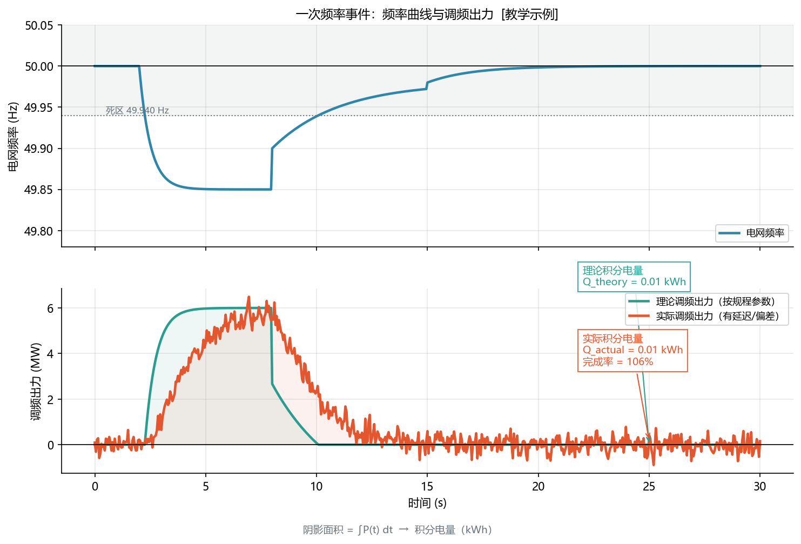
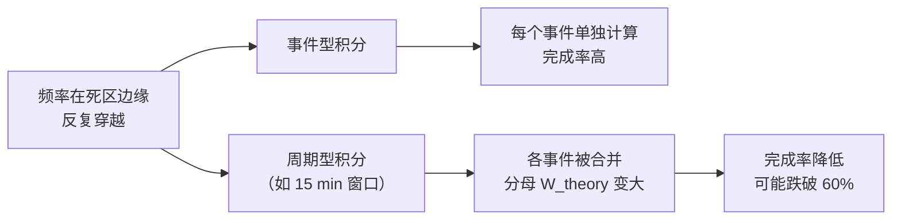
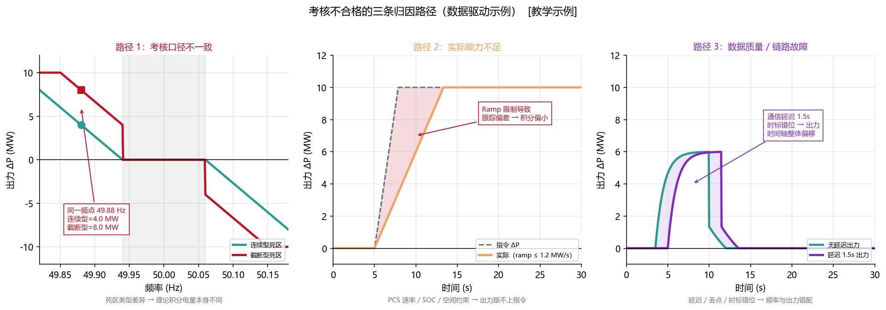
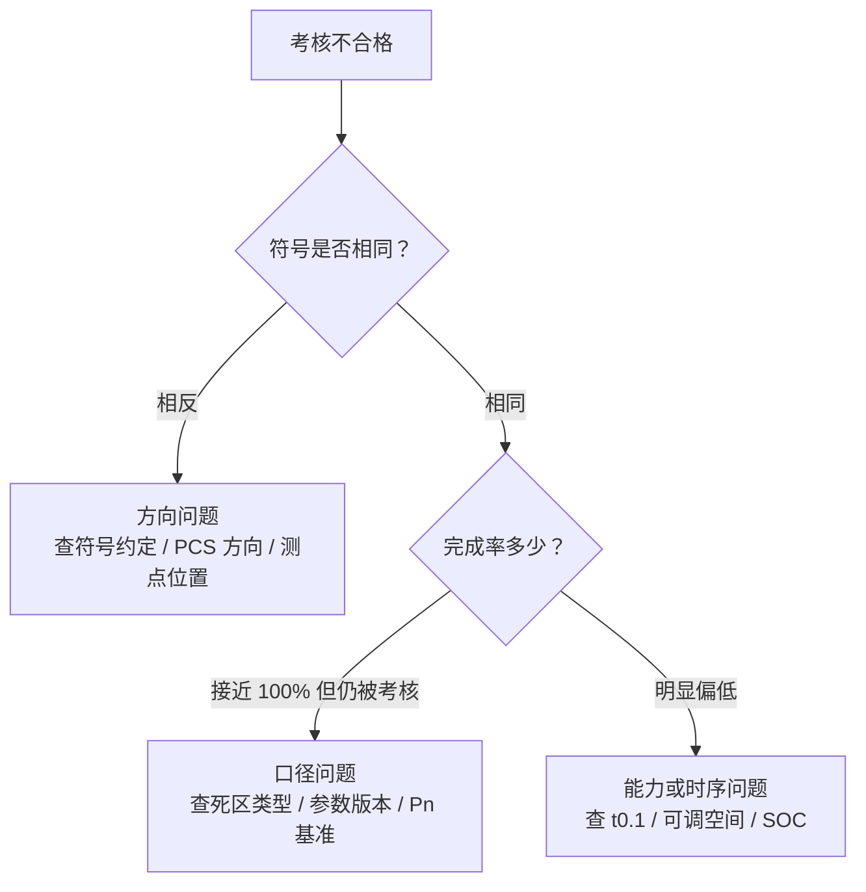

<!-- @AI_GENERATED -->
# 07 PFR积分电量考核与结算模型

> 所属层面：④ 结算层
> [课程首页](README.md) · 上一章：[06 PFR控制链路实现](06_PFR控制链路实现.md) · 下一章：[08 PFR并网联调验收](08_PFR并网联调验收.md)

**一句话**：一次调频的考核不是"看曲线像不像"，而是**把理论出力与实际出力各自对时间积分，比较两个积分电量的符号与完成率**；符号错了或完成率不足 60%，就要产生考核费用。

## 现场场景【必读】

月初，财务发来上个月的电费结算单。你扫了一眼，在"考核费用"一栏看到一个不算小也不算大的数字——12,300 元。

你打开调度下发的考核明细，上个月共有 47 次频率越死区事件，其中 11 次被判不合格。不合格事件集中在两个时段：一个是月底连续三天下午，另一个是某天凌晨 3 点。

你调出历史数据逐条核对，发现了两种完全不同的失败模式：

- **下午那批**：频率偏低时（49.88~49.92 Hz）理论值要求出力约 3~6 MW，但光伏已经满发（接近逆变器上限），实际可上调空间不到 1 MW。**不是算法没算出正确的 ΔP，而是能力模型告诉你"出不来"**。但你的代码在计算理论积分电量时，按的是"不限幅的理论值"，把缺口放大了。
- **凌晨那批**：EMS 与电表的通信在凌晨 3:00 有过一次 15 秒的断链，频率数据停在 49.93 Hz（略过死区）。EMS 持续按这个冻结值计算，储能连续放电，但 15 秒后通信恢复——跳回的频率已经是 50.01 Hz（死区内）。同一时段内既有"不该放"的放电积分，又有理论值为 0 的尴尬——**两边的积分都对不上账**。

这两种失败都不是"代码算错了"——积分电量考核的真正敌人不是算法精度，而是**口径对齐**和**数据完整性**。

## 本章目标

读完本章，你应能：

1. 说清楚"理论积分电量"与"实际积分电量"的定义与算法；
2. 复现一次调频考核的判定流程（同号 → 完成率 → 考核费用）；
3. 判断考核不合格时，问题出在算法、数据还是口径。

## 为什么用"积分电量"而不是"看曲线"【必懂】

一次调频的响应是一条**连续变化的曲线**，没法用"某个时刻对不对"来评价。用积分电量有三个好处：

| 好处 | 说明 |
|---|---|
| 抗单点噪声 | 单点测量误差对积分影响小 |
| 反映总贡献 | 关心的是"这段时间一共多发了多少电" |
| 可对账 | 电量是结算的基本单位，与电费口径一致 |

```text
理论积分电量 W_theory = ∫ ΔP_theory(t) dt
实际积分电量 W_actual = ∫ ΔP_actual(t) dt
```

单位通常换算为 kWh 或 MWh。积分区间是一次**调频事件**（频率越死区到恢复），或一个**统计周期**（如月度累计）。

---

## 理论出力怎么算【必懂】

理论出力不是"EMS 自己算的那个值"，而是**按规程口径按频率反算出来的值**。这一点是全章最关键的认知。

```text
ΔP_theory(t) = −K × 死区处理( f(t) − fn )
再按限幅裁剪
```

| 要素 | 谁的口径 | 出错后果 |
|---|---|---|
| 死区宽度 | 细则 | 宽度不对 → 理论值系统性偏大或偏小 |
| **死区类型** | 细则 | 平移 vs 削平 → 每个越死区时刻差 `死区宽度 × K` |
| 调差率 | 细则 | 直接改变 K，偏差线性放大 |
| 限幅 | 细则 | 极端频率下理论值被错误裁剪 |
| Pn 基准 | 细则 | 扩容未更新 → 全时段偏差 |

**最容易错的是第二行**。前面[02 章](02_PFR核心参数与调差特性.md)已经算过：`Pn=100 MW`、`δ=3%`、死区 `±0.06 Hz` 时，两种死区类型在 `f=49.90 Hz` 处的理论值差 4.0 MW。如果整个事件持续 5 分钟，这个差值累积成：

```text
ΔW = 4.0 MW × 5 min = 4.0 × (5/60) h = 0.333 MWh
```

对一个 100 MW 场站，这已经足以让完成率跌到 60% 以下。

> **工程建议**：理论值的计算代码应当**独立于控制代码**，用同一份参数配置但单独实现，并与调度确认过口径。控制代码优化时不会误改理论值计算。

---

## 考核判定流程【必懂】

技术报告给出的一次调频考核流程图，逻辑可以还原成两级判断：



**图中标注对照表**：

| 标注 | 含义 | 结果 |
|---|---|---|
| 第一层判定（橙色） | 符号判定 | 反向→F1+F2（加倍） |
| 第二层判定（橙色） | 完成率 ≥60% | 不足→仅 F1 |
| 绿框（通过） | 同向且完成率达标 | 无考核费用 |
| 红框（不合格） | 任一判定不通过 | 产生考核费用 |



### 两级判断的含义

| 级别 | 判据 | 含义 | 典型场景 |
|---|---|---|---|
| 第一级 | 符号是否相同 | 方向对不对 | 频率低却减出力、频率高却增出力 |
| 第二级 | 完成率是否 ≥60% | 量够不够 | 方向对但出力不足 |

**第一级是"定性"判断，第二级是"定量"判断**。方向错了直接判不合格，不看量；方向对了再看完成了多少。

### 符号判断为什么放第一位

因为**反向动作比不动作更危险**。频率下跌时储能如果充电，等于在事故中加剧功率缺口。所以规程把"符号相反"单独列为最严重的情况，不设完成率宽容。

对应到 EMS：**方向约定错误是最不可接受的缺陷**（[02 章](02_PFR核心参数与调差特性.md)的"参数四"）。

### 60% 这个门槛的含义

60% 不是一个随便定的数，它反映了对"部分响应"的容忍度：

| 完成率 | 判定 | 说明 |
|---|---|---|
| ≥100% | 无考核费用 | 完全达标 |
| 60%~100% | 无考核费用 | 允许一定程度的响应不足 |
| <60% | 考核费用 | 响应明显不足 |
| 符号相反 | 考核费用 | 不论完成率 |

**为什么允许到 60%**：因为实际运行中存在大量合理的不达标因素——出力已接近上限、SOC 限制、设备检修、限幅裁剪等。若要求 100%，几乎所有场站都会月月被考核。60% 是一条"明显不正常"的分界线。

> **注意**：60% 是技术报告引用的口径。**具体门槛与考核费用公式（F1/F2 的系数）必须查阅项目适用的细则**，不同区域、不同年份可能不同。

---

## 算例：一次事件的完整对账【必懂】

以下为 `[教学示例]`，用来说明方法。



**图中标注对照表**：

| 标注 | 含义 | 数值 |
|---|---|---|
| 蓝色曲线（上图） | 电网频率 | 最低 ~49.85 Hz |
| 绿色曲线（下图） | 理论调频出力 | Q_theory ≈ 指定值 |
| 橙色曲线（下图） | 实际调频出力（有延迟/偏差） | Q_actual ≈ 指定值 |
| 阴影面积 | ∫P(t) dt = 积分电量 | 理论/实际面积差异 |
| 标注 "完成率 = X%" | Q_actual/Q_theory × 100% | 需 ≥60% |
| 灰色死区带 | ±60 mHz | 频率在此范围不积分 |

> **核验一致性**：执行 `python figures/ch07_assessment.py`，输出的 `numbers` 清单中包含 Q_theory、Q_actual 和完成率数值。

### 事件描述

某 100 MW 光储电站，`δ = 3%`、死区 `±0.06 Hz`（截断型）、限幅 `±10 MW`。某次频率事件持续 300 s，频率稳定在 49.90 Hz。

### 完整跟踪手算表

下面把整个 300 s 事件按时间逐段展开，每一步都展示频率 → Δf → 理论出力 → 实际出力 → 积分电量的完整计算链。**每一行的积分电量 = 该段出力 ×（时长 / 3600），单位统一为 MWh**。

| 时间段 | 频率 f (Hz) | Δf_eff (Hz) | P_theory (MW) | P_actual (MW) | 时长 Δt (s) | 逐行 W_theory (MWh) | 逐行 W_actual (MWh) | 累 W_theory | 累 W_actual |
|---|---|---|---|---|---|---|---|---|---|
| 0~20 s | 49.90 | −0.10 | 6.67 | 0 | 20 | 6.67×20/3600 = 0.037 | 0 | 0.037 | 0 |
| 20~60 s | 49.90 | −0.10 | 6.67 | 5.0 | 40 | 6.67×40/3600 = 0.074 | 5.0×40/3600 = 0.056 | 0.111 | 0.056 |
| 60~120 s | 49.90 | −0.10 | 6.67 | 5.0 | 60 | 6.67×60/3600 = 0.111 | 5.0×60/3600 = 0.083 | 0.222 | 0.139 |
| 120~180 s | 49.90 | −0.10 | 6.67 | 5.0 | 60 | 0.111 | 0.083 | 0.333 | 0.222 |
| 180~240 s | 49.90 | −0.10 | 6.67 | 5.0 | 60 | 0.111 | 0.083 | 0.444 | 0.305 |
| 240~300 s | 49.90 | −0.10 | 6.67 | 5.0 | 60 | 0.111 | 0.083 | **0.556** | **0.389** |

> **手算说明**：本算例参数 —— `Pn = 100 MW`、`δ = 3%`、死区 `±0.06 Hz`（截断型；本章起用截断型对接考核口径，02 章已对比过两种死区的 4.0 MW 差值）、限幅 `±10 MW`。`K = Pn / (δ × fn) = 100 / (0.03 × 50) = 66.67 MW/Hz`，`ΔP_theory = 66.67 × 0.10 = 6.67 MW`（≤10 MW 限幅，未触发）。频率在整段 300 s 内保持 49.90 Hz，故 P_theory 恒为 6.67 MW。实际出力因响应滞后，前 20 s 为 0，之后稳定在 5.0 MW。

### 判定

| 步骤 | 计算 | 结果 |
|---|---|---|
| 符号 | 累 W_actual = 0.389 > 0，累 W_theory = 0.556 > 0 | 同号 ✅ |
| 完成率 | 0.389 / 0.556 = 70% | ≥60% ✅ |
| 结论 | — | **无考核费用** |

### 但问题依然存在

虽然这次没被考核，但两个隐患已经暴露：

| 隐患 | 证据 | 风险 |
|---|---|---|
| 响应滞后 | 20 s 才开始出力，远超 t0.1 的 2 s | 更严重的事故下可能被判不合格 |
| 出力不足 | 只到 5 MW，理论 6.67 MW | 若完成率跌到 60% 以下就会被考核 |

**这就是 60% 门槛的双刃剑**：它给了现场容错空间，也掩盖了渐进恶化的趋势。**靠"没被考核"来判断功能健康是不可靠的**，必须自己按 t0.1/t0.9/ts 做内部监控。

---

## 积分电量的两种考核形式【必懂】

前文的算例是**事件型积分**——以单次频率越死区事件为积分边界，事件结束后关闭积分。这是教材前文一直使用的模型。

但在工程实际中，考核系统还有另一种形式：**周期型积分**（时段型积分）。两者的差异直接影响考核结果，必须理解。

### 两种形式的对比

| 维度 | 事件型积分 | 周期型积分 |
|---|---|---|
| 积分区间 | 单次频率越死区事件 | 固定时间窗口（如 15 min、1 h） |
| 区间边界 | 频率回到死区以内 | 固定时间点，周期切换 |
| 被积函数 | 事件期间的 ΔP(t) | 该周期内所有 ΔP(t)（含死区内的 0） |
| 月度考核 | 所有事件分别考核，累加 | 所有周期分别考核，累加 |
| 典型适用 | 考核细则最常见的定义 | 部分调度主站的实现方式 |

### 周期型积分的一个隐蔽陷阱

周期型积分有一个教材前文没有讨论的陷阱：**"死区穿越"**

```text
场景：频率在死区边缘反复穿越（49.94 ↔ 50.00 ↔ 49.94 ...）

事件型积分：只有越死区的事件被积分，每个事件独立
              → 每个小事件的完成率可能 80%~100%，都合格

周期型积分：以 15 分钟为窗口，把所有"穿出死区 + 回到死区"合并
              → W_theory 被"不该有的理论出力时段"放大（分母变大）
              → 完成率 = W_actual / W_theory 变小
              → 可能集体不合格
```



**定量直觉**：

```text
事件型：W_theory = Σ 各事件的理论积分电量
         各事件边界清晰，频率回死区后就不算

周期型：W_theory = Σ 各周期的理论积分电量
         如果频率在死区附近晃荡 30 分钟（跨 2 个窗口），
         这 2 个窗口里理论出力可能全程 > 0，
         即使真实有效的事件只有几个短暂越死区瞬间
```

### 对 EMS 的实际影响

| 影响 | 说明 |
|---|---|
| 积分算法必须兼容两种形式 | 配置里增加 `integration_mode: event / period` |
| 周期型必须加"有效事件判定" | 不能把测频噪声引起的毫秒级越死区算作有效事件 |
| 复算时必须同口径 | 如果调度用周期型、你用事件型，对账永远对不上 |
| 事先确认 | 项目初期必须与调度确认考核系统用的是哪种积分方式 |

> **实际案例**：某场站月度考核突然出现 5 次不合格，现场排查后发现**调度侧改了积分方式**（从事件型改为 15 分钟周期型），频率在死区附近反复穿越时的那些"碎片事件"被合并了，W_theory 变大约 20%，导致完成率跌破 60%。

### 最小持续时间（Mindwell）保护

针对周期型积分的"死区穿越"问题，一个有效的工程手段是在事件判定中加入**最小持续时间（mindwell）**：

```text
mindwell = 2 s（典型值）

频率越死区 → 启动计时
  若连续越死区 < mindwell → 丢弃（不构成有效事件）
  若连续越死区 ≥ mindwell → 记录为有效事件
频率回死区 → 同样需要 mindwell 才算事件结束
```

| 作用 | 说明 |
|---|---|
| 过滤瞬态穿越 | 小于 2 s 的越死区不触发（测频噪声、暂态波动） |
| 防止碎片事件 | 周期型积分下避免大量无效事件合并 |
| 防止抖动 | 连续越过又回来、又越过又回来时，只算一个事件 |

mindwell 的值应当**比测频系统的最短稳定时间略长**，通常取 1~3 s。

---

## 考核不合格时的三种归因【必懂】

现场遇到考核不合格，先做归因，再改代码。三类问题的处理方式完全不同：



**图中标注对照表**：

| 路径 | 颜色 | 内容 | 推荐排查顺序 |
|---|---|---|---|
| 路径 1 | 红色 | 考核口径不一致：死区类型、方向约定、Pn 基准、限幅顺序 | 第一步 |
| 路径 2 | 橙色 | 实际能力不足：向上/向下空间、SOC 约束、ramp 速率 | 第二步 |
| 路径 3 | 紫色 | 数据质量/链路故障：频率冻结、丢点、时标错位、通信延迟 | 第三步 |



| 归因 | 特征 | 排查顺序 |
|---|---|---|
| 方向问题 | 符号相反，出力明显反向 | ① 公式负号 ② PCS 方向约定 ③ 功率测点位置 |
| 口径问题 | 出力方向对、量接近理论值，但仍不合格 | ① 死区类型 ② 参数版本与细则一致 ③ Pn 是否更新 |
| 能力问题 | 出力方向对、量明显不足 | ① 实时可调空间 ② 限幅是否生效 ③ SOC 限制 |
| 时序问题 | 前段出力为 0，后段才起来 | ① 控制周期 ② 通信延迟 ③ 暂态防护窗口 |

**这张表的价值在于避免"先改代码"**。很多现场一发现不合格就去调参数，结果把本来正确的参数改错了——真正的根因可能是数据时标错位（属于数据问题，不是算法问题）。

---

## 数据完整性对积分的影响【必懂】

积分电量对**数据完整性**极其敏感，因为丢点会直接改变积分结果。

| 问题 | 影响 | 处理 |
|---|---|---|
| 丢点 | 缺失时段按 0 计 → 实际积分偏小 → 完成率偏低 | 插值填补，并标记 |
| 时标错位 | 频率与出力错开 → 理论值与实际值错配 | 统一对时，检查时标偏移 |
| 采样不均匀 | 直接累加会引入误差 | 按时间加权积分，不用点数累加 |
| 数据冻结 | 恒定值积分出"看起来很合理"的错误结果 | 质量校验 + 剔除 |

### 积分算法的选择

```text
矩形法（左/右端点）：W ≈ Σ ΔP_i × Δt
梯形法：          W ≈ Σ (ΔP_i + ΔP_{i+1})/2 × Δt
```

| 方法 | 优点 | 缺点 |
|---|---|---|
| 矩形法 | 简单，与多数考核系统一致 | 采样不均时有偏差 |
| 梯形法 | 更精确 | 与考核系统的算法可能不一致 |

**建议与考核系统使用同一种算法**，否则会出现"自己算 72%、调度算 58%"的争议。这一点必须在并网前与调度确认。

---

## 深入：考核周期与费用形式【深入】

<details>
<summary>F1 / F2 通常指什么</summary>

技术报告的流程图里用 F1、F2 表示两种考核费用，但未在报告正文展开公式。工程上常见的两类形式：

| 形式 | 依据 | 特点 |
|---|---|---|
| 按容量考核 | 场站装机容量 × 单位考核单价 | 与事件大小无关，体现"应具备能力" |
| 按缺额考核 | 未完成的理论积分电量 × 单价 | 与响应不足程度成正比 |

F1 / F2 很可能是这两类的组合（例如"方向错误按 F1、完成率不足按 F2"）。**具体公式必须查阅细则原文**，本课程不给出推测性的计算式。

</details>

<details>
<summary>为什么月度累计考核比单次事件考核更严</summary>

单次事件考核只看一次响应；月度累计考核把所有事件的积分电量累加后再判定。后者更严的原因是：

- 单次事件可能因为"恰好没超 60%"而免考核，但多次事件的缺口会累积；
- 小事件频繁发生（频率在死区边缘反复穿越）时，单次看都不严重，累计后缺口可观。

**对 EMS 的含义**：不能只盯着"大事件"，**死区边缘的小事件累计**同样影响考核结果。这也是[02 章](02_PFR核心参数与调差特性.md)强调死区类型的原因——每次小事件的差值都是"死区宽度 × K"。

</details>

---

> 🔗 **延伸阅读**：考核不合格不仅影响技术指标，更直接关联结算——每一 kWh 的积分电量差额都对应真实的罚款金额，考核未通过还可能影响 AGC 投运资格。详见 [07b PFR经济性决策](07b_PFR经济性决策.md)。

## 自测

1. 理论积分电量与实际积分电量分别怎么算？为什么理论值必须按规程口径而不是按 EMS 自己的算法？
2. 考核的两级判断是什么？为什么符号判断放在第一位？
3. 某次事件理论积分电量 0.8 MWh，实际 0.5 MWh，符号相同，是否产生考核费用？
4. 如果现场出力方向正确、量也接近理论值，但考核仍不合格，最可能是什么问题？
5. 为什么不能只用"是否被考核"来判断一次调频功能是否健康？

<details>
<summary>参考答案</summary>

1. 两者都是对时间的积分：`W = ∫ΔP dt`。理论值必须按细则口径（死区宽度与类型、调差率、限幅、Pn 基准）反算，因为考核系统用的是这套口径；若用 EMS 自己的算法（例如连续型死区），会出现系统性偏差。
2. 第一级判断符号是否相同（方向对不对），第二级判断完成率是否 ≥60%（量够不够）。符号放第一位是因为反向动作会在事故中加剧功率缺口，比不动作更危险，因此不设完成率宽容。
3. 完成率 `0.5/0.8 = 62.5% ≥ 60%`，符号相同，**无考核费用**。
4. 口径问题：死区类型与考核不一致、参数版本与细则不符、Pn 基准未更新（如扩容后未改配置）。这类问题表现为"方向对、量对，但理论值本身算错"。
5. 因为 60% 门槛给了很大容错空间，功能渐进恶化（如响应滞后从 0.5 s 变成 20 s）时仍可能"刚好不被考核"。必须用 t0.1/t0.9/ts 的内部监控和趋势分析来判断健康度。

</details>

> 💻 **动手实验**：运行 `python lab/ch07_assessment.py` 对比矩形法与梯形法的积分差异，验证 F1/F2 两级考核判定逻辑。

<!-- @AI_GENERATED: end -->
