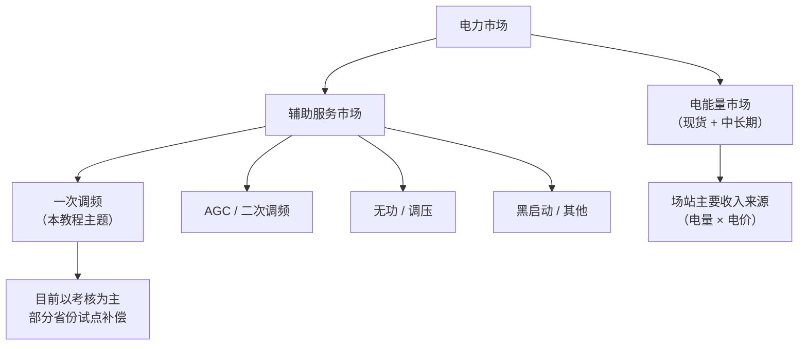
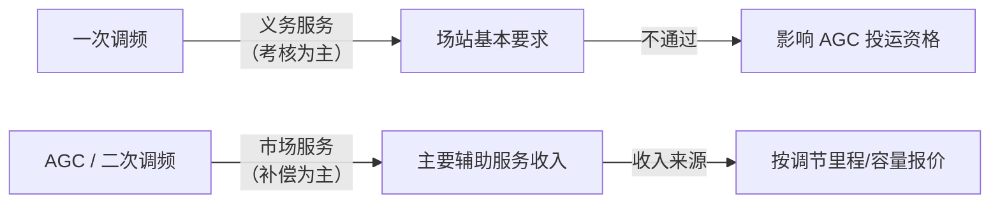

<!-- @AI_GENERATED -->
# 07b PFR辅助服务经济性决策

> 所属层面：④ 结算层（经济性）
> **定位**：从"如何不被罚款"到"如何赚到钱"，补齐一次调频的商业视角。

> 📎 **前置依赖**：本章承接 [07 PFR积分电量结算](07_PFR积分电量结算.md)，将"积分电量→考核判定"的结果转化为具体金额。建议先理解 F1/F2 判定逻辑再读本章。

---

## 场景：投资决策会议上的灵魂拷问

> 某储能电站的投资方在项目评审会上问技术团队："一次调频改造成本 30 万，一年能给我们省多少罚款、赚多少补偿？几年能回本？"
>
> 技术团队翻遍了细则文件，发现考核条款写得很清楚——但罚款金额和补偿标准散落在"两个细则"的不同章节，甚至不在同一份文件里。财务模型缺了这块数据，老板的耐心在消失。

这种场景暴露了一个工程现实：**技术人员只懂"能不能通过"，不懂"能省多少/能赚多少"，就不算真正理解一次调频**。

---

## 一次调频在电力市场中的三层定位



**一次调频目前仍是"义务型辅助服务"**——场站必须提供，不考核通过则罚款；部分省份在试点"市场化补偿"。

---

## 考核费用计算【必懂】

### 考核标准公式

各省"两个细则"对一次调频考核的算法大同小异，核心是：

```text
月度考核费用 = Σ(不合格事件的考核电量 × 考核单价)
```

**考核电量**的计算方式因省而异：

| 省份/区域 | 考核电量算法 | 典型单价 | 月度上限 |
|---|---|---|---|
| 华东 | 不合格次数 × 理论积分电量 × (1 - 完成率) × 惩罚系数 | 0.5~1.0 元/kWh | Pn × 10h × 单价 |
| 东北 | 按月统计不合格小时数 × Pn × 考核系数 | 0.1~0.5 元/kWh | Pn × 50h × 单价 |
| 山西 | 按事件考核 + 月度可用率考核（双维度） | 0.5 元/kWh | — |

### 实战算例

**华东某 100MW 储能电站**，一个月内发生一次调频动作 120 次，其中 3 次不合格：

| 事件 | W_theory | W_actual | 完成率 | 考核电量 |
|---|---|---|---|---|
| #17 低频 | 0.83 MWh | 0.38 MWh | 45.8% | 0.83 × (1-0.458) × 2.0 = 0.90 MWh |
| #42 高频 | 0.56 MWh | -0.12 MWh | ❌符号不匹配 | 0.56 × 2.0 = 1.12 MWh |
| #98 低频 | 1.05 MWh | 0.50 MWh | 47.6% | 1.05 × (1-0.476) × 2.0 = 1.10 MWh |

> `[教学示例]` 惩罚系数取 2.0，仅为说明计算逻辑

> 📋 **参数注**：以上采用某省级"两个细则"中与缺额挂钩的典型系数。不同省份的 F1（方向错误）/ F2（完成率不足）系数取值在 1.0~5.0 之间，具体以项目所在地当年发布的细则为准。考核单价在各省差异较大（0.5~1.0 元/kWh），月度罚款上限通常为 `Pn × 10h × 考核单价`（即"按 10 小时满功率计"），少数省份取 1 小时或 15 小时。

```text
月度考核总电量 = 0.90 + 1.12 + 1.10 = 3.12 MWh
若考核单价 = 0.8 元/kWh
月度罚款 = 3.12 × 1000 × 0.8 = 2496 元
```

**看起来不多？但注意**：如果这 3 次恰好是频率大扰动期间、出力偏差绝对值大，单次考核电量可能到 10 MWh+。更严重的是：**连续多月考核不合格可能触发整改通知、限期整改、甚至罚款系数加倍**。

---

## 补偿收益模型【必懂】

部分省份已试点一次调频补偿。以华东某省为例：

### 补偿公式

```text
一次调频月度补偿 = Σ(合格事件的补偿电量 × 补偿单价)
补偿单价 = 通常 15~30 元/MWh（约 0.015~0.030 元/kWh）
```

### 补偿与考核的对比

| 项目 | 考核（罚款） | 补偿（收益） |
|---|---|---|
| 单价 | 0.5~1.0 元/kWh | 0.015~0.030 元/kWh |
| 价差 | — | **罚款单价是补偿单价的 30~50 倍** |
| 导向 | "做不好就罚" | "做得好象征性奖励" |

> **核心认知**：在当前政策框架下，一次调频的**核心经济价值在于"避免罚款"而非"赚取补偿"**。补偿金额通常不到电能量收入的 1%，但罚款可能吃掉场站年利润的 3~5%。

---

## ROI 分析：一次调频改造的投资回报【必懂】

### 投入端

| 投入项 | 典型成本（100MW 储能） | 说明 |
|---|---|---|
| 测频装置（含备件） | 5~8 万 | 高精度频率测量终端 |
| 软件改造 | 3~5 万 | EMS 功能开发 + 调试 |
| 通信改造 | 2~3 万 | GOOSE 交换机 + 光纤 |
| 试验调试 | 5~10 万 | 场内试验 + 并网联调 |
| **一次性投入合计** | **15~26 万** | — |

### 收益端

| 收益项 | 年度金额 | 说明 |
|---|---|---|
| 避免考核罚款 | 3~15 万/年 | 假设每月 1~3 次不合格 × 罚金 |
| 辅助服务补偿（如有） | 0.5~3 万/年 | 合格事件累计补偿 |
| **年度收益合计** | **4~18 万/年** | — |

### ROI 结论

```text
回本周期 = 15~26 万 / (4~18 万/年) ≈ 1.5~6.5 年
中位数约 2~3 年
```

> `[教学示例]` 以上数据基于 2024-2025 年市场情况，具体以各省最新细则为准。

**性价比最高的是"先把参数整对"**：软件改造（3~5 万）就能消除大部分因死区类型选错、K 值硬编码导致的考核失败——这是 ROI 最高的投入，几乎没有物理设备成本。

---

## 参数整定的经济维度【必懂】

### 死区宽度的经济学

| 死区宽度 | 考核通过率 | SOC 消耗 | 电池寿命影响 |
|---|---|---|---|
| 窄（±0.03 Hz） | 高 | 大（动作频繁） | 大（循环次数增加） |
| 中（±0.05 Hz） | 中 | 中 | 中 |
| 宽（±0.10 Hz） | 低（可能漏动作） | 小 | 小（动作少） |

窄死区带来高考核通过率，但频繁动作加速电池日历衰减。粗略估算：

```text
`[教学示例]`
窄死区每年多动作约 2000 次，每次等效 0.05 个满循环
→ 年增等效循环 100 次
→ 若电池日历寿命 6000 次，年衰减率增加 1.7%
→ 对 200MWh 电站，年等效容量损失 3.4 MWh ≈ 3.4 MWh × 0.4 元/kWh ≈ 1.4 万/年
```

> 死区宽度不仅是技术参数，也是一笔经济账。

### 限幅大小的经济学

- 限幅大（如 ±20% Pn）→ 单次事件出力大 → 积分电量多 → 考核通过率高 → 但 SOC 消耗快
- 限幅小（如 ±6% Pn）→ 单次事件出力小 → 积分离理论值"远" → 考核完成率可能低

**最优限幅**取决于 **Pn 相对于电网扰动规模的比例**。Pn 越大（如 200MW），单个事件的出力占 Pn 比例小，可以设较低的限幅百分比；Pn 越小（如 10MW），可能需要更高的限幅百分比才能跟在频率偏差后面"够用"。

---

## 与 AGC / 二次调频的经济衔接



在多个省份，**一次调频考核不合格的场站，AGC 辅助服务可能被限制投运或降级**。这意味着一次调频的罚款损失只是"冰山之上"，更大的损失可能来自 AGC 收入的丧失。

```text
`[教学示例]`
假设 AGC 月度补偿收入约 8~15 万/月（100MW 储能，华东某省）
一次调频不合格 → AGC 限投 1 个月 → 直接损失 8~15 万
这个数字可能超过一次调频改造的全部成本
```

---

## 自测

1. 一次调频的罚款单价和补偿单价的量级关系是什么？这意味着什么？
2. 为什么"先把参数整对"是 ROI 最高的投入？
3. 窄死区会带来什么经济代价？
4. 一次调频不合格为什么可能影响 AGC 收入？

<details>
<summary>参考答案</summary>

1. 罚款单价（0.5~1.0 元/kWh）是补偿单价（0.015~0.030 元/kWh）的 30~50 倍。这意味着一次调频当前的核心经济价值在于"避免罚款"而非"赚取补偿"。
2. 参数错误（死区类型、K 值）导致的考核失败，修改只需要软件配置变更（3~5 万），不需要硬件投入，ROI 极高。
3. 窄死区导致动作频率增加，加速电池等效循环次数，年衰减率增加约 1~2%，对大型电站意味每年数万至十几万的等效容量损失。
4. 多个省份规定一次调频考核不合格会影响 AGC 辅助服务投运资格，AGC 月度补偿收入（8~15 万/月）远超一次调频罚款，这是隐性的更大损失。

</details>

> 💻 **动手实验**：本章为经济分析扩展章节，暂无独立实验。建议结合 `lab/ch07_assessment.py` 的考核判定结果手工验证本章考核费用公式。

<!-- @AI_GENERATED: end -->
