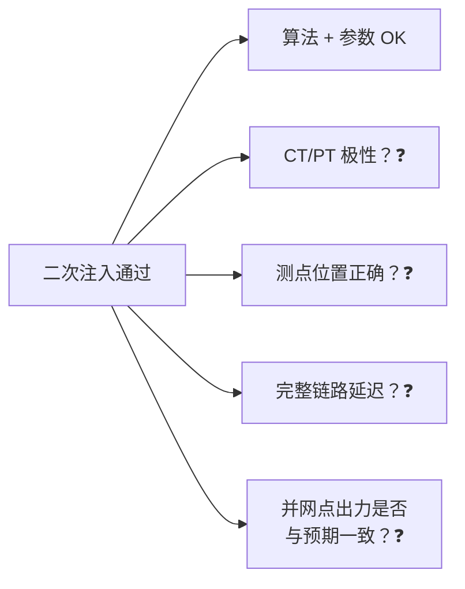
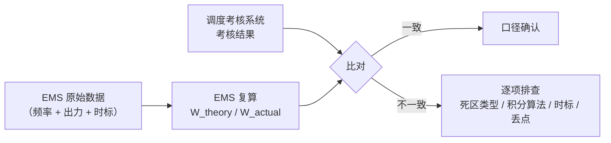

<!-- @AI_GENERATED -->
# 08 PFR并网联调与验收证据链

> 所属层面：② 时序层 + ③ 精度层（试验验证）
> [课程首页](README.md) · 上一章：[07 PFR积分电量结算](07_PFR积分电量结算.md) · 下一章：[09 PFR故障根因诊断](09_PFR故障根因诊断.md)

**一句话**：一次调频的验收不看"功能有没有"，只看**带统一时标的频率-出力曲线能不能复现规程判据**；试验方案、原始数据、参数快照三者合起来才是完整的验收证据链。

## 现场场景【必读】

并网试验的前一天晚上，你还在办公室。试验大纲已经准备好了——四类试验、十二个工况，照着华北电科院去年那份模板写的。

但你心里有一件事放不下：PCS 厂家今天刚换了通信协议版本，方向约定是"充电为正"还是"放电为正"，对方工程师在微信里说"你先试一下看看"。

你没有"先试一下看看"。你打开试验方案，在**第一项参数核对**下面加了一行：

> **方向约定验证**：注入 49.90 Hz 的频率信号。接收端应观察到 PCS 出力 **增加**（放电为正方）。如观察到出力减小，立即中止试验并检查方向换算层。

第二天试验中，这个步骤真的触发了——PCS 在有功设定为 +3 MW 时，实际读取的反馈值是 −3 MW。方向约定恰好在这次协议升级里被反转了。

**如果不是在试验第一项就查了方向，后面的阶跃响应、ts 计算、控制偏差全部会是错的。**一次调频的试验逻辑就是：先查"有没有"（参数），再查"对不对"（方向），最后查"快不快、稳不稳"（响应时间与控制偏差）。

## 本章目标

读完本章，你应能：

1. 设计一次调频的四类试验（参数核对、阶跃响应、防误动、连续运行）；
2. 按 t0.1 / t0.9 / ts / 控制偏差形成可判定的判据表；
3. 组织一套可追溯的验收证据链，避免事后争议。

## 试验的四类项目【必懂】


| 类别 | 目的 | 检查的指标 |
|---|---|---|
| ① 参数与逻辑核对 | 确认配置与细则一致 | 死区、死区类型、调差率、限幅、方向 |
| ② 阶跃响应试验 | 确认响应速度与幅度 | t0.1、t0.9、ts、控制偏差 |
| ③ 防误动与暂态试验 | 确认不误动、不拒动 | 暂态过程要求、闭锁逻辑 |
| ④ 连续运行与数据核对 | 确认考核数据可信 | 数据完整性、时标一致性、积分口径 |

**顺序不能颠倒**：参数没核对就做阶跃试验，等于在错误的参数上验证正确的算法，结论无效。

---

## ① 参数与逻辑核对【必懂】

这一步不产生曲线，但它是后面所有试验的前提。

### 核对清单

| 项 | 核对方法 | 通过判据 |
|---|---|---|
| 死区宽度 | EMS 配置 vs 装置回读 vs 细则 | 三者一致 |
| 死区类型 | 查阅装置实现，注入小偏差观察 | 与细则口径一致（平移/削平） |
| 调差率 | 配置 vs 回读 | 与细则一致 |
| 限幅（上/下） | 配置 vs 回读 | 分别核对，不能只看一个 |
| Pn 基准 | 配置 vs 场站实际容量 | 一致（扩容后必须更新） |
| 方向 | 注入频率偏低信号，观察出力 | 出力**增加** |
| 最低出力约束 | 配置 vs 设备参数 | 一致 |

### 方向验证的三种方法

| 方法 | 做法 | 可靠性 |
|---|---|---|
| 静态注入 | 注入 49.9 Hz 信号，看出力是否增加 | 高，最直接 |
| 参数推演 | 手算 `ΔP = −K × Δf_eff` 与装置输出比对 | 中，依赖实现透明 |
| 实际频率 | 等真实频率越死区时观察 | 低，不可控 |

**推荐第一种**。方向错误是[07 章](07_PFR积分电量结算.md)里最严重的缺陷（直接判符号相反），必须在试验中一次性确认。

---

## ② 频率阶跃响应试验【必懂】

### 试验方法

工程上常用两种方式：

| 方式 | 做法 | 优点 | 缺点 |
|---|---|---|---|
| 频率信号注入 | 在测频回路注入阶跃频率信号（如 50 → 49.9 Hz） | 可控、可重复、可做多档 | 需要装置支持注入接口 |
| 实际频率等待 | 等真实电网出现足够偏差时记录 | 完全真实 | 不可控、难复现 |

技术报告给出的限值，正是基于**试点场站的阶跃扰动实测平均值**（[04 章](04_PFR时序分解与贡献率.md)），所以阶跃试验是最贴合定值来源的方法。

### 阶跃档位设计【必懂】

不能只做一档。至少覆盖：

| 档位 | 阶跃幅度 | 验证目标 |
|---|---|---|
| 死区内 | 如 50 → 49.95 Hz（小于死区 0.06） | **不动作**（防误动） |
| 死区边缘 | 恰好等于死区 | 边界行为（0 或最小出力） |
| 小阶跃 | 如 50 → 49.90 Hz | 小幅响应的控制偏差 |
| 中阶跃 | 如 50 → 49.85 Hz | t0.9 与 ts |
| 大阶跃 | 如 50 → 49.70 Hz | **限幅**是否生效、是否越限 |

**上下两个方向都要做**：频率升高与降低的响应特性可能不同，尤其东北这类上下限幅不对称的区域（[05 章](05_PFR跨区考核适配.md)）。

### 判据表

以光伏 `Pn = 100 MW`、`δ = 3%`、死区 `±0.06 Hz`（截断型——与 ch02 教学示例使用的连续型不同，此处特意切换为截断型以展示判据变化）、限幅 `±10 MW` 为例 `[教学示例]`：

| 判据 | 限值 | 本次实测 | 判定 |
|---|---|---|---|
| 测频分辨率 | ≤0.003 Hz | 待测 | — |
| 采样周期 | ≤100 ms | 待测 | — |
| 控制周期 | ≤1 s | 待测 | — |
| 响应滞后 t0.1 | ≤2 s | 待测 | — |
| 响应时间 t0.9 | ≤5 s（光伏） | 待测 | — |
| 调节时间 ts | ≤15 s | 待测 | — |
| 控制偏差 | ≤±1% Pn（光伏） | 待测 | — |
| 限幅 | ≤±10 MW | 待测 | — |
| 死区内不动作 | 出力增量为 0 | 待测 | — |

### 阶跃响应记录模板

```text
试验编号：PF-2026-001
场站：XX 光储电站        Pn：100 MW
配置版本：shanxi_2020-v1
死区：0.05 Hz  类型：cut   调差率：2%   限幅：+10% / -20%

阶跃：50.00 → 49.90 Hz（下行）
起始时间：2026-03-12 10:23:45.100
频率越死区时刻 t0：10:23:45.100（Δf 首次超过 0.05）
出力开始变化时刻：10:23:45.680   → t0.1 = 0.58 s
达到 90% 目标时刻：10:23:48.900   → t0.9 = 3.80 s
进入 ±1% Pn 稳定带时刻：10:23:52.300 → ts = 7.20 s
稳定增量：4.02 MW   理论值：4.00 MW  偏差：0.02 MW（0.02% Pn）
结论：t0.1 / t0.9 / ts / 偏差 全部合格
```

> **注意 `t0` 的定义**：起点是"频率**越过死区**"的时刻，不是"阶跃施加"的时刻。若两者混用，t0.1 会被低估（把信号传输时间算进响应时间）。

---

## 二次注入 vs 一次整组试验【必懂】

一次调频的试验方法按信号注入位置分两类，它们验证的范围完全不同：

| 维度 | 二次注入试验 | 一次整组试验 |
|---|---|---|
| 注入点 | 测频回路的端子排 / RTU 输入端 | 一次设备侧（CT/PT 之前的真实电压/电流） |
| 验证范围 | 从测频信号输入 → 控制逻辑 → 指令输出 | 从 CT/PT → 测频回路 → 控制逻辑 → PCS → 并网点出力 |
| 能验证的 | 算法正确性、参数整定、响应时间、控制偏差 | 上述全部 + CT/PT 极性、测点位置、功率方向、完整链路延迟 |
| 测试工具 | 信号发生器（可编程频率源） | 真实电网频率事件（等待）或 **RTDS/HIL 半实物仿真** |
| 实施难度 | 低，可在投运前完成 | 高，依赖真实事件或专用仿真设备 |
| 实施时机 | 并网前 / 投运前 | 并网后持续观察 / 半实物仿真可在投运前 |

### 为什么只做二次注入不够



二次注入只能在"测频端子排"这一层验证。但真实世界还有以下环节：

| 环节 | 可能问题 | 二次注入能否发现 |
|---|---|---|
| CT 方向装反 | 出力方向在并网点是反的 | ✗ |
| PT 变比配置错误 | 测到的频率是对的但电压相位错 | ✗ |
| 测频装置在错误位置取信号 | 取的是站内母线而非并网点 | ✗ |
| PCS 通信延迟 | 指令到执行有额外 200 ms 延迟 | ✗（指令发出了，不知道执行了多久） |
| 并网点功率 ≠ EMS 计算值 | 站用电等被计入/漏计 | ✗ |

### 工程上如何补全

| 手段 | 覆盖哪些漏掉的环节 | 建议 |
|---|---|---|
| 一次设备极性校核 | CT/PT 方向与测点位置 | 在二次注入之前单独完成，作为前提条件 |
| 真实频率事件数据回放 | 完整链路延迟、并网点出力 | 每次电网真实事件后，把录波数据导回来与 EMS 理论值对账 |
| RTDS/HIL 半实物仿真 | CT/PT → 控制 → PCS 全链路 | 新建大型场站建议做，成本高但最全面 |
| 并网后持续监控 | 长期考核趋势 | 月度对账，发现趋势性偏差 |

> **一句话**：**二次注入是"逻辑考试"，一次整组是"实战演习"**。并网验收通常以二次注入为主、以真实事件数据为辅。但二次注入过不了真实事件对账的例子很多——最常见的原因是 CT/PT 极性问题（[09 章](09_PFR故障根因诊断.md)）。

---

## ③ 防误动与暂态试验【必懂】

### 要验证的四件事

| 项目 | 做法 | 通过判据 |
|---|---|---|
| 死区内不动作 | 注入死区内频率并保持 | 出力增量恒为 0 |
| 频率突变不误动 | 注入短时频率尖峰（模拟短路引起的瞬时突变） | 不产生持续出力 |
| 数据中断闭锁 | 断开测频数据源 | 按斜坡退出，不保持最后值 |
| 闭锁后恢复 | 恢复数据源 | 延时后恢复，不抖动 |

### 瞬时频率突变的模拟

单相短路引起的频率测量跳变，通常表现为**持续几十到几百毫秒的尖峰**。试验中可以用信号源产生类似的短时跳变，观察：

- 是否触发出力变化；
- 若触发，出力是否在尖峰消失后**立即回退**（说明只是跟随测量值，没有防护）；
- 防护窗口是否满足 t0.1 预算（[04 章](04_PFR时序分解与贡献率.md)）。

> **这是最容易被跳过的一项**。因为它不产生漂亮曲线，也不影响日常考核；但一旦真实发生短路，误动会造成出力震荡，后果比"响应慢一点"严重得多。

---

## ④ 连续运行与数据核对【必懂】

### 要核对的三件事

| 项目 | 方法 | 通过判据 |
|---|---|---|
| 数据完整性 | 统计连续运行期的丢点率 | 无长时间连续丢点 |
| 时标一致性 | 与调度主站对时偏差 | 在允许范围内 |
| 积分口径 | 用 EMS 数据复算理论/实际积分电量，与考核系统对比 | 差异可解释 |

### 为什么必须做积分对账

[07 章](07_PFR积分电量结算.md)算过一个例子：理论 0.556 MWh、实际 0.389 MWh、完成率 70%。这个数如果 EMS 自己算成 72%、调度算成 58%，结论就完全不同。

**对账方法**：



排查顺序建议：**先查时标，再查丢点，再查积分算法，最后查死区类型**。因为前三项是"数据问题"（好查好改），最后一项是"口径问题"（需要与调度沟通）。

---

## 并网联调【必懂】

场站内部试验通过后，还要与调度主站联调。

| 联调项 | 内容 | 常见问题 |
|---|---|---|
| 遥测上送 | 频率、出力、调频状态上送正确 | 点表映射错误、量纲错误（kW/MW） |
| 遥信上送 | 投入/退出/闭锁状态 | 状态位定义不一致 |
| 远方投退 | 调度下发投入/退出命令 | 命令字与确认机制不匹配 |
| 与 AGC 叠加 | AGC 基点 + 一次调频增量的合成 | 总量越限处理未确认 |
| 事件记录 | 调频动作事件上送 | 事件定义与主站不一致 |

### 量纲问题最隐蔽

| 错误 | 表现 |
|---|---|
| kW 当 MW 上送 | 调度看到 100000 MW |
| 百分比当绝对值 | 调度看到 0.1 而不是 10 MW |
| 符号相反 | 频率低时上送负出力 |

这类问题在联调时通常会被发现，但**如果只做"点表通、数值有"的粗查，很容易漏过**。建议联调时逐点核对量纲与符号，并保留核对记录。

---

## 验收证据链【必懂】

一次调频的验收材料应当能回答三个问题：**用了什么参数、做了什么试验、结果是多少**。


| 材料 | 关键内容 | 缺失后果 |
|---|---|---|
| 细则原文 | 文号、生效日期、适用对象 | 无法证明参数来源 |
| 参数快照 | 配置值 + 装置回读值 + 比对时间 | 无法证明参数一致 |
| 原始数据 | 未加工的带时标数据 | 无法复核曲线 |
| 试验报告 | 判据表、每项实测值、结论 | 无法判定达标 |
| 积分对账 | EMS 复算 vs 调度结果 | 争议时无依据 |

> **一条实践经验**：**原始数据比报告重要**。报告可以重写，原始数据一旦丢失就无法重建。试验当天务必把原始数据完整备份到独立介质。

---

## 深入：试验中最常见的四个失败【深入】

<details>
<summary>失败一：t0.1 超限</summary>

| 可能原因 | 排查方法 | 整改 |
|---|---|---|
| 控制周期过长（如 1 s） | 查控制周期配置 | 缩短到 200~500 ms |
| 暂态防护窗口过长 | 查防护时窗参数 | 缩短窗口，改用质量位 |
| 通信延迟大 | 抓包测端到端延迟 | 改用本地执行或优化通信 |
| 死区边界斜率接近 0 | 连续型死区在边界处斜率 0 | 改用截断型或调整判定阈值 |

第四项常被忽略：连续型死区在边界处斜率为 0（[02 章](02_PFR核心参数与调差特性.md)），出力"开始变化"的时刻天然偏晚。

</details>

<details>
<summary>失败二：t0.9 达不到</summary>

| 可能原因 | 排查方法 | 整改 |
|---|---|---|
| 目标值被能力校验削减后仍按理论值算 90% | 查目标值定义 | 按可执行目标算 90%（[04 章](04_PFR时序分解与贡献率.md)） |
| PCS 爬坡速率限制 | 查 PCS 有功变化率设置 | 提高爬坡速率（需评估设备影响） |
| 出力已接近上限 | 查当前出力与设备容量 | 属物理限制，需与调度确认口径 |

</details>

<details>
<summary>失败三：控制偏差超标但方向正确</summary>

按[07 章](07_PFR积分电量结算.md)的归因流程走：**先查口径，再查能力**。最常见的三个原因依次是：死区类型不一致、参数版本与细则不符、Pn 基准未更新。真正属于"算法写错"的比例其实很低。

</details>

<details>
<summary>失败四：试验数据"太漂亮"</summary>

如果实测曲线与理论曲线**完全重合、毫无噪声**，要警惕三种情况：

- 数据是仿真生成而非实测；
- 实际出力被"回填"成理论值；
- 采样率过低，把瞬态过程平滑掉了。

真实数据一定带有噪声、爬坡过程与小幅超调。**验收时应关注原始数据的采样率与时间分辨率**，避免用秒级数据评价毫秒级过程。

</details>

---

## 自测

1. 四类试验的先后顺序为什么不能颠倒？
2. 阶跃试验的 `t0` 起点应该怎么定义？用"阶跃施加时刻"会有什么后果？
3. 为什么"频率突变不误动"这一项最容易被跳过？不做的风险是什么？
4. 积分对账不一致时，建议的排查顺序是什么？为什么这样排？
5. 验收证据链里哪一项最不可替代？

<details>
<summary>参考答案</summary>

1. 因为参数核对是后面所有试验的前提。参数不一致时，阶跃试验验证的是"错误的参数 + 正确的算法"，结论无效，还可能误导整改方向。
2. 起点应为频率**首次越过死区**的时刻，而不是阶跃信号施加的时刻。用后者会把信号传输与测量延迟算进响应时间，导致 t0.1 被低估，看起来"合格"但实际不达标。
3. 因为它不产生典型曲线、也不影响日常考核，容易被当作"附加项"。风险是一旦真实发生单相短路，测量频率跳变会触发出力震荡，后果比响应慢更严重。
4. 顺序：时标 → 丢点 → 积分算法 → 死区类型。前三项属于数据问题，可自行排查修正；死区类型属于口径问题，需要与调度确认，放在最后避免在数据问题上浪费时间。
5. 试验原始数据（带时标的频率与出力记录）。报告可以重写、参数可以重新导出，但原始数据一旦丢失无法重建，争议时无从复核。

</details>

> 💻 **动手实验**：运行 `python lab/ch08_testing.py` 仿真防误动、阶跃响应、方向正确性三个关键试验项。

<!-- @AI_GENERATED: end -->
