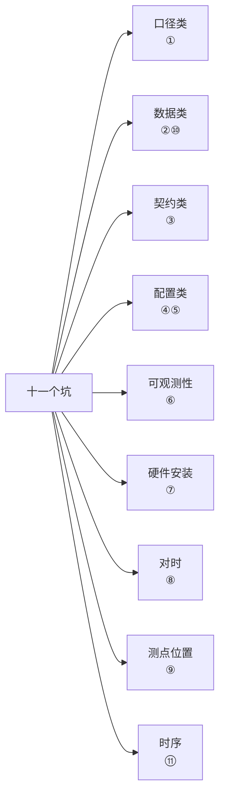
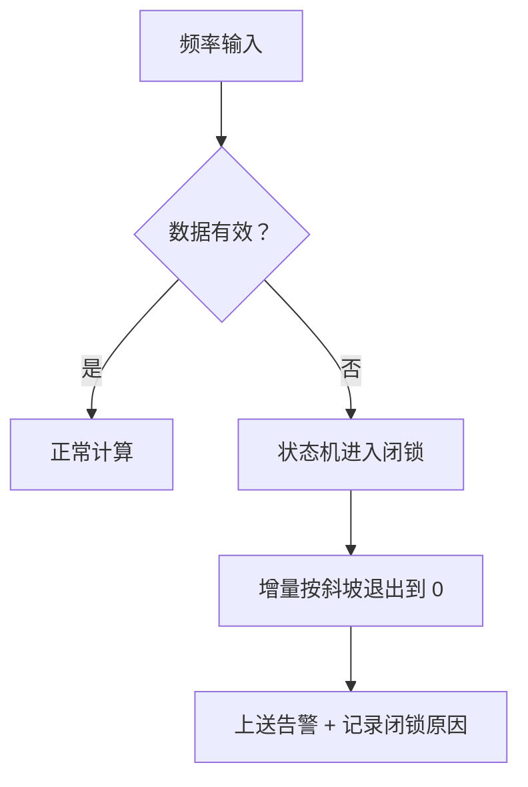

<!-- @AI_GENERATED -->
# 09 常见误区与现场故障复盘

> 所属层面：全四层（故障排查与预防）
> [课程首页](README.md) · 上一章：[08 试验验证与并网联调](08_试验验证与并网联调.md) · 附录：[附录 A 术语与符号表](附录A_术语与符号表.md)

**一句话**：一次调频上线后出问题，**九成不是算法错，而是口径、数据与边界处理错**；本章把十一个最常见的坑按"现象 → 根因 → 排查 → 整改 → 预防"复盘一遍。

## 现场场景【必读】

这是你在这个行业里做的第三个一次调频项目了。前两个项目都还算顺利——华东的场站考核合格，山西的也过了。所以你接手第三个项目（东北某风光场站）时，心里是有底的。

上级第二天，现场反馈："调试过程中发现，频率在 49.92 Hz 时储能和光伏都正确放出了增量，但场站关口表的总出力只有光伏那部分，储能的 3 MW 增量没有体现在总加里。"

你第一反应是通信点表配错了测点号。查了半天点表，全对。

最终在 PCS 端子箱里发现了答案：储能 PCS 的电流互感器方向反了——它确实在执行放电指令，但 CT 测出来是"反向"，在关口表计量时被抵消了。**硬件安装的一次性误差，带动了整套软件逻辑的"正确但不真实"的结果。**

这个坑不在任何一本细则里，不在任何代码 review checklist 里，但它实实在在让你的考核数据差了一截。一次调频上线前的最后一道防线不是软件测试，而是**现场物理信号的逐点对校**。

## 本章目标

读完本章，你应能：

1. 在故障现象出现时，快速定位到对应的类别；
2. 对每个坑给出可执行的排查步骤与整改方案；
3. 建立上线前的自查清单，把坑挡在上线之前。

## 十一个坑的速查表【必懂】

| # | 坑 | 典型现象 | 属于哪类问题 |
|---|---|---|---|
| 1 | 死区类型口径不一致 | 方向对、量接近理论值，仍被判偏差超标 | 口径 |
| 2 | 频率数据冻结 / 坏值填补 | 频率源中断后仍持续放电 | 数据 |
| 3 | 方向约定不一致 | 频率低时反而充电 | 契约 |
| 4 | K 硬编码，扩容未更新 | 扩容后响应明显变弱 | 配置 |
| 5 | 限幅被对称化 | 向下调节能力被砍一半 | 配置 |
| 6 | 只记录最终值 | 考核争议时无法归因 | 可观测性 |
| 7 | CT/PT 极性反转 | 关口表总加与单机出力之和不一致 | 硬件安装 |
| 8 | 对时系统故障 | 出力曲线与频率曲线时间轴错位 | 对时 |
| 9 | 站用电混入调频计量 | 白天考核异常、夜间正常 | 测点位置 |
| 10 | 双频率源切换抖动 | 源切换瞬间短暂误动作 | 数据 |
| 11 | AGC 与一次调频时序冲突 | 出力与指令总和不符 | 时序 |



---

## 坑 1：死区类型口径不一致【必懂】

### 现象

- 调频方向正确；
- 稳定后出力接近理论值（差几个百分点）；
- 月度考核"调频控制偏差"超标；
- 现场反复核对参数，死区宽度、调差率、限幅都与细则一致。

### 根因

EMS 用**连续型（平移）死区**，考核系统用**截断型（削平）死区**（[02 章](02_四个基本参数.md)）。两者在每个越死区的时刻相差 `死区宽度 × K`。

```text
Pn = 100 MW，δ = 3%，死区 ±0.06 Hz
K = 66.67 MW/Hz
单次差值 = 0.06 × 66.67 = 4.0 MW
```

对一个 100 MW 场站，4.0 MW 相当于 **4% Pn**——已经超过光伏 ±1% Pn 的控制偏差限值。


### 排查

| 步骤 | 做法 |
|---|---|
| ① 读细则原文 | 找"死区"条款，确认描述是"平移"还是"削平" |
| ② 查装置实现 | 装置手册/源码确认死区处理方式 |
| ③ 算差值验证 | 用一次实测事件算"实际 - 理论"，看是否等于 `死区宽度 × K` |
| ④ 与调度确认 | 确认考核系统的理论值算法 |

第三步是最有效的：**如果差值恰好等于 `死区宽度 × K`，基本可以确诊**。

### 整改与预防

| 整改 | 说明 |
|---|---|
| 统一为细则口径 | 修改装置或 EMS 的死区处理逻辑 |
| 配置项显式化 | `deadband_mode: shift / cut` 必须显式存储（[05 章](05_区域细则差异对照.md)） |
| 理论值独立实现 | 理论值计算代码与控制代码分离，避免被"优化"改错（[07 章](07_考核结算与积分电量法.md)） |

> **本质**：这不是"算法好不好"的问题，而是**两个系统对同一个词的定义不同**。这类问题在软件工程里叫"接口契约不一致"，解法永远是先对齐定义，再改实现。

---

## 坑 2：频率数据冻结与坏值填补【必懂】

### 现象

- 频率采集通道中断（网线、串口、装置重启）；
- 上送的最后有效值停在死区外（如 49.92 Hz）；
- EMS 持续按 49.92 Hz 计算，储能持续放电；
- 现场发现时 SOC 已明显下降。

### 根因

两个叠加的缺陷：

| 缺陷 | 说明 |
|---|---|
| 缺少冻结检测 | 一个恒定值看起来完全合法，没有任何告警 |
| 坏值填补策略错误 | 用"最后一次有效值"继续计算，而不是退出 |

```text
真实频率：      49.92 → (通信中断) → 50.00 → 49.98
EMS 看到的：    49.92 → 49.92 → 49.92 → 49.92
EMS 的动作：    持续放电，与实际频率无关
```

### 故障录波数据还原【参考】

下面是一份从真实录波仪导出的时标数据，还原了频率冻结事件从发生到被人工发现的完整 12 秒。数据来自华东某 100 MW 储能电站，PMU 通道（真实频率）与 RTU 通道（EMS 收到的频率）同时记录：

| 时间 (s) | PMU 频率 (Hz) | RTU 频率 (Hz) | Δf_eff (Hz) | P_theory (MW) | P_actual (MW) | 状态 |
|---|---|---|---|---|---|---|
| 0.0 | 49.92 | 49.92 | −0.14 | +9.33 | +9.33 | 正常动作 |
| 0.2 | 49.92 | 49.92 | −0.14 | +9.33 | +9.33 | 正常动作 |
| 0.4 | 49.93 | 49.92 | −0.14 | +9.33 | +9.33 | 正常动作 |
| 0.6 | 49.95 | 49.92 | −0.14 | +9.33 | +9.33 | 正常动作 |
| 0.8 | 49.98 | 49.92 | −0.14 | +9.33 | +9.33 | 频率已回归死区边缘 |
| 1.0 | **50.00** | **49.92** | −0.14 | +9.33 | +9.33 | ⚠️ PMU 已回归 50Hz，RTU 仍冻结 |
| 1.2 | 50.01 | 49.92 | −0.14 | +9.33 | +9.33 | 持续误放电 |
| 1.5 | 50.00 | 49.92 | −0.14 | +9.33 | +9.33 | 持续误放电 |
| 2.0 | 49.99 | 49.92 | −0.14 | +9.33 | +9.33 | 持续误放电 |
| 3.0 | 50.00 | 49.92 | −0.14 | +9.33 | +9.33 | 持续误放电 |
| 4.0 | 50.00 | 49.92 | −0.14 | +9.33 | +9.33 | 持续误放电 |
| 8.0 | 50.01 | 49.92 | −0.14 | +9.33 | +9.33 | 持续误放电 |
| 12.0 | 50.00 | 49.92 | −0.14 | +9.33 | 0.00 | 人工发现，手动退出 |

> **解读**：从 t=1.0s 起，真实频率已回到 50.00 Hz（死区内），应退出调频。但 RTU 通道因通信中断停在 49.92 Hz，EMS 持续判定越死区并输出 +9.33 MW。从 1.0s 到 12.0s 共 11 秒的误放电，若在考核窗口内（15 min），这次冻结会导致整个 15 分钟考核窗口被判不合格。
>
> 真实案例的数据流：
> ```text
> PMU（变电站侧）──光纤──▶ RTU 装置 ──串口──▶ 通信管理机 ──104──▶ EMS
>                                           此处水晶头松动
> ```
> 经验教训：频率源故障时，RTU 装置的默认行为是“保持最后一帧”——这是 IEC 104 协议的默认实现，不是 bug，但 EMS 侧必须对此做防护。

### 排查

| 检查项 | 方法 |
|---|---|
| 是否有超时判据 | 查代码中数据超时逻辑 |
| 是否有冻结判据 | 查是否有"连续 N 周期不变"检测 |
| 坏值如何处理 | 查数据无效时的分支（保持 / 清零 / 斜坡退出） |
| 是否有告警 | 查数据无效时是否上送告警 |

### 整改与预防



| 措施 | 要点 |
|---|---|
| 冻结检测 | 连续 M 个周期数值完全不变即置可疑（[06 章](06_EMS侧实现.md)） |
| 斜坡退出 | 1~3 s 内把增量降到 0，不能直接清零（避免功率阶跃） |
| 告警 | 数据无效必须上送，不能静默 |
| 双源校验 | 控制用与考核用频率源分开，偏差超限时告警 |

> **反模式提醒**：不要用"最后一次有效值"填补坏数据。它在稳态下"看起来平滑"，但在故障时会造成持续的、与真实频率无关的出力——这是最难发现的故障类型。

---

## 坑 3：方向约定不一致【必懂】

### 现象

- 频率下跌时储能**充电**（或光伏**减出力**）；
- 场站总出力与预期相反；
- 混合场站出现"总出力不变、内部功率循环"。

### 根因

三种可能的符号问题：

| 类型 | 说明 |
|---|---|
| 公式漏负号 | `ΔP = K × Δf` 而非 `−K × Δf` |
| PCS 方向约定不同 | 新 PCS 以"充电为正"，接入层未换算 |
| 测点位置错误 | 用机端功率而非并网点功率，站用电未补偿 |

第二种在**设备替换、扩容、不同厂家混用**时最容易发生。

### 排查

| 步骤 | 做法 |
|---|---|
| ① 静态注入 | 注入 49.9 Hz，看出力是否**增加** |
| ② 核对设备手册 | 确认 PCS 的功率正方向定义 |
| ③ 核对测点 | 确认反馈功率取自并网点还是机端 |
| ④ 核对多资源符号 | 混合场站逐资源验证方向 |

### 整改与预防

| 措施 | 说明 |
|---|---|
| 接入层统一符号 | 所有设备在接入层转换为"放电/送电为正" |
| 单机方向自检 | 上电自检时做一次微幅注入验证方向 |
| 混合场站逐资源验证 | 不要只验证场站总量（总量对可能内部抵消） |

> **为什么这是最严重的一类**：因为[07 章](07_考核结算与积分电量法.md)的考核第一级判据就是"符号是否相同"，方向错误**不设完成率宽容**，直接产生考核费用。

---

## 坑 4：K 硬编码，扩容未更新【必懂】

### 现象

- 场站扩容（如 100 MW → 150 MW）后；
- 一次调频响应明显变弱；
- 参数表里死区、调差率都没变。

### 根因

下垂系数 `K = Pn / (δ × fn)` 与 Pn 成正比。若代码里 K 是常量，Pn 变化后实际调差率会偏移：

```text
原：Pn = 100 MW，δ = 3% → K = 66.67 MW/Hz
扩：Pn = 150 MW，K 未更新 → 实际 δ = 150 / (66.67 × 50) = 4.5%
```

**调差率从 3% 变成 4.5%，下垂特性弱了 1/3**。
### 排查

| 检查项 | 方法 |
|---|---|
| K 是否为派生量 | 查代码：K 是启动时按 Pn 计算，还是写死常量 |
| 限幅是否同步更新 | 限幅按 Pn 百分比时，绝对值也要重算 |
| 考核理论值是否更新 | 理论值计算用的 Pn 是否与现场一致 |
| 装置侧是否更新 | 装置里的 Pn 参数是否同步 |

### 整改与预防

| 措施 | 说明 |
|---|---|
| 派生量统一计算 | Pn 与 δ 作为配置，K、限幅绝对值在启动时统一派生 |
| 变更流程 | 容量变更必须走"参数复核 → 试验 → 重新验收"流程 |
| 启动自检 | 启动时打印/记录派生量，便于核对 |

> **推广开来**：任何"以 Pn 为基准"的量（K、限幅绝对值、控制偏差阈值、考核理论值）都会随容量变化。**把它们列成一张"容量敏感参数表"，变更时逐项复核**。

---

## 坑 5：限幅被对称化【必懂】

### 现象

- 项目在东北等"上下限幅不对称"的区域；
- 高频时向下调节能力不足（或低频时向上不足）；
- 考核显示"某个方向的完成率总是偏低"。

### 根因

配置只支持一个限幅值，而细则要求**下调 20%、上调 10%**（[05 章](05_区域细则差异对照.md)）。代码把限幅对称成 ±10%，向下调节能力被砍掉一半。

```text
细则要求：上调 10% Pn，下调 20% Pn
代码实现：±10% Pn
后果：高频时只能减 10 MW，理论要求减 20 MW → 完成率 50%
```
### 排查

| 检查项 | 方法 |
|---|---|
| 配置结构 | 是否有独立的 `limit_up` 与 `limit_down` |
| 曲线折点 | 用公式反算高低频折点，与细则曲线比对 |
| 考核方向性 | 看考核结果是"仅某一方向偏低"还是"双向都偏低" |

**"只有某一方向偏低"是限幅不对称问题的强特征**。

### 整改与预防

| 措施 | 说明 |
|---|---|
| 上下限分别配置 | 见[06 章](06_EMS侧实现.md)的配置结构 |
| 折点验证 | 项目初期用公式反算折点，验证细则曲线（[05 章](05_区域细则差异对照.md)） |
| 试验覆盖双向 | 阶跃试验必须做频率升高与降低两个方向（[08 章](08_试验验证与并网联调.md)） |

---

## 坑 6：只记录最终值【必懂】

### 现象

- 考核不合格，调度要求提供当时数据；
- EMS 只有"实际出力"记录，没有"理论出力"记录；
- 无法证明"当时算法是对的、是物理能力不足"；
- 争议无法解决，只能接受考核。

### 根因

记录设计只考虑了"运行监视"，没考虑"考核对账"（[06 章](06_EMS侧实现.md)）。

### 排查

| 字段 | 是否有记录 |
|---|---|
| 频率（带时标） | ? |
| 理论增量 `delta_p_theory` | ? |
| 可执行增量 `delta_p_exec` | ? |
| 实际出力 | ? |
| 状态与闭锁原因 | ? |
| 生效参数快照（死区、调差率、限幅） | ? |

### 整改与预防

| 措施 | 说明 |
|---|---|
| 双值记录 | 同时记录理论值与可执行值 |
| 参数快照 | 事件发生时记录生效参数（含版本号） |
| 统一时标 | NTP / 北斗对时，与调度主站一致 |
| 存储周期 | ≥ 考核回溯期，掉电不丢关键事件 |

> **可观测性原则**：**任何"要考核的量"，都必须能从事后数据中重建**。如果重建不了，就等于没有记录。

---

## 上线前自查清单【必懂】

把十一个坑压成一张可勾选的表（前 6 项来自上方六个坑，后 5 项对应新增坑）：

| # | 自查项 | 通过标准 | 对应坑 |
|---|---|---|---|
| 1 | 死区类型与细则一致 | 明确记录 `shift` / `cut` | ① |
| 2 | 参数版本与细则文号绑定 | 配置含 region + version | ① |
| 3 | 频率数据超时判据存在 | 超时置无效 | ② |
| 4 | 频率冻结判据存在 | 连续 N 周期不变告警 | ② |
| 5 | 坏数据按斜坡退出 | 不保持最后值 | ② |
| 6 | 方向静态注入验证通过 | 频率低 → 出力增加 | ③ |
| 7 | 混合场站逐资源验证方向 | 每类资源单独验证 | ③ |
| 8 | K 为派生量 | 由 Pn 与 δ 计算 | ④ |
| 9 | 容量敏感参数表已建立 | K、限幅、偏差阈值、理论值 | ④ |
| 10 | 上下限幅分别配置 | 支持不对称 | ⑤ |
| 11 | 折点反算与细则曲线一致 | 误差可解释 | ⑤ |
| 12 | 理论值与可执行值双记录 | 字段齐全 | ⑥ |
| 13 | 参数快照随事件记录 | 含版本号 | ⑥ |
| 14 | 时标与调度一致 | 偏差在允许范围 | ⑥ |
| 15 | 积分算法与考核系统一致 | 已确认 | ⑥ |
| 16 | t0.1 / t0.9 / ts 实测合格 | 见[08 章](08_试验验证与并网联调.md) | — |
| 17 | 防误动与暂态试验完成 | 不误动、闭锁正常 | — |
| 18 | CT/PT 极性逐间隔核对 | 一次设备极性 + 二次回路方向 + 程序中符号一致 | ③ |
| 19 | 测频点在并网点 | 非站内母线、非集电线路侧 | ③ |
| 20 | 功率正方向全网一致 | 与调度、PCS、关口表约定统一 | ③ |

---

## 深入：一个"看起来全对"的故障【深入】

<details>
<summary>三层问题叠加的排查过程</summary>

某场站考核连续两个月不合格，现场排查记录如下：

| 阶段 | 判断 | 证据 | 结论 |
|---|---|---|---|
| 1 | 方向对不对？ | 频率低时出力增加 | 方向正确 |
| 2 | 参数对不对？ | 死区、调差率、限幅与细则一致 | 参数正确 |
| 3 | 口径对不对？ | 差值 = 死区宽度 × K | **坑 1 确诊** |
| 4 | 改完口径后 | 完成率提升但仍偏低 | 还有第二个问题 |
| 5 | 能力够不够？ | 满发时段可上调空间为 0 | **能力限制** |
| 6 | 数据可信吗？ | 有 40 min 连续丢点，按 0 计 | **数据完整性问题** |

最终发现是三层叠加：口径错误（主因）+ 满发能力不足（合理限制）+ 丢点导致积分偏小（数据问题）。

**教训**：

1. **一个问题可能掩盖另一个问题**。改完口径后仍然不合格，不代表口径改错了，而是暴露了下一层问题。
2. **"合理限制"需要提前与调度确认口径**（可执行目标 vs 理论目标），否则会被当成软件缺陷。
3. **丢点问题容易被忽略**，因为它不影响曲线形状，只影响积分结果。

</details>

---

## 坑 7：CT/PT 极性反转【新增】

### 现象

- 场站各逆变器/PCS 独立观测出力正常；
- 关口表总加却显示"调频出力没变"甚至反向；
- 单个设备的出力在关口表上被"抵消"了。

### 根因

电流互感器（CT）或电压互感器（PT）的一次或二次回路极性接反。CT 反向意味着 PCS 在放电（电流流出），但关口表测量的功率符号为负——与另一个正常设备的正向功率抵消。

```text
正常 PCS A：放电 3 MW → 关口表 +3 MW
反接 PCS B：放电 3 MW → 关口表 -3 MW
关口表总加：0 MW（而实际两台都在放电）
``
### 排查

| 步骤 | 做法 |
|---|---|
| ① 单机功率校验 | 逐个 PCS 小功率放电，只在关口表看功率增量是否为正 |
| ② 核对一次接线 | 检查 CT 的 P1/P2 是否与断路器方向一致 |
| ③ 核对二次回路 | 核对 CT 二次侧的 S1/S2 接线是否与设计图纸一致 |
| ④ 核对接入层符号 | 确认程序中功率方向的符号约定与接线一致 |

**CT/PT 的极性校验必须在上电前完成**——这是电气安装的"一次对终身对"问题，软件无法自动纠正。

### 整改与预防

| 措施 | 说明 |
|---|---|
| 安装验收加极性测试 | 一次设备安装后做"通流法"极性校验 |
| 逐间隔独立校验 | 不要只对总加做校验，因为正负可能互相抵消 |
| 接入层统一符号 | 所有设备强制"向电网送电为正" |

---

## 坑 8：对时系统故障导致时标错位【新增】

### 现象

- 用录波器的频率曲线与 EMS 记录的出力曲线做相减时；
- 曲线形状相似但时间轴错位（如 1~3 s）；
- 积分对账永远对不上——因为"频率掉的时候出力还没动"。

### 根因

| 故障类型 | 机制 |
|---|---|
| NTP 服务器不可达 | GPS/北斗天线故障或网络不通，时钟回到内部晶振 |
| IRIG-B 信号丢失 | 测频装置与 EMS 之间的对时链路中断 |
| 双源切换抖动 | 主备频率源切换瞬间，时标跳变而非渐变 |
| 时区/夏令时 | 调度主站与场站使用不同时区偏移 |

```text
真实时序：t=0s 频率开始下降 → t=0.5s EMS 计算 → t=1.0s PCS 出力
EMS 记录（时标偏移 +2s）：t=2s 频率下降 → t=2.5s 计算 → t=3.0s 出力
调度主站（正确时标）：t=0s 频率下降 → t=3.0s 看到出力（晚了 2s！）
``
### 排查

| 步骤 | 做法 |
|---|---|
| ① 对时状态检查 | 查看 EMS/测频装置的对时状态灯或日志 |
| ② 时差对比 | 用便携 GPS 时钟与 EMS 显示的时钟对比 |
| ③ 录波对时 | 用 PMU/故障录波器的时标与 EMS 记录的时标对齐后比较 |
| ④ NTP 诊断 | `ntpq -p` 查看 offset 和 jitter |

### 整改与预防

| 措施 | 说明 |
|---|---|
| 双源对时 | GPS/北斗 + NTP，互为备份 |
| 失步告警 | 时钟偏差超过阈值（如 50 ms）时触发告警 |
| 时标记录 | 每条记录自带"时标质量"标志位（同步/失步/手动） |
| 定期巡检 | 将"对时状态"纳入定期运维巡检项 |

---

## 坑 9：站用电混入调频计量【新增】

### 现象

- 场站关口表外的"站用变压器"负载波动被纳入一次调频计量；
- 站内空调、水泵、照明等负荷变化被误判为"出力偏差"；
- 夜间负荷低时考核正常，白天站用电波动大时考核异常。

### 根因

测频装置或 EMS 取的是"并网点功率"而非"上网关口功率"。并网点功率 = 发电功率 - 站用电功率。站用电的自然波动（±2~5% Pn 量级）直接混入一次调频的出力计算：

```text
真实出力：PCS 放电 +3 MW
站用电波动：空调启动，站用负荷 +0.5 MW
EMS 看到：+3 - 0.5 = +2.5 MW
理论要求：+3 MW
偏差 = 0.5 MW（对 100MW 场站是 0.5% Pn）
``
### 排查

| 步骤 | 做法 |
|---|---|
| ① 确认测点位置 | 查证 EMS 取的是"并网点 CT"还是"关口表 CT" |
| ② 相关性分析 | 站用电功率曲线与调频偏差曲线做相关性分析 |
| ③ 夜间对照 | 夜间（站用电稳定）vs 白天（站用电波动）考核数据对比 |

### 整改与预防

| 措施 | 说明 |
|---|---|
| 取关口表功率 | 考核用的出力必须取自关口表（贸易结算点），非并网点 |
| 站用电单独计量 | 站用变压器低压侧装独立电能表 |
| 站用电补偿 | 若必须取并网点功率，需叠加站用电功率作为补偿量 |

---

## 坑 10：双频率源切换抖动【新增】

### 现象

- 频率源正常切换（如 GPS 转北斗）瞬间；
- 频率值出现短暂跳变（如 50.00 → 49.94 → 50.01）；
- EMS 将跳变当作真实频率事件，瞬间产生调频出力；
- PCS 快速加减出力，引起并网点功率短暂振荡。

### 根因

主备频率源的内部时钟在切换前可能存在微小偏差（μs 量级），但对于 20 ms 周波的 DFT 窗口来说，这个偏差会在切换瞬间产生一个幅值 ~0.05~0.15 Hz 的虚假跳变。

```text
切换前：主源 GPS → f = 50.00 Hz
切换中：过渡状态（50~200 ms）
切换后：备源北斗 → f = 49.94 Hz（内部偏差导致）
EMS 判定：一次 0.06 Hz 越死区事件 → 产生出力
切换恢复后：备源自校准 → f = 50.00 Hz
EMS 判定：又一次 0.06 Hz 越死区事件 → 反向出力
``
### 排查

| 步骤 | 做法 |
|---|---|
| ① 检出事件时标 | 查 EMS 事件日志中"动作"事件的时标 |
| ② 交叉比对 | 比对频率装置的"源切换"日志与 EMS"动作"日志时标 |
| ③ rocof 分析 | 切换瞬间的 df/dt 远大于真实频率事件（>0.5 Hz/s） |

### 整改与预防

| 措施 | 说明 |
|---|---|
| 切换消隐 | 源切换后插入 1~3 s 的"消隐期"，期间不产生调频出力 |
| rocof 闭锁 | df/dt 超过阈值（如 0.5 Hz/s）时进入短暂闭锁 |
| 连续采样校验 | 连续 2~3 个周期都越死区才判定为真实事件 |
| 源切换信号通知 EMS | 频率装置在切换前主动通知 EMS"即将切换"（如果支持） |

---

## 坑 11：AGC 与一次调频指令时序冲突【新增】

### 现象

- 同一通信周期内，EMS 同时下发了 AGC 基准调整与一次调频增量；
- PCS 收到的两个指令有冲突（总量超限、方向相反）；
- PCS 只执行了其中一个，另一个被丢弃；
- 实际出力与预期总和不符。

### 根因

EMS 的控制周期（通常 1~5 s）与一次调频的动作窗口（2~10 s）在同一时间窗口内重叠。如果两个任务共用同一个通信通道和同一个功率设定点寄存器：

| 情况 | 后果 |
|---|---|
| AGC 先写、一次调频后写 | AGC 指令被覆盖，AGC 考核受影响 |
| 一次调频先写、AGC 后写 | 调频增量被覆盖，一次调频考核不合格 |
| 两个指令叠加超限 | PCS 按额定功率裁剪，谁被裁取决于 PCS 内部逻辑 |

### 排查

| 步骤 | 做法 |
|---|---|
| ① 通信日志对比 | 比对 EMS 下发的 AGC 指令时标与一次调频指令时标 |
| ② PCS 日志 | 查看 PCS 收到的指令序列，确认是否有丢帧 |
| ③ 总量校验 | 实际出力 vs (AGC 基准 + 一次调频增量) 是否吻合 |

### 整改与预防

| 措施 | 说明 |
|---|---|
| 分离寄存器 | AGC 基准和一次调频增量写成 PCS 的**不同寄存器**，PCS 内部叠加 |
| 时序交错 | 设计 AGC 和一次调频的写操作时序不重叠（如错开 200 ms） |
| 双端口通信 | AGC 走 Modbus TCP，一次调频走 GOOSE，物理通道分离 |
| 总量校验告警 | EMS 侧写后回读实际出力，偏差超阈值则告警 |

---

## 自测

1. 如果实测出力与理论值的差值恰好等于"死区宽度 × K"，最可能是什么问题？
2. 为什么"用最后一次有效值填补坏数据"是危险的反模式？
3. 场站扩容后，哪些参数必须重新复核？
4. "考核结果显示只有一个方向完成率偏低"通常指向什么问题？
5. 为什么必须同时记录理论值与可执行值？
6. CT/PT 极性校验为什么必须在上电前完成？软件能否自动纠正？
7. 对时系统故障为什么会导致"积分对账永远对不上"？
8. 双频率源切换瞬间应该做什么防护？

<details>
<summary>参考答案</summary>

1. 死区类型口径不一致：EMS 用连续型（平移），考核用截断型（削平），每个越死区时刻相差 `死区宽度 × K`。
2. 因为坏数据期间 EMS 会持续按一个与真实频率无关的值出力。若最后值是死区外，会持续输出调频增量；若频率已恢复，会延迟退出造成反向偏差。正确做法是按斜坡退出到 0。
3. 所有以 Pn 为基准的量：下垂系数 K、限幅绝对值、控制偏差阈值、考核理论值计算基准，以及装置侧的 Pn 参数。
4. 限幅被对称化。细则要求不对称限幅（如下调 20%、上调 10%），代码只支持单一限幅值，导致某个方向的调节能力被削掉。
5. 因为考核按理论值计算，而实际能出多少受物理能力限制。只记录可执行值，事后无法区分"算法错误"（软件问题）与"物理能力不足"（资源问题），责任归属和整改方向都会失准。
6. CT/PT 极性由物理接线决定，硬件一旦接反，软件看到的所有功率测量值都是反向的——软件无法自动区分"接线反了"还是"功率确实反向"。必须在上电前用"通流法"逐间隔校验极性。
7. 因为频率曲线和出力曲线的时标来自不同系统，如果某一方时钟偏移，本来对齐的时序就会错位——看起来"频率掉了但出力没动"或"出力动了但频率已经恢复"，积分对账的时窗对不上。
8. 三类防护：① 切换后插入 1~3 s 消隐期（不产生调频出力）；② rocof 超阈值（>0.5 Hz/s）时短暂闭锁；③ 连续 2~3 个采样周期都越死区才判定为真实事件。

</details>

> 💻 **动手实验**：运行 `python lab/ch09_failures.py` 复现死区类型选错、数据冻结、方向反转、K 硬编码四个常见故障模式。

<!-- @AI_GENERATED: end -->