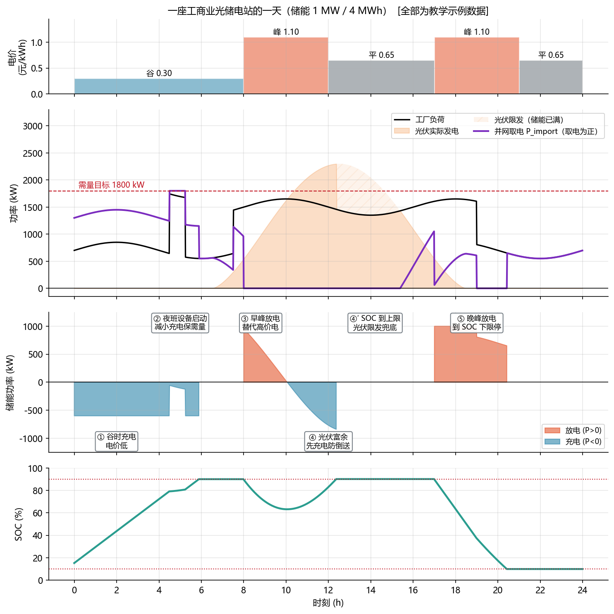
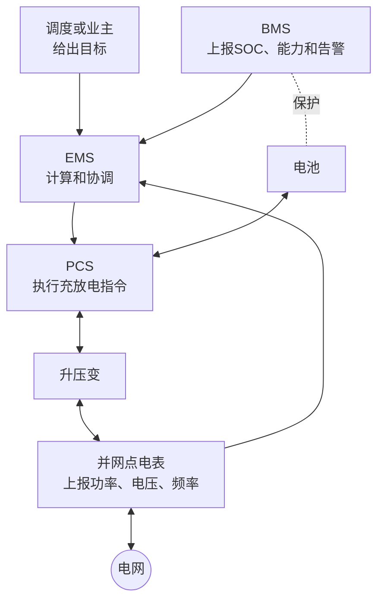

<!-- @AI_GENERATED -->
# 00 储能电站运行概览与 EMS 学习导引

> [课程首页](README.md) · 下一章：[01 电力系统入门](01_电力系统入门.md)

**一句话**：从一座工商业光储站的一天开始，先看懂 EMS 为什么要在不同时间充电、放电、减充和限发，再逐章学习这些决策背后的电力原理与软件实现。

## 00.0 本章学习目标与阅读约定【必懂】

读完本章，你不需要先会电力系统公式，但应能：

1. 说清储能为什么能解决峰谷、光伏富余和突发功率缺口；
2. 指出电池/BMS、PCS、EMS、并网点电表和调度各自负责什么；
3. 读懂一张日曲线，解释 EMS 为什么在五个时段做出不同决策；
4. 说清安全、并网约束、费用和收益发生冲突时，谁优先；
5. 知道下一章会把哪些“现象”解释成电网原理。

### 阅读约定

- 标注为 `[教学示例]` 的数值只用于理解原理，不能直接用于现场整定；
- 本书约定：储能**放电为正、充电为负**；
- 本章图中的 `P_import` 表示“从电网取电功率”，取电为正；它与后续用于潮流分析的并网点净功率 `P_PCC` 是不同的方向约定，详见附录 B。

---

## 00.1 储能在电力系统中的作用【必懂】

电力系统最根本的约束是：**发出的电和用掉的电必须在同一时刻平衡。** 导线和变压器几乎不储能，发电多了或少了，频率会变化；局部的无功不平衡还会影响电压。

这给储能带来三类价值：

| 现实问题 | 现场表现 | 储能能做什么 |
|---|---|---|
| 用电有峰谷 | 晚高峰需要很多一年只用少量时间的设备 | 低谷充电、高峰放电，把电挪到更需要的时段 |
| 新能源看天气 | 光伏中午多、傍晚少；风电忽大忽小 | 吸收午间富余，在傍晚或波动时释放 |
| 突发缺口 | 机组或线路故障时，供需瞬间失衡 | 在很短时间内增减出力，为其他资源争取时间 |

> **软件类比**：储能像一个几乎零延迟的缓冲区：平时搬运峰谷，突发时先顶住缺口。
>
> **类比失效点**：软件队列中的消息可以稍后处理；电网功率缺口必须当下补齐，晚几秒就可能触发保护动作。

---

## 00.2 工商业光储电站的日运行特征【必懂】

下面是一座工厂的光储电站：光伏最大约 2.3 MW，储能为 1 MW / 4 MWh。图中数据均为 `[教学示例]`。

### 日运行曲线的阅读方法

1. **先看第一行电价**：什么时候低价、什么时候高价；
2. **再看第二行负荷、光伏和并网取电**：什么时候需要从电网买电，什么时候光伏有富余；
3. **最后看储能功率和 SOC**：EMS 为什么选择充电、放电、减充或停止。

图中四条功率信息的含义：

| 图中量 | 含义 | 读图时关注什么 |
|---|---|---|
| 工厂负荷 | 工厂此刻需要多少功率 | 负荷高时，取电可能接近需量上限 |
| 光伏实际发电 | 屋顶光伏实际送到站内的功率 | 光伏超过负荷时会出现富余 |
| 并网取电 `P_import` | 从电网取回多少功率，取电为正 | 是否超过需量目标，是否接近零倒送 |
| 储能功率 | 正值放电、负值充电 | EMS 对电价、光伏、约束的最终动作 |

---

## 00.3 典型日运行决策与控制约束【必懂】

### ① 谷时充电：低价时段能量转移

**发生**：凌晨电价低，电池还有可充容量。  
**决策**：以约 600 kW 充电。  
**原因**：把低价电存起来，准备在高价时段使用。  
**后续学习**：第 13 章峰谷套利。

### ② 需量约束介入：充电功率动态调整

**发生**：夜班设备启动，负荷突然上升。  
**决策**：把原来的充电功率明显减小。  
**原因**：充电也会增加从电网取电；若继续满功率充电，并网取电可能超过 1800 kW 的需量目标。  
**后续学习**：第 14 章需量管理。

### ③ 峰时放电：高价时段负荷削减

**发生**：早间进入高电价时段，站内仍有负荷。  
**决策**：储能放电，减少从电网购买的高价电。  
**原因**：套利；但放电不能超过站内净负荷，否则会向电网倒送。  
**后续学习**：第 12、13 章。

### ④ 光伏富余：防倒送充电

**发生**：中午光伏发电超过工厂负荷。  
**决策**：储能由放电切换为充电，吸收富余光伏。  
**原因**：项目不允许向电网倒送时，防倒送优先于峰谷套利。  
**后续学习**：第 12 章。

### ④′ SOC 上限约束：光伏限发兜底

**发生**：电池 SOC 到达 90% 上限，已经不能继续充电。  
**决策**：通知光伏逆变器限发，图中的斜线区域就是没有被利用的光伏。  
**原因**：SOC 上限是电池安全边界；储能无法继续吸收时，仍要避免倒送。  
**后续学习**：第 05、12 章。

### ⑤ 晚峰放电：SOC 下限约束

**发生**：傍晚再次进入高电价时段。  
**决策**：储能放电，直到 SOC 降至 10% 下限。  
**原因**：收益不能覆盖安全边界；到下限必须停止放电。  
**后续学习**：第 05、13 章。

---

## 00.4 运行目标冲突与优先级约束【必懂】

一天里的充放电并不是只看电价。更准确的理解是：高优先级规则会先收紧低优先级策略可使用的范围。

| 优先级 | 在日曲线中的体现 | 为什么优先 |
|---|---|---|
| 安全 | ④′、⑤：SOC 到上下限停止充放 | 不能用收益交换电池安全 |
| 合规 | ④：光伏富余时先充电，满电后限发 | 不能违反并网协议 |
| 费用 | ②：负荷突增时减小充电 | 避免需量费用上升 |
| 收益 | ①、③、⑤：按电价充放电 | 在前面规则允许时才追求收益 |

第 12 章会把这些限制写成可行域，第 18 章会讲多个请求如何仲裁；本章只需要先记住：**安全 > 合规 > 费用 > 收益。**

---

## 00.5 储能电站设备与 EMS 职责边界【必懂】

| 角色 | 它做什么 | EMS 不能替代什么 |
|---|---|---|
| 电池/BMS | 存电、给出 SOC 和可充可放能力、执行电池保护 | BMS 的硬件保护 |
| PCS | 把电池直流变成交流，执行功率命令 | PCS 的本地控制和保护 |
| EMS | 根据目标、测量和约束计算功率请求 | 不能要求设备超出能力运行 |
| 并网点电表 | 反映站点和电网之间的功率交换 | 点表方向和变比必须正确 |
| 调度或业主 | 给出上级目标和运行规则 | 不同场景的指令来源不同 |

EMS 不直接流过电能；它的职责是让每个时刻的功率请求既符合业务目标，又落在设备和并网允许的范围内。

---

## 00.6 储能应用场景与控制目标对比【了解】

| 场景 | 谁主要给目标 | 最先关注什么 | 本书后续章节 |
|---|---|---|---|
| 用户侧工商业储能 | 业主或本地策略 | 电价、需量、防倒送 | 12～14 |
| 电网侧独立储能 | 电网调度 | 计划跟踪、频率和电压支撑 | 15～18 |
| 电源侧配储 | 新能源电站与调度 | 平滑出力、减少弃风弃光 | 13、15、16 |

同一套 EMS 的基本结构不变：测量事实、产生请求、应用约束、下发并记录。变化的是上级指令来源和优化目标。AGC、一次调频、AVC 的具体机制将在第 15～17 章展开。

---

## 00.7 EMS 控制闭环概览【必懂】

把 24 小时图翻译成软件，不需要一开始记住所有模块，只需看到五层：

后续章节会逐步把每一层展开：第 09、10 章讲数据和控制流程，第 11、12 章讲工具与约束，第 13～18 章讲业务功能，第 19～21 章讲仿真、运维和综合项目。

---

## 00.8 课程学习路径与章节结构【必懂】

### 课程学习主线

| 阶段 | 学完后的产出 |
|---|---|
| 01～03 | 能解释储能为什么存在、装在哪里、靠什么创造价值 |
| 04～07 | 能读懂电池、PCS、拓扑、测点和功率流向 |
| 08～12 | 能把请求压进安全可行范围并可靠下发 |
| 13～18 | 能实现常见的储能业务控制 |
| 19～21 | 能把功能放进仿真、测试、运维和综合项目 |

**下一步**：进入 [01 电力系统入门](01_电力系统入门.md)。本章建立的是“储能站一天会发生什么”的直觉；第 01 章将解释电网为什么必须实时平衡、峰谷和光伏会如何改变电网运行。

---

## 00.9 典型工程故障：功率方向反接【必懂】

**现象**：某工商业储能项目投入防倒送后，储能越放越多，最终触发并网点保护。  
**原因**：电表把“从电网取电”定义为正，EMS 却把它当成“向电网送电”为正；控制方向被整体取反。  
**正确做法**：接入层统一方向；新测点上线前做小功率方向核对；发现放电增加且倒送也增加时，告警并退出闭环。

第 07、10、12 章会分别从功率平衡、数据质量和约束算法三个角度解决这个问题。

---

## 00.10 本章自测

1. 为什么储能既可以在峰谷问题中发挥作用，也可以在突发功率缺口中发挥作用？
2. 在日曲线中，为什么 ② 要减小充电，而不是继续按低价满充？
3. 为什么 ④′ 时要限发光伏，而不是继续要求电池充电？
4. “安全 > 合规 > 费用 > 收益”分别在五次决策中体现在哪里？
5. 为什么进入控制算法前必须先统一功率方向？

参考答案

1. 储能既能把电量在时间上搬运，也能快速改变功率；前者服务于峰谷，后者服务于突发缺口。
2. 夜班设备启动会把取电推向需量目标；继续充电可能增加费用，需量约束优先于套利。
3. SOC 已到安全上限，电池不能继续充电；为避免倒送，只能由光伏限发兜底。
4. 安全：④′、⑤ 的 SOC 上下限；合规：④ 防倒送；费用：② 需量目标；收益：①、③、⑤ 的峰谷套利。
5. 方向不一致会把“倒送”误判成“取电”，使闭环朝错误方向增强，形成正反馈。

<!-- @AI_GENERATED: end -->
