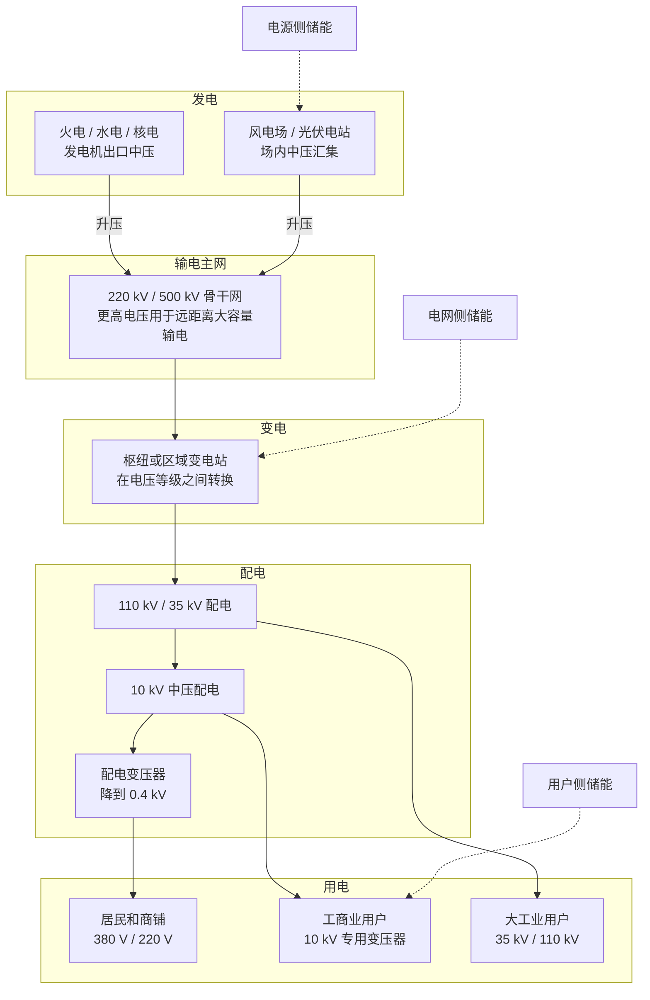
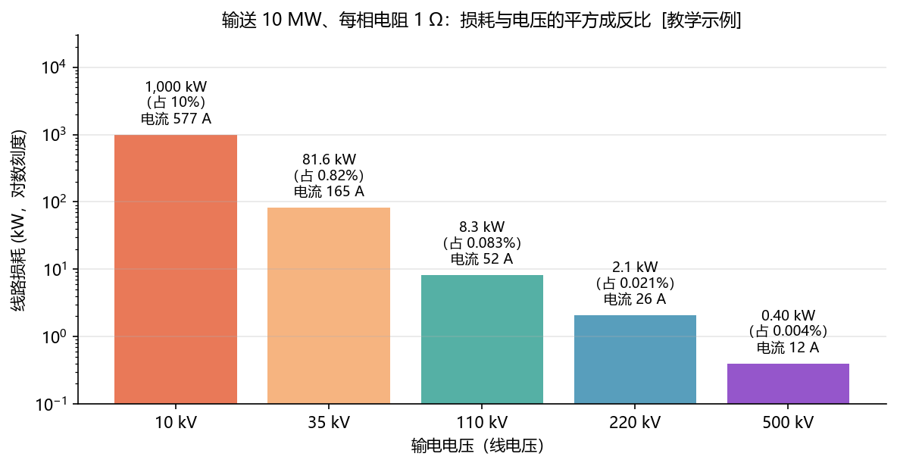
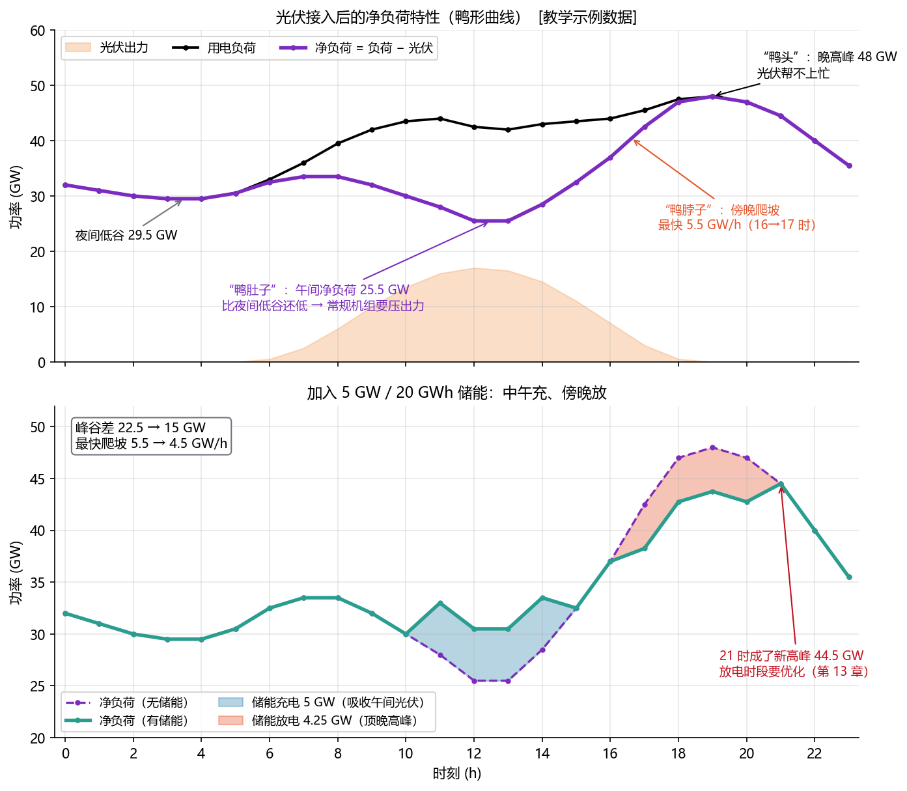
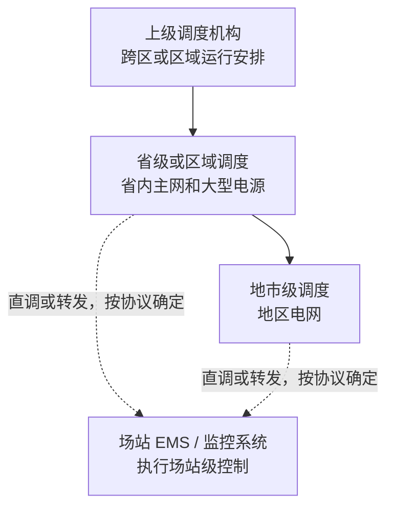

<!-- @AI_GENERATED -->

# 01 电力系统结构、运行与储能接入基础

> [课程首页](README.md) · 上一章：[00 导读：一个储能站的 24 小时](00_导读_储能站的24小时.md) · 下一章：[02 交流电与功率](02_交流电与功率.md)

**一句话**：把储能站放回电网，理解电压等级、输电损耗、实时平衡、净负荷、调度体系和安全边界。

**本章学习目标**：

- 能从一段接入系统方案中识别储能的接入电压、升压链路和调度关系；
- 能解释为什么输送同样功率时需要升高电压；
- 能区分负荷、净负荷、频率、电压和潮流；
- 能解释光伏接入后“鸭形曲线”对电网调峰和爬坡的影响；
- 能说清保护、稳控和 EMS 的职责边界。

**与第 00 章的关系**：第 00 章讲“一座工商业光储站的一天会发生什么”；本章把这座站放回更大的电网，解释这些现象为什么发生。第 02 章再定义 P、Q、S、PF、U、I 等交流电量。

---

## 1.1 储能接入系统方案的基本构成【必懂】

假设你拿到一份储能项目的接入系统方案：

> 本项目储能规模 100 MW / 200 MWh，站内经 35 kV 集电线路汇集，通过 1 台主变升压至 220 kV，以 1 回 220 kV 线路接入某变电站，接受省级调度，参与调峰和一次调频。

这段话至少包含五类信息：

| 信息           | 本例内容         | 它回答的问题                   |
| -------------- | ---------------- | ------------------------------ |
| 功率和电量规模 | 100 MW / 200 MWh | 站能以多大功率运行、能持续多久 |
| 站内汇集电压   | 35 kV            | 多台 PCS 或储能单元如何汇集    |
| 对外接入电压   | 220 kV           | 储能通过哪个电压等级接入主网   |
| 调度关系       | 省级调度         | 谁向场站下发计划或调节指令     |
| 电网服务       | 调峰、一次调频   | 储能需要提供什么能力           |

**本节结论**：接入电压、调度关系和服务类型会直接决定 EMS 要接收哪些指令、监视哪些测点、满足哪些约束。具体项目以接入批复和调度协议为准。

---

## 1.2 电力系统的发、输、变、配、用结构【必懂】

电力系统不是一根从电源通向用户的管子，而是一张由不同电压等级、线路、变电站和保护设备组成的网络。



| 环节 | 主要作用                       | 储能 EMS 需要关注什么                      |
| ---- | ------------------------------ | ------------------------------------------ |
| 发电 | 将一次能源转换为电能           | 传统机组可调但响应较慢，风光出力受天气影响 |
| 输电 | 将大容量电能远距离送往负荷中心 | 线路潮流、输送能力和断面限额               |
| 变电 | 在不同电压等级之间转换         | 储能的并网母线、主变容量和保护配合         |
| 配电 | 将电能分配到区域和用户         | 光伏、储能接入后可能出现反向潮流           |
| 用电 | 消耗电能                       | 负荷随时间变化，形成峰谷和爬坡             |

储能的位置很重要：同样是 100 MW，装在用户侧、电源侧或电网侧，面对的测点、调度关系和约束可能完全不同。

> **软件类比**：电网像分层网络：发电侧是资源端，输电网是骨干网络，变电站是电压转换和边界设备，配电网连接最终用户。
>
> **类比失效点**：数据包可以排队和重传；电流不能排队，功率按网络参数自然分配，且发出的功率必须在同一时刻被消纳。

---

## 1.3 电压等级体系与储能并网电压【必懂】

### 常用电压等级及典型应用

下表用于建立工程直觉，具体用途和接入方案以项目设计、接入批复和调度要求为准。

| 电压等级                          | 典型用途                           | 与储能的关系                       |
| --------------------------------- | ---------------------------------- | ---------------------------------- |
| 0.4 kV（380 V / 220 V）           | 居民、商铺和工厂车间用电           | 小型工商业储能可能直接接在低压母线 |
| 10 kV（部分地区为 20 kV）         | 中压配电、工商业用户进线           | 工商业储能常见接入电压             |
| 35 kV                             | 区域配电、风光电站和储能站内部集电 | 大型站内汇集常用电压               |
| 66 kV                             | 部分地区的高压配电                 | 东北等地区项目可能遇到             |
| 110 kV                            | 地区电网和大工业用户               | 中大型储能常见接入电压             |
| 220 kV                            | 省内骨干网                         | 百 MW 级独立储能可能接入           |
| 330、500、750 kV                  | 区域或省间骨干网                   | 通常是储能服务的电网层级           |
| 1000 kV 交流、±800 kV 及以上直流 | 跨区域远距离大容量输电             | 送端新能源基地可能配套储能         |

储能站内部通常也有一条升压链：

```text
电池直流侧
→ PCS 交流输出
→ 箱式变压器升至 10 kV 或 35 kV
→ 主变升至 110 kV 或 220 kV
→ 接入电网
```

### 电压等级选择的工程约束

电压越高，输送同样功率所需的电流越小，线路损耗越低；但高电压设备、绝缘、开关站和线路建设成本也更高。因此，电压等级是**输送能力、距离、损耗、设备成本和接入条件之间的折中**，不能简单理解为“越高越好”。

---

## 1.4 输电损耗与电压等级选择【必懂】

### 为什么升高电压可以降低损耗

输送功率一定时，提高线电压会降低线路电流；线路损耗与电流的平方成正比，因此损耗会快速下降。

### 公式与单位

三相平衡线路中：

```text
I = P / (√3 × U × PF)
P_loss = 3 × I² × R
```

| 符号       | 含义             | 单位    |     本例 |
| ---------- | ---------------- | ------- | -------: |
| `P`      | 输送的有功功率   | W 或 kW |    10 MW |
| `U`      | 线电压           | V 或 kV |    10 kV |
| `PF`     | 功率因数         | 无量纲  |      1.0 |
| `I`      | 每相电流         | A       | 约 577 A |
| `R`      | 每相线路电阻     | Ω      |     1 Ω |
| `P_loss` | 三相线路有功损耗 | W 或 kW |  1000 kW |

如果使用 `P` 的单位为 kW、`U` 的单位为 kV，希望直接得到 kW，则应写成：

```text
P_loss(kW) = P(kW)² × R(Ω) / [1000 × U(kV)² × PF²]
```

### 手算：输送 10 MW 时提高电压

已知：`P=10000 kW`、`R=1 Ω`、`PF=1`。

```text
10 kV：P_loss = 10000² × 1 / (1000 × 10² × 1²) = 1000 kW
35 kV：P_loss = 10000² × 1 / (1000 × 35² × 1²) ≈ 81.6 kW
110 kV：P_loss = 10000² × 1 / (1000 × 110² × 1²) ≈ 8.3 kW
```

| 线电压 |     电流 |       损耗 | 损耗占输送功率 |
| -----: | -------: | ---------: | -------------: |
|  10 kV | 约 577 A | 约 1000 kW |            10% |
|  35 kV | 约 165 A | 约 81.6 kW |          0.82% |
| 110 kV |  约 52 A |  约 8.3 kW |         0.083% |
| 220 kV |  约 26 A |  约 2.1 kW |         0.021% |
| 500 kV |  约 12 A |  约 0.4 kW |         0.004% |



> **读图提示**：损耗图使用对数纵轴，柱高不能按线性高度直接比较；具体数值以正文表格为准。

**结论**：电压翻倍，在线路参数和输送功率不变的理想比较中，损耗降为原来的四分之一；功率因数降低时，电流增加，线路损耗也会增加。实际线路的电阻随长度、导线截面和温度变化，本例只用于说明电压的作用。

---

## 1.5 电力系统实时功率平衡与频率响应【必懂】

### 电力系统的瞬时功率平衡

电力系统在同步运行区域内必须持续满足：

```text
发电功率 = 用电功率 + 网络损耗
```

线路和变压器相对整个电网规模几乎不提供可用的能量缓冲。电磁状态变化传播很快，供需不平衡会迅速反映到系统频率和局部运行状态。

### 同步机组的惯性响应

传统同步机组首先通过转子动能响应功率缺口：发电少于用电时，转子被拖慢，频率下降；发电多于用电时，转子被推动，频率上升。现代电力电子资源的快速控制和后续调节也共同参与平衡。

**教学示例**：等值同步机组容量 50 GW，惯性时间常数取 4 s。这里的 4 s 只用于量级计算，不代表某个实际电网的统一参数。

```text
转子动能 = 4 s × 50 GW = 200 GW·s
         = 200 × 1000 / 3600 ≈ 55.6 MWh
```

这说明惯性响应只能争取秒级时间，随后还需要调速机组、储能和其他调节资源继续补偿。

### 储能的快速功率调节作用

储能适合在短时间内快速改变充放电功率，但它的能量容量有限。因此储能通常用于：

- 在故障或功率突变后的短时间内快速支撑；
- 填补负荷和新能源曲线中的短时缺口；
- 通过计划调度把电量从低价值时段搬到高价值时段。

储能不能替代整个电网的长期发电能力。如何把功率能力和电量能力结合起来，是后续 SOC、计划和调频章节的内容。

---

## 1.6 负荷特性与峰谷变化【必懂】

每个时刻的用电功率连起来，就是负荷曲线。深夜负荷较低，白天逐渐上升，傍晚可能出现高峰；产业结构、天气、工作日和节假日都会改变曲线形状。

本章逐时数据均为 `[教学示例]`。每个逐时值表示该小时的平均功率，因此：

```text
全天电量 ≈ Σ（每小时平均功率 × 1 h）
```

常用统计量为：

```text
峰谷差 = 最大负荷 − 最小负荷
峰谷差率 = 峰谷差 ÷ 最大负荷
负荷率 = 平均负荷 ÷ 最大负荷
```

### 手算：从逐时数据得到统计量

本教学示例的逐时负荷数据中：最大值为 48 GW，最小值为 29.5 GW。平均负荷用 24 个逐时平均功率的算术平均表示。

```text
峰谷差
= 最大负荷 − 最小负荷
= 48 − 29.5
= 18.5 GW

峰谷差率
= 峰谷差 ÷ 最大负荷
= 18.5 ÷ 48
≈ 38.5%

全天用电量
= Σ（每小时平均功率 × 1 h）
= 24 个逐时功率之和 × 1 h
= 943.5 GWh

平均负荷
= 全天用电量 ÷ 24 h
= 943.5 ÷ 24
≈ 39.3 GW

负荷率
= 平均负荷 ÷ 最大负荷
= 39.3 ÷ 48
≈ 81.9%
```

**结果**：最大负荷 48 GW，最小负荷 29.5 GW，峰谷差 18.5 GW，全天用电量 943.5 GWh，负荷率约 81.9%。

峰谷差越大，电网就越需要按高峰建设发电、输电和变电能力，而这些设备在低谷时利用率较低。电网通常通过分时电价、调峰资源和储能来削减峰谷影响。

---

## 1.7 光伏接入后的净负荷特性（鸭形曲线）【必懂】

### 净负荷的定义与物理意义

光伏发出的电优先供给负荷，剩余部分才需要常规电源和储能承担：

```text
净负荷 = 用电负荷 − 新能源出力
```



上图使用虚构的逐时负荷和光伏数据，所有数值均为 `[教学示例]`。

### 净负荷的典型特征

行业上常把这种净负荷曲线称为“鸭形曲线”：

| 特征     | 本例表现                                 | 对电网的挑战                                 |
| -------- | ---------------------------------------- | -------------------------------------------- |
| 午间低谷 | 13:00 净负荷约 25.5 GW，低于夜间 29.5 GW | 常规机组需要降到较低出力，压不下去就可能弃光 |
| 傍晚爬坡 | 16:00～17:00 净负荷上升 5.5 GW           | 常规机组需要快速增加出力                     |
| 晚高峰   | 19:00 净负荷为 48 GW，光伏几乎没有贡献   | 光伏不一定减少晚高峰所需的顶峰容量           |

### 关键时刻手算：负荷如何变成净负荷

净负荷不是新的物理量，而是把同一时刻的光伏出力从负荷中扣除：

```text
13:00 净负荷
= 13:00 用电负荷 − 13:00 光伏出力
= 42 − 16.5
= 25.5 GW

19:00 净负荷
= 19:00 用电负荷 − 19:00 光伏出力
= 48 − 0
= 48 GW

16:00 → 17:00 净负荷爬坡
= 17:00 净负荷 − 16:00 净负荷
= (45.5 − 3) − (44 − 7)
= 42.5 − 37
= 5.5 GW/h
```

因此，本例的午间净负荷低谷为 25.5 GW，晚高峰为 48 GW，傍晚一小时内需要增加的净供电功率为 5.5 GW/h。

“鸭肚子”“鸭脖子”“鸭头”是帮助记忆的行业俗称，正式分析仍应使用“净负荷低谷、净负荷爬坡和净负荷峰值”。

### 储能对净负荷曲线的调节作用

本教学示例加入 5 GW / 20 GWh 储能：11:00～14:00 充电，17:00～20:00 以 4.25 GW 放电。假设往返效率为 0.85。

**先算储能的电量变化**：

```text
充入电量
= 5 GW × 4 h
= 20 GWh

释放电量
= 4.25 GW × 4 h
= 17 GWh

往返效率
= 释放电量 ÷ 充入电量
= 17 ÷ 20
= 0.85
```

**再算几个关键时刻**：

```text
13:00 有储能的净负荷
= 无储能净负荷 − 储能功率
= 25.5 − (−5)
= 30.5 GW

19:00 有储能的净负荷
= 19:00 无储能净负荷 − 放电功率
= 48 − 4.25
= 43.75 GW

21:00 有储能的净负荷
= 21:00 无储能净负荷 − 0
= 44.5 − 0
= 44.5 GW
```

**峰谷差的变化**：

```text
无储能峰谷差
= 48 − 25.5
= 22.5 GW

有储能峰谷差
= 44.5 − 29.5
= 15 GW
```

| 指标            |         无储能 |           有储能 |
| --------------- | -------------: | ---------------: |
| 午间最低点      |        25.5 GW |          30.5 GW |
| 峰谷差          |        22.5 GW |            15 GW |
| 最大 1 小时爬坡 |         5.5 GW |           4.5 GW |
| 最高点          | 48 GW（19:00） | 44.5 GW（21:00） |

储能削掉了 19:00 的高峰，但放电时段结束后，21:00 出现了新的最高点。这说明储能调度是一个时段优化问题，不能只看单个时刻的峰值。

按本教学示例的假设，5.5 GW/h 相当于约 91.7 MW/min；若按每分钟 1.5% 的等效爬坡能力折算：

```text
等效在线可调机组容量
= 91.7 MW/min ÷ 1.5%
≈ 6100 MW
≈ 6.1 GW
```

这个结果只用于说明量级，不是工程配置建议。

---

## 1.8 电网运行状态量：频率、电压与潮流【必懂】

| 状态量 | 反映什么                   | 空间特征                     | 储能可以做什么                                 |
| ------ | -------------------------- | ---------------------------- | ---------------------------------------------- |
| 频率   | 同步运行区域内的有功平衡   | 在同步运行区域内近似共同变化 | 频率低时放电，频率高时充电                     |
| 电压   | 节点和局部网络的运行状态   | 每个节点可能不同             | 通过有功或无功调节影响电压，具体取决于网络条件 |
| 潮流   | 功率在线路和变压器中的分布 | 每条线路、每台变压器各不相同 | 在合适位置充电或放电，缓解局部断面约束         |

这里先建立运行直觉，P、Q、S、PF、U、I 的精确定义在第 02 章展开。

### 潮流分布与网络约束

电网没有像数据网络那样的路由器。交流潮流由节点电压、相角差、线路阻抗和功率分布共同决定；调度不能直接指定某个功率包一定经过哪条线路，只能通过调整电源和负荷的位置间接改变潮流。

电网通常按照 N-1 原则进行安全校核：在规定的运行方式和事故范围内，某个元件退出后，系统仍应满足相应的安全要求。具体限额、允许后果和校核范围以项目设计与调度规程为准。

---

## 1.9 电力系统调度体系与储能调度关系【了解】

电力系统实行统一调度、分级管理。不同区域的调度机构名称和管辖范围可能不同，储能站由哪一级调度机构直调，以接入电压、容量、接入批复和调度协议为准。



对 EMS 开发而言，最重要的是三件事：

1. 确认每条计划、AGC、AVC 或稳控指令的来源和优先级；
2. 确认远动装置、调度数据网和场站 EMS 的接口边界；
3. 确认执行不到位时的考核、上送和记录要求。

调度关系是项目协议的一部分，不能仅凭储能规模或电压等级推断。

---

## 1.10 电力系统安全防线与 EMS 职责边界【了解】

电力系统通常通过保护、稳控和紧急控制等手段应对不同严重程度的故障。教材中常将其归纳为多层安全防线，具体分类和动作逻辑以现行标准、稳控方案和调度规程为准。

| 安全层次           | 主要手段                                 | EMS 的边界                                                   |
| ------------------ | ---------------------------------------- | ------------------------------------------------------------ |
| 设备和线路保护     | 快速切除故障设备                         | EMS 不能覆盖保护定值或替代保护动作                           |
| 稳定控制和紧急控制 | 切机、切负荷、快速调整出力               | 储能是否作为执行对象由项目方案确定，通常通过独立快速通道控制 |
| 事故后的恢复       | 恢复运行方式、恢复 SOC、重新建立调节裕度 | EMS 负责状态上报、事件记录和恢复策略                         |

储能参与快速安全控制时，稳控装置或快速功率控制装置可能直接控制 PCS，不经过 EMS 的常规控制循环。EMS 的职责是正确上报状态和可用能力、记录动作结果、配合恢复，不能替代或干扰保护和稳控动作。

---

## 1.11 电网运行要求到 EMS 输入、约束与指令的映射【必懂】

第 00 章已经介绍了 EMS 的基本控制链。本节只把本章的电网概念映射到 EMS 的输入和边界：

| 电网概念   | EMS 中的形态                     | 后续章节 |
| ---------- | -------------------------------- | -------- |
| 电压等级   | 点表电压、变比和设备能力范围     | 07、10   |
| 计划曲线   | 计划输入、时间段和跟踪目标       | 13、16   |
| 频率       | 频率测点、一次调频和 AGC 输入    | 15、16   |
| 电压       | 电压测点、AVC 和无功控制输入     | 17       |
| 潮流和断面 | 出力上限、并网点限值和可行域约束 | 12、16   |
| 稳控       | 独立快速命令、状态上报和事件记录 | 12、20   |

本节不再重复完整 EMS 流水线；第 09 章会详细解释采集、校验、状态估计、仲裁、约束、下发和反馈。

---

## 1.12 配套教学代码与实践【实践】

本章配套代码复用课程已有的电网经济性计算模块，提供三个可运行练习：

- 计算不同电压等级下的三相线路损耗；
- 根据逐时负荷和光伏出力计算净负荷；
- 比较储能介入前后的峰谷差和最大爬坡。

教学代码位置：

```text
lab/examples/ch01_power_system.py
```

从教学代码包的 `lab` 目录运行：

```text
python examples/ch01_power_system.py
```

建议练习：

1. 将输电电压从 35 kV 改为 110 kV，观察线路损耗变化；
2. 将功率因数从 1.0 改为 0.9，观察电流和线路损耗变化；
3. 修改午间光伏出力，观察净负荷最低点变化；
4. 修改储能充放电时段，观察峰谷差和最大爬坡变化；
5. 解释为什么放电时段改变后，新的最高负荷可能出现在其他时刻。

---

## 1.13 典型工程故障与设计启示【必懂】

**案例一：计划曲线整体错位 15 分钟。**  调度下发的日前计划每点代表一个 15 分钟时段，EMS 将时段起点误读为时段终点，整条曲线向后错位。傍晚爬坡时，执行功率与计划差了一个台阶。

**设计启示**：计划点与时段的对应关系、时区、起止时刻必须按调度协议核对；联调应覆盖爬坡变化明显的时段。

**案例二：配电网末端电压过高。**  光伏大发时，储能错误地继续放电，使线路潮流反向，末端电压升高，多个光伏逆变器触发过压保护。

**设计启示**：配电网反向潮流会改变末端电压；储能策略必须同时考虑并网点功率、电压和光伏出力，不能只依据电价决定充放电。

---

## 1.14 自测

1. 输送 10 MW，电压从 35 kV 提高到 110 kV，线路损耗大约变为原来的几分之一？
2. 为什么同步机组的转子动能只能应付秒级功率缺口？
3. 某地负荷最大 60 GW、最小 36 GW、平均 50 GW，求峰谷差、峰谷差率和负荷率。
4. 某时刻负荷 40 GW、光伏 18 GW，净负荷是多少？一小时后负荷 44 GW、光伏 6 GW，净负荷上升多少？
5. 净负荷低谷和傍晚净负荷爬坡分别给电网带来什么挑战？储能如何帮助？
6. 频率、电压、潮流三者中，哪一个在同步运行区域内近似共同变化？
7. 为什么稳控命令通常不经过 EMS 的常规控制循环？EMS 在其中负责什么？

<details>
<summary>参考答案</summary>

1. 损耗与电压平方成反比：`(110 ÷ 35)² ≈ 9.9`，约降为原来的 1/10。
2. 转子动能只相当于机组满发几秒的能量；之后需要机组、储能和其他调节资源继续补偿。
3. 峰谷差 = 24 GW；峰谷差率 = 40%；负荷率 = 50 ÷ 60 ≈ 83.3%。
4. 当前净负荷 = 22 GW；一小时后 = 38 GW，上升 16 GW。
5. 低谷可能导致常规机组压出力和弃光；傍晚爬坡要求资源快速增发。储能可在低谷充电、爬坡时放电。
6. 频率。
7. 稳控要求更快响应，EMS 常规循环和通信链路可能引入延迟或与普通策略冲突。EMS 负责上报状态和能力、记录事件以及事后恢复，不能覆盖稳控动作。

</details>

---

## 1.15 深入【深入】

<details>
<summary>三相线路损耗公式的推导</summary>

平衡三相线路中，每相电流为 `I = P / (√3 × U × PF)`，三根导线的总损耗为 `P_loss = 3 × I² × R`。将前式代入，得到 `P_loss = P² × R / (U² × PF²)`。使用 kW 和 kV 直接计算时，结果需要按单位换算为 kW，正文已给出适用于 kW/kV 的表达式。

</details>

<details>
<summary>潮流分配与储能位置</summary>

两条并联线路连接相同的两端时，两端电压差相同。在高压电网的近似分析中，有功潮流与两端电压相角差成正比、与线路电抗成反比，因此不同线路会自然分担不同潮流。储能的位置决定它能否缓解某个断面的送端或受端约束。

</details>

<details>
<summary>直流输电的工程边界</summary>

特高压直流适合远距离、大容量点对点输电。直流线路本身不承担交流线路的无功传输和同步功角约束，但换流站仍需要无功支撑，受端交流系统仍存在稳定问题。直流工程的换流站成本高，直流闭锁也可能造成受端瞬时失去大量功率。

</details>

<details>
<summary>本章模型边界</summary>

- 负荷、光伏和储能数据均为 `[教学示例]`，只用于说明曲线和计算方法；
- 逐时数据被视为该小时平均功率，因此逐时功率乘以 1 小时后可近似计算电量；
- 电压等级、调度关系、爬坡能力和储能接入方式均以项目资料和调度规程为准；
- 本章模型属于 EMS 级离散时间教学模型，不能用于电网稳定分析、保护定值计算或并网验收。

</details>

<!-- @AI_GENERATED: end -->
