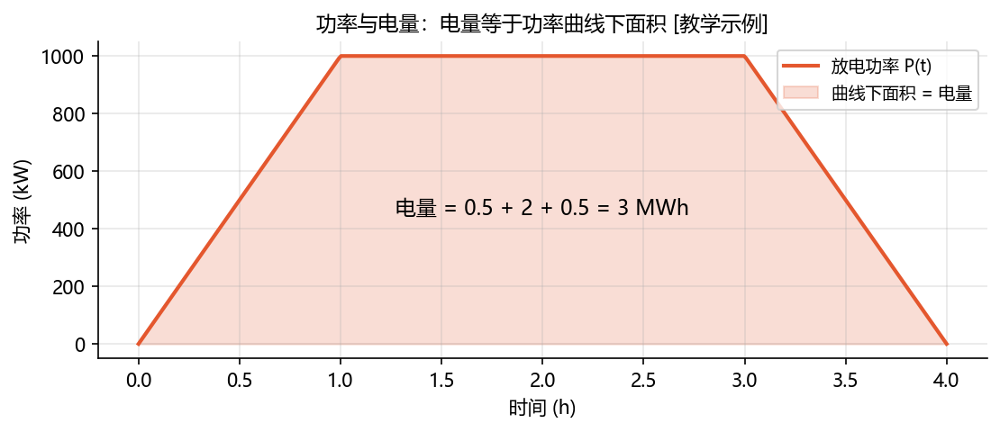
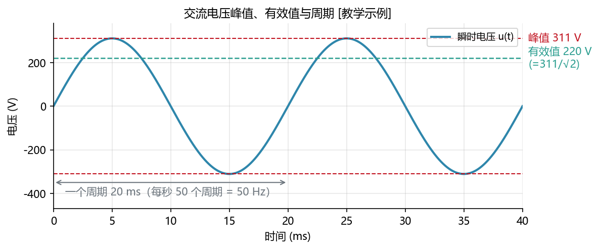
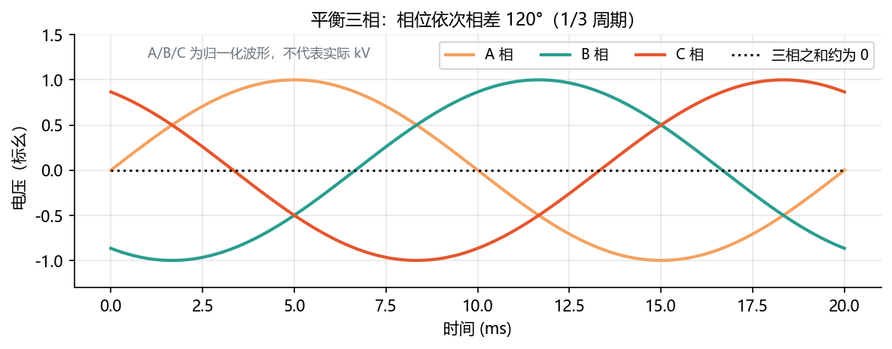
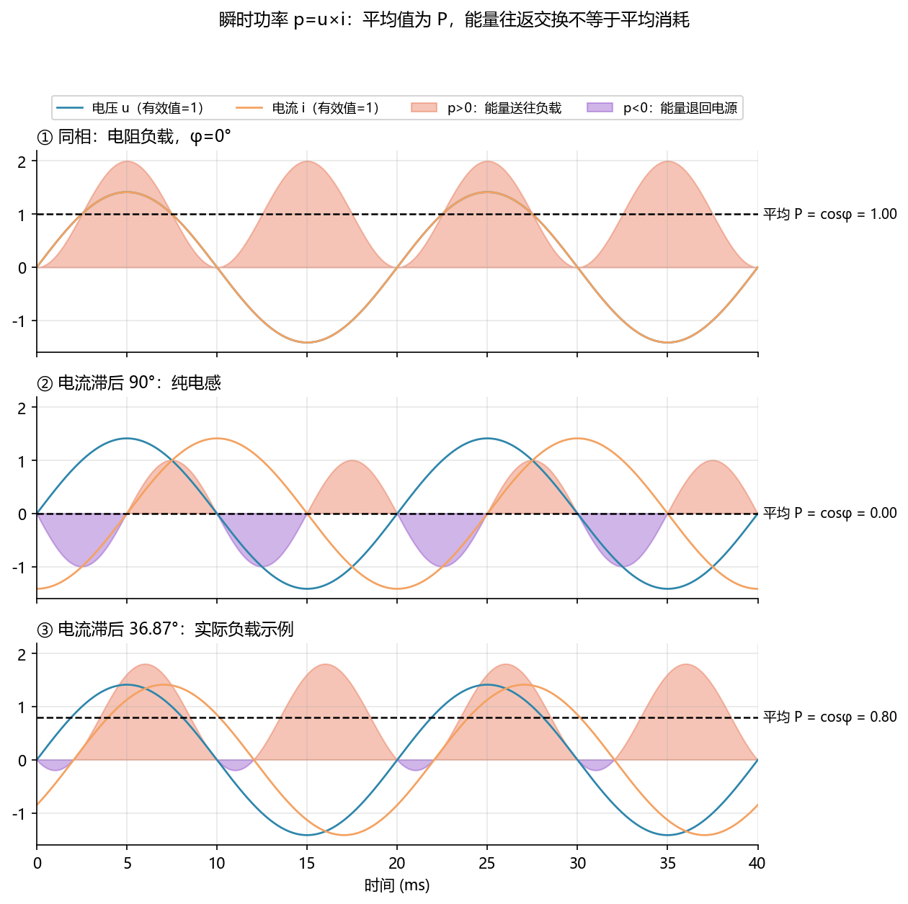
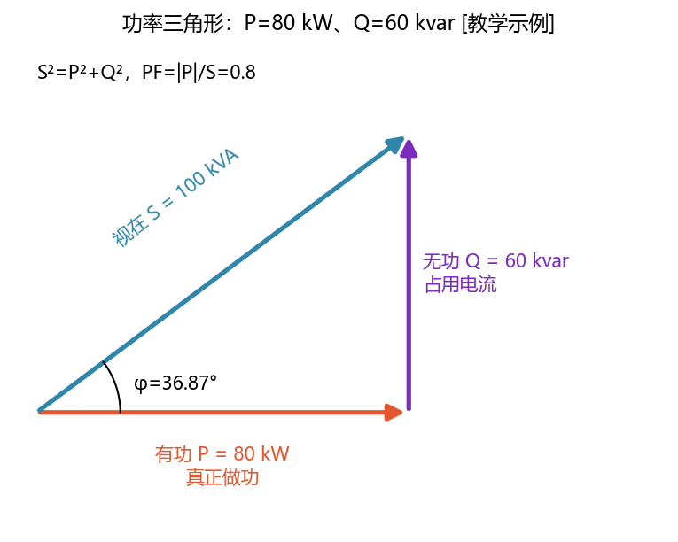
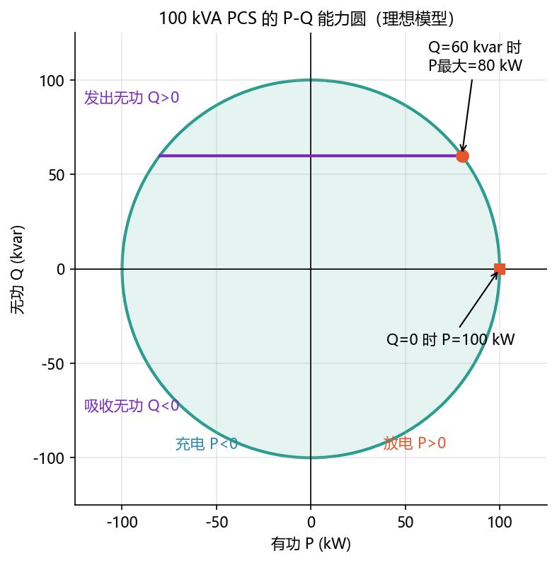
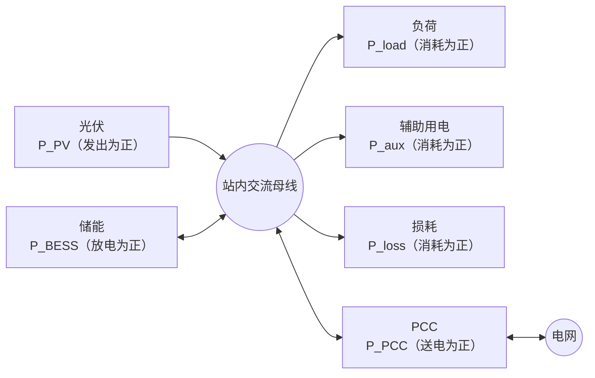

<!-- @AI_GENERATED -->
# 02 交流电量与功率关系

> [课程首页](README.md) · 上一章：[01 电力系统结构、运行与储能接入基础](01_电力系统入门.md) · 下一章：[03 储能应用场景与收益](03_储能应用场景与收益.md)

**一句话**：建立 EMS 点表中 P、Q、S、PF、U、I、f 和 kWh 的物理直觉，理解储能为什么既要控制有功，也要控制无功。

**本章学习目标**：

- 区分功率与电量，能从离散功率计算电量；
- 理解交流有效值、三相线电压、线电流和总功率；
- 解释有功、无功、视在功率和功率因数的关系；
- 读懂 PCS 的 P-Q 能力圆，理解 P、Q 为什么共享容量；
- 根据统一方向计算站点 PCC 功率平衡；
- 能识别单位、方向、时间戳和点表缩放错误。

**本章边界**：本章建立 EMS 开发所需的交流电量基础，不展开 PWM、电流环、电磁暂态、保护定值和完整 AVC 控制；这些内容在第 06、17、19 章及附录中展开。

**统一方向**：储能放电为正、充电为负；储能向电网发出无功为正、吸收无功为负；并网点向电网送电为正。

---

## 2.0 EMS 点表中的测量对象与单位【必懂】

在 EMS 中，P、Q、U、I 并不是抽象数学符号，而是来自 PCS、电表、BMS 和调度接口的测量字段。写算法前必须先确认三个问题：

1. 这个量测的是什么位置：PCS 出口、站内母线还是 PCC？
2. 这个量的单位是什么：W、kW、MW，还是 V、kV？
3. 正负方向是什么：放电/充电、送电/取电、发出/吸收？

| 量 | 白话解释 | 常见单位 | 本章用途 |
|---|---|---|---|
| `P` | 真正传输、消耗或存储能量的功率 | kW、MW | 功率平衡、调度、能量统计 |
| `Q` | 建立电磁场、影响电压的无功功率 | kvar、Mvar | 无功补偿和 AVC |
| `S` | 设备交流侧承受的总容量 | kVA、MVA | PCS、变压器和电缆容量校核 |
| `PF` | 有功功率在视在功率中的比例 | 无量纲 | 并网功率因数考核 |
| `U` | 电压有效值或瞬时值 | V、kV | 并网和设备状态判断 |
| `I` | 电流有效值或瞬时值 | A、kA | 发热和设备容量校核 |
| `E` | 一段时间内累计的电量 | kWh、MWh | SOC、结算和效率统计 |

本章所有数字均为 `[教学示例]`；现场点表以设备厂家和项目协议为准。

---

## 2.1 功率、电量与时间积分【必懂】

### 为什么需要

EMS 既要决定“现在充放多快”，也要知道“这段时间已经充放了多少”。前者是功率，后者是电量。如果把二者混用，可能出现“功率没有超限，但电量统计错误”或“SOC 计算逐渐漂移”的问题。

### 原理

**功率**是能量流动的速度，单位 kW 或 MW。**电量**是这段时间流过的能量总量，单位 kWh 或 MWh。

功率恒定时：

```text
E = P × t
```

功率变化时，电量等于功率曲线下的面积：



图中标注对照表：

| 编号 | 位置 | 标注 | 对应正文 |
|---|---|---|---|
| ① | 功率曲线 | 1000 kW | 峰值功率 |
| ② | 第一个三角形 | 0.5 MWh | 0～1 h 的面积 |
| ③ | 中间矩形 | 2 MWh | 1～3 h 的面积 |
| ④ | 最后一个三角形 | 0.5 MWh | 3～4 h 的面积 |
| ⑤ | 全部面积 | 3 MWh | 总放电电量 |

### 手算：恒功率和变化功率

```text
恒功率放电
= 1000 kW × 0.5 h
= 500 kWh

0～1 h 线性上升的电量
= 1/2 × 1 h × 1000 kW
= 0.5 MWh

1～3 h 恒功率的电量
= 2 h × 1000 kW
= 2 MWh

3～4 h 线性下降的电量
= 1/2 × 1 h × 1000 kW
= 0.5 MWh

总电量
= 0.5 + 2 + 0.5
= 3 MWh
```

### 储能额定功率和额定电量

铭牌 `100 MW / 200 MWh` 代表两个不同维度：

| 额定量 | 含义 | 主要影响因素 |
|---|---|---|
| 100 MW | 最大充放电功率 | PCS、电池倍率和热管理 |
| 200 MWh | 可存储的电量规模 | 电池数量、容量和 SOC 窗口 |

**手算持续时间**：

```text
满功率放电时间
= 200 MWh ÷ 100 MW
= 2 h

如果只以 20 MW 放电
= 200 MWh ÷ 20 MW
= 10 h
```

实际可用时间还要考虑 SOC 窗口、效率、温度、老化和功率能力；这里的结果只说明功率和电量的关系。

### 离散采样：梯形积分

EMS 得到的是带时间戳的离散功率点，采样间隔可能不均匀。相邻两个点之间按梯形面积累加：

```text
E ≈ Σ [P[i] + P[i−1]] / 2 × [t[i] − t[i−1]]
```

若功率使用 kW、时间使用 s，最后需要换算：

```text
1 kW·s = 1/3600 kWh
```

**手算**：功率从 0 kW 线性上升到 1000 kW，持续 1 h：

```text
E = 1/2 × 1 h × 1000 kW
  = 500 kWh
```

真实实现使用时间戳而不是固定周期；时间戳倒退应判为数据错误，异常间隔如何处理由数据质量层规定。

---

## 2.2 交流量、频率与有效值【必懂】

### 为什么需要

电池输出的是直流电，电网和 PCS 交流侧使用的是周期性变化的交流电。EMS 点表通常上送交流电压、电流的有效值，而不是瞬时值；如果混淆峰值和有效值，设备容量和保护判断都会错。

### 原理

交流电压可以用正弦波表示：

```text
u(t) = U_peak × sin(2πft)
T = 1/f
U_rms = U_peak / √2      （正弦波）
```



图中标注对照表：

| 编号 | 位置 | 标注 | 对应正文 |
|---|---|---|---|
| ① | 峰值线 | 311 V | 正弦波峰值教学示例 |
| ② | 有效值线 | 220 V | `311/√2` |
| ③ | 横向周期标记 | 20 ms | 一个周期 |
| ④ | 波形条件 | 50 Hz | 每秒 50 个周期 |

### 手算：频率、周期和有效值

```text
50 Hz 的周期
= 1 ÷ 50 s
= 0.02 s
= 20 ms

正弦电压有效值
= 峰值 ÷ √2
= 311 ÷ 1.414
≈ 220 V

由有效值反推峰值
= 220 × √2
≈ 311 V
```

这里的 220 V 是常见低压交流电教学示例；储能站的并网电压可能是 10 kV、35 kV、110 kV 或更高，不能把这个数字当作储能项目的电压配置。

---

## 2.3 平衡三相与功率测量字段【必懂】

### 为什么需要

储能 PCS 和并网点通常使用三相交流。点表中的 `P`、`Q`、`S` 多数表示三相总量，但电压和电流字段可能同时包含相量、线量、有效值和瞬时值。EMS 必须知道字段的测量口径，才能正确计算。

### 三相基本关系

三相电压的相位依次相差 120°，每相电压的有效值相同、相序一致时，三相瞬时功率总和较稳定。



图中标注对照表：

| 编号 | 位置 | 标注 | 对应正文 |
|---|---|---|---|
| ① | A/B/C 三相 | 120° | 相位差 |
| ② | 一个周期 | 1/3 周期 | 相邻两相时间差 |
| ③ | 三相和曲线 | 约 0 | 平衡三相的瞬时电压和 |
| — | 全图 | 标幺值 | 仅比较波形，不代表 kV |

| 字段 | 含义 |
|---|---|
| `Ua`、`Ub`、`Uc` | 相电压：相线对中性点的电压 |
| `Uab`、`Ubc`、`Uca` | 线电压：两根相线之间的电压 |
| `Ia`、`Ib`、`Ic` | 各相电流 |
| `P`、`Q`、`S` | 通常是三相总功率，需核对点表定义 |

平衡三相总有功功率应写为：

```text
P = √3 × U_line × I_line × PF
```

其中 `U_line` 是线电压，`I_line` 是线电流，二者必须使用同一测量口径。

### 手算：400 V 三相 PCS 的 1 MW

已知：线电压 `U_line=400 V`，线电流 `I_line=1443 A`，`PF=1`。

```text
P = √3 × U_line × I_line × PF
  = 1.732 × 400 × 1443 × 1
  ≈ 1,000,000 W
  = 1 MW
```

低压侧达到 1 MW 时电流已经超过 1400 A，这就是 PCS 交流出线需要粗母排或多根并联电缆的原因。

**边界**：上式适用于平衡三相、基波、有效值和三相总功率。三相不平衡时，需要逐相计算后再求和。

---

## 2.4 瞬时功率、有功与无功【必懂】

### 为什么需要

软件开发者看到“无功不做功”时，容易误以为无功没有电流、没有设备影响。实际上，无功会占用线路和 PCS 的电流容量，并影响电压；只是它在一个周期内平均不消耗能量。

### 瞬时功率

```text
p(t) = u(t) × i(t)
```



图中标注对照表：

| 编号 | 位置 | 标注 | 对应正文 |
|---|---|---|---|
| ① | 电阻负载 | 相位差 0°，平均 P=1.00 | 电流与电压同相 |
| ② | 纯电感 | 相位差 90°，平均 P=0 | 能量往返交换 |
| ③ | 实际负载 | 相位差 36.87°，平均 P≈0.80 | 部分电流产生有功 |
| — | 三个子图 | `U_rms=I_rms=1` | 归一化教学示例 |

图中电压、电流的有效值都取 1，只用于比较波形和平均值，不能把纵轴直接当作 V 或 A。

### 有功和无功的公式

对于正弦稳态交流：

```text
P = U × I × cos φ
Q = U × I × sin φ
S = U × I
```

| 符号 | 含义 | 单位 | 示例 |
|---|---|---|---:|
| `P` | 有功功率，平均做功 | W、kW | 0.80 |
| `Q` | 无功功率，能量交换幅度 | var、kvar | 由 `sin φ` 决定 |
| `S` | 视在功率，设备承受总量 | VA、kVA | 1 |
| `φ` | 电压相位减电流相位 | ° | 0、36.87、90 |

### 手算：三种相位关系

**电阻负载**：`φ=0°`。

```text
P = U × I × cos 0°
  = 1 × 1 × 1
  = 1.00
Q = U × I × sin 0°
  = 0
```

**纯电感**：`φ=90°`。

```text
P = 1 × 1 × cos 90° = 0
Q = 1 × 1 × sin 90° = +1
```

**相位差 36.87° 的实际负载**：

```text
P = 1 × 1 × cos 36.87° ≈ 0.80
Q = 1 × 1 × sin 36.87° ≈ 0.60
```

有功是瞬时功率的平均值；无功表示每个周期中能量来回交换的幅度。无功平均不消耗电池电量，但会占用导线和 PCS 的电流容量。

### 感性、容性与储能方向的转换

负荷/元件惯例常把纯电感记为 `Q>0`、纯电容记为 `Q<0`；本课程的储能控制变量采用“向电网发出无功为正”：

| 语境 | 正方向 |
|---|---|
| 负荷/元件性质 | 常用感性 `Q>0`、容性 `Q<0` |
| 储能 EMS 控制 | 储能发出无功 `Q_BESS>0`，吸收无功 `Q_BESS<0` |

读取厂家或电表点表时，必须先确认参考方向，再转换到附录 B 的统一约定。

---

## 2.5 视在功率与功率因数【必懂】

### 为什么需要

有功和无功都要通过电流传输。PCS、变压器和电缆的发热由电流决定，因此设备不能只按 P 标定，还要看 P 和 Q 合成后的视在功率 S。

### 公式与符号

```text
S² = P² + Q²
S = √(P² + Q²)
PF = |P| / S
```

| 符号 | 含义 | 单位 | 本例 |
|---|---|---|---:|
| `P` | 有功功率 | kW | 80 |
| `Q` | 无功功率 | kvar | 60 |
| `S` | 视在功率 | kVA | 100 |
| `PF` | 功率因数幅值 | 无 | 0.8 |

`PF` 是幅值，不表达超前/滞后，也不表达储能充放电方向。代码实现返回 `|P|/S`；当 P、Q 都为 0 时，代码按约定返回 1.0，但这不代表存在有物理意义的功率因数。

### 手算：功率三角形



图中标注对照表：

| 编号 | 位置 | 标注 | 对应正文 |
|---|---|---|---|
| ① | 水平边 | P=80 kW | 有功 |
| ② | 垂直边 | Q=60 kvar | 无功 |
| ③ | 斜边 | S=100 kVA | 视在功率 |
| ④ | 角度 | φ=36.87° | 相位角示例 |
| ⑤ | 公式 | PF=0.8 | 功率因数 |

```text
S = √(P² + Q²)
  = √(80² + 60²)
  = √10000
  = 100 kVA

PF = |P| / S
   = 80 / 100
   = 0.8
```

### 为什么设备按 kVA 标定

1000 kVA 的 PCS 并不意味着任何工况都能输出 1000 kW。Q 越大，可用 P 越小；P 和 Q 共同受交流电流上限约束。

---

## 2.6 P-Q 能力域与容量竞争【必懂】

### 原理

理想 PCS 的能力边界可以写成：

```text
P² + Q² ≤ S²
```

在 P-Q 平面上，`S=100 kVA` 的边界是一个圆。真实 PCS 的充放电方向、交流电压、温度和电流限制可能使能力边界偏离理想圆。



图中标注对照表：

| 编号 | 位置 | 标注 | 对应正文 |
|---|---|---|---|
| ① | 能力圆半径 | S=100 kVA | 理想容量边界 |
| ② | 水平轴端点 | Q=0 时 P=100 kW | 纯有功 |
| ③ | 水平线交点 | Q=60 kvar 时 P=80 kW | 有功受无功挤占 |
| ④ | 纵轴方向 | Q=+60 发出、Q=−60 吸收 | 储能视角 |

### 四象限方向

| 象限 | P | Q | 储能状态 |
|---|---|---|---|
| 右上 | 放电 | 发出无功 | 放电并支撑电压 |
| 右下 | 放电 | 吸收无功 | 放电并压低电压 |
| 左上 | 充电 | 发出无功 | 充电并支撑电压 |
| 左下 | 充电 | 吸收无功 | 充电并压低电压 |

### 手算：无功需求挤占有功能力

已知 PCS 视在容量 `S=100 kVA`，电网要求储能发出 `Q=60 kvar`：

```text
P_max = √(S² − Q²)
      = √(100² − 60²)
      = √6400
      = 80 kW
```

因此，即使电池和 BMS 允许 100 kW 放电，PCS 在该无功工况下也最多输出 80 kW。真实 EMS 还必须处理充放电不对称、温度降额、低电压降额和设备厂家能力曲线。

---

## 2.7 频率、电压与储能调节对象【必懂】

| 状态量 | 主要反映 | 储能调节对象 | 后续章节 |
|---|---|---|---|
| 频率 | 同步运行区域内的有功平衡 | 有功：频率低时放电，频率高时充电 | 15、16 |
| 电压 | 节点和局部网络的运行状态 | 无功或有功，取决于网络条件 | 17 |
| 潮流 | 功率在线路和变压器中的分布 | 通过位置和 P/Q 改变网络功率分布 | 12、16 |

“有功管频率、无功管电压”是高压电网中的入门近似，不是排他的因果关系。第 17 章会进一步说明线路参数、P/Q 和电压之间的关系。

---

## 2.8 PCC 功率平衡与方向换算【必懂】

### 功率平衡



```text
P_PCC = P_PV + P_BESS − P_load − P_aux − P_loss
```

| 符号 | 含义 | 正方向 |
|---|---|---|
| `P_PCC` | 并网点净功率 | 向电网送电为正 |
| `P_BESS` | 储能交流侧功率 | 放电为正，充电为负 |
| `P_PV` | 光伏发电 | 发电为正 |
| `P_load`、`P_aux`、`P_loss` | 负荷、辅助和损耗 | 消耗为正 |

### 手算：四种站点工况

已知负荷 `P_load=100 kW`，无光伏，忽略辅助用电和损耗：

```text
工况 1：储能不动作
P_PCC = 0 − 100 = −100 kW
含义：全部从电网取电。

工况 2：储能放电 30 kW
P_PCC = 30 − 100 = −70 kW
含义：储能承担 30 kW，仍从电网取 70 kW。

工况 3：储能放电 120 kW
P_PCC = 120 − 100 = +20 kW
含义：储能放电超过负荷，向电网倒送 20 kW。

工况 4：储能充电 20 kW
P_PCC = −20 − 100 = −120 kW
含义：取电增加到 120 kW。
```

| 储能 `P_BESS` | `P_PCC` | 含义 |
|---:|---:|---|
| 0 | −100 | 全部从电网取电 |
| +30 | −70 | 储能分担部分负荷 |
| +120 | +20 | 向电网倒送 |
| −20 | −120 | 充电增加取电 |

计费电表可能采用“从电网取电为正”的口径。接入层应统一换算：

```text
P_import = −P_PCC
```

控制算法内部只保留一套方向约定，避免在多个模块重复取反。

---

## 2.9 配套教学代码与最小闭环【实践】

本章配套代码复用 `lab/ems_lab/power.py`，入口为：

```text
lab/examples/ch02_power_examples.py
```

从教学代码包的 `lab` 目录运行：

```text
python examples/ch02_power_examples.py
```

示例包含：

- 功率与电量；
- 三相功率；
- P-Q 和 PF；
- P-Q 能力竞争；
- PCC 功率平衡。

示例输出与本章手算一致，并通过 `assert` 自检。建议练习：修改 P、Q、S、负荷和光伏输入，观察功率因数、P-Q 可行域和 PCC 方向如何变化。

### 正文最小闭环：P-Q 能力和 PCC 方向

```python
import math

# 输入：PCS容量、无功请求、负荷和储能功率
s_kva = 100.0
q_kvar = 60.0
p_bess_kw = 30.0
p_load_kw = 100.0

# 算法1：无功占用容量后，剩余有功能力
p_max_kw = math.sqrt(s_kva**2 - q_kvar**2)

# 算法2：站点功率平衡，送电为正、取电为负
p_pcc_kw = p_bess_kw - p_load_kw

print(f"Q={q_kvar:.0f} kvar 时，PCS 最大有功={p_max_kw:.0f} kW")
print(f"P_BESS={p_bess_kw:.0f} kW、负荷={p_load_kw:.0f} kW 时，P_PCC={p_pcc_kw:.0f} kW")

assert p_max_kw == 80.0
assert p_pcc_kw == -70.0
```

运行输出：

```text
Q=60 kvar 时，PCS 最大有功=80 kW
P_BESS=30 kW、负荷=100 kW 时，P_PCC=-70 kW
```

真实实现 `lab/ems_lab/power.py` 还增加了输入校验、零容量处理、PCC 辅助/损耗/光伏参数，以及梯形积分的时间戳校验；本章不在正文展开这些工程细节。

---

## 2.10 关键认知边界与现场故障【必懂】

| 误区 | 正确理解 |
|---|---|
| kW 和 kWh 可以互换 | kW 是功率速度，kWh 是累计电量 |
| 1000 kVA PCS 一定能放 1000 kW | 只有 Q=0 时才成立；P 和 Q 共享容量 |
| 无功是浪费，越少越好 | 无功是维持电压和磁场所必需的，要适量、适地 |
| PF=0.8 能确定无功方向 | PF 是幅值，方向要看 Q 或点表定义 |
| Q>0 永远就是感性 | 要先确认负荷惯例还是储能电源惯例 |
| P、Q 分别不超额定就不会过载 | 还必须满足 `P²+Q²≤S²` 和实际电流边界 |
| 采样间隔固定，所以电量直接乘固定周期 | 应使用实际时间戳进行梯形积分 |

**案例一：电量统计偏小。** 通信延迟导致采样间隔变化，但程序仍按固定 1 秒积分，累计电量系统性偏小。正确做法是使用实际时间戳，并将时间质量异常交给数据质量层处理。

**案例二：功率读数放大 10 倍。** 点表原始值的缩放系数为 0.1 kW，接入层漏乘后，EMS 把实际 500 kW 当成 5000 kW。正确做法是把类型、缩放、单位和方向作为点表配置，在已知工况下验收。

---

## 2.11 自测

1. 50 MW / 100 MWh 储能满功率能放多久？以 20 MW 放电能放多久？
2. 负荷 500 kW、储能放电 200 kW、辅助 10 kW、损耗 5 kW，PCC 功率和进口表读数是多少？
3. P=50 MW、Q=30 Mvar，求 S 和 PF。
4. S=1000 kVA、Q=600 kvar 时，最大有功是多少？
5. 为什么电压、电流没有分别超过额定值，PCS 仍可能过载？
6. 频率偏低、变电站电压偏低时，储能分别调节什么？
7. 纯电感和纯电容的 Q 符号分别是什么？
8. 电机需要吸收 100 kvar、旁边电容发出 100 kvar 时，电网侧还需输送多少无功？

<details>
<summary>参考答案</summary>

1. `100÷50=2 h`；`100÷20=5 h`。
2. `P_PCC=200−500−10−5=−315 kW`；取电为正的电表读数为 `+315 kW`。
3. `S=√(50²+30²)≈58.3 MVA`；`PF=50÷58.3≈0.857`。
4. `P_max=√(1000²−600²)=800 kW`。
5. P 和 Q 共同形成 S，设备发热由电流和视在功率决定；三相不平衡时单相也可能先超限。
6. 频率偏低增加有功；电压偏低发出无功。
7. 纯电感 `Q>0`，纯电容 `Q<0`，这是负荷/元件惯例；储能控制方向仍以附录 B 为准。
8. 理想情况下电网侧约不再需要输送这 100 kvar，无功在本地补偿。

</details>

---

## 2.12 深入【深入】

<details>
<summary>相量与 P、Q、S 的推导</summary>

设电压 `u=√2U sin(ωt)`，电流 `i=√2I sin(ωt−φ)`，其中 U、I 是有效值：

```text
p = u·i
  = U·I·cosφ − U·I·cos(2ωt−φ)
```

第一项的平均值是有功功率：`P=U·I·cosφ`；振荡部分平均为 0，和 `sinφ` 相关的能量交换幅度对应无功：`Q=U·I·sinφ`。因此 `S=U·I`，并有 `S²=P²+Q²`。

</details>

<details>
<summary>真实功率因数与位移功率因数</summary>

上面的推导假设电压和电流都是纯正弦。实际电流含有谐波时，位移功率因数只看基波相角，真实功率因数还受到谐波电流影响。电表和 PCS 上送的 PF 口径必须查阅厂家定义。

</details>

<details>
<summary>三相不平衡和 PCS 单相电流边界</summary>

三相不平衡时，各相电流不同，不能直接使用平衡三相公式，需要逐相求和。PCS 过流保护按单相电流判断，即使三相总功率未超额定，某一相仍可能先达到电流上限。

</details>

<details>
<summary>本章模型边界</summary>

- 教学示例默认正弦稳态、平衡三相和有效值；
- P-Q 能力圆是理想模型，实际能力以 PCS 厂家曲线和实时电压、温度为准；
- 本章不进行 PWM、电流环、电磁暂态、保护定值和完整 AVC 计算；
- 现场点表的单位、缩放和方向必须在接入层核对。

</details>

<!-- @AI_GENERATED: end -->
