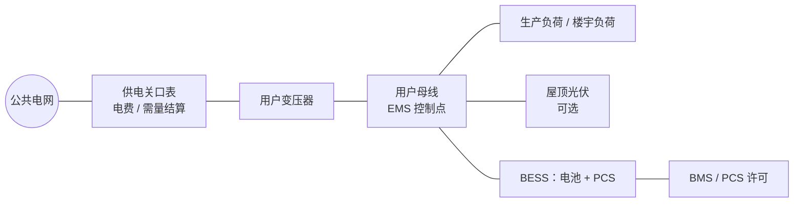
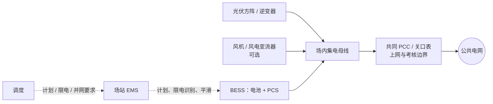
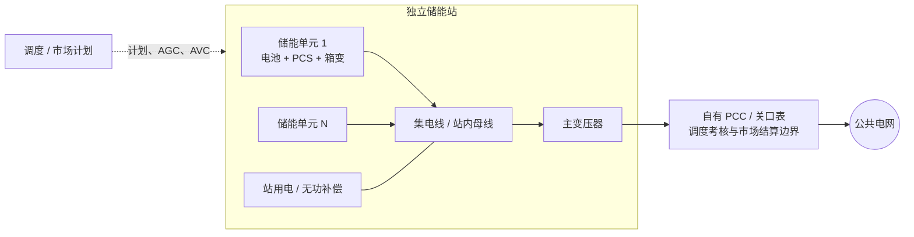
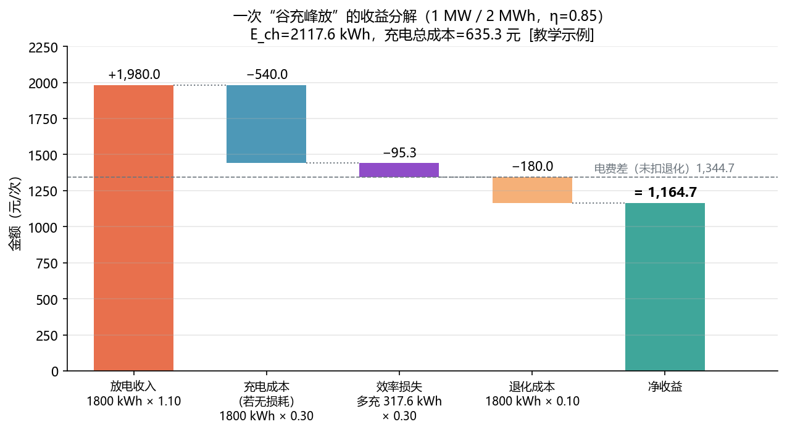
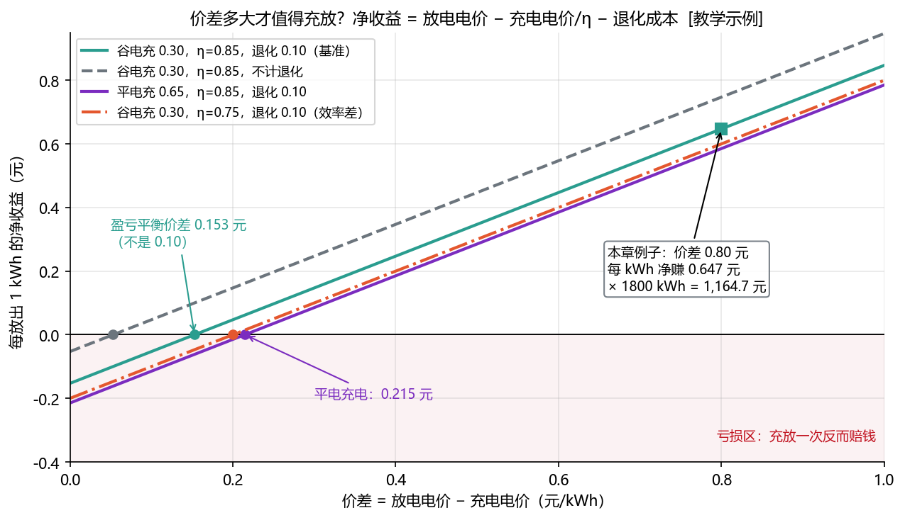
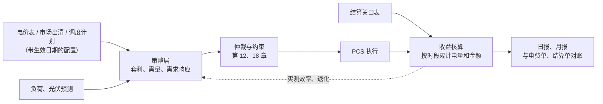

<!-- @AI_GENERATED -->

# 03 储能应用场景、收益机制与 EMS 经济决策

> [课程首页](README.md) · 上一章：[02 交流电与功率](02_交流电与功率.md) · 下一章：[04 电池与 BMS](04_电池与BMS.md)

**一句话**：储能的应用场景、收益机制和 EMS 经济决策，取决于它装在哪里、接受什么目标以及受到哪些约束。

**本章目标**：

- 区分用户侧、电网侧和电源侧储能的目标、指令来源与收益口径；
- 计算效率损失、退化成本、盈亏平衡价差和简单投资回收期；
- 判断一次充放电是否值得执行，并识别需量、防倒送、SOC 和市场规则的影响；
- 理解收益核算与 EMS 实时决策的关系。

**本章边界**：本章讲收益场景、经济口径和 EMS 的充放决策；不展开区域市场的完整出清规则、正式投资评价（NPV/IRR）、电池精细寿命模型和完整调度优化，这些内容在后续章节和工程文件中展开。

> 本章所有电价、补偿标准、投资和成本数字都是 `[教学示例]`，**不代表任何地区的实际政策，以当地最新政策为准**。本章要掌握的是计算方法，而不是具体数字。

---

## 3.1 用户侧储能收益核算场景【必懂】

一家工厂装了 1 MW / 2 MWh 储能。销售同事算了一笔账：

> 谷电 0.30 元，峰电 1.10 元，价差 0.80 元。一天充放一次 2000 度，一天赚 0.80 × 2000 = **1600 元**。

这笔账有四个问题：

1. 2 MWh 是额定容量，为了保护电池，SOC 不会从 0% 用到 100%，每次实际放出的电量更少；
2. 充进去的电不能全部放出来，**有效率损失**，想放出 1 度，要充进去不止 1 度；
3. 每充放一次，电池寿命就少一点，这是**退化成本**；
4. 并不是每天都能满充满放：停产检修、需量控制、防倒送都会限制充放电（第 00 章 0.4）。

本章用第 3.6 节的方法把这笔账算对。先剧透结果：在同样的电价下，每次循环的净收益约 **1164.7 元**，只有朴素算法的 73%。

---

## 3.2 先看物理拓扑，再看服务与收益【必懂】

“用户侧、电源侧、电网侧”首先是帮助理解**储能与负荷、新能源、并网点（PCC）之间物理关系**的常用说法，不是按接入电压、某一种服务或某一笔收入划分的严格互斥类别。接入 110 kV 不必然是电网侧；参与 AGC 或 AVC 也不自动改变项目的物理身份。

判断一个项目时按下面顺序提问：

1. **物理拓扑**：储能与负荷、风光是否共用 PCC？站点是用户表后、风光场内，还是自成一座储能站？
2. **控制与约束**：谁给计划或实时设点？BMS、PCS、接入协议和保护给出了哪些不能突破的边界？
3. **结算与收益**：谁付款、按哪块表和哪个周期结算？是少交电费、市场/辅助服务收入、容量合同，还是弃电回收与考核扣减？

### 3.2.1 用户侧：储能在用户负荷一侧



**识别要点**：储能位于用户表后或用户配电系统内，负荷是最重要的外部扰动；光伏可以存在，但不是定义用户侧的必要条件。控制常围绕进口功率、最大需量、防倒送、防超容和保电展开。

### 3.2.2 电源侧：储能与风光共用并网点



**识别要点**：风光与储能在场内汇集后通过**同一个 PCC**送电。储能可以把已确认会弃掉的新能源电量转移到其他时段，也可以承担平滑、计划跟踪和已签约的电网服务；这些是服务标签，不是电源侧的唯一功能。

### 3.2.3 电网侧：独立储能站自成并网边界



**识别要点**：独立储能通常自成一个站，有自己的 PCC，不以同站用户负荷或同站风光出力为主要边界。行业常把它称为“电网侧储能”，但更准确的项目形态是**独立储能**。它可以参与调峰、现货、AGC、一次调频、AVC、容量租赁等服务，具体取决于接入协议、市场规则和合同。

> **不要只凭电压等级判断侧别**：0.4/10/35/110/220 kV 都可能出现在不同项目中。接入电压说明工程接入层级；项目拓扑、合同和考核点才说明储能在解决什么问题。

### 3.2.4 三类典型项目的控制与结算矩阵

| 物理身份 | PCC 与主要对象 | 常见计划/设点来源 | 典型目标与硬约束 | 常见收益或价值 | 计量与 EMS 重点 |
|---|---|---|---|---|---|
| 用户侧 | 用户负荷、可选屋顶光伏与 BESS 位于用户配电系统；以供电关口和用户母线为关键边界 | 业主策略；需求响应时由聚合商或电网发邀约、业主确认 | 少购电、压最大需量、防倒送、防超容、保电；受 BMS/PCS 和用户接入约束限制 | 电度/基本电费节省、需求响应补偿、避免扩容成本 | 关口表、需量窗口、负荷与 PCC 功率；第 12～14 章 |
| 电源侧 | 风/光与 BESS 场内集电，共用 PCC | 场站计划、调度计划、限电指令、已签约服务设点 | 弃电转移、出力平滑、计划跟踪、可用率和并网考核；受新能源出力与共同 PCC 约束 | 上网电量、弃电回收、考核扣减减少、容量合同等 | 共同 PCC 的上网/考核表、限电状态、风光-BESS 功率平衡；第 11、13、15、16 章 |
| 电网侧（典型为独立储能） | BESS 自成站，通常有自有 PCC；站内主要是储能、站用电和无功设备 | 市场计划、调度计划、AGC/AVC；最终受本地许可约束 | 调峰、现货计划、AGC、一次调频、AVC、SOC 与可用率；受 BMS/PCS、接入协议和保护限制 | 市场价差、辅助服务、容量租赁/补偿或合同收入 | 调度考核点、市场结算表、能力上送与审计；第 13、15～18 章 |

三类项目可以提供重叠服务。例如新能源共址站也可以按协议参与一次调频或 AVC；用户侧储能也可以接受已确认的需求响应邀约。最终功率不能按“侧别”分别下发，而要把计划、服务请求和硬约束统一交给第 18 章的仲裁、投影和分配流程。

---

## 3.3 用户侧储能的电费收益【必懂】

用户侧储能装在工厂、园区、商业楼宇的配电系统内，业主通常拥有本地策略的决策权。它的主要结算口径是**电费节省和合同补偿**：峰谷套利体现为少购电成本，需量管理体现为基本电费节省，需求响应按规则补偿，动态增容体现为避免扩容投资。

### 3.3.1 峰谷套利：分时电价

国家层面建立了**分时电价机制**：一天分为峰、平、谷（部分地区还有尖峰、深谷）等时段，不同时段电价不同，引导用户错峰用电。时段划分、价格比例由各地确定，并会随季节和政策调整。

储能在谷时充电、峰时放电，替用户少买高价电。它的收益本质是“**省下的电费**”，不是卖电收入。

- 谁下指令：EMS 按电价表和负荷预测自己决定；
- EMS 核心功能：电价时段表管理、充放电计划（第 13 章），受防倒送、需量、SOC 约束（第 12、14 章）。

### 3.3.2 需量管理：两部制电价

大工业用户通常执行**两部制电价**：

```text
电费 = 电度电费（按用了多少度电） + 基本电费（按容量或最大需量）
```

基本电费可以按变压器容量计收，也可以按当月**最大需量**计收。最大需量是指一个计费周期内，某个固定时间窗口（常见为 15 分钟 `[行业典型值]`）平均取电功率的最大值。具体规则以当地电网公司和供用电合同为准。

按需量计费时，一个月里只要有一个 15 分钟窗口的取电功率冲高，整个月的基本电费就按这个值算。储能在负荷高峰时放电，把最大需量压下来。

**手算**：储能把某工厂的月最大需量从 3000 kW 压到 2500 kW，需量电价 40 元/(kW·月) `[教学示例]`：

```text
每月节省 = 500 kW × 40 元/(kW·月) = 20000 元
一年节省 = 20000 × 12 = 240000 元
```

前提是**当月每一个窗口都压住了**。只要有一次没压住（比如储能恰好没电，或 EMS 通信中断），当月的节省可能大部分归零。这就是需量管理比峰谷套利更依赖控制可靠性的原因（第 14 章）。

### 3.3.3 需求响应

电网在用电紧张（或新能源过剩）时，通过电网企业或负荷聚合商向用户发出**邀约**，请用户在指定时段减少（或增加）用电，事后按实际响应量给予补偿。补偿标准、响应时长、提前通知时间由各地需求响应实施方案规定。

- 谁下指令：电网企业或聚合商发邀约，业主确认后由 EMS 执行；
- 怎么认定响应量：通常用“**基线**”（不响应时本应的负荷，按历史同期数据估算）减去实际负荷；
- EMS 核心功能：接收邀约、在响应时段提前备好电量、按计划放电、保存完整的计量数据供事后核定。

### 3.3.4 备用电源与动态增容【了解】

- **备用电源**：电网停电时，储能离网给重要负荷供电。这要求 PCS 有离网运行能力、站内有切换开关和配套保护，属于“可靠性价值”，不直接产生电费收益。EMS 要预留足够 SOC，并管理并网/离网切换（第 06、07 章）；
- **动态增容**：工厂变压器容量 1000 kVA，新增充电桩后高峰时偶尔超载。与其花钱扩容变压器，不如在超载时让储能放电补足。收益是“省下的扩容投资和基本电费”。EMS 要实时监视变压器负载，这是一个典型的“防超容”约束（第 12 章）。

---

## 3.4 电网侧储能的辅助服务与市场收益【必懂】

独立储能通常单独接入电网（第 01 章 1.1 的例子），直接接受调度或参与市场。它的收入可来自**市场交易、辅助服务结算、容量租赁、容量补偿或其他合同补偿**；付款方、结算点和计算方式由市场规则、接入协议与合同共同确定，并不必然由电网直接付款。

### 调峰

在负荷低谷或新能源大发时充电、在高峰时放电，帮电网缩小峰谷差、填“鸭肚子”（第 01 章 1.6）。

- 谁下指令：调度下发计划曲线，或按市场出清结果执行；
- 收益来源：调峰辅助服务补偿；在电力现货市场运行的地区，调峰价值更多体现为现货价差；
- EMS 核心功能：计划曲线接收与跟踪、SOC 管理（第 13 章）。

### 调频辅助服务

跟随调度每几秒下发一次的 AGC 指令，快速增减出力，帮助维持频率（第 01 章 1.7）。

- 谁下指令：调度 AGC 主站；
- 收益来源：调频辅助服务补偿。常见的结算结构是“**调节量（如调频里程）× 单价 × 性能系数**”，其中性能系数由调节速度、精度、响应时间等决定 `[教学示例：结构示意，以所在区域辅助服务规则为准]`；
- EMS 核心功能：AGC 指令跟踪、性能指标统计、SOC 维持在双向可调区间（第 16 章）。

调频收益对**跟踪性能**非常敏感：同样的容量，响应快、跟得准的储能，性能系数高，收益可能成倍增加。这直接取决于 EMS 和 PCS 的控制质量。

### 容量租赁与容量补偿

- **容量租赁**：部分地区要求新能源项目配置一定储能，新能源企业可以不自建，而是向独立储能**租用**容量。收益是按容量计的租金（元/(kW·年) 或 元/(kWh·年)），与充放电次数关系不大；
- **容量补偿 / 容量电价**：部分地区对能在高峰时段可靠顶峰的独立储能给予容量补偿，认可它“随时能顶上”的价值。

两种收益都要求储能**在需要时可用**，EMS 要如实上报可用容量和设备状态，可用率往往是考核指标之一。具体机制差别很大，以当地最新政策为准。

### 电力现货市场套利

在电力现货市场中，电价按时段（例如每 15 分钟）由市场出清形成，一天内高低波动。储能申报充放电计划，低价时段充电、高价时段放电。

因为全课程约定**放电为正、充电为负**，现货收益可以直接写成：

```text
电量收益 = Σ（储能功率 × 该时段电价 × 时段长度）
```

放电时功率为正，收入为正；充电时功率为负，自动变成成本，公式里不需要任何判断。

**手算**：4 个 1 小时时段 `[教学示例]`：


| 时段 |                                  储能功率 | 电价（元/kWh） | 收益（元） |
| ------ | ------------------------------------------: | ---------------: | -----------: |
| 1    |                         −1000 kW（充电） |           0.20 |      −200 |
| 2    |                         −1000 kW（充电） |           0.25 |      −250 |
| 3    |                           +850 kW（放电） |           0.90 |       +765 |
| 4    |                           +850 kW（放电） |           1.00 |       +850 |
| 合计 | 充 2000 kWh，放 1700 kWh（往返效率 0.85） |                |  **+1165** |

- 谁下指令：交易员或交易辅助系统申报，按出清结果执行；
- EMS 核心功能：执行出清计划、偏差控制（实际与计划的偏差可能被考核）、SOC 管理（第 13 章）。

国家层面有推动新型储能参与电力市场和调度运用的政策文件，各地现货市场规则差别很大，以当地最新规则为准。

---

## 3.5 电源侧储能的并网与弃电收益【必懂】

电源侧储能装在光伏电站或风电场里，和新能源一起通过同一个并网点送电。


| 功能 | 做什么 | 准入约束或运行时来源 | 收益或价值口径 | EMS 核心功能 | 章节 |
|---|---|---|---|---|---|
| 新能源配储 | 按要求配置一定功率和时长的储能 | 政策、接入批复或容量合同；它们是准入/履约约束，不是实时功率指令 | 满足并网、项目或容量租赁条件 | 能力上报、可用率统计、SOC 预留 | 05c、13、20 |
| 减少弃电 | 调度限电时段把本要弃掉的电充进储能，不限电时再放出 | 调度限电信息 + 场站策略 | 已确认弃电的边际电量回收 | 限电时段识别、充电控制、功率平衡 | 07、13 |
| 平滑出力 | 云层经过时光伏出力骤降，储能补上，让并网点出力变化更平缓 | 场站策略或并网 Ramp 要求 | 满足波动限值、减少考核 | 出力平滑、Ramp 控制 | 11、13 |
| 并网与辅助服务 | 跟踪调度计划、参与一次调频、AVC 等已签约服务 | 调度计划、频率/电压测量或服务协议 | 考核扣减减少、辅助服务或合同收入 | 计划跟踪、一次调频、AVC、SOC 管理 | 15、16、17、18 |

配储是否强制、比例和时长多少，近年政策变化较大，以当地最新政策为准。

并网考核依据国家能源局的《电力并网运行管理规定》和《电力辅助服务管理办法》，各区域再制定具体的实施细则（行业里常称“两个细则”）。考核指标包括计划跟踪偏差、一次调频性能等，考核扣的是真金白银。

**手算**（已确认弃电的边际电量回收，`[教学示例]`）：限电时段充入本要弃掉的 2000 kWh，晚间放出 1700 kWh，上网电价 0.35 元/kWh，度电退化成本 0.10 元/kWh（3.6 节）。这里“充电成本 = 0”的前提是该电量本来不能上网、且合同与计量口径确认它没有替代结算价值：

```text
放电收入 = 1700 × 0.35 = 595 元
充电成本 = 0（这些电本来要弃掉，不花钱）
退化成本 = 1700 × 0.10 = 170 元
净收益   = 595 − 0 − 170 = 425 元
```

充电电价为 0 时，只要上网电价高于度电退化成本就值得做。但如果**不限电时**也拿光伏发的电去充，那部分电本来可以直接上网卖 0.35 元，充电的“机会成本”就是 0.35 元，再算上效率和退化就亏了。所以 EMS 必须准确识别“限电时段”，而不是看到光伏有功率就充。

---

## 3.6 储能套利收益的统一经济口径【必懂】

### 第一步：往返效率

储能充进 1 度电，放出来不到 1 度。损耗来自电池内阻、PCS 变换、变压器、线缆，以及空调、液冷等辅助用电。衡量整体损耗的量叫**往返效率**：

```text
往返效率 η = 放出的电量 ÷ 充入的电量     （同一计量点、SOC 回到起点）
```

**手算**：从某一 SOC 开始充入 2000 kWh，再放电回到同一 SOC，共放出 1700 kWh：`η = 1700 ÷ 2000 = 0.85`。

**单向效率和往返效率**：充电一段、放电一段，损耗是**相乘**的：

- 充电效率 0.92、放电效率 0.92 → 往返效率 `0.92 × 0.92 ≈ 0.846`；
- 反过来，已知往返效率 0.85，假设两个方向相同，单向效率 `√0.85 ≈ 0.922`。

交流侧往返效率（含 PCS 和变压器损耗）常见在 80%～90% 的量级 `[行业典型值]`，与电池类型、系统设计、运行工况、是否计入辅助用电有很大关系。**说一个效率数字时必须同时说清计量点**。

### 第二步：充电电量

想放出 E_dis，要先充进去更多：

```text
E_ch = E_dis ÷ η
```

**手算**：1 MW / 2 MWh 储能，SOC 使用范围 5%～95% `[教学示例]`，每次在计量点放出 2000 × 90% = 1800 kWh：

```text
E_ch = 1800 ÷ 0.85 ≈ 2117.6 kWh
```

多充的 317.6 kWh，就是效率损失。

### 第三步：退化成本

锂电池的寿命可以粗略地用“能充放多少次”来衡量。每放出 1 kWh，就消耗掉一小部分电池寿命。把电池的重置成本平摊到它一生能放出的电量上，就得到**度电退化成本**：

```text
c_deg = 电池重置成本 ÷ (循环寿命次数 × 每次放出的电量)
```

**手算**：电池重置成本 108 万元，循环寿命 6000 次，每次放出 1800 kWh（均为 `[教学示例]`）：

```text
全寿命放电量 = 6000 × 1800 = 10 800 000 kWh
c_deg = 1 080 000 ÷ 10 800 000 = 0.10 元/kWh
```

这里按**放电电量**折算。有的资料按“充 + 放”双向吞吐量折算，数值约减半，但乘的电量也要跟着换，**两处口径必须一致**。

### 第四步：一次循环的账

```text
净收益 = E_dis × 放电电价 − E_ch × 充电电价 − E_dis × c_deg
```


| 符号     | 含义                               | 单位   | 本例   |
| ---------- | ------------------------------------ | -------- | -------- |
| E_dis    | 每次放出的电量（计量点）           | kWh    | 1800   |
| E_ch     | 每次充入的电量 = E_dis ÷ η       | kWh    | 2117.6 |
| η       | 往返效率                           | 无     | 0.85   |
| 放电电价 | 放电时段电价（用户侧是省下的电价） | 元/kWh | 1.10   |
| 充电电价 | 充电时段电价                       | 元/kWh | 0.30   |
| c_deg    | 度电退化成本                       | 元/kWh | 0.10   |

**手算**：


| 项                   | 计算                     | 金额（元） |
| ---------------------- | -------------------------- | -----------: |
| 放电收入             | 1800 × 1.10             |    +1980.0 |
| 充电成本（若无损耗） | 1800 × 0.30             |    −540.0 |
| 效率损失             | (2117.6 − 1800) × 0.30 |     −95.3 |
| **电费差**           | 1980 − 540 − 95.3      | **1344.7** |
| 退化成本             | 1800 × 0.10             |    −180.0 |
| **净收益**           | 1344.7 − 180            | **1164.7** |



图中标注对照表：

| 编号 | 位置 | 标注 | 对应正文 |
|---|---|---|---|
| ① | 放电收入 | 1800 kWh × 1.10 = 1980.0 元 | 收益分解 |
| ② | 理想充电成本 | 1800 kWh × 0.30 = 540.0 元 | 收益分解 |
| ③ | 效率损失 | 多充 317.6 kWh；损失成本 95.3 元 | 充电电量、收益分解 |
| ④ | 退化成本 | 1800 kWh × 0.10 = 180.0 元 | 退化成本 |
| ⑤ | 结果 | 电费差 1344.7 元；净收益 1164.7 元 | 完整套利账 |
| — | 标题补充 | 充入电量 2117.6 kWh；充电总成本 635.3 元；往返效率 η=0.85 | 充电电量、收益分解 |

回到 3.1 的问题：朴素算法 1600 元，实际 1164.7 元，差距来自三处：SOC 使用范围（2000 → 1800 kWh）、效率损失、退化成本。

---

## 3.7 套利决策的盈亏平衡与安全裕度【必懂】

EMS 每天都要回答：“这一对时段，值得充放一次吗？”把 3.6 的公式除以 E_dis，得到**每放出 1 kWh 的净收益**，令它大于 0：

```text
放电电价 > 充电电价 ÷ η + c_deg
```

右边就是**盈亏平衡放电电价**。它减去充电电价，就是**盈亏平衡价差**。

**手算**（η = 0.85，c_deg = 0.10）：


| 充电时段 | 盈亏平衡放电电价             | 盈亏平衡价差 |
| ---------- | ------------------------------ | -------------- |
| 谷 0.30  | 0.30 ÷ 0.85 + 0.10 ≈ 0.453 | ≈ 0.153     |
| 平 0.65  | 0.65 ÷ 0.85 + 0.10 ≈ 0.865 | ≈ 0.215     |

两个结论：

1. **阈值不是 c_deg**：很多人以为价差超过退化成本就赚钱，实际还要覆盖效率损失；
2. **阈值取决于充电电价本身**：同样 0.20 元的价差，

   - 谷 0.30 充、0.50 放：每 kWh 净赚 `0.50 − 0.353 − 0.10 ≈ +0.047` 元，**赚**；
   - 平 0.65 充、0.85 放：每 kWh 净赚 `0.85 − 0.765 − 0.10 ≈ −0.015` 元，**亏**。

   因为效率损失 = 多充的电 × 充电电价，充电电价越高，损失越贵。



图中标注对照表：

| 编号 | 位置 | 标注 | 对应正文 |
|---|---|---|---|
| ① | 基准线 | 充电 0.30、η=0.85、退化 0.10；盈亏平衡价差 0.153 | 阈值手算 |
| ② | 平充线 | 充电 0.65；盈亏平衡价差 0.215 | 阈值手算 |
| ③ | 低效率线 | η=0.75；盈亏平衡价差 0.20 | 阈值手算 |
| ④ | 不计退化线 | 盈亏平衡价差约 0.053 | 阈值手算 |
| ⑤ | 本章示例点 | 充电 0.30、放电 1.10；价差 0.80；每 kWh 净赚 0.647；1800 kWh 净收益 1164.7 | 阈值与完整套利账 |

图中每条线与 0 线的交点就是盈亏平衡价差。效率从 0.85 降到 0.75，阈值从 0.153 升到 0.20（红色点划线）；不计退化成本时阈值只有约 0.053（灰色虚线），会让 EMS 做很多“看起来赚、其实亏”的循环。

### 两充两放

有些地区一天有两个高峰。如果中间的平段够长，可以“谷充 → 早峰放 → 平充 → 晚峰放”：

```text
第二次循环每 kWh 净收益 = 1.10 − 0.65 ÷ 0.85 − 0.10 ≈ 0.235 元
第二次循环净收益 = 1800 × 0.235 ≈ 423.5 元
一天合计 ≈ 1164.7 + 423.5 = 1588.2 元
```

第二次循环也是赚的，但每 kWh 只有第一次的约 1/3，而退化成本一样多。如果电池寿命主要由循环次数决定，要不要做第二次，还要看它会不会让电池提前到寿（3.10 深入）。

### EMS 里的判断

实际 EMS 不会在净收益刚好大于 0 时就动作，而是加一个**安全裕度**，覆盖负荷预测误差、辅助用电、电价时段边界误差等：

```text
每 kWh 净收益 > 安全裕度   才安排这次循环
```

例如上面“谷 0.30 → 0.50”每 kWh 只赚 0.047 元，安全裕度设 0.05 元时就不做了。裕度多大是项目经验参数 `[教学示例]`。

---

## 3.8 储能项目的简单投资回收测算【了解】

业主最关心的是“多少年回本”。最简单的算法：

```text
简单投资回收期 = 初始投资 ÷ 年净现金流
年净现金流 = 每次循环电费差 × 年循环次数 − 年运维费用
```

**手算**（全部 `[教学示例]`）：初始投资 200 万元，每次循环电费差 1344.7 元，每年 330 次，年运维 4 万元：

```text
年净现金流 = 1344.7 × 330 − 40000 ≈ 403 753 元
回收期 = 2 000 000 ÷ 403 753 ≈ 4.95 年
```

注意这里用的是**电费差**（1344.7 元），没有再扣退化成本。因为电池的钱已经算在初始投资里了，再扣一次退化就重复计算了。两个口径的用途不同：


| 口径                        | 用途                               | 是否扣退化                                                               |
| ----------------------------- | ------------------------------------ | -------------------------------------------------------------------------- |
| 每次循环净收益（1164.7 元） | EMS 日常决策：今天这一次该不该充放 | 扣，因为每次循环都在消耗电池                                             |
| 年净现金流（电费差口径）    | 投资测算：多少年回本               | 不扣，电池成本已在初始投资中；如计划中途更换电池，把更换费用计入对应年份 |

简单回收期忽略了很多因素：电池容量逐年衰减（每次放出的电量变少）、电价政策调整、每年实际能运行的天数、资金的时间价值等。正式的投资评估用净现值（NPV）、内部收益率（IRR）等方法，由专门的经济评价人员完成。

---

## 3.9 收益决策与核算在 EMS 中的位置【必懂】

EMS 对收益的影响体现在两端：**决策**（该不该充放、充放多少）和**核算**（实际赚了多少、和结算单对不对得上）。



几条工程要点：

- **经济参数是配置，不是代码**：电价表、时段、需量电价要带生效日期和版本，支持季节切换和政策调整；
- **以结算关口表为准**：EMS 自己统计的是 PCS 或储能出口的电量，结算用的是关口表。两者之间差着变压器损耗和辅助用电，收益核算要用关口表数据；
- **实测效率回灌决策**：用实际运行数据统计往返效率，替代设计值，价差阈值才准确；
- **所有决策可追溯**：为什么这一天没有充放、为什么这一次只放了一半，要能从日志中查到原因（第 20 章）。

---

## 3.10 配套教学代码与最小闭环【实践】

本章配套代码入口：

```text
lab/examples/ch03_economics_trace.py
```

从教学代码包的 `lab` 目录运行：

```text
python examples/ch03_economics_trace.py
```

示例输入 `1800 kWh、峰电 1.10 元/kWh、谷电 0.30 元/kWh、往返效率 0.85、退化成本 0.10 元/kWh`，输出充入电量、效率损失、退化成本、净收益、盈亏平衡价差和年度需量节省。正文直接展示的最小闭环不依赖 `lab`；配套示例复用 `lab/ems_lab/economics.py` 的真实实现。

### 正文最小闭环：一次套利收益

```python
# 输入：一次放电电量、峰谷电价、往返效率、度电退化成本
E_DIS = 1800.0
PRICE_DIS = 1.10
PRICE_CH = 0.30
ETA_RT = 0.85
C_DEG = 0.10

# 算法：先算需要充入的电量，再分别计算收入、效率损失和退化
E_CH = E_DIS / ETA_RT
REVENUE = E_DIS * PRICE_DIS
IDEAL_CHARGE_COST = E_DIS * PRICE_CH
EFFICIENCY_LOSS_COST = (E_CH - E_DIS) * PRICE_CH
DEGRADATION_COST = E_DIS * C_DEG
NET_PROFIT = REVENUE - IDEAL_CHARGE_COST - EFFICIENCY_LOSS_COST - DEGRADATION_COST

print(f"充入电量：{E_CH:.2f} kWh")
print(f"效率损失成本：{EFFICIENCY_LOSS_COST:.2f} 元")
print(f"净收益：{NET_PROFIT:.2f} 元")

assert round(E_CH, 2) == 2117.65
assert round(NET_PROFIT, 2) == 1164.71
```

运行输出：

```text
充入电量：2117.65 kWh
效率损失成本：95.29 元
净收益：1164.71 元
```

真实实现还会处理参数校验、不同计量点、实测效率、辅助用电、配置版本和审计记录。

## 3.11 收益模型的关键边界与误区【必懂】


| 误区                            | 正确理解                                                                   |
| --------------------------------- | ---------------------------------------------------------------------------- |
| 收益 = 价差 × 额定容量         | 要用实际放电量（受 SOC 范围限制），充电量 = 放电量 ÷ 效率，还要扣退化成本 |
| 价差大于退化成本就值得充放      | 还要覆盖效率损失：放电电价 > 充电电价 ÷ η + c_deg                        |
| 价差相同，收益就相同            | 效率损失按充电电价计，充电电价越高越不划算                                 |
| 单向效率 0.92 就是往返效率 0.92 | 往返效率是两段相乘，约 0.85                                                |
| 回收期计算里再扣一次退化成本    | 电池成本已在初始投资中，重复扣会低估收益；日常决策才扣退化                 |
| 需量节省按“压了多少 kW”直接算 | 前提是整个计费周期每个窗口都压住，一次失守可能让当月节省大部分归零         |
| 电源侧储能看到光伏有功率就充电  | 只有限电时段的电才是“免费”的，不限电时充电有机会成本                     |
| EMS 统计的电量就是结算电量      | 结算以关口表为准，中间差着变压器损耗和辅助用电                             |

---

## 3.12 典型收益偏差故障与设计启示【必懂】

**案例一：电价时段换季后没更新，峰时充电。**
当地从某月起调整了夏季分时时段，把一段原来的平段改成了峰段。EMS 的电价表写死在代码里，没有更新，储能在新的峰段照常充电。月底电费单出来，储能反而让电费增加了。
**教训**：电价表必须是带生效日期、可审核的配置；EMS 每次充电前检查当前电价是否低于阈值，异常时告警；月度电费单要和 EMS 核算对账。

**案例二：收益测算比电费单高出一截。**
EMS 用 PCS 交流侧的充放电量计算收益，得出往返效率 88%。但结算用的是 10 kV 关口表，中间有升压变压器损耗，还有储能舱空调、液冷的辅助用电，这部分用电也从同一关口取电，而且不管储能充不充放都在耗电。关口表口径的实际往返效率只有 80% 左右，收益比测算低了不少。
**教训**：效率和收益统一用结算关口口径；辅助用电单独统计，在阈值计算中作为成本扣除（第 07 章）。

**案例三：一次通信中断，当月需量节省泡汤。**
某月最后一周，EMS 与电表的通信中断了 20 分钟，EMS 按“数据失效停止输出”处理，储能停止放电，恰逢负荷高峰，那个 15 分钟窗口的需量冲到了没有储能时的水平。整月的需量电费节省几乎归零。
**教训**：需量类收益对可靠性极其敏感，通信失效时的降级策略要单独设计，例如按保守预测继续放电（第 10、14 章）。

---

## 3.13 本章自测

1. 往返效率 0.90，想放出 900 kWh，要充多少电？
2. 谷电 0.25 元、峰电 0.95 元，往返效率 0.88，度电退化成本 0.08 元，每次放出 3600 kWh，一次循环净收益多少？
3. 充电电价 0.40 元、往返效率 0.85、度电退化成本 0.10 元，盈亏平衡放电电价和盈亏平衡价差各是多少？
4. 为什么同样 0.20 元的价差，“谷充”可能赚钱而“平充”可能亏钱？
5. 电池重置成本 150 万元，循环寿命 5000 次，每次放出 2500 kWh，度电退化成本是多少？
6. 初始投资 300 万元，年净现金流 50 万元，简单回收期多少年？
7. 在投资回收期测算里，为什么不再扣除度电退化成本？

<details>
<summary>参考答案</summary>

1. 900 ÷ 0.90 = 1000 kWh。
2. 每 kWh 净收益 = 0.95 − 0.25 ÷ 0.88 − 0.08 ≈ 0.95 − 0.284 − 0.08 = 0.586 元；× 3600 ≈ 2109.3 元。
3. 盈亏平衡放电电价 = 0.40 ÷ 0.85 + 0.10 ≈ 0.571 元；价差 ≈ 0.571 − 0.40 = 0.171 元。
4. 效率损失 = 多充的电量 × 充电电价。平段充电电价高，同样的效率下多充那部分电更贵，吃掉的价差更多。
5. 1 500 000 ÷ (5000 × 2500) = 0.12 元/kWh。
6. 3 000 000 ÷ 500 000 = 6 年。
7. 电池成本已经包含在初始投资里。回收期是在问“这笔投资多久收回”，再扣退化就把电池成本算了两次。退化成本用于日常调度决策，回答“这一次充放是否划算”。

</details>

---

## 3.14 深入：收益阈值与工程边界【深入】

<details>
<summary>价差阈值的推导</summary>

每放出 1 kWh：收入 `p_dis`，要充 `1/η` kWh，成本 `p_ch/η`，退化 `c_deg`。净收益大于 0：

```text
p_dis − p_ch/η − c_deg > 0
p_dis − p_ch > p_ch × (1/η − 1) + c_deg
```

右边第一项是效率损失，与充电电价成正比；第二项是退化成本，与电价无关。η = 1 且 c_deg = 0 时阈值为 0，即“有价差就赚”，这是理想储能的情况。

</details>

<details>
<summary>退化成本为什么只是近似</summary>

- **与放电深度有关**：同样放出 1 kWh，浅充浅放和深充深放对寿命的影响不同。循环寿命通常是在某个放电深度、温度、倍率下测得的，偏离这些条件时要修正；
- **日历老化**：电池即使不用也会老化。本章例子每年 330 次循环，15 年约 4950 次，少于 6000 次循环寿命，也就是日历寿命先到。按实际能完成的放电量折算：`1 080 000 ÷ (4950 × 1800) ≈ 0.121 元/kWh`，比按循环寿命算出的 0.10 元更高；
- **容量衰减**：电池老化后每次能放出的电量变少，后期每次循环的收益下降；
- **更精细的方法**：用雨流计数法统计不同深度的循环，结合厂家的寿命曲线计算退化量，常用于优化调度（第 13 章）。

</details>

<details>
<summary>SOC 的机会成本</summary>

参与调频的独立储能，SOC 要维持在中间区间才能双向调节（第 15 章 15.9）。如果为了套利把电放光，调频时段就没有能力了，损失的调频收益就是套利的**机会成本**。多种服务叠加时，EMS 需要在不同服务之间分配功率和电量，本质上是一个带约束的优化问题（第 13、18 章）。

</details>

<details>
<summary>本章模型边界</summary>

- 所有电价、补偿、投资、成本数字都是 `[教学示例]`，不代表任何地区的实际政策，以当地最新政策和合同为准；
- 往返效率被当作一个常数；实际效率随功率、温度、SOC 变化，辅助用电在不充放时也存在；
- 简单回收期不考虑折现、衰减、政策变化和税费，不能作为投资决策依据；
- 辅助服务的收益结构只给出示意，具体计算公式以所在区域的辅助服务和并网运行管理实施细则为准（附录 E）。

</details>

<!-- @AI_GENERATED: end -->
