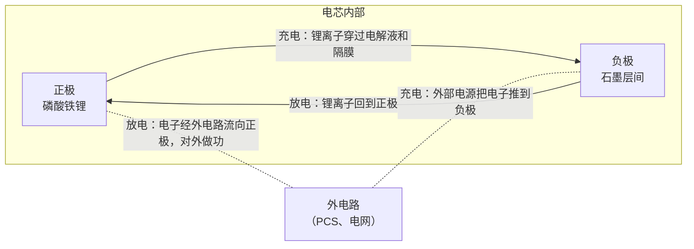
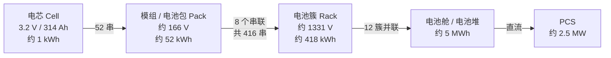
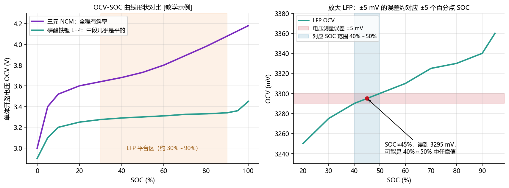
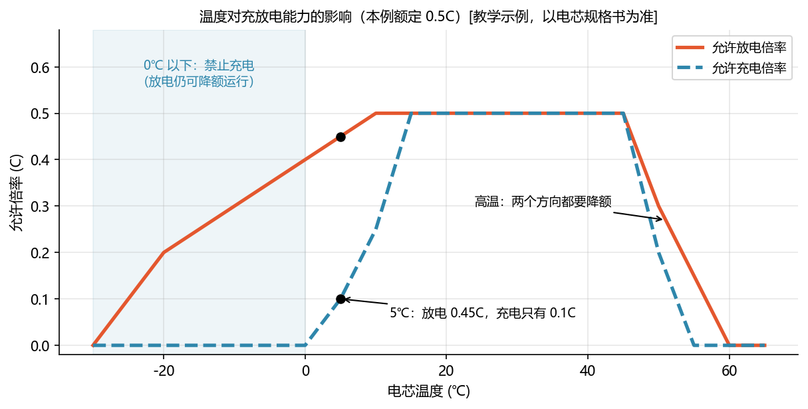
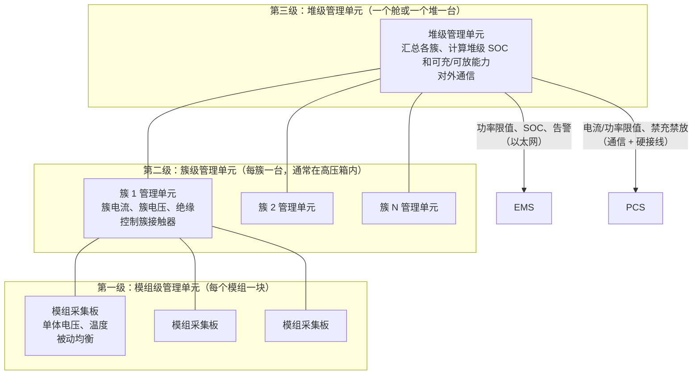
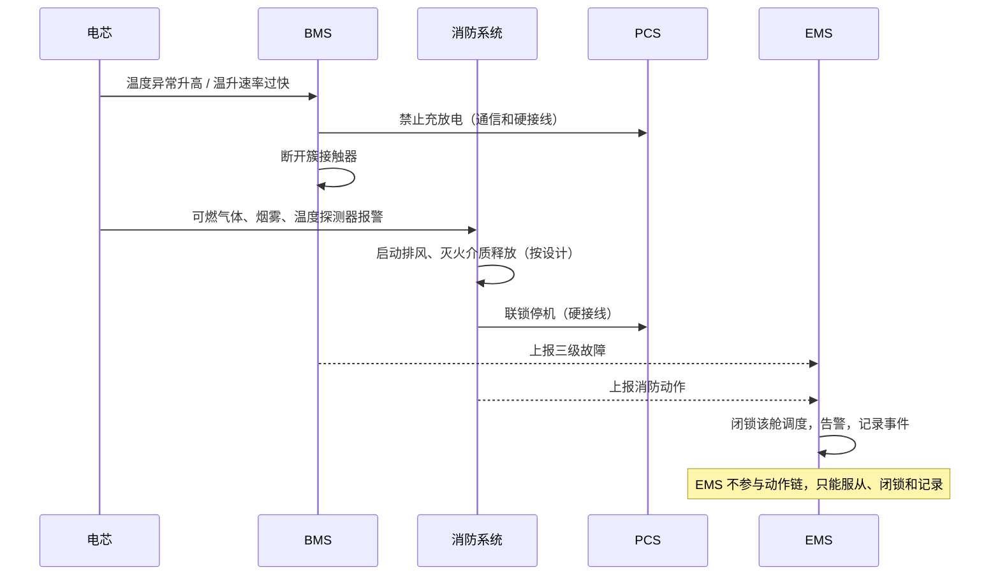
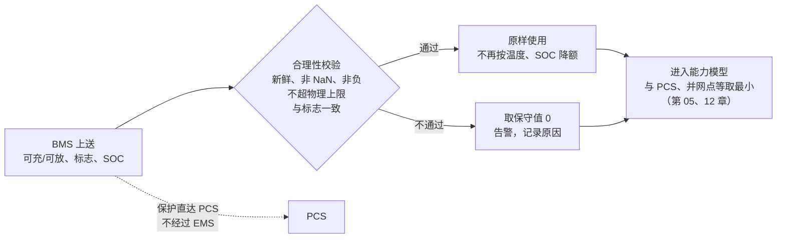
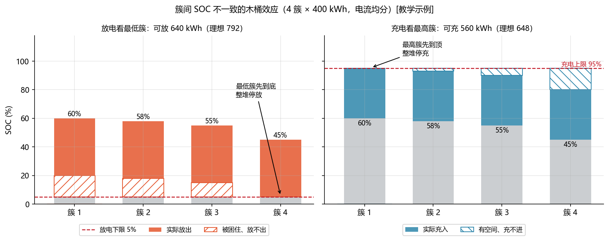
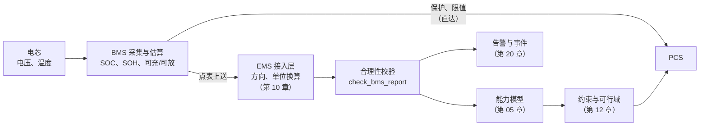

<!-- @AI_GENERATED -->
# 04 电池系统与 BMS 安全边界

> [课程首页](README.md) · 上一章：[03 储能应用场景与收益](03_储能应用场景与收益.md) · 下一章：[05a SOC 估计与校准](05a_SOC估计与校准.md)

**一句话**：电池能充多快、放多快、还剩多少，由电化学和温度决定；BMS 守住安全边界，EMS 在边界内做决策。

**本章目标**：

- 理解电芯、模组、簇和电池舱的电压、容量、能量与倍率关系；
- 解释 OCV、内阻、温度和电芯一致性如何改变电池能力；
- 识别 BMS 的采集、估算、保护、均衡和能力上送职责；
- 明确 EMS 如何使用 BMS 数据，以及哪些保护动作不能由 EMS 替代；
- 能通过手算和配套代码解释低温限充、簇间木桶效应和能力校验。

**本章边界**：本章讲电池系统和 BMS 与 EMS 的接口；SOC/SOH/SOP 的完整估算在第 05a～05c 章，PCS 并网执行在第 06 章，通信质量在第 10 章，消防专业设计不在本章展开。

**前置**：第 02 章的功率、电量和单位约定；第 11 章的查表插值只在本章作为工具使用。

---

## 4.1 低温限充：电池能力如何限制 EMS 计划【必懂】

北方某储能站，1 月的一个早晨，室外 −15℃。调度计划要求 7:00 开始以 2.5 MW 充电。EMS 按时下发了 −2500 kW 的指令，PCS 实际只充了 500 kW 左右，而且过了两个多小时才慢慢升到额定功率。

EMS 日志里没有任何故障，PCS 也没有告警。问题出在哪？

答案藏在 BMS 上送的两个点里：**最低单体温度 5℃**、**最大允许充电功率 500 kW 左右**。电池舱的热管理整夜在保温，但电芯温度仍然偏低。低温下给锂电池大电流充电会损伤电芯，所以 BMS 大幅限制了充电能力，PCS 按 BMS 的限值执行。EMS 下发的指令没有错，错在它**没有提前知道**这件事，也就没有提前向调度申报能力下降，最后被考核了计划偏差。

这一章讲清楚：电池的能力从哪里来、为什么会变、BMS 怎么管、EMS 应该读什么、信什么、不能碰什么。

---

## 4.2 锂离子电芯的储能机理【了解】

### 锂离子在正负极之间的迁移

一个锂离子电芯里有四样东西：**正极**（储能电池常用磷酸铁锂）、**负极**（通常是石墨）、**电解液**（让锂离子通过）、**隔膜**（把正负极隔开，只让离子过、不让电子过）。



- **充电**：外部电源把锂离子从正极“拽”出来，穿过电解液，嵌进负极石墨的层间；电子则从外电路走到负极。能量以“锂离子待在负极这个高能位置”的形式存起来；
- **放电**：锂离子自发地回到正极，电子只能从外电路绕过去，这股电子流就是对外输出的电流。

因为锂离子像坐摇椅一样在两极之间来回摆，锂离子电池也被叫作**摇椅电池**。

对 EMS 有意义的结论只有三条：

1. **能存多少**取决于能往返的锂离子有多少，这就是**容量**（Ah）。循环次数多了，一部分锂被副反应“消耗”，能往返的锂变少，容量下降，这就是**老化**（第 05 章的 SOH）；
2. **能多快往返**取决于锂离子在电极和电解液里移动的速度。温度低时移动变慢，这就是低温下充放电能力下降的根源；
3. 锂离子“挤”得太急时，可能来不及嵌进石墨，直接在负极表面变成金属锂，这叫**析锂**。析锂会永久损失容量，严重时形成枝晶刺穿隔膜，引起内短路。**低温大电流充电最容易析锂**（4.7）。

---

## 4.3 电芯电量参数与充放电倍率【必懂】

点表和规格书里有四个最基础的量：

| 量 | 含义 | 单位 | 例（LFP 单体） |
|---|---|---|---|
| 电压 U | 正负极之间的“电位差”，随剩余电量变化 | V | 标称 3.2 V `[行业典型值]` |
| 容量 C | 能放出多少电荷：以 1 A 放电能放多少小时 | Ah（安时） | 280 Ah、314 Ah `[行业典型值]` |
| 能量 E | 电压 × 容量 | Wh、kWh | 3.2 × 314 ≈ 1005 Wh ≈ 1 kWh |
| 倍率 | 电流 ÷ 容量，描述充放电“有多猛” | C | 0.5C = 157 A（314 Ah 电芯） |

### 倍率 C-rate

**倍率**是储能行业最常用的“速度”单位：

```text
倍率 = |电流| / 容量          1C = 1 小时充满或放完；0.5C = 2 小时；0.25C = 4 小时
```

**手算**：314 Ah 电芯，0.5C 充放电：

```text
电流 = 0.5 × 314 = 157 A
一个 416 串的电池簇（见本节），标称电压 1331.2 V：
簇功率 = 157 A × 1331.2 V ≈ 209 kW
12 个簇：209 × 12 ≈ 2508 kW ≈ 2.5 MW
```

这就是常说的“5 MWh / 2.5 MW、2 小时系统”：电池按 0.5C 运行，满功率放 2 小时。储能系统设计常见的倍率在 0.25C～1C 之间 `[行业典型值]`，倍率越高，发热越大、对热管理要求越高。

> **软件类比**：容量是**磁盘大小**，倍率是**以磁盘大小为单位的读写速度**，“0.5C”相当于“每小时读写半块盘”。用倍率描述速度的好处是：不同大小的电池可以用同一套规则。
>
> **类比失效点**：磁盘满速读写不会让它变老，电池却会：倍率越高、温度越极端，老化越快。

---

## 4.4 LFP 与三元电池的技术特性【了解】

动力电池里常见的是**三元**（NCM/NCA，正极含镍钴锰或镍钴铝），储能站则以**磷酸铁锂**（LFP）为主流。原因主要是三点：

| 维度 | 磷酸铁锂 LFP | 三元 NCM | 对储能意味着什么 |
|---|---|---|---|
| 安全 | 正极结构稳定，热失控起始温度更高、分解时放出的氧少 | 能量密度高，但热稳定性较差 | 储能站几百 MWh 集中在一起，安全是第一位的 |
| 寿命 | 循环寿命长，储能级电芯宣称数千到上万次 `[行业典型值]` | 通常明显低于 LFP | 储能每天充放 1～2 次，要运行 10～20 年 |
| 成本 | 不含钴、镍，材料便宜 | 含钴镍，价格高且波动大 | 储能收益薄，度电成本决定项目能否赚钱 |
| 能量密度 | 较低 | 较高 | 储能站对体积重量不敏感，这个短板影响小 |
| 单体电压 | 标称 3.2 V | 标称约 3.6～3.7 V `[行业典型值]` | 同样的簇电压，LFP 需要串更多电芯 |
| 电压曲线 | 中段**非常平** | 全程有明显斜率 | LFP 的 SOC 难以靠电压判断（4.6、第 05 章） |
| 低温 | 低温性能偏弱 | 相对好一些 | 北方项目必须配热管理 |

表中最后两行对 EMS 开发影响最大：**电压平**让 SOC 估算变难，**怕冷**让能力随季节大幅变化。

国内电力储能用锂离子电池的技术要求见 GB/T 36276-2023《电力储能用锂离子电池》`[国标/行标]`，具体指标以标准原文和电芯规格书为准。

---

## 4.5 电池系统串并联结构与额定能力【必懂】

一个电芯只有 3.2 V、1 kWh。要做成几 MWh、上千伏的储能系统，要一层一层地串并联：



`[教学示例，接近行业常见配置]`：模组的串数、每簇模组数、每舱簇数各厂不同，以项目设计为准。

两条规则：

- **串联加电压**：电流相同，电压相加。簇电压 = 单体电压 × 串联数；
- **并联加容量**：电压相同，容量（Ah）相加。舱的 Ah = 簇的 Ah × 并联簇数；
- **能量 = 电压 × 容量**，与怎么串并无关，总能量就是所有电芯能量之和。

**手算**：

| 层级 | 电压 | 容量 | 能量 |
|---|---|---|---|
| 电芯 | 3.2 V | 314 Ah | 3.2 × 314 = 1004.8 Wh |
| 簇（416 串） | 3.2 × 416 = 1331.2 V | 314 Ah | 1331.2 × 314 ≈ 418.0 kWh |
| 舱（12 簇并联） | 1331.2 V | 314 × 12 = 3768 Ah | ≈ 5016 kWh ≈ 5.0 MWh |
| 上一代：280 Ah，416 串 × 10 簇 | 1331.2 V | 2800 Ah | ≈ 3727 kWh ≈ 3.7 MWh |

**簇电压不是固定值**。单体电压随 SOC 在一个范围内变化，按单体工作范围 2.8～3.6 V `[教学示例]` 计算：

```text
416 × 2.8 = 1164.8 V（接近放空）      416 × 3.6 = 1497.6 V（接近充满）
```

所以大型储能的电池簇电压在 1000～1500 V 量级 `[行业典型值]`，这也是“1500 V 直流系统”名字的由来。PCS 的直流电压范围必须覆盖电池簇的整个工作电压范围，第 06 章会讲。

```python
# 配套实现示意：串并联计算
def series_parallel(cell_voltage_v, cell_capacity_ah, n_series, n_parallel=1):
    """串联加电压、并联加容量；能量 = 电压 × 容量。"""
    v = cell_voltage_v * n_series
    ah = cell_capacity_ah * n_parallel
    return PackRating(voltage_v=v, capacity_ah=ah, energy_kwh=v * ah / 1000.0)
```

> **软件类比**：串联像**流水线**：每一级都必须工作，任何一级“卡住”（电芯到限值），整条线都停；并联像**多副本横向扩容**：总吞吐是各副本之和，但前提是负载能均匀分到每个副本上。
>
> **类比失效点**：并联的电池簇之间电流不是由调度器分配的，而是由各簇电压和内阻“自然”分配。簇之间不一致时，负载就分不均匀（4.13）。

---

## 4.6 OCV-SOC 特性与端电压误差【必懂】

电芯静置足够久（没有电流、内部状态稳定）后测到的电压叫**开路电压**（OCV）。OCV 和剩余电量（SOC，第 05 章详细定义）之间有一一对应的关系，画出来就是 **OCV-SOC 曲线**：



图中标注对照表：

| 编号 | 位置 | 标注 | 对应正文 |
|---|---|---|---|
| ① | LFP 平台 | 约 30%～90% | LFP 平台区 |
| ② | LFP 放大图 | SOC≈45%，OCV=3295 mV | OCV 误差手算 |
| ③ | 测量误差带 | ±5 mV | 电压测量误差 |
| ④ | 对应 SOC 区间 | 40%～50% | LFP 平台误差传播 |

读图要点：

- **两端陡、中间平**。接近放空和接近充满时，电压变化很快，这也是 BMS 靠电压判断“满了”“空了”的依据；
- **LFP 的中段几乎是平的**。本图的教学曲线里，LFP 在 40%～50% 之间电压只变化 10 mV，约 1 mV / 1% SOC；三元同一区间约 5 mV / 1% SOC；
- **平台区靠电压猜 SOC 非常不准**。右图：电压读到 3295 mV，若测量误差 ±5 mV，SOC 可能是 40%～50% 中的任意值；同样的误差放在三元上，只会造成约 ±1% 的 SOC 误差。

**手算**（`[教学示例]` 曲线）：

```text
LFP：斜率 = (3.300 − 3.290) V / (50% − 40%) = 1 mV / 1%     5 mV 误差 → 5% SOC
三元：斜率 = (3.73 − 3.68) V / (50% − 40%)  = 5 mV / 1%     5 mV 误差 → 1% SOC
```

这件事直接决定了第 05 章 SOC 估算的难度：**LFP 电池的 SOC 主要靠电流累加（安时积分），很难靠电压随时校准**。

### 端电压 ≠ 开路电压

有电流时测到的是**端电压**，它偏离 OCV：

```text
端电压 = OCV − 电流 × 内阻          （电流放电为正）
```

放电时端电压低于 OCV，充电时高于 OCV。这就是为什么：

- 大电流放电时电压“掉”得快，可能提前触到欠压保护；停下来以后电压又“弹”回来一些；
- 看端电压判断 SOC，会把放电中的电池看得更空、把充电中的电池看得更满。

```python
def terminal_voltage_v(ocv_v, current_a, resistance_ohm):
    return ocv_v - current_a * resistance_ohm
```

---

## 4.7 内阻、发热与温度降额【必懂】

### 内阻发热 I²R

电芯内部有电阻，电流流过就发热，功率是：

```text
发热功率 = 电流² × 内阻
```

**手算**：314 Ah 电芯，内阻取 0.25 mΩ `[教学示例]`：

| 工况 | 电流 | 单体发热 | 一簇（416 个） |
|---|---|---|---|
| 0.5C | 157 A | 157² × 0.00025 ≈ 6.2 W | ≈ 2.6 kW |
| 1C | 314 A | ≈ 24.6 W（**4 倍**） | ≈ 10.3 kW |
| 0.5C、低温内阻变成 3 倍 | 157 A | ≈ 18.5 W | ≈ 7.7 kW |

三条结论：

1. **电流翻倍，发热变 4 倍**。高倍率运行对热管理的压力远超线性增长；
2. **充电、放电都发热**（电流平方永远为正），发热也是往返效率损失的一部分（第 05 章）；
3. **内阻随温度降低而升高**。同样的电流，低温时压降更大（0.5C 下压降从 39 mV 变成 118 mV），端电压更容易触到保护限值，所以低温时 BMS 必须降低允许电流。

### 温度对能力的影响



图中标注对照表：

| 编号 | 位置 | 标注 | 对应正文 |
|---|---|---|---|
| ① | 低温区域 | 0℃以下禁止充电 | 低温充电边界 |
| ② | 5℃标记 | 温度 5℃；放电 0.45C；充电 0.1C | 温度限值手算 |
| ③ | 高温区域 | 充放电均降额 | 高温能力边界 |
| — | 图题 | 额定 0.5C | 教学示例参数 |

图中是一组 `[教学示例]` 曲线，形状反映了 LFP 电芯规格书中的典型规律：

- **适宜温度区**（本例约 15～45℃）：可以按额定倍率充放电；
- **低温**：放电能力逐步下降，**充电能力下降得快得多**。本例 5℃ 时放电还能 0.45C，充电只能 0.1C；0℃ 以下禁止充电。原因就是 4.2 讲的**析锂**：低温下锂离子嵌入石墨变慢，大电流充电时锂会在负极表面析出。很多 LFP 电芯规格书规定 0℃ 以下不允许充电 `[行业典型值]`，具体温度和倍率以规格书为准；
- **高温**：副反应加速，老化加快，热失控风险升高，充放电都要降额，到上限时停机。

**手算**：本例 5℃ 时，一个簇的能力：

```text
可充：0.1 × 314 = 31.4 A  × 1331.2 V ≈ 41.8 kW
可放：0.45 × 314 = 141.3 A × 1331.2 V ≈ 188.1 kW
```

12 个簇按最冷的一簇限流（4.13 的木桶效应），整舱可充约 41.8 × 12 ≈ 502 kW，这就是 4.1 场景里“只充了 500 kW 左右”的原因。

```python
CHARGE_C_TABLE_TEACHING = ((-20, 0, 5, 10, 15, 45, 50, 55), (0.0, 0.0, 0.1, 0.25, 0.5, 0.5, 0.2, 0.0))
DISCHARGE_C_TABLE_TEACHING = ((-30, -20, -10, 0, 10, 45, 50, 55, 60), (0.0, 0.2, 0.3, 0.4, 0.5, 0.5, 0.3, 0.15, 0.0))

def temperature_c_limits(temp_c, charge_table=CHARGE_C_TABLE_TEACHING, discharge_table=DISCHARGE_C_TABLE_TEACHING):
    """充放电是两张独立的表。"""
    return interp_table(temp_c, *charge_table), interp_table(temp_c, *discharge_table)
```

**这张表通常由 BMS 使用，而不是 EMS**。BMS 按电芯温度、SOC、电压算出允许电流，再上送给 PCS 和 EMS。EMS 用这段代码的场景只有两个：理解 BMS 的行为，以及在仿真里模拟 BMS（第 19 章）。4.12 会说明为什么 EMS 不应该再按温度降一次额。

### 热管理

储能舱配有液冷或风冷系统，夏天散热、冬天加热。热管理本身要耗电（辅助用电 `P_aux`，第 07 章），而且加热需要时间。对 EMS 来说，**低温限充是可以预见的**：根据电芯温度和计划时间，提前安排预热或提前向调度申报能力，是 EMS 能做的优化。

---

## 4.8 BMS 分层架构与保护链路【必懂】

一个 5 MWh 的电池舱有将近 5000 个电芯。BMS 不可能用一个控制器直接采集所有电芯，所以按电池的层级分成三级：



| 层级 | 管什么 | 常见叫法（各厂不同） |
|---|---|---|
| 第一级：单体/模组级 | 采集每个电芯的电压、若干测温点的温度；执行均衡 | BMU、CSC、从控 |
| 第二级：簇级 | 采集簇电流、簇总电压、绝缘电阻；计算簇 SOC；控制簇的主接触器（合闸、分闸） | BCU、BCMU、主控 |
| 第三级：堆级 | 汇总所有簇，计算堆级 SOC、可充/可放能力；与 PCS、EMS、消防通信 | BAU、BAMS、BSMU、总控 |

**命名各厂不同，接入时以厂家点表和架构图为准**。国内电力储能用 BMS 的技术要求见 GB/T 34131-2023 `[国标/行标]`，具体条款以标准原文为准。

对 EMS 最重要的一点：**BMS 和 PCS 之间通常有直连的通信，关键保护还有硬接线**。BMS 把电流限值、禁充禁放直接告诉 PCS，PCS 自己执行；紧急情况下 BMS 可以直接断开簇接触器。**这条保护链不经过 EMS**，EMS 宕机时电池依然受保护。

---

## 4.9 BMS 功能：采集、估算、保护、均衡与能力上送【必懂】

### 采集

单体电压、单体温度（通常每个模组若干测温点，不是每个电芯都测）、簇电流、簇电压、绝缘电阻、接触器状态。这些原始数据量很大，EMS 通常只读**汇总值**：最高/最低单体电压及其位置、最高/最低温度及其位置、各簇电流电压。

### 估算

SOC（剩余电量）、SOH（健康状态）、SOP（可用功率），第 05 章详细讲。**BMS 是 SOC 的权威来源**，因为只有它能看到每个电芯的电压和电流。

### 保护

| 保护项 | 防什么 | 典型动作 |
|---|---|---|
| 单体过压 | 过充：正极结构破坏、产气、热失控风险 | 限制/禁止充电，严重时断开接触器 |
| 单体欠压 | 过放：负极铜集流体溶解，造成永久损坏 | 限制/禁止放电，严重时断开 |
| 过流 | 电流超过当前允许值 | 降额、断开 |
| 过温 | 副反应加速、热失控 | 降额、停机、联动消防 |
| 低温 | 低温充电析锂 | 禁止充电、限制放电 |
| 绝缘低 | 直流 1000～1500 V 对地绝缘下降，触电和短路风险 | 告警、停机 |
| 压差、温差过大 | 电芯不一致、局部故障 | 告警、降额 |

保护通常**分级**，常见三级 `[行业典型值]`：

| 等级 | 例：单体过压 `[教学示例]` | 动作 | EMS 应该怎么做 |
|---|---|---|---|
| 一级（提示） | 3.60 V | 告警 | 记录，按能力点降低充电功率 |
| 二级（严重） | 3.65 V | BMS 限流或请求停止充电 | 立即停止该方向的指令，上报 |
| 三级（故障） | 3.70 V | BMS 断开接触器 | 该簇/堆退出，重新计算站级能力，**不自动恢复** |

阈值以电芯规格书和 BMS 定值单为准。**恢复阈值要带滞回**（第 11 章），否则同一条告警会反复出现、消失。

### 均衡

串联的电芯流过同样的电流，但每个电芯的容量、自放电、温度略有不同，时间长了 SOC 会拉开差距。串联链上**任何一个电芯先满就不能再充，任何一个先空就不能再放**，差距越大，整串可用的电量越少。均衡就是把差距拉回来：

| 方式 | 原理 | 特点 |
|---|---|---|
| 被动均衡 | 给电压高的电芯并一个电阻，把多出来的电量变成热量消耗掉 | 简单便宜，电流小（常见百毫安量级 `[行业典型值]`），浪费能量 |
| 主动均衡 | 用电力电子电路把能量从高的电芯搬到低的电芯 | 电流大、效率高，成本和复杂度高 |

**手算**：314 Ah 电芯差了 1% SOC（3.14 Ah），被动均衡电流 0.1 A `[教学示例]`：

```text
均衡时间 = 3.14 Ah / 0.1 A = 31.4 小时
```

所以对大容量电芯，被动均衡只能慢慢“纠偏”，不能指望它快速消除大的不一致。

### 充放电许可和可充/可放能力

BMS 综合所有信息，给出两类结果：

- **标志**：允许充电、允许放电（或禁充、禁放）；
- **数值**：最大允许充电/放电电流或功率。

常见做法是按电流给出，再乘以当前电压得到功率：

```text
簇可充功率 = 簇允许充电电流 × 簇电压
```

**手算**：0.5C（157 A）× 1331.2 V ≈ 209 kW，与 4.3 一致。

---

## 4.10 热失控与消防联锁边界【了解】

**热失控**：电芯内部温度升高引发放热副反应，副反应产生更多热量，温度进一步升高，形成正反馈，最终可能产气、起火，并蔓延到相邻电芯。诱因包括过充、过放后再充、内短路（析锂枝晶、制造缺陷）、外部过热、机械损伤等。

储能舱的防线是多层的：



对 EMS 开发的结论：

- 消防和热失控联锁走**硬接线和设备本地逻辑**，不依赖 EMS 软件；
- EMS 收到消防动作或热失控类告警后，必须**闭锁**相关单元，**不能自动复归、不能自动重启**，恢复需要现场确认；
- 气体、温度等早期预警信号要进入告警系统并高优先级展示（第 20 章）；
- 具体的探测、灭火和联锁设计由消防专业和项目安全设计决定，不在 EMS 的职责范围内。

---

## 4.11 BMS 上送 EMS 的关键数据接口【必懂】

| 点位 | 用途 | 接入时要核对 |
|---|---|---|
| 堆/簇 SOC | 计划、套利、调频备用计算 | 0～100 还是 0～1；堆级 SOC 的计算方法（第 05 章） |
| SOH | 实际可用容量，向调度申报容量 | 是容量 SOH 还是综合 SOH |
| 最大允许充电 / 放电功率（或电流） | **本周期的能力上限**，进入第 12 章可行域 | 单位、缩放系数、符号；是直流侧还是交流侧；是瞬时值还是持续值 |
| 允许充电 / 允许放电标志 | 方向性禁止 | 位定义（1 是允许还是禁止） |
| 最高 / 最低单体电压及位置 | 判断接近满充/放空，定位问题电芯 | 位置编码规则（簇号、模组号、电芯号） |
| 最高 / 最低单体温度及位置 | 判断温度降额原因，热管理联动 | 同上 |
| 簇电压、簇电流 | 簇间一致性、能量统计 | **电流方向**：很多 BMS 以充电为正 |
| 告警和故障（分级） | 告警展示、闭锁逻辑 | 分级定义、复归方式 |
| 接触器状态、在线簇数 | 判断可用簇数、能力变化原因 | 簇退出后能力是否已更新 |
| 数据时间戳 / 心跳 | 判断数据是否新鲜 | 有没有；没有时用接收时间并配合冻结检测（第 10 章） |

两个现场最常见的坑：

1. **电流、功率方向**：BMS 行业常用“充电为正”，本课程是“放电为正”。**在接入层统一换算**（附录 B）；
2. **能力点的测量平面**：BMS 给的是**直流侧**的电流或功率，EMS 限幅用的是 **PCS 交流侧**功率，中间差一个 PCS 效率（第 05 章 5.11）。

---

## 4.12 EMS 与 BMS 的职责边界和数据校验【必懂】

三条规则：

**① EMS 不能覆盖 BMS 保护。** EMS 没有、也不应该有“解除 BMS 保护”“强制合接触器”这类普通控制命令。BMS 禁放时，EMS 的任何策略（包括调度指令）都不能让电池放电。

**② BMS 已算好的能力，EMS 不重复降额。** BMS 已经按温度、SOC、电压算出了可放 2500 kW，如果 EMS 再按自己的温度表乘一个 0.8，结果只剩 2000 kW：白白损失了 20% 的能力，调度考核和收益都受影响。而且两套降额叠加后，出了问题说不清是谁限的。

**③ 但要校验合理性。** BMS 也会出错：通信中断后数据冻结、缩放系数配错、符号约定不一致、标志和数值矛盾。EMS 的职责是**判断这个数能不能用**，不能用就取保守值并告警。

注意区分：EMS 自己的**运行策略**（例如 SOC 运行窗口比 BMS 保护更窄，给调频留备用，第 05 章 5.7）不是重复降额，它们防的是不同的问题。



```python
# 配套实现示意：串并联计算
def _check_one_direction(name, value, allowed, plausible_max, issues):
    if value is None or math.isnan(value):
        issues.append(f"可{name}功率无效（NaN），按不可{name}处理")
        return 0.0
    if value < 0:
        issues.append(f"可{name}功率为负（{value}），检查接入层符号约定，按不可{name}处理")
        return 0.0
    if value > plausible_max:
        issues.append(f"可{name}功率 {value} 超出物理上限 {plausible_max}，疑似缩放系数错误，按不可{name}处理")
        return 0.0
    if not allowed:
        if value > 0:
            issues.append(f"禁{name}标志置位但可{name}功率为 {value}，以禁止标志为准")
        return 0.0
    return value  # 合理：原样使用，不再重复降额


def check_bms_report(report, plausible_max_charge_kw, plausible_max_discharge_kw, max_age_s=5.0):
    issues = []
    if report.age_s > max_age_s:
        return BmsCheck(0.0, 0.0, (f"BMS 数据超时 ...",))
    chg = _check_one_direction("充", report.available_charge_kw, report.charge_allowed, plausible_max_charge_kw, issues)
    dis = _check_one_direction("放", report.available_discharge_kw, report.discharge_allowed, plausible_max_discharge_kw, issues)
    # 另外检查 SOC 越界、最高/最低电压和温度是否颠倒（只告警，不改能力）
    ...
    return BmsCheck(chg, dis, tuple(issues))
```

`plausible_max` 是“物理上不可能超过的值”（例如电池额定功率的 1.1～1.2 倍，按项目配置），不是用来降额的阈值：**低于它就原样用，超过它就判为数据错误**。

> **软件类比**：BMS 保护是**内核态保护**：用户态程序（EMS）无论怎么调用都绕不过去，内核会直接拒绝或杀掉违规操作。BMS 上送的可充/可放能力像下游服务返回的**限流配额**（rate-limit 响应头）：调用方应当遵守，而不是在配额之外再自作主张打个八折；但如果配额是 NaN、负数或大得离谱，调用方应当判定响应异常，而不是照单全收。
>
> **类比失效点**：内核拒绝调用只是返回错误码；BMS 保护动作是**断开接触器**，整簇甚至整舱退出运行，恢复需要人工确认。而且 BMS 是独立的硬件和固件，响应在毫秒级，EMS 宕机时它照样工作。

---

## 4.13 簇间不一致与电池系统木桶效应【必懂】

一个舱的 12 个簇并联在同一条直流母线上，接同一台（或同一组）PCS。理想情况下各簇完全一样，电流均分。实际上各簇的容量、内阻、温度、初始 SOC 总有差别，运行一段时间后 SOC 会拉开。

多簇并联、电流大致均分时，每个簇放出（充入）的电量差不多，于是：

- **放电看最低簇**：SOC 最低的簇先到下限，BMS 就会限制整堆放电，其他簇里还有电也放不出来；
- **充电看最高簇**：SOC 最高的簇先到上限，整堆停充，其他簇还有空间也充不进去。



图中标注对照表：

| 编号 | 位置 | 标注 | 对应正文 |
|---|---|---|---|
| ① | 左图 SOC | 4 簇 × 400 kWh；60%、58%、55%、45% | 四簇初始 SOC |
| ② | 左图结果 | 实际可放 640 kWh；理想 792 kWh | 放电木桶效应 |
| ③ | 右图结果 | 实际可充 560 kWh；理想 648 kWh | 充电木桶效应 |
| ④ | 功率示例 | 11×209=2449 kW；最弱簇 150 kW；堆级约 1800 kW | 功率木桶效应 |
| — | 约束线 | SOC 下限 5%、上限 95% | 已知条件 |

**手算**：4 簇 × 400 kWh，SOC 分别为 60%、58%、55%、45%，放电下限 5%、充电上限 95% `[教学示例]`：

```text
放电：最低簇只能放 45% − 5% = 40%，每簇都放 40%
     实际可放 = 4 × 40% × 400 = 640 kWh
     理想可放 = (55% + 53% + 50% + 40%) × 400 = 792 kWh    少了 152 kWh（约 19%）
充电：最高簇只能充 95% − 60% = 35%
     实际可充 = 4 × 35% × 400 = 560 kWh；理想 648 kWh
```

功率也一样。电流均分时，堆的可放能力由最弱的簇决定：

```text
11 个簇各能放 209 kW，1 个簇因温度高只能放 150 kW
堆级可放 ≈ 150 × 12 = 1800 kW，而不是各簇之和 2449 kW
```

```python
def stack_energy(socs, capacity_kwh_each, soc_min, soc_max):
    n = len(socs)
    dis = n * max(0.0, min(socs) - soc_min) * capacity_kwh_each     # 放电看最低
    chg = n * max(0.0, soc_max - max(socs)) * capacity_kwh_each     # 充电看最高
    ...

def stack_power_limit_kw(cluster_limits_kw):
    return min(cluster_limits_kw) * len(cluster_limits_kw)
```

“电流均分”是简化假设。实际电流按各簇的电压和内阻分配，BMS 厂家的堆级能力算法也各不相同（有的在某簇到限后把它切出，其余簇继续运行，此时堆级能力按剩余簇数下降）。**EMS 不需要自己算，但必须理解**：

1. 堆级 SOC 如果用平均值，会高估可放电量（第 05 章 5.8）；
2. 簇间 SOC 差、温差是重要的健康指标，应当纳入监视和告警；
3. 某簇退出后，BMS 上送的堆级能力应该随之下降，如果没有下降，说明 BMS 数据有问题。

> **软件类比**：多个分片存储，写入按固定比例均匀分到每个分片，没有自动再平衡。只要有一个分片写满，整体写入就失败，哪怕其他分片还有很多空间。
>
> **类比失效点**：分片可以随时迁移数据再平衡；电池簇之间的“再平衡”只能靠均衡电路慢慢做，或者停机后单独对某簇充放电，代价高、速度慢。

---

## 4.14 电池系统与 BMS 在 EMS 架构中的位置【必懂】



### 配套教学代码与实践

本章配套示例入口：

```text
lab/examples/ch04_battery_basics.py
```

从教学代码包的 `lab` 目录运行：

```text
python examples/ch04_battery_basics.py
```

示例会重算本章的成组额定值、0.5C 簇功率、5℃限充、OCV 误差和簇间木桶效应。正文中的手算、图表和示例输出使用同一组教学参数。

---

## 4.15 电池能力与 BMS 数据的关键边界【必懂】

| 误区 | 正确理解 |
|---|---|
| 5 MWh 的舱，任何时候都能放 5 MWh | 可放电量受 SOC 窗口、SOH、簇间不一致、效率影响，第 05 章细算 |
| 电池的额定功率就是它的能力 | 能力随温度、SOC、健康状态实时变化，以 BMS 上送的可充/可放为准 |
| 低温时充电和放电受的限制差不多 | 低温对充电的限制严格得多，0℃ 附近常常只能放、不能充 |
| EMS 可以在 BMS 能力上再按温度降一次额，更保险 | 重复降额白白损失能力，还让限制原因说不清；EMS 做合理性校验，不做重复降额 |
| BMS 不报故障，数据就可信 | 通信冻结、缩放系数错误、符号错误都不会触发 BMS 故障，要由 EMS 校验 |
| 堆的能力 = 各簇能力之和 | 并联簇电流近似均分时，堆的能力受最弱簇限制 |
| 看电压就能知道 LFP 电池还剩多少电 | LFP 中段电压非常平，电压几毫伏的误差就对应好几个百分点的 SOC |

## 4.16 典型电池系统故障与设计启示【必懂】

**案例一：冬季早晨充电计划完不成。**
现象：就是 4.1 的场景。EMS 按计划下发 −2500 kW，实际只充了 500 kW 左右，被考核计划偏差。
原因：EMS 只读了“允许充电”标志（为 1），没有读“最大允许充电功率”，也没有把它纳入能力上报。
修复：能力模型以 BMS 可充/可放功率为输入（第 05 章）；根据电芯温度趋势提前申报能力或安排预热；PCS 实际功率长期达不到指令时产生“能力受限”事件，并记录限制来源。

**案例二：缩放系数配错，EMS 按 10 倍能力下发。**
现象：投运初期，储能放电时几个簇频繁因过流二级告警退出。
原因：BMS 最大允许放电功率的寄存器单位是 0.1 kW，点表录成了 1 kW。平时 BMS 上送原始值 25000（实际 2500 kW），EMS 读成 25000 kW，限幅实际由 PCS 额定兜住，没人发现。高温时 BMS 降额到 800 kW（原始值 8000），EMS 读成 8000 kW，仍按 2500 kW 下发。PCS 在该项目中没有启用 BMS 直连限流，只靠 EMS 限幅。
修复：修正点表；EMS 增加合理性校验（超出物理上限判为数据错误）；**PCS 必须启用 BMS 直连限流**，保护不能只靠 EMS 一层。

**案例三：平均 SOC 55%，晚峰放电提前停机。**
现象：堆级 SOC 显示 55%，EMS 按此安排晚峰满功率放电 1 小时，结果 40 多分钟后整堆停放。
原因：BMS 堆级 SOC 取各簇平均值，其中一簇因长期温度偏高、容量衰减，SOC 比平均值低 10 个百分点。最低簇到下限后 BMS 禁放。
修复：EMS 读取各簇 SOC，放电规划使用最低簇 SOC（或 BMS 提供的可放电量），充电规划使用最高簇 SOC；簇间 SOC 差超过阈值时告警并安排维护均衡（第 05 章 5.8）。

---

## 4.17 本章自测

1. 一个 LFP 电芯 3.2 V / 280 Ah，416 串组成一簇，簇的标称电压和能量是多少？10 簇并联呢？
2. 314 Ah 电芯以 157 A 放电，倍率是多少？满容量能放多久？
3. 电流从 0.5C 提高到 1C，单体发热变为原来的几倍？为什么？
4. 为什么低温时 BMS 对充电的限制比放电严格得多？
5. BMS 上送“允许放电 = 1、最大可放功率 = −800 kW”，EMS 应该怎么处理？
6. 4 簇 × 400 kWh，SOC 分别为 50%、50%、50%、30%，放电下限 5%。电流均分时实际可放多少？与按平均 SOC 估算相比差多少？
7. 为什么 EMS 宕机时电池仍然是安全的？这对 EMS 的设计意味着什么？

<details>
<summary>参考答案</summary>

1. 电压 3.2 × 416 = 1331.2 V，能量 1331.2 × 280 ≈ 372.7 kWh；10 簇并联约 3727 kWh（3.7 MWh），电压不变，容量 2800 Ah。
2. 157 / 314 = 0.5C，满容量约 2 小时。
3. 4 倍。发热功率与电流的平方成正比：(2I)² × R = 4 × I² × R。
4. 低温下锂离子嵌入负极石墨变慢，大电流充电时锂来不及嵌入，会在负极表面析出（析锂），造成永久容量损失，严重时形成枝晶导致内短路。放电是锂离子离开负极，不存在析锂问题，主要受内阻增大、电压下降限制。
5. 负值不符合“能力为非负幅值”的约定，说明接入层符号换算有问题或数据异常。EMS 应按不可放电处理（取 0）并告警，检查点表的符号定义，不能自行取绝对值当作 800 kW 使用。
6. 最低簇可放 30% − 5% = 25%，实际可放 4 × 25% × 400 = 400 kWh。平均 SOC = 45%，按平均估算 4 × 40% × 400 = 640 kWh，高估 240 kWh。
7. BMS 和 PCS 之间有直连通信和硬接线，关键保护在 BMS、PCS 本地执行，不经过 EMS。所以 EMS 的设计原则是：不承担、也不绕过这条保护链；EMS 做的是在保护边界内优化，并对保护动作做闭锁、记录和上报。

</details>

---

## 4.18 深入：电池模型、OCV 滞回与并簇环流【深入】

<details>
<summary>电池等效电路模型</summary>

EMS 级仿真常用的电池模型从简到繁：

- **Rint 模型**：OCV(SOC) 串一个内阻 R，即本章的 `端电压 = OCV − I·R`。能解释压降和发热，不能解释“停止放电后电压慢慢回弹”；
- **一阶/二阶 RC 模型**：在内阻后面再串一个或两个“电阻并电容”环节，描述极化电压随时间建立和消退的过程。电压回弹、OCV 需要静置一段时间才能测准，都来自这部分；
- 模型参数（R、RC 常数、OCV 表）随温度、SOC、老化程度变化，要通过试验标定。

对 EMS 仿真（第 19 章），Rint 模型加温度相关的限值表通常够用；BMS 的 SOC 估算算法才需要更精细的模型（第 05 章深入部分）。

</details>

<details>
<summary>为什么 LFP 的电压平台那么平</summary>

LFP 充放电时，正极材料在“含锂的磷酸铁锂”和“脱锂的磷酸铁”两种相之间转换，两相共存区间内电极电位基本不随锂含量变化，这就是平台。三元材料是固溶体反应，锂含量变化时电位连续变化，所以曲线有斜率。石墨负极自身也有几个分阶段的平台，叠加后 LFP 全电池曲线上会出现几个小台阶。另外，LFP 的 OCV 在充电后静置和放电后静置时会略有差异（OCV 滞回），在平台区这个差异可能与平台斜率同一量级，进一步增加了靠电压判断 SOC 的难度。

</details>

<details>
<summary>并簇环流：为什么簇投入前要检查压差</summary>

两个电压不同的簇直接并联，高电压簇会向低电压簇充电，电流只受两簇内阻和回路电阻限制。**手算** `[教学示例]`：两簇压差 10 V，回路总电阻 0.1 Ω，环流约 10 / 0.1 = 100 A，接近 0.3C。压差越大，合闸瞬间电流越大，可能触发过流保护甚至损伤接触器。

所以 BMS 在簇投入（合接触器）前会检查该簇与母线的压差，超过允许值就不投入，需要先单独调整该簇 SOC。对 EMS 的影响是：检修后的簇可能长时间无法并入，站级能力一直偏低，要在运维界面上能看到“在线簇数”和“未投入原因”。

</details>

<!-- @AI_GENERATED: end -->
