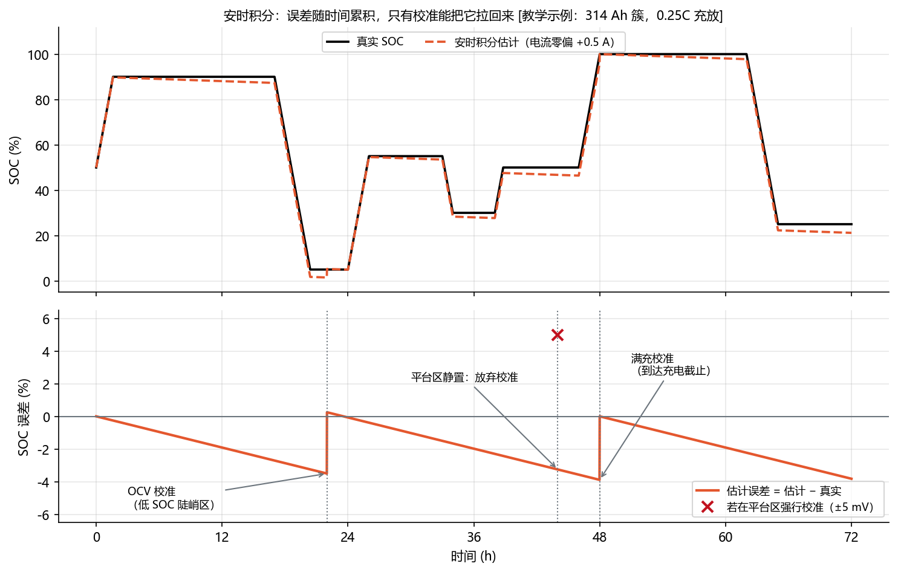
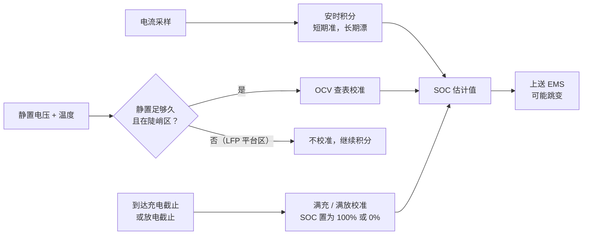

<!-- @AI_GENERATED -->
# 05a SOC 估计、误差累积与校准

> [课程首页](README.md) · 上一章：[04 电池与 BMS](04_电池与BMS.md) · 下一章：[05b SOC 到可用能量：效率、窗口与簇间一致性](05b_从SOC到可用电量.md)

**一句话**：SOC 没有传感器能直接读，只能靠电流累加估出来，会越积越偏，要靠静置电压和满充把它拨回正确值。

## 本章目标

读完本章，你应能完成四件事：

1. 说明 SOC 的分子、分母和容量 SOH 为什么必须使用同一套截止条件；
2. 按安时积分公式逐步更新 SOC，并判断零点偏差、增益误差和容量误差怎样累积；
3. 根据静置条件、OCV 曲线斜率和电压误差，判断一次 OCV 校准是否可信；
4. 解释校准导致的 SOC 跳变，并把“不确定度、校准事件和剩余余量”传给后续能量规划。

## 本章边界与前置

本章只解决“**SOC 这个状态量如何估计、为什么漂移、何时校准**”。效率、SOC 运行窗口、SOH 对可用能量的影响在 [05b](05b_从SOC到可用电量.md) 展开；持续功率、SOP 和并网点能力在 [05c](05c_功率能力与能力模型.md) 展开。本章依赖第 04 章的 OCV 曲线和 BMS 能力点，以及第 02 章的功率、电量和单位换算。

---

## 5.1 现场场景：SOC 估计偏差导致放电时长高估【必懂】

某 LFP 储能站，1 MW / 2 MWh。傍晚 SOC 显示 30%，EMS 估算：放电下限 10%，还能放 20% × 2 MWh = 400 kWh，于是安排以 1 MW 放电 24 分钟，覆盖晚峰最贵的一段。实际放了不到 20 分钟，BMS 报最低单体欠压，禁止放电，晚峰计划没完成。

事后复盘，EMS 的估算至少错了三处：

1. **SOC 本身不准**：这个站连续两周只做浅充浅放，一直没有满充，BMS 的安时积分误差累积到了 5% 以上；
2. **没算效率**：400 kWh 是电池里存的电，从电池经 PCS 送到交流侧还要损失一部分；
3. **用了平均 SOC**：各簇 SOC 相差几个百分点，最低的一簇先到下限，整堆就停了（第 04 章 4.13）。

这一组章节把三件事逐层拆开：05a 先确认 SOC 这个状态量是否可信；05b 再把可信度和运行边界换算成可用能量；05c 最后把能量和设备、并网点约束合成为功率能力。5.12 会用本章公式把这次故障的数字逐项算清。

---

## 5.2 SOC 定义、容量口径与可观测性【必懂】

**SOC**（State of Charge，荷电状态）是电池**当前还能放出的电荷**，占它**充满时能放出的总电荷**的比例。分子和分母是同一种量（可放出的电荷，单位 Ah），一个是“现在还剩的”，一个是“充满时的总量”。后者就是**当前实际容量**。

### 公式与符号

```text
SOC = Q_剩余 / C
C   = C_额定 × SOH_容量
```

| 符号 | 含义 | 单位 | 示例值 |
|---|---|---|---|
| `Q_剩余` | 从当前状态放到放电截止条件，还能放出的电荷 | Ah | 144.44 |
| `C` | 当前实际容量：此刻从充满（充电截止）放到放空（放电截止）能放出的总电荷 | Ah | 288.88 |
| `C_额定` | 出厂额定容量（铭牌值，不随时间变化） | Ah | 314 |
| `SOH_容量` | 容量健康状态（5.9） | 0～1 | 0.92 |

公式要点：

- 分子、分母必须在**同一套截止条件**（充电截止、放电截止的电压/电流，见规格书）下计量，比例才有意义；
- 分母是**当前实际容量**，不是额定容量。它随老化下降，也随温度、倍率变化；
- 代码中 SOC 用 0～1，正文用 %。

### 单步数值校核：同一块电池，两种分母

一簇额定 314 Ah 的电池，SOH 92%，当前还能放出 144.44 Ah：

```text
① 当前实际容量       C = C_额定 × SOH       = 314 × 0.92      = 288.88 Ah
② SOC（本课程口径）  Q_剩余 / C             = 144.44 / 288.88 = 0.50（50%）
③ 若误用额定容量     Q_剩余 / C_额定        = 144.44 / 314    = 0.46（46%）
④ 充满时（误用额定）  C / C_额定            = 288.88 / 314    = 0.92（92%）
```

同一个物理状态，分母不同就差 4 个百分点；按额定容量算，老化电池充满也只显示 92%。本课程统一用当前实际容量做分母：SOC = 100% 表示**充到当前条件下的满**，0% 表示放到放电截止。

### SOC 可观测性边界与估计原因

SOC 无法直接测量：

- **没有“电量传感器”**。电池里剩多少可移动的锂离子，没有仪器能直接读出来；
- **电压和 SOC 的关系不可靠**。有电流时端电压偏离 OCV；OCV 要静置才能测准；LFP 的中段电压几乎不随 SOC 变化（第 04 章 4.6）；温度也会影响电压；
- **分母本身也是估计值**。上面说的“当前实际容量”无法直接测，随老化下降（5.9 的 SOH），还随温度、倍率变化，BMS 只能估计它——分子分母都带误差。

所以 SOC 是 BMS 用**电流累加 + 电压校准 + 模型**综合**估计**出来的，一定有误差。EMS 要做的是：知道误差从哪来、有多大，在规划中留出余量，并理解 SOC 为什么会“跳”。

> **软件类比**：SOC 估算像一台**没有外部时钟源的机器上的本地时钟**。安时积分是晶振计时：短时间很准，时间长了一定漂移；OCV 校准和满充校准是 **NTP 对时**，把漂移拉回来。
>
> **类比失效点**：NTP 随时都能对时；电池的“对时”有苛刻条件：OCV 校准要长时间静置，LFP 在平台区的“时间源”本身就很模糊，满充校准要真的把电池充满。条件不满足时，只能任由误差累积。

---

## 5.3 安时积分模型与误差累积【必懂】

### 原理直觉：SOC 就是一个“只记流水的账户余额”

电池像一个银行账户，电流是每一秒的流水：放电是支出，充电是存入。BMS 不能直接“查余额”（5.2 讲过，没有电量传感器），只能从一个已知的期初余额出发，把每一笔流水累加上去：

```text
当前余额 = 期初余额 − 所有支出 + 所有存入
```

这就是**安时积分**（也叫库仑计数）。它的“流水”单位是**安时（Ah）**：1 A 的电流流 1 小时，就流过了 1 Ah 的电荷。BMS 以毫秒到秒级的周期持续做这件事。

它的致命弱点也来自账户类比：**只要记账员每一笔都多记一点，误差就会一直攒下去**，账户本身永远不会发现。

> **软件类比**：安时积分就是**事件溯源**（Event Sourcing）：不直接存储状态，而是从初始快照开始重放所有增量事件来重建状态。只要每条事件都带着一个微小的系统性偏差，重放出来的状态就会越跑越偏。
>
> **类比失效点**：事件溯源可以定期打快照、和权威数据源对账；电池的“对账”（5.4 的校准）条件苛刻，要长时间静置或真的充满放空，很多时候根本没机会对账。

### 公式与符号

一步安时积分：

```text
SOC[k] = SOC[k−1] − I[k] × Δt / (3600 × C)
```

| 符号 | 含义 | 单位 | 示例值 |
|---|---|---|---|
| `SOC[k−1]` | 上一步的 SOC | 0～1 | 0.50 |
| `I[k]` | 本步电流，**放电为正、充电为负** | A | 60 |
| `Δt` | 本步时长 | **s** | 3600（1 小时） |
| `C` | 当前实际容量（5.2） | Ah | 314 |
| `SOC[k]` | 本步结束后的 SOC | 0～1 | 待求 |

公式要点，写代码时最容易踩的坑：

- **一个减号管两个方向**：`I > 0`（放电）时 SOC 下降，`I < 0`（充电）时 SOC 上升；
- **3600 是单位换算**：`I × Δt` 的单位是“安·秒”，÷3600 才是安时（Ah）。BMS 采样周期是毫秒或秒，把 `Δt` 直接当小时代进去，结果会大 3600 倍；
- **充电时还要乘库仑效率 `η_c`**（略小于 1），充进去的电荷不能全部放出来。本节为了看清误差，取 `η_c = 1`。

### 单步数值校核：把示例值代入公式

一簇 314 Ah 的电池，SOC 50%，以 60 A 放电 1 小时（即上表的示例值）：

```text
① 本步流过的电荷  I × Δt / 3600 = 60 × 3600 / 3600 = 60 Ah
② 占容量的比例    60 / C       = 60 / 314         = 0.1911（19.11%）
③ 新 SOC          SOC[k−1] − ② = 0.50 − 0.1911    = 0.3089（30.89%）
```

每一行左边写公式里的哪一项，右边写代入的数字，和公式一一对应。

### 多步状态追踪：误差的时序累积

把上面这一步重复 6 次，模拟一段“放电 2 小时 → 静置 2 小时 → 充电 2 小时”的运行，电池最后回到 50%。同时让两个**有毛病的电流传感器**跟着算：

- **零点偏差 +0.5 A**：不管真实电流是多少，读数都多 0.5 A，电流为 0 时也读到 0.5 A；
- **增益误差 +1%**：读数按比例偏大 1%，电流为 0 时读数也是 0。

`[教学示例]`，每行 = 1 小时，误差 = 估计 SOC − 真实 SOC：

| 时段 | 真实电流 | 真实 SOC | 零点偏差估计 | 误差 | 增益误差估计 | 误差 |
|---|---:|---:|---:|---:|---:|---:|
| 1 h 放电 | 60 A | 30.892% | 30.732% | −0.159% | 30.701% | −0.191% |
| 2 h 放电 | 60 A | 11.783% | 11.465% | −0.318% | 11.401% | −0.382% |
| 3 h 静置 | 0 A | 11.783% | 11.306% | −0.478% | 11.401% | −0.382% |
| 4 h 静置 | 0 A | 11.783% | 11.146% | −0.637% | 11.401% | −0.382% |
| 5 h 充电 | −60 A | 30.892% | 30.096% | −0.796% | 30.701% | −0.191% |
| 6 h 充电 | −60 A | 50.000% | 49.045% | **−0.955%** | 50.000% | **0.000%** |

逐列看，能读出三个结论：

1. **零点偏差每小时稳定多扣 0.159%**（= 0.5 / 314），**静置时照样在涨**（第 3、4 行），充电也抵消不了。误差只朝一个方向走，和时间成正比；
2. **增益误差只在有电流时产生**，静置时不变；放电时多扣、充电时多加，**一个完整充放循环后正好抵消**；
3. 两种误差 BMS 自己都看不见，估计器只知道自己算出的数。要把它拉回来，只能靠 5.4 的校准。

把零点偏差按每小时 0.159% 外推，就能估出不校准的后果：

```text
1 天：0.159% × 24 ≈ 3.8%
两周：3.8% × 14 ≈ 53%     （实际 BMS 有零漂补偿和校准，这里只说明量级）
```

这就是 5.1 那个“两周没满充”的站 SOC 漂了好几个点的原因。

### 教学闭环：输入、算法与输出

下面的代码**不依赖任何库**，复制就能运行。输入是一段电流序列，算法是上面那个公式，输出是上面那张追踪表，最后用 `assert` 验证结论 1、2：

```python
# 安时积分最小闭环：输入电流序列 → 逐步积分 → 输出 SOC 追踪表
CAPACITY_AH = 314.0   # C：当前实际容量（Ah）
SOC0 = 0.50           # SOC[0]：初始 SOC
DT_S = 3600.0         # Δt：每步时长（s）。取 1 小时，方便和手算逐行对照

# ---- 输入：真实电流序列（A），放电为正、充电为负 ----
true_current_a = [60, 60, 0, 0, -60, -60]
labels = ["放电", "放电", "静置", "静置", "充电", "充电"]


# ---- 算法：一步安时积分 SOC[k] = SOC[k-1] − I[k]·Δt / (3600·C) ----
def coulomb_step(soc, current_a, dt_s, capacity_ah):
    delta_ah = current_a * dt_s / 3600.0   # 本步流过的电荷（Ah），÷3600 把秒换成小时
    return soc - delta_ah / capacity_ah    # 放电 I>0 → SOC 减小；充电 I<0 → SOC 增大


# 三个估计器从同一个初值出发，只有“看到的电流”不同
soc_true = soc_bias = soc_gain = SOC0

print(f"{'时段':<4}{'电流(A)':>8}{'真实SOC':>10}{'零点偏差':>10}{'误差':>9}{'增益误差':>10}{'误差':>9}")
for k, (i_true, lab) in enumerate(zip(true_current_a, labels), start=1):
    soc_true = coulomb_step(soc_true, i_true, DT_S, CAPACITY_AH)          # 理想传感器
    soc_bias = coulomb_step(soc_bias, i_true + 0.5, DT_S, CAPACITY_AH)    # 零点偏差：总是多读 0.5 A
    soc_gain = coulomb_step(soc_gain, i_true * 1.01, DT_S, CAPACITY_AH)   # 增益误差：读数偏大 1%

    # ---- 输出：每一步的 SOC 和误差（百分比） ----
    print(f"{k}h {lab}{i_true:>8}{soc_true*100:>9.3f}%{soc_bias*100:>9.3f}%"
          f"{(soc_bias-soc_true)*100:>+8.3f}%{soc_gain*100:>9.3f}%{(soc_gain-soc_true)*100:>+8.3f}%")

# ---- 自检：验证表格读出的两个结论 ----
# 结论 1：零点偏差误差 = 偏差 × 总时长 / 容量，与充放电无关
assert abs((soc_bias - soc_true) - (-0.5 * 6 / 314)) < 1e-12
# 结论 2：增益误差在一个完整充放循环后抵消
assert abs(soc_gain - soc_true) < 1e-12
print("自检通过")
```

运行输出：

```text
时段     电流(A)     真实SOC      零点偏差       误差      增益误差       误差
1h 放电      60   30.892%   30.732%  -0.159%   30.701%  -0.191%
2h 放电      60   11.783%   11.465%  -0.318%   11.401%  -0.382%
3h 静置       0   11.783%   11.306%  -0.478%   11.401%  -0.382%
4h 静置       0   11.783%   11.146%  -0.637%   11.401%  -0.382%
5h 充电     -60   30.892%   30.096%  -0.796%   30.701%  -0.191%
6h 充电     -60   50.000%   49.045%  -0.955%   50.000%  +0.000%
自检通过
```

动手改一改，加深理解：

- 把 `DT_S` 改成 1、电流序列每项重复 3600 次（秒级采样），结果不变，说明电流恒定时步长不影响积分结果；
- 把零点偏差改成 −0.5 A，误差变成正的，估计 SOC 偏高。这种情况更危险，EMS 会以为还有电；
- 把序列改成只有静置 `[0] * 24`，真实 SOC 不动，零点偏差估计器一天漂 3.8%。

### BMS 工程实现与边界

教学代码只保留了公式本身。`lab/ems_lab/battery.py` 中的 `CoulombCounter` 是同一个算法，多了三样工程细节：充电库仑效率、把 SOC 限制在 0～1、记录自上次校准以来的吞吐量（吞吐量越大，误差风险越高）。它还提供 `calibrate()`，供 5.4 的校准使用。

`lab/examples/ch05_coulomb_counting.py` 用 `CoulombCounter` 重跑了同一张追踪表，结果与上面完全一致：

```bash
cd lab
python examples/ch05_coulomb_counting.py
```

**配套练习**：运行 `lab/examples/ch05_coulomb_counting.py`，先复现本节追踪表，再分别修改采样周期、零点偏差和电流序列，观察误差是否按“偏差 × 时间 / 容量”变化。

> 【了解】两个计算机背景的人常问的问题：
>
> - **浮点累加误差要不要担心？** 双精度每步误差约 1e-16，BMS 一年累加 3000 万次也只有 1e-9 量级，比传感器误差（1e-3 量级）小 6 个数量级，不是主要矛盾；
> - **为什么不直接 clamp 到 0～1 了事？** 显示时可以 clamp，但 clamp 会把“估计已经越界”这个信号吞掉。仿真中要保留原始值（5.5 的 `soc_raw`）。

### 误差来源与累积特性

| 误差源 | 表现 | 会不会随时间累积 |
|---|---|---|
| 电流传感器**零点偏差** | 电流为 0 时也读到一个小电流 | **会**，而且静置时也在累积 |
| 电流传感器**增益误差** | 读数按比例偏大或偏小 | 充放电方向的误差会部分抵消，净累积较小 |
| 库仑效率 | 充进去的电荷不能 100% 放出来 | 会，每次充电都偏一点 |
| 自放电 | 电池静置时自己慢慢漏电 | 会，安时积分完全看不到 |
| 容量值不准 | 分母（当前容量）用错，例如没按 SOH 更新 | 按比例放大所有误差 |
| 初值错误 | 上电时从一个错误的 SOC 开始 | 不会消失，直到下次校准 |



图中标注对照表：

| 编号 | 位置 | 标注 | 对应正文 |
|---|---|---|---|
| ① | 图题 | 314 Ah | 安时积分示例容量 |
| ② | 图题 | 0.25C | 配图运行倍率；与正文 60 A 的逐时追踪表是两条独立教学轨迹 |
| ③ | 估计曲线图例 | +0.5 A | 电流传感器零点偏差 |

图中的估计器每时每刻都多算了 0.5 A 的放电电流，所以估计 SOC 一直偏低，误差按直线增长，斜率就是追踪表里的每小时 0.159%。只有校准事件能把它拉回来，下一节讲。图中采用 0.25C（314 Ah × 0.25 = 78.5 A）来拉开长时间轨迹；正文手算表采用 60 A 来逐行展示误差，二者不应把斜率直接混用。

---

## 5.4 SOC 校准：OCV 与满充/满放基准【必懂】

### 原理直觉：校准是状态估计的基准重置

5.3 的安时积分像一块会走偏的表。校准就是找一个**不依赖历史**的权威时间源，把表直接拨回正确时间（5.2 的 NTP 类比）。电池有两个这样的“时间源”：

- **静置电压（OCV）**：电池静置足够久、极化消退后，端电压接近开路电压。OCV 和 SOC 一一对应，查表就能得到 SOC；
- **满充 / 满放**：充到充电截止、或放到放电截止的那一刻，SOC 就确定是 100% 或 0%。

OCV 这个时间源有个隐患：**曲线越平，读数越不可信**。电压表差几毫伏，在陡的地方只差零点几个百分点，在平的地方可能差好几个百分点。所以 BMS 不是“一静置就校准”，而是先判断这次读数够不够可信。

> ↩ **回顾**：下面公式里的 `f⁻¹` 就是第 04 章前置提到的「查表反查」——已知电压、在 OCV-SOC 表里反着查出 SOC，表格点之间按直线估算（分段线性插值，第 11 章细讲）。`ΔV`、`k` 里的 Δ 表示「一小段差值」，`k` 就是第 04 章 4.6 手算过的 OCV 曲线斜率（每变化 1% SOC，电压变多少）。

### 公式与符号

```text
SOC_ocv = f⁻¹(V_静置)          反查 OCV-SOC 表
ΔSOC    ≈ ΔV / k                k：该点 OCV 曲线斜率
```

| 符号 | 含义 | 单位 | 示例值 |
|---|---|---|---|
| `V_静置` | 静置足够久后测到的端电压 | V | 3.145 |
| `f⁻¹` | OCV-SOC 表反查（分段线性插值） | — | 本章 LFP 教学曲线 |
| `ΔV` | 电压测量误差 | V | 0.005（5 mV） |
| `k` | OCV 曲线在该点的斜率 | V / 单位 SOC | 2.0（即 20 mV / 1%） |
| `ΔSOC` | 这次校准的不确定度 | 0～1 | 待求 |

公式要点：

- **斜率 k 越小（曲线越平），同样的 ΔV 造成的 SOC 误差越大**。LFP 平台区 k 约 0.1 V/单位 SOC（1 mV/1%），低端陡峭区约 2.0（20 mV/1%），相差 20 倍；
- **单位换算**：1 mV / 1% = 0.001 V / 0.01 = 0.1 V/单位 SOC。代码里 SOC 用 0～1，斜率也要按 0～1 算；
- **静置是前提**：没静置够，电压里还含极化电压，公式本身就不成立。静置时长由 BMS 厂家按温度标定。

### 单步数值校核：陡峭区的一次校准

`[教学示例]`：真实 SOC 7%，静置 2 小时后 OCV 真值 3.140 V，电压表读到 3.145 V（误差 +5 mV）。安时积分此刻显示 3.5%（已经漂了 −3.5%）。

```text
① 查表     表中 5%→3.10 V、10%→3.20 V
           SOC_ocv = 5% + (3.145 − 3.10) / (3.20 − 3.10) × 5% = 7.25%
② 斜率     k = (3.20 − 3.10) / (0.10 − 0.05) = 2.0 V/单位 SOC
③ 不确定度 ΔSOC = ΔV / k = 0.005 / 2.0 = 0.0025（0.25%）
④ 判定     0.25% ≤ 门限 1%（[教学示例]）→ 采用，SOC 从 3.5% 改为 7.25%
```

校准后误差从 −3.5% 变成 +0.25%。电压表的 5 mV 误差还在，但被陡峭的曲线“压缩”成了 0.25%。

### 多步状态追踪：三次静置，BMS 怎么决定校不校

| 场景 | 真实 SOC | 校准前（积分值） | 静置 | 实测电压 | 查表 SOC | 不确定度 | 决策 | 结果 |
|---|---:|---:|---:|---:|---:|---:|---|---:|
| A 低端静置 | 7% | 3.5% | 120 min | 3.145 V | 7.25% | 0.25% | 采用 | 7.25% |
| B 平台区静置 | 45% | 43.0% | 120 min | 3.300 V | 50.00% | 5.00% | 放弃 | 43.0% |
| C 静置不足 | 7% | 3.5% | 10 min | 3.160 V | — | — | 放弃 | 3.5% |

- **A**：曲线陡，采用后误差从 −3.5% 缩到 +0.25%；
- **B**：平台区 k = 0.1，同样 5 mV 误差放大成 5%。如果强行采用，SOC 会从 43% 跳到 50%，误差从 −2% 变成 **+5%**，比不校准还糟，所以放弃；
- **C**：静置时间不够，电压含极化，直接放弃，不查表。

5.3 的图（`ch05_ah_drift.png`）里三个事件就是这三种情况：

- **第 22 小时**：电池放到 5% 附近静置，处在陡峭区，OCV 校准把误差从 −3.5% 拉回到约 +0.25%；
- **第 44 小时**：在 50% 静置，处在平台区。如果强行校准会造成约 +5% 的误差（红色 ×），所以 BMS 放弃校准，误差继续累积；
- **第 48 小时**：充到满，触发满充校准，误差归零。

### 教学闭环：输入、算法与输出

输入是静置电压和静置时长，算法是“静置判定 → 查表 → 不确定度判定”，输出是校准后的 SOC 和决策原因：

```python
# OCV 校准最小闭环：输入静置电压、静置时长 → 查表 + 可信度判定 → 输出校准后 SOC
SOC_PTS = [0.00, 0.05, 0.10, 0.20, 0.30, 0.40, 0.50, 0.60, 0.70, 0.80, 0.90, 0.95, 1.00]
OCV_PTS = [2.90, 3.10, 3.20, 3.25, 3.275, 3.29, 3.30, 3.31, 3.325, 3.33, 3.34, 3.36, 3.45]  # LFP [教学示例]
DV_METER = 0.005      # ΔV：电压测量误差（V）
MAX_UNCERT = 0.01     # 不确定度门限（单位 SOC），[教学示例]
MIN_REST_MIN = 60     # 最短静置时长（min），[教学示例]，真实值由 BMS 厂家按温度标定


def interp(x, xs, ys):
    """分段线性插值 f⁻¹：表外取端点（第 11 章 interp_table 的简化版）。"""
    if x <= xs[0]:
        return ys[0]
    for i in range(1, len(xs)):
        if x <= xs[i]:
            return ys[i - 1] + (x - xs[i - 1]) / (xs[i] - xs[i - 1]) * (ys[i] - ys[i - 1])
    return ys[-1]


def slope_at(v):
    """电压 v 所在区段的 OCV 斜率 k（V / 单位 SOC）。"""
    for i in range(1, len(OCV_PTS)):
        if v <= OCV_PTS[i]:
            return (OCV_PTS[i] - OCV_PTS[i - 1]) / (SOC_PTS[i] - SOC_PTS[i - 1])
    return (OCV_PTS[-1] - OCV_PTS[-2]) / (SOC_PTS[-1] - SOC_PTS[-2])


def try_ocv_calibration(soc_est, v_rest, rest_min):
    """返回 (校准后 SOC, 决策原因)。不可信时保留积分值 soc_est。"""
    if rest_min < MIN_REST_MIN:
        return soc_est, "放弃：静置不足"               # 电压里还有极化，公式不成立
    soc_ocv = interp(v_rest, OCV_PTS, SOC_PTS)          # ① 查表
    uncert = DV_METER / slope_at(v_rest)                # ② ③ ΔSOC = ΔV / k
    if uncert > MAX_UNCERT:
        return soc_est, f"放弃：不确定度 {uncert:.2%}"   # ④ 平台区：宁可不校
    return soc_ocv, f"采用：不确定度 {uncert:.2%}"


# ---- 输入：(场景, 真实 SOC, 积分估计 SOC, 实测静置电压 V, 静置时长 min) ----
cases = [("A 低端静置", 0.07, 0.035, 3.145, 120),
         ("B 平台区静置", 0.45, 0.43, 3.300, 120),
         ("C 静置不足", 0.07, 0.035, 3.160, 10)]

print(f"{'场景':<8}{'校准前误差':>9}{'校准后':>8}{'校准后误差':>9}  决策")
results = []
for name, soc_true, soc_est, v, rest in cases:
    soc_new, why = try_ocv_calibration(soc_est, v, rest)
    results.append(soc_new)
    print(f"{name:<8}{soc_est - soc_true:>+9.2%}{soc_new:>8.2%}{soc_new - soc_true:>+9.2%}  {why}")

assert abs(results[0] - 0.0725) < 1e-9          # A：采用查表值
assert results[1] == 0.43 and results[2] == 0.035  # B、C：保留积分值
```

运行输出：

```text
场景          校准前误差     校准后    校准后误差  决策
A 低端静置     -3.50%   7.25%   +0.25%  采用：不确定度 0.25%
B 平台区静置    -2.00%  43.00%   -2.00%  放弃：不确定度 5.00%
C 静置不足     -3.50%   3.50%   -3.50%  放弃：静置不足
```

动手改一改：把 `MAX_UNCERT` 放宽到 0.06，场景 B 就会被“采用”，校准后误差变成 +5%。门限不是越宽越好。

### 满充与满放基准校准

电池充到截止电压、电流按规格书的截止条件减小后，可以确定此刻 SOC = 100%；同理放到截止条件可确定 0%。这是 LFP 最可靠的校准方式。

对 EMS 的直接影响：

- **长期浅充浅放的 LFP 站，SOC 会越来越不准**。有的 BMS 厂家会要求定期满充（或满放）校准，周期以厂家要求为准。EMS 的调度策略要为校准留出机会，例如在允许的时段放开 SOC 运行上限，执行一次“校准充电”；
- **校准会让 SOC 跳变**。显示 SOC 从 48% 一下子变成 51%，EMS 不应把它当成数据故障，但要记录事件。能量统计要用电表或 PCS 的电量积分（第 02 章），**不能用 SOC 差值乘容量**。



### 工程实现与边界

真实实现中，`soc_from_ocv` 负责查表反查，`ocv_slope_v_per_soc` 用中心差分求斜率，`soc_error_from_voltage_error` 实现 ΔV / k；采用校准时，SOC 估计器还应同步记录校准事件并清零“自上次校准以来”的吞吐量。真实 BMS 会进一步做温度补偿，并按厂家标定的静置时长判定。**配套练习**：运行 `lab/examples/ch05_ocv_calibration.py`，对比低端陡峭区、平台区和静置不足三种决策。
## 常见误区：SOC 估计与校准【必懂】

| 误区 | 正确理解 |
|---|---|
| SOC 是测量值，直接用就行 | SOC 是估计值，有累积误差和校准跳变；规划要留余量，能量统计用电表积分 |
| SOC 越界时 clamp 一下就好 | 仿真和测试中要保留 `soc_raw` 和越界原因，越界本身就是 bug |

## 现场故障复盘：SOC 漂移导致计划失配【必懂】

**案例一：两周不满充，SOC 漂了 6 个点。**
现象：就是 5.1 的场景，LFP 站显示 30%，实际约 24%，晚峰放电提前停止。
原因：调度计划长期让储能在 30%～70% 之间浅充浅放，BMS 找不到满充和陡峭区静置的校准机会，安时积分误差持续累积。
修复：与 BMS 厂家确认校准条件和建议周期；EMS 在低价时段安排定期“校准充电”（临时放开 SOC 运行上限，事件留痕）；SOC 估计的“自上次校准以来的时间 / 吞吐量”作为监视指标，超过阈值时在规划中加大 SOC 余量。

## 自测：SOC 估计与校准

1. 为什么 SOC 只能估计？列出至少三个原因。
2. 314 Ah 的电池簇，电流传感器零点偏差 0.3 A，3 天不校准，SOC 误差大约多少？如果是增益误差 1%，每天一个完整充放电循环，误差会以同样的方式累积吗？
3. 为什么 LFP 电池在 SOC 50% 静置后不适合做 OCV 校准？什么时候适合？

<details>
<summary>参考答案</summary>

1. 没有直接测量电量的传感器；端电压与 SOC 的关系受电流、极化、温度影响，LFP 平台区电压几乎不变；安时积分依赖电流测量，误差会累积；分母（实际容量）随老化变化；自放电看不到。
2. 0.3 × 72 / 314 ≈ 6.9%。增益误差在充电和放电时方向相反（充电多算、放电也多算），一个完整循环下来大部分相互抵消，不会像零点偏差那样单向累积。
3. LFP 在平台区 OCV 斜率很小（本章教学曲线约 1 mV / 1%），几毫伏的测量误差就对应几个百分点的 SOC 误差，校准后可能更不准。适合在曲线陡峭区（接近放空或接近充满）静置后做 OCV 校准，或者在满充、满放到截止条件时校准。

</details>

> **5.1 场景的另外两处错误（没算效率、用了平均 SOC）在 05b 解决，最后在 05c 把三处错误的数字逐项算清。**

---

## 深入：SOC 观测器与 SOE【深入】

<details>
<summary>BMS 的 SOC 估算算法：从安时积分到卡尔曼滤波</summary>

工程上常见的 SOC 估算是“安时积分为主、电压校准为辅”的融合：

- **安时积分 + 规则校准**：本章讲的方法，规则简单、可解释，依赖校准机会；
- **基于模型的观测器**：建立电池等效电路模型（第 04 章深入部分），用模型预测端电压，与实测端电压比较，用误差持续修正 SOC。扩展卡尔曼滤波（EKF）是最典型的做法：它同时估计 SOC 和“这个估计有多不确定”，电压信息可信时多修正、不可信时少修正；
- 对 LFP，平台区电压对 SOC 几乎不敏感，观测器在平台区的修正能力同样有限，所以仍然依赖陡峭区和满充校准。

EMS 不需要实现这些算法，但要知道：BMS 的 SOC 会在校准或观测器修正时变化，“SOC 不连续”不一定是数据故障。

</details>

<details>
<summary>SOC 与 SOE：电荷口径和能量口径</summary>

严格来说，SOC 是**电荷**（Ah）的比例，而 EMS 关心的是**能量**（kWh）。两者不完全等价：电压随 SOC 变化，SOC 从 90% 放到 80% 时电压较高，这 10% 的电荷对应的能量比从 20% 放到 10% 时略多。有的系统会单独估计 **SOE**（State of Energy，能量状态）。

对 LFP，平台区电压很平，SOC 与 SOE 差别较小，本课程在能量计算中用“SOC × 容量（kWh）”近似，误差由效率和余量覆盖。项目中如果 BMS 同时提供可充/可放电量（kWh），优先使用 BMS 的电量值，并核对其测量平面（直流侧还是交流侧）。

</details>

> 下一章：[05b 从 SOC 到可用电量](05b_从SOC到可用电量.md)

<!-- @AI_GENERATED: end -->
