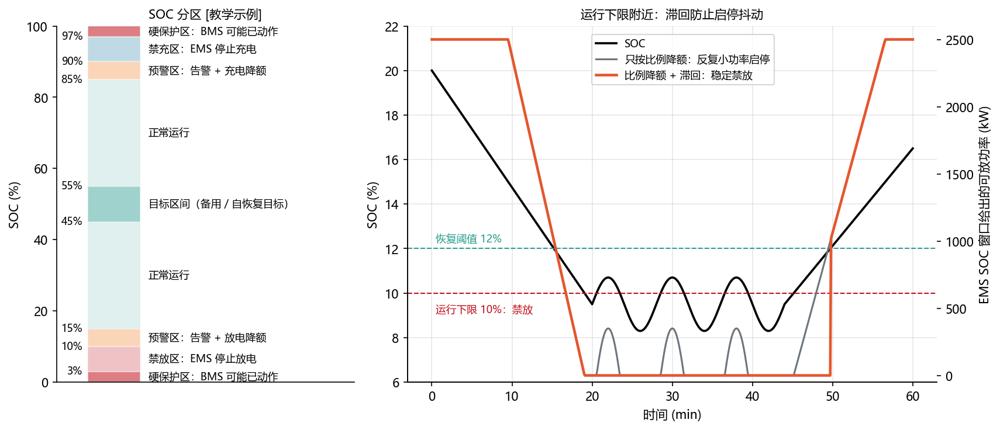
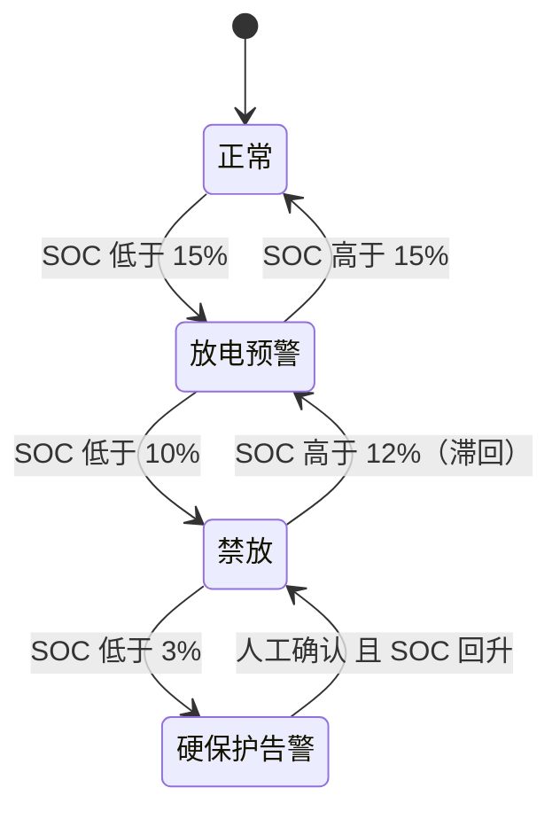

<!-- @AI_GENERATED -->
# 05b SOC 到可用能量：效率、窗口与簇间一致性

> [课程首页](README.md) · 上一章：[05a SOC 估计、误差累积与校准](05a_SOC估计与校准.md) · 下一章：[05c 功率状态（SOP）与能力模型](05c_功率能力与能力模型.md)

**一句话**：一个 SOC 数字不等于能用的电量——要乘效率、减去运行窗口、乘老化、还要看最低的那一簇，一层层打折后才是能拿去规划的电量。

## 本章目标

读完本章，你应能把一个状态量变成一个可执行的能量边界：

1. 区分充电和放电的效率方向，按交流侧或直流侧测量平面选择效率；
2. 逐项计算 SOH、SOC 运行窗口和效率造成的能量瀑布，并保留每个中间结果；
3. 用滞回和分区把“还能量”转成允许的运行行为，而不是把保护阈值、策略阈值和目标区间混为一谈；
4. 按放电看最低簇、充电看最高簇的原则聚合簇级 SOC，并复盘 05a 场景中的能量高估。

## 本章边界与前置

本章解决“**SOC 这个估计值在指定效率、SOH、运行窗口和簇间不一致条件下还能提供多少 kWh**”。SOC 的估计、漂移和校准回到 [05a](05a_SOC估计与校准.md)；持续功率、指定时长的 SOP 和并网点瓶颈进入 [05c](05c_功率能力与能力模型.md)。本章依赖第 02 章的功率与电量、第 04 章的木桶效应和 BMS 口径。

---

## 5.5 充放电效率与 SOC 状态更新【必懂】

### 原理直觉：效率损耗改变状态更新量

第 04 章讲过，电流流过内阻会发热，电化学反应本身也有损失。这些损耗都发生在“电池内部储存的能量”（SOC 描述的量）和“外部端口”之间：

- **放电**：外部要收到 200 kWh，电池内部必须拿出更多，因为路上有损耗。拿出的量 = 200 ÷ η，所以**除以效率**；
- **充电**：外部送进 200 kWh，路上损耗一部分，真正存进去的只有 200 × η，所以**乘以效率**。

不管哪个方向，**损耗都让 SOC 更“不划算”**：放电时 SOC 下降得比外部收到的多，充电时 SOC 上升得比外部送进的少。

> **软件类比**：充电“乘”、放电“除”像带手续费的转账：充值 100 元，扣掉 5% 手续费到账 95 元；要提现到手 100 元，账户里得扣 105.3 元。
>
> **类比失效点**：手续费率是固定的；电池效率随倍率、温度、SOC 变化，大电流、低温时损耗明显更大。

> ↩ **回顾**：效率 `η`（希腊字母，读作 eta）第 03 章 3.6 定义过——当时是「往返效率 = 放出 ÷ 充入」的一个整体数（0.85）。本节把它拆开用：一次充放要经过两段路（充进去、放出来），所以分成**单向**的 `η_充`、`η_放`，各约 0.95，相乘才是 03 章那个往返效率。关键差别是本节要**分方向**，别和 03 章那个合并的数混用。

### 公式与符号

```text
放电（P > 0）：SOC_新 = SOC_旧 − P × Δt / (η_放 × E)
充电（P < 0）：SOC_新 = SOC_旧 + |P| × Δt × η_充 / E
```

| 符号 | 含义 | 单位 | 示例值 |
|---|---|---|---|
| `P` | 端口功率，**放电为正、充电为负** | kW | ±200 |
| `Δt` | 时长（代码里用秒，要 ÷3600） | h | 1 |
| `E` | 当前实际容量（能量口径） | kWh | 1000 |
| `η_充`、`η_放` | 单向效率（端口 ↔ 电池内部） | 0～1 | 0.95 `[教学示例]` |
| `SOC_旧` | 更新前的 SOC | 0～1 | 0.50 |

公式要点：

- **放电除、充电乘**，两个方向都让 SOC 吃亏。写反了（放电乘、充电除），模型会凭空创造能量；
- **η 必须和 P 的测量平面对应**：P 是直流侧就用电池效率，P 是交流侧就用“电池 × PCS”效率（见本节后面的测量平面）；
- 分母 E 是 kWh，和 5.3 的 Ah 口径不同：这里按能量更新 SOC（两者的差别见 5.17“SOC 与 SOE”）。

### 单步数值校核：放电 1 小时

1000 kWh 电池，SOC 50%，以 200 kW 放电 1 小时，η_放 = 0.95：

```text
① 端口收到        P × Δt           = 200 × 1         = 200 kWh
② 电池内部拿出    ① / η_放         = 200 / 0.95      = 210.53 kWh
③ SOC 下降        ② / E            = 210.53 / 1000   = 21.05%
④ 新 SOC          SOC_旧 − ③       = 50% − 21.05%    = 28.95%
```

### 多步状态追踪：一次充放循环的能量账本

从 50% 开始，先充 200 kW × 1 h，再放 200 kW × 1 h。端口上进 200 kWh、出 200 kWh，看正确写法和写反写法的 SOC 各落到哪：

| 步骤 | 端口能量 | 内部变化（正确） | SOC（正确） | 内部变化（写反） | SOC（写反） |
|---|---:|---:|---:|---:|---:|
| 初始 | — | — | 50.00% | — | 50.00% |
| 充电 200 kW × 1 h | 送进 200 | +190.00（× 0.95） | 69.00% | +210.53（÷ 0.95） | 71.05% |
| 放电 200 kW × 1 h | 收到 200 | −210.53（÷ 0.95） | **47.95%** | −190.00（× 0.95） | **52.05%** |

- **正确写法**：端口进出一样多，SOC 却比开始低了 2.05%，即 20.53 kWh 变成了热。这符合物理；
- **写反写法**：端口进出一样多，SOC 反而比开始**高** 2.05%，凭空多出 20.53 kWh。循环越多，“存款”越多，这就是 5.15 案例二“越充越多”的仿真 bug。

### 教学闭环：输入、算法与输出

```python
# SOC 效率更新最小闭环：输入功率序列 → 正确/写反两种更新 → 输出能量账本
CAPACITY_KWH = 1000.0   # E：当前实际容量（kWh）
ETA_CHG = 0.95          # η_充：端口 → 电池内部
ETA_DIS = 0.95          # η_放：电池内部 → 端口
SOC0 = 0.50

# ---- 输入：(端口功率 kW, 时长 h)，放电为正、充电为负 ----
steps = [(-200, 1.0), (200, 1.0)]     # 先充 200 kW × 1 h，再放 200 kW × 1 h


def stored_delta_ok(p_kw, dt_h):
    """正确写法：返回电池内部储能变化（kWh），存进为正。"""
    if p_kw >= 0:
        return -p_kw * dt_h / ETA_DIS   # 放电：内部要多拿，除以效率
    return -p_kw * dt_h * ETA_CHG       # 充电：内部只存进一部分，乘以效率


def stored_delta_bug(p_kw, dt_h):
    """写反的版本（5.15 案例二）：放电乘、充电除。"""
    if p_kw >= 0:
        return -p_kw * dt_h * ETA_DIS
    return -p_kw * dt_h / ETA_CHG


soc_ok = soc_bug = SOC0
print(f"{'步骤':<4}{'端口kWh':>8}{'内部(正确)':>11}{'SOC(正确)':>10}{'内部(写反)':>11}{'SOC(写反)':>10}")
for p_kw, dt_h in steps:
    d_ok, d_bug = stored_delta_ok(p_kw, dt_h), stored_delta_bug(p_kw, dt_h)
    soc_ok += d_ok / CAPACITY_KWH       # SOC 变化 = 内部储能变化 / 容量
    soc_bug += d_bug / CAPACITY_KWH
    name = "充电" if p_kw < 0 else "放电"
    print(f"{name:<4}{abs(p_kw) * dt_h:>8.0f}{d_ok:>+11.2f}{soc_ok:>10.2%}{d_bug:>+11.2f}{soc_bug:>10.2%}")

loss = (SOC0 - soc_ok) * CAPACITY_KWH
print(f"正确：进 200 出 200，内部少了 {loss:.2f} kWh（变成热）")
print(f"写反：进 200 出 200，内部多了 {(soc_bug - SOC0) * CAPACITY_KWH:.2f} kWh（凭空产生）")

assert soc_ok < SOC0 < soc_bug                                 # 正确版一定亏，写反版凭空赚
assert abs(loss - (200 / ETA_DIS - 200 * ETA_CHG)) < 1e-9      # 亏损 = 210.53 − 190
```

运行输出：

```text
步骤     端口kWh     内部(正确)   SOC(正确)     内部(写反)   SOC(写反)
充电       200    +190.00    69.00%    +210.53    71.05%
放电       200    -210.53    47.95%    -190.00    52.05%
正确：进 200 出 200，内部少了 20.53 kWh（变成热）
写反：进 200 出 200，内部多了 20.53 kWh（凭空产生）
```

动手改一改：把 `steps` 改成 10 个充放循环，写反版的 SOC 会一路涨过 100%。

### 测量平面决定用哪个效率

效率必须和功率的**测量位置**对应（附录 B 的测量平面）：


- 用 BMS 的**直流**电流、功率更新 SOC：η 只含电池本身；
- 用 PCS 的**交流**功率更新 SOC：η = 电池效率 × PCS 效率；
- 两个平面的功率不能混用，也不能把“电池效率”和“端到端效率”混成一个不说明来源的参数。

图中的效率值是 `[教学示例]`。真实效率随倍率、温度、SOC 变化，PCS 效率在低负载时明显下降（第 06 章）。

### 系统往返效率（RTE）与测量口径

**往返效率**（Round-Trip Efficiency）= 放出的电量 ÷ 充进的电量（回到同一 SOC），等于充电路径和放电路径所有环节效率的乘积。

**手算**：交流侧充进 100 kWh：

```text
① 充电存进电池   100 × 0.98（PCS）× 0.95（电池）   = 93.1 kWh
② 放电回到交流侧 93.1 × 0.95（电池）× 0.98（PCS）   ≈ 86.7 kWh
③ RTE            ② / 100 = 0.98 × 0.95 × 0.95 × 0.98 ≈ 86.7%
```

系统级往返效率的数值差别很大：是否计入变压器损耗、液冷和空调等辅助用电、统计周期多长，都会改变结果。储能站交流侧往返效率常见在 80%～90% 区间 `[行业典型值]`，项目中的数值以合同定义的测量点和统计口径为准。峰谷套利的收益计算必须用它（第 13 章）。

### 工程实现与边界：保留越界信息

真实实现中的 `update_soc` 是上面“正确写法”的工程版，多了三样东西：参数校验（容量为正、效率在 (0, 1]、dt 非负）、按秒计时、**越界不静默吞掉**。它返回一个 `SocUpdate`：

```python
SocUpdate(soc, soc_raw, violated, reason, stored_delta_kwh)
# soc：施加 soc_min/soc_max 边界后的值；soc_raw：未截断的计算值；reason："above_max" / "below_min" / None
```

**手算**：SOC 92%，以 200 kW 充电 1 小时，上限 95%：`soc_raw = 92% + 19% = 111%`，`soc = 95%`，`reason = "above_max"`。

为什么不直接 `min(raw, soc_max)` 了事：在仿真和验收中，**越界本身就是 bug 的证据**，说明上游的约束或仲裁没有拦住这条指令。静默截断会让问题消失。`soc_raw` 和 `reason` 必须写进事件记录，并成为验收断言的一部分。**配套练习**：运行 `lab/examples/ch05_soc_efficiency.py`，把充放循环次数改为 10 次，观察正确模型和错误模型的能量差。

---

## 5.6 可用能量计算与 SOC 运行窗口【必懂】

### 原理直觉：容量、窗口与效率的三级约束

“这个舱还能放多少电”，要依次打三次折，谁也不能省：

1. **桶缩水了**：老化后实际容量 = 额定容量 × SOH（5.2、5.9）；
2. **上下各留一条线**：运行窗口（例如 5%～95%）之外的电不用，只用中间一段；
3. **倒出来会洒**：从电池内部送到交流侧要经过效率（5.5）。

### 公式与符号

```text
可放电量 = (SOC − SOC_下限) × C_额定 × SOH × η_放
可充电量 = (SOC_上限 − SOC) × C_额定 × SOH ÷ η_充
```

| 符号 | 含义 | 单位 | 示例值 |
|---|---|---|---|
| `C_额定` | 额定容量 | kWh | 5016 |
| `SOH` | 容量健康状态 | 0～1 | 0.92 |
| `SOC` | 当前 SOC | 0～1 | 0.50 |
| `SOC_下限`、`SOC_上限` | 运行窗口 | 0～1 | 0.05、0.95 |
| `η_放`、`η_充` | 放电/充电路径效率（电池 0.95 × PCS 0.98） | 0～1 | 0.931 `[教学示例]` |

公式要点：

- **放电乘效率、充电除效率**，和 5.5 的方向一致：可放电量是外部**收到**的，比内部拿出的少；可充电量是外部要**送进**的，比内部存进的多；
- **效率决定测量平面**：乘了 0.931 的结果就是交流侧（PCS 端口）的电量；
- `SOC − SOC_下限` 为负时取 0：已经低于下限，可放电量是 0，不是负数。

### 单步数值校核：能量瀑布

```text
① 当前实际容量   C_额定 × SOH              = 5016 × 0.92        = 4614.72 kWh
② 窗口内部电量   (SOC − SOC_下限) × ①       = 0.45 × 4614.72     = 2076.62 kWh
③ 交流侧可放     ② × η_放                  = 2076.62 × 0.931    = 1933.34 kWh
④ 交流侧可充     (SOC_上限 − SOC) × ① ÷ η_充 = 2076.62 ÷ 0.931    = 2230.53 kWh
```

同样是 45% 的 SOC 空间，放电能拿到 1933 kWh，充电却要送进 2231 kWh，差别就是效率。如果直接用 `5016 × 45% = 2257 kWh` 当可放电量，高估了约 17%。

### SOC 映射口径与重复预留

有的 BMS 会把真实 SOC 的某个区间**映射**成显示 SOC 的 0%～100%。例如真实 5%～95% 映射为显示 0%～100%：

```text
SOC_真实 = 5% + SOC_显示 × 90%
```

EMS 不知道映射，又按显示值设了 5% 下限：

```text
① EMS 停止放电时   SOC_显示 = 5%  →  SOC_真实 = 5% + 5% × 90% = 9.5%
② BMS 本来的底线   SOC_显示 = 0%  →  SOC_真实 = 5%
③ 永远用不上的一段 9.5% − 5% = 4.5% × 4614.72 kWh ≈ 208 kWh
```

两边各留了一次余量，白白锁住约 208 kWh。接入时必须问清楚：BMS 上送的是真实 SOC 还是映射后的 SOC，额定容量对应的是哪一个区间。

### 教学闭环：输入、算法与输出

```python
# 可用能量最小闭环：输入铭牌、SOH、SOC、窗口、效率 → 逐级打折 → 输出可放/可充电量
RATED_KWH = 5016.0            # C_额定
SOH = 0.92
SOC = 0.50
SOC_MIN, SOC_MAX = 0.05, 0.95  # 运行窗口
ETA = 0.95 * 0.98              # 放电/充电路径效率：电池 × PCS = 0.931

cap = RATED_KWH * SOH                       # ① 桶缩水：当前实际容量
inner_dis = max(0.0, SOC - SOC_MIN) * cap   # ② 两头留线：窗口内能拿出的内部电量
e_dis = inner_dis * ETA                     # ③ 倒出会洒：交流侧收到的，放电乘效率
inner_chg = max(0.0, SOC_MAX - SOC) * cap
e_chg = inner_chg / ETA                     # ④ 交流侧要送进的，充电除效率
naive = RATED_KWH * (SOC - SOC_MIN)         # 常见错误：铭牌 × SOC 差，三次折一次都没打

print(f"① 当前实际容量  {cap:8.2f} kWh")
print(f"② 窗口内部电量  {inner_dis:8.2f} kWh")
print(f"③ 交流侧可放    {e_dis:8.2f} kWh")
print(f"④ 交流侧可充    {e_chg:8.2f} kWh")
print(f"铭牌直接算      {naive:8.2f} kWh，高估 {naive / e_dis - 1:.1%}")

# 口径陷阱：BMS 把真实 5%～95% 映射为显示 0%～100%，EMS 不知情又按显示值留 5% 下限
true_at_ems_floor = 0.05 + 0.05 * 0.90      # 显示 5% 对应的真实 SOC
wasted = (true_at_ems_floor - 0.05) * cap
print(f"重复预留        真实 5%～{true_at_ems_floor:.1%} 用不上，约 {wasted:.0f} kWh")

assert abs(e_dis - 1933.34) < 0.01 and abs(e_chg - 2230.53) < 0.01
```

运行输出：

```text
① 当前实际容量   4614.72 kWh
② 窗口内部电量   2076.62 kWh
③ 交流侧可放     1933.34 kWh
④ 交流侧可充     2230.53 kWh
铭牌直接算       2257.20 kWh，高估 16.8%
重复预留        真实 5%～9.5% 用不上，约 208 kWh
```

### 工程实现与边界

真实实现中，`actual_capacity_kwh(rated_kwh, soh)` 算 ①，并校验 SOH 在合理范围；`dischargeable_energy_kwh`、`chargeable_energy_kwh` 算 ③、④，内部用 `max(0, …)` 保证非负。**配套练习**：运行 `lab/examples/ch05_usable_energy.py`，改变 SOH、SOC 窗口和效率，逐级核对能量瀑布。

---

## 5.7 SOC 分区、功率降额与滞回许可【必懂】

### 原理直觉：保护边界、运行边界与调度目标分离

不要把 “SOC = 10%” 同时当成保护边界、运行边界和调度目标。EMS 通常把 SOC 分成几层：



图中标注对照表：

| 编号 | 位置 | 标注 | 对应正文 |
|---|---|---|---|
| ① | 左图下边界 | 3% | 硬保护下限 |
| ② | 左图运行边界 | 10% | 禁放阈值 |
| ③ | 右图恢复线 | 12% | 滞回恢复阈值 |
| ④ | 左图预警边界 | 15% | 放电预警起点 |
| ⑤ | 左图目标区 | 45%～55% | 调频备用、自恢复目标 |
| ⑥ | 左图上侧边界 | 85%、90% | 充电预警起点、运行上限 |
| ⑦ | 左图上边界 | 97% | 硬保护上限 |

| 分区 | `[教学示例]` 范围 | 含义 | EMS 行为 |
|---|---|---|---|
| 硬保护区 | 低于 3% / 高于 97% | BMS 可能已按电压保护动作 | EMS 规划**永远不应到达**；到达即告警，说明 SOC 估计或上游约束有问题 |
| 禁放区 / 禁充区 | 3%～10% / 90%～97% | EMS 的运行限值之外 | 停止该方向的指令，只允许反方向 |
| 预警区 | 10%～15% / 85%～90% | 接近运行限值 | 告警；该方向功率线性降额，到运行限值时降到 0 |
| 正常区 | 15%～85% | — | 按策略运行 |
| 目标区间 | 45%～55% | 调频备用、自恢复的目标 | 调频类业务空闲时把 SOC 拉回这里（第 15、16 章） |

几条设计要点：

- **运行限值比 BMS 保护更窄**：EMS 不应该依赖 BMS 保护来停止放电。BMS 保护动作意味着接触器断开、需要复归，而且 SOC 估计误差可能让电池比“显示”的更空；
- **这不是重复降额**：第 04 章说 EMS 不应在 BMS 能力上再按温度降额，而 SOC 窗口是 EMS 的**运行策略**（留调频备用、减少深充深放、给估计误差留余量），与 BMS 的安全降额防的是不同的问题；
- **阈值要带滞回**。SOC 在运行下限附近上下波动（估计噪声、光伏小充电等原因）时，只按比例降额，储能会反复小功率启停；加上滞回后，到 10% 禁放，回到 12% 以上才恢复。

> **软件类比**：这和 Elasticsearch 的**磁盘水位线**几乎一样：low watermark 开始限制新分片分配（预警降额），high watermark 开始迁出分片（禁止写入方向），flood stage 把索引设为只读（硬保护）；恢复时要回到阈值以下一段距离才解除。
>
> **类比失效点**：磁盘使用率是精确测量值，SOC 是有误差的估计值。SOC 阈值之间的间隔要大于估计误差，否则“预警区”形同虚设。

### 公式与符号

放电方向（充电方向对称，把下限换成上限）：

```text
线性降额：k_放 = clamp( (SOC − SOC_运行下限) / (SOC_预警下限 − SOC_运行下限), 0, 1 )
窗口限值：P_窗口,放 = k_放 × P_额定 × 许可
滞回许可：SOC 低于 SOC_运行下限 → 禁放；SOC 高于 SOC_运行下限 + band → 恢复；中间保持原状态
```

| 符号 | 含义 | 单位 | 示例值 |
|---|---|---|---|
| `SOC` | 当前 SOC | 0～1 | 0.12 |
| `SOC_运行下限` | 到这里停止放电 | 0～1 | 0.10 |
| `SOC_预警下限` | 从这里开始降额 | 0～1 | 0.15 |
| `band` | 滞回带宽 | 0～1 | 0.02 |
| `P_额定` | 放电额定功率 | kW | 2500 |
| `k_放` | 降额比例 | 0～1 | 待求 |
| `许可` | 滞回给出的允许放电（1）或禁放（0） | — | 待求 |

公式要点：

- **降额和滞回是两件事**：降额决定“能放多少”（无状态，只看当前 SOC），滞回决定“允不允许放”（有状态，还要看上一拍是否已禁放）；
- `clamp(x, 0, 1)` 把一个数**夹**在 0 到 1 之间：小于 0 取 0，大于 1 取 1，中间原样返回（本章首次用到，是控制里最常用的小工具，第 11 章作为基础函数系统讲）。这里用它保证降额比例落在 0～1：高于预警线是 1，低于运行线是 0；
- 滞回是**有状态**的，控制器重启时状态初值要按实际情况恢复（第 11 章陷阱）。

### 单步数值校核：SOC 12%

```text
① 降额比例  k_放 = (0.12 − 0.10) / (0.15 − 0.10)  = 0.4
② 降额功率  k_放 × P_额定 = 0.4 × 2500           = 1000 kW
③ 滞回许可  12% 不低于 10%，当前未禁放            → 允许（1）
④ 窗口限值  ② × ③                                = 1000 kW
```

### 多步状态追踪：SOC 在 10% 附近来回波动

| SOC | k_放 | 只有降额（kW） | 滞回状态 | 降额 + 滞回（kW） |
|---:|---:|---:|---|---:|
| 12.0% | 0.40 | 1000 | 允许 | 1000 |
| 9.9% | 0.00 | 0 | **禁放**（低于 10%） | 0 |
| 10.5% | 0.10 | 250 | 禁放（未超过 12%，保持） | 0 |
| 11.5% | 0.30 | 750 | 禁放（保持） | 0 |
| 12.1% | 0.42 | 1050 | **恢复**（高于 12%） | 1050 |
| 13.0% | 0.60 | 1500 | 允许 | 1500 |

只有降额时，SOC 一跌破 10% 就停、稍微回升又开始放（0 → 250 → 750），储能在下限附近反复启停（图中灰线）。加上滞回后，一旦禁放，要等 SOC 回到 12% 以上才恢复（图中橙线）。

### 教学闭环：输入、算法与输出

```python
# SOC 窗口最小闭环：输入 SOC 序列 → 线性降额 + 滞回许可 → 输出每拍可放功率
OP_MIN, WARN_MIN = 0.10, 0.15   # 运行下限、预警下限 [教学示例]
BAND = 0.02                     # 滞回带宽：低于 10% 禁放，高于 12% 才恢复
P_RATED_KW = 2500.0


def derate_factor(soc):
    """无状态：k_放 = clamp((SOC − 运行下限) / (预警下限 − 运行下限), 0, 1)。"""
    k = (soc - OP_MIN) / (WARN_MIN - OP_MIN)
    return min(1.0, max(0.0, k))


class DischargeGate:
    """有状态：记住“当前是否已禁放”，实现滞回。"""

    def __init__(self, blocked=False):
        self.blocked = blocked          # 重启时应按实际状态恢复，而不是一律 False

    def update(self, soc):
        if soc < OP_MIN:                # 跌破运行下限：进入禁放
            self.blocked = True
        elif soc > OP_MIN + BAND:       # 离开下限足够远：解除禁放
            self.blocked = False
        return not self.blocked         # 两个阈值之间：保持上一拍的状态


# ---- 输入：SOC 在运行下限附近来回波动 ----
socs = [0.12, 0.099, 0.105, 0.115, 0.121, 0.13]

gate = DischargeGate()
out_plain, out_gate = [], []
print(f"{'SOC':>6}{'k_放':>6}{'只有降额':>9}{'滞回状态':>7}{'降额+滞回':>9}")
for soc in socs:
    k = derate_factor(soc)
    p_plain = k * P_RATED_KW              # 只有降额：SOC 一回升就重新放电
    allowed = gate.update(soc)
    p_gate = p_plain if allowed else 0.0  # 降额 × 许可
    out_plain.append(round(p_plain))
    out_gate.append(round(p_gate))
    print(f"{soc:>6.1%}{k:>6.2f}{p_plain:>9.0f}{'允许' if allowed else '禁放':>7}{p_gate:>9.0f}")

assert out_plain == [1000, 0, 250, 750, 1050, 1500]
assert out_gate == [1000, 0, 0, 0, 1050, 1500]
```

运行输出：

```text
   SOC   k_放     只有降额   滞回状态    降额+滞回
 12.0%  0.40     1000     允许     1000
  9.9%  0.00        0     禁放        0
 10.5%  0.10      250     禁放        0
 11.5%  0.30      750     禁放        0
 12.1%  0.42     1050     允许     1050
 13.0%  0.60     1500     允许     1500
```



（充电侧对称，图中省略。）

### 工程实现与边界

`lab/ems_lab/battery.py` 中：`SocZones` 保存全部阈值，并校验它们严格递增；`soc_window_factors` 同时算充、放两个方向的降额比例；`SocPermissionGate` 复用第 11 章的 `Hysteresis`，充电方向对 −SOC 使用同一个滞回类；`soc_window_limits_kw` 把降额和许可乘起来，作为 5.11 能力模型中的一项。`lab/examples/ch05_soc_window.py` 用它们重跑了上面的追踪表。

---

## 5.8 簇间 SOC 不一致与堆级聚合口径【必懂】

### 原理直觉：一起放电，最先见底的那簇说了算

第 04 章讲过木桶效应：多簇并联、电流近似均分时，每一簇的 SOC 掉得一样快。SOC 最低的那簇最先到下限，BMS 就要整堆停放，其他簇里还剩的电暂时放不出来。所以“堆级 SOC 报哪个数”，要看拿它做什么用。

### 公式与符号

| 取法 | 公式 | 适合 | 问题 |
|---|---|---|---|
| 最小值 | `min(SOC_i)` | 放电规划、放电方向的告警 | 显示偏低，充电规划会低估可充空间 |
| 最大值 | `max(SOC_i)` | 充电规划、充电方向的告警 | 显示偏高 |
| 算术平均 | `Σ SOC_i / N` | 显示、趋势 | 只在各簇容量相同时有能量含义；不反映木桶效应 |
| 容量加权 | `Σ(SOC_i × C_i) / Σ C_i` | 总剩余电量 | 同样不反映木桶效应 |

| 符号 | 含义 | 单位 | 示例值 |
|---|---|---|---|
| `SOC_i` | 第 i 簇 SOC | 0～1 | 0.60、0.58、0.55、0.45 |
| `C_i` | 第 i 簇当前实际容量 | kWh | 400、400、400、320（加权例）/ 各 400（放电例） |
| `N` | 簇数 | — | 4 |

公式要点：**电流均分时，可放电量由 `min(SOC_i)` 决定，可充电量由 `max(SOC_i)` 决定**。平均值和加权值描述的是“总共还剩多少”，不是“还能连续放多少”。

### 单步数值校核：四种取法

```text
平均 = (60% + 58% + 55% + 45%) / 4                          = 54.5%
最小 = 45%，最大 = 60%
加权（容量 400、400、400、320 kWh）
     = (0.60×400 + 0.58×400 + 0.55×400 + 0.45×320) / 1520 = 836 / 1520 = 55%
```

对可用能量的影响（每簇 400 kWh，下限 5%）：

```text
按平均 SOC 估算可放 = 4 × 400 × (54.5% − 5%) = 792 kWh
按最低簇估算可放   = 4 × 400 × (45% − 5%)   = 640 kWh   ← 电流均分时的实际值
```

按平均值规划会高估 152 kWh，这正是 5.1 场景的第三个原因。

### 多步状态追踪：均分放电与最低簇停机边界

每簇 400 kWh，总功率 400 kW 均分，每簇 100 kW，每小时掉 25%（忽略效率）：

| t | 簇 1 | 簇 2 | 簇 3 | 簇 4 | 平均 | 最低 | 累计放出 |
|---:|---:|---:|---:|---:|---:|---:|---:|
| 0 h | 60.0% | 58.0% | 55.0% | 45.0% | 54.5% | 45.0% | 0 kWh |
| 0.5 h | 47.5% | 45.5% | 42.5% | 32.5% | 42.0% | 32.5% | 200 kWh |
| 1.0 h | 35.0% | 33.0% | 30.0% | 20.0% | 29.5% | 20.0% | 400 kWh |
| 1.5 h | 22.5% | 20.5% | 17.5% | 7.5% | 17.0% | 7.5% | 600 kWh |
| 1.6 h | 20.0% | 18.0% | 15.0% | **5.0%** | 14.5% | **5.0% → 停机** | **640 kWh** |

停机那一刻，平均 SOC 还显示 14.5%。按平均值看，“还能再放 (14.5% − 5%) × 1600 = 152 kWh”，这 152 kWh 正是上面的高估量。

### 教学闭环：输入、算法与输出

```python
# 簇间 SOC 最小闭环：输入各簇 SOC → 电流均分放电 → 输出何时停机、实际放出多少
socs = [0.60, 0.58, 0.55, 0.45]   # 4 簇初始 SOC
CAP_KWH = 400.0                   # 每簇容量（kWh），相同
P_EACH_KW = 100.0                 # 电流均分：每簇 100 kW，共 400 kW
SOC_MIN = 0.05
DT_H = 0.1                        # 仿真步长 0.1 h

n = len(socs)
est_by_mean = n * CAP_KWH * (sum(socs) / n - SOC_MIN)   # 按平均 SOC 估
est_by_min = n * CAP_KWH * (min(socs) - SOC_MIN)        # 按最低簇估

t, delivered, step = 0.0, 0.0, 0
print(f"{'t(h)':>5}  {'各簇 SOC':<26}{'平均':>7}{'最低':>7}{'累计kWh':>8}")
while True:
    stop = min(socs) <= SOC_MIN + 1e-9                  # 木桶效应：最低一簇到下限，整堆停
    if step % 5 == 0 or stop:                           # 每 0.5 h 打印一行，停机时再打印一行
        print(f"{t:>5.1f}  {' '.join(f'{s:5.1%}' for s in socs):<26}"
              f"{sum(socs) / n:>7.1%}{min(socs):>7.1%}{delivered:>8.0f}")
    if stop:
        break
    socs = [s - P_EACH_KW * DT_H / CAP_KWH for s in socs]   # 每簇掉得一样快
    delivered += P_EACH_KW * n * DT_H
    t += DT_H
    step += 1

print(f"按平均估 {est_by_mean:.0f} kWh，按最低簇估 {est_by_min:.0f} kWh，实际放出 {delivered:.0f} kWh")
assert abs(delivered - est_by_min) < 1e-6 and abs(est_by_mean - delivered - 152) < 1e-6
```

运行输出：

```text
 t(h)  各簇 SOC                         平均     最低   累计kWh
  0.0  60.0% 58.0% 55.0% 45.0%     54.5%  45.0%       0
  0.5  47.5% 45.5% 42.5% 32.5%     42.0%  32.5%     200
  1.0  35.0% 33.0% 30.0% 20.0%     29.5%  20.0%     400
  1.5  22.5% 20.5% 17.5%  7.5%     17.0%   7.5%     600
  1.6  20.0% 18.0% 15.0%  5.0%     14.5%   5.0%     640
按平均估 792 kWh，按最低簇估 640 kWh，实际放出 640 kWh
```

### EMS 实施要点

1. **弄清 BMS 堆级 SOC 的算法**。有的 BMS 在接近满充时显示偏向最高簇、接近放空时偏向最低簇、中间显示平均值，各厂不同，以厂家说明为准；
2. **能量规划分方向**：放电用最低簇 SOC（或 BMS 直接给出的可放电量），充电用最高簇 SOC；
3. **显示和上报**：用 BMS 的堆级 SOC，但同时监视簇间 SOC 差，超过阈值告警并安排均衡维护；
4. 簇退出运行时，从聚合中去掉该簇，同时容量也要相应减少。

### 工程实现与边界

真实实现中的 `aggregate_soc(socs, method, capacities_kwh)` 支持四种取法，并对空列表、容量长度不一致和未知方法直接报错；`stack_energy` 按最低簇、最高簇给出整堆可放、可充电量。**配套练习**：运行 `lab/examples/ch05_cluster_soc.py`，加入一个退出运行的簇并同步减少容量，观察平均值和方向化可用量的差别。

---

## 5.9 SOH 评估：容量衰减与内阻增长【必懂】

**SOH**（State of Health，健康状态）描述电池相对新电池的老化程度。常见两种口径：

| 口径 | 定义 | 影响 EMS 的什么 |
|---|---|---|
| 容量 SOH | 当前实际容量 / 额定容量 | 可充放电量、申报容量、SOC 的分母 |
| 内阻 SOH | 与内阻增长相关（各厂定义不同） | 同样电流下压降更大、发热更多，功率能力下降 |

### 公式与符号

```text
SOH_容量 = C_实测 / C_额定
```

| 符号 | 含义 | 单位 | 示例值 |
|---|---|---|---|
| `C_实测` | 容量标定试验中，规定条件下从满充放到放电截止放出的电量 | kWh | 4614.72 |
| `C_额定` | 额定容量 | kWh | 5016 |
| `SOH_容量` | 容量健康状态 | 0～1 | 待求 |

**手算**：`SOH = 4614.72 / 5016 = 0.92`（92%）。这正是 5.6 瀑布第 ① 步的反向：已知 SOH 求实际容量，和已知实际容量求 SOH，是同一个关系。

BMS 上送的 SOH 是哪种口径、怎么估算，以厂家说明为准。容量 SOH 最可靠的来源是**容量标定试验**（在规定条件下满充再满放，统计放出的电量）；BMS 的在线估算会有误差。

老化的主要因素：循环次数和放电深度、温度（高温加速）、倍率、长期停留在高 SOC。储能电池常以容量衰减到额定的 70%～80% 作为寿命终止判据 `[行业典型值]`，具体以合同和质保条款为准。

对 EMS 的影响：

- **可用电量要乘 SOH**（5.6 的手算中 SOH 92% 让容量少了约 400 kWh）；
- **向调度申报的可用容量**要随 SOH 更新，不能一直用铭牌值；
- **策略影响寿命**：长期满充满放、高温大倍率运行会加速老化。SOC 窗口（5.7）和倍率限制都是在收益和寿命之间做权衡；
- **补电和更换**：容量衰减后，有的项目会增加电池（扩容补电），EMS 要能处理不同批次、不同 SOH 的簇共存，此时容量加权（5.8）才有意义。

---

## 5.12 场景复盘：SOC、效率与簇间偏差的叠加影响【必懂】

5.1 的站：1 MW / 2 MWh，傍晚显示 SOC 30%，放电下限 10%。EMS 估算能以 1 MW 放 24 分钟，实际不到 20 分钟就放空了。现在用本章的公式逐项修正。

### 公式与符号

```text
可放电量 = (SOC_最低簇,真实 − SOC_下限) × C × η_放
SOC_最低簇,真实 = SOC_显示 + 漂移 + 最低簇偏差
可放时长 = 可放电量 / P
```

| 符号 | 含义 | 单位 | 示例值 |
|---|---|---|---|
| `SOC_显示` | BMS 上送的堆级 SOC（平均值） | 0～1 | 0.30 |
| `漂移` | 两周未满充的安时积分误差（5.3、5.15 案例一） | 0～1 | −0.06 |
| `最低簇偏差` | 最低簇比平均低多少（5.8） | 0～1 | −0.02 |
| `SOC_下限` | 放电下限 | 0～1 | 0.10 |
| `C` | 当前实际容量（本例 SOH 已计入） | kWh | 2000 |
| `η_放` | 放电路径效率（电池 0.95 × PCS 0.98，5.5） | 0～1 | 0.931 |
| `P` | 计划放电功率 | kW | 1000 |

数值均为 `[教学示例]`。

### 逐项数值校核：可放电量与计划时长的递进修正

```text
EMS 的估算   (30% − 10%) × 2000                     = 400.0 kWh → 24.0 min
① 修正漂移   真实 24%：(24% − 10%) × 2000             = 280.0 kWh → 16.8 min   （5.3）
② 乘效率     280.0 × 0.931                            = 260.7 kWh → 15.6 min   （5.5）
③ 看最低簇   最低簇 22%：(22% − 10%) × 2000 × 0.931   = 223.4 kWh → 13.4 min   （5.8）
```

三处错误各自都不大，叠在一起让可放电量少了 44%，24 分钟的计划只能放 13 分钟左右。

### 教学闭环：输入、算法与输出

```python
# 5.1 复盘最小闭环：输入显示 SOC 和三处修正 → 逐项修正可放电量 → 输出能放多久
CAPACITY_KWH = 2000.0     # C：当前实际容量（kWh），[教学示例]
SOC_MIN = 0.10            # 放电下限
P_KW = 1000.0             # 计划放电功率
SOC_SHOWN = 0.30          # BMS 显示的堆级 SOC（平均值）
DRIFT = -0.06             # ① 安时积分漂移：真实比显示低 6 个点（5.3）
ETA_DIS = 0.931           # ② 放电路径效率：电池 0.95 × PCS 0.98（5.5）
MIN_CLUSTER_GAP = -0.02   # ③ 最低簇比平均低 2 个点（5.8）


def usable_kwh(soc, eta=1.0):
    """可放电量 = (SOC − 下限) × 容量 × 放电效率（5.6），低于下限时为 0。"""
    return max(0.0, soc - SOC_MIN) * CAPACITY_KWH * eta


steps = [("EMS 的估算", usable_kwh(SOC_SHOWN)),
         ("① 修正漂移", usable_kwh(SOC_SHOWN + DRIFT)),
         ("② 再乘效率", usable_kwh(SOC_SHOWN + DRIFT, ETA_DIS)),
         ("③ 再看最低簇", usable_kwh(SOC_SHOWN + DRIFT + MIN_CLUSTER_GAP, ETA_DIS))]

for name, e in steps:
    print(f"{name:<8}{e:>7.1f} kWh → 以 {P_KW:.0f} kW 能放 {e / P_KW * 60:>4.1f} min")

assert steps[-1][1] / P_KW * 60 < 20      # 与 5.1 现场“不到 20 分钟就放空”一致
```

运行输出：

```text
EMS 的估算   400.0 kWh → 以 1000 kW 能放 24.0 min
① 修正漂移    280.0 kWh → 以 1000 kW 能放 16.8 min
② 再乘效率    260.7 kWh → 以 1000 kW 能放 15.6 min
③ 再看最低簇   223.4 kWh → 以 1000 kW 能放 13.4 min
```

### EMS 应该怎么算

- **放电规划用最低簇 SOC**，或直接用 BMS 上送的可放电量（5.8）；
- **按测量平面乘效率**，计划功率在交流侧，就用交流侧可放电量（5.5、5.6）；
- **为 SOC 误差留余量**，余量随“自上次校准以来的时间 / 吞吐量”增大，并在低价时段安排校准充电（5.3、5.4、5.15 案例一）；
- 把以上结果作为能力模型的输入，按持续时长算 SOP（5.10、5.11）。

**配套练习**：运行 `lab/examples/ch05_scenario_recap.py`，逐项改变 SOC 漂移、最低簇偏差和放电效率，观察 24 分钟计划如何缩短。

---

## 常见误区：效率、可用能量与簇间口径【必懂】

| 误区 | 正确理解 |
|---|---|
| 放电也乘效率 | 放电除以效率、充电乘以效率；写反会让模型凭空产生能量 |
| 效率就一个数 | 要说明是电池、PCS 还是端到端效率，对应哪个测量平面，是否含辅助用电 |
| 可放电量 = SOC × 额定容量 | 要减去 SOC 下限、乘 SOH、乘放电路径效率，还要考虑簇间不一致 |
| 堆级 SOC 用平均值规划放电 | 电流均分时放电看最低簇、充电看最高簇 |

## 现场故障复盘：效率方向写反导致能量虚增【必懂】

**案例二：仿真里的储能“越充越多”。**
现象：开发阶段的套利仿真显示，储能充放电循环几天后 SOC 持续上升，收益高得离谱。
原因：SOC 更新函数把效率写反了：放电乘 η、充电除 η，每个循环都凭空多出几个百分点的能量；SOC 更新里又直接 clamp 到 100%，越界被悄悄吞掉，测试一直是绿的。
修复：按“放电除、充电乘”改正；SOC 更新返回 `soc_raw` 和越界原因；加一个“一个完整循环后能量必须减少，且减少比例等于 1 − RTE”的测试。

## 自测：从 SOC 到可用能量

1. 1000 kWh 电池，SOC 50%，以 300 kW 放电 1 小时，放电效率 0.95，SOC 变为多少？若以 300 kW 充电 1 小时、充电效率 0.95 呢？
2. PCS 效率 0.97，电池单向效率 0.96，求交流侧往返效率。

<details>
<summary>参考答案</summary>

1. 放电：300 / 0.95 ≈ 315.8 kWh，SOC ≈ 50% − 31.6% = 18.4%。充电：300 × 0.95 = 285 kWh，SOC = 50% + 28.5% = 78.5%。
2. 0.97 × 0.96 × 0.96 × 0.97 ≈ 0.867，约 86.7%。

</details>

---

## 深入：效率变化与能量守恒测试【深入】

<details>
<summary>效率随工况变化</summary>

本章的固定效率是 `[教学示例]`。真实系统中：

- 电池效率随电流升高而下降（内阻损耗与电流平方成正比，而输出功率只与电流成正比）；
- 低温时内阻变大，效率下降；
- PCS 效率在额定功率附近最高，低负载时明显下降，还有待机损耗；
- 辅助用电（液冷、空调）与功率无关、与时间和环境温度相关，计入站级效率时，长时间低功率运行的效率会显著偏低。

更精细的模型可以用“效率 = f(功率, 温度)”查表（第 11 章 `interp_table`），代价是参数更多、需要标定数据。EMS 能量规划通常使用分方向的平均效率，并定期用电表数据回归校正。

</details>

<details>
<summary>能量守恒测试：怎样用一个测试抓住效率 bug</summary>

对任何 SOC 更新实现，都可以写这样一个性质测试：从 SOC = s 开始，以任意功率 P 充电 t 小时，再以同样功率放电，直到 SOC 回到 s，统计放出的电量 E_out 与充入的电量 E_in，断言 `E_out / E_in == η_充 × η_放`（在数值误差内）。效率写反时，这个比值会大于 1，测试立刻失败。这类“守恒性”测试比逐点比对数值更能暴露方向和公式错误，第 19 章会系统讲。

</details>

> 下一章：[05c 功率能力：SOP 与能力模型](05c_功率能力与能力模型.md)

<!-- @AI_GENERATED: end -->
