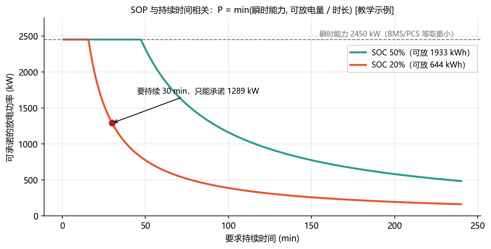
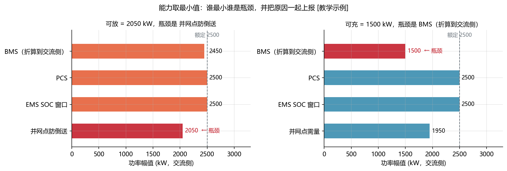
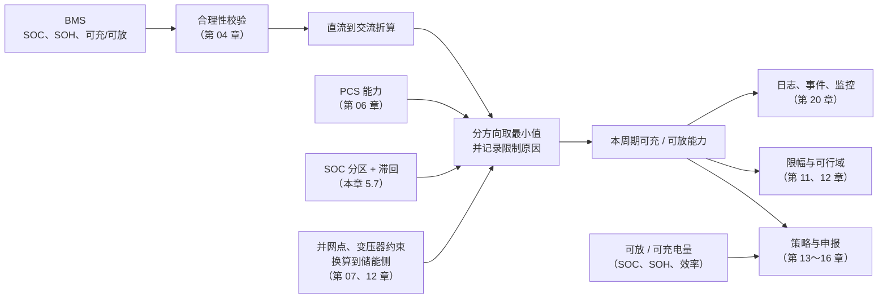

<!-- @AI_GENERATED -->
# 05c 功率状态（SOP）与储能能力模型

> [课程首页](README.md) · 上一章：[05b SOC 到可用能量：效率、窗口与簇间一致性](05b_从SOC到可用电量.md) · 下一章：[06 PCS 与并网](06_PCS与并网.md)

**一句话**：此刻能出多大功率，要分充放两个方向、看要持续多久，再把链路上每一环的上限取最小值，并说清是谁在限。

## 本章目标

读完本章，你应能：

1. 按指定持续时间计算方向化的 SOP，并找出“功率限”和“电量限”的拐点；
2. 把 BMS、PCS、SOC 窗口、变压器和并网点约束统一换算到同一测量平面；
3. 对充电和放电分别取最小能力，同时保留限制原因和数据来源；
4. 用站点功率平衡解释防倒送、需量约束如何改变能力，并为后续策略和限幅提供输入。

## 本章边界与前置

本章解决“**在给定持续时间、设备能力和并网边界内，当前周期最多能充/放多少功率**”。05a 负责 SOC 的可信度，05b 负责可用能量、窗口和簇间一致性；PCS 详细 P-Q 能力、站级拓扑和完整可行域分别在第 06、07、12 章展开。本章依赖 05b 的可放/可充电量、第 02 章的功率方向，以及附录 B 的测量平面约定。

---

## 5.10 SOP：方向化能力与持续时间约束【必懂】

### 原理直觉：瞬时功率约束与持续能量约束

**SOP**（State of Power，功率状态）是电池“此刻能以多大功率充/放”。它有三个特点：

**① 分方向。** 可充和可放是两个独立的数，随 SOC、温度各自变化（第 04 章：低温时可放 0.45C、可充 0.1C）。代码中统一用两个非负幅值 `available_charge_kw` 和 `available_discharge_kw`。

**② 与持续时间相关。** 把电池想成一个水箱接一根水管：只放几分钟，水管多粗就能放多快（瞬时功率能力）；要连续放几个小时，就要看水箱里还有多少水（可放电量），放得越久，平均流量越小。两条限制在某个时长 T* 相交：**短于 T* 受功率限，长于 T* 受电量限**。此外大电流持续时电压降低、温度升高，能力也会下降。有的 BMS 会同时给出几档（例如短时、持续）能力值，含义以厂家说明为准。

**③ 由多个因素共同决定**，5.11 展开。

### 公式与符号

```text
P_T = min( P_瞬时, E_可放 / T )
T*  = E_可放 / P_瞬时                 拐点：短于 T* 受功率限，长于 T* 受电量限
```

| 符号 | 含义 | 单位 | 示例值 |
|---|---|---|---|
| `P_瞬时` | 瞬时可放功率（BMS/PCS 给出） | kW | 2450 |
| `E_可放` | 交流侧可放电量（5.6 公式，SOC 20%） | kWh | 644.45 |
| `T` | 要求持续的时长 | h | 0.5（30 min） |
| `P_T` | 能持续 T 的可承诺功率 | kW | 待求 |
| `T*` | 拐点时长 | h | 待求 |

公式要点：`E_可放 / T` 是“把电量平均摊到 T 内”的功率，T 用小时；T 是分钟时要先 ÷60。这里是 EMS 最常用的简化，没有考虑持续大电流时能力的进一步下降。

### 单步数值校核：持续 30 分钟

5.6 的电池舱，SOC 20%：

```text
① 可放电量  (0.20 − 0.05) × 4614.72 × 0.931   = 644.45 kWh
② 电量限    E_可放 / T = 644.45 / 0.5          = 1288.9 kW
③ 取小      min(P_瞬时, ②) = min(2450, 1288.9) = 1288.9 kW（电量在限）
④ 拐点      T* = 644.45 / 2450 = 0.263 h       ≈ 15.8 min
```

### 多步状态追踪：不同持续时长

| 持续时长 | E / T（kW） | 可承诺功率（kW） | 谁在限 |
|---:|---:|---:|---|
| 5 min | 7733.3 | 2450 | 功率 |
| 15 min | 2577.8 | 2450 | 功率 |
| 15.8 min（T*） | 2450.0 | 2450 | 两者相等 |
| 30 min | 1288.9 | 1288.9 | 电量 |
| 60 min | 644.4 | 644.4 | 电量 |
| 120 min | 322.2 | 322.2 | 电量 |



图中标注对照表：

| 编号 | 位置 | 标注 | 对应正文 |
|---|---|---|---|
| ① | SOC 50% 曲线图例 | 50%、1933 kWh | SOC 较高时的可放电量 |
| ② | SOC 20% 曲线图例 | 20%、644 kWh | 5.6 手算使用的可放电量 |
| ③ | 30 min 标注点 | 30 min、1289 kW | 持续 30 分钟时的可承诺功率 |
| ④ | 瞬时能力参考线 | 2450 kW | 短时功率能力上限 |

图中曲线的拐点就是 T*。这对调度申报很关键：调频、备用类服务往往要求“能持续一段时间”，**申报的可调功率必须按要求的持续时间计算**，而不是报瞬时值。

### 教学闭环：输入、算法与输出

```python
# SOP 持续时间最小闭环：输入瞬时能力、可放电量、持续时长 → 取小 → 输出可承诺功率和瓶颈
P_INSTANT_KW = 2450.0                          # P_瞬时
E_KWH = (0.20 - 0.05) * 5016 * 0.92 * 0.931    # E_可放：5.6 公式，SOC 20%
t_star_min = E_KWH / P_INSTANT_KW * 60         # 拐点 T*（换算成分钟）

print(f"可放电量 {E_KWH:.2f} kWh，拐点 T* = {t_star_min:.1f} min")
print(f"{'持续(min)':>9}{'E/T(kW)':>9}{'可承诺(kW)':>11}  谁在限")
results = []
for minutes in [5, 15, 30, 60, 120]:
    p_energy = E_KWH / (minutes / 60)          # 电量能撑住的平均功率，T 换算成小时
    p = min(P_INSTANT_KW, p_energy)            # 两者取小
    who = "功率" if P_INSTANT_KW < p_energy else "电量"
    results.append(p)
    print(f"{minutes:>9}{p_energy:>9.1f}{p:>11.1f}  {who}")

assert results[:2] == [2450.0, 2450.0]         # 短于 T*：功率在限
assert abs(results[2] - 1288.89) < 0.01        # 30 分钟：电量在限
```

运行输出：

```text
可放电量 644.45 kWh，拐点 T* = 15.8 min
  持续(min)  E/T(kW)    可承诺(kW)  谁在限
        5   7733.3     2450.0  功率
       15   2577.8     2450.0  功率
       30   1288.9     1288.9  电量
       60    644.4      644.4  电量
      120    322.2      322.2  电量
```

### 工程实现与边界

真实实现中，`energy_limited_power_kw(energy_kwh, duration_s)` 计算 `E / T`，对非正时长报错、对负电量按 0 处理；`sop_for_duration` 取两者的小值。注意实现接口的时长单位是**秒**，而本章手算表为了直观使用小时或分钟。**配套练习**：运行 `lab/examples/ch05_sop_duration.py`，改变 SOC 和持续时间，观察功率限到电量限的拐点如何移动。

---

## 5.11 储能能力模型：多约束取最小值【必懂】

### 原理直觉：串联约束与最小能力边界

储能此刻能放多少，不只由电池决定。从电池到并网点，链路上每一个环节都有自己的上限，端到端能通过的就是其中最小的那个。而且**两个方向的瓶颈往往不是同一个**，一天之内还会换人。

> **软件类比**：多个**限流器串联**：API 网关限 1000 QPS，服务自身限 800，数据库连接池只撑得住 600，端到端有效速率就是 600。好的可观测性不仅要告诉你“现在 600”，还要告诉你“是连接池在限”。
>
> **类比失效点**：限流器超限只是拒绝请求；电力设备超出能力会触发保护跳闸，所以 EMS 必须在下发**之前**就把指令压进最小能力之内（第 11、12 章）。

| 限制来源 | 例子 | 由谁提供 |
|---|---|---|
| BMS | 按 SOC、温度、电压算出的可充/可放（直流侧） | BMS 点表，经合理性校验（第 04 章 4.12） |
| PCS | 额定功率、温度降额、P-Q 容量（发无功会挤占有功） | PCS 点表 / 能力模型（第 06 章） |
| EMS SOC 窗口 | 运行限值附近的降额和禁止（5.7） | EMS 自身 |
| 变压器、并网点 | 变压器容量；防倒送、需量、并网协议限值 | 换算到储能侧的允许功率（第 07、12、14 章） |

### 公式与符号

每个方向分别取最小值，全部先换算到 **PCS 交流侧**、非负幅值。这里把“防倒送”和“需量”写成站点功率平衡反推的候选上限；如果项目的并网协议、变压器或辅助负荷口径不同，应替换为项目边界值：

```text
P_PCC = P_PV + P_BESS − P_load − P_aux − P_loss
P_import = −P_PCC

可放 = min( P_BMS,放 × η_PCS,  P_PCS,  P_窗口,放,  P_load + P_aux − P_PV )      最后一项：防倒送
可充 = min( P_BMS,充 ÷ η_PCS,  P_PCS,  P_窗口,充,  P_需量 − P_load − P_aux + P_PV ) 最后一项：需量
```

| 符号 | 含义 | 单位 | 示例值（07:00） |
|---|---|---|---|
| `P_BMS,放`、`P_BMS,充` | BMS 直流侧可放、可充 | kW | 2500、1470 |
| `η_PCS` | PCS 效率 | 0～1 | 0.98 |
| `P_PCS` | PCS 额定功率 | kW | 2500 |
| `P_窗口,放`、`P_窗口,充` | SOC 窗口限值（5.7） | kW | 2500、2500（SOC 80%） |
| `P_load`、`P_aux`、`P_PV` | 负荷、辅助用电、光伏，均按消耗/发电正值记录 | kW | 2000、50、0 |
| `P_loss` | 并网点前尚未被测点包含的损耗 | kW | 本例忽略 |
| `P_BESS` | PCS 交流侧储能功率，放电为正、充电为负 | kW | 待求 |
| `P_PCC` | 并网点功率，向电网送电为正 | kW | 防倒送时不大于 0 |
| `P_import` | 电网进口功率，取电为正 | kW | `−P_PCC` |
| `P_需量` | 从电网取电的上限 | kW | 4000 |

公式要点：

- **先统一测量平面再取最小**。BMS 在直流侧：放电时直流侧放出 P，交流侧只收到 P × η；充电时要让直流侧收到 P，交流侧得吸收 P ÷ η；
- **正方向不能混用**。能力模型里的“可充/可放”是非负幅值，`P_BESS` 才带方向；并网点 `P_PCC` 向电网送电为正，而需量使用的 `P_import` 取反；
- **并网点约束由功率平衡反推**：代入 `P_PCC = P_PV + P_BESS − P_load − P_aux − P_loss`，防倒送要求 `P_PCC ≤ 0`，忽略 `P_loss` 时得到 `P_BESS ≤ P_load + P_aux − P_PV`；
- **取最小的同时记下是谁**。“能放 2050 kW”不够，还要说“是防倒送在限”。

### 单步数值校核：07:00 能力边界与瓶颈识别

`[教学示例]`：5 MWh 舱 + 2.5 MW PCS，早晨电芯温度偏低，SOC 80%。负荷 2000 kW，辅助用电 50 kW，无光伏，不允许倒送，需量限值 4000 kW，PCS 效率 0.98。

| 限制来源 | 可放 (kW) | 可充 (kW) |
|---|---:|---:|
| BMS（直流 2500 / 1470，折算到交流侧） | 2500 × 0.98 = 2450 | 1470 ÷ 0.98 = 1500 |
| PCS | 2500 | 2500 |
| EMS SOC 窗口（SOC 80%，在正常区） | 2500 | 2500 |
| 并网点：防倒送 / 需量 | 2000 + 50 − 0 = 2050 | 4000 − 2000 − 50 = 1950 |
| **结果** | **2050（防倒送）** | **1500（BMS）** |



图中标注对照表：

| 编号 | 位置 | 标注 | 对应正文 |
|---|---|---|---|
| ① | 可放柱状图 | 2450 kW | BMS 直流 2500 kW 经 PCS 效率折算 |
| ② | 可放结果 | 2050 kW | 并网点防倒送瓶颈 |
| ③ | 可充结果 | 1500 kW | BMS 直流 1470 kW 经 PCS 效率折算 |
| ④ | 可充结果 | 1950 kW | 并网点需量限值对应的候选能力 |
| ⑤ | 额定参考线 | 2500 kW | PCS 额定功率 |

同一时刻，两个方向的瓶颈完全不同。铭牌写着 2.5 MW，但此刻能放 2050 kW、能充 1500 kW。**EMS 的所有策略都必须基于可用功率，而不是额定功率**。

### 多步状态追踪：时序运行中的瓶颈切换

同一座站，其他参数不变，看三个时刻：

| 时刻 | 工况 | SOC | 负荷 | BMS 直流 可充/可放 | 可充（瓶颈） | 可放（瓶颈） |
|---|---|---:|---:|---:|---|---|
| 07:00 | 电芯偏冷 | 80% | 2000 | 1470 / 2500 | 1500（BMS） | 2050（防倒送） |
| 10:00 | 回暖，负荷高 | 84% | 2600 | 2400 / 2500 | 1350（需量） | 2450（BMS） |
| 12:00 | SOC 接近上限，负荷低 | 88% | 800 | 2400 / 2500 | 1000（SOC 窗口） | 850（防倒送） |

- **10:00**：电芯回暖，BMS 可充变成 2400 ÷ 0.98 ≈ 2449 kW，不再是瓶颈；负荷升到 2600 kW，需量只剩 4000 − 2600 − 50 = 1350 kW 的取电空间，瓶颈变成需量。放电方向防倒送放宽到 2650 kW，瓶颈变成 BMS 的 2450 kW；
- **12:00**：SOC 88% 进入充电预警区，窗口比例 = (0.90 − 0.88) / (0.90 − 0.85) = 0.4，可充 0.4 × 2500 = 1000 kW；负荷降到 800 kW，防倒送把放电压到 850 kW。

这就是为什么“是谁在限”必须每个周期都记录：同一个“为什么只放了这么多”的问题，在不同时刻答案不一样。

### 教学闭环：输入、算法与输出

```python
# 能力模型最小闭环：输入各环节限值 → 分方向取最小并记录原因 → 输出可充/可放和瓶颈
ETA_PCS = 0.98
P_PCS = 2500.0          # PCS 额定（kW）
P_DEMAND = 4000.0       # 需量限值：从电网取电上限（kW）
P_AUX = 50.0            # 辅助用电（kW）；本例无光伏


def soc_window_kw(soc):
    """SOC 窗口（5.7 的线性降额，未含滞回）：返回 (可充, 可放)。"""
    chg = min(1.0, max(0.0, (0.90 - soc) / (0.90 - 0.85)))   # 充电：预警上限 85%，运行上限 90%
    dis = min(1.0, max(0.0, (soc - 0.10) / (0.15 - 0.10)))   # 放电：运行下限 10%，预警下限 15%
    return chg * P_PCS, dis * P_PCS


def min_with_reason(limits):
    """取最小值，并返回是谁在限（并列时取先登记的一项）。"""
    name = min(limits, key=limits.get)
    return limits[name], name


# ---- 输入：(时刻, SOC, BMS 直流可充, BMS 直流可放, 负荷 kW) ----
snapshots = [("07:00", 0.80, 1470, 2500, 2000),   # 电芯偏冷，BMS 限充
             ("10:00", 0.84, 2400, 2500, 2600),   # 回暖，负荷高
             ("12:00", 0.88, 2400, 2500, 800)]    # SOC 接近上限，负荷低

results = []
print(f"{'时刻':<6}{'可充kW':>7}  {'充电瓶颈':<7}{'可放kW':>7}  放电瓶颈")
for when, soc, bms_chg_dc, bms_dis_dc, load in snapshots:
    win_chg, win_dis = soc_window_kw(soc)
    charge = {                              # 全部换算到 PCS 交流侧、非负幅值
        "BMS": bms_chg_dc / ETA_PCS,        # 充电：交流侧要多吸收，除以效率
        "PCS": P_PCS,
        "SOC窗口": win_chg,
        "需量": P_DEMAND - load - P_AUX,    # 取电 = 负荷 + 辅助 + 充电，不能超过需量
    }
    discharge = {
        "BMS": bms_dis_dc * ETA_PCS,        # 放电：交流侧只收到一部分，乘以效率
        "PCS": P_PCS,
        "SOC窗口": win_dis,
        "防倒送": load + P_AUX,             # 放电超过站内消耗就会倒送
    }
    c, c_by = min_with_reason(charge)
    d, d_by = min_with_reason(discharge)
    results.append((round(c), c_by, round(d), d_by))
    print(f"{when:<6}{c:>7.0f}  {c_by:<7}{d:>7.0f}  {d_by}")

assert results == [(1500, "BMS", 2050, "防倒送"),
                   (1350, "需量", 2450, "BMS"),
                   (1000, "SOC窗口", 850, "防倒送")]
```

运行输出：

```text
时刻       可充kW  充电瓶颈      可放kW  放电瓶颈
07:00    1500  BMS       2050  防倒送
10:00    1350  需量        2450  BMS
12:00    1000  SOC窗口      850  防倒送
```

### 工程实现与边界

真实实现中，`ac_limits_from_dc` 做直流到交流的换算，并校验效率和非负；`soc_window_limits_kw` 提供 SOC 窗口一项（含滞回）；`combine_capability` 对两个方向分别调用 `min_with_reason`，返回带有可充、可放能力和限制原因的结果。

`min_with_reason` 还会检查限值是否为 NaN 或负数。此类异常应在第 04 章的 BMS 合理性校验和第 10 章的数据质量层拦截，走到能力模型仍说明上游有问题。限制原因要随每个周期的能力写入事件并上送监控：调度问“为什么没跟上计划”、运维问“为什么只放了 2050 kW”时，答案必须可追溯。**配套练习**：运行 `lab/examples/ch05_capability.py`，逐一改变 BMS、需量和负荷参数，验证充放两个方向的瓶颈可以不同且会切换。

---

## 5.13 能力模型在 EMS 控制链路中的位置【必懂】



在第 00 章的控制流水线中，这就是“③ 状态估计”这一步的输出。

---

## 常见误区：SOP 与能力瓶颈【必懂】

| 误区 | 正确理解 |
|---|---|
| SOP 就是一个功率值 | SOP 分方向、与持续时间相关，由多个环节共同决定 |
| 能力取最小值就够了 | 还要统一测量平面和方向，并记录是谁在限 |
| 按额定功率制定计划和申报 | 按可用功率和可用电量，并随 SOH、温度、SOC 实时更新 |

## 现场故障复盘：能力模型遗漏并网点约束【必懂】

**案例三：能力只取了 BMS，并网点倒送。**
现象：工商业储能站中午负荷骤降，储能按 BMS 可放 2450 kW 放电，并网点向电网倒送，触发防逆流保护跳闸。
原因：能力模型只包含 BMS 和 PCS，并网点约束放在策略层单独处理，负荷骤降时策略层的闭环来不及修正。
修复：并网点约束换算到储能侧，作为能力模型中的一项参与取最小值，并且在最终下发前再做一次兜底（第 11 章“限幅 → Ramp → 再限幅”、第 12 章）。

## 自测：SOP 与能力模型

1. 5.6 的电池舱在 SOC 30% 时，持续 1 小时能承诺的放电功率是多少（瞬时能力 2450 kW）？
2. 某时刻 BMS 直流侧可放 2000 kW，PCS 效率 0.98，PCS 可放 2500 kW，防倒送换算的可放 1800 kW。可放能力是多少？瓶颈是谁？如果负荷突然上升，防倒送换算值变为 3000 kW 呢？

<details>
<summary>参考答案</summary>

1. 可放电量 = (30% − 5%) × 4614.7 × 0.931 ≈ 1074 kWh；持续 1 小时 = min(2450, 1074) ≈ 1074 kW。
2. BMS 折算到交流侧 2000 × 0.98 = 1960 kW；min(1960, 2500, 1800) = 1800 kW，瓶颈是防倒送。负荷上升后变为 min(1960, 2500, 3000) = 1960 kW，瓶颈变成 BMS。

</details>

<!-- @AI_GENERATED: end -->
