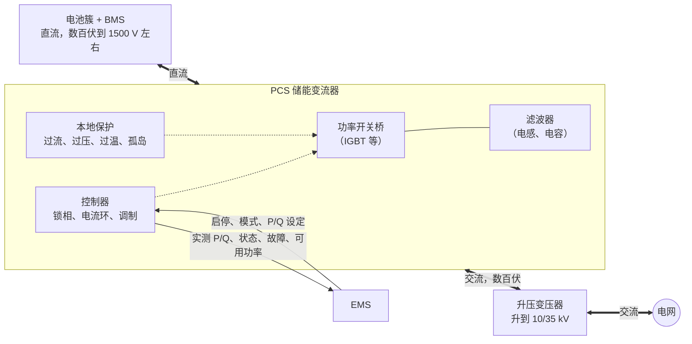
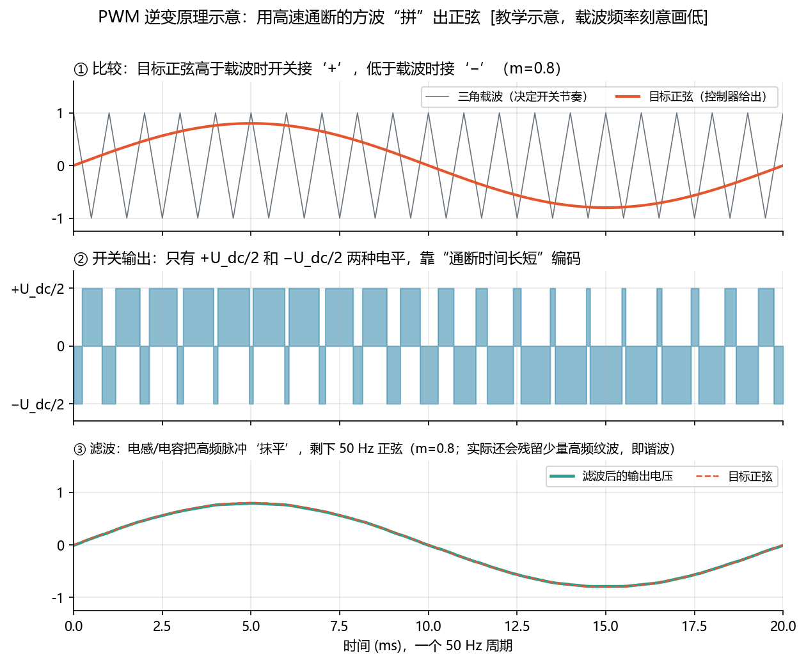
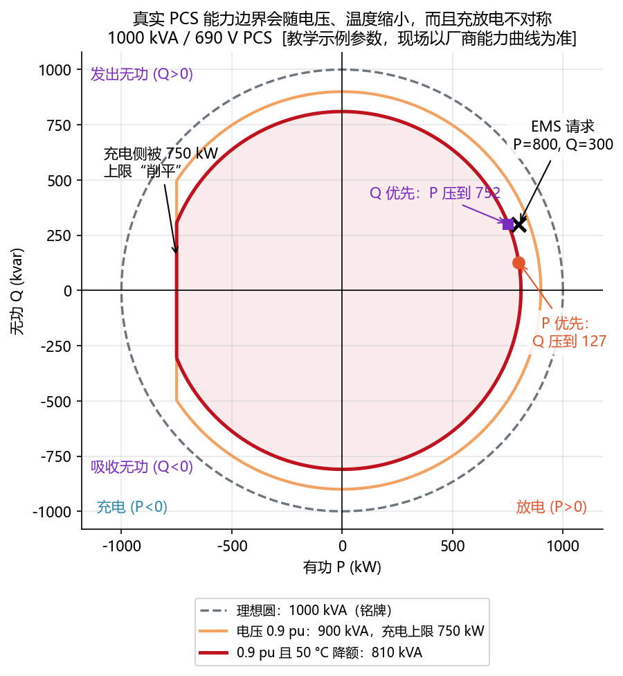
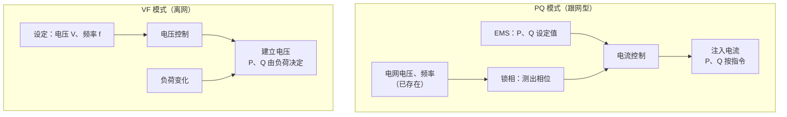
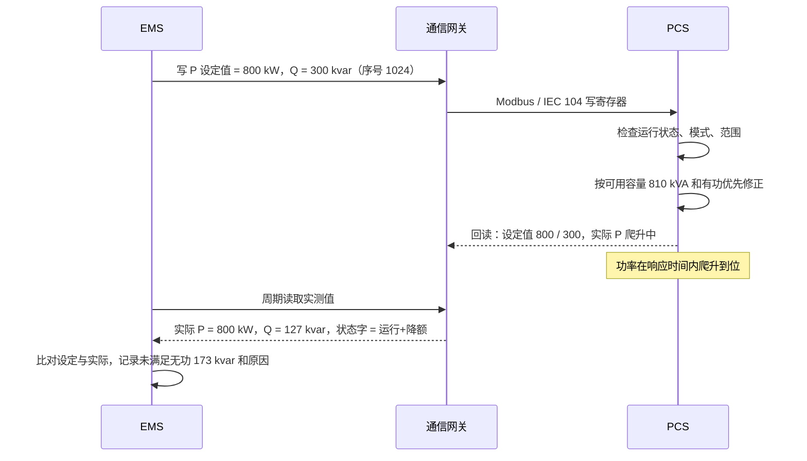
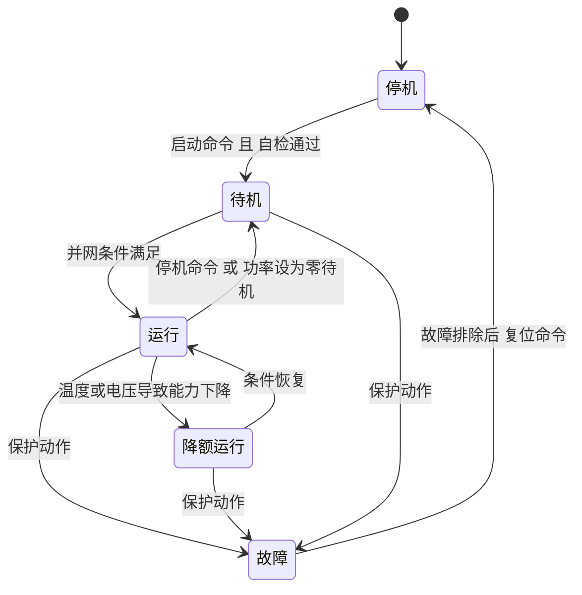
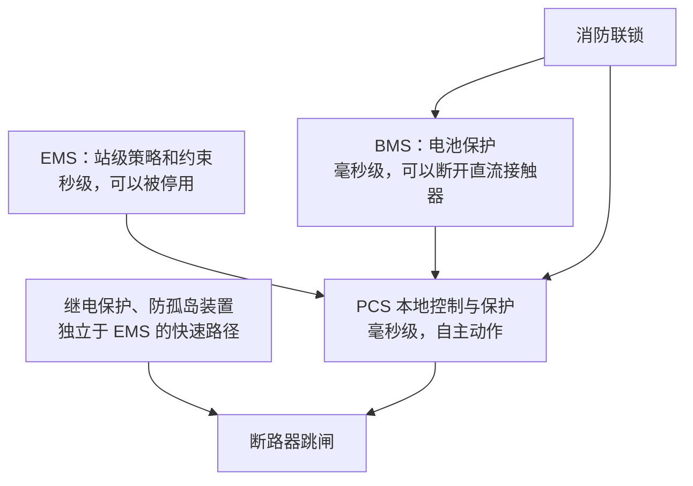
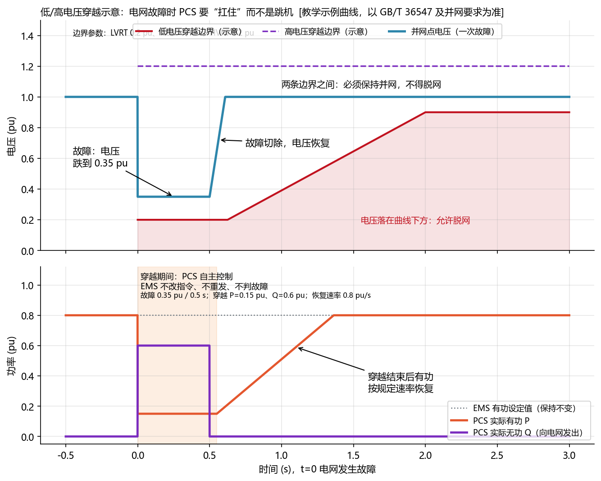
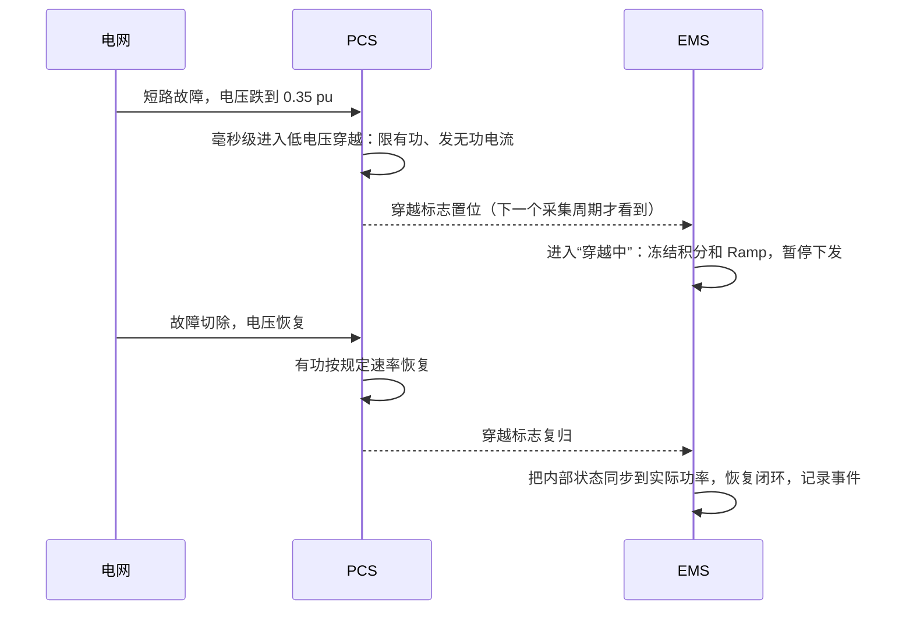
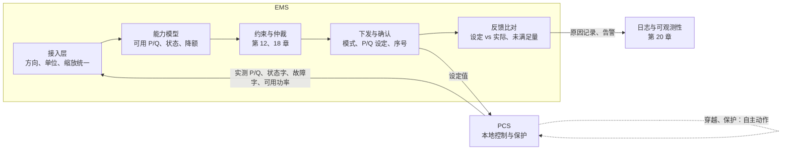

<!-- @AI_GENERATED -->
# 06 储能变流器（PCS）的能力边界、控制模式与并网接口

> [课程首页](README.md) · 上一章：[05c 功率状态（SOP）与储能能力模型](05c_功率能力与能力模型.md) · 下一章：[07 电站拓扑与功率平衡](07_电站拓扑与功率平衡.md)

**一句话**：PCS 是储能侧的主要功率执行器，它有自己的能力边界、控制模式和保护逻辑，会修正甚至拒绝 EMS 的指令。

## 本章目标

读完本章，你应能：

1. 用三相视在功率、电流、温度和直流电压关系，估算 PCS 当前的可用 P、Q 能力；
2. 用 P-Q 能力边界和优先级投影，解释指令为什么被修正、拒绝以及未满足量从何而来；
3. 区分 PQ、VF 和 Grid-Forming 的控制边界，知道 EMS 在每种模式下能控制什么；
4. 设计 PCS 点表接入、设定值确认、状态/故障解析和保护反馈的基本闭环；
5. 解释电压穿越期间 EMS 为什么应暂停干预，并在恢复后同步控制器状态。

## 本章边界与前置

本章聚焦“**PCS 能力模型、控制模式和 EMS 并网接口**”。第 07 章继续展开 PCS 交流端、升压变压器、PCC 和站点功率平衡的测量平面；第 10～12 章展开点表质量、控制函数和安全可行域；第 15、17、18、19 章分别展开调频、无功电压、仲裁分配和仿真验收。本章依赖第 02 章的 P、Q、S 与能力圆，以及第 05c 章的可充/可放能力。

本章正文中的电压和电流默认指 **PCS 交流侧线电压有效值和电流**；除非特别说明，不把 PCS 交流端电压与并网点（PCC）电压混为一谈。PCS 与 PCC 之间若存在升压变压器，必须按变比和现场测点折算。

**配套练习**：运行 `lab/examples/ch06_pcs_projection.py`，修改电压、温度、P/Q 请求和优先级，观察 `PQResult` 中的实际值、未满足量和限制原因。

---

## 6.1 现场场景：PCS 能力降额导致 P/Q 指令未满足【必懂】

七月的一个下午，某储能站参加调峰，EMS 给一台 1000 kVA 的 PCS 下发“放电 800 kW，同时发出无功 300 kvar”。PCS 回读的结果是：有功 800 kW，无功只有 127 kvar。EMS 连续重发三次，结果不变，调度侧的无功考核被判不合格。

并网点附近电压偏低，但本例换算到 **PCS 交流端** 的线电压为 621 V（相对 690 V 为 0.9 pu）；PCS 舱内温度 50 °C，这台 PCS 此刻的真实容量只有 810 kVA，而它被配置为“有功优先”。PCS 与并网点之间若有升压变压器，必须按现场变比和测点换算，不能直接把 PCC 电压代入 PCS 能力公式。

这一章要讲清楚：PCS 是什么、能做什么、为什么它的能力会变、它和 EMS 之间怎么分工。

---

## 6.2 PCS 双向能量变换与 EMS 执行边界【必懂】

电池只能收发**直流电**，电网只认**交流电**。PCS（Power Conversion System，储能变流器）夹在两者之间：

- **放电**：把电池的直流电变成 50 Hz 交流电送入电网，这个方向叫**逆变**（DC → AC）；
- **充电**：把电网的交流电变成直流电给电池充电，这个方向叫**整流**（AC → DC）。

同一套硬件、同一组功率开关，既能逆变也能整流，方向由控制算法决定，切换只需几十到几百毫秒 `[行业典型值]`。这就是“双向变流器”。光伏逆变器只需要 DC → AC 一个方向，这是它和 PCS 的根本区别。



EMS 与 PCS 的关系，要记住三条：

1. **EMS 给的是目标，PCS 负责执行**。电流怎么控制、开关怎么动作，都在 PCS 内部以微秒到毫秒级完成，EMS 看不见也不该管；
2. **PCS 有自己的边界**：容量、电压、电流、温度都会限制它，超出边界的指令会被修正或拒绝；
3. **PCS 有自己的保护**：发生故障时会自主停机，不等 EMS 批准。

> **软件类比**：PCS 像一个**带限流和熔断的下游服务**：你发请求（设定值），它按自己的配额（能力）执行，超配额就截断，出故障就熔断，并通过状态码（状态字 / 故障字）告诉你。
>
> **类比失效点**：下游服务拒绝请求后，你可以重试或换一个实例；PCS 的限制来自物理条件（电压、温度），**重试不会改变结果**，只会刷屏日志。正确做法是读取它的“可用功率”，重新分配。

---

## 6.3 PWM 逆变原理与滤波输出【了解】

PCS 内部没有旋转部件，只有一组能在微秒级通断的功率半导体开关。它们只有两种状态：通或断。怎么用“只会通断”的开关造出平滑的正弦波？答案是 **PWM（脉宽调制）**：



图中标注对照表：

| 编号 | 位置 | 标注 | 对应正文 |
|---|---|---|---|
| ① | 图题/目标波形 | 50 Hz | 并网交流基波频率教学参数 |
| ② | 图题/载波模型 | 1000 Hz | 为便于读图而设置的低载波频率 |
| ③ | 调制参考波 | m=0.8 | 调制系数教学参数 |

1. 控制器先算出想要的正弦波形（目标电压）；
2. 用一个高频三角波和它比较：目标高于三角波，开关接到直流正极；低于三角波，接到负极；
3. 输出是一串宽窄不一的方波：正弦处在波峰时，“正”脉冲宽；处在波谷时，“负”脉冲宽；
4. 经过电感、电容组成的滤波器，高频的“毛刺”被滤掉，剩下的平均值就是 50 Hz 正弦。

图中为了看清脉冲，把开关频率画成了 1 kHz。真实 PCS 的开关频率通常在千赫兹量级甚至更高 `[行业典型值]`，每个 50 Hz 周期内有几十到几百次通断。

对 EMS 开发来说，只需要记住这个原理带来的四个结果：

| 结果 | 原因 | 对 EMS 的影响 |
|---|---|---|
| 响应快 | 输出波形每个开关周期都能调整 | PCS 功率响应通常在百毫秒级 `[行业典型值]`，比 EMS 的控制周期快得多 |
| 有损耗 | 开关每次通断、电流流过半导体都会发热 | PCS 效率不是 100%，而且低负载时效率更低（第 07 章效率链） |
| 有谐波 | 滤波器滤不干净的高频残留 | 电能质量要达标（6.11），这是 PCS 和滤波器的设计问题 |
| 输出电压有上限 | 交流电压的峰值不能超过直流电压能“拼”出的范围 | 电池电压偏低、电网电压偏高时，PCS 能力会下降（6.5 与深入） |

EMS 不需要懂开关级电路，但要知道：**PCS 的快速控制和保护都在它内部，EMS 的周期性指令只是它的“外环目标”。**

---

## 6.4 四象限运行与 P-Q 电流共享【必懂】

第 02 章讲过，储能能在 P-Q 平面的四个象限运行。现在可以解释它为什么能做到。

最常见的并网 PCS 工作方式是：**先测出电网电压的相位（这叫“锁相”），再决定自己输出电流的大小和相位**。

- 电流与电网电压**同相** → 输出纯有功 P，送入电网（放电）；
- 电流与电压**反相** → 吸收纯有功（充电）；
- 电流比电压**超前或滞后 90°** → 输出或吸收纯无功 Q；
- 中间的任何角度 → P 和 Q 按比例组合。

所以 P 和 Q 本质上都是 PCS 输出**同一个电流**的两个分量。电流的大小受半导体发热限制，这就是 P 和 Q 共享容量的物理根源。

### 公式与符号

```text
S = √(P² + Q²)
I = S × 1000 / (√3 × U)
```

| 符号 | 含义 | 单位 | 示例值 |
|---|---|---|---|
| `P` | 有功功率，放电向电网送出为正 | kW | 800 |
| `Q` | 无功功率，向电网发出为正 | kvar | 600 |
| `S` | 视在功率，P/Q 合成后的容量占用 | kVA | 1000 |
| `U` | PCS 交流侧线电压有效值 | V | 690 |
| `I` | PCS 交流侧线电流有效值 | A | 待求 |

公式要点：`P` 和 `Q` 的单位分别是 kW、kvar，合成 `S` 后再乘 1000 换成 VA，才能与 V、A 的三相公式保持单位一致。这里使用 PCS 交流侧测量点，不直接代入升压变压器高压侧或 PCC 电压。

**手算**：690 V 的 PCS 输出 P = 800 kW、Q = 600 kvar：

```text
S = √(800² + 600²) = 1000 kVA
I = S / (√3 × U) = 1 000 000 / (1.732 × 690) ≈ 836.7 A
```

如果只输出 P = 1000 kW、Q = 0，电流同样是 836.7 A。**对 PCS 来说，发无功和发有功一样“累”**。

两个常被问到的事实：

- **发无功几乎不耗电池的电**：无功在一个周期内来回搬运，平均不消耗能量，电池只需补上 PCS 的损耗。所以 SOC 为 0 的储能（在电池允许的前提下）也可能继续提供无功，但这要看 PCS 和 BMS 是否允许在这种状态下运行；
- **四象限都可运行，不等于四个象限的能力相同**：下一节就讲为什么不对称。

---

## 6.5 PCS 实际 P-Q 能力边界与动态降额【必懂】

第 02 章的 P-Q 能力圆是**理想模型**：半径等于铭牌容量 S_rated，四个方向对称。真实 PCS 的能力边界受五个因素影响，**工程上以厂商提供的能力曲线为准**。



图中标注对照表：

| 编号 | 位置 | 标注 | 对应正文 |
|---|---|---|---|
| ① | 图题 | 1000 kVA、690 V | PCS 铭牌和交流侧额定电压 |
| ② | 能力边界 | 900 kVA | 0.9 pu 电压下的电流约束 |
| ③ | 能力边界 | 810 kVA | 0.9 pu 且 50 °C 温度降额后的可用容量 |
| ④ | 充电边界 | 750 kW | 充电方向有功上限 |
| ⑤ | 请求点 | P=800 kW、Q=300 kvar | EMS 请求 |
| ⑥ | 投影结果 | Q≈127 kvar | 有功优先 |
| ⑦ | 投影结果 | P≈752 kW | 无功优先 |

### 视在容量边界：铭牌上限

这是最外层的边界：`P² + Q² ≤ S_rated²`。任何工况下都不能超过。

### 电流约束：低电压下的容量收缩

PCS 真正受限的是电流（半导体发热由电流决定）。三相视在功率：

```text
S = √3 × U × I
```

电流顶到上限 `I_max` 后，电压越低，能输出的 S 就越小。

**手算**：1000 kVA / 690 V 的 PCS，额定电流 836.7 A，没有电流裕量 `[教学示例]`。电网故障后电压恢复得不完全，PCS 端电压降到 621 V（0.9 pu）：

```text
S = 1.732 × 621 × 836.7 / 1000 ≈ 900 kVA
```

电压降了 10%，能力也降了 10%。有些 PCS 的最大电流比额定电流留有裕量（例如 1.1 倍），这时 0.9 pu 电压下仍可输出 `min(1000, 990) = 990 kVA`。**有没有裕量、裕量多大，只能看厂商数据表。**

电压偏高时，电流没到上限，但 S 仍被铭牌容量封顶。此外电压过高还会碰到另一个限制：PCS 输出的交流电压峰值不能超过直流侧能提供的电压，电池电压偏低时这个限制更早出现（见本章深入）。

### 温度约束：热降额与停机边界

PCS 的散热能力随环境温度和冷却系统状态变化。厂商通常给出一张“温度 → 允许输出比例”的降额表 `[教学示例]`：

| 温度 | ≤ 45 °C | 50 °C | 55 °C | 60 °C |
|---|---|---|---|---|
| 允许比例 | 100% | 90% | 80% | 0%（停机） |

表中间的温度用线性插值（第 11 章 `interp_table`）。**手算**：0.9 pu 电压、50 °C：

```text
S_avail = min(1000, 900) × 0.9 = 810 kVA
```

这就是 6.1 场景里那个 810 kVA 的由来。温度看的是哪个测点（环境、散热器、IGBT 结温估算）、降额按电流还是按功率，各厂家不同。

### 充放电方向不对称与 BMS 能力交集

即使视在容量对称，有功的充、放两个方向常常不一样：

- **直流侧电流上限**：直流功率 = 直流电压 × 直流电流。电池电压随 SOC 变化，例如直流电流上限 1200 A `[教学示例]` 时，电池电压 850 V 可以送 1020 kW，放电末段电压降到 750 V 就只能送 900 kW；
- **厂商设计**：有的 PCS 充电、放电额定功率本来就不同；
- **BMS 的限制**：电池本身的可充 / 可放能力通常不对称（第 05 章），它和 PCS 能力取交集。

图中的例子把充电方向上限设为 750 kW，圆的左侧被“削平”。

### 无功上限与三相不平衡边界【了解】

有的 PCS 单独规定了无功上限（比如低于视在容量），有的在不同电压下发出和吸收无功的能力不同，三相不平衡时最重的那一相会先到电流上限。这些都只能靠厂商能力曲线来描述。

### 汇总：EMS 眼中的可用容量

```text
S_avail = min( S_rated, √3 × U × I_max ) × k_温度
```

| 符号 | 含义 | 单位 | 示例值 |
|---|---|---|---|
| S_rated | 铭牌视在容量 | kVA | 1000 |
| U | 交流侧线电压（实测） | V | 621 |
| I_max | 交流侧最大持续电流 | A | 836.7 |
| k_温度 | 温度降额比例，查厂商降额表 | 无 | 0.9 |
| S_avail | 当前可用视在容量 | kVA | 810 |

再和充 / 放有功上限、无功上限、BMS 可充 / 可放功率取交集，才是这台 PCS 此刻的可行域。**实际项目优先读 PCS 上送的“可用有功 / 可用无功”点位**，本节公式用于理解、校核和仿真。

> **软件类比**：可用容量像云主机的**动态配额**：名义规格是 8 核，但宿主机过热降频、邻居争抢资源时，你实际能用的算力会下降。
>
> **类比失效点**：云平台通常会透明地迁移负载；PCS 不会替你把功率挪到别的设备上，**重新分配是 EMS 的工作**（第 18 章）。

---

## 6.6 P-Q 优先级投影与未满足量反馈【必懂】

当 EMS 请求的 (P, Q) 落在可用容量圆外面时，PCS 必须“砍”掉一部分。砍谁，由优先级决定：

```text
有功优先：P 保持，Q_max = √(S_avail² − P²)
无功优先：Q 保持，P_max = √(S_avail² − Q²)
```

| 符号 | 含义 | 单位 | 示例值 |
|---|---|---|---|
| `P`、`Q` | 请求或实际的有功、无功 | kW、kvar | 800、300 |
| `S_avail` | 当前工况可用视在容量 | kVA | 810 |
| `Q_max` | 有功优先时剩余的无功幅值上限 | kvar | 126.9 |
| `P_max` | 无功优先时剩余的有功幅值上限 | kW | 752.4 |
| `P_unserved`、`Q_unserved` | 请求值减实际值，保留方向的未满足量 | kW、kvar | 47.6、173.1 |

公式中的 `P`、`Q` 必须先经过充放方向上限和无功上限截断；然后才按优先级共享 `S_avail`。因此 `P_unserved_kw`、`Q_unserved_kvar` 是有符号差值，正文说“缺 150 kW”时指其缺口幅值 `|−150|=150 kW`。

**单步数值校核**（S_avail = 810 kVA，EMS 请求 P = 800 kW、Q = 300 kvar，对应能力图中的 × 点）：

| 优先级 | 实际 P | 实际 Q | 未满足 |
|---|---|---|---|
| 有功优先 | 800 kW | √(810² − 800²) ≈ **126.9 kvar** | 无功缺 173.1 kvar |
| 无功优先 | √(810² − 300²) ≈ **752.4 kW** | 300 kvar | 有功缺 47.6 kW |

另一个例子：请求充电 900 kW，PCS 充电上限 750 kW，实际只执行 −750 kW，缺 150 kW。

**优先级在哪里配置**是个需要写进设计文档的问题：PCS 自身有一个优先级参数（通常在 PCS 参数里设置），EMS 仲裁层也有一个（第 18 章）。**两者必须一致**，否则 EMS 以为“无功优先”算出的 P，到了 PCS 又按“有功优先”被改掉，结果谁也对不上。推荐做法：EMS 先按真实能力算好 (P, Q) 再下发，让 PCS 的修正只作为最后一道兜底。

### 核心实现片段（伪代码）

下面是能力投影的核心伪代码，用于对应公式和处理顺序；它不是可直接运行的完整脚本。可运行版本见 `lab/examples/ch06_pcs_projection.py`，该脚本会打印实际 P/Q、未满足量和限制原因，并执行 `assert`。

```python
# 真实实现中的能力接口（节选）
def available_apparent_kva(rating, u_line_v, temp_c):
    """电流上限 → 铭牌上限 → 温度降额，得到当前可用视在容量。"""
    s_cur = apparent_from_current_kva(u_line_v, rating.max_current_a)
    return min(rating.s_rated_kva, s_cur) * temperature_derate_ratio(rating, temp_c)


def allocate_pq(p_req_kw, q_req_kvar, s_avail_kva, p_charge_max_kw=None,
                p_discharge_max_kw=None, q_max_kvar=None, priority="P"):
    # 第 1 步：按充/放方向的有功上限、无功上限截断
    ...
    # 第 2 步：P、Q 共享同一个视在容量，按优先级分配
    if priority == "P":
        p = p1
        q_cap = math.sqrt(max(0.0, s * s - p * p))
        q = clamp(q1, -q_cap, q_cap)
    else:
        q = q1
        p_cap = math.sqrt(max(0.0, s * s - q * q))
        p = clamp(p1, -p_cap, p_cap)
    return PQResult(p, q, p_req_kw - p, q_req_kvar - q, reasons)
```

返回值带着**未满足量和原因**。这一点很重要：被截断的功率不能静默丢掉，要记录下来，上报给仲裁层和调度（第 18、20 章）。**配套练习**：运行 `lab/examples/ch06_pcs_projection.py`，分别切换 P/Q 优先级并核对未满足量。

---

### 6.6.1 教学闭环：PCS 指令修正的输入、算法与输出【必懂】

本例把 6.1 的现场场景完整走一遍：EMS 发出请求，PCS 根据实时能力计算，最后返回实际执行值和未满足量。

**输入 → 算法 → 输出**：

```text
输入：S_rated=1000 kVA，U=621 V，I_max=836.7 A，温度=50 °C
      请求 P=800 kW，Q=300 kvar，有功优先
算法：
  ① S_电流 = √3 × 621 × 836.7 / 1000 = 900 kVA
  ② k_温度 = 0.9，S_avail = min(1000, 900) × 0.9 = 810 kVA
  ③ Q_剩余 = √(810² − 800²) = 126.9 kvar
输出：P=800 kW，Q=126.9 kvar，未满足无功=173.1 kvar
```

| 符号 | 含义 | 单位 | 示例值 |
|---|---|---|---:|
| `S_rated` | 铭牌视在容量 | kVA | 1000 |
| `U` | PCS 交流线电压 | V | 621 |
| `I_max` | 最大持续电流 | A | 836.7 |
| `k_温度` | 温度降额比例 | — | 0.9 |
| `S_avail` | 当前可用视在容量 | kVA | 810 |
| `P_req`、`Q_req` | EMS 请求的有功、无功 | kW、kvar | 800、300 |
| `P_final`、`Q_final` | PCS 最终执行的有功、无功 | kW、kvar | 800、126.9 |

对应脚本：`lab/examples/ch06_pcs_projection.py`。它调用 `apply_pcs_limits()`，并对最终 P、Q 和未满足量做 `assert`，不是只打印结果。

## 6.7 PCS 控制模式：PQ、VF 与 Grid-Forming【必懂 / 了解】

VF 是离网或孤网场景下建立电压和频率的控制模式；Grid-Forming 是可在并网状态下运行的构网控制策略，具体能否无缝并离网取决于 PCS、并网开关和系统方案，不能把两者视为同一个模式。

### PQ 模式：跟网型有功/无功控制【必懂】

这是并网储能最常用的模式，6.4 描述的就是它：

- PCS 先**锁相**，跟踪电网已有的电压和频率；
- 按 EMS 给的 P、Q 设定值控制输出电流；
- 本质上是一个**受控电流源**：电网“定”电压和频率，PCS 只负责按指令注入电流。

EMS 视角：**P、Q 设定值就是你的控制量**，前面所有章节的算法都建立在这个模式上。它的前提是电网存在而且足够“强”。电网消失（停电）时，它没有可以跟踪的电压，会停机。

### VF 模式：离网电压/频率源控制【必懂】

在没有大电网的场合（海岛微网、停电后给重要负荷供电、黑启动），需要有设备**自己建立**电压和频率：

- PCS 按设定的电压幅值 V 和频率 f 输出，变成一个**电压源**；
- 输出多少 P、Q **由负荷决定**，而不是由 EMS 决定：负荷用多少，它就供多少（在能力范围内）。

EMS 视角：**VF 模式下下发 P 设定值没有意义**，EMS 要切换到另一套策略：监视 SOC 和负荷、必要时切负荷或启动其他电源、管理并离网切换。常见的现场错误是 PCS 已在 VF 模式，EMS 仍在按 PQ 模式发 P 指令，还奇怪“为什么不执行”。



**并离网切换**【了解】：计划离网（先把功率调到接近 0，再断开并网开关，切到 VF）相对容易；电网突然停电后的非计划切换，要求 PCS、并网开关和保护配合，切换时间和负荷是否断电取决于设备方案。这类逻辑通常由 PCS 或专用控制器实现，EMS 负责判断条件、下发许可、记录事件。

### Grid-Forming：并网构网与虚拟同步机策略【了解】

构网型是近年发展很快的方向，它回答了一个问题：**电网里的同步发电机越来越少，谁来“撑住”电压和频率？**

第 15 章讲过，同步发电机的转子天然提供惯量：频率一变，转子立刻释放或吸收动能，不需要任何测量和计算。跟网型 PCS 做不到这一点，它必须先测出频率变化（有测量延迟和滤波延迟），再计算、再调整电流。

构网型 PCS 在**并网状态下也按电压源方式运行**，模仿同步发电机的外特性：

| 对比项 | 跟网型（PQ） | 构网型（含虚拟同步机） |
|---|---|---|
| 对外表现 | 受控电流源 | 受控电压源，类似同步发电机 |
| 是否需要电网“先存在” | 需要，靠锁相跟踪电网 | 不需要，可以自己建立电压，也能与电网并联运行 |
| 惯量与阻尼 | 只能“先测后算”模拟，有延迟 | 频率、相角变化时功率**自然**响应，更接近真实转子 |
| 在弱电网中 | 电网越弱，锁相越难稳定 | 适合弱电网、高比例新能源场景 |
| 输出有功是否严格等于设定值 | 基本等于 | 电网扰动时会**自动偏离**设定值去支撑电网，扰动后回到设定值 |
| 过流能力 | 电流直接受控，容易限流 | 电压源特性下故障电流限制更复杂，是设计难点 |

意义：新能源比例越高，系统惯量越小、电网越“软”，构网型储能能提供电压和频率支撑，是提升系统稳定性的重要手段，国内外都在推进相关技术要求和示范工程。

EMS 视角的三个变化：

1. **实际有功会“不听话”**：电网频率波动时，构网型 PCS 会自动多发或少发，EMS 的闭环控制和考核统计要容忍这种偏离，不能把它当作“跟踪误差”去强行纠正；
2. **参数由 PCS 侧管理**：虚拟惯量、阻尼、下垂系数等参数在 PCS 内生效，EMS 负责参数一致性核对、投退和记录；
3. **SOC 要留出支撑余量**：自然响应也要消耗电量，和一次调频一样需要 SOC 管理（第 15 章）。

---

## 6.8 PCS-EMS 接口与设定值闭环【必懂】

### 接口清单

国内习惯把点表分成“四遥”。下表是 EMS 与 PCS 之间最常见的内容，具体地址、类型、缩放系数以厂商点表为准（第 10 章）：

| 类别 | 内容 | EMS 要注意什么 |
|---|---|---|
| 遥控（命令） | 启动、停机、复位、急停；并网 / 离网切换 | 命令发出 ≠ 执行成功，要看状态字变化；复位前要确认故障已排除 |
| 遥调（设定） | 控制模式（PQ / VF / 构网等）；有功设定值 P；无功设定值 Q 或功率因数；P/Q 优先级 | 先确认模式，再下设定值；设定值的单位、方向、缩放系数要在接入层统一 |
| 遥测（测量） | 实际 P、Q；交流电压、电流、频率；直流电压、电流；温度；**可用充电 / 放电功率、可用无功** | 实测值和设定值分开存储；可用功率是约束的重要输入 |
| 遥信（状态） | **状态字**（停机、待机、运行、降额、并网、离网…）；**故障字**、告警字（按位定义） | 按位解析，未定义的位也要报出来 |

几个容易出错的细节：

- **方向**：有的 PCS 以“充电为正”上送功率，接入层必须换算成课程约定（放电为正）；
- **响应时间**：设定值写入后，PCS 要经过“通信 → 接收 → 功率爬升”才到位。厂商和技术协议会给出响应时间、调节时间等指标（以技术协议和 GB/T 34120 等标准为准），EMS 在这段时间内**不应判定“执行失败”**；
- **设定值是否被接受**：有的 PCS 会在收到超范围的设定值时整条拒绝（不执行也不修改），有的会截断后执行。两种行为 EMS 的处理完全不同，调试时一定要逐项测试；
- **心跳和通信超时**：EMS 通信中断时 PCS 应该做什么（保持最后设定值、按斜率回零还是停机），要在 PCS 参数里配置，并与 EMS 的降级逻辑一致（第 09、10 章）。

### 一次设定值的完整往返



### 状态机

PCS 的状态转换由 PCS 自己决定，EMS 只能“请求”（启动、停机、复位），然后**观察**状态字：



`decode_bits` 演示了状态字 / 故障字的按位解析：

```python
# 真实实现中的能力接口（节选）
def decode_bits(word, bit_names):
    """未在表中定义但置 1 的位也要报出来，避免“静默丢故障”。"""
    active, bit = [], 0
    while word >> bit:
        if (word >> bit) & 1:
            active.append(bit_names.get(bit, f"未定义位 bit{bit}"))
        bit += 1
    return active
```

---

## 6.9 PCS 保护动作与能力降额【必懂】

PCS 在自己的“安全域”内自主保护，这一点和 BMS 一样：**EMS 不能解除、覆盖或绕过 PCS 的本地保护**。

| PCS 行为 | 典型原因 | EMS 怎么感知 | EMS 应该怎么做 |
|---|---|---|---|
| **拒绝**指令 | 不在运行状态；模式不对；设定值超出允许范围；本地 / 远方开关在“本地” | 设定值回读不变，或返回错误码；状态字不是“运行” | 记录原因；不要无限重发；检查状态和模式 |
| **修正**指令 | 电压、温度降额；充 / 放上限；P/Q 优先级 | 实际值小于设定值，状态字有“降额”，可用功率下降 | 把可用功率作为约束；重新分配到其他 PCS（第 18 章） |
| **跳机**停运 | 交流过流、过压、欠压、过频、欠频；直流过压、欠压；过温；绝缘故障；孤岛 | 状态字变为故障，故障字有置位 | 从可用设备中移除；告警；按规程决定是否复位，**不自动反复复位** |
| **自主动作**（不是故障） | 电压穿越、一次调频（若在 PCS 本地实现）、构网自然响应 | 穿越标志、实际功率偏离设定值 | 不干预，不判为跟踪失败（6.11） |

保护链条的层次：



任何一层的保护动作，最终都要以**状态变化或能力变化**的形式进入 EMS 的可行域计算（第 12 章）。EMS 自己的“软件保护”只是最外层，不能替代任何一层硬件保护。

---

## 6.10 PCS 升压链路与一体舱工程边界【必懂】

### 为什么要升压

PCS 交流侧电压通常是几百伏（例如 400 V、690 V 等，由设备方案决定）`[行业典型值]`。第 02 章算过：同样功率下电压越低，电流越大，线路损耗和电缆截面都会很大。所以：

- **工商业用户侧**：小功率储能常直接接到用户的 0.4 kV 母线，不单独升压（第 07 章拓扑①）；
- **大型储能站**：每台 PCS 后面接一台升压变压器，把电压升到 10 kV 或 35 kV，再汇集送到升压站或电网（第 07 章拓扑②）。

**手算**：1 MW 在 690 V 时电流约 837 A；升到 35 kV 后电流约 16.5 A（1 000 000 ÷ (1.732 × 35 000)），只有原来的 1/50 左右。

### PCS 升压一体舱

大型储能站常把 PCS、升压变压器、中压开关柜和辅助电源装在一个集装箱或预制舱里，叫“PCS 升压一体舱”（也称“变流升压舱”）。一台变压器可能带多台 PCS（例如采用多个低压绕组），具体配置以设计图为准。

对 EMS 来说，一体舱意味着：

| 关注点 | 说明 |
|---|---|
| 测点更多 | 除 PCS 本身，还有变压器温度、中压开关位置、舱内温湿度、辅助电源状态等遥测遥信 |
| 保护信号 | 变压器过温、中压开关跳闸会让整个舱内的 PCS 同时失去出力，EMS 要按“舱”为单位处理可用容量 |
| 空载损耗 | 变压器只要带电，即使 PCS 功率为 0，也有铁芯损耗（空载损耗），待机时站点仍从电网取电 |
| 辅助用电 | 舱内空调、风机、控制电源从哪里取电，决定了功率平衡里 `P_aux` 怎么算（第 07 章） |

---

## 6.11 PCS 并网合规与电压穿越边界【了解】

储能站接入电网，必须满足国家标准和电网企业的接入要求。这些要求大部分由 PCS 和保护装置实现，EMS 需要知道它们是什么、何时会发生、发生时自己该做什么。

### 防孤岛保护边界

**孤岛**：电网因故障或检修停电后，储能（或光伏）仍在给一小片电网供电，形成一个“孤立的带电岛”。

危险在于：

- 检修人员以为线路已停电，实际仍然带电，有人身安全风险；
- 电网恢复送电时，孤岛的电压、相位和电网不同步，合闸瞬间可能损坏设备。

所以**并网运行的 PCS 必须能检测孤岛并在规定时间内停止向电网送电**（检测方法分被动式和主动式，时间要求以 GB/T 34120、GB/T 36547 等标准及项目接入要求为准）。注意它与 6.7 的“计划离网运行（VF 模式）”是两回事：计划离网是经过设计、断开并网点后给自有负荷供电，防孤岛防的是“非计划地给电网带电”。

### 电压穿越（LVRT/HVRT）与 EMS 协同

电网发生短路故障时，附近的电压会在几百毫秒内大幅跌落，故障切除后恢复。如果所有新能源和储能在电压一跌就纷纷跳机，电网会在故障之外再损失大量电源，事故扩大。所以标准要求：**在规定的电压—时间范围内，设备必须保持并网不脱网**，这叫**低电压穿越**（LVRT）；电压突然升高时同理，叫**高电压穿越**（HVRT）。



图中标注对照表：

| 编号 | 位置 | 标注 | 对应正文 |
|---|---|---|---|
| ① | LVRT 边界 | 0.2 pu、0.625 s、2 s | 低电压穿越教学曲线参数 |
| ② | HVRT 边界 | 1.2 pu | 高电压穿越教学边界 |
| ③ | 故障电压 | 0.35 pu | 一次故障的示意电压 |
| ④ | 故障过程 | 0.5 s | 故障持续时间 |
| ⑤ | 穿越期间功率 | P=0.15 pu、Q=0.6 pu | PCS 自主限有功、发无功示意 |
| ⑥ | 恢复过程 | 0.8 pu/s | 有功恢复速率教学参数 |

读图要点（曲线为 `[教学示例]`，实际曲线、无功电流要求、恢复速率以 GB/T 36547 及项目并网要求为准）：

- **上图**：电压落在两条边界之间，PCS 必须保持并网；落到低电压边界下方才允许脱网；
- **下图**：穿越期间 PCS 通常要**减少有功、发出无功电流**支撑电压；故障切除后，有功要按规定的速率恢复到故障前水平。

**穿越期间 PCS 自主动作，EMS 不应干预**。原因很简单：穿越过程只有几百毫秒到几秒，EMS 的采集和控制周期在秒级，它看到的数据已经过时，任何“纠正”都来不及而且可能帮倒忙。EMS 应当：

1. 识别 PCS 上送的**穿越标志**（或由电压越限判断），进入“穿越中”状态；
2. 期间**不改设定值、不重发、不把功率偏差判为执行失败、不触发故障处理**；
3. **冻结**会累积误差的控制器（例如 PI 积分项，第 11 章抗饱和），避免穿越结束后积分项“憋”出一个大指令；
4. 穿越结束后，等待 PCS 按规定速率恢复，再把 Ramp 等内部状态同步到实际功率，恢复正常闭环；
5. 完整记录事件：时间、电压、P/Q 曲线、PCS 标志，供并网性能分析和调度核查（第 20 章）。



### 电能质量

PCS 的输出不可能是完美的正弦波，标准对它注入电网的“杂质”有限值要求：

| 指标 | 含义 | 为什么要管 |
|---|---|---|
| 谐波 | 电流中含有 50 Hz 整数倍频率的成分（来自 PWM 残留） | 让其他设备发热、误动作；干扰通信 |
| 直流分量 | 交流输出中混入的直流偏置 | 会让变压器铁芯偏磁、发热甚至饱和 |
| 三相不平衡、电压波动与闪变 | 三相输出不一致；功率快速波动引起的电压起伏 | 影响同一电网上的其他用户 |

这些指标由 PCS 设计和滤波器保证，通过型式试验和并网检测验证。EMS 通常只负责**采集和记录**电能质量装置的数据，但要注意一点：EMS 控制指令如果频繁大幅跳变（例如没有 Ramp），会造成功率波动，间接影响电压波动与闪变。

### 相关标准（名称与编号，条款以现行版本原文为准）

| 标准 | 名称 | 内容方向 |
|---|---|---|
| GB/T 34120 | 电化学储能系统储能变流器技术规范 | PCS 的技术要求 |
| GB/T 34133 | 储能变流器检测技术规程 | PCS 的检测方法 |
| GB/T 36547 | 电化学储能系统接入电网技术规定 | 接入电网的功率控制、电压穿越、电能质量、保护等要求 |
| GB/T 36548 | 电化学储能系统接入电网测试规范 | 接入电网的测试方法 |
| GB/T 14549 | 电能质量 公用电网谐波 | 谐波限值 |
| GB/T 40595 | 并网电源一次调频技术规定及试验导则 | 一次调频（第 15 章） |

此外，各省电网企业和调度机构还会发布接入与运行细则。**写代码前要拿到项目适用的标准版本和并网协议，逐条核对**，不要凭印象设参数。

---

## 6.12 PCS 能力与反馈在 EMS 控制链路中的位置【必懂】



PCS 在 EMS 流水线中出现两次：**输入端**，它的能力和状态决定可行域；**输出端**，它执行设定值并反馈结果。两端都要以“PCS 上送的真实数据”为准，而不是 EMS 自己的假设。

---

## 6.13 常见工程误区【必懂】

| 误区 | 正确理解 |
|---|---|
| 铭牌 1000 kVA，就一直能出 1000 kVA | 电压偏低、温度升高、电池电压偏低时都会下降，以 PCS 上送的可用功率和厂商能力曲线为准 |
| 设定值写成功了，功率就到位了 | 写成功只代表寄存器被接受；要看实测值，并允许响应时间 |
| PCS 没执行，就重发 | 先读状态字、故障字和可用功率找原因，物理限制下重发没有用 |
| 充放电能力对称 | 直流电压、厂商设计、BMS 限制都会造成不对称 |
| 电网故障时 EMS 应该赶紧调整功率 | 电压穿越期间由 PCS 自主控制，EMS 不应干预，事后再同步状态 |
| VF 模式下也可以下 P 指令 | VF 模式下输出功率由负荷决定，EMS 要切换到离网策略 |
| 构网型 PCS 功率偏离设定值是故障 | 那是它在支撑电网的自然响应，扰动结束后会回到设定值 |
| EMS 发现 PCS 故障就自动复位 | 故障复位要按规程确认原因，自动反复复位可能扩大设备损坏 |

## 6.14 现场故障复盘：PCS 能力、穿越与接口失配【必懂】

**案例一：夏季午后调峰“欠发”。**
某站每天 14:00～16:00 放电，调度考核显示功率总是比计划少 5%～10%。EMS 按铭牌容量把总功率平均分给每台 PCS，而部分 PCS 舱的空调效率下降、温度偏高，进入降额，实际出力被截断。
**修复**：EMS 按每台 PCS 上送的“可用放电功率”分配，被截断的部分分给还有余量的 PCS；同时把降额事件上报运维，检查空调和风道。

**案例二：电压穿越后功率冲击。**
一次电网故障中，PCS 正确完成了低电压穿越。但 EMS 的 PCC 功率闭环在穿越期间看到“实际功率远低于目标”，PI 积分项持续累积。穿越结束后，积分项叠加出一个远超计划的指令，PCS 恢复过程中功率明显超调，触发了并网点功率越限告警。
**修复**：识别穿越标志后冻结积分和 Ramp；穿越结束后把控制器状态重置为实测功率（第 11 章 `PIController.reset`、`RateLimiter.reset`）。

**案例三：模式和方向双重错误。**
新接入的一批 PCS 默认工作在“恒功率因数”模式，EMS 下发的无功设定值被忽略；同时这批 PCS 以“充电为正”上送有功。调试时，EMS 看到的是“无功不执行、放电显示为负”，被误判为设备故障，排查了两天。
**修复**：接入检查表中加入“控制模式确认”和“方向核对试验”两项（第 07 章 7.9），每种新型号 PCS 上线前逐项确认。

---

## 6.15 自测：PCS 能力、模式与并网接口

1. PCS 和光伏逆变器最根本的区别是什么？
2. 为什么说 PCS 发无功和发有功“一样累”，却几乎不消耗电池电量？
3. 一台 500 kVA / 400 V 的 PCS，没有电流裕量，电压跌到 360 V 时最多能输出多少视在功率？如果此时温度对应的降额比例是 0.8 呢？
4. 可用容量 900 kVA，EMS 请求 P = 540 kW、Q = 800 kvar。有功优先时，实际 Q 是多少？未满足多少？
5. PQ 模式和 VF 模式下，EMS 分别能控制什么？
6. 跟网型和构网型 PCS 的核心区别是什么？为什么高比例新能源电网需要构网型？
7. 低电压穿越期间，EMS 应该做什么、不应该做什么？

<details>
<summary>参考答案</summary>

1. PCS 是双向变流器，既能 DC → AC（放电）也能 AC → DC（充电）；光伏逆变器只需要 DC → AC 一个方向。
2. P 和 Q 都是 PCS 输出同一个电流的分量，电流大小决定发热，所以占用的容量相同；但无功在一个周期内来回交换、平均不做功，电池只需要补充 PCS 自身损耗。
3. 额定电流 = 500 000 ÷ (1.732 × 400) ≈ 721.7 A；360 V 时 S = 1.732 × 360 × 721.7 ÷ 1000 ≈ 450 kVA（即 500 × 0.9）。再乘 0.8 得 360 kVA。
4. Q_max = √(900² − 540²) = 720 kvar，未满足 80 kvar。
5. PQ 模式：EMS 通过 P、Q 设定值直接控制输出功率；VF 模式：PCS 按设定的电压和频率建立电网，输出功率由负荷决定，EMS 不能再用 P 设定值控制，只能管理 SOC、负荷和切换。
6. 跟网型是受控电流源，依赖锁相跟踪已有电网，频率支撑要“先测后算”；构网型是受控电压源，像同步发电机一样自然地对频率、相角变化作出响应，能提供惯量和电压支撑。新能源通过电力电子并网，系统惯量下降、电网变弱，需要构网型设备维持稳定。
7. 应该：识别穿越状态、冻结积分和 Ramp、暂停下发、完整记录、结束后同步状态再恢复闭环。不应该：修改或重发设定值、把功率偏差当执行失败、触发故障处理或自动复位。

</details>

---

## 6.16 深入：PCS 调制、控制与模型边界【深入】

<details>
<summary>直流电压为什么会限制交流输出</summary>

两电平 PCS 的每一相输出只能在 +U_dc/2 和 −U_dc/2 之间切换，经过滤波后的交流电压峰值不可能超过这个范围。按常用调制方式估算，交流线电压有效值的上限大约是：

```text
正弦 PWM：        U_线,max ≈ 0.612 × U_dc
空间矢量 PWM：     U_线,max ≈ 0.707 × U_dc
```

以 690 V 输出为例，按空间矢量 PWM 估算，直流电压至少要 690 ÷ 0.707 ≈ 976 V，还要再留出电感压降和电网电压上波动的裕量。所以：

- 电池 SOC 低、直流电压下降时，PCS 能输出的交流电压变低；
- 电网电压偏高时，PCS 需要更高的直流电压才能“顶得住”；
- 两者叠加，PCS 就会降额甚至停机。

这就是为什么 PCS 的能力曲线常常以“直流电压”和“交流电压”为参数给出多条曲线。具体系数与拓扑（两电平、三电平）、调制方式和设计裕量有关，以厂商资料为准。

</details>

<details>
<summary>跟网型 PCS 的双环控制</summary>

典型跟网型 PCS 在内部把三相电流变换到随电网电压旋转的坐标系（dq 坐标系）中：

- d 轴电流与电网电压同相，对应有功；
- q 轴电流与电网电压正交，对应无功。

外环根据 P、Q 设定值计算 d、q 轴电流目标，内环（电流环）以毫秒级速度让实际电流跟上目标，再由 PWM 产生开关信号。锁相环（PLL）负责实时提供电网电压的相位，是整个坐标系的“基准”。电网很弱时，PCS 自己的电流会显著影响并网点电压，锁相基准也跟着晃动，这是跟网型设备在弱电网中容易失稳的原因之一。

</details>

<details>
<summary>虚拟同步机的基本思路</summary>

虚拟同步机在控制器里“模拟”一个同步发电机的转子方程：

```text
2H × d(ω)/dt = P_设定 − P_实际 − D × (ω − ω₀)
```

H 是虚拟惯性时间常数，D 是阻尼系数，ω 是内部“虚拟转子”的角速度。PCS 按 ω 积分出的相角输出电压。电网频率下降时，电网与虚拟转子之间的相角差变大，P_实际 会自然增加，就像真实发电机那样。H、D 以及外层的下垂参数决定了支撑强度，由 PCS 厂商和电网要求共同确定。

</details>

<details>
<summary>本章模型的工程边界</summary>

本章的 `pcs.py` 是 EMS 级的能力近似模型，用于理解、校核和离散仿真。它**不能**用来证明：

- PCS 开关级动态、PWM、电流环和电压环性能；
- 谐波、三相不平衡、电磁暂态；
- 电压穿越、防孤岛等并网性能是否满足标准；
- 构网型控制的稳定性。

这些需要厂商型式试验、硬件在环（HIL）或实时数字仿真以及现场并网测试来验证。模型中的参数（容量、电流裕量、降额表、充放电上限）均为 `[教学示例]`，现场必须替换为厂商数据表和技术协议中的数值。

</details>

<!-- @AI_GENERATED: end -->
