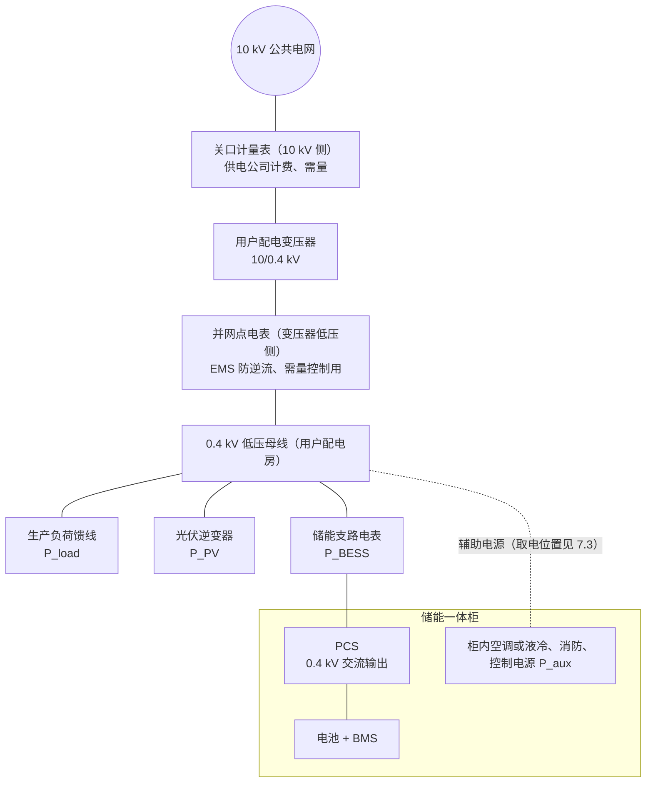
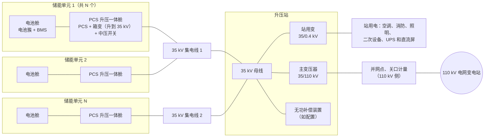
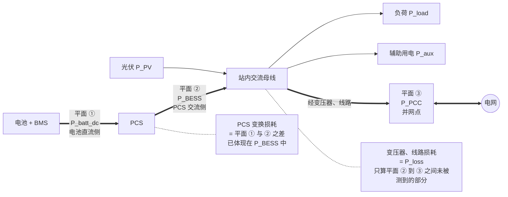
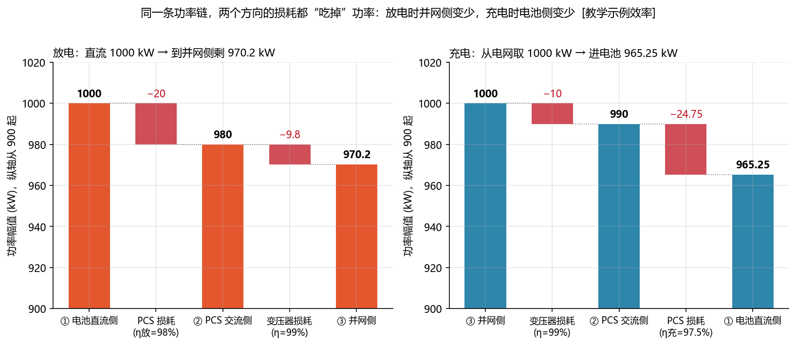
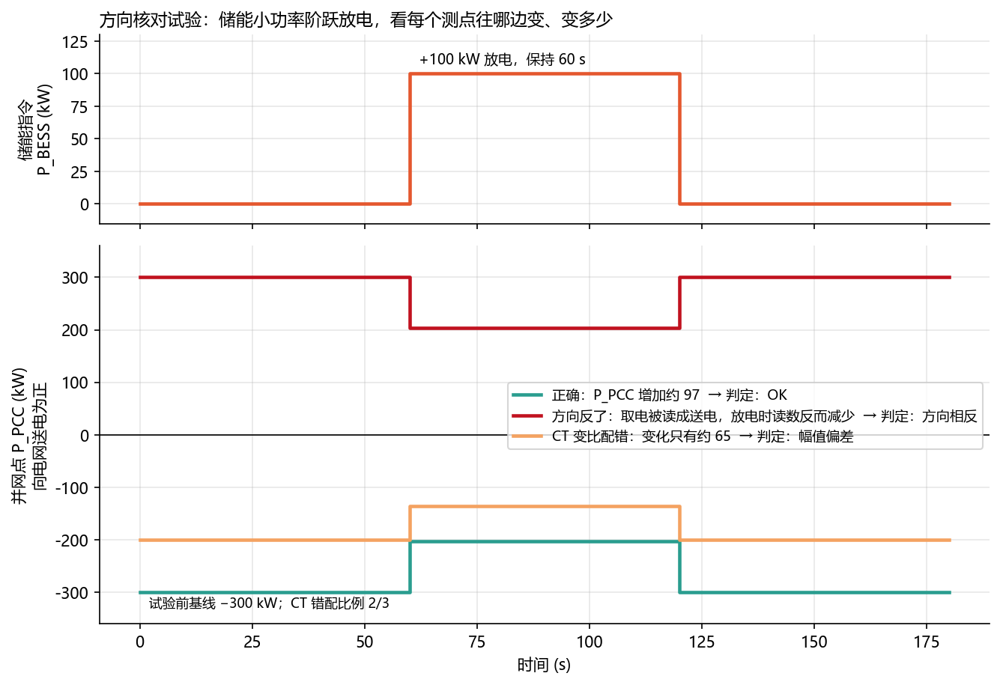
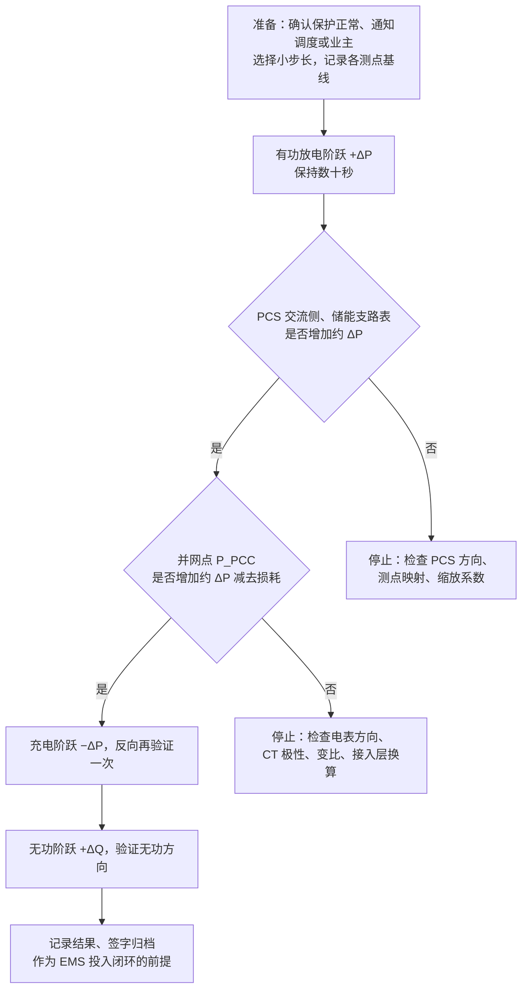
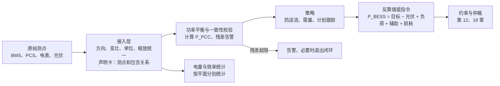

<!-- @AI_GENERATED -->
# 07 电站拓扑、测量平面与功率平衡

> [课程首页](README.md) · 上一章：[06 储能变流器（PCS）的能力边界、控制模式与并网接口](06_PCS与并网.md) · 下一章：[08 EMS 系统架构与部署](08_EMS系统架构与部署.md)

**一句话**：先确定功率从哪里流到哪里、每个量在哪个测量平面，再写功率平衡；测点、方向、损耗归属一旦错了，后面所有算法都会跟着错。

## 本章目标

读完本章，你应能：

1. 从单线图识别工商业用户侧和电网侧独立储能的功率路径、并网点和控制点；
2. 区分电池直流侧、PCS 交流侧和 PCC 三个测量平面，明确 PCS、变压器、线路和辅助负荷的归属；
3. 按充电/放电方向计算效率链，并统一 `P_BESS`、`P_PCC`、`P_import` 的符号；
4. 编写站点功率平衡、由 PCC 目标反算储能指令，并用残差和方向核对试验定位接入错误；
5. 识别控制点与计费/调度考核点的差异，为后续防逆流、需量和计划控制提供可靠输入。

## 本章边界与前置

本章解决“**电站各功率量在哪个平面、如何换算、怎样在并网点闭合功率平衡**”。第 06 章负责 PCS 自身能力；第 08 章展开 EMS 系统架构；第 10～12 章展开数据质量、控制流水线和安全约束；第 14、18、19 章继续讨论需量、仲裁分配和仿真验收。本章依赖第 02 章的功率平衡与方向约定，以及第 06 章的 PCS 和升压变压器概念。

本章所有功率项必须先声明测量点、正方向、单位、采样时间和包含关系。特别是：`P_BESS` 默认指 PCS 交流侧；`P_aux` 只表示**没有被其他测点包含、且需要在当前平衡平面扣除**的辅助消耗；`P_loss` 只表示当前平面到 PCC 之间没有被其他测点反映的损耗。不同测量平面的功率不能直接相加减。

**配套练习**：运行 `lab/examples/ch07_site_balance.py`，先复现 1000 kW 直流功率到 PCC 的效率链和 458 kW 平衡结果，再故意把直流功率当成交流功率，观察残差诊断。

---

## 7.1 现场场景：测量平面混用导致 PCC 残差【必懂】

某工商业储能项目调试第一天，EMS 页面上“按分项算出的并网点功率”和“并网点电表实测”总是差 20～30 kW，而且储能功率越大差得越多。

排查结果：开发者把 BMS 上送的**电池直流功率**当成了 `P_BESS` 代入功率平衡公式。储能放电 1000 kW（直流侧）时，PCS 交流侧实际只有 980 kW，中间 20 kW 是 PCS 的变换损耗；再经过变压器，又少了约 10 kW。

公式没错，错的是**把不同位置测到的功率混在一起算**。这一章先把电站的“地图”画清楚，再讲在地图上怎么记账。

---

## 7.2 典型电站拓扑与并网边界【必懂】

储能站的接入方式很多，但 EMS 开发最常遇到的是下面两种。真实项目以设计院的单线图为准，本节图是方框级示意。

### 拓扑①：工商业用户侧 0.4 kV 接入

储能装在工厂或园区的配电房旁边，和生产负荷、屋顶光伏接在**同一条 0.4 kV 低压母线**上：



特点：

- **不单独升压**：PCS 直接输出 0.4 kV，借用用户已有的配电变压器；
- **并网点在用户配电房**：EMS 通常以变压器低压侧（或进线柜）的电表作为控制用的“并网点”；
- **负荷和光伏是“外部扰动”**：EMS 管不了负荷，只能调储能（必要时限光伏）去满足防逆流、需量等约束（第 12、14 章）；
- **计量点可能在更高一级**：供电公司计费的关口表常在 10 kV 侧，与 EMS 控制用的电表不是同一块（7.8）。

### 拓扑②：电网侧独立储能的 35/110 kV 升压接入

大型储能站（几十到几百 MW）自成一个电站，结构类似一座小型发电厂：



特点：

- **两级升压**：PCS 交流侧几百伏 → 一体舱内箱变升到 35 kV → 升压站主变升到 110 kV `[行业典型值]`，电压等级按接入方案不同；
- **集电线**：多台一体舱用 35 kV 电缆“串”在一条线上汇到升压站，一条集电线故障会让整串单元同时失去出力；
- **站用电从站内取**：正常时由站用变从 35 kV 母线取电，另有外接备用电源（例如附近的 10 kV 线路或柴油发电机）保证全站停运时消防和控制系统不断电；
- **调度只看并网点**：AGC、计划曲线、一次调频考核都以并网点（或调度指定的考核点）的功率为准，而 EMS 能直接控制的只是每台 PCS 的交流侧功率。两者之间隔着箱变、集电线、主变的损耗和站用电。

| 对比项 | 拓扑① 工商业 0.4 kV | 拓扑② 电网侧 35/110 kV |
|---|---|---|
| 规模 `[行业典型值]` | 数百 kW ～ 数 MW | 数十 ～ 数百 MW |
| 并网点 | 用户配电房低压侧或进线 | 升压站高压侧 |
| 同一母线上还有谁 | 负荷、光伏 | 基本只有储能自己（和站用电、无功补偿） |
| EMS 主要控制目标 | 防逆流、需量、峰谷套利 | 计划曲线、AGC、一次调频、AVC |
| 功率平衡的难点 | 负荷、光伏、储能的测点和方向是否一致 | 多级损耗、站用电、PCS 合计与并网点的差 |

---

## 7.3 辅助负荷、站用电与功率归属【必懂】

储能系统在运行和待机时都要消耗电能，这部分叫**辅助负荷**或**站用电**，记作 `P_aux`（消耗为正）。

| 辅助负荷 | 作用 | 功率特点 | 常见取电位置 |
|---|---|---|---|
| 液冷机组 / 空调 | 给电池和 PCS 散热 | **随环境温度和充放电功率变化**，夏季满功率时最大 | 舱内辅助变压器、箱变低压侧，或站用电 0.4 kV 馈线 |
| 消防系统 | 探测、报警、灭火 | 平时小，动作时短时较大；**必须保证供电** | 站用电 + UPS，或独立的消防电源 |
| 照明、通风、除湿 | 舱内和站区环境 | 基本恒定 | 站用电 |
| 控制电源 | BMS、PCS 控制板、EMS、通信、保护装置 | 小而恒定，**不能中断** | UPS、直流屏（蓄电池后备） |

取电位置决定了它出现在功率平衡的哪一项：

- **从储能支路电表下游取**（例如柜内空调接在 PCS 交流出口与支路电表之间）：储能支路电表测到的 `P_BESS` 已经扣掉了辅助用电，公式中**不能再减** `P_aux`；
- **从并网点下游的另一条馈线取**（例如工商业站从 0.4 kV 母线单独拉一路给储能柜空调）：需要单独计量或估算，作为 `P_aux` 减去；
- **从负荷馈线里取**（和生产负荷共用一个电表）：它已经包含在 `P_load` 里，公式中**不能再减** `P_aux`。

这就是 7.12 “辅助负荷重复统计”故障的根源。经验上，**每个功率项都要在点表或配置里写一张“声明卡”**：

| 声明项 | 示例 |
|---|---|
| 测量点 | 0.4 kV 母线 3# 馈线柜，储能支路 |
| 正方向 | 放电为正（已在接入层换算） |
| 单位与缩放 | kW，寄存器 × 0.1 |
| 采样时间与刷新周期 | 1 s |
| 是否已包含辅助用电 | 否，柜内空调单独计量 |
| 是否已包含损耗 | 已包含 PCS 损耗；不含电缆损耗 |

> **软件类比**：辅助负荷的归属问题，很像分布式系统里的**请求计数去重**：同一个请求经过网关和服务两层埋点，汇总时如果两层都算，就会统计两次。必须明确“哪一层负责计数”。
>
> **类比失效点**：埋点重复只是报表不准；功率重复统计会直接让防逆流、需量控制的**控制量偏移**，造成倒送或需量超限。

---

## 7.4 测量平面与损耗归属【必懂】

同一股功率从电池流到电网，在不同位置测到的数值不同。课程把最重要的三个位置称为**测量平面**：



| 平面 | 符号 | 测在哪里 | 方向 | 包含什么 |
|---|---|---|---|---|
| ① 电池直流侧 | `P_batt_dc` | 电池簇 / 直流母线，BMS 或 PCS 直流侧上送 | 放电为正 | 只反映电池本体进出的功率 |
| ② PCS 交流侧 | `P_BESS` | PCS 交流端口，或储能支路电表 | 放电为正 | 已扣除 PCS 变换损耗 |
| ③ 并网点 | `P_PCC` | 站点与电网的分界点 | 向电网送电为正 | 所有设备、负荷、辅助用电、损耗的净结果 |

**损耗归属规则**（从原稿保留，请严格遵守）：

1. **PCS 变换损耗**发生在平面 ① 和 ② 之间，已经体现在 `P_batt_dc` 与 `P_BESS` 的差值中；
2. **变压器、线路损耗**发生在平面 ② 和 ③ 之间，属于功率平衡里的 `P_loss`；
3. 用 `P_BESS`（交流侧）写功率平衡时，`P_loss` **只包含** PCS 交流端口到并网点之间、**没有被任何测点反映**的损耗，**不能再扣一次 PCS 损耗**；
4. 如果从电池直流侧建模，就必须显式写出**方向相关**的 PCS、变压器、线路效率（7.5），不能把电池效率、PCS 效率和端到端效率混成一个参数；
5. `P_load` 是否已经包含辅助负荷、`P_aux` 是否已经包含在某个测量值中，**必须在点表中声明**（7.3 声明卡）。

一句话：**不同平面的功率不能直接相加减**。要跨平面比较，必须先经过效率换算。

---

## 7.5 充放电效率链与跨平面功率换算【必懂】

### 放电方向

功率从电池流向电网，每经过一个设备，乘以这个设备的效率：

**手算**（`[教学示例]`：PCS 放电效率 98%，变压器效率 99%）：

| 位置 | 计算 | 功率 | 这一步的损耗 |
|---|---|---:|---:|
| 平面 ① 电池直流侧 | — | 1000 kW | — |
| 平面 ② PCS 交流侧 | 1000 × 0.98 | 980 kW | PCS 20 kW |
| 变压器高压侧 | 980 × 0.99 | 970.2 kW | 变压器 9.8 kW |

电池放出 1000 kW，到并网侧只剩 **970.2 kW**，损耗合计 29.8 kW（约 3%）。

### 充电方向

功率从电网流向电池，方向反过来，每经过一个设备**同样要损失**，损失后剩下的才进到下一级：

**手算**（`[教学示例]`：变压器 99%，PCS 充电效率 97.5%）：

| 位置 | 计算 | 功率幅值 | 这一步的损耗 |
|---|---|---:|---:|
| 并网侧 | — | 1000 kW | — |
| 平面 ② PCS 交流侧 | 1000 × 0.99 | 990 kW | 变压器 10 kW |
| 平面 ① 电池直流侧 | 990 × 0.975 | 965.25 kW | PCS 24.75 kW |

从电网取 1000 kW，真正进电池的只有 **965.25 kW**。反过来问：想让电池直流侧充进 1000 kW，并网侧要取多少？`1000 ÷ 0.975 ÷ 0.99 ≈ 1036.0 kW`。



图中标注对照表：

| 编号 | 位置 | 标注 | 对应正文 |
|---|---|---|---|
| ① | 放电效率链 | 1000 kW、980 kW、970.2 kW | 电池直流侧、PCS 交流侧、并网侧功率 |
| ② | 放电损耗 | 20 kW、9.8 kW | PCS 和变压器损耗 |
| ③ | 充电效率链 | 1000 kW、990 kW、965.25 kW | 并网侧、PCS 交流侧、电池直流侧功率幅值 |
| ④ | 充电损耗 | 10 kW、24.75 kW | 变压器和 PCS 充电损耗 |

### 效率链公式与符号

```text
放电：P_下一级 = η_放 × P_上一级        （从电池往电网算）
充电：|P_下一级| = η_充 × |P_上一级|    （从电网往电池算）
```

| 符号 | 含义 | 单位 | 示例值 |
|---|---|---|---|
| η_放 | 功率从电池流向电网时，该设备“出 / 入”之比 | 无 | PCS 0.98 |
| η_充 | 功率从电网流向电池时，该设备“出 / 入”之比 | 无 | PCS 0.975 |
| P_上一级、P_下一级 | 沿功率流动方向相邻两个平面的功率 | kW | 1000、980 |

两个要点：

- **两个方向都在“吃”功率**：放电时并网侧比电池侧少，充电时电池侧比并网侧少。所以不能用“除以效率”一个公式处理两个方向，也不能在充电时把效率当成“放大”；
- **两个方向的效率可以不同**：PCS 整流和逆变的工作点不同，厂商常给出不同的效率曲线。代码里用 `Stage(name, eta_discharge, eta_charge)` 分开配置。

### 电网侧储能站：多级损耗和站用电

**手算**（`[教学示例]`：箱变 99%、集电线 99.5%、主变 99.5%，站用电 0.5 MW 从 35 kV 母线取）：

```text
PCS 交流侧合计              100 MW
经箱变、集电线到 35 kV 母线   100 × 0.99 × 0.995 = 98.505 MW
减去站用电                   98.505 − 0.5      = 98.005 MW
经主变到 110 kV 并网点        98.005 × 0.995    ≈ 97.51 MW
```

反过来，**要让并网点送出 100 MW，PCS 交流侧合计要发约 102.5 MW**。这引出一个在合同和调度协议里必须写清楚的问题：**电站的“额定功率”是在哪个平面定义的？** 是 PCS 铭牌之和、35 kV 母线，还是并网点？答案不同，PCS 选型和 EMS 的指令计算都不同。

### 代码

```python
# 真实实现中的站点接口（节选）
def chain_from_dc(p_dc_kw, stages):
    """已知直流侧功率，逐级推算到电网侧。放电乘 η_放，充电除以 η_充。"""
    powers = [p_dc_kw]
    p = p_dc_kw
    for st in stages:
        p = p * st.eta_discharge if p >= 0 else p / st.eta_chg
        powers.append(p)
    return ChainResult([st.name for st in stages], powers, _losses(powers))


CHAIN = [Stage("PCS", 0.98, 0.975), Stage("变压器", 0.99)]
chain_from_dc(1000, CHAIN).powers_kw     # [1000, 980, 970.2]
chain_from_grid(-1000, CHAIN).powers_kw  # [-965.25, -990, -1000]
```

效率链上的功率统一以“从电池流向电网”为正，所以充电时各平面的数值都是负的；损耗 `losses_kw` 恒为非负。`chain_from_grid` 是它的逆运算，测试验证了两者互逆。

---

## 7.6 功率方向、进口换算与 CT/PT 变比【必懂】

全课程的方向约定（与附录 B 一致）：

| 量 | 符号 | 代码字段 | 正方向 |
|---|---|---|---|
| 储能交流侧有功 | `P_BESS` | `p_bess_kw` | **放电为正**，充电为负 |
| 电池直流侧功率 | `P_batt_dc` | `p_batt_dc_kw` | 放电为正 |
| 并网点净有功 | `P_PCC` | `p_pcc_kw` | **向电网送电为正**（倒送），取电为负 |
| 电表 / 计费进口功率 | `P_import` | `p_import_kw` | 从电网取电为正，只在接入层和需量计费中使用 |
| 负荷、辅助用电、损耗 | `P_load`、`P_aux`、`P_loss` | `p_load_kw` 等 | 消耗为正 |
| 光伏 | `P_PV` | `p_pv_kw` | 发电为正 |
| 无功 | `Q_BESS`、`Q_PCC` | `q_bess_kvar` 等 | 向电网发出无功为正 |

### 电表“进口为正”的换算

很多工商业电表和计费系统用“从电网取电为正”。它和控制层 `P_PCC` 的关系只有一条：

```text
P_import = −P_PCC
```

| 电表读数 `P_import` | 控制层 `P_PCC` | 含义 |
|---:|---:|---|
| +70 kW | −70 kW | 从电网取电 70 kW |
| −20 kW | +20 kW | 向电网倒送 20 kW |

**换算只在数据接入层做一次**。控制算法内部只用 `P_PCC`，不允许某个策略模块“自己取个反”：一旦两处都取反，或一处取反一处没取，控制方向就会整体反转（第 00 章 0.8）。`P_grid` 这类含义模糊的名字不要用在核心公式里，它可能指电网侧、并网点，也可能指电网模型中的功率。

### CT、PT 变比

大电流、高电压不能直接接进电表，要经过**电流互感器（CT）**和**电压互感器（PT）**按比例缩小。电表测的是二次侧，乘以变比才是一次侧的真实值。例如 CT 1500/5 的变比是 300。

变比配置错误是现场最常见的“数值不对”原因之一。**手算**：CT 实际是 1500/5（变比 300），电表里配置成 1000/5（变比 200），真实取电 600 kW 时电表只报：

```text
600 × 200 / 300 = 400 kW
修正：400 × 300 / 200 = 600 kW
```

读数整体缩小为 2/3，方向正确、趋势正确，所以很难一眼看出来，要靠功率平衡残差（7.7）和方向核对试验（7.9）发现。

---

## 7.7 PCC 功率平衡、目标反算与残差诊断【必懂】

### 公式

在平面 ② 和平面 ③ 之间“记账”：

```text
P_PCC = P_PV + P_BESS − P_load − P_aux − P_loss
```

| 符号 | 含义 | 方向 | 示例值 |
|---|---|---|---|
| `P_PCC` | 并网点净有功 | 送电为正 | −122 kW |
| `P_PV` | 光伏交流侧发电 | 发电为正 | 300 kW |
| `P_BESS` | PCS 交流侧功率（平面 ②） | 放电为正 | +400 kW |
| `P_load` | 负荷（不含辅助用电） | 消耗为正 | 800 kW |
| `P_aux` | **没有被其他测点包含的**辅助用电 | 消耗为正 | 20 kW |
| `P_loss` | 平面 ② 到并网点之间**没有被测到的**损耗 | 消耗为正 | 2 kW |

### 手算表

某工商业站（拓扑①）在 0.4 kV 母线上的一组测量 `[教学示例]`：负荷 800 kW（生产负荷馈线，不含储能柜空调），储能柜空调单独计量 20 kW，母线到并网点电表之间的电缆损耗估算 2 kW。

| 工况 | `P_PV` | `P_BESS` | 计算 | `P_PCC` | 电表 `P_import` | 含义 |
|---|---:|---:|---|---:|---:|---|
| 基准 | 300 | +400 | 300 + 400 − 800 − 20 − 2 | **−122** | +122 | 取电 122 kW |
| 中午光伏大 | 700 | +400 | 700 + 400 − 822 | **+278** | −278 | 倒送 278 kW |
| 储能改充电 | 700 | −200 | 700 − 200 − 822 | **−322** | +322 | 取电 322 kW |
| 夜间停机 | 0 | 0 | 0 + 0 − 822 | **−822** | +822 | 取电 822 kW |

### 由并网点目标反算储能指令

把公式移项，就得到“要让并网点等于某个目标，储能该出多少”：

```text
P_BESS = P_PCC,目标 − P_PV + P_load + P_aux + P_loss
```

接口默认 `P_load` 不含辅助用电；如果负荷测点已经包含 `P_aux`，调用目标反算接口时必须声明 `load_includes_aux=True`，这样 `P_aux` 不会被重复加入。这个参数只改变辅助负荷归属，不改变功率方向和限幅逻辑。

**手算**：光伏 700 kW，项目不允许倒送（`P_PCC,目标 = 0`）：

```text
P_BESS = 0 − 700 + 800 + 20 + 2 = 122 kW
```

储能放电最多只能到 122 kW。若光伏升到 1000 kW，则 `P_BESS = −178 kW`，储能需要**充电** 178 kW 才能不倒送；如果此时电池只能再充 100 kW，限幅后仍有 78 kW 倒送，只能靠光伏限发兜底（第 00 章 0.4 的 ④′ 时段）。

### 最小闭环：效率链、功率平衡与残差诊断

本例把“不同测量平面不能直接相加”走成一个可执行闭环：

```text
输入：电池直流放电 1000 kW；PCS 效率 0.98；变压器效率 0.99
      光伏 300 kW；负荷 800 kW；辅助 20 kW；线路损耗 2 kW
算法：
  ① PCS 交流功率 = 1000 × 0.98 = 980 kW
  ② PCC = 300 + 980 − 800 − 20 − 2 = 458 kW
  ③ 用 PCC 实测值与计算值比较，残差 = 实测 − 计算
输出：PCC=458 kW；正常实测 458 → 残差 0
```

| 符号 | 含义 | 单位 | 示例值 |
|---|---|---|---:|
| `P_batt_dc` | 电池直流侧功率 | kW | 1000 |
| `η_PCS` | PCS 放电效率 | — | 0.98 |
| `P_BESS` | PCS 交流侧功率 | kW | 980 |
| `P_PV` | 光伏出力 | kW | 300 |
| `P_load` | 生产负荷 | kW | 800 |
| `P_aux` | 未包含在负荷中的辅助用电 | kW | 20 |
| `P_loss` | 交流侧到 PCC 的未计量损耗 | kW | 2 |
| `P_PCC` | 并网点净功率，向电网送电为正 | kW | 458 |

对应脚本：`lab/examples/ch07_site_balance.py`。脚本还故意把 1000 kW 直流功率错误地当成交流功率，展示单点残差可能与辅助负荷漏计混淆；实际诊断必须用多个功率点和方向试验复核。


### 用残差检查数据是否可信

并网点有电表实测值时，可以拿它和分项计算值比较：

```text
残差 = P_PCC,实测 − P_PCC,计算
```

残差长期稳定在容差内，说明测点、方向、声明卡都对；残差出现规律性偏差，往往直接指向原因：

| 残差特征 | 可能原因 |
|---|---|
| ≈ +P_aux | 辅助用电被重复统计（`P_load` 已包含 `P_aux`） |
| ≈ −P_aux | 有一路辅助用电漏计 |
| ≈ −2 × P_BESS | 储能功率方向接反 |
| 实测 ≈ −计算 | 并网点电表方向接反 |
| 实测 / 计算 ≈ 固定倍数 | CT/PT 变比或缩放系数错误 |
| 随功率变化、比例约为 PCS 效率 | 把直流侧功率当成了交流侧（7.1） |
| 忽大忽小、与负荷变化同步 | 各测点采样时间不同步（第 10 章） |

```python
# 真实实现中的站点接口（节选）
def site_pcc_kw(p_pv_kw, p_bess_kw, p_load_kw, p_aux_kw=0.0, p_loss_kw=0.0,
                load_includes_aux=False):
    aux = 0.0 if load_includes_aux else p_aux_kw     # 声明卡说“已包含”，就不能再减
    return pcc_injection_kw(p_bess_kw, p_load_kw, aux, p_loss_kw, p_pv_kw)


def diagnose_balance(p_pcc_measured_kw, p_pv_kw, p_bess_kw, p_load_kw,
                     p_aux_kw=0.0, p_loss_kw=0.0, tol_kw=5.0):
    """残差 = 实测 − 计算，按上表的特征给出“嫌疑”。"""
    ...
```

`site_pcc_kw` 直接复用了第 02 章 `power.py` 的 `pcc_injection_kw`，保证全课程只有一个功率平衡公式。`diagnose_balance` 只给出嫌疑，最终要靠图纸和 7.9 的试验确认。

---

## 7.8 计量点、控制点与考核点边界【必懂】

“并网点功率”这个词，在一个项目里可能对应好几块表：

| 用途 | 常见测点 | 谁关心 |
|---|---|---|
| **计费、需量** | 供电公司的关口计量表（工商业常在 10 kV 进线侧） | 业主、供电公司 |
| **调度考核** | 调度指定的考核点（电网侧储能常在并网点高压侧） | 调度 |
| **EMS 控制** | EMS 能快速、稳定读到的电表（常在变压器低压侧或 35 kV 母线） | EMS |
| **防孤岛、并网保护** | 保护装置自己的互感器 | 保护装置 |

它们之间可能隔着变压器、线路损耗，甚至隔着其他负荷。以拓扑①为例：EMS 用 0.4 kV 侧电表做需量控制，而计费看 10 kV 关口表，两者相差一台配电变压器的损耗；如果用户还有第二台变压器挂着别的负荷，计费表还会多出那部分负荷。

设计时要逐条回答：

1. 每个控制目标（防逆流、需量、计划跟踪）**按合同或规程以哪块表为准**？
2. EMS 控制用的表和它差多少？差值是否稳定？要不要在目标里留余量或做补偿？
3. 那块表的数据 EMS 能否实时读到？刷新周期、延迟多少？读不到时用什么替代？

例如：需量以 10 kV 关口表计费、限值 1800 kW，而 EMS 控制用 0.4 kV 表，那么 EMS 的控制目标应当低于 1800 kW，差值至少覆盖变压器损耗和没被 0.4 kV 表覆盖的负荷（第 14 章）。

---

## 7.9 并网功率方向与变比核对试验【必懂】

方向、变比、测点映射的错误，**用试验发现比用代码推理可靠得多**。原理很简单：让储能按已知的小步长动作，看每个测点是不是按预期方向、预期幅度变化。



图中标注对照表：

| 编号 | 位置 | 标注 | 对应正文 |
|---|---|---|---|
| ① | 储能阶跃 | 100 kW、60 s | 小步长放电试验 |
| ② | 正确方向曲线 | 97 kW | 经过损耗后 PCC 增量 |
| ③ | CT 变比错误曲线 | 65 kW | 变化幅值约为 2/3 |
| ④ | 试验基线 | −300 kW | 试验前从电网取电 300 kW |
| ⑤ | 变比比例说明 | 2/3 | 实际 1500/5、配置 1000/5 的缩小比例 |



操作要点：

- **步长要小**：例如额定功率的 5%～10% `[教学示例]`，并确认不会造成倒送、需量越限或调度偏差，电网侧储能要提前与调度沟通；
- **每个测点都要看**：BMS 直流功率、PCS 交流功率、储能支路表、并网点表、计费表（能读到的话）、调度上送值，逐一对照“预期方向、预期幅度”；
- **幅度也要核**：方向对但幅度只有预期的 2/3，就是变比问题；
- **电表原始值和换算后的值都要记录**：“进口为正”的电表，储能多放 100 kW 时原始读数应当**减少**约 100 kW，换算后的 `P_PCC` 应当**增加**；
- **无功也要做**：无功方向约定比有功更混乱（第 17 章），不做试验几乎一定会出错；
- **结果固化为回归测试**：把试验记录的数据保存下来，将来改接入层配置时回放验证（第 19 章）。

```python
# 真实实现中的站点接口（节选）
def check_direction(delta_expected_kw, delta_observed_kw, tol_ratio=0.2):
    if abs(delta_observed_kw) < tol_ratio * abs(delta_expected_kw):
        return "无响应：检查通信、测点映射或 PCS 是否执行"
    ratio = delta_observed_kw / delta_expected_kw
    if ratio < 0:
        return "方向相反：检查电表/PCS 的正方向定义和接入层换算"
    if abs(ratio - 1) > tol_ratio:
        return f"幅值偏差：实测变化是预期的 {ratio:.2f} 倍，检查变比、缩放系数或单位"
    return "OK"
```

---

## 7.10 功率平衡在 EMS 控制链路中的位置【必懂】



本章的内容集中在前两层：**接入层负责“翻译正确”，功率平衡负责“账目对得上”**。策略层拿到的必须是已经统一方向、统一平面、声明清楚包含关系的数据。残差持续超限时，EMS 不应继续基于错误数据闭环控制，而应告警并退到安全模式（第 12 章）。

---

## 7.11 功率平衡与测量接入常见误区【必懂】

| 误区 | 正确理解 |
|---|---|
| BMS 功率、PCS 功率、支路电表功率是同一个数 | 分属平面 ① 和 ②，相差 PCS 损耗；支路电表和 PCS 端口之间可能还有辅助用电 |
| `P_loss` 就是全站所有损耗 | 只包含平面 ② 到并网点之间**没有被测到**的损耗，PCS 损耗已在 `P_BESS` 中 |
| 充电时用“除以效率”就行 | 充电时功率从电网流向电池，每一级同样按 η_充 衰减，而且 η_充 可能不等于 η_放 |
| 变压器效率是常数 | 空载损耗与功率无关，轻载时效率低；待机时站点也在耗电（见深入） |
| 电表取个反就行，哪里方便在哪里取 | 只在接入层取反一次，控制算法内部只用一套方向 |
| 控制用的表就是计费的表 | 常常不是，两者之间可能有损耗和其他负荷，目标要留余量 |
| 方向对了就说明接入没问题 | 还要核对幅度：变比错误时方向和趋势都对，数值不对 |
| 防倒送和防非计划充电是同一个功能 | 防倒送限制 `P_PCC` 为正，防非计划充电限制 `P_BESS` 为负，是两个独立约束（第 12 章） |

## 7.12 现场故障复盘：效率、辅助负荷与变比失配【必懂】

**案例一：充放电效率 103%。**
某站 EMS 日报显示储能“往返效率 103%”，电量统计明显不合理。原因是储能支路电表的 CT 极性装反，接入层又按“放电为正”直接使用，结果充电量和放电量被互换统计：日报里的“放电量”其实是更大的充电量。
**教训**：效率超过 100%、或者某一天效率突变，首先怀疑方向和测点映射。方向核对试验要覆盖**每一块用于统计的电表**，而不仅是控制用的电表。

**案例二：辅助负荷重复统计导致小幅倒送。**
某工商业站的负荷数据不是直接测的，而是用“关口表 − 储能 − 光伏”反推出来的，这个“负荷”里已经包含了储能柜空调。EMS 配置里又把空调功率作为 `P_aux` 单独减了一次。计算出的 `P_PCC` 比实际偏“取电”约 20 kW，防逆流前馈因此允许储能多放 20 kW。轻载时段，并网点持续小幅倒送，触发了逆功率保护告警。
**修复**：按 7.3 的声明卡注明“负荷测点已包含辅助用电”（代码中 `load_includes_aux=True`）；上线后监视功率平衡残差，残差稳定在 +20 kW 就是这类问题的典型特征。

**案例三：CT 变比配错，需量超限。**
某工厂更换了进线柜 CT（1000/5 换成 1500/5），但 EMS 读取的电表里仍配置为 1000/5。电表读数只有真实值的 2/3：真实取电 1800 kW 时，EMS 以为只有 1200 kW，需量控制完全没有动作，当月需量电费大幅上升。
**教训**：设备改造后，接入层配置（变比、缩放系数、方向）必须重新核对并重做方向核对试验；EMS 应当定期比较控制用电表与计费电量、功率平衡残差，发现系统性倍数偏差时告警。

---

## 7.13 自测：拓扑、效率链与 PCC 平衡

1. 电池直流侧放电 500 kW，PCS 放电效率 97%，变压器效率 98.5%，并网侧能送出多少？
2. 从电网取 500 kW 充电，变压器效率 98.5%，PCS 充电效率 96%，进入电池的功率是多少？
3. “进口为正”的电表读数为 +250 kW，控制层的 `P_PCC` 是多少？站点在取电还是送电？
4. 光伏 500 kW，储能充电 300 kW，负荷 600 kW，辅助用电 15 kW，未测损耗 5 kW，`P_PCC` 是多少？
5. 同一站点，光伏升到 900 kW，要求不倒送，储能应当如何动作？
6. 为什么控制用电表和计费电表不同，会影响需量控制的目标设定？
7. 第 4 题的站点，如果负荷测点其实已经包含了 15 kW 辅助用电，而配置里又减了一次 `P_aux`，功率平衡残差会是多少？

<details>
<summary>参考答案</summary>

1. 500 × 0.97 = 485 kW，485 × 0.985 ≈ 477.7 kW。
2. 500 × 0.985 = 492.5 kW，492.5 × 0.96 = 472.8 kW。
3. `P_PCC = −250 kW`，站点从电网取电 250 kW。
4. `500 − 300 − 600 − 15 − 5 = −420 kW`，取电 420 kW。
5. `P_BESS = 0 − 900 + 600 + 15 + 5 = −280 kW`，储能至少要充电 280 kW；若充电能力不足，需要光伏限发。
6. 需量按计费电表统计，而 EMS 按控制用电表调节。两者之间有变压器损耗或其他负荷时，EMS 看到的取电功率偏小，必须把控制目标设得比需量限值更低，留出差值余量。
7. 负荷读数为 615 kW（含辅助），再减 15 kW，计算值为 −435 kW；实测为 −420 kW，残差 = −420 − (−435) = +15 kW，正好等于 `P_aux`，这是重复统计的典型特征。

</details>

---

## 7.14 深入：变压器损耗、往返效率与平衡边界【深入】

<details>
<summary>变压器损耗不是固定比例</summary>

变压器损耗分两部分：

```text
P_loss_变 = P_0 + P_k × (S / S_rated)²
```

- `P_0`：空载损耗（铁损），只要变压器带电就存在，与负载无关；
- `P_k`：额定负载下的负载损耗（铜损），与电流平方成正比。

**手算**（`[教学示例]`：2000 kVA 变压器，P_0 = 2 kW，P_k = 16 kW）：

| 负载 | 损耗 | 等效效率 |
|---|---|---|
| 50%（1000 kVA，按 1000 kW 计） | 2 + 16 × 0.25 = 6 kW | 约 99.4% |
| 10%（200 kVA，按 200 kW 计） | 2 + 16 × 0.01 = 2.16 kW | 约 98.9% |
| 0（待机） | 2 kW | 无意义，但一直在耗电 |

所以正文的“固定效率”是简化模型。精细的效率统计、待机损耗分析要用这个模型，或者直接用两侧电表的差值。这也解释了为什么储能站**待机一整天也会从电网取电**：变压器空载损耗加上辅助用电。实现见 `transformer_loss_kw`。

</details>

<details>
<summary>往返效率要说清楚“从哪到哪”</summary>

“往返效率”（充一次再放一次，放出电量 ÷ 充入电量）必须说明两个端点在哪个平面：

- 只看功率链：`0.98 × 0.99 × 0.975 × 0.99 ≈ 93.6%`（本章示例参数，`round_trip_efficiency`）；
- 再乘以电池本体的充放电效率，才是并网点到并网点的效率；
- 如果统计周期里包含待机时段，还要扣掉空载损耗和辅助用电，数值会更低。

合同里的“系统效率”、BMS 报告的“电池效率”、EMS 统计的“站点效率”常常口径不同，比较前先对齐端点和统计周期。

</details>

<details>
<summary>功率平衡的工程边界</summary>

本章公式基于稳态、平衡三相、基波有功，并假设各测点同时采样。实际工程中还要注意：

- 各测点的采样时间、刷新周期不同，快速变化时残差会“抖动”，比较前要对齐时间戳或做平滑（第 10 章）；
- 电表有精度等级，残差容差要按各表精度合成，而不是设成 0；
- 三相不平衡时，三相总功率平衡仍成立，但单相可能越限（第 02 章深入）；
- 无功平衡的写法相同，但无功在线路和变压器中的“损耗”（无功消耗）占比远大于有功，不能照搬有功的效率假设（第 17 章）。

每个功率项都必须声明测量点、正方向、单位、采样时间、是否已包含辅助用电、是否已包含损耗（7.3 声明卡）。计量点不同的功率不能在不做效率和方向换算的情况下直接相加。

</details>

<!-- @AI_GENERATED: end -->
