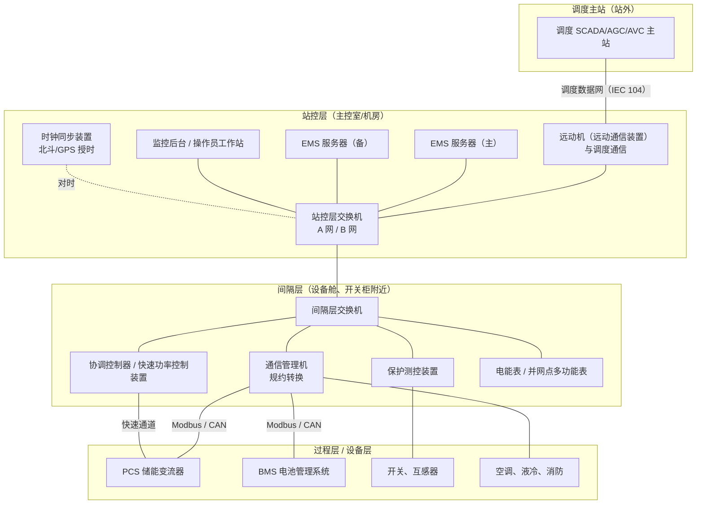
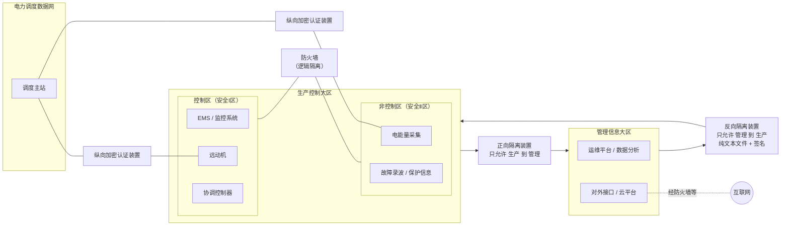
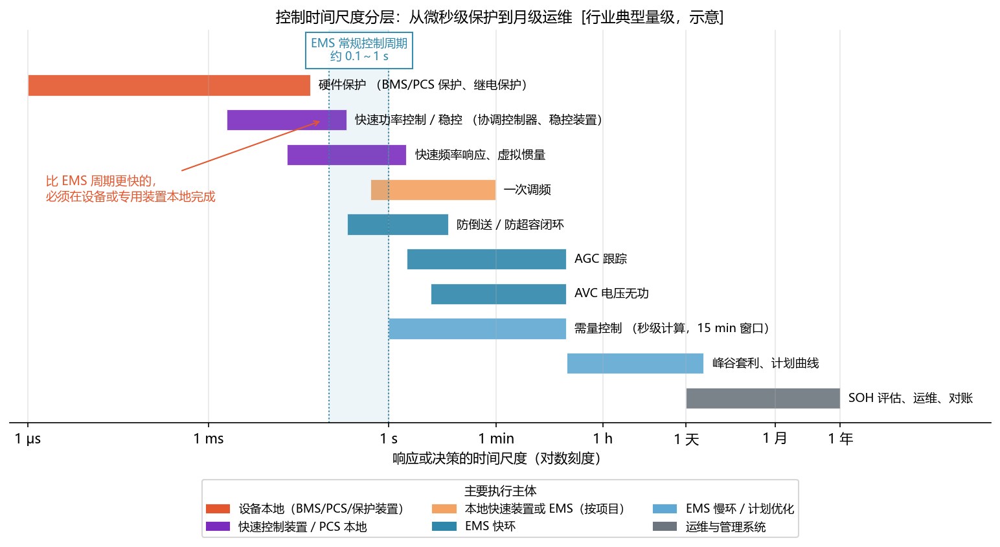
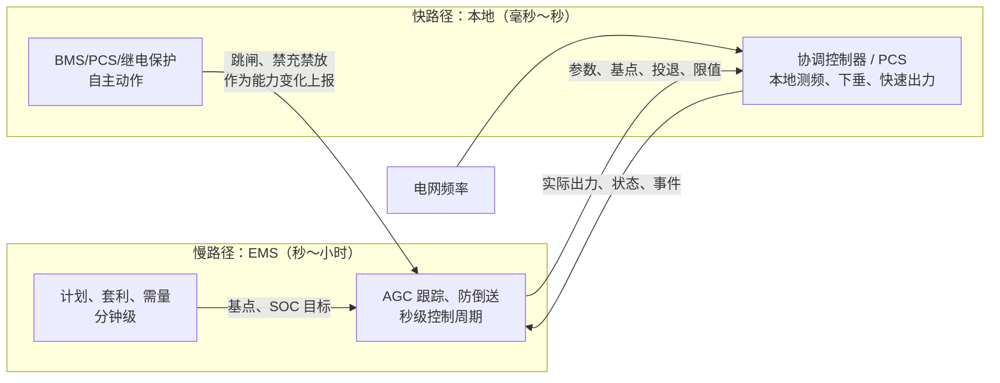
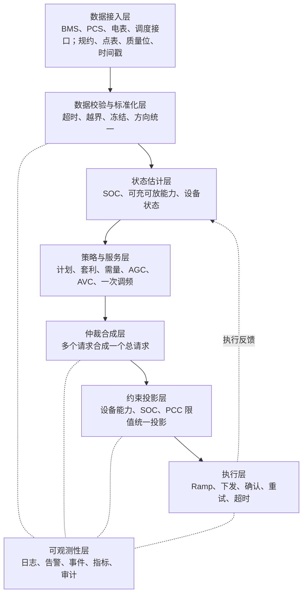
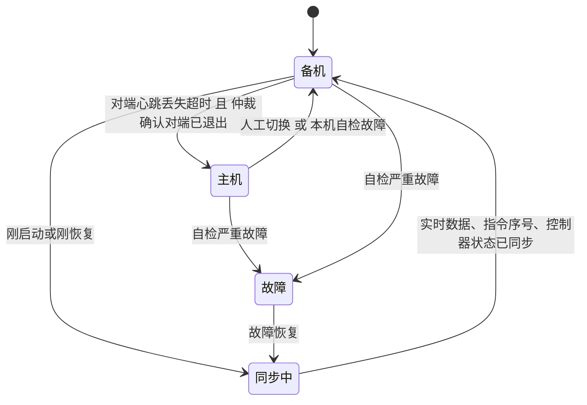

<!-- @AI_GENERATED -->
# 08 EMS 系统架构、部署与安全边界

> [课程首页](README.md) · 上一章：[07 电站拓扑、测量平面与功率平衡](07_电站拓扑与功率平衡.md) · 下一章：[09 EMS 控制流水线、约束投影与执行闭环](09_EMS软件控制流水线.md)

**一句话**：EMS 不是一台服务器上的一个程序，而是分布在三层网络、多个安全分区和多种时间尺度里的一组装置与软件。

## 本章目标

读完本章，你应能：

1. 画出站控层、间隔层、过程层的部署关系，并说明 EMS、远动机、通信管理机、PCS 和协调控制器的职责；
2. 根据安全分区和网络边界，判断数据与控制指令允许经过哪些装置；
3. 用延迟预算判断功能应放在 EMS、协调控制器、PCS 还是保护装置本地；
4. 解释主备切换时为什么必须同步命令序号、Ramp 状态和实测功率，并区分教学模型与现场高可用方案。

## 本章边界与前置

本章解决“**EMS 由哪些部署层、网络边界和控制路径组成，以及功能应放在哪个时间尺度和设备上**”。第 09 章展开控制周期和软件流水线；第 10 章展开通信接入与数据质量；第 19～21 章展开仿真、可观测性和综合验收。本章依赖第 06 章 PCS 并网、第 07 章电站拓扑与功率平衡。

本章的物理网络、安全隔离、主备选举和调度装置描述属于架构与工程边界说明；`lab` 中可运行的最小证据主要覆盖延迟求和、命令序号 fencing、流水线恢复和故障场景，不等同于真实站控系统的双机选主、脑裂仲裁或网络安全装置实现。

**配套练习**：运行 `lab/examples/ch08_architecture_trace.py`，修改各段延迟和主备序号，观察端到端响应时间与旧命令拒绝结果。

---

## 8.1 现场场景：第一次去储能站调试【必懂】

你写好了 EMS 程序，带着笔记本去一座 **100 MW / 200 MWh `[教学示例]`** 的电网侧储能站调试。到了现场才发现：

- 机房里的 EMS 服务器**没有外网**，`pip install` 装不了任何包；
- 你的笔记本不允许直接插进站控层交换机，要先登记、查杀、使用专用运维终端；
- 调度的 AGC 指令不是直接发给 EMS 的，而是先到一台叫“远动机”的装置，再转给 EMS；
- PCS 的数据也不是 EMS 直接读的，中间隔着“通信管理机”；
- 业主想在手机上看电站实时数据，数据要先穿过一台“正向隔离装置”，而且**只能出、不能进**；
- 调度要求一次调频在很短时间内响应，项目最终把它放进了“协调控制器”，EMS 只负责下发参数和投退。

这些都不是软件设计的“可选项”，而是电力行业的部署规则。这一章把它们讲清楚。

---

## 8.2 物理部署：站控层、间隔层、过程层【必懂】

### 原理：按“离一次设备多远”分层

电力行业习惯把变电站、电站的二次系统（测量、控制、保护、通信）分成三层。这个分法来自变电站自动化，IEC 61850 体系中也使用同样的层次：

| 层 | 离一次设备 | 放什么 | 时间要求 |
|---|---|---|---|
| **站控层** | 最远，在主控室/机房 | 全站级的监视、控制、管理：EMS 服务器、监控后台、远动机、时钟同步 | 秒级为主 |
| **间隔层** | 中间，在各个开关柜、设备舱附近 | 以“间隔”（一条线路、一台变压器、一个储能单元）为单位的保护、测控、计量 | 毫秒到秒 |
| **过程层**（储能站常称“设备层”） | 最近，直接连一次设备 | 互感器、合并单元、智能终端；储能站里还包括 PCS、BMS、电池、开关 | 微秒到毫秒 |

“一次设备”指直接流过电能的设备（电池、PCS、变压器、开关、电缆），“二次设备”指测量、控制、保护一次设备的装置。EMS 属于二次系统，**一度电都不流过它**。

### 一座储能站的典型部署



### 每台设备做什么

| 设备 | 在哪层 | 做什么 | 与 EMS 的关系 | 软件类比 |
|---|---|---|---|---|
| **EMS 服务器（主备）** | 站控层 | 站级策略、调度跟踪、约束、仲裁、功率分配、记录 | 本课程写的程序就跑在这里 | 控制平面服务，双副本 |
| **监控后台 / 操作员工作站** | 站控层 | 画面、告警、遥控操作、报表；有时和 EMS 合为一套“监控系统” | 展示 EMS 的状态，把运行人员的操作转给 EMS | 管理控制台 / Web 前端 |
| **远动机（远动装置、远动通信装置）** | 站控层 | 站内与调度之间**唯一的通信出口**：把站内数据按调度规约（常用 IEC 104）上送，把调度指令转进站内 | AGC/AVC 指令从它进来，EMS 的上送数据从它出去 | 对外 API 网关 |
| **通信管理机** | 间隔层（或站控层） | 采集各厂家设备，把 Modbus、CAN、厂家私有规约**转换**成站内统一规约 | EMS 读到的 PCS/BMS 数据大多经过它；它的轮询周期直接影响数据延迟 | 协议适配器 / sidecar |
| **协调控制器 / 快速功率控制装置** | 间隔层 | 毫秒到百毫秒级的快速功率控制：一次调频、快速调频、稳控切机切负荷的配合 | EMS 给它下发参数、基点和投退；它把实际出力回报给 EMS | 数据平面的快速路径 |
| **保护测控装置** | 间隔层 | 继电保护（过流、差动等）+ 开关的测量和控制 | EMS **读取**其状态和测量值，不能替代保护 | 硬件看门狗 |
| **电能表 / 多功能表** | 间隔层 | 计费计量、并网点 P/Q/U/f 测量 | 防倒送、需量、调度考核的依据 | 监控探针 |
| **时钟同步装置** | 站控层 | 接收北斗/GPS 卫星时间，通过 IRIG-B、NTP、PTP 等给全站设备对时 | 所有时间戳的共同来源（第 10 章） | NTP 服务器 |
| **交换机** | 各层 | 站控层网络常为 A/B 双网冗余 | EMS 通常双网卡分别接 A 网、B 网 | 网络基础设施 |
| **PCS、BMS** | 设备层 | 功率变换、电池管理与保护 | 执行 EMS 指令；把能力和告警报给 EMS | 执行器 + 内核态保护 |

> **软件类比**：这很像一个多集群的微服务部署。站控层是控制平面，远动机是唯一的对外 API 网关，通信管理机是把各种老旧协议适配成统一接口的 adapter，协调控制器是不经过控制平面的快速数据平面。
>
> **类比失效点**：微服务可以随时加一个旁路调试接口；电站的每一个网络连接都要在安全防护方案里登记，**私自加一条连接本身就是违规**（8.3）。另外，每一层的装置往往来自不同厂家，你拿不到它们的源代码，只能按点表和规约联调。

### 两条数据主路径

| 方向 | 路径 | 典型延迟来源 |
|---|---|---|
| 上行（设备 → 调度） | PCS/BMS → 通信管理机 → EMS → 远动机 → 调度 | 通信管理机轮询周期、EMS 刷新周期、远动机变化上送策略 |
| 下行（调度 → 设备） | 调度 → 远动机 → EMS → 通信管理机 → PCS | 远动机转发、EMS 控制周期、下行写命令排队 |

有的项目会让调度的 AGC 指令经远动机**直接**送到协调控制器，EMS 只做监视和慢速优化。选哪种由项目的响应时间要求决定（8.5、第 09 章 9.6 的延迟预算）。

---

## 8.3 电力监控系统安全防护：它决定了你的软件能做什么【必懂】

### 为什么电力行业对网络安全这么严

普通系统被攻破，损失的是数据；电力监控系统被攻破，攻击者可以**直接操作开关和功率**，后果是停电、设备损坏甚至人身伤害。2015 年底乌克兰电网遭遇网络攻击，攻击者远程操作配电调度系统断开开关，造成大面积停电，这是公开报道中第一起由网络攻击直接导致的停电事件。

国内对电力监控系统（包括储能站的 EMS、监控系统、远动、计量等）有专门的安全防护规定。核心是 16 个字：

| 原则 | 含义 | 对应装置 |
|---|---|---|
| **安全分区** | 按业务的重要程度和对一次系统的影响程度，把系统划分到不同安全区 | —— |
| **网络专用** | 调度业务使用专用的电力调度数据网，与公用网络（互联网）物理隔离 | 调度数据网 |
| **横向隔离** | 同一个站内，不同安全区之间要隔离；生产控制大区与管理信息大区之间必须用**电力专用的单向隔离装置** | 正向/反向隔离装置、防火墙 |
| **纵向认证** | 站内与调度主站之间的纵向通信，要做双向身份认证和数据加密 | 纵向加密认证装置 |

依据：《电力监控系统安全防护规定》（国家发展和改革委员会令 2014 年第 14 号；该规定已于 2024 年修订，以新令发布并自 2025 年起施行，具体条文以最新版本为准）及国家能源局发布的《电力监控系统安全防护总体方案》等配套文件。**本节讲的是原则和对软件的影响，具体到一个项目，以当地调度机构审核通过的安全防护方案为准。**

### 分区：生产控制大区与管理信息大区

| 大区 | 安全区 | 放什么（储能站典型） | 特点 |
|---|---|---|---|
| **生产控制大区** | **控制区（安全Ⅰ区）** | EMS/监控系统、远动机、协调控制器、保护测控；AGC/AVC 的站端 | 能直接控制一次设备，要求最高，实时性强 |
| | **非控制区（安全Ⅱ区）** | 电能量计量采集、故障录波、功率预测（新能源场站）、保护信息管理 | 生产必需，但不直接控制设备 |
| **管理信息大区** | 部分方案再分为Ⅲ区、Ⅳ区 | 运维管理平台、视频监控、数据分析、办公、对外的云平台接口 | 可以有限地接触外部网络 |

有的储能项目的功能划分会有差异（例如某些高级应用放在Ⅰ区还是Ⅱ区），以项目安全防护方案为准。



几个关键装置的位置：

| 装置 | 装在哪里 | 做什么 |
|---|---|---|
| **纵向加密认证装置** | 生产控制大区与调度数据网的边界（Ⅰ区、Ⅱ区各有一套或按方案配置） | 与调度主站侧装置双向认证，对业务数据加密，只放行策略允许的地址和端口 |
| **防火墙** | 控制区（Ⅰ区）与非控制区（Ⅱ区）之间 | 逻辑隔离，按白名单放行 |
| **正向隔离装置** | 生产控制大区 → 管理信息大区 | 电力专用的单向隔离装置，数据只能从生产侧流向管理侧 |
| **反向隔离装置** | 管理信息大区 → 生产控制大区 | 只允许经签名验证的纯文本文件等受限形式进入生产侧 |

> **软件类比**：正向隔离装置像一个**数据二极管**（data diode），或者一个只能写不能读回的消息队列：你可以往下游推数据，但永远收不到下游的应答。
>
> **类比失效点**：消息队列至少会给生产者一个“投递成功”的 ack；穿过正向隔离的数据**没有任何应用层回执**。发送端无法知道对方收没收到，只能靠序号、周期性全量重发和接收端去重来保证完整性。

### 对 EMS 软件的直接影响

这是本节的重点。下表每一条都是现场会真实碰到的约束：

| 约束 | 对软件设计的影响 |
|---|---|
| Ⅰ区不能连互联网 | 不能在线装包、不能调用云 API、不能在线授权/激活；依赖要**离线打包**，操作系统和依赖版本要固定；时间只能从站内时钟同步装置获取，不能用公网 NTP |
| 天气、电价、市场出清结果在外网 | 只能经**反向隔离**以文件形式进入生产区。EMS 要处理“文件晚到、没到、格式错”，并且有“没有外部数据时怎么运行”的兜底策略 |
| 数据上云、远程监视 | 只能经**正向隔离**单向推送。发送端不能等回执；要带序号和时间戳，接收端去重、补传靠周期性全量同步 |
| 远程运维 | 不能从外网直接登录 Ⅰ 区服务器。远程升级、查日志要走审批和专门的运维通道，**本地日志和诊断能力必须足够强**（第 20 章） |
| 调度通信 | 必须经纵向加密认证装置，调度侧 IP、端口在策略中固定；EMS/远动的地址、端口一改，就要重新申请策略 |
| 端口与服务 | 只开放必要端口和服务，禁用不必要的系统服务；软件不能随意监听新端口、不能自带远程调试后门 |
| 移动介质 | U 盘、调试笔记本受管控；升级包要经过查杀和审批，升级流程要能离线完成 |
| 安全审计 | 登录、操作、配置变更要留痕，有的项目要求把安全事件上送到站内的网络安全监测装置 |

**一句话总结：在 Ⅰ 区里，你的程序要当作“永远离线、只能靠自己”的系统来设计。**

### 【了解】与网络安全等级保护的关系

电力监控系统同时要满足网络安全等级保护的要求，涉及身份鉴别、访问控制、安全审计、入侵防范等。对开发者来说，最常碰到的是：账号口令复杂度与定期更换、权限分级、操作审计日志、关闭不必要的服务和端口、操作系统加固。这些要求在交付验收时会逐条检查，最好在设计阶段就纳入需求。

---

## 8.4 职责矩阵：谁负责什么【必懂】

一个储能站里，“管功率”的至少有 EMS、PCS、BMS、协调控制器、调度五方。职责不清是很多现场事故的根源。

| 能力 | EMS | BMS | PCS | SCADA/监控 | 调度/稳控 |
|---|---|---|---|---|---|
| 电芯安全保护 | 读取结果，**不能覆盖** | 在电池安全域内自主保护 | 配合或执行本地联锁 | 监视 | 不直接负责 |
| SOC/SOH 估计 | 使用并审计来源 | 提供电池侧估计 | 提供反馈 | 展示 | 使用汇总 |
| 有功目标生成 | **主要负责** | 提供边界和许可 | 执行 | 监视/转发 | 下发上级目标 |
| 有功快速执行 | 协调或转发 | 提供许可 | **主要负责本地执行** | 通常不负责 | 可能通过独立快速路径触发 |
| 无功/电压目标 | 主要负责站级目标 | 通常不负责 | 执行并受本地保护 | 监视 | 可能下发 AVC |
| 设备硬保护 | **不能替代** | 电池域自主保护 | 变流器域自主保护 | 监视 | 继保/稳控装置负责 |
| 消防和热失控联锁 | **服从禁止条件** | 配合上报 | 配合停机 | 监视 | 安全系统负责 |
| 日志和告警 | 记录控制原因 | 提供电池告警 | 提供设备告警 | 展示和存储 | 接收关键反馈 |

从矩阵里可以读出 EMS 的几条“不能”：

1. EMS 不能解除 BMS 保护，也不能解除 PCS 本地保护；
2. EMS 不能替代继电保护或稳控装置；
3. EMS 不能覆盖消防和热失控联锁；
4. 设备拒绝或跳闸，EMS 必须把它当作**能力或状态的变化**，而不是“下次再试”。

> **软件类比**：BMS 和保护装置是**内核态**，EMS 是**用户态**。用户态程序可以请求资源，但不能关掉内核的保护机制；内核拒绝了请求，用户态只能接受并调整。
>
> **类比失效点**：操作系统内核和用户态程序跑在同一台机器上，出了问题有统一的日志；BMS、PCS 各有各的固件和时钟，同一个事件在三方日志里的时间可能对不上（第 10 章时钟同步）。

---

## 8.5 控制时间尺度与快慢路径边界【必懂】

### 原理：不同功能的时间尺度跨越多个数量级



图中标注对照表：

| 编号 | 位置 | 标注 | 对应正文 |
|---|---|---|---|
| ① | EMS 控制区间 | 0.1～1.0 s | EMS 常规控制周期示意 |
| ② | 对数时间轴 | 1 μs、1 ms、1 s、1 min、1 h、1 天、1 月、1 年 | 从保护到运维的时间尺度参考 |

从保护的微秒级到运维的月级，时间尺度跨越多个数量级。图中采用对数刻度，不能把每个刻度间隔都理解成固定的 1000 倍；图中范围是 `[行业典型量级]` 的示意，具体数值由设备能力、并网要求和调度规程决定。

| 控制/功能 | 典型时间尺度 | 主要责任层 | 关键输入 |
|---|---|---|---|
| 硬件保护 | 微秒～毫秒 | BMS/PCS/保护装置 | 电压、电流、温度、故障 |
| 快速稳控、快速功率控制 | 毫秒～百毫秒 | 稳控装置、协调控制器、PCS | 事件信号、频率、电压 |
| 快速频率响应、虚拟惯量 | 数十毫秒～秒 | 快速控制层 | 频率、RoCoF、SOC |
| 一次调频 | 秒～数十秒 | 快速控制层或 EMS（按项目） | 频率偏差 |
| 防倒送、防超容 | 百毫秒～秒 | EMS 快环（约束层） | PCC 功率、设备能力 |
| AGC、AVC | 秒～分钟 | EMS 快环（调度服务） | 调度目标、PCC、频率、电压 |
| 需量控制 | 秒级计算、15 分钟计费窗口 | EMS 慢环 | 负荷、需量、SOC、电价 |
| 峰谷套利、计划曲线 | 分钟～小时 | EMS 慢环（计划/优化） | 电价、负荷预测、SOC |
| SOH 评估、运维 | 天～月 | 管理和运维系统 | 能量吞吐、容量测试、温度历史 |

这些时间尺度是**架构设计参考**，不等于端到端响应时间。端到端响应要按第 09 章的延迟预算逐段相加。

### 一条硬规则：比 EMS 控制周期还快的，不能靠 EMS

EMS 的常规控制周期一般在 100 毫秒到 1 秒量级 `[行业典型值]`，再加上上下行通信，端到端往往是秒级（第 09 章）。所以：

- **保护**必须在设备和保护装置本地完成，EMS 只看结果；
- **快速调频、一次调频**如果响应时间要求很短，放在 PCS 或协调控制器本地，EMS 下发参数、基点、投退，并回读实际出力；
- EMS 自己的循环里也要再分快环和慢环：防倒送、AGC 跟踪用快环，套利、计划、需量预测用慢环。



快慢分离要遵守三条规则：

1. **快的不等慢的**：快路径不能依赖慢路径的实时响应。EMS 挂了，协调控制器按最后一次的参数继续做一次调频（或按约定退出），保护照常动作；
2. **慢的给快的定边界**：EMS 下发基点、限值和投退，快路径在这个边界内自主调节；
3. **快的把结果报给慢的**：本地快速出力了多少，必须回报给 EMS，否则 EMS 的仲裁、SOC 管理和上送调度的数据都会“算错账”（第 15 章 15.10）。

> **软件类比**：这就是**控制平面与数据平面分离**。服务网格里，Istio（控制平面）下发路由和限流规则，Envoy（数据平面）在每个请求上本地执行；控制平面宕机，数据平面按最后一次配置继续工作。
>
> **类比失效点**：数据平面丢几个请求可以重试；本地快速控制出错的后果是真实的功率偏差，而且控制平面（EMS）往往要过好几个周期才看得到。

---

## 8.6 软件内部架构与延迟预算【必懂】

### 延迟预算：用端到端时间决定功能归属

不要凭“感觉快不快”决定把逻辑放在 EMS 还是本地控制器。把一条链路的每一段延迟相加：

| 环节 | 延迟（ms） |
|---|---:|
| 远动转发 | 50 |
| EMS 等待下一个周期 | 1000 |
| EMS 计算 | 50 |
| 通信管理机排队 | 200 |
| PCS 接收 | 20 |
| 功率爬升到目标附近 | 300 |
| **总计** | **1620** |

输入是一次调频事件，算法是 `T_total = Σ T_i`，输出是 EMS 路径约 **1.62 s**。如果项目要求几百毫秒内响应，这条链路就不应依赖 EMS，应把测频和快速出力放到协调控制器或 PCS 本地，EMS 只下发参数、基点和投退状态。

对应脚本：`lab/examples/ch08_architecture_trace.py`。


### 软件内部架构分层

物理上 EMS 只是站控层的一两台服务器，但软件内部要再分层。下面是本课程统一的分层，第 09 章会把它映射成 Python 包：



**顺序的关键：先仲裁合成，后统一约束投影。** 课程原稿的“典型闭环控制”图曾把约束放在仲裁之前，这是错误的：如果每个服务先各自限幅、再相加，合成结果仍然可能超出设备能力，也可能在服务方向相反时白白浪费能力。第 09 章 9.3 用具体数字说明这一点。本课程所有章节统一为：

```text
各服务请求 → 仲裁合成 → 统一约束投影 → Ramp（+ 兜底限幅） → 下发确认
```

BMS 禁充禁放、PCS 故障、消防联锁这类**安全许可**不是一个普通的“请求”，而是约束投影中不可放松的硬约束（第 12 章）。

---

## 8.7 主备冗余、fencing 与切换连续性【了解】

EMS 停了，调度指令就没人执行，考核和安全都受影响，所以站控层的关键设备通常**双机冗余**：EMS 服务器主备、远动机双机、站控层 A/B 双网、双电源。



EMS 开发要关心的不是“怎么做热备”，而是**切换那一刻控制是否连续**：

| 问题 | 要求 |
|---|---|
| 谁是主 | 任何时刻只能有一台 EMS 对设备下发指令。只靠心跳判断很危险：网络分区时两台都以为对方死了，形成**双主**（脑裂）。常见做法是引入第三方仲裁（例如双网都丢才切）或让下游设备只接受当前主机的指令 |
| 状态同步 | 备机要实时同步：最后下发的指令值、命令序号、Ramp 状态、PI 积分、事件状态机、告警状态 |
| 切换后第一拍 | 新主机从**实测功率**起步做 Ramp，而不是从 0 或从过期的缓存值起步；命令序号接着旧主机继续递增（第 09 章 9.8） |
| 切换时间 | 切换期间设备会保持上一指令或按自身策略处理，切换时间要纳入调度考核和延迟预算 `[项目配置]` |
| 可追溯 | 每次切换本身是一个事件，要记录原因、时间和切换前后的指令 |

> **软件类比**：这就是分布式系统里的 leader election 和 fencing token。命令序号起的正是 fencing token 的作用：设备只执行序号比已执行的更大的命令，旧主机“复活”后发的旧序号指令会被拒绝。
>
> **类比失效点**：分布式系统可以依赖 Raft/ZooKeeper 这类共识组件；站控层通常只有两台机器，又不能随意引入外部组件，仲裁往往靠双网心跳、硬接点信号和设备侧校验的组合，由厂家方案决定。

---

## 8.8 EMS 部署与安全边界常见误区【必懂】

| 误区 | 正确理解 |
|---|---|
| EMS 是全站唯一的控制中心 | EMS 是站级协调者；保护、快速控制、电池安全各有独立的本地路径，而且优先于 EMS |
| 远动机只是一个“转发器”，EMS 直连调度更简单 | 远动机是站内与调度之间唯一被批准的通信出口，经纵向加密认证；EMS 私自直连调度既违规也通不过验收 |
| Ⅰ区服务器装个 4G 网卡方便远程维护 | 生产控制大区不能连互联网，这是安全防护的底线要求 |
| 跨区传数据用 TCP 就行，丢了会重传 | 穿过正向隔离的数据没有应用层回执；可靠性要靠序号、周期全量重发和接收端去重 |
| 各服务先各自限幅，最后相加，结果一定安全 | 相加后仍可能越限；必须先合成、后统一投影 |
| 一次调频的逻辑写在 EMS 里就够了 | 要按端到端延迟预算判断；很多项目要放到协调控制器或 PCS 本地 |
| 主备切换是运维的事 | 切换后的指令连续性、序号、Ramp 状态都是 EMS 软件的事 |

## 8.9 现场故障复盘：安全边界与主备切换【必懂】

**案例一：调试笔记本“双网卡”被通报。**
调试人员为了下载资料，笔记本一边插着站控层交换机，一边开着手机热点。站内网络安全监测发现了这台终端的外联行为，项目被通报整改，调试暂停。
**教训**：Ⅰ区设备和接入 Ⅰ 区的终端**任何时刻**都不能连互联网；调试用专用运维终端，软件包和资料提前离线准备、查杀后带入。

**案例二：云平台数据同步“卡住”。**
开发团队把站内数据推送到管理信息大区的云平台，沿用了公司通用的“发送—等待确认—再发下一批”的同步程序。部署后数据一条也没同步过去：正向隔离装置不会把接收端的应用层确认送回生产区，发送程序永远在等 ack。
**修复**：改为单向推送，每条数据带递增序号和时间戳，定期发全量快照；接收端按序号去重、发现缺号就等下一次全量补齐。

**案例三：主备切换后功率跳变。**
EMS 主机故障，备机接管。备机没有同步 Ramp 状态，从 0 kW 开始爬坡，而主机故障前正在以 80 MW 放电跟踪 AGC。PCS 收到的第一条指令就是一个很小的值，全站出力骤降，AGC 考核出现大偏差。
**教训**：备机要同步最后指令、序号和控制器状态；新主机第一拍以**实测功率**初始化 Ramp（第 09 章 9.8 的 `recover`）。

---

## 8.10 自测：部署、路径、安全与高可用

1. 站控层、间隔层、过程层分别放什么设备？EMS 服务器、通信管理机、PCS 分别在哪一层？
2. 调度的 AGC 指令从调度主站到 PCS，最常见的路径经过哪些装置？
3. “安全分区、网络专用、横向隔离、纵向认证”分别对应哪些装置或措施？
4. EMS 需要天气预报和日前电价，这两类数据怎样才能进入安全Ⅰ区？对软件有什么要求？
5. 为什么不能在 EMS 1 秒的控制周期里实现保护功能？
6. “快的不等慢的、慢的给快的定边界、快的把结果报给慢的”分别是什么意思？
7. 主备切换时为什么要同步命令序号？只同步“最后下发的功率值”够不够？

<details>
<summary>参考答案</summary>

1. 站控层：EMS 服务器、监控后台、远动机、时钟同步装置；间隔层：通信管理机（有的项目放在站控层）、协调控制器、保护测控装置、电能表；过程层/设备层：互感器、开关、PCS、BMS、电池。
2. 调度主站 → 调度数据网 → 纵向加密认证装置 → 远动机 → EMS（或协调控制器）→ 通信管理机或快速通道 → PCS。
3. 安全分区：生产控制大区（Ⅰ区、Ⅱ区）和管理信息大区的划分；网络专用：电力调度数据网；横向隔离：Ⅰ/Ⅱ区之间的防火墙，生产与管理大区之间的正向/反向隔离装置；纵向认证：纵向加密认证装置。
4. 只能经反向隔离装置，以受限的文件形式（例如签名后的纯文本文件）进入。软件要能解析这类文件、校验时间和完整性，并在文件晚到、缺失、格式错误时有兜底策略（例如沿用保守计划或只执行调度指令）。
5. 保护要求微秒到毫秒级动作，而 EMS 的控制周期加上通信延迟是百毫秒到秒级；而且 EMS 是一台通用服务器上的软件，可靠性等级不能替代专用保护装置。
6. 快路径（本地快速控制、保护）不依赖 EMS 的实时响应，EMS 失效时仍按既定参数工作；EMS 通过基点、限值、投退给快路径设定边界；快路径的实际出力和事件要回报 EMS，保证 EMS 的仲裁、SOC 管理和上送数据正确。
7. 序号让设备能识别并拒绝旧主机发出的过期指令（防双主），也避免新主机的序号与已执行的序号冲突被设备当作重复命令忽略。只同步功率值不够，还需要序号、Ramp 状态、PI 积分和各状态机的状态。

</details>

---

## 8.11 深入：网络分层、控制顺序与工程边界【深入】

<details>
<summary>“三层两网”：智能变电站的网络结构</summary>

IEC 61850 体系下的智能变电站常被概括为“三层两网”：站控层、间隔层、过程层三层设备，站控层网络和过程层网络两张网。站控层网络上跑 MMS（客户端/服务器方式的数据访问和控制）和 GOOSE（快速事件）；过程层网络上跑 GOOSE（跳闸、联锁）和 SV（采样值，合并单元把互感器采样数字化后组播出去）。储能站的规模和配置差别很大：大型电网侧储能站常按智能变电站的方式建设升压站部分，而储能单元侧仍大量使用 Modbus、CAN 等规约。第 10 章会介绍这些协议的定位。

</details>

<details>
<summary>为什么原稿“先约束、后仲裁”的顺序是错的</summary>

原稿典型闭环的顺序是“策略 → 约束 → 仲裁”。这相当于每个服务的请求先分别被压进可行域，再由仲裁挑选或合并。问题有三个：

1. **叠加型服务会越限**：AGC 基点和一次调频增量都是合法的，相加后可能超出可放能力（9.3 的第一个例子）；
2. **方向相反时浪费能力**：一个服务先被截到上限，另一个反向服务再扣掉一部分，结果比可行的最优值小（9.3 的第二个例子）；
3. **约束依赖总功率**：防倒送、需量、变压器容量约束的都是**总**功率对应的并网点功率，单个服务的请求根本无法单独判断是否满足。

所以约束投影必须作用在合成之后的**唯一总请求**上，而且只做一次。

</details>

<details>
<summary>工程边界</summary>

本章描述的是典型储能站的部署方式，不是某个厂家的固定产品结构。真实项目会根据容量、电压等级、接入方式、调度关系和设备厂家调整：有的项目没有独立的协调控制器，有的把监控后台和 EMS 合为一套软件，有的把通信管理机集成在 PCS 或 BMS 的控制器里。安全分区的具体划分、隔离装置的配置和策略，以项目安全防护方案和调度机构的审查意见为准。

</details>

<!-- @AI_GENERATED: end -->
