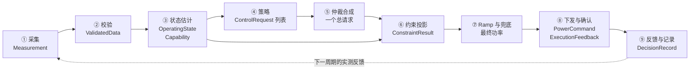
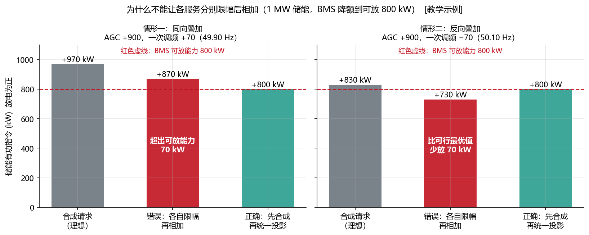
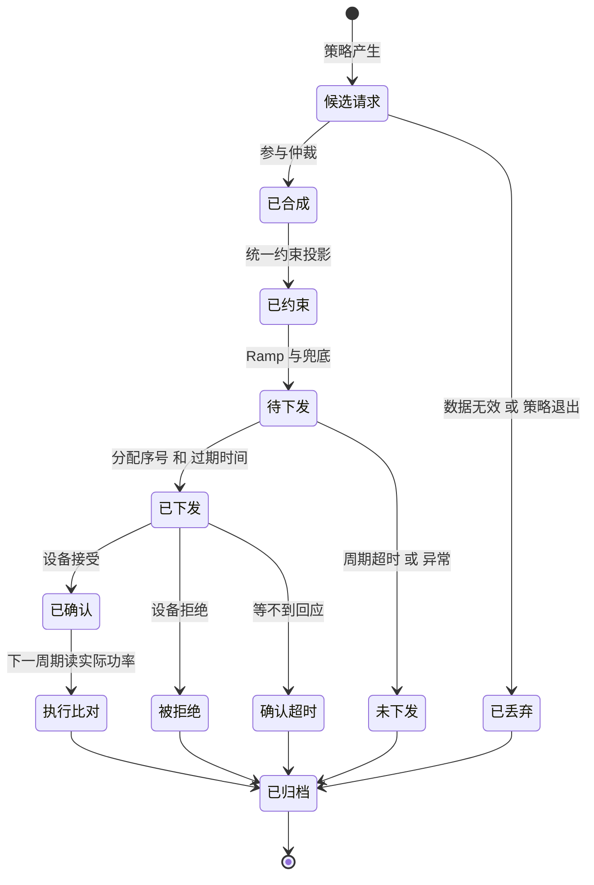
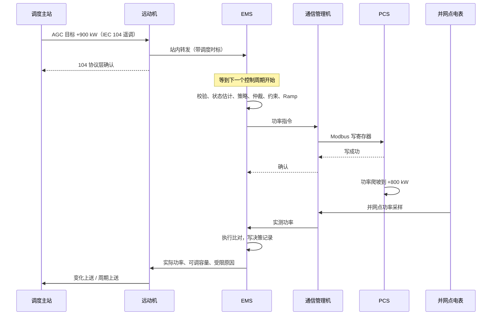
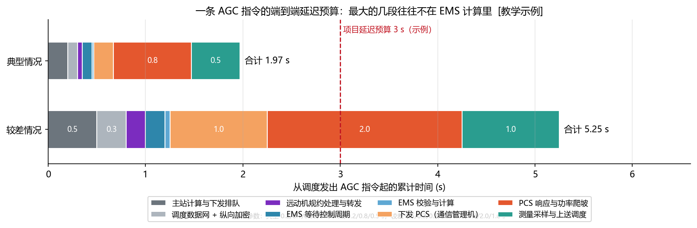
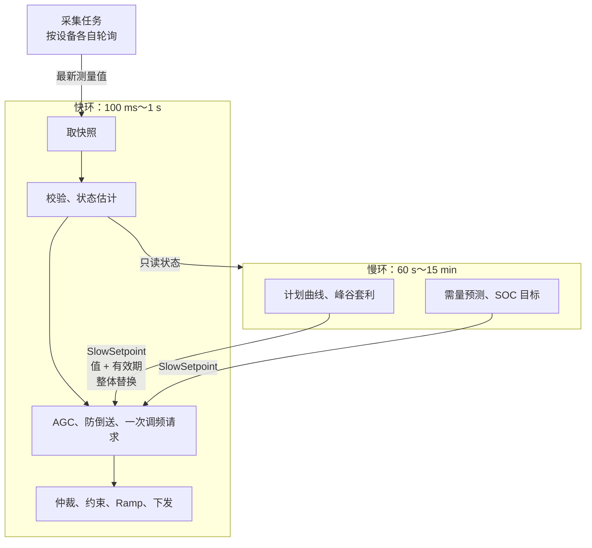

<!-- @AI_GENERATED -->
# 09 EMS 控制流水线、约束投影与执行闭环

> [课程首页](README.md) · 上一章：[08 EMS 系统架构、部署与安全边界](08_EMS系统架构与部署.md) · 下一章：[10 EMS 通信接入、点表解码与数据质量管理](10_通信点表与数据质量.md)

**一句话**：每个控制周期，EMS 把带质量位的测量值变成一条经过合成、约束、确认并可追溯的功率指令。

## 本章目标

读完本章，你应能：

1. 画出并实现采集、校验、状态估计、策略、仲裁、约束、Ramp、下发和反馈记录九步流水线；
2. 手算“先合成、后统一投影”与 Ramp 的结果，并解释各约束的作用原因；
3. 使用快照、不可变对象、命令序号和过期时间保证控制周期的一致性与可追溯性；
4. 处理周期超时、数据失效、策略异常、PCS 拒绝和 EMS 重启恢复。

## 本章边界与前置

本章只讲“**控制周期如何编排、数据对象如何流转、总请求如何统一约束、指令如何确认和恢复**”。通信协议、寄存器解码和质量位完整分类在第 10 章；限幅、Ramp 和 PI 基础在第 11 章；完整可行域在第 12 章；业务策略、多服务分配、仿真和可观测性分别在第 13～20 章展开。本章依赖第 08 章的部署边界和第 05c～07 章的能力、PCC 与功率方向约定。

本章代码是 EMS 级控制流水线骨架：它实现快照、校验、状态估计、请求合成、约束投影、Ramp、命令 fencing 和恢复；真实规约、物理设备、双机选主和现场实时性能仍需第 10、19、20、21 章以及 FAT/SAT 验证。

**配套练习**：运行 `lab/examples/ch09_pipeline_trace.py`，修改 BMS 能力、频率、PCC 限值、Ramp 和命令有效期，观察每一步对象和最终反馈。

---

## 9.1 现场场景：从调度偏差到可追溯决策【必懂】

14:03 调度来电：“14:03:25 下发的 AGC 目标是 900 kW，你站实际只到了 800 kW，偏差超出考核范围，请说明原因。”

能不能在 5 分钟内给出下面这份回答，决定了你写的 EMS 是否合格：

```text
14:03:25.200  收到 AGC 目标 +900 kW（远动转发，指令序号 …）
14:03:25.400  控制周期 #8123：
              请求：AGC 基点 +900 kW，一次调频 +70 kW（频率 49.90 Hz）
              合成：+970 kW
              约束：可放能力 800 kW（BMS 因电芯温度 43℃ 降额）→ +800 kW
              Ramp：700 → 800 kW
              下发：指令 #5812，PCS 于 14:03:25.450 确认
14:03:26.600  PCS 实际 +798 kW，并网点实测……
```

这份回答背后是一条**每一步都留下记录**的控制流水线。本章讲它怎么搭。

---

## 9.2 控制周期的九步处理流水线【必懂】



> ↩ **先知道这一点**：下表的 `质量位`（quality flag）是每个测量值自带的一个标记，说明这个数**可不可信**——是正常、还是坏值、过期、冻结。本章先把它当成"每个数据都带一个可信度标签"用，六种质量位的完整分类和判定规则在第 10.7 节。

| 步骤 | 输入 | 输出 | 职责 | 不做什么 |
|---|---|---|---|---|
| ① 采集 | 设备寄存器、调度报文 | 带质量位和时间戳的 `Measurement` | 规约解码、缩放、方向换算（第 10 章） | 不做业务判断 |
| ② 校验 | `Measurement` 快照 | 可用值 + 拒绝原因 | 检查存在、质量位、新鲜度 | 不修补数据（替代值要显式标记） |
| ③ 状态估计 | 可用值 | `OperatingState`、`Capability` | 汇总 SOC、可充/可放能力、设备状态；数据不可用时给出安全默认能力 | 不决定要出多少功率 |
| ④ 策略 | `OperatingState` | 若干 `ControlRequest` | 各业务服务**各算各的**：计划、AGC、一次调频、需量…… | 不看其他服务，不做限幅 |
| ⑤ 仲裁合成 | 所有请求 | 一个总请求 | 按优先级和规则合并（第 18 章） | 不做安全约束 |
| ⑥ 约束投影 | 总请求 + 状态 | `ConstraintResult` | 把总请求**一次性**压进可行域，记录哪条约束起作用（第 12 章） | 不改变业务目标，只限制 |
| ⑦ Ramp 与兜底 | 投影结果 | 最终功率 | 限制主动变化速度；能力突降时立即兜底（第 11 章 11.4） | 不能让安全约束“慢慢生效” |
| ⑧ 下发与确认 | 最终功率 | `PowerCommand`、`ExecutionFeedback` | 编号、设过期时间、发送、等确认、处理拒绝 | 不把“发出去”当作“执行了” |
| ⑨ 反馈与记录 | 全部中间结果 | `DecisionRecord` | 一个周期一条完整记录 | —— |

**每一步只读规定的上游输出对象**，不回头读原始寄存器，不读全局变量。状态估计、策略和约束可以按接口契约读取各自需要的上游结果，但不得绕过快照和校验层直接读取原始数据。这样每一步都能单独测试，也能在记录里重现。

> **软件类比**：这是一条典型的**请求处理管道**：解析 → 校验 → 加载上下文 → 业务处理 → 聚合 → 准入控制 → 限流 → 调用下游 → 记录访问日志。
>
> **类比失效点**：Web 请求失败了可以返回 500 让客户端重试；控制周期“失败”了，PCS 仍然在以上一条指令的功率运行，能量一直在流动。**不下发也是一种决策**，要有明确的规则（9.8）。

---

## 9.3 统一约束投影：先合成、后限幅【必懂】

一个 1 MW 储能站，电芯温度偏高，BMS 把可放能力降到 **800 kW**。此刻有两个服务在工作：AGC 要求基点 +900 kW，一次调频按频率算出一个增量。参数与第 15 章相同：调差率 2%，连续型死区 ±0.03 Hz，限幅 ±10% `[教学示例]`，下垂系数 `K = 1000 / (0.02 × 50) = 1000 kW/Hz`。

**情形一：频率 49.90 Hz，同向叠加**

```text
一次调频：偏差 −0.10 Hz，过死区后 −0.07 Hz，ΔP = +70 kW

错误做法（各自限幅再相加）：
  AGC   clamp(900, −1000, 800) = 800
  调频  clamp(70,  −1000, 800) = 70
  相加  800 + 70 = 870 kW    ← 超出可放能力 70 kW

正确做法（先合成、后统一投影）：
  合成  900 + 70 = 970
  投影  clamp(970, −1000, 800) = 800 kW
```

**情形二：频率 50.10 Hz，反向叠加**

```text
一次调频：ΔP = −70 kW

错误做法：800 + (−70) = 730 kW   ← 能放 800 却只放了 730，一次调频的响应也被“吃掉”
正确做法：900 − 70 = 830 → 投影到 800 kW
```



图中标注对照表：

| 编号 | 位置 | 标注 | 对应正文 |
|---|---|---|---|
| ① | 图题 | 1 MW、800 kW | 储能额定功率与 BMS 可放能力 |
| ② | 情形一 | AGC 900 kW、一次调频 70 kW、49.90 Hz | 同向叠加 |
| ③ | 情形一柱状图 | 970 kW、870 kW、800 kW | 理想合成、错误限幅、正确投影 |
| ④ | 情形二 | AGC 900 kW、一次调频 −70 kW、50.10 Hz | 反向叠加 |
| ⑤ | 情形二柱状图 | 830 kW、730 kW、800 kW | 反向请求的错误与正确结果 |

第三个原因更根本：**很多约束本来就只能对总功率判断**。防倒送、需量、变压器容量约束的是并网点功率，而并网点功率由储能的**总**出力决定，单看一个服务的请求无从判断它是否满足约束。

这就是第 08 章强调的统一顺序：**先仲裁合成，后统一约束投影，而且约束只投影一次**。测试 `test_limit_each_then_sum_exceeds_capability` 和 `test_limit_each_then_sum_under_delivers_with_opposite_signs` 覆盖了这两个例子。

> **软件类比**：多个微服务各自检查“我这笔扣款不超过余额”，然后并发扣款，总额照样透支。余额检查必须对**合并后的总扣款**做一次，而且是原子的。

---

## 9.4 控制数据对象与语义分层【必懂】

不要把所有字段塞进一个巨大的字典。不同步骤产生的数据含义不同、可信度不同、生命周期不同，应当用不同的类型表示：

| 对象 | 含义 | 由谁产生 | 关键字段 | 最容易犯的错 |
|---|---|---|---|---|
| `Measurement` | 设备测量值 | ① 接入层 | 值、单位、质量位、采样时间、接收时间 | 把没有质量位的裸数字传给算法 |
| `Capability` | 当前能力边界 | ③ 状态估计 | 可充、可放（非负幅值）、来源 | 符号约定不统一；BMS 失联时仍用旧能力 |
| `OperatingState` | 本周期的统一运行状态 | ③ 状态估计 | 时刻、能力、SOC、实测功率、频率、问题列表 | 各策略自己去读测点，看到的不是同一份数据 |
| `ControlRequest` | 某个服务“想要多少” | ④ 策略 | 来源、功率、类型（基点/增量）、优先级、原因 | 策略在请求里自己做限幅 |
| `ConstraintResult` | 约束投影的结果 | ⑥ 约束 | 投影前后、上下界、起作用的约束、是否冲突 | 只保留结果，丢掉“被谁限了” |
| `PowerCommand` | 真正下发的指令 | ⑧ 执行 | 序号、目标值、创建时间、过期时间、原因 | 没有序号和过期时间 |
| `ExecutionFeedback` | 设备的回应 | ⑧ 执行 | 序号、是否接受、实际功率、确认时间 | 把目标值当作实际值 |

三条原则：

1. **测量值和目标值分开**。`PowerCommand.target_kw` 是“要求多少”，`ExecutionFeedback.p_actual_kw` 和下一周期的 `pcs.p_kw` 才是“实际多少”。用目标值算 SOC、算防倒送，会在 PCS 没执行到位时悄悄算错；
2. **对象不可变**（`frozen=True`）。一个周期里每一步只能产生新对象，不能修改上一步的对象，否则记录下来的中间结果和实际使用的对不上；
3. **每个对象都带“来源和原因”**。`Capability.source`、`ControlRequest.reason`、`ConstraintResult.active`，是 9.1 那份回答的原材料。

```python
# lab/ems_lab/pipeline.py（节选）
@dataclass(frozen=True)
class ControlRequest:
    source: str       # "agc" / "pfr" / "schedule" ...
    p_kw: float       # 放电为正
    kind: str         # "base" 基点（取优先级最高的一个）/ "delta" 叠加量
    priority: int
    reason: str


@dataclass(frozen=True)
class PowerCommand:
    seq: int          # 单调递增，设备据此去重（幂等）
    cycle_id: int
    target_kw: float
    created_at: float
    expires_at: float # 过期时间：过了这个时间，设备不应再执行
    reason: str
```

---

## 9.5 指令生命周期与决策记录【必懂】

一条功率指令从产生到归档，要经过下面这些状态：



每条最终指令至少要能回答六个问题，对应的字段：

| 问题 | 字段（`DecisionRecord.as_log()`） |
|---|---|
| 谁要的？为什么要？ | `requests`（来源、类型、功率），各请求的 `reason` |
| 合起来要多少？ | `combined_kw` |
| 被谁限制了？限到多少？ | `active_constraints`、`bounds_kw`、`constrained_kw` |
| 最终发了什么？ | `final_kw`、`seq` |
| 设备接受了吗？ | `accepted`、反馈里的 `note` |
| 实际执行了多少？ | `p_actual_kw`，以及下一周期的实测 |
| 这个周期有什么异常？ | `issues`、`elapsed_s`、`overrun` |

9.3 情形一的完整周期，由 `test_full_cycle_hand_calc_and_trace` 跑出的记录是：

```python
{'cycle_id': 1, 't': 100.0,
 'requests': [('agc', 'base', 900.0), ('pfr', 'delta', 70.0)],
 'combined_kw': 970.0,
 'constrained_kw': 800.0, 'bounds_kw': (-1000.0, 800.0),
 'active_constraints': ['可放能力'],
 'final_kw': 800.0, 'seq': 1, 'accepted': True, 'p_actual_kw': 800.0,
 'issues': [], 'elapsed_s': 0.02, 'overrun': False}
```

（上一周期输出 700 kW，Ramp 1000 kW/s × 0.2 s 允许本周期 +200 kW，所以直接到 800 kW。）

记录要**结构化**（字典/JSON），而不是拼成一句中文日志。结构化记录可以按字段检索、统计“被可放能力限制的次数”，第 20 章的运维报表就建立在它上面。

---

## 9.6 AGC 指令端到端闭环【必懂】

### 时序



注意这里有**三种不同的“确认”**：远动机回给调度的是 104 **协议层**的确认（报文收到了），通信管理机回给 EMS 的是**写寄存器成功**，只有最后电表和 PCS 的实测功率才说明**真的执行了**。调度考核看的是最后一种。

### 延迟预算

端到端时间是每一段时间之和：

```text
T_端到端 = T_主站 + T_上游网络 + T_远动 + T_等待周期 + T_计算
         + T_下发 + T_PCS 响应 + T_测量上送
```

| 符号 | 含义 | 典型 `[教学示例]` | 较差 `[教学示例]` |
|---|---|---:|---:|
| T_主站 | 调度主站计算、排队下发 | 0.2 s | 0.5 s |
| T_上游网络 | 调度数据网 + 纵向加密 | 0.1 s | 0.3 s |
| T_远动 | 远动机规约处理与转发 | 0.05 s | 0.2 s |
| T_等待周期 | 指令到达后等下一个控制周期（最坏等一整个周期） | 0.1 s | 0.2 s |
| T_计算 | EMS 校验与计算 | 0.02 s | 0.05 s |
| T_下发 | 经通信管理机写到 PCS | 0.2 s | 1.0 s |
| T_PCS 响应 | PCS 接收并爬坡到位 | 0.8 s | 2.0 s |
| T_测量上送 | 电表采样、上送调度 | 0.5 s | 1.0 s |
| **合计** | | **1.97 s** | **5.25 s** |



图中标注对照表：

| 编号 | 位置 | 标注 | 对应正文 |
|---|---|---|---|
| ① | 预算参考线 | 3 s | 项目延迟预算教学值 |
| ② | 合计 | 1.97 s、5.25 s | 典型与较差端到端延迟 |
| ③ | 分段参数 | 0.02、0.05、0.1、0.2、0.3、0.5、0.8、1.0、2.0 s | 各通信、计算和 PCS 响应环节 |

**手算**：典型情况 `0.2 + 0.1 + 0.05 + 0.1 + 0.02 + 0.2 + 0.8 + 0.5 = 1.97 s`。较差情况合计 5.25 s，超过了图中 3 s 的示例预算。

从图里能读出三个结论：

1. **EMS 的计算只占 1% 左右**。优化算法快 10 倍，端到端几乎不变；
2. 大头在**设备响应、下发链路、测量上送**。通信管理机的轮询方式（先轮询完所有设备再写，还是写命令插队）对“下发”这一段影响很大；
3. **等待周期**这一段由控制周期决定：周期 200 ms，指令到达时刻随机，平均等 100 ms，最坏等 200 ms。

真实的考核指标（响应时间、调节速率、调节精度）怎么定义、怎么算，在第 16 章讲。这里要建立的习惯是：**任何“要求多少秒内响应”的功能，先画出这张预算表，再决定放在哪里实现**。

---

### 最小闭环：一个控制周期的数据对象追踪

沿用 9.1 的输入，按九步流水线追踪关键对象：

| 步骤 | 输入 | 输出 | 本例结果 |
|---|---|---|---|
| ①采集 | BMS、PCS、电表、AGC | `Measurement` 快照 | BMS 可放 800，PCC -500，频率 49.90 Hz |
| ②校验 | 快照 | 可用值/拒绝原因 | 全部 GOOD |
| ③状态估计 | 可用值 | `Capability` | 可放 800 kW |
| ④策略 | 状态 | 请求列表 | AGC 900 + PFR 70 |
| ⑤仲裁 | 请求列表 | 合成请求 | 970 kW |
| ⑥约束 | 970 + 能力 | 投影结果 | 800 kW，未满足 170 kW |
| ⑦Ramp | 800 + 上次 700 | 最终功率 | 800 kW（本周期最多变化 200） |
| ⑧下发 | 最终功率 | `PowerCommand` | seq=1，目标 800 kW |
| ⑨反馈 | PCS 回读 | `ExecutionFeedback` | accepted=True，实际 800 kW |

这张表的重点不是“记住九个名词”，而是每一步都有明确输入和输出；调试时可以定位到底是数据、策略、约束还是执行环节改变了结果。

对应脚本：`lab/examples/ch09_pipeline_trace.py`。


## 9.7 多速率调度、快照一致性与慢环有效期【必懂】

### 多速率控制周期与快慢路径

不同功能对周期的要求不同（第 08 章 8.5）。把所有功能塞进同一个 200 ms 循环，慢的算法（优化、预测）会拖垮快的；把所有功能都放慢，快的功能又不达标。常见的组织方式：



| 环 | 周期 `[教学示例]` | 做什么 | 输出 |
|---|---|---|---|
| 采集 | 每类设备自己的轮询周期 | 读寄存器、解码、质量判定 | 最新 `Measurement` |
| 快环 | 200 ms | 流水线 ② ～ ⑨ | 功率指令、决策记录 |
| 慢环 | 60 s | 计划、套利、需量预测 | 带有效期的 `SlowSetpoint` |

### 快照一致性：避免撕裂读

**手算**：光伏富余，防倒送要求并网点送电不超过 0。上一周期储能 0 kW，并网点 +500 kW（倒送 500 kW）。EMS 下发充电 500 kW，PCS 执行到位。下一周期开始时：

- 电表的新值已经到了：并网点 0 kW（倒送消除）；
- PCS 的读数还是旧的：0 kW（通信管理机还没轮询到它）。

EMS 算“除储能以外的功率” = `P_PCC − P_BESS = 0 − 0 = 0`，得出“储能不用充电也不会倒送”，于是把指令改回 0，下一周期又倒送 500 kW……两个量来自不同时刻，算出来的差值错了整整 500 kW，指令来回振荡（`test_torn_read_shifts_export_limit_by_500`）。

对策：

1. **一个周期只取一次快照**，本周期所有步骤都读这份快照（`take_snapshot` 复制后冻结，采集任务之后写入的新值不影响本周期）；
2. 相互关联的测点要看**采样时间是否接近**，差得太多就不做相减这类运算，或者用更保守的约束；
3. 能从同一台设备、同一次读取中拿到的量，尽量一起读（例如 PCS 的 P、Q、状态放在连续寄存器里一次读出）。

### 慢环设定值有效期与原子替换

慢环算出的计划值要交给快环使用，有两个坑：

- **半新半旧**：慢环逐个字段更新“目标功率、开始时间、结束时间”，快环恰好在中间读到了新的功率和旧的时间。对策是慢环每次生成一个**完整的不可变对象**，一次性替换引用；
- **过期沿用**：慢环因为异常 10 分钟没更新，快环一直在用 10 分钟前的计划。对策是每个慢环结果都带**有效期**，过期就不再使用，走降级逻辑。

```python
@dataclass(frozen=True)
class SlowSetpoint:
    p_kw: float
    computed_at: float
    valid_until: float


class ScheduleStrategy:
    def publish(self, p_kw, now, ttl_s):
        self.setpoint = SlowSetpoint(p_kw, now, now + ttl_s)  # 原子替换引用

    def request(self, state):
        sp = self.setpoint
        if sp is None or state.t > sp.valid_until:
            return None  # 计划过期：不提请求，而不是沿用旧值
        return ControlRequest("schedule", sp.p_kw, "base", self.priority, "计划值")
```

> **软件类比**：快照相当于数据库的**快照隔离**（snapshot isolation）：一个事务从头到尾看到同一个版本的数据。慢环结果的整体替换相当于 **copy-on-write** 配置热更新。
>
> **类比失效点**：数据库快照里的数据来自同一个时刻；EMS 快照里的每个测点都有自己的采样时间，快照只保证“本周期不再变化”，**不保证它们是同时采样的**。这就是还要检查采样时间的原因。

---

## 9.8 异常降级、超时与重启恢复【必懂】

| 异常 | 本课程骨架的做法 | 为什么 |
|---|---|---|
| **控制周期超时**（计算超过预算） | 放弃本周期，不下发；PCS 保持上一指令；计数 `missed_deadlines` | 超时后快照已经不新鲜，按旧数据算出的指令可能比不动更危险。连续超时多次应进入降级并告警 |
| **单个策略抛异常** | 捕获、记录，忽略这个策略的请求，其他策略照常 | 一个服务的 bug 不应让整站停止跟踪调度 |
| **关键数据不可用**（BMS 能力通信失败） | 能力取安全默认值 0，约束投影**立即**把输出压到 0 | 不知道电池能不能充放，就不充不放；不能按 Ramp 慢慢降 |
| **非关键数据不可用**（频率、AGC 目标） | 对应策略退出（不提请求），由优先级更低的基点或 0 兜底 | 降级而不是全停 |
| **电表不可用但配置了防倒送** | 保守处理：禁止放电 | 看不到并网点，就不能证明放电不会倒送 |
| **设备拒绝指令** | 记录原因，Ramp 状态回到上一次成功下发的值 | 不假设成功 |
| **周期内未预期异常** | 本周期不下发，记录异常 | 保持上一指令，等下一周期重新计算 |
| **EMS 重启** | `recover()`：Ramp 从**实测功率**起步，命令序号从持久化的值继续；不重放旧命令 | 旧命令可能已经过期，重放等于执行历史上的决策 |

**“安全默认值”不一定是 0。** 本骨架在 BMS 数据失效时输出 0，这是最简单、最保守的选择。但在有的场景下，突然归零本身就是一次功率扰动（例如大功率跟踪 AGC 时），项目可能规定“保持当前值一段时间再按速率降到 0”。**哪一种是安全的，要按项目的故障模式分析确定并写进配置，而不是写死在代码里**。同理，PCS 侧通常也有通信看门狗：一段时间收不到 EMS 心跳或指令，PCS 自己保持或降功率。EMS 的降级策略要和 PCS 看门狗的配置一致，否则两边会“打架”。

重启恢复的完整检查项：

1. 设备是否重新在线，数据是否恢复可信；
2. 读取 PCS 实测功率，初始化 Ramp；
3. 读取持久化的最后命令序号，从它之后继续编号；
4. 从实际状态初始化各状态机和滞回（第 11 章 11.3），PI 积分清零或按实测反算；
5. 丢弃重启前的待发命令队列；
6. 需要人工确认的故障，等确认后再自动运行。

```python
def recover(self, p_actual_kw: float, last_seq: int) -> None:
    """重启后：Ramp 从实测功率起步，序号从持久化的最后序号继续；不重放旧命令。"""
    self.ramp.reset(p_actual_kw)
    self.last_sent_kw = p_actual_kw
    self.seq = last_seq
```

测试 `test_recover_continues_seq_and_ramps_from_actual`：重启前 PCS 以 500 kW 运行、最后序号 41；恢复后第一条指令序号为 42，目标从 500 kW 按 Ramp 升到 700 kW，而不是从 0 开始。反过来，`test_rejected_command_resets_ramp` 演示了忘记恢复序号的后果：EMS 从序号 1 开始发，PCS 记得已执行到 100，新指令全部被当作旧命令拒绝。

---

## 9.9 从逻辑分层到 Python 包结构【必懂】

生产项目的包结构可以这样组织（第 08 章 8.6 的分层）：

```text
ems/
├── models/          Measurement、Capability、OperatingState、ControlRequest、PowerCommand ...
├── gateway/         BMS、PCS、电表、调度的规约接入和 Mock 实现（第 10 章）
├── validation/      质量位、新鲜度、冻结、越界（第 10 章）
├── estimation/      SOC、SOH、可充/可放能力、设备状态（第 05 章）
├── strategies/      计划、套利、需量、AGC、AVC、一次调频（第 13～17 章）
├── arbitration/     优先级、合成、多 PCS 功率分配（第 18 章）
├── constraints/     设备能力、SOC、PCC、P-Q 约束投影（第 12 章）
├── execution/       Ramp、下发、确认、序号、过期、重试（本章、第 10 章）
├── pipeline/        控制周期编排、多速率调度、快照（本章）
├── observability/   决策记录、告警、事件、指标（第 20 章）
└── simulation/      电池、PCS、负荷、电网仿真（第 19 章）
```

本课程的 `lab/ems_lab/` 是它的教学缩影：

| 课程模块 | 对应分层 | 章节 |
|---|---|---|
| `datapoint.py` | gateway + validation | 10 |
| `pipeline.py` | models + pipeline + execution 的最小骨架 | 09 |
| `control.py` | 执行层用到的限幅、Ramp 等基础函数 | 11 |
| `constraints.py` | constraints | 12 |
| `frequency.py` | strategies（一次调频） | 15 |

依赖规则：

1. **只能向下依赖**：策略可以依赖 models，不能依赖 gateway；约束不能 import 策略；
2. **策略不认识寄存器**：策略里出现 Modbus 地址，说明分层破了（第 10 章）；
3. **pipeline 只编排不计算**：它按顺序调用各层，自己不包含业务规则，这样换一个策略、换一种约束，不需要改主循环；
4. **I/O 与计算分离**：② ～ ⑦ 是纯计算，可以在单元测试里用构造好的快照直接跑；① 和 ⑧ 才碰网络和设备。本骨架里 `run_cycle` 接收的是已经采集好的 `Measurement` 字典，设备则用 `MockPcs` 替身，所以 20 个测试不需要任何真实设备。

`pipeline.py` 的 `project()` 只实现了本章需要的最小约束（设备能力、防倒送、需量、冲突上报）。完整的约束分层、SOC 分区和冲突处理规则见第 12 章的 `constraints.py`。

---

## 9.10 一个控制周期的 Python 实现【必懂】

```python
# lab/ems_lab/pipeline.py（节选，省略记录细节）
def run_cycle(self, measurements, now):
    self.cycle_id += 1
    start = self.clock()
    snap = take_snapshot(measurements, now)                  # ① 快照
    data = validate(snap, self.cfg.max_age_s)                # ②
    state = estimate_state(data, now, self.cfg.p_rated_kw)   # ③
    for s in self.strategies:                                # ④ 异常隔离
        try:
            r = s.request(state)
        except Exception as exc:
            rec.issues.append(f"策略 {s.name} 异常：{exc!r}，本周期忽略")
            continue
        if r is not None:
            rec.requests.append(r)
    combined, _ = arbitrate(rec.requests)                    # ⑤ 先合成
    res = project(combined, state, ...)                      # ⑥ 后统一投影
    ramped = self.ramp.update(res.p_out_kw, self.cfg.dt_s)   # ⑦ Ramp
    final = clamp(ramped, res.lower_kw, res.upper_kw)        #    兜底
    if final != ramped:
        self.ramp.reset(final)
    if self.clock() - start > self.cfg.cycle_budget_s:       # 超时：本周期不下发
        ...
        return rec
    self.seq += 1                                            # ⑧ 编号、过期时间、下发
    cmd = PowerCommand(self.seq, self.cycle_id, final, now, now + self.cfg.command_ttl_s, ...)
    rec.feedback = self.sink.apply(cmd, now)
    return rec                                               # ⑨ 记录
```

测试清单（`lab/tests/test_pipeline.py`）：

| 测试 | 验证什么 |
|---|---|
| `test_limit_each_then_sum_*` | 9.3 两个手算例子 |
| `test_full_cycle_hand_calc_and_trace` | 9.5 的完整决策记录 |
| `test_ramp_limits_step_then_reaches_target` | Ramp 每周期 +200 kW，第 4 周期到 800 kW |
| `test_bms_comm_failed_goes_to_safe_zero_immediately` | 关键数据失效时立即归零 |
| `test_strategy_exception_is_isolated` | 一个策略异常，AGC 照常 |
| `test_overrun_skips_dispatch_and_keeps_last` | 周期超时不下发 |
| `test_duplicate_command_executed_once_and_expired_rejected` | 重复序号不重复执行，过期指令被拒绝 |
| `test_recover_continues_seq_and_ramps_from_actual` | 重启恢复 |
| `test_snapshot_is_isolated_and_read_only`、`test_slow_setpoint_expiry` | 快照与慢环有效期 |
| `test_torn_read_shifts_export_limit_by_500`、`test_self_check_q2` | 9.7 撕裂读手算、9.13 自测第 2 题 |
| `test_pcc_export_limit_forces_charge` 等 | 约束投影的换算、电表失效、冲突上报 |

---

## 9.11 常见设计误区【必懂】

| 误区 | 正确理解 |
|---|---|
| 各服务自己限幅，最后相加 | 相加后可能越限，反向时又浪费能力；先合成、后统一投影一次 |
| 指令发出去就算执行了 | 协议确认、写成功、实际功率到位是三件事，考核看最后一件 |
| 用下发值当实际功率 | 算 SOC、防倒送、调度上送都要用实测值 |
| EMS 算法越快，响应越快 | 端到端时间主要在通信链路和设备响应，计算通常只占很小一部分 |
| 每个策略自己去读最新测点 | 同一周期要读同一份快照，否则会出现撕裂读 |
| 周期超时了也要把算出的指令发出去 | 超时后数据已不新鲜，要按预先定义的规则处理 |
| 重启后把队列里的命令补发出去 | 旧命令可能已过期，必须丢弃；从实测状态重新开始 |
| 安全默认值就是 0 | 由故障模式分析决定，并与 PCS 看门狗配置一致 |

## 9.12 现场故障模式与修复【必懂】

**案例一：两个控制周期“重叠”，指令乱序。**
EMS 用定时器每 500 ms 起一个线程跑控制周期。某次历史库写入卡顿，一个周期跑了 1.3 秒，期间又起了两个新周期。三个线程几乎同时下发，PCS 先收到了最新的指令，后收到了最旧的指令，功率回跳。
**原因**：周期之间没有互斥，也没有超时放弃；指令没有序号，设备无法识别旧指令。
**修复**：同一时刻只允许一个周期运行（上一个没结束，本次跳过并计数）；耗时的 I/O（历史库写入）移出控制周期，异步完成；每条指令带递增序号。

**案例二：用目标值当反馈，SOC 越算越偏。**
EMS 用“下发的功率 × 时间”累加计算站级 SOC。夏季 PCS 因散热降额，实际只能出目标的 80%，EMS 的 SOC 比 BMS 的低得越来越多，傍晚高峰前误判“电量不足”，提前停止放电。
**教训**：测量值和目标值必须分开存放、分开使用；SOC 以 BMS 为准，EMS 的估算只做审计和比对（第 05 章）。

**案例三：通信恢复后“补发”旧指令。**
EMS 与通信管理机之间网络中断 3 分钟，下发队列里积压了几百条指令。网络恢复后，发送线程把积压指令依次发出，PCS 在几秒内把 3 分钟的历史功率“快进”了一遍，并网点功率大幅波动。
**修复**：指令带过期时间，发送前和设备执行前都检查是否过期；下发队列只保留最新一条（新指令覆盖旧指令），而不是先进先出排队。

---

## 9.13 自测：流水线、投影与恢复

1. 流水线九个步骤中，哪几步是纯计算、可以不连设备直接测试？
2. 可放能力 600 kW，AGC 基点 +550 kW，一次调频 +100 kW。各自限幅后相加是多少？正确做法是多少？如果一次调频是 −100 kW 呢？
3. `ConstraintResult` 为什么要记录 `active`（起作用的约束），只记录限幅后的值不行吗？
4. 控制周期 500 ms，AGC 指令到达时刻随机。“等待周期”这一段平均多长、最长多长？
5. 什么是撕裂读？在防倒送计算里它会造成什么后果？
6. 为什么慢环的结果要带有效期，而且要整体替换？
7. EMS 重启后，为什么要读取持久化的命令序号，而不是从 1 开始？

<details>
<summary>参考答案</summary>

1. ② 校验、③ 状态估计、④ 策略、⑤ 仲裁、⑥ 约束、⑦ Ramp 都是纯计算，输入是快照和配置，输出是新对象；① 采集和 ⑧ 下发涉及 I/O，用 Mock 替身测试。
2. 同向：各自限幅 550 + 100 = 650 kW，超出 50 kW；正确做法 650 → 600 kW。反向：各自限幅 550 − 100 = 450 kW；正确做法 450 kW。反向时两者恰好相等，因为 550 本身没被限幅——只有某个服务先被截住时，反向叠加才会浪费能力（9.3 情形二里 AGC 900 被先截到 800）。
3. 不行。只看结果无法回答“为什么只出了这么多”：是 BMS 降额、防倒送还是需量上限？运维统计、调度解释、问题定位都依赖这个字段。
4. 平均 250 ms，最长 500 ms（刚错过一个周期开始时刻）。
5. 同一个周期里用到的多个测点来自不同采样时刻，一部分是新值、一部分是旧值。防倒送用 `P_PCC − P_BESS` 推算其他负荷时，如果 P_PCC 是新值而 P_BESS 是旧值，推算结果会差一个“储能刚刚变化的量”，导致指令来回振荡。
6. 带有效期是为了在慢环停止更新时，快环不会无限期沿用旧结果；整体替换是为了避免快环读到“一半新、一半旧”的结果。
7. 设备按序号去重：只执行比已执行序号更大的指令。EMS 从 1 开始，会被设备当作旧指令全部拒绝（或者在设备也重启的情况下与旧指令混淆）。持久化序号保证了指令的单调性。

</details>

---

## 9.14 深入：实时性、看门狗与工程边界【深入】

<details>
<summary>控制周期的实现方式：线程、asyncio 还是独立进程</summary>

Python 做 EMS 的快环（百毫秒到秒级）是可行的，关键是**抖动**（jitter）而不是平均速度。常见做法：

- 采集任务用 asyncio 或线程池并发轮询多台设备，结果写入一个“最新值表”；
- 控制周期用单独的线程或进程，以单调时钟（`time.monotonic`）为基准定时触发，每周期先检查上一周期是否已结束；
- 历史库写入、上送云平台等耗时 I/O 放进独立队列异步完成，不在控制周期内等待；
- 垃圾回收、日志刷盘等会造成停顿的操作要评估最坏耗时。

毫秒级、确定性要求的功能（保护、快速调频）不应放在通用操作系统上的 Python 程序里，而应由 PCS、协调控制器等专用装置完成（第 08 章 8.5）。

</details>

<details>
<summary>“不下发”和“下发上一值”有什么区别</summary>

超时放弃本周期时，可以选择什么都不发（PCS 保持上一次收到的指令），也可以重新发一次上一值。两者对 PCS 的影响取决于 PCS 看门狗的实现：如果 PCS 要求每隔一段时间必须收到指令或心跳，否则自动降功率，那么“什么都不发”持续几个周期就会触发 PCS 的降级。本骨架选择“不发”，并在记录中标出 `overrun`；工程上还要配合独立的心跳机制，把“EMS 还活着”和“EMS 有新指令”这两件事分开。

</details>

<details>
<summary>工程边界</summary>

`pipeline.py` 是教学骨架：仲裁只有“最高优先级基点 + 叠加量”一条规则，约束只有设备能力和并网点限值，下发对象只有一台理想的 `MockPcs`。它能验证流水线顺序、数据对象分层、可追溯记录和异常处理逻辑，但不能证明现场实时性能；端到端延迟必须在 HIL、FAT、SAT 中实测（第 19 章）。

</details>

<!-- @AI_GENERATED: end -->
