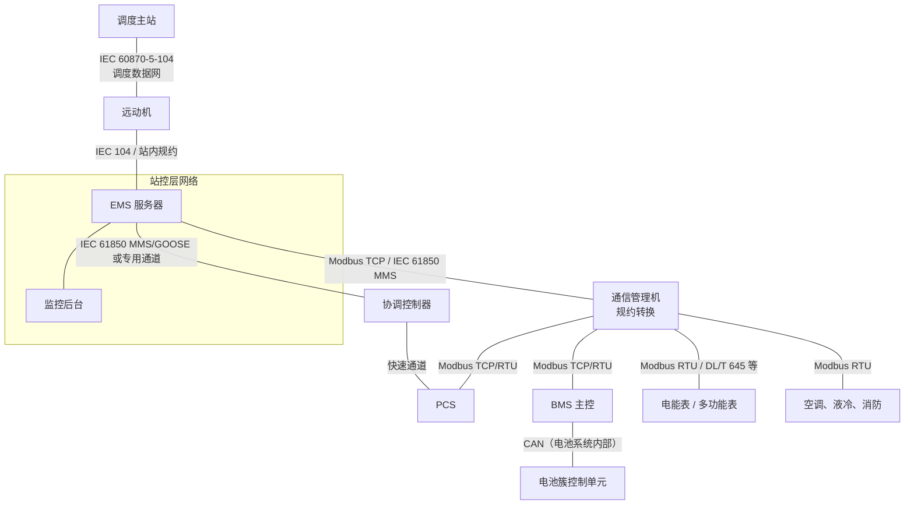
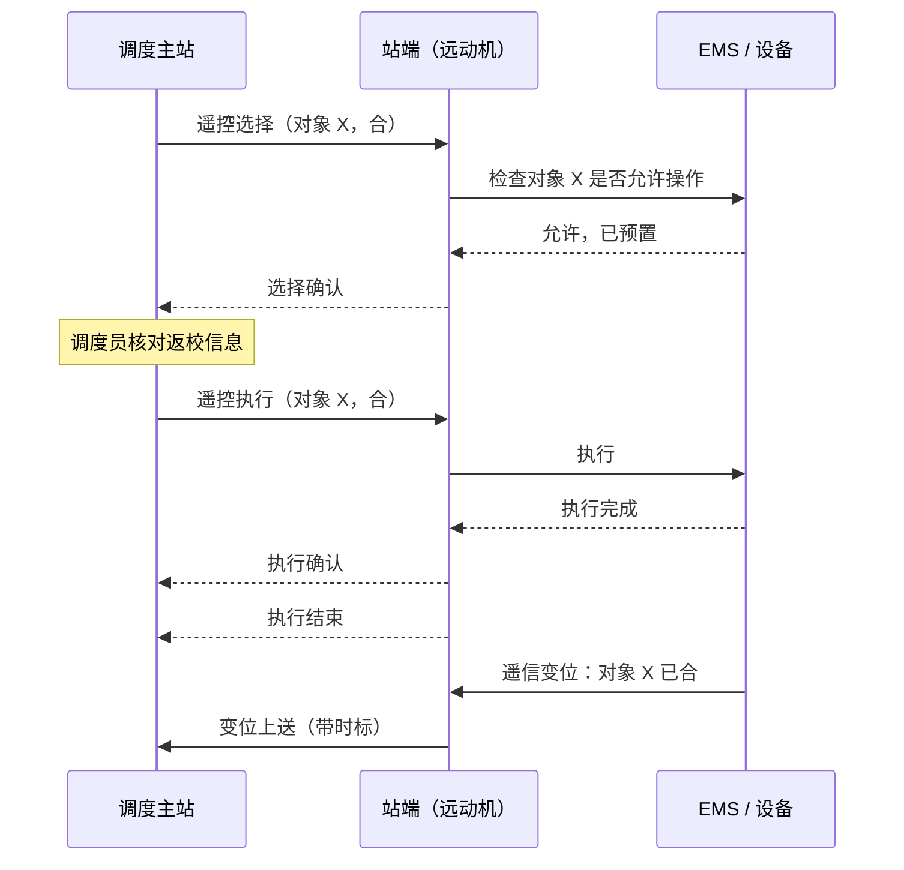
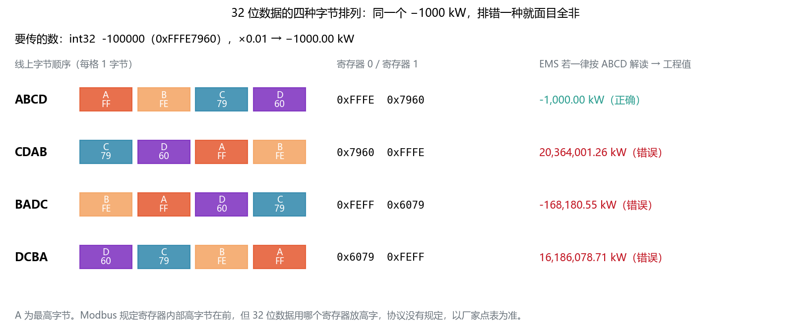
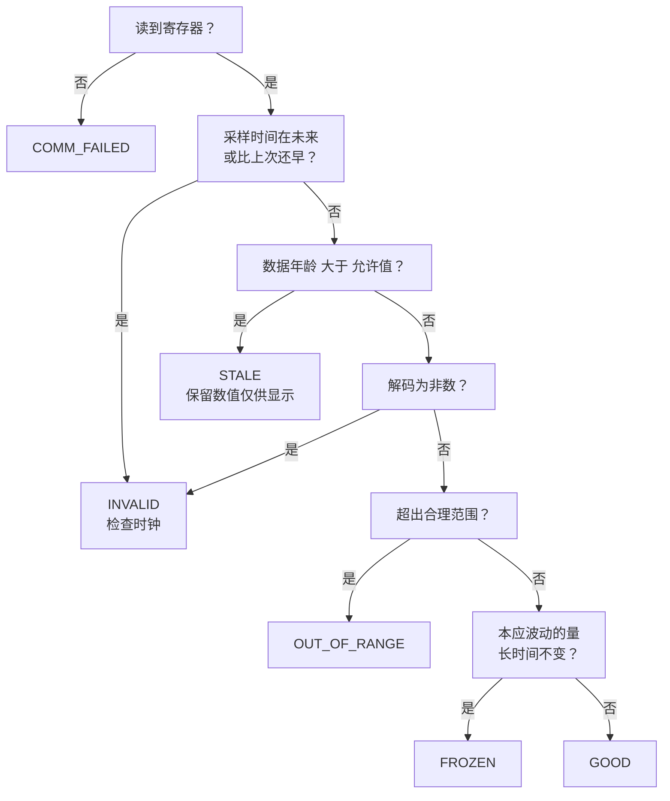
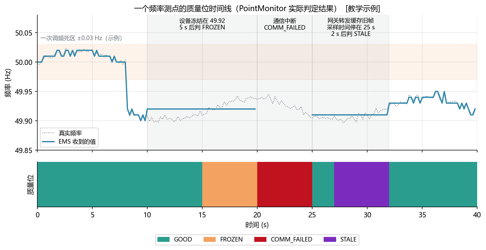
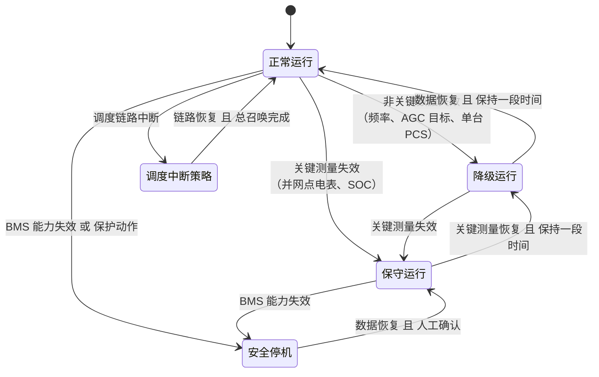

<!-- @AI_GENERATED -->
# 10 EMS 通信接入、点表解码与数据质量管理

> [课程首页](README.md) · 上一章：[09 EMS 控制流水线、约束投影与执行闭环](09_EMS软件控制流水线.md) · 下一章：[11 控制基础函数](11_控制基础函数.md)

**一句话**：EMS 用到的每个数字都来自一条通信链路；链路、点表、时间戳或质量判定任何一环出错，控制算法都会“认真地”算错。

## 本章目标

读完本章，你应能：

1. 根据点表的类型、字节/字序、缩放、偏移和方向，把寄存器还原为工程值，并用正负和跨 16 位工况完成联调核验；
2. 为测量值建立采样时间、接收时间和质量位，区分 GOOD、STALE、FROZEN、OUT_OF_RANGE、COMM_FAILED、SUBSTITUTED 和 INVALID；
3. 用数据年龄、冻结检测和时钟偏差判断一个值能否进入控制流水线；
4. 区分读重试、幂等遥调和非幂等遥控，并为通信故障选择合适的降级行为。

## 本章边界与前置

本章解决“**数据如何从协议和寄存器变成控制算法可以信任的 Measurement**”：通信层级、四遥、点表契约、寄存器解码、工程值换算、质量、新鲜度、冻结和时钟一致性。第 09 章负责把 Measurement 放进控制流水线；第 11 章负责基础控制函数；第 20 章继续展开审计和可观测性。

本章的 `datapoint.py` 是接入层与校验层教学模型，不实现完整 Modbus/IEC 104/IEC 61850 协议栈、真实链路管理、质量映射、只读点写保护审批或现场降级状态机；这些内容以项目点表、规约库、安全方案和 FAT/SAT 为准。

**配套练习**：运行 `lab/examples/ch10_quality_trace.py`，修改寄存器、采样时间、冻结阈值和通信状态，观察 Measurement 的质量位与控制许可。

---

## 10.1 现场场景：通信接入错误导致控制数据失真【必懂】

EMS 第一次连上现场设备，监控画面上出现了这些数字：

| 画面显示 | 实际情况 | 原因（本章会讲） |
|---|---|---|
| PCS 有功 **6533.6 kW**（PCS 额定 1000 kW） | 充电 20 kW | 有符号数按无符号解读（10.6） |
| 累计放电量 **2036 万 kWh** | 正常数值 | 32 位数据字序反了（10.6） |
| 并网点频率 **49.92 Hz**，一小时没变过 | 电表采集卡死 | 冻结值没被识别（10.8） |
| 调度说“你站数据全部过期” | 数据是新的 | 远动机时钟慢了 5 分钟（10.9） |
| 运行人员点一次“启动”，PCS 启动了两次 | —— | 遥控超时重发，没有去重（10.10） |

这些问题一个都不是算法问题，却都会让算法做出错误决策。本章讲清从“寄存器里的 16 位整数”到“控制算法可以信任的测量值”之间的每一步。

---

## 10.2 EMS 通信链路与数据传输层级【必懂】



| 链路 | 常用协议 | 谁主动 | 数据刷新方式 |
|---|---|---|---|
| 调度 ⇄ 远动机 | IEC 60870-5-104（国内对应 DL/T 634.5104） | 双方都可以：调度下发指令、召唤；远动主动上送变化 | 变化上送 + 周期上送 + 总召唤 |
| 远动机 ⇄ EMS | 104 或厂家站内规约 | 双向 | 事件驱动为主 |
| EMS ⇄ 通信管理机 / 设备 | Modbus TCP、IEC 61850 MMS | EMS 或通信管理机轮询 | 轮询（问一次答一次） |
| 通信管理机 ⇄ PCS/BMS/电表 | Modbus RTU（RS-485）、Modbus TCP、电表规约 | 通信管理机轮询 | 轮询，逐台设备、逐段寄存器 |
| BMS 内部（主控 ⇄ 簇 ⇄ 模组） | CAN | 各节点周期广播 | 周期报文 |

**数据的年龄是一路累加的**：电芯温度先在 BMS 内部经 CAN 汇总，再被通信管理机轮询，再被 EMS 读取。每一跳都可能增加几百毫秒到数秒的延迟 `[行业典型量级]`。EMS 读到的“当前温度”，可能是几秒前的温度。所以每个测量值都需要时间戳和质量位（10.7、10.8）。

---

## 10.3 四遥数据对象与命令语义【必懂】

电力自动化把站端与主站之间交换的信息分成四类，合称“四遥”：

| 四遥 | 英文 | 是什么 | 例子 | 软件操作 | Modbus 常见映射 | IEC 104 常见类型 |
|---|---|---|---|---|---|---|
| **遥测**（YC） | Telemetry | 连续变化的模拟量 | 有功、无功、电压、频率、SOC、温度 | 读，周期刷新 | 读输入寄存器（04）、读保持寄存器（03） | 测量值（归一化、标度化、短浮点，可带时标） |
| **遥信**（YX） | Teleindication | 离散状态量 | 开关分合、设备运行/停机、故障告警 | 读 + **事件**（变位时上送） | 读线圈（01）、读离散输入（02），或寄存器中的位 | 单点/双点信息（可带时标） |
| **遥控**（YK） | Telecontrol | 改变设备状态的命令 | 开关分合闸、PCS 启停、故障复归 | 写，**命令语义**，通常要先选择再执行 | 写单个线圈（05）或写寄存器 | 单点/双点命令，选择-执行 |
| **遥调**（YT） | Teleadjusting | 修改设定值 | 有功/无功设定、功率因数设定、AGC 目标 | 写，**设定值语义** | 写单个寄存器（06）、写多个寄存器（16） | 设定值命令（归一化、标度化、短浮点） |

此外还有“遥脉”（电度量累计值）等说法，常和四遥一起出现。

从软件角度看，四遥最重要的区别是**写操作的语义**：

- **遥调是“设定为某个值”**：连续写两次“有功设定 = 800 kW”，结果和写一次一样，天然**幂等**；
- **遥控是“做一个动作”**：“启动”“复归”“合闸”执行两次和执行一次**不一样**，不是幂等的。所以遥控要有选择-执行、序号和确认（10.4.3、10.10）。

> **软件类比**：遥测、遥信是 `GET` 和事件订阅；遥调是 `PUT`（整体设置，幂等）；遥控是 `POST`（执行动作，非幂等）。
>
> **类比失效点**：HTTP 的幂等性写在协议规范里，客户端库会据此决定能否自动重试；电力规约不会替你判断，通信管理机的“超时自动重发”对遥调无害，对遥控可能就是一次重复分闸。

---

## 10.4 主要通信协议与工程要点【必懂 / 了解】

### 10.4.1 Modbus TCP / RTU【必懂】

储能站里最常见的设备协议。它非常简单，简单到很多事情协议都**不管**，要靠点表约定：

| 特点 | 说明 | 对 EMS 的影响 |
|---|---|---|
| 主从（客户端/服务器）问答 | 主站问一次，从站答一次；从站不会主动上报 | 数据延迟 ≈ 轮询周期；变位事件可能在两次轮询之间发生又消失 |
| 四类数据区 | 线圈（可读写的位）、离散输入（只读位）、输入寄存器（只读 16 位）、保持寄存器（可读写 16 位） | 点表必须写明在哪个区 |
| 常用功能码 | 01 读线圈、02 读离散输入、03 读保持寄存器、04 读输入寄存器、05 写单个线圈、06 写单个寄存器、15 写多个线圈、16 写多个寄存器 | 同一个地址用 03 和 04 读到的是两个不同的数据区 |
| 寄存器 16 位，寄存器内部高字节在前 | 32 位数据要占两个寄存器，**哪个寄存器放高 16 位，协议没有规定** | 字序必须按厂家点表逐项确认（10.6） |
| 没有数据类型 | 协议里只有 16 位整数 | 有符号/无符号、缩放系数、偏移全靠点表 |
| 没有时间戳和质量位 | 读到的只是数值 | 采样时间只能用轮询时间近似，质量位由 EMS 自己判定 |
| 地址基准不统一 | 厂家文档常写“40001”这类记法，协议报文里的地址从 0 开始 | 地址差 1 是联调中最常见的错误之一 |
| 异常响应 | 从站出错时返回“功能码 + 0x80”和异常码（如非法地址、非法数据值） | 异常响应也要区分：地址错是配置问题，设备忙可以重试 |
| 单次读取上限 | 一次读保持寄存器最多 125 个 | 大点表要拆成多段读，段与段之间采样时刻不同 |

Modbus RTU 跑在 RS-485 串口总线上，一条总线挂多台设备，用从站地址（1～247）区分，报文带 CRC 校验。串口速率低、只能一问一答，一条总线上设备越多，每台设备的刷新越慢，这是“下发 PCS”这一段延迟的主要来源之一（第 09 章 9.6）。

### 10.4.2 CAN【了解】

CAN 总线主要用在 **BMS 内部**：电池模组、电池簇控制单元、BMS 主控之间周期广播电压、温度、告警。它的特点是报文短（经典 CAN 每帧 8 字节数据）、按报文 ID 做优先级仲裁、抗干扰强、实时性好。报文的含义由厂家的通信协议文档（常见为 DBC 文件）定义。

EMS 一般不直接接 CAN，而是通过 BMS 主控或通信管理机拿到汇总后的数据。你需要知道的是：**EMS 看到的电芯数据是 BMS 汇总过的**，单体电压、温度的刷新可能比 EMS 读 BMS 的周期还慢。

### 10.4.3 IEC 60870-5-104：调度远动【必懂】

调度与站端之间最常用的规约，国内对应标准为 DL/T 634.5104。它跑在 TCP 上（标准端口 2404），和 Modbus 最大的区别是：**站端可以主动上送**，而且协议里带质量描述和时标。

| 机制 | 做什么 | EMS 开发要知道的 |
|---|---|---|
| **总召唤** | 主站要求站端把所有数据全部上送一遍，通常在连接建立时和定期执行 | 站端要能随时给出全量数据；总召唤期间数据量大 |
| **变化上送（突发上送）** | 数据变化超过阈值（遥测）或状态变位（遥信）时站端主动上送 | 遥测变化阈值设大了调度看到的曲线是台阶，设小了报文太多 |
| **带时标的数据** | 遥信变位、SOE（事件顺序记录）带毫秒级时标 | 时标来自站端时钟，时钟不准，事件顺序就不可信（10.9） |
| **质量描述** | 数据带无效（IV）、非当前值（NT）、被取代（SB）、被闭锁（BL）、溢出（OV）等标志 | 与本课程的质量位对应（10.7），要双向映射 |
| **遥控选择-执行** | 先“选择”，站端确认后再“执行”，站端再确认并报告执行结束 | 防止误操作和报文错误导致误动作 |
| **带序号的确认** | 每个信息帧带发送序号和接收序号；未确认帧数达到上限就停发，超时未确认就断开重连 | 协议层保证“收到”，不保证“执行了” |
| **链路测试** | 空闲时定期发测试帧，检测连接是否存活 | 变化上送的数据长时间不变是正常的，要靠链路测试判断链路是否健康 |

标准给出的一组常用默认参数（未确认帧上限 k = 12、接收方最迟确认 w = 8 帧，以及 t1 = 15 s、t2 = 10 s、t3 = 20 s 等超时）`[国标/行标：IEC 60870-5-104 / DL/T 634.5104]`，实际取值以调度机构的接入要求为准。

遥控选择-执行的过程：



选择之后在规定时间内没有收到执行命令，选择自动失效；执行后要以**遥信变位**（设备实际状态）为准判断是否成功，而不是以“执行确认”为准。

### 10.4.4 IEC 61850 MMS / GOOSE【了解】

IEC 61850（国内对应 DL/T 860 系列）是变电站自动化的主流标准，大型储能站的升压站部分、协调控制器常用它。与 Modbus “一张寄存器表”的思路不同，它是**面向对象的数据模型**：设备由逻辑设备、逻辑节点（例如测量单元 MMXU、断路器 XCBR）、数据对象、数据属性逐级组成，每个数据自带值、质量和时标，配置用 SCL 文件（ICD、CID、SCD 等）描述。

| 服务 | 用途 | 特点 |
|---|---|---|
| **MMS** | 站控层的数据读取、报告、控制 | 客户端/服务器方式；支持按变化或周期上送的“报告”服务 |
| **GOOSE** | 快速事件：跳闸、联锁、快速控制信号 | 以太网二层组播，发布者在变化时连续快速重发，稳定后逐渐拉长重发间隔，订阅者靠它检测通信中断 |
| **SV** | 采样值 | 合并单元把互感器采样数字化后组播，主要用于保护 |

EMS 开发者接触 61850 时，最常做的是：读 SCD 文件找到数据对象的引用路径，用 MMS 订阅报告，理解 GOOSE 信号用于哪些联锁。协议栈通常用成熟的库或厂家网关，不建议自己实现。

---

## 10.5 点表契约与接入配置【必懂】

点表是 EMS 与每台设备之间的接口契约。一行点表至少要回答这些问题：

| 字段 | 含义 | 例子 | 不填会怎样 |
|---|---|---|---|
| `name` | 标准化测点名（EMS 内部统一命名） | `pcs1.p_kw` | 各模块各叫各的，无法复用 |
| `address` | 协议地址（写明 0 基还是 1 基） | `0x2000` | 差 1 读到相邻寄存器 |
| `function` / 数据区 | 保持寄存器、输入寄存器、线圈…… | 03 | 同一地址读到另一个数据区 |
| `data_type` | uint16、int16、uint32、int32、float32…… | int16 | 负数变成巨大正数 |
| `layout` | 32 位数据的字节排列 | ABCD / CDAB | 数值面目全非 |
| `scale`、`offset` | 缩放系数、偏移 | 0.1、−40 | 差 10 倍，或温度差 40 度 |
| `unit` | 工程单位 | kW | kW 和 MW 混用差 1000 倍 |
| `sign` / 方向 | 厂家方向到课程方向的换算 | −1（电表进口为正） | 控制方向整体反转（第 00 章 0.8） |
| `valid_min`、`valid_max` | **物理合理范围**（不是控制限值） | −1100～1100 kW | 离谱数值进入算法 |
| `stale_after_s` | 最大允许数据年龄 | 2 s | 过期数据当新数据用 |
| `frozen_after_s` | 冻结判定时间（只对会波动的量） | 5 s | 冻结值当真实值用 |
| `access` | 只读 / 可写 | R / RW | 误写只读点，或写命令没有保护 |
| `source` | 来自哪台设备、哪条链路 | 通信管理机 2 / PCS1 | 出问题找不到链路 |

示例（地址、缩放均为 `[教学示例]`，不是任何厂家的真实点表）：

| name | address | 类型 | layout | scale | offset | sign | 单位 | 合理范围 | 年龄上限 | 读写 |
|---|---|---|---|---:|---:|---:|---|---|---|---|
| `pcs1.p_kw` | 0x2000 | int16 | AB | 0.1 | 0 | +1 | kW | −1100～1100 | 2 s | R |
| `bms.soc` | 0x1000 | uint16 | AB | 0.1 | 0 | +1 | % | 0～100 | 10 s | R |
| `bms.cell_temp_max` | 0x1010 | uint16 | AB | 0.1 | −40 | +1 | ℃ | −40～100 | 10 s | R |
| `pcs1.e_dis_kwh` | 0x2010 | uint32 | ABCD | 0.1 | 0 | +1 | kWh | ≥ 0 | 60 s | R |
| `meter.p_pcc_kw` | 0x0100 | int32 | CDAB | 0.01 | 0 | **−1** | kW | −20000～20000 | 1 s | R |
| `pcs1.p_set_kw` | 0x3000 | int16 | AB | 0.1 | 0 | +1 | kW | −1000～1000 | —— | RW |

两条设计原则：

1. **点表是配置，不是代码**。地址、字序、缩放写在配置里，由接入层解释；策略、约束代码里**永远不出现寄存器地址**（第 09 章 9.9）；
2. **“合理范围”和“控制限值”是两回事**。合理范围用来判断“这个数是不是坏数据”（PCS 额定 1000 kW，读到 6533 kW 一定是坏数据）；控制限值是“允许运行到多少”（第 12 章）。把两者混为一谈，要么把真实的越限当作坏数据丢掉，要么把坏数据当作越限去保护动作。

---

## 10.6 寄存器解码、工程值换算与编码【必懂】

### 工程值换算公式

```text
工程值 = (原始值 × scale + offset) × sign
```

| 符号 | 含义 | 例子 |
|---|---|---|
| 原始值 | 按数据类型、字序从寄存器还原出的整数（或浮点数） | −200 |
| scale | 缩放系数：原始值 1 代表多少工程单位 | 0.1 |
| offset | 偏移 | −40（温度） |
| sign | 方向换算，+1 或 −1 | −1（电表进口为正 → 课程 P_PCC 送电为正） |

### 16 位有符号数据与补码

一个寄存器 16 位，能表示 0～65535。**int16 用“二进制补码”表示负数：原始数 ≥ 32768 时，减去 65536 才是真实值。**

| 例子 | 寄存器 | 按什么解读 | 原始值 | × scale + offset | 工程值 |
|---|---|---|---:|---|---:|
| PCS 有功（正确） | 0xFF38 | int16 | 65336 − 65536 = **−200** | × 0.1 | **−20.0 kW**（充电 20 kW） |
| PCS 有功（错误） | 0xFF38 | uint16 | 65336 | × 0.1 | 6533.6 kW |
| SOC | 0x0307 | uint16 | 775 | × 0.1 | 77.5 % |
| 最高电芯温度 | 650 | uint16 | 650 | × 0.1 − 40 | 25.0 ℃ |

十六进制换算：`0xFF38 = 15×4096 + 15×256 + 3×16 + 8 = 65336`；`0x0307 = 3×256 + 7 = 775`。

**反过来写遥调**：下发 −20.0 kW，原始值 = −20.0 / 0.1 = −200，编码成补码 65536 − 200 = 65336 = 0xFF38。int16、×0.1 最多能表示 ±3276.7 kW；如果要下发 5000 kW，代码必须**报错**，而不是让它溢出成一个负数（`test_setpoint_out_of_register_range_raises`）。

### 32 位数据与寄存器字序

32 位数据占两个寄存器，四个字节记作 A B C D（A 最高）。厂家可能用四种排法：



图中标注对照表：

| 编号 | 位置 | 标注 | 对应正文 |
|---|---|---|---|
| ① | 原始数据 | −100000、−1000.00 kW | int32 原始值与工程值 |
| ② | 字节/寄存器示例 | 79、60、6079、7960 | 字节标签与寄存器组合 |
| ③ | 错误解读结果 | 20364001.26、−168180.55、16186078.71 | 字序错误造成的异常工程值 |

| layout | 寄存器 0 | 寄存器 1 | 说明 |
|---|---|---|---|
| ABCD | A B | C D | 高字在前（最常见） |
| CDAB | C D | A B | 低字在前（字交换） |
| BADC | B A | D C | 字内字节交换 |
| DCBA | D C | B A | 完全小端 |

**手算一：int32 高字在前**。PCS 有功，寄存器 `[0xFFFE, 0x7960]`，×0.01：

```text
拼接：0xFFFE7960 = 4294867296
最高位为 1，是负数：4294867296 − 4294967296 = −100000
工程值：−100000 × 0.01 = −1000.00 kW
```

**手算二：字序反了**。设备实际是 CDAB，送来 `[0x7960, 0xFFFE]`，EMS 按 ABCD 解读：

```text
拼接：0x7960FFFE = 2036400126（最高位为 0，是正数）
工程值：2036400126 × 0.01 ≈ 2036 万 kW
```

这种错误一眼能看出来。**更阴险的是：功率为 0 时，字序错了也解出 0**。调试时 PCS 待机，画面一切正常；一带负载，数值才面目全非。所以联调要在**非零、有符号、跨 16 位**（大于 65535 或为负）的工况下核对每个 32 位点。

**手算三：uint32 电量**。累计放电量寄存器 `[0x0012, 0xD687]`，×0.1 kWh：

```text
0x0012 × 65536 + 0xD687 = 18 × 65536 + 54919 = 1179648 + 54919 = 1234567
工程值：1234567 × 0.1 = 123456.7 kWh
```

**手算四：float32**。频率寄存器 `[0x4248, 0x0000]`，按 IEEE 754 单精度解读为 50.0 Hz。浮点数同样有字序问题，CDAB 设备会送来 `[0x0000, 0x4248]`。

**手算五：方向换算**。电表“从电网取电为正”，读到 +1500 kW。点表 `sign = −1`，换算后 `p_pcc_kw = −1500 kW`（取电 1500 kW），与课程约定一致。**方向换算只在接入层做一次**，算法内部不再临时取反。

### 实现摘录（伪代码）

下面代码用于展示解码和质量判定顺序，是教材伪代码而不是可直接运行的完整脚本；可运行实现见 `lab/ems_lab/datapoint.py`，读者入口见 `lab/examples/ch10_quality_trace.py`。

```python
# lab/ems_lab/datapoint.py（节选）
def registers_to_raw(regs, data_type, layout=None):
    n_regs, signed, is_float = DATA_TYPES[data_type]
    if n_regs == 1:
        u = _swap16(regs[0]) if layout == "BA" else regs[0]
        bits = 16
    else:
        r0, r1 = regs
        if layout in ("BADC", "DCBA"):          # 寄存器内部字节被交换过
            r0, r1 = _swap16(r0), _swap16(r1)
        hi, lo = (r1, r0) if layout in ("CDAB", "DCBA") else (r0, r1)
        u = (hi << 16) | lo
        bits = 32
    if is_float:
        return struct.unpack(">f", u.to_bytes(4, "big"))[0]
    if signed and u >= 1 << (bits - 1):         # 二进制补码
        u -= 1 << bits
    return u


def to_engineering(raw, scale=1.0, offset=0.0, sign=1):
    return (raw * scale + offset) * sign
```

本节每个手算都有对应测试（`test_int16_negative_power_hand_calc`、`test_int32_word_order_mistake`、`test_word_order_invisible_at_small_values`、`test_uint32_energy_hand_calc`、`test_float32_frequency`、`test_meter_import_positive_converted_to_pcc_export_positive` 等），另有对四种字序做往返编码解码的参数化测试。

---

## 10.7 数据质量位与控制可用性【必懂】

解码出一个数值只是第一步。控制算法真正需要知道的是：**这个数现在能不能拿来做决策**。本课程的质量位：

| 质量位 | 含义 | 典型原因 | 能否用于控制 |
|---|---|---|---|
| `GOOD` | 通过全部检查 | —— | 能 |
| `STALE` | 过期：采样时间距今超过允许年龄 | 轮询变慢、网关转发旧数据、链路中断后的缓存 | 不能；可用于显示（标灰） |
| `FROZEN` | 冻结：本应波动的量长时间不变 | 设备采集卡死、网关缓存 | 不能 |
| `OUT_OF_RANGE` | 越界：超出物理合理范围 | 缩放系数错、字序错、传感器故障 | 不能 |
| `COMM_FAILED` | 通信失败：本次没读到 | 超时、断线、异常响应 | 不能，没有数值 |
| `SUBSTITUTED` | 替代值：人工置数或按规则估算 | 检修时人工置数、用冗余测点替代 | **默认不能**；项目显式允许且记录后才能用 |
| `INVALID` | 无效：时间戳在未来或倒退、非数 | 时钟错误、NaN | 不能 |

与 IEC 104 质量描述的对应关系：无效（IV）≈ 本课程的 COMM_FAILED/INVALID/OUT_OF_RANGE，非当前值（NT）≈ STALE/FROZEN，被取代（SB）≈ SUBSTITUTED。EMS 把数据上送调度时，要把内部质量位映射回规约的质量描述，**不能把坏数据标成好数据上送**。

### 数据质量判定顺序



顺序的道理是：**先判断“数据来源能不能信”，再判断“数值合不合理”**。一个过期的数据，即使数值在合理范围内，也不能用；先判越界再判过期，会把“过期但看起来正常”的数据放过去。

下图是 `PointMonitor` 对一个频率测点的实际判定结果（场景为 `[教学示例]`）：



图中标注对照表：

| 编号 | 位置 | 标注 | 对应正文 |
|---|---|---|---|
| ① | 频率死区 | ±0.03 Hz | 一次调频死区教学参数 |
| ② | 冻结区间 | 10～20 s、49.92 Hz、5 s | 设备冻结与 FROZEN 判定 |
| ③ | 通信中断区间 | 20～25 s | COMM_FAILED |
| ④ | 缓存旧帧区间 | 25～32 s、2 s | 采样时间停滞与 STALE 判定 |
| ⑤ | 时间轴 | 0～40 s | 时间线范围 |

注意 10～15 s：设备已经冻结，但质量位仍是 GOOD，直到 5 s 判定时间到了才变成 FROZEN。**冻结检测天然有滞后**，判定时间越短误报越多，越长漏报越久。25～27 s 同理：网关开始转发旧帧后，要等数据年龄超过 2 s 才判为 STALE。对快速功能（一次调频），这几秒的滞后要计入风险评估，必要时用冗余测点交叉校验（例如电表频率与 PCS 测频比对）。

```python
# lab/ems_lab/datapoint.py（节选）
def evaluate(self, regs, receive_time, now, sample_time=None):
    ts = receive_time if sample_time is None else sample_time
    if regs is None:
        return make(None, Quality.COMM_FAILED)
    if now - ts < -self.future_tolerance_s:
        return make(None, Quality.INVALID, note="采样时间在未来，检查时钟同步")
    if self.last_sample_time is not None and ts < self.last_sample_time:
        return make(None, Quality.INVALID, note="采样时间倒退")
    self.last_sample_time = ts
    raw, value = p.decode(regs)
    if now - ts > p.stale_after_s:
        return make(value, Quality.STALE, raw)
    if math.isnan(value) or math.isinf(value):
        return make(None, Quality.INVALID, raw)
    if 超出合理范围:
        return make(value, Quality.OUT_OF_RANGE, raw)
    if self.frozen is not None and self.frozen.update(value, ts):
        return make(value, Quality.FROZEN, raw)
    return make(value, Quality.GOOD, raw)
```

---

## 10.8 时间戳、新鲜度与冻结判定【必懂】

### 三个时间不能混为一谈

| 时间 | 谁打的 | 含义 |
|---|---|---|
| **采样时间**（sample_time） | 设备（或最接近设备的一跳） | 这个物理量是什么时候测的 |
| **接收时间**（receive_time） | 网关 / EMS 接入层 | 数据什么时候到达 EMS |
| **处理时间**（now） | EMS 控制周期 | 本周期开始的时刻 |

**数据年龄 = 处理时间 − 采样时间**，而不是“处理时间 − 接收时间”。网关转发一帧 10 秒前的缓存数据，接收时间是新的，采样时间是旧的，只有按采样时间才能发现它过期了。

Modbus 设备通常不提供采样时间，只能用轮询时刻近似，这一点要在点表里注明；104 和 61850 的数据可以带站端时标。

**手算：新鲜度**。采样时间 100.0 s，现在 102.5 s，允许年龄 2 s：年龄 2.5 s，判 STALE。

### 不同数据，允许的年龄不同

| 数据 | 允许年龄 `[教学示例]` | 理由 |
|---|---|---|
| 并网点功率、频率（快环闭环用） | 约 1 s | 防倒送、一次调频要跟上变化 |
| PCS 实际功率 | 约 2 s | 用于执行比对和功率平衡 |
| BMS 可充/可放能力 | 约 5 s | 变化较慢，但失效后果严重 |
| SOC | 约 10 s | 变化慢 |
| 电价、计划 | 分钟～小时 | 按业务有效期判断 |

现场值要按第 09 章的延迟预算和各设备的实际刷新周期确定。

**变化上送的数据要特别处理**。104 的 AGC 目标、遥信状态只在变化时上送，调度 10 分钟不改目标，这个值的“采样时间”就停在 10 分钟前，但它完全有效。这类数据的新鲜度要看**链路是否健康**（链路测试帧、定期总召唤是否正常），而不是看数值本身的年龄。同理，冻结检测也**只能用于物理上一定会波动的量**（频率、功率、电压），不能用于开关状态、设定值、AGC 目标。

### 冻结检测

```python
class FrozenDetector:
    def update(self, value, t):
        if self.ref_value is None or abs(value - self.ref_value) > self.tolerance:
            self.ref_value, self.ref_time = value, t    # 数值动了：重新计时
            return False
        return t - self.ref_time >= self.frozen_after_s
```

**手算**：频率冻结在 49.92 Hz，判定时间 5 s。第 0～4 s 仍为 GOOD，第 5 s 起判 FROZEN；第 11 s 读到 49.93 Hz，重新计时（`test_frozen_detector`）。

容差（tolerance）的选择：电网频率在正常运行时总有毫赫兹级的波动，测量分辨率若为 0.01 Hz，连续几秒完全不变是可能的。判定时间和容差要结合测点分辨率和历史数据确定。

---

### 最小闭环：寄存器值如何决定控制许可

一个测点进入控制算法前，至少经过四步：

```text
原始寄存器 0x1380
→ int16 解码：5000
→ 缩放 ×0.01：50.00 Hz
→ 合理范围/新鲜度/冻结判定
→ GOOD：允许进入一次调频；FROZEN/STALE：拒绝进入控制
```

冻结追踪示例：

| 时刻 | 解码值 | 数据年龄 | 判定 | 控制许可 |
|---:|---:|---:|---|---|
| 0 s | 49.92 Hz | 0 s | GOOD | 允许 |
| 1 s | 49.92 Hz | 0 s | GOOD | 允许 |
| 4 s | 49.92 Hz | 0 s | GOOD | 允许 |
| 5 s | 49.92 Hz | 0 s | FROZEN | **拒绝** |
| 6 s | 49.92 Hz | 0 s | FROZEN | **拒绝** |
| 7 s | 49.93 Hz | 0 s | GOOD，重新计时 | 允许 |

这里“值看起来正常”不等于“可以用于控制”：冻结值 49.92 Hz 仍在合理范围内，但已经不能代表当前电网频率。对应脚本：`lab/examples/ch10_quality_trace.py`。


## 10.9 时钟同步与时间一致性【必懂】

站内所有时间戳要可比，前提是所有设备的时钟一致。站控层的时钟同步装置接收北斗/GPS 卫星时间，再用几种方式分发给全站：

| 方式 | 传输 | 精度量级 `[行业典型值]` | 常见对象 |
|---|---|---|---|
| NTP / SNTP | 以太网 | 毫秒级 | 服务器、监控后台、通信管理机 |
| PTP（IEEE 1588） | 以太网，需要交换机和网卡支持 | 亚微秒级（硬件时间戳） | 保护、合并单元、PMU 等对时要求高的装置 |
| IRIG-B（B 码） | 专用对时线缆 | 微秒级 | 保护测控、故障录波 |
| 脉冲对时（秒脉冲、分脉冲） | 硬接线 | 配合其他方式使用 | 老式装置 |

此外，调度主站也可以通过 104 的时钟同步命令给站端对时，但站内通常以本站时钟同步装置为准。EMS 服务器在 Ⅰ 区不能连互联网，**只能从站内时钟源对时**（第 08 章 8.3）。

**手算：时钟不同步让新数据“过期”**。远动机时钟比 EMS 慢 300 s。一帧数据 0.2 s 前刚到达，远动机打的采样时间却是“300.2 s 前”。按采样时间判断，它严重过期。

```python
m = Measurement(..., sample_time=1000.0 - 300.0, receive_time=1000.0 - 0.2)
check_freshness(m, now=1000.0, max_age_s=2.0)   # → STALE（假的过期）
clock_skew_suspect(m, max_transport_s=1.0)      # → True（真正的问题是时钟）
```

判断依据：**接收时间 − 采样时间**正常情况下只是传输延迟（零点几秒），远大于传输延迟、或者为负（采样时间晚于接收时间），就说明两边时钟不一致。这时应当报“时钟失步”告警，而不是只报“数据过期”，否则运维人员会一直去查通信链路。

---

## 10.10 读重试、写命令幂等与过期控制【必懂】

读和写的重试规则完全不同：

| | 读（遥测、遥信） | 写（遥调、遥控） |
|---|---|---|
| 重复执行的后果 | 无，读多少次都一样 | 遥调：设定值写两次一般无害；遥控：动作执行两次 |
| 超时后设备状态 | 没变化 | **不确定**：可能没收到，也可能已经执行、只是回应丢了 |
| 能否自动重试 | 能，但要在周期预算内有上限 | 要看幂等性；非幂等命令不能盲目重试 |
| 失败后怎么办 | 标 COMM_FAILED，走降级 | 读回设备状态核实，再决定是否重发 |

写命令要保证三件事：**不丢、不重、不过期**。每条命令带：

| 字段 | 作用 |
|---|---|
| `seq` 命令序号 | 单调递增。设备（或网关）记住已执行的最大序号：同序号重发不再执行，更小的序号拒绝 |
| `created_at` / `expires_at` | 过期时间。网络恢复后才送到的旧命令，设备不执行 |
| 期望的确认 | 写成功只是第一步；以**读回的设定值和实际状态**为准 |
| `retry_count` | 重试次数有上限，超限转告警和降级 |

`MockPcs` 演示了这套规则（`test_duplicate_command_executed_once_and_expired_rejected`）：同一个序号 #7 发两次，只执行一次；序号 #8 在过期时间之后才送到，被拒绝，PCS 保持 500 kW。

几条设计建议：

1. **优先使用绝对设定值，避免增量命令**。“有功设定 = 800 kW”重复写无害；“有功增加 100 kW”重复一次就多了 100 kW；
2. **遥控动作前先检查状态**。要“启动”先读当前是否已启动；执行后以遥信变位确认，而不是以“执行确认”报文确认；
3. **下发队列只保留最新值**。功率设定是“最新的覆盖旧的”，不是先进先出排队（第 09 章 9.12 案例三）；
4. **Modbus 本身没有序号字段**。序号和过期时间要么由 PCS 厂家在点表中提供专门的寄存器（例如“指令序号”“指令有效期”），要么由通信管理机实现。联调前要和厂家确认 PCS 是否支持、怎么支持。

> **软件类比**：这就是分布式系统里的**幂等键**（idempotency key）加**请求截止时间**（deadline）。支付接口用幂等键防止重复扣款，gRPC 用 deadline 防止执行过时的请求。
>
> **类比失效点**：支付系统里重复扣款可以退款；重复分闸、重复启停造成的设备冲击和停电无法“退回”。

---

## 10.11 数据质量故障降级矩阵【必懂】

每一种通信故障都要有预先定义的动作，而不是只打印一条日志：

| 故障 | 检测方式 | 降级动作 | 恢复条件 |
|---|---|---|---|
| BMS 能力数据失效 | COMM_FAILED / STALE | 可充/可放能力取 0，禁止充放电（第 09 章 9.8） | 连续若干周期 GOOD |
| SOC 数据过期 | STALE | 禁止新增高风险放电和充电，使用保守能力 | 数据恢复 |
| 单台 PCS 离线 | 通信失败、状态字 | 该 PCS 能力置 0，功率重新分配给其他 PCS（第 18 章） | 通信恢复 且 设备状态正常 |
| 并网点电表失效 | COMM_FAILED / FROZEN / OUT_OF_RANGE | 停止依赖 PCC 的闭环（防倒送、需量）；配置了防倒送时保守禁放 | 数据恢复，必要时人工确认 |
| 频率数据失效 | 同上 | 一次调频按规程退出或保持安全状态，告警 | 数据恢复 |
| 调度通信中断 | 104 链路断开、测试帧超时 | 执行通信中断策略：保持最后目标一段时间、切换到本地计划曲线或按调度规定处理 | 链路恢复，总召唤完成 |
| 温度数据异常 | OUT_OF_RANGE / STALE | 按保守降额，严重时停机 | 数据恢复 |
| 时钟失步 | `clock_skew_suspect` | 告警；该链路数据按接收时间保守判断，事件记录标注时间不可信 | 对时恢复 |
| 命令未确认 | 确认超时 | 不假设成功；读回核实；超过重试次数进入降级 | —— |

把矩阵落成状态机：



每个状态要定义：允许哪些策略工作、能力怎么取、上送调度的状态和可调容量怎么报、要产生哪些告警。**恢复要有滞回**（“保持一段时间”）：数据时好时坏时，状态机不应在两个状态之间来回跳（第 11 章 11.3）。

---

## 10.12 通信接入与数据质量常见误区【必懂】

| 误区 | 正确理解 |
|---|---|
| 协议能通、数能读到就算接入完成 | 还要核对类型、字序、缩放、方向、合理范围，并在非零工况下验证 |
| 功率为 0 时显示正常，说明解码没问题 | 0 在任何字序下都是 0；要在正负、大值工况下核对 |
| 数据年龄用接收时间算 | 用采样时间算；接收时间只能发现“收不到”，发现不了“收到的是旧的” |
| 所有测点都做冻结检测 | 只对物理上一定会波动的量做；设定值、状态量、AGC 目标长时间不变是正常的 |
| 越界就是设备越限 | 越界（OUT_OF_RANGE）说明数据不可信；设备越限是控制问题，两者分开处理 |
| 写命令超时就重发 | 先弄清是否幂等、设备是否已执行；非幂等命令必须有序号去重 |
| 替代值和真实值一样用 | 替代值要显式标记，安全和快速功能默认不用 |
| 服务器时间随便对个公网 NTP | Ⅰ 区不能连互联网，只能用站内时钟同步装置 |

## 10.13 现场故障复盘：解码、时钟与命令可靠性【必懂】

**案例一：字序反了，待机时看不出来。**
新接入的电表并网点功率是 int32，厂家点表写的是“低字在前”，EMS 配置成了高字在前。调试时储能待机、厂区负荷很小，功率显示接近 0，看起来一切正常。投运第一天负荷上来，并网点功率显示为几千万 kW，防倒送和需量控制全部因“数据越界”退出。
**教训**：32 位测点要在负值、大于 65535 的工况下逐点核对；越界检测救了这一次，如果恰好解出一个“合理”的错值，后果会严重得多。

**案例二：缩放系数错了 10 倍。**
PCS 厂家升级固件后，有功功率寄存器的单位从 0.1 kW 改为 0.01 kW，点表没有同步更新。EMS 读到的功率只有实际的 1/10，功率闭环认为 PCS“不跟指令”，不断加大指令，直到 PCS 自身限幅。
**教训**：设备固件升级必须同步核对点表；EMS 要做**合理性交叉校验**：PCS 功率之和与并网点功率的变化应当一致，偏差持续过大就告警。

**案例三：冻结的频率让储能一直放电。**
电表的频率测量模块故障，频率冻结在 49.92 Hz（在一次调频死区外）。EMS 没有冻结检测，持续按 49.92 Hz 计算一次调频出力，储能一直放电到 SOC 下限（第 15 章 15.12 案例二）。
**修复**：频率加冻结检测；用 PCS 自带的测频做交叉校验；一次调频在频率数据失效时按规程退出。

**案例四：远动机时钟慢了 5 分钟，调度判数据过期。**
站内时钟同步装置的卫星天线被遮挡，远动机失去对时后时钟逐渐漂移，慢了约 5 分钟。调度主站按报文时标判断，认为站端数据全部过期，AGC 被切除。
**教训**：时钟同步装置失锁要告警；EMS 和远动都要监视“接收时间 − 采样时间”，发现时钟问题直接报时钟告警（10.9）。

**案例五：遥控超时重发，PCS 启动了两次。**
运行人员在监控后台点击“PCS 启动”。通信管理机转发后等待回应超时（PCS 实际已执行，只是回应报文丢了），按默认配置自动重发了一次。PCS 在启动过程中收到第二条启动命令，进入故障状态。
**修复**：遥控类命令关闭网关的自动重发；执行前检查设备当前状态；命令带序号，设备或网关对同一序号只执行一次；执行结果以遥信变位确认。

---

## 10.14 自测：解码、质量与时钟一致性

1. 寄存器 0xFE0C，int16，×0.1 kW，工程值是多少？如果误按 uint16 解读呢？
2. 32 位累计电量，寄存器 `[0x0001, 0x86A0]`，高字在前，×0.01 kWh，工程值是多少？如果设备是低字在前而 EMS 按高字在前解读，会得到什么？
3. 温度寄存器 0x0258，uint16，×0.1，偏移 −40，温度是多少？
4. 为什么“字序错了”常常在调试阶段发现不了？怎样安排联调工况才能发现？
5. 一个测点采样时间 50.0 s，接收时间 349.8 s，当前时间 350.0 s。它过期了吗？最可能的原因是什么？
6. 为什么 AGC 目标不能用冻结检测？它的新鲜度应该怎么判断？
7. 遥调“有功设定 800 kW”和遥控“PCS 启动”，哪个可以在超时后直接重发？为什么？

<details>
<summary>参考答案</summary>

1. 0xFE0C = 65036，int16 为 65036 − 65536 = −500，工程值 −50.0 kW（充电 50 kW）。误按 uint16：6503.6 kW。
2. 0x0001 × 65536 + 0x86A0 = 65536 + 34464 = 100000，× 0.01 = 1000.00 kWh。若设备是低字在前，实际送来的是 `[0x86A0, 0x0001]`，按高字在前解读得 0x86A00001 = 2258632705，× 0.01 ≈ 2258 万 kWh。
3. 0x0258 = 600，600 × 0.1 − 40 = 20.0 ℃。
4. 调试时设备常处于待机，功率为 0 或很小，0 在任何字序下都是 0，小正数错了也可能被忽略。要在正负两个方向、数值超过 65535（原始值）的工况下核对，例如让储能以较大功率充电和放电各一次。
5. 按采样时间算，年龄 300 s，判为过期。但接收时间只比当前早 0.2 s，说明数据是刚收到的；接收时间与采样时间相差约 300 s，远大于正常传输延迟，最可能是设备或远动机的时钟慢了约 5 分钟，应报时钟失步告警。
6. AGC 目标是设定值，调度可能长时间不改，长时间不变是正常的；而且 104 按变化上送，没有变化就没有新报文。它的新鲜度要看 104 链路是否健康（测试帧、总召唤是否正常）以及调度规定的指令有效期，而不是看数值本身多久没变。
7. 遥调设定值是“设定为某个值”，重复写结果相同，是幂等的，超时后可以重发（仍需读回确认）。遥控“启动”是一个动作，不是幂等的：第一次可能已经执行、只是回应丢了，重发会导致重复执行。必须先读回设备状态，并依靠命令序号去重。

</details>

---

## 10.15 深入：编码精度、批量采集与工程边界【深入】

<details>
<summary>二进制补码为什么是“减 65536”</summary>

16 位能表示 65536 个不同的数。补码规定：0～32767 表示自己，32768～65535 表示 −32768～−1，也就是“原数 − 65536”。这样加减法可以直接按无符号数算、只保留低 16 位，硬件实现最简单。例如 −200 + 300：0xFF38 + 0x012C = 0x10064，只保留低 16 位是 0x0064 = 100，结果正确。32 位同理，减的是 2³² = 4294967296。

</details>

<details>
<summary>float32 的精度陷阱</summary>

IEEE 754 单精度浮点只有约 7 位有效数字。累计电量这类不断增大的量如果用 float32 传输，数值到 1000 万 kWh 以后，最小可分辨的变化是 1 kWh 左右，小功率时的电量增长会“消失”。累计量宜用 uint32/uint64 整数加缩放系数传输。另外，float32 解码可能得到 NaN、无穷大，必须判为 INVALID（`test_monitor_nan_float_is_invalid`）。

</details>

<details>
<summary>一次读多少寄存器：批量读与采样一致性</summary>

把相关的测点放在连续地址、一次读出，既减少报文数量，又能保证这些量来自同一时刻（第 09 章 9.7 的撕裂读）。但一次读取有上限（保持寄存器 125 个），而且中间有“空洞”地址时，有的设备会返回非法地址异常。点表设计时，按“同一时刻需要的量”分组，而不是按厂家文档的章节分组。

</details>

<details>
<summary>工程边界</summary>

`datapoint.py` 只实现解码、质量判定和新鲜度/冻结检测，不包含任何真实的协议栈（Modbus、104、61850 的报文收发和链路管理）。真实项目应使用成熟的协议库或厂家网关，并用厂家提供的点表、规约文本和现场报文抓包逐点核对。文中的地址、缩放、判定时间、允许年龄都是 `[教学示例]`。

</details>

<!-- @AI_GENERATED: end -->
