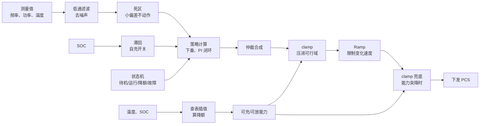
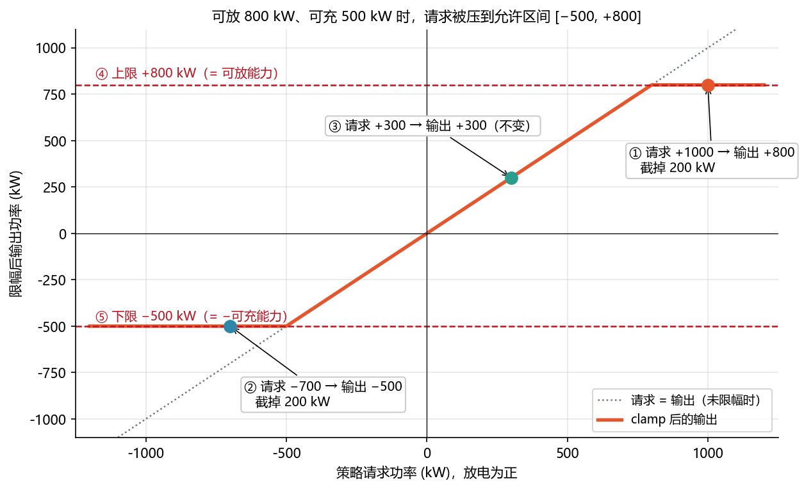
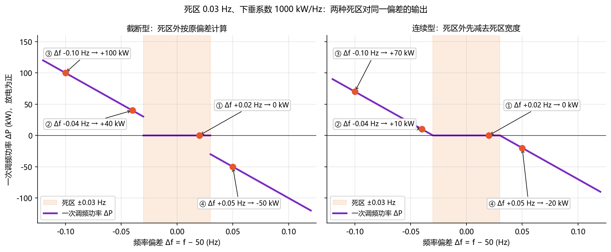
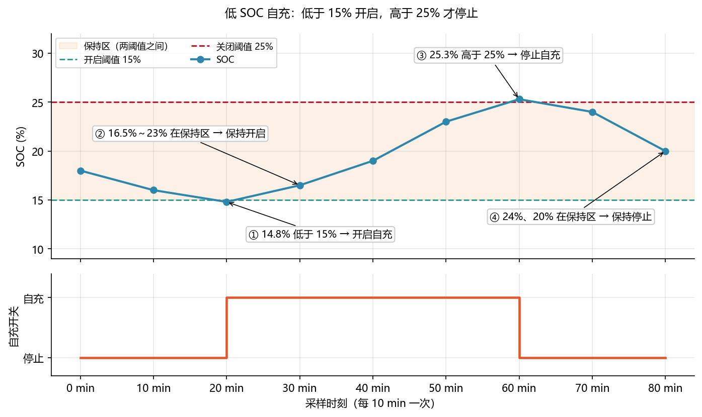
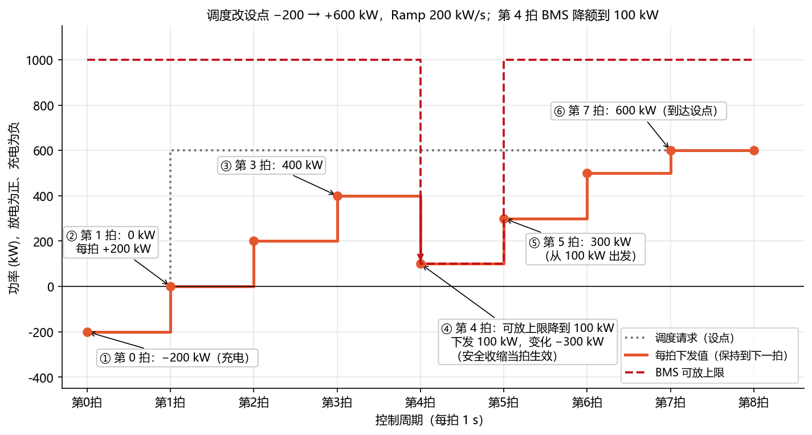
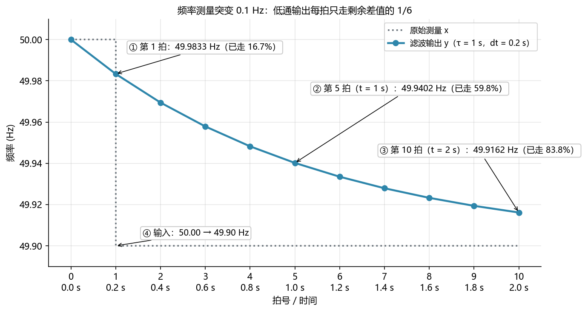
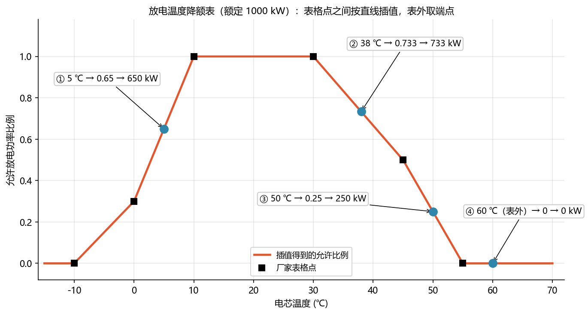
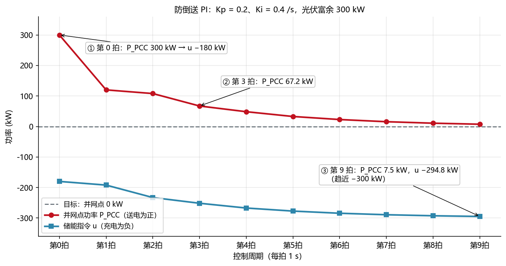
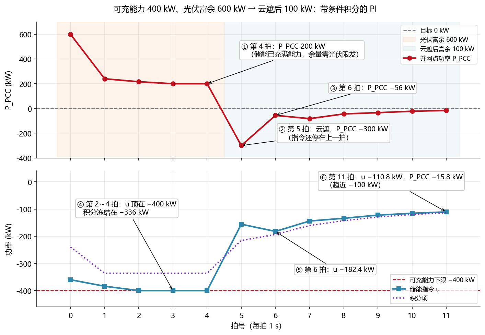
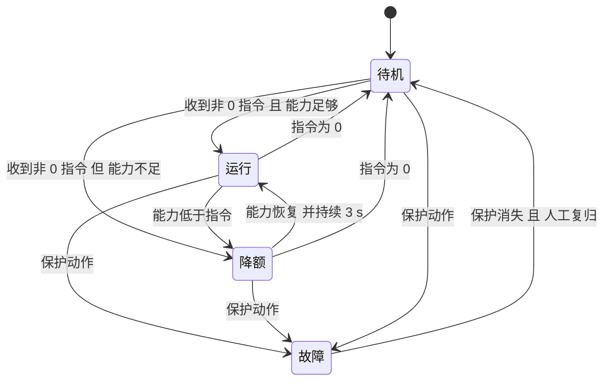

<!-- @AI_GENERATED -->
# 11 EMS 功率控制基础函数：限幅、滤波、闭环与状态机

> [课程首页](README.md) · 上一章：[10 EMS 通信接入、点表解码与数据质量管理](10_通信点表与数据质量.md) · 下一章：[12 EMS 安全约束建模与可行域投影](12_安全约束与可行域.md)

**一句话**：EMS 的功率控制逻辑，大多由限幅、死区、滞回、变化率限制、滤波、查表、PI 和状态机这些基础原语组合而成。

## 本章目标

读完本章，你应能：

1. 统一放电为正、充电为负的功率方向，并手算 8 类基础控制原语；
2. 解释 Ramp 后为什么还要兜底限幅、PI 为什么需要抗积分饱和；
3. 识别带状态的滞回、滤波器、PI 和状态机在重启/失效时需要恢复什么；
4. 用逐拍追踪、概念实现和测试验证控制行为。

## 本章边界与前置

本章只讲标量有功 P 的控制基础函数和教学状态机；P-Q 联合投影进入第 17 章，多 PCS 分配进入第 18 章，完整安全可行域进入第 12 章，现场整定和 HIL/FAT/SAT 以项目规程和第 19 章为准。本章依赖第 09 章流水线、第 10 章数据质量和第 05c 章能力模型。

**本章怎么读**：每节按“为什么需要 → 作用 → 原理/公式 → 手算/逐拍追踪 → 配套实现 → 验证”展开。正文中的短代码是概念实现；真实接口位于配套教学模块，二者通过测试保持结果一致。

---

## 11.0 这些函数在流水线的哪里【必懂】



| 函数 | 解决的业务问题 | 软件类比 | 本节 |
|---|---|---|---|
| clamp 限幅 | 指令不能超过设备此刻的能力 | 参数边界校验 | 11.1 |
| 死区 | 电网正常的小波动不需要响应 | 防抖（debounce） | 11.2 |
| 滞回 | 开关判断不能在阈值附近反复切换 | 施密特触发器；熔断器的打开/恢复阈值 | 11.3 |
| Ramp 变化率限制 | 主动改变功率时不能冲击电网和设备 | 令牌桶限流 | 11.4 |
| 一阶低通滤波 | 测量噪声不能直接驱动控制 | 指数加权移动平均（EWMA） | 11.5 |
| 查表插值 | 厂家只给表格，代码要在任意点取值 | 分段线性的配置映射 | 11.6 |
| PI 控制 | 目标在并网点，要按实测偏差持续修正 | K8s HPA 按指标持续扩缩容 | 11.7 |
| 状态机 | 运行模式要可解释、切换要有顺序 | 有限状态机 / 工作流引擎 | 11.8 |

示例统一以一座 1000 kW / 4000 kWh 的储能站为背景（`[教学示例]`），各节的数值在本节内单独给出。

通用控制原语实现于 `lab/ems_lab/control.py`。11.8 的 `ModeMachine` 是教学示例实现，位于 `lab/examples/ch11_control_examples.py`，并不代表仓库提供了通用状态机模块。配套示例会用真实控制原语重算本章各节结果。

---

## 11.1 clamp 限幅：给功率指令装护栏【必懂】

### 为什么需要

策略层（削峰、调频、计划跟踪）算出的是业务“想要”多少功率，它并不知道电池此刻“能给”多少。BMS 会随 SOC、温度和电芯一致性实时调整允许的充、放电功率，PCS 也有自己的额定值和温度降额。指令一旦超出这个范围，会出两类问题：

- **状态失真**：PCS 拒绝或自行截断指令，EMS 记录的下发值与实际执行值不一致，后面的 Ramp、闭环都建立在错误的状态上；
- **保护动作**：电流超过 BMS 允许值，BMS 会触发保护、断开直流接触器，整站失去出力。

所以，**每一条功率指令在下发之前，都必须压回本周期的允许区间**，这就是限幅（clamp）。

### 作用

| 项 | 内容 |
|---|---|
| 在流水线中的位置 | 仲裁合成之后、Ramp 之前；Ramp 之后再做一次兜底限幅（11.4） |
| 输入 | 请求功率、本拍可充能力、本拍可放能力 |
| 输出 | 落在允许区间内的功率，以及被截掉的部分 |
| 谁受影响 | PCS 执行；被截掉的部分要反馈给策略层或记录下来（例如 AGC 跟踪不到设点的原因） |

### 原理

**直觉**：请求在区间内就原样通过；超出哪一边，就取哪一边的边界。

**公式与符号**

```text
clamp(x, lo, hi) = min( max(x, lo), hi )                 要求 lo ≤ hi
P_out = clamp( P_req, −P_charge_max, +P_discharge_max )  储能的允许区间
P_cut = P_req − P_out                                    被截掉的部分
```

| 符号 | 含义 | 单位 | 取值来源 |
|---|---|---|---|
| `P_req` | 请求功率，放电为正、充电为负 | kW | 仲裁合成的输出 |
| `P_charge_max` | 本拍可充能力（非负幅值） | kW | BMS 上送的允许充电功率与 PCS 能力取小 |
| `P_discharge_max` | 本拍可放能力（非负幅值） | kW | BMS 上送的允许放电功率与 PCS 能力取小 |
| `P_out` | 限幅后的功率 | kW | 本函数输出 |
| `P_cut` | 被截掉的功率；正值表示少放，负值表示少充 | kW | 本函数输出，用于上报和记录 |

**要点**：

- **区间不对称**：可充、可放能力由 BMS 分别给出，两边一般不相等，而且每拍都可能变化。
- **可行域为空（lo > hi）是约束冲突**：例如防倒送要求“放电不超过 200 kW”，而调度强制要求“至少放电 300 kW”。这不是限幅能解决的问题，要上报并按优先级处理（第 12、18 章）。
- **只适用于一维**：P 和 Q 同时受视在功率约束时，要用圆投影（第 17 章）。

### 示例：三个请求遇到不对称的能力

**已知条件**（`[教学示例]`）：

| 量 | 值 |
|---|---|
| 储能 | 1000 kW / 4000 kWh |
| 当前状态 | SOC 偏高，BMS 收窄了充电能力 |
| 可充能力 `P_charge_max` | 500 kW |
| 可放能力 `P_discharge_max` | 800 kW |
| 请求 ① | +1000 kW（调度要求满功率放电） |
| 请求 ② | −700 kW（光伏富余，要求充电） |
| 请求 ③ | +300 kW（计划放电） |

**手算一项（请求 ①）**：

```text
① 允许区间  [−P_charge_max, +P_discharge_max] = [−500, +800] kW
② 先压下界  max(1000, −500) = 1000
③ 再压上界  min(1000, 800)  = 800 kW               → P_out = +800 kW
④ 截掉      P_cut = 1000 − 800 = +200 kW            （少放 200 kW）
```

**逐项结果**：

| 请求 | 允许区间 | 输出 | 截掉 | 说明 |
|---:|---|---:|---:|---|
| +1000 | [−500, +800] | **+800** | +200 | 超过可放能力，少放 200 kW |
| −700 | [−500, +800] | **−500** | −200 | 超过可充能力，少充 200 kW |
| +300 | [−500, +800] | **+300** | 0 | 在区间内，原样通过 |

**读表**：

- 请求 ① 和 ② 被截掉的幅度都是 200 kW，但截在不同的边界上：一个碰到可放能力 800 kW，一个碰到可充能力 500 kW。
- 被截掉的 200 kW 是“业务没有被满足的部分”，要反馈给上层（例如调度考核时说明原因），不能只把结果下发了事。

**验证**：

- 三个输出都落在 [−500, +800] 内；
- 区间内的请求（+300 kW）没有被改动。



图中标注对照表：

| 编号 | 位置 | 标注 | 对应正文 |
|---|---|---|---|
| ① | 右上圆点 | 请求 +1000 kW → 输出 +800 kW，截掉 200 kW | 手算一项、逐项表第 1 行 |
| ② | 左下圆点 | 请求 −700 kW → 输出 −500 kW，截掉 200 kW | 逐项表第 2 行 |
| ③ | 中间圆点 | 请求 +300 kW → 输出 +300 kW（不变） | 逐项表第 3 行 |
| ④ | 上方虚线 | 上限 +800 kW（= 可放能力） | 已知条件 |
| ⑤ | 下方虚线 | 下限 −500 kW（= −可充能力） | 已知条件 |

**自包含代码**（复制即可运行）：

```python
# clamp 最小闭环：输入请求和本拍可充/可放能力 → 压回允许区间 → 输出下发值和被截掉的部分
P_CHARGE_MAX = 500.0     # 可充能力（kW，非负幅值）
P_DISCHARGE_MAX = 800.0  # 可放能力（kW，非负幅值）
requests = [1000, -700, 300]   # 三个策略请求（kW），放电为正、充电为负


def clamp(x, lo, hi):
    if lo > hi:                # 可行域为空：约束冲突，交给上层上报处理
        raise ValueError(f"可行域为空：下限 {lo} > 上限 {hi}")
    return max(lo, min(hi, x))


lo, hi = -P_CHARGE_MAX, P_DISCHARGE_MAX   # 允许区间 [−可充, +可放]
outs = []
print("请求    下限    上限    输出   截掉")
for req in requests:
    out = clamp(req, lo, hi)
    outs.append(out)
    print(f"{req:>+5}  {lo:>+6.0f}  {hi:>+6.0f}  {out:>+5.0f}  {req - out:>+5.0f}")

assert outs == [800, -500, 300]
print("自检通过")
```

运行输出：

```text
请求    下限    上限    输出   截掉
+1000    -500    +800   +800   +200
 -700    -500    +800   -500   -200
 +300    -500    +800   +300     +0
自检通过
```

**注意**：

- 可充、可放能力一律用非负幅值。有的 BMS 上送的可充功率是负数，接入层要统一换算后再进入 clamp，函数入口做校验。
- NaN 必须在数据校验层拦截（第 10 章）。Python 的 `max`/`min` 遇到 NaN 时，结果取决于参数顺序，可能把异常值“洗”成一个看似正常的数，所以真实实现遇到 NaN 直接报错。

**真实实现**：`lab/ems_lab/control.py` 中的 `clamp()`（含 NaN 和空可行域校验）和 `clamp_power()`（按 `[−可充, +可放]` 限幅）。

---

## 11.2 死区：小偏差不动作【必懂】

### 为什么需要

储能参与一次调频时，按电网频率偏差成比例地调整出力：频率低就多放电，频率高就多充电。但电网频率每时每刻都在额定值附近小幅波动，测量本身也有噪声。如果对每一点波动都做出响应：

- **对电池**：多出大量没有意义的浅充浅放，增加循环损耗；
- **对 PCS**：功率在零附近频繁换向；
- **对电网**：这些小波动本来由电网自身就能消化，储能的响应既无必要，也可能与其他调频资源相互干扰。

并网规范和调度规程因此规定，一次调频必须设置**死区**：偏差小于死区时不动作。无功调压对电压偏差的处理同理。

所以，**凡是“按偏差成比例响应”的功能，偏差进入控制律之前都要先过死区**。

### 作用

| 项 | 内容 |
|---|---|
| 在流水线中的位置 | 测量滤波之后、下垂计算之前 |
| 输入 | 偏差，例如频率偏差 Δf = f − 50 Hz |
| 输出 | 有效偏差，再乘以下垂系数得到调频功率 |
| 谁受影响 | 一次调频出力和调频性能考核（第 15 章） |

### 原理

**直觉**：偏差落在死区内，就当没有偏差；落在死区外，规程有两种规定：按原偏差算（截断型），或者先减去死区宽度再算（连续型）。

**公式与符号**

```text
截断型：e_eff = 0                  |Δf| ≤ w
             = Δf                 |Δf| > w     死区外按原偏差，边界处输出跳变
连续型：e_eff = 0                  |Δf| ≤ w
             = Δf − w × sign(Δf)  |Δf| > w     死区外先减去 w，边界处从 0 连续增长
调频功率：ΔP = −K × e_eff                       频率低（Δf < 0）→ ΔP > 0，多放电
```

| 符号 | 含义 | 单位 | 取值来源 |
|---|---|---|---|
| `Δf` | 频率偏差 = 测量频率 − 额定频率 | Hz | 滤波后的频率测量 |
| `w` | 死区宽度 | Hz | 项目适用的并网规范、调度规程 |
| `e_eff` | 过死区后的有效偏差 | Hz | 本函数输出 |
| `K` | 下垂系数：频率每偏 1 Hz，功率调多少 | kW/Hz | 由调差率换算（第 15 章） |
| `ΔP` | 一次调频功率，放电为正 | kW | 下垂计算的输出 |

**要点**：

- **用哪一型由规程决定**。死区外两型的有效偏差恒差 w，功率恒差 K × w，写错会直接影响调频考核。
- **死区作用在偏差上**（频率 − 50 Hz），而不是作用在频率本身上。
- **边界用 `<` 还是 `<=`**，同一个项目里要统一，测试要覆盖“正好等于死区”的输入。

### 示例：同一组频率，两种死区的调频功率

**已知条件**（`[教学示例]`）：

| 量 | 值 |
|---|---|
| 额定频率 | 50 Hz |
| 死区宽度 `w` | 0.03 Hz |
| 下垂系数 `K` | 1000 kW/Hz |
| 四次频率测量 | 50.02、49.96、49.90、50.05 Hz |

**手算一项（49.96 Hz）**：

```text
① 偏差     Δf = 49.96 − 50 = −0.04 Hz，|−0.04| > 0.03，在死区外
② 截断型   e_eff = −0.04 Hz                 ΔP = −1000 × (−0.04) = +40 kW
③ 连续型   e_eff = −0.04 + 0.03 = −0.01 Hz   ΔP = −1000 × (−0.01) = +10 kW
```

**逐项结果**：

| 频率 (Hz) | Δf (Hz) | 截断型 e_eff | 截断型 ΔP (kW) | 连续型 e_eff | 连续型 ΔP (kW) |
|---:|---:|---:|---:|---:|---:|
| 50.02 | +0.02 | 0 | **0** | 0 | **0** |
| 49.96 | −0.04 | −0.04 | **+40** | −0.01 | **+10** |
| 49.90 | −0.10 | −0.10 | **+100** | −0.07 | **+70** |
| 50.05 | +0.05 | +0.05 | **−50** | +0.02 | **−20** |

**读表**：

- 50.02 Hz 的偏差 +0.02 Hz 在死区内，两型都不动作。
- 死区外，两型的功率之差恒为 K × w = 1000 × 0.03 = 30 kW（+40 与 +10、+100 与 +70、−50 与 −20）。
- 50.05 Hz 频率偏高，ΔP 为负，表示储能少放或多充。

**验证**：

- 连续型在死区边界处从 0 开始增长，曲线没有断点；
- 截断型在死区边界处直接从 0 跳到 ±K × w，这是它的特征，不是错误。



图中标注对照表：

| 编号 | 位置 | 标注 | 对应正文 |
|---|---|---|---|
| ① | 两图 Δf 为正的小偏差处 | Δf +0.02 Hz → 截断型 0 kW，连续型 0 kW | 逐项表第 1 行 |
| ② | 两图 Δf 为负的小偏差处 | Δf −0.04 Hz → 截断型 +40 kW，连续型 +10 kW | 手算一项、逐项表第 2 行 |
| ③ | 两图左上方 | Δf −0.10 Hz → 截断型 +100 kW，连续型 +70 kW | 逐项表第 3 行 |
| ④ | 两图右下方 | Δf +0.05 Hz → 截断型 −50 kW，连续型 −20 kW | 逐项表第 4 行 |
| — | 阴影带 | 死区 ±0.03 Hz | 已知条件 |

**自包含代码**（复制即可运行）：

```python
# 死区最小闭环：输入频率测量 → 偏差 → 两种死区 → 一次调频功率
F_NOMINAL = 50.0   # 额定频率（Hz）
WIDTH = 0.03       # 死区宽度 w（Hz）
K = 1000.0         # 下垂系数（kW/Hz），频率每低 1 Hz 多放 1000 kW
freqs = [50.02, 49.96, 49.90, 50.05]


def deadband_cut(x, w):            # 截断型：死区外按原偏差
    return 0.0 if abs(x) <= w else x


def deadband_shift(x, w):          # 连续型：死区外先减去死区宽度
    if abs(x) <= w:
        return 0.0
    return x - w if x > 0 else x + w


rows = []
print("频率     偏差    截断型偏差  截断型ΔP  连续型偏差  连续型ΔP")
for f in freqs:
    df = round(f - F_NOMINAL, 4)                       # ① 偏差（避免浮点尾数）
    cut, shift = deadband_cut(df, WIDTH), round(deadband_shift(df, WIDTH), 4)
    p_cut, p_shift = -K * cut + 0.0, -K * shift + 0.0  # ② ΔP = −K × 有效偏差（+0.0 去掉 −0）
    rows.append((p_cut, p_shift))
    print(f"{f:.2f}  {df:+.2f}  {cut:>+10.2f}  {p_cut:>+8.0f}  {shift:>+10.2f}  {p_shift:>+8.0f}")

assert rows == [(0, 0), (40, 10), (100, 70), (-50, -20)]
print("自检通过")
```

运行输出：

```text
频率     偏差    截断型偏差  截断型ΔP  连续型偏差  连续型ΔP
50.02  +0.02       +0.00        +0       +0.00        +0
49.96  -0.04       -0.04       +40       -0.01       +10
49.90  -0.10       -0.10      +100       -0.07       +70
50.05  +0.05       +0.05       -50       +0.02       -20
自检通过
```

**注意**：

- 截断型在边界处有跳变。频率在死区边界附近徘徊时，出力会在 0 和 ±K × w 之间反复跳；规程要求截断型时，通常配合滤波（11.5）使用。
- 死区宽度要与调度确认后写进配置，不要硬编码在代码里。

**真实实现**：`lab/ems_lab/control.py` 中的 `deadband_cut()` 和 `deadband_shift()`。

---

## 11.3 滞回：开和关用不同的阈值【必懂】

### 为什么需要

储能长期待命做调频或备用时，SOC 会因为自耗和不对称的调节慢慢走低。EMS 需要一个“低 SOC 自动补电”功能：SOC 低到一定程度就从电网充电，充到足够再停。

如果开和停用同一个阈值，SOC 恰好在阈值附近时：充一点就超过阈值而停止，自耗一点又低于阈值而启动。补电开关在几分钟内反复切换，带来三个后果：

- PCS 频繁启停，增加设备损耗；
- 对调度上报的“可用状态”来回跳变；
- 每次切换都产生事件记录，告警列表被刷屏。

告警的产生和恢复（温度越限、SOC 越限）也有同样的问题。

所以，**凡是“根据一个连续量做开/关判断”的地方，都要用两个阈值把“开”和“关”分开**，这就是滞回。

### 作用

| 项 | 内容 |
|---|---|
| 在流水线中的位置 | SOC 分区、模式切换、告警判断 |
| 输入 | 连续量（SOC、温度等）和上一拍的开关状态 |
| 输出 | 本拍的开关状态 |
| 谁受影响 | 自充策略；对外上报的可用状态；告警记录 |

### 原理

**直觉**：低于开启阈值才打开；打开以后，要高于关闭阈值才关闭；落在两个阈值之间时，保持原来的状态。所以滞回必须**记住上一拍的状态**。

**公式与符号**

```text
若 当前为关 且 x < x_on    → 打开
若 当前为开 且 x > x_off   → 关闭
其他情况                    → 保持原状态              要求 x_on < x_off
```

| 符号 | 含义 | 单位 | 取值来源 |
|---|---|---|---|
| `x` | 被判断的连续量，本例为 SOC | % | 测量或估算值 |
| `x_on` | 开启阈值 | % | 项目整定 |
| `x_off` | 关闭阈值 | % | 项目整定 |
| `state` | 开关状态，跨拍保存 | 开/关 | 本函数的内部状态 |

**要点**：

- **滞回是有状态的**：控制器重启后，应按设备当前的实际运行状态初始化 `state`，而不是一律设为“关”。
- **带宽要足够**：`x_off − x_on` 要大于测量噪声的幅度，否则等于没有滞回。

### 示例：低 SOC 自动补电

**已知条件**（`[教学示例]`）：

| 量 | 值 |
|---|---|
| 开启阈值 `x_on` | 15%（低于它开始补电） |
| 关闭阈值 `x_off` | 25%（高于它停止补电） |
| 采样 | 每 10 min 一次 |
| 初始状态 | 未补电 |
| SOC 序列 | 18、16、14.8、16.5、19、23、25.3、24、20（%） |

**手算三个关键时刻**：

```text
20 min：当前为关，SOC 14.8% < 开启阈值 15%       → 打开
30 min：当前为开，SOC 16.5% 不高于关闭阈值 25%   → 保持打开
60 min：当前为开，SOC 25.3% > 关闭阈值 25%       → 关闭
```

**逐拍追踪**：

| 时刻 | SOC | 判断 | 自充开关 |
|---:|---:|---|---|
| 0 min | 18.0% | 在两阈值之间，保持 | 关 |
| 10 min | 16.0% | 在两阈值之间，保持 | 关 |
| 20 min | 14.8% | 低于 15% | **开** |
| 30 min | 16.5% | 在两阈值之间，保持 | 开 |
| 40 min | 19.0% | 在两阈值之间，保持 | 开 |
| 50 min | 23.0% | 在两阈值之间，保持 | 开 |
| 60 min | 25.3% | 高于 25% | **关** |
| 70 min | 24.0% | 在两阈值之间，保持 | 关 |
| 80 min | 20.0% | 在两阈值之间，保持 | 关 |

**读表**：

- 同样是 16%～19% 附近的 SOC，0～10 min 时开关为“关”，30～40 min 时为“开”。区别在于上一拍的状态，这就是“记住状态”的含义。
- 补电一旦开启，就一直充到越过 25% 才停，中间不会因为 SOC 小幅回落而反复启停。

**验证**：

- 整个过程只开启 1 次、停止 1 次；
- 开启发生在低于 15% 时，停止发生在高于 25% 时。



图中标注对照表：

| 编号 | 位置 | 标注 | 对应正文 |
|---|---|---|---|
| ① | 20 min | 14.8% 低于 15% → 开启自充 | 手算、逐拍表 20 min |
| ② | 30～50 min | 16.5%～23% 在保持区 → 保持开启 | 逐拍表 30～50 min |
| ③ | 60 min | 25.3% 高于 25% → 停止自充 | 手算、逐拍表 60 min |
| ④ | 70～80 min | 24%、20% 在保持区 → 保持停止 | 逐拍表 70～80 min |

**自包含代码**（复制即可运行）：

```python
# 滞回最小闭环：输入每 10 分钟的 SOC → 两阈值 + 记忆状态 → 输出自充开关
ON_BELOW = 15.0    # 开启阈值（%）：低于它开始自充
OFF_ABOVE = 25.0   # 关闭阈值（%）：高于它停止自充
socs = [18, 16, 14.8, 16.5, 19, 23, 25.3, 24, 20]
active = False     # 当前是否在自充（有状态：重启时应按实际状态恢复）

states = []
print("时刻     SOC    自充   判断")
for i, soc in enumerate(socs):
    before = active
    if not active and soc < ON_BELOW:
        active, why = True, "低于开启阈值 → 开启"
    elif active and soc > OFF_ABOVE:
        active, why = False, "高于关闭阈值 → 停止"
    else:
        why = "在两阈值之间 → 保持"
    states.append(active)
    print(f"{10 * i:>3} min  {soc:>5.1f}%  {'开' if before else '关'}→{'开' if active else '关'}  {why}")

assert states == [False, False, True, True, True, True, False, False, False]
print("自检通过")
```

运行输出：

```text
时刻     SOC    自充   判断
  0 min   18.0%  关→关  在两阈值之间 → 保持
 10 min   16.0%  关→关  在两阈值之间 → 保持
 20 min   14.8%  关→开  低于开启阈值 → 开启
 30 min   16.5%  开→开  在两阈值之间 → 保持
 40 min   19.0%  开→开  在两阈值之间 → 保持
 50 min   23.0%  开→开  在两阈值之间 → 保持
 60 min   25.3%  开→关  高于关闭阈值 → 停止
 70 min   24.0%  关→关  在两阈值之间 → 保持
 80 min   20.0%  关→关  在两阈值之间 → 保持
自检通过
```

**注意**：

- 告警也要用滞回。例如“温度高于 45℃ 告警”要配合“温度低于 42℃ 才恢复”，否则同一条告警会反复产生和消除（第 20 章）。
- 滞回解决的是“数值”上的抖动；如果还要求“持续一段时间才切换”，要再加时间判断（11.8 的降额恢复就是这样）。

**真实实现**：`lab/ems_lab/control.py` 中的 `Hysteresis`（内部状态 `active`）。

---

## 11.4 Ramp 变化率限制【必懂】

### 为什么需要

EMS 几乎每时每刻都在改变储能的功率目标：调度下发新的 AGC 设点、计划曲线跨时段切换、调频事件触发、运行人员手动改设定、储能从充电切换到放电。如果每次目标变化都在一个控制周期内直接下发到 PCS，会在三个地方出问题：

- **对电网**：储能站作为并网电源，并网规范和调度会限制有功功率的变化速度。功率阶跃会冲击局部电网的频率和电压，超过限值要被考核。
- **对设备**：PCS 和升压变压器会承受电流阶跃，容易触发过流保护，长期还会加剧设备老化。
- **对站内的其他控制**：防倒送、需量控制靠并网点电表做闭环。储能功率突然大幅变化时，并网点功率会在闭环来得及修正之前越限。

所以，**只要 EMS 会主动改变功率目标（实际上每个业务都会），下发之前就必须限制功率的变化速度**，这就是 Ramp。

同时还有另一类情况：BMS 突然降低允许功率、保护或联锁要求停机。这是**安全边界在收缩**，必须当周期生效，不能也被 Ramp 拖慢。所以 Ramp 只约束“主动的变化”，安全约束的收缩不受 Ramp 限制。

### 作用

| 项 | 内容 |
|---|---|
| 在流水线中的位置 | 约束投影（第 12 章）之后、下发 PCS 之前，之后再做一次“兜底限幅” |
| 输入 | 投影后的目标功率、上一拍实际下发的功率、本拍周期 dt、上升和下降速率 |
| 输出 | 本拍下发给 PCS 的功率 |
| 谁受影响 | PCS 执行；并网点闭环（防倒送、需量）；AGC 的“调节速率”考核（第 16 章） |

### 原理

**直觉**：每个控制周期，功率最多只能朝目标走一小步。步长 = 速率 × 周期。离目标还远就走一个整步；剩下的距离不足一步时，直接到达目标。

**公式与符号**

```text
允许范围 = [ P_prev − r_down × dt ,  P_prev + r_up × dt ]
P_ramp   = clamp( P_target, 允许范围 )
P_out    = clamp( P_ramp, −P_charge_max, +P_discharge_max )      兜底：安全边界当周期生效
P_prev  ← P_out                                                  下一拍从实际下发值出发
```

| 符号 | 含义 | 单位 | 取值来源 |
|---|---|---|---|
| `P_target` | 约束投影之后的目标功率，放电为正、充电为负 | kW | 上游约束投影的输出 |
| `P_prev` | 上一拍**实际下发**的功率 | kW | EMS 自己记录；被截断、PCS 拒绝、主备切换后，要同步到实测值 |
| `r_up`、`r_down` | 功率代数值增大、减小的最大速率 | kW/s | 并网规范、调度要求或项目整定，按“哪个更严用哪个” |
| `dt` | 本拍实际经过的时间 | s | 用单调时钟实测，不要直接写死成标称周期 |
| `P_charge_max`、`P_discharge_max` | 本拍可充、可放能力（非负幅值） | kW | BMS、PCS 能力和约束层的结果 |

**要点**：

- **方向按代数值算**：从 −200 kW（充电）变到 +600 kW（放电），整个过程都是“上升”，全程用 `r_up`。
- **单位换算**：规范里常写成 `%Pn/min`。换算公式是 `r(kW/s) = x% × Pn ÷ 100 ÷ 60`。例如 1000 kW 的站，10%Pn/min = 100 kW/min ≈ 1.67 kW/s。按“每秒”和“每分钟”写错，会相差 60 倍。
- **兜底与同步**：兜底限幅之后，必须把实际下发值记成新的 `P_prev`。这样下一拍才能从真实位置出发，主动变化不会因为状态不同步而跳变。

### 示例：调度改设点，中途 BMS 降额

**已知条件**（`[教学示例]`）：

| 量 | 值 |
|---|---|
| 储能 | 1000 kW / 4000 kWh，可充能力 1000 kW |
| 调度改设点之前 | 储能正在充电，下发值 −200 kW |
| 从第 1 拍起 | AGC 设点改为放电 +600 kW |
| Ramp 速率 | 上升、下降都是 200 kW/s（项目整定值） |
| 控制周期 | 1 s |
| BMS 可放能力 | 平时 1000 kW；第 4 拍因电芯温度高降到 100 kW；第 5 拍恢复 1000 kW |

**手算一拍（第 1 拍）**：

```text
① 目标     P_target = clamp(600, −1000, +1000)                = 600 kW
② 允许范围 [−200 − 200×1, −200 + 200×1]                       = [−400, 0] kW
③ Ramp     P_ramp = clamp(600, −400, 0)                        = 0 kW
④ 兜底     P_out = clamp(0, −1000, +1000)                      = 0 kW
⑤ 同步     P_prev ← 0 kW                                       （下一拍从 0 出发）
```

**逐拍追踪**：

| 拍 | 请求 | 可放上限 | 目标 | 上一拍 | 允许范围 | Ramp 结果 | 下发 | 变化量 |
|---:|---:|---:|---:|---:|---|---:|---:|---:|
| 1 | 600 | 1000 | 600 | −200 | [−400, 0] | 0 | **0** | +200 |
| 2 | 600 | 1000 | 600 | 0 | [−200, 200] | 200 | **200** | +200 |
| 3 | 600 | 1000 | 600 | 200 | [0, 400] | 400 | **400** | +200 |
| 4 | 600 | **100** | 100 | 400 | [200, 600] | 200 | **100** | **−300** |
| 5 | 600 | 1000 | 600 | 100 | [−100, 300] | 300 | **300** | +200 |
| 6 | 600 | 1000 | 600 | 300 | [100, 500] | 500 | **500** | +200 |
| 7 | 600 | 1000 | 600 | 500 | [300, 700] | 600 | **600** | +100 |
| 8 | 600 | 1000 | 600 | 600 | [400, 800] | 600 | **600** | 0 |

**读表**：

- **第 1～3 拍**：每拍上升 200 kW。第 1 拍从 −200 kW 到 0，是从充电回到零，按代数值算也是“上升”。
- **第 4 拍**：BMS 把可放能力降到 100 kW。按 Ramp 本拍只能降到 200 kW，兜底限幅把下发值直接压到 100 kW，本拍变化 −300 kW，超过了下降速率。这是安全收缩，允许超过速率限制。
- **第 5～7 拍**：能力恢复后，从实际下发的 100 kW 出发，重新按 200 kW/s 上升。第 7 拍离目标只剩 100 kW，直接到达 600 kW。

**验证**：

- 除第 4 拍外，每拍的主动变化都不超过 200 kW；
- 每拍下发值都不超过当拍的可放上限；
- 最终稳定在调度设点 600 kW。



图中标注对照表：

| 编号 | 位置 | 标注 | 对应正文 |
|---|---|---|---|
| ① | 第 0 拍 | 起点 −200 kW（充电） | 已知条件 |
| ② | 第 1 拍 | 0 kW，每拍 +200 kW | 手算一拍、逐拍表第 1 行 |
| ③ | 第 3 拍 | 400 kW | 逐拍表第 3 行 |
| ④ | 第 4 拍 | 可放上限降到 100 kW，下发 100 kW，变化 −300 kW | 逐拍表第 4 行 |
| ⑤ | 第 5 拍 | 300 kW，从 100 kW 出发 | 逐拍表第 5 行 |
| ⑥ | 第 7 拍 | 600 kW，到达设点 | 逐拍表第 7 行 |

**自包含代码**（复制即可运行）：

```python
# Ramp 最小闭环：输入每拍请求和可放能力 → 限幅 → Ramp → 兜底 → 输出每拍下发值
RATE_UP = 200.0        # 上升速率 r_up（kW/s）
RATE_DOWN = 200.0      # 下降速率 r_down（kW/s）
DT = 1.0               # 控制周期 dt（s）
P_CHARGE_MAX = 1000.0  # 可充能力（kW，非负幅值）

# ---- 输入：每拍的 (调度请求 kW, BMS 可放能力 kW) ----
inputs = [(600, 1000), (600, 1000), (600, 1000), (600, 100),
          (600, 1000), (600, 1000), (600, 1000), (600, 1000)]
p_prev = -200.0        # 第 0 拍（调度改设点之前）的下发值：正在充电 200 kW


def clamp(x, lo, hi):
    return max(lo, min(hi, x))


rows = []
print("拍  请求  可放上限  目标  上一拍  允许范围        Ramp结果  下发  变化量")
for k, (req, dis_max) in enumerate(inputs, start=1):
    target = clamp(req, -P_CHARGE_MAX, dis_max)          # ① 先压进当前能力范围
    lo, hi = p_prev - RATE_DOWN * DT, p_prev + RATE_UP * DT
    ramped = clamp(target, lo, hi)                        # ② 本拍最多走 r×dt
    final = clamp(ramped, -P_CHARGE_MAX, dis_max)         # ③ 兜底：能力突降立即生效
    delta = final - p_prev
    print(f"{k:>2}  {req:>4}  {dis_max:>6}  {target:>6.0f}  {p_prev:>6.0f}  "
          f"[{lo:>5.0f}, {hi:>5.0f}]  {ramped:>8.0f}  {final:>4.0f}  {delta:>+6.0f}")
    rows.append(final)
    p_prev = final                                        # ④ 记住真正下发的值（同步状态）

assert rows == [0, 200, 400, 100, 300, 500, 600, 600]
print("自检通过")
```

运行输出：

```text
拍  请求  可放上限  目标  上一拍  允许范围        Ramp结果  下发  变化量
 1   600    1000     600    -200  [ -400,     0]         0     0    +200
 2   600    1000     600       0  [ -200,   200]       200   200    +200
 3   600    1000     600     200  [    0,   400]       400   400    +200
 4   600     100     100     400  [  200,   600]       200   100    -300
 5   600    1000     600     100  [ -100,   300]       300   300    +200
 6   600    1000     600     300  [  100,   500]       500   500    +200
 7   600    1000     600     500  [  300,   700]       600   600    +100
 8   600    1000     600     600  [  400,   800]       600   600      +0
自检通过
```

**注意**：

- `P_prev` 记录的是**实际下发值**，不是 Ramp 的中间结果；被兜底截断、被 PCS 拒绝、主备切换后，都要同步到实际值。
- 一次调频、紧急停机这类快速功能是否走 Ramp、用什么速率，要按项目要求单独配置。
- PCS 自身也可能带变化率限制。EMS 的速率要和它协调，避免两层叠加后实际响应变得比要求更慢。

**真实实现**：`lab/ems_lab/control.py` 中的 `RateLimiter`（Ramp 本身，内部状态 `output` 即 `P_prev`）和 `limit_then_ramp()`（限幅 → Ramp → 兜底 → `reset` 同步）。`lab/examples/ch11_ramp_example.py` 用它们重跑了上面的逐拍表，结果一致。

---

## 11.5 一阶低通滤波：让测量值稳一点【必懂】

### 为什么需要

EMS 的很多判断直接使用测量值：一次调频看频率，防倒送看并网点功率，频率变化率（RoCoF）判断看频率的变化速度。测量值里叠加着采样噪声、负荷的快速随机波动和通信抖动：

- 直接用于控制，下发的指令会跟着噪声抖动；
- 用于求变化率时，噪声会被放大，可能被误判为电网事件（第 15 章）。

所以，**测量值进入控制和判断之前，通常要先过一个低通滤波**，在“平稳”和“及时”之间按时间常数取舍。

### 作用

| 项 | 内容 |
|---|---|
| 在流水线中的位置 | 数据质量校验之后、死区和策略计算之前 |
| 输入 | 每拍的测量值、本拍实际经过的时间 dt |
| 输出 | 滤波后的测量值 |
| 谁受影响 | 所有使用该测量的功能；滤波引入的延迟要计入响应时间预算（第 09 章） |

### 原理

**直觉**：每拍只朝新测量值走“剩余差值的一部分”。噪声忽上忽下，走过去的部分会相互抵消；真实的持续变化则会被一拍拍跟上。

**公式与符号**

```text
α    = dt / (τ + dt)
y[k] = y[k−1] + α × ( x[k] − y[k−1] )
输入阶跃后，第 k 拍已走比例 = 1 − (1 − α)^k
```

| 符号 | 含义 | 单位 | 取值来源 |
|---|---|---|---|
| `x[k]` | 第 k 拍的测量值 | 与测量量相同 | 数据校验之后的测量 |
| `y[k]` | 第 k 拍的滤波输出 | 同上 | 本函数输出，跨拍保存 |
| `dt` | 本拍实际经过的时间 | s | 用单调时钟实测 |
| `τ` | 时间常数，越大越平稳、越慢 | s | 按噪声水平和响应时间预算整定 |
| `α` | 每拍走剩余差值的比例，0～1 | 无 | 由 τ 和 dt 算出，不直接配置 |

**要点**：

- **配置写 τ，代码按实测 dt 算 α**。这样采样周期变化时，滤波特性保持不变，也能直接说清它引入了多少延迟。
- **τ 的含义**：连续时间下，输入阶跃后 τ 秒走完 63.2%，约 3τ 秒走完 95%。离散实现走得略少，dt 越小越接近。
- **初值**：用第一个有效样本作为初值，不要从 0 开始滤。

### 示例：频率测量突变 0.1 Hz

**已知条件**（`[教学示例]`）：

| 量 | 值 |
|---|---|
| 时间常数 `τ` | 1 s |
| 采样周期 `dt` | 0.2 s |
| 第 0 拍测量 | 50.00 Hz |
| 第 1 拍起测量 | 49.90 Hz（电网频率下跌事件） |

**手算第 1 拍**：

```text
① α        = 0.2 / (1 + 0.2) = 0.1667
② 第 0 拍  y[0] = x[0] = 50.0000 Hz                          （第一个样本直接作为初值）
③ 第 1 拍  y[1] = 50.0000 + 0.1667 × (49.90 − 50.0000) = 49.9833 Hz
④ 已走比例 (50 − 49.9833) / (50 − 49.90) = 16.7%
```

**逐拍追踪**：

| 拍 | 时间 | 输入 x | 上一拍 y | 输出 y | 已走比例 |
|---:|---:|---:|---:|---:|---:|
| 0 | 0.0 s | 50.00 | — | 50.0000 | 0.0% |
| 1 | 0.2 s | 49.90 | 50.0000 | **49.9833** | 16.7% |
| 2 | 0.4 s | 49.90 | 49.9833 | 49.9694 | 30.6% |
| 3 | 0.6 s | 49.90 | 49.9694 | 49.9579 | 42.1% |
| 4 | 0.8 s | 49.90 | 49.9579 | 49.9482 | 51.8% |
| 5 | 1.0 s | 49.90 | 49.9482 | **49.9402** | 59.8% |
| 6 | 1.2 s | 49.90 | 49.9402 | 49.9335 | 66.5% |
| 7 | 1.4 s | 49.90 | 49.9335 | 49.9279 | 72.1% |
| 8 | 1.6 s | 49.90 | 49.9279 | 49.9233 | 76.7% |
| 9 | 1.8 s | 49.90 | 49.9233 | 49.9194 | 80.6% |
| 10 | 2.0 s | 49.90 | 49.9194 | **49.9162** | 83.8% |

**读表**：

- 每拍都走剩余差值的 1/6（α = 0.1667），所以越接近 49.90 Hz，每拍走得越少。
- t = 1 s（一个 τ）时已走 59.8%，比连续时间的 63.2% 略少，这是 dt 与 τ 相比不够小造成的离散化差别。
- 到 2 s 时输出仍未到 49.90 Hz。如果一次调频用滤波后的频率判断，动作也会相应推迟，这就是滤波的代价。

**验证**：

- 输出单调趋近 49.90 Hz，不会越过；
- 第 5 拍已走比例 = 1 − (1 − 0.1667)^5 = 1 − 0.402 = 59.8%，与逐拍结果一致。



图中标注对照表：

| 编号 | 位置 | 标注 | 对应正文 |
|---|---|---|---|
| ① | 第 1 拍 | 49.9833 Hz（已走 16.7%） | 手算第 1 拍 |
| ② | 第 5 拍（t = 1 s） | 49.9402 Hz（已走 59.8%） | 逐拍表第 5 拍、验证 |
| ③ | 第 10 拍（t = 2 s） | 49.9162 Hz（已走 83.8%） | 逐拍表第 10 拍 |
| ④ | 第 1 拍 | 输入：50.00 → 49.90 Hz | 已知条件 |

**自包含代码**（复制即可运行）：

```python
# 低通最小闭环：输入频率测量序列 → 一阶低通 → 输出每拍滤波值和已走比例
TAU = 1.0          # 时间常数 τ（s）
DT = 0.2           # 采样周期 dt（s）
x = [50.0] + [49.9] * 10       # 第 1 拍起测量值从 50.00 跳到 49.90 Hz

alpha = DT / (TAU + DT)        # 每拍走剩余差值的比例
y = None
ys = []
print(f"α = {alpha:.4f}")
print("拍   时间    输入x    输出y     已走比例")
for k, xk in enumerate(x):
    if y is None:
        y = xk                 # 第一个样本直接作为初值
    else:
        y = y + alpha * (xk - y)
    ys.append(y)
    done = (50.0 - y) / (50.0 - 49.9) * 100
    print(f"{k:>2}  {k * DT:>4.1f} s  {xk:.2f}  {y:.4f}  {done:>6.1f}%")

assert round(ys[5], 4) == 49.9402 and round(ys[10], 4) == 49.9162
print("自检通过")
```

运行输出：

```text
α = 0.1667
拍   时间    输入x    输出y     已走比例
 0   0.0 s  50.00  50.0000     0.0%
 1   0.2 s  49.90  49.9833    16.7%
 2   0.4 s  49.90  49.9694    30.6%
 3   0.6 s  49.90  49.9579    42.1%
 4   0.8 s  49.90  49.9482    51.8%
 5   1.0 s  49.90  49.9402    59.8%
 6   1.2 s  49.90  49.9335    66.5%
 7   1.4 s  49.90  49.9279    72.1%
 8   1.6 s  49.90  49.9233    76.7%
 9   1.8 s  49.90  49.9194    80.6%
10   2.0 s  49.90  49.9162    83.8%
自检通过
```

**注意**：

- 一次调频、快速频率响应对响应时间有硬性要求，加入滤波前要先算延迟预算。
- 测量被判为无效时，应冻结滤波器并标记数据质量，而不是把异常值也滤进去（第 10 章）。

**真实实现**：`lab/ems_lab/control.py` 中的 `LowPassFilter`（`tau_s=0` 时直通；第一个样本作为初值）。

---

## 11.6 查表插值：把厂家曲线变成代码【必懂】

### 为什么需要

电池允许的充放电功率随电芯温度变化：低温时锂离子迁移变慢，大电流充电容易析锂；高温时老化加速，严重时有热失控风险。电池厂家把这种关系以**表格**的形式给出（若干温度点和对应的允许比例），而不是一个公式。PCS 的温度降额、SOC 接近上下限时的功率收窄，也都是表格形式。

EMS 的能力模型要在任意温度下给出允许功率，用于限幅、对调度申报能力和校核计划。

所以，**凡是厂家以表格给出的特性曲线，代码里都用“查表 + 线性插值”实现**。

### 作用

| 项 | 内容 |
|---|---|
| 在流水线中的位置 | 能力模型中计算可充/可放能力（第 05c 章），结果进入限幅 |
| 输入 | 当前温度（或 SOC）、厂家表格 |
| 输出 | 允许比例，乘以额定功率得到允许功率 |
| 谁受影响 | 限幅区间；对调度申报的可用能力 |

### 原理

**直觉**：当前值落在哪两个表格点之间，就在这两点连成的直线上取值；超出表格范围时取端点值，不把直线延长出去。

**公式与符号**

```text
找到区间  x_i ≤ x ≤ x_(i+1)
插值      y = y_i + ( y_(i+1) − y_i ) × ( x − x_i ) / ( x_(i+1) − x_i )
表外      x ≤ x_0 → y_0；x ≥ x_n → y_n                     （不外推）
```

| 符号 | 含义 | 单位 | 取值来源 |
|---|---|---|---|
| `x` | 查询值，本例为电芯温度 | ℃ | BMS 上送的最高（或最低）电芯温度 |
| `x_i`、`y_i` | 表格第 i 个点 | ℃、无 | 电池厂家规格书 |
| `y` | 插值结果，本例为允许放电比例 | 无 | 本函数输出 |

**要点**：

- **不外推**：表格外取端点值。延长直线可能算出负的允许功率，或大于 1 的比例。
- **表格必须严格递增**：录入错误（两个相同的温度点）会导致除以 0，加载配置时就要校验。
- **充电和放电是两张表**：低温时电池对充电的限制比放电严格得多，不能共用一张表。

### 示例：放电温度降额表

**已知条件**（`[教学示例]`，现场以电池厂家规格书为准）：

| 电芯温度 (℃) | −10 | 0 | 10 | 30 | 45 | 55 |
|---|---:|---:|---:|---:|---:|---:|
| 允许放电比例 | 0 | 0.3 | 1.0 | 1.0 | 0.5 | 0 |

额定放电功率 1000 kW；查询温度 5、38、50、60 ℃。

**手算一项（38 ℃）**：

```text
① 找区间   30 ≤ 38 ≤ 45，两端点为 (30, 1.0) 和 (45, 0.5)
② 插值     y = 1.0 + (0.5 − 1.0) × (38 − 30) / (45 − 30) = 1.0 − 0.5 × 8/15 = 0.733
③ 功率     P = 1000 × 0.733 = 733.3 kW
```

**逐项结果**：

| 温度 | 所在区间 | 允许比例 | 允许放电 |
|---:|---|---:|---:|
| 5 ℃ | [0, 10] | 0.650 | **650.0 kW** |
| 38 ℃ | [30, 45] | 0.733 | **733.3 kW** |
| 50 ℃ | [45, 55] | 0.250 | **250.0 kW** |
| 60 ℃ | 表外（高于最高点） | 0 | **0 kW** |

**读表**：

- 5 ℃ 在低温段，正好是 0 ℃（0.3）和 10 ℃（1.0）的中点，比例取中间值 0.65。
- 60 ℃ 超出表格，取端点值 0，即禁止放电，而不是沿着 45～55 ℃ 的直线算出一个负数。

**验证**：

- 所有结果都在 [0, 1] 内；
- 在表格点上（例如 30 ℃）取值等于表格值。



图中标注对照表：

| 编号 | 位置 | 标注 | 对应正文 |
|---|---|---|---|
| ① | 低温段 | 5 ℃ → 0.65 → 650 kW | 逐项表第 1 行 |
| ② | 高温段起点附近 | 38 ℃ → 0.733 → 733 kW | 手算一项、逐项表第 2 行 |
| ③ | 高温段 | 50 ℃ → 0.25 → 250 kW | 逐项表第 3 行 |
| ④ | 表格右侧 | 60 ℃（表外）→ 0 → 0 kW | 逐项表第 4 行 |

**自包含代码**（复制即可运行）：

```python
# 查表插值最小闭环：输入温度 → 找区间 → 直线插值（表外取端点）→ 输出允许放电功率
TEMPS = [-10, 0, 10, 30, 45, 55]          # 厂家表：电芯温度（℃），严格递增
RATIOS = [0.0, 0.3, 1.0, 1.0, 0.5, 0.0]   # 对应允许放电比例
P_RATED = 1000.0                          # 额定放电功率（kW）


def interp(t):
    if t <= TEMPS[0]:
        return RATIOS[0], "表外（低于最低点）取端点"
    if t >= TEMPS[-1]:
        return RATIOS[-1], "表外（高于最高点）取端点"
    for i in range(1, len(TEMPS)):
        if t <= TEMPS[i]:
            t0, t1, r0, r1 = TEMPS[i - 1], TEMPS[i], RATIOS[i - 1], RATIOS[i]
            return r0 + (r1 - r0) * (t - t0) / (t1 - t0), f"区间 [{t0}, {t1}]"


results = []
print("温度    比例    允许放电    所在区间")
for t in [5, 38, 50, 60]:
    r, where = interp(t)
    results.append(round(P_RATED * r, 1))
    print(f"{t:>3} ℃  {r:.3f}  {P_RATED * r:>6.1f} kW   {where}")

assert results == [650.0, 733.3, 250.0, 0.0]
print("自检通过")
```

运行输出：

```text
温度    比例    允许放电    所在区间
  5 ℃  0.650   650.0 kW   区间 [0, 10]
 38 ℃  0.733   733.3 kW   区间 [30, 45]
 50 ℃  0.250   250.0 kW   区间 [45, 55]
 60 ℃  0.000     0.0 kW   表外（高于最高点）取端点
自检通过
```

**注意**：

- BMS 通常已经按温度算好了可充/可放功率。EMS 直接使用 BMS 的结果时，不要再叠加同一张降额表，否则会降额两次（第 04、05c 章讨论这个边界）。

**真实实现**：`lab/ems_lab/control.py` 中的 `interp_table()`（用二分查找定位区间）；`lab/ems_lab/pcs.py` 的 `temperature_derate_ratio()` 用它查 PCS 温度降额表，`lab/ems_lab/sim.py` 用它计算 SOC 接近上下限时的功率收窄。

---

## 11.7 PI 控制：按偏差持续修正【必懂】

### 为什么需要

很多 EMS 功能的目标不是“储能输出多少”，而是“**并网点**达到多少”：

- **防倒送**：不向电网送电；
- **需量控制**：从电网取电不超过申报的需量；
- **计划跟踪**：并网点功率等于调度计划值。

并网点功率是负荷、光伏和储能的合成。负荷和光伏每时每刻都在变，储能的实际出力也不完全等于指令。按公式一次算出储能指令（开环），总会留下误差，而且误差不会自己消失。

所以，**目标定义在并网点的功能，要根据并网点电表的实测偏差持续修正储能指令（闭环）**，最常用的就是 PI 控制。闭环中储能的能力有限，指令会被限幅，因此 PI 还必须带**抗积分饱和**。

### 作用

| 项 | 内容 |
|---|---|
| 在流水线中的位置 | 策略计算层（防倒送、需量控制、计划跟踪） |
| 输入 | 目标值、并网点实测功率、本拍可充/可放能力（作为输出上下限）、dt |
| 输出 | 储能功率指令 u，之后再经过仲裁、限幅和 Ramp |
| 谁受影响 | 并网点是否越限；需量电费和调度考核 |

### 原理

**直觉**：

- **比例项（P）**看“现在差多少”，差得越多，调得越多；
- **积分项（I）**把一直存在的偏差累加起来，只要偏差不为 0，就继续调，直到偏差消除；
- **条件积分（抗积分饱和）**：输出已经顶到能力上下限、偏差还在往外推时，储能已经出不了更多，继续累加积分没有意义，反而会让积分越积越大，约束解除后要很多拍才能退回来。所以这时冻结积分。

**公式与符号**

```text
e[k]   = 目标 − 测量[k]
I_cand = I[k−1] + Ki × e[k] × dt                      积分候选值
u_raw  = Kp × e[k] + I_cand                           未限幅输出
u[k]   = clamp( u_raw, u_min, u_max )
I[k]   = I[k−1]    若 (u_raw < u_min 且 e < 0) 或 (u_raw > u_max 且 e > 0)   顶住且仍往外推：冻结
       = I_cand    其他情况
```

| 符号 | 含义 | 单位 | 取值来源 |
|---|---|---|---|
| `e` | 偏差 = 目标 − 并网点实测 | kW | 并网点电表 |
| `Kp` | 比例增益：偏差 1 kW，输出立即调多少 | kW/kW | 仿真整定（第 19 章） |
| `Ki` | 积分增益：偏差持续 1 s，输出累加调多少 | 1/s | 仿真整定 |
| `dt` | 控制周期 | s | 实测 |
| `I` | 积分项，跨拍保存 | kW | 控制器内部状态 |
| `u` | 储能功率指令，放电为正、充电为负 | kW | 本函数输出 |
| `u_min`、`u_max` | 输出下限、上限 | kW | −可充能力、+可放能力，每拍更新 |

本节示例用一个最简单的站内模型：**本拍下发的指令，下一拍才反映到电表上**。

```text
P_PCC[k] = P_rest[k] + u[k−1]
```

| 符号 | 含义 | 单位 |
|---|---|---|
| `P_PCC` | 并网点功率，向电网送电为正 | kW |
| `P_rest` | 除储能外的站内净功率 = 光伏 − 负荷 | kW |

**要点**：

- **积分是状态**：必须跨拍保存；模式切换时要复位，或按当前指令重新初始化。
- **上下限每拍更新**：BMS 的可充/可放能力每拍都可能变化，`u_min`、`u_max` 要跟着变。
- **数据无效时冻结积分**：电表数据超时或冻结时，偏差是假的，不能继续积分。
- 冻结条件中“往外推”的判断假设 Kp、Ki 为正。

### 示例 A：光伏富余，PI 把并网点拉回 0

**已知条件**（`[教学示例]`）：

| 量 | 值 |
|---|---|
| 场景 | 中午光伏出力比负荷多 300 kW，`P_rest` 恒为 300 kW |
| 目标 | 并网点 0 kW（不向电网送电） |
| PI 参数 | Kp = 0.2，Ki = 0.4 /s，dt = 1 s |
| 储能能力 | 可充 1000 kW，可放 1000 kW，即 u ∈ [−1000, +1000] kW |
| 初始 | u = 0，I = 0 |

**手算前两拍**：

```text
第 0 拍：P_PCC = 300 + 0 = 300 kW               e = 0 − 300 = −300
         I_cand = 0 + 0.4 × (−300) × 1 = −120     u_raw = 0.2 × (−300) + (−120) = −180
         −180 在 [−1000, +1000] 内                → u = −180 kW（充电 180 kW），I = −120
第 1 拍：P_PCC = 300 + (−180) = 120 kW           e = −120
         I = −120 + 0.4 × (−120) × 1 = −168       u = 0.2 × (−120) + (−168) = −192 kW
```

**逐拍追踪**：

| 拍 | P_rest | P_PCC | e | P 项 | 积分 I | u |
|---:|---:|---:|---:|---:|---:|---:|
| 0 | 300 | **300.0** | −300.0 | −60.0 | −120.0 | **−180.0** |
| 1 | 300 | 120.0 | −120.0 | −24.0 | −168.0 | −192.0 |
| 2 | 300 | 108.0 | −108.0 | −21.6 | −211.2 | −232.8 |
| 3 | 300 | **67.2** | −67.2 | −13.4 | −238.1 | −251.5 |
| 4 | 300 | 48.5 | −48.5 | −9.7 | −257.5 | −267.2 |
| 5 | 300 | 32.8 | −32.8 | −6.6 | −270.6 | −277.2 |
| 6 | 300 | 22.8 | −22.8 | −4.6 | −279.7 | −284.3 |
| 7 | 300 | 15.7 | −15.7 | −3.1 | −286.0 | −289.2 |
| 8 | 300 | 10.8 | −10.8 | −2.2 | −290.4 | −292.5 |
| 9 | 300 | **7.5** | −7.5 | −1.5 | −293.3 | **−294.8** |

**读表**：

- 第 0 拍偏差最大，P 项（−60）和积分（−120）一起给出 −180 kW。
- 随着偏差缩小，P 项越来越小，但积分仍在累加，所以 u 继续向 −300 kW 靠近。
- 只要还有偏差，积分就不停，这就是 PI 能把偏差“清零”的原因。

**验证**：

- P_PCC 从 300 kW 单调下降到 7.5 kW，没有越过 0（本组参数下没有超调）；
- u 趋近 −P_rest = −300 kW，即储能最终吸收全部富余光伏。



图中标注对照表：

| 编号 | 位置 | 标注 | 对应正文 |
|---|---|---|---|
| ① | 第 0 拍 | P_PCC 300 kW → u −180 kW | 手算第 0 拍 |
| ② | 第 3 拍 | P_PCC 67.2 kW | 逐拍表第 3 拍 |
| ③ | 第 9 拍 | P_PCC 7.5 kW，u −294.8 kW（趋近 −300 kW） | 逐拍表第 9 拍、验证 |
| — | 虚线 | 目标：并网点 0 kW | 已知条件 |

### 示例 B：储能能力不足，再遇云遮

**已知条件**（`[教学示例]`，其余同示例 A）：

| 量 | 值 |
|---|---|
| 第 0～4 拍 | 光伏富余 600 kW，`P_rest` = 600 kW |
| 第 5～11 拍 | 一片云飘过，光伏骤降，`P_rest` = 100 kW |
| 储能能力 | 可充 400 kW，即 u ∈ [−400, +1000] kW |
| 抗积分饱和 | 条件积分 |

**手算两个关键拍**：

```text
第 2 拍（顶住）：P_PCC = 600 + (−384) = 216 kW        e = −216
         I_cand = −336 + 0.4 × (−216) × 1 = −422.4     u_raw = 0.2 × (−216) + (−422.4) = −465.6
         −465.6 < 下限 −400 且 e < 0（还在往外推）     → u = −400 kW，积分冻结 I = −336
第 5 拍（云遮）：P_PCC = 100 + (−400) = −300 kW        e = +300
         I_cand = −336 + 0.4 × 300 × 1 = −216          u_raw = 0.2 × 300 + (−216) = −156
         −156 在范围内                                 → u = −156 kW，I = −216
```

**逐拍追踪**：

| 拍 | P_rest | P_PCC | e | P 项 | 积分 I | u | 顶住 |
|---:|---:|---:|---:|---:|---:|---:|---|
| 0 | 600 | 600.0 | −600.0 | −120.0 | −240.0 | −360.0 | 否 |
| 1 | 600 | 240.0 | −240.0 | −48.0 | −336.0 | −384.0 | 否 |
| 2 | 600 | 216.0 | −216.0 | −43.2 | **−336.0** | **−400.0** | 是 |
| 3 | 600 | 200.0 | −200.0 | −40.0 | **−336.0** | **−400.0** | 是 |
| 4 | 600 | **200.0** | −200.0 | −40.0 | **−336.0** | **−400.0** | 是 |
| 5 | 100 | **−300.0** | 300.0 | 60.0 | −216.0 | −156.0 | 否 |
| 6 | 100 | **−56.0** | 56.0 | 11.2 | −193.6 | **−182.4** | 否 |
| 7 | 100 | −82.4 | 82.4 | 16.5 | −160.6 | −144.2 | 否 |
| 8 | 100 | −44.2 | 44.2 | 8.8 | −143.0 | −134.1 | 否 |
| 9 | 100 | −34.1 | 34.1 | 6.8 | −129.3 | −122.5 | 否 |
| 10 | 100 | −22.5 | 22.5 | 4.5 | −120.3 | −115.8 | 否 |
| 11 | 100 | **−15.8** | 15.8 | 3.2 | −114.0 | **−110.8** | 否 |

**读表**：

- **第 2～4 拍**：储能已按可充能力满额充电（−400 kW），并网点仍送出 200 kW。这部分超出了储能的能力，要由光伏限发等其他手段处理。此时积分冻结在 −336 kW，没有继续累加。
- **第 5 拍**：云遮后光伏骤降，上一拍的指令还是 −400 kW，并网点变成从电网取电 300 kW。这一拍是“下一拍才反映到电表”带来的固有延迟，PI 立即把指令收回到 −156 kW。
- **第 5 拍起**：偏差变为正，积分从冻结时的 −336 kW 逐拍回升。第 6 拍偏差变小，P 项从 60 kW 降到 11.2 kW，u 反而比第 5 拍更负（−182.4 kW），所以第 7 拍 P_PCC 回摆到 −82.4 kW；之后逐拍收敛，u 趋近 −100 kW（正好吸收云遮后剩下的 100 kW 富余），P_PCC 趋近 0。

**验证**：

- 每拍的 u 都不低于下限 −400 kW；
- 顶住的第 2～4 拍，积分保持 −336 kW 不变，第 5 拍偏差一反向，积分立即开始回升；
- 第 11 拍 u = −110.8 kW、P_PCC = −15.8 kW，正在收敛到 u = −100 kW、P_PCC = 0。



图中标注对照表：

| 编号 | 位置 | 标注 | 对应正文 |
|---|---|---|---|
| ① | 上图第 4 拍 | P_PCC 200 kW（储能已充满能力，余量需光伏限发） | 读表第 2～4 拍 |
| ② | 上图第 5 拍 | 云遮，P_PCC −300 kW（指令还停在上一拍） | 手算第 5 拍 |
| ③ | 上图第 6 拍 | P_PCC −56 kW | 逐拍表第 6 拍 |
| ④ | 下图第 2～4 拍 | u 顶在 −400 kW，积分冻结在 −336 kW | 手算第 2 拍、读表 |
| ⑤ | 下图第 6 拍 | u −182.4 kW | 逐拍表第 6 拍 |
| ⑥ | 下图第 11 拍 | u −110.8 kW，P_PCC −15.8 kW（趋近 −100 kW） | 逐拍表第 11 拍、验证 |

**自包含代码**（复制即可运行，同时跑示例 A 和 B）：

```python
# PI 最小闭环：输入每拍“其余功率” → 电表读到 P_PCC → PI（条件积分）→ 输出储能指令 u
KP, KI, DT = 0.2, 0.4, 1.0     # 比例增益、积分增益（1/s）、控制周期（s）
TARGET = 0.0                   # 并网点目标：0 kW（不向电网送电）


def run(rest_kw, u_min, u_max=1000.0):
    """P_PCC[k] = 其余功率[k] + u[k−1]：本拍下发的 u，下一拍才在电表上反映出来。"""
    integral, u, rows = 0.0, 0.0, []
    print("拍  其余   P_PCC     e      P项     积分      u     顶住")
    for k, rest in enumerate(rest_kw):
        p_pcc = rest + u                          # ① 电表读数（含上一拍指令的效果）
        e = TARGET - p_pcc                        # ② 偏差
        i_cand = integral + KI * e * DT           # ③ 积分候选值
        u_raw = KP * e + i_cand                   # ④ 未限幅输出
        u = max(u_min, min(u_max, u_raw))         # ⑤ 限幅到能力范围
        pushing_out = (u_raw < u_min and e < 0) or (u_raw > u_max and e > 0)
        if not pushing_out:                       # ⑥ 条件积分：顶住且还往外推时不积分
            integral = i_cand
        rows.append((round(p_pcc, 1), round(u, 1)))
        print(f"{k:>2}  {rest:>4.0f}  {p_pcc:>6.1f}  {e:>6.1f}  {KP * e:>6.1f}  {integral:>7.1f}  "
              f"{u:>7.1f}   {'是' if pushing_out else '否'}")
    return rows


print("A：光伏富余 300 kW，可充能力 1000 kW")
a = run([300.0] * 10, u_min=-1000.0)
print("B：光伏富余 600 kW（第 0～4 拍）→ 云遮后 100 kW，可充能力 400 kW")
b = run([600.0] * 5 + [100.0] * 7, u_min=-400.0)

assert a[-1] == (7.5, -294.8)
assert [r[1] for r in b[2:5]] == [-400.0, -400.0, -400.0] and b[5] == (-300.0, -156.0)
print("自检通过")
```

运行输出：

```text
A：光伏富余 300 kW，可充能力 1000 kW
拍  其余   P_PCC     e      P项     积分      u     顶住
 0   300   300.0  -300.0   -60.0   -120.0   -180.0   否
 1   300   120.0  -120.0   -24.0   -168.0   -192.0   否
 2   300   108.0  -108.0   -21.6   -211.2   -232.8   否
 3   300    67.2   -67.2   -13.4   -238.1   -251.5   否
 4   300    48.5   -48.5    -9.7   -257.5   -267.2   否
 5   300    32.8   -32.8    -6.6   -270.6   -277.2   否
 6   300    22.8   -22.8    -4.6   -279.7   -284.3   否
 7   300    15.7   -15.7    -3.1   -286.0   -289.2   否
 8   300    10.8   -10.8    -2.2   -290.4   -292.5   否
 9   300     7.5    -7.5    -1.5   -293.3   -294.8   否
B：光伏富余 600 kW（第 0～4 拍）→ 云遮后 100 kW，可充能力 400 kW
拍  其余   P_PCC     e      P项     积分      u     顶住
 0   600   600.0  -600.0  -120.0   -240.0   -360.0   否
 1   600   240.0  -240.0   -48.0   -336.0   -384.0   否
 2   600   216.0  -216.0   -43.2   -336.0   -400.0   是
 3   600   200.0  -200.0   -40.0   -336.0   -400.0   是
 4   600   200.0  -200.0   -40.0   -336.0   -400.0   是
 5   100  -300.0   300.0    60.0   -216.0   -156.0   否
 6   100   -56.0    56.0    11.2   -193.6   -182.4   否
 7   100   -82.4    82.4    16.5   -160.6   -144.2   否
 8   100   -44.2    44.2     8.8   -143.0   -134.1   否
 9   100   -34.1    34.1     6.8   -129.3   -122.5   否
10   100   -22.5    22.5     4.5   -120.3   -115.8   否
11   100   -15.8    15.8     3.2   -114.0   -110.8   否
自检通过
```

**注意**：

- 现场的防倒送通常把目标设为一个小的取电裕度，而不是正好 0 kW，以免测量误差导致短时倒送。本例取 0 是为了便于计算。
- 增益要结合 PCS 执行延迟和电表刷新周期，在仿真中整定（第 19 章）。延迟越大，增益越要保守。
- 模式切换、数据无效时如何处理积分（复位、冻结或重新初始化），要写进代码，也要写进测试。

**真实实现**：`lab/ems_lab/control.py` 中的 `PIController`（`anti_windup=True` 时使用条件积分；内部状态 `integral`，本拍是否顶住看 `saturated`）。配套示例用真实实现重算示例 A、B，结果与上面的逐拍表一致。

---

## 11.8 状态机：让模式切换可解释【必懂】

### 为什么需要

EMS 必须随时能回答两个问题：现在处于什么运行模式？为什么这样出力（或者不出力）？运维人员看到“储能不响应调度”时，要能立刻知道是故障锁定、能力降额，还是没有收到有效指令。

设备操作也有严格的顺序要求。例如保护动作后，必须等保护信号消失、并经人工复归，才能重新运行，不能因为下一条指令到来就自动恢复。

如果用多个布尔变量（`is_running`、`is_fault`、`is_derated`……）拼凑运行状态，会出现“既在运行又在故障”这类无法解释的组合，切换顺序也无从保证。

所以，**凡是有多种运行模式、模式之间有切换顺序要求的地方，都要用显式的状态机**。

### 作用

| 项 | 内容 |
|---|---|
| 在流水线中的位置 | 策略计算之前，决定本拍走哪条处理路径和默认输出 |
| 输入 | 功率指令、可放能力、保护信号、人工复归确认 |
| 输出 | 当前状态、本拍下发值、迁移原因（写入日志） |
| 谁受影响 | 下发给 PCS 的功率；告警；对调度和运维上报的运行状态 |

### 原理

**直觉**：把所有运行模式列成有限个状态，任何时刻只处于其中一个；每个状态规定好默认输出，以及在什么条件下迁移到哪个状态。



| 状态 | 本拍下发值 | 进入条件 | 离开条件 |
|---|---|---|---|
| 待机 | 0 | 初始；指令为 0；故障复归后 | 收到非 0 指令 → 运行（能力不足时 → 降额）；保护动作 → 故障 |
| 运行 | 指令值 | 收到非 0 指令且能力足够；降额恢复 | 指令为 0 → 待机；能力低于指令 → 降额；保护动作 → 故障 |
| 降额 | min(指令, 可放能力) | 能力低于指令 | 能力恢复并连续保持 `T_hold` → 运行；指令为 0 → 待机；保护动作 → 故障 |
| 故障 | 0，拒绝一切指令 | 任一状态下保护动作 | 保护消失且人工复归 → 待机 |

| 符号 | 含义 | 单位 | 取值来源 |
|---|---|---|---|
| `T_hold` | 降额回到运行前，能力恢复需连续保持的时间 | s | 项目整定 |

**要点**：

- **保护优先级最高**：任一状态下保护动作，都直接进入故障。
- **降额恢复要持续一段时间**：能力在边界附近波动时，状态才不会在降额和运行之间来回切换。这是 11.3 滞回思路在时间上的应用。
- **每次迁移都记录原因**，事后才能追溯“为什么这样出力”。

### 示例：一次降额和一次保护动作

**已知条件**（`[教学示例]`）：

| 量 | 值 |
|---|---|
| 控制周期 | 1 s |
| `T_hold` | 3 s |
| 初始状态 | 待机 |

逐秒输入：

| t (s) | 0 | 1 | 2 | 3 | 4 | 5 | 6 | 7 | 8 | 9 |
|---|---:|---:|---:|---:|---:|---:|---:|---:|---:|---:|
| 指令 (kW) | 0 | 500 | 500 | 500 | 500 | 500 | 500 | 500 | 500 | 500 |
| 可放能力 (kW) | 1000 | 1000 | 300 | 1000 | 1000 | 1000 | 1000 | 1000 | 1000 | 1000 |
| 保护动作 | 否 | 否 | 否 | 否 | 否 | 否 | **是** | 否 | 否 | 否 |
| 人工复归 | 否 | 否 | 否 | 否 | 否 | 否 | 否 | 否 | **是** | 否 |

**手算三个关键时刻**：

```text
t2：状态为运行，可放 300 kW < 指令 500 kW           → 降额，下发 min(500, 300) = 300 kW
t3～t5：可放恢复到 1000 kW，连续满足计时 1、2、3 s   → t5 计满 3 s，回到运行
t7：状态为故障，保护已消失但未人工复归              → 保持故障，拒绝 500 kW 指令，下发 0
```

**逐秒追踪**：

| t (s) | 状态迁移 | 下发 (kW) | 原因 |
|---:|---|---:|---|
| 0 | 待机 → 待机 | 0 | 指令为 0 |
| 1 | 待机 → **运行** | 500 | 收到有效指令，能力足够 |
| 2 | 运行 → **降额** | 300 | 可放能力降到 300 kW |
| 3 | 降额 → 降额 | 500 | 能力恢复，计时 1 s |
| 4 | 降额 → 降额 | 500 | 能力恢复，计时 2 s |
| 5 | 降额 → **运行** | 500 | 能力恢复已持续 3 s |
| 6 | 运行 → **故障** | 0 | 保护动作 |
| 7 | 故障 → 故障 | 0 | 未人工复归，拒绝指令 |
| 8 | 故障 → **待机** | 0 | 保护已消失且人工复归 |
| 9 | 待机 → **运行** | 500 | 收到有效指令 |

**读表**：

- t3、t4 能力已经恢复，下发值也回到 500 kW，但状态仍是降额，要连续 3 s 才回到运行。对外上报“降额”，提示运维能力刚刚波动过。
- t7 保护信号已经消失，但没有人工复归，状态机仍拒绝指令；t8 复归后先回到待机，t9 再按新指令进入运行。

**验证**：

- 故障期间（t6～t7）下发始终为 0；
- 每一秒的状态和下发值，都能用“原因”列解释。

**自包含代码**（复制即可运行）：

```python
# 状态机最小闭环：输入每秒的指令、可放能力、保护信号、人工复归 → 状态迁移 → 输出状态和下发值
HOLD_S = 3   # 降额 → 运行：能力恢复后需连续保持 3 s（防止来回切换）

# 每秒输入：(指令 kW, 可放能力 kW, 保护动作, 人工复归确认)
inputs = [(0, 1000, False, False), (500, 1000, False, False), (500, 300, False, False),
          (500, 1000, False, False), (500, 1000, False, False), (500, 1000, False, False),
          (500, 1000, True, False), (500, 1000, False, False), (500, 1000, False, True),
          (500, 1000, False, False)]

state, ok_s = "待机", 0
trace = []
print("t  指令  可放  保护  复归  状态迁移    下发  原因")
for t, (cmd, cap, fault, ack) in enumerate(inputs):
    old, why = state, "保持"
    if fault:                                          # 任何状态：保护动作 → 故障
        state, why = "故障", "保护动作"
    elif state == "故障":
        if ack:
            state, why = "待机", "保护已消失且人工复归"
        else:
            why = "未复归，拒绝指令"
    elif state == "待机":
        if cmd != 0:
            state, why = ("降额", "能力不足") if cap < cmd else ("运行", "收到有效指令")
        else:
            why = "指令为 0"
    elif state == "运行":
        if cmd == 0:
            state, why = "待机", "指令为 0"
        elif cap < cmd:
            state, why = "降额", "能力下降"
    elif state == "降额":
        ok_s = ok_s + 1 if cap >= cmd else 0           # 能力恢复连续满足的秒数
        if cmd == 0:
            state, why = "待机", "指令为 0"
        elif ok_s >= HOLD_S:
            state, why = "运行", f"能力恢复已持续 {HOLD_S} s"
        else:
            why = f"能力恢复计时 {ok_s} s" if ok_s else "能力仍不足"
    if state != "降额":
        ok_s = 0
    out = {"待机": 0, "故障": 0, "运行": cmd, "降额": min(cmd, cap)}[state]   # 每个状态的默认输出
    trace.append((state, out))
    print(f"{t}  {cmd:>4}  {cap:>4}   {'是' if fault else '否'}    {'是' if ack else '否'}   "
          f"{old}→{state}  {out:>4}  {why}")

assert trace == [("待机", 0), ("运行", 500), ("降额", 300), ("降额", 500), ("降额", 500), ("运行", 500),
                 ("故障", 0), ("故障", 0), ("待机", 0), ("运行", 500)]
print("自检通过")
```

运行输出：

```text
t  指令  可放  保护  复归  状态迁移    下发  原因
0     0  1000   否    否   待机→待机     0  指令为 0
1   500  1000   否    否   待机→运行   500  收到有效指令
2   500   300   否    否   运行→降额   300  能力下降
3   500  1000   否    否   降额→降额   500  能力恢复计时 1 s
4   500  1000   否    否   降额→降额   500  能力恢复计时 2 s
5   500  1000   否    否   降额→运行   500  能力恢复已持续 3 s
6   500  1000   是    否   运行→故障     0  保护动作
7   500  1000   否    否   故障→故障     0  未复归，拒绝指令
8   500  1000   否    是   故障→待机     0  保护已消失且人工复归
9   500  1000   否    否   待机→运行   500  收到有效指令
自检通过
```

**注意**：

- EMS 重启时，要按设备的实际运行状态初始化状态机，而不是一律从待机开始。
- 后续的 SOC 分区、调频事件等功能，都按同样的方式书写：先列状态和迁移条件，再写代码。

**真实实现**：`lab/ems_lab` 中没有通用的状态机模块。`lab/examples/ch11_control_examples.py` 中的 `ModeMachine` 是上面代码的类写法，配套验证会校验逐秒追踪表。

---

## 11.9 要点回顾【必懂】

| 函数 | 记住这一条 |
|---|---|
| clamp 限幅 | 区间是 [−可充, +可放]，两边独立且每拍更新；区间为空时上报约束冲突 |
| 死区 | 作用在偏差上；截断型还是连续型由规程决定 |
| 滞回 | 两个阈值加上一拍状态；带宽要大于测量噪声 |
| Ramp | 只约束主动变化，安全收缩当拍生效；`P_prev` 记实际下发值 |
| 低通滤波 | 配置 τ，按实测 dt 算 α；延迟计入响应时间预算 |
| 查表插值 | 表外取端点，不外推；表格严格递增；充放电分两张表 |
| PI | 积分是状态；上下限每拍更新；顶住且往外推时冻结积分 |
| 状态机 | 保护优先；故障需人工复归；每次迁移记录原因 |

---

## 11.10 现场案例【必懂】

**现象**：某光储站中午光伏大发，储能按防倒送 PI 满功率充电，仍有余电送出。一片云飘过、光伏骤降之后，储能却继续大功率充电十多秒，站内从电网取电突增，触发需量越限。

**原因**：PI 没有做抗积分饱和。储能顶在可充上限期间，偏差一直存在，积分持续累加；云遮后，积累的积分要很多拍才能退回来，储能在这段时间里一直按“还要多充”执行。

**正确做法**：

- 使用条件积分：输出顶住且偏差仍往外推时冻结积分（11.7 示例 B）；
- BMS 能力或运行模式变化时，对积分限幅，或按当前指令重新初始化；
- 在仿真中加入“光伏骤降”“能力突变”场景，作为回归测试（第 19 章）。

---

## 11.11 自测

1. 可放 600 kW、可充 400 kW，请求 −550 kW，clamp 后是多少？请求 +200 kW 呢？
2. 死区 0.05 Hz，频率 50.08 Hz，截断型和连续型的有效偏差分别是多少？
3. SOC 自充用 15% / 25% 的滞回，初始为关。SOC 依次为 16、14、20、24、26、20（%），自充开关的状态序列是什么？
4. 从 −500 kW（充电）切到 +500 kW（放电），上升速率 50 kW/s，需要多少秒？
5. 采样周期 0.2 s，希望滤波时间常数 1 s，α 应取多少？如果采样周期改成 0.5 s 而 α 不变，实际时间常数变成多少？
6. 表中 30 ℃ 对应 1.0、45 ℃ 对应 0.5，额定放电 1000 kW。42 ℃ 时允许放电多少？
7. PI 参数 Kp = 0.2、Ki = 0.4 /s、dt = 1 s，积分初值 0。第一拍偏差 e = −50 kW，输出 u 是多少（不触及上下限）？
8. 为什么“限幅 → Ramp”之后还要再限幅一次？
9. 什么情况下 PI 会发生积分饱和？条件积分怎样避免它？
10. 状态机处于故障，保护信号已经消失，此时收到 500 kW 放电指令，应该怎么处理？

<details>
<summary>参考答案</summary>

1. 允许区间 [−400, +600]。−550 kW → −400 kW；+200 kW → +200 kW。
2. 偏差 +0.08 Hz。截断型 +0.08 Hz；连续型 0.08 − 0.05 = +0.03 Hz。
3. 关（16 不低于 15）、开（14 < 15）、开（20 在两阈值之间，保持）、开（24 在两阈值之间，保持）、关（26 > 25）、关（20 在两阈值之间，保持）。
4. 总变化 1000 kW（按代数值全程上升），1000 ÷ 50 = 20 秒。
5. α = 0.2 / (1 + 0.2) ≈ 0.167。由 α = dt / (τ + dt) 得 τ = dt × (1 − α) / α = 0.5 × 5 = 2.5 s，滤波变慢了一倍多。所以配置里要写 τ，而不是写 α。
6. 比例 = 1.0 + (0.5 − 1.0) × (42 − 30) / (45 − 30) = 1.0 − 0.5 × 0.8 = 0.6，允许放电 600 kW。
7. 积分 I = 0 + 0.4 × (−50) × 1 = −20；u = 0.2 × (−50) + (−20) = −30 kW。
8. BMS/PCS 的能力可能在本周期突然缩小，Ramp 只会按速率慢慢降，中间若干个周期会超出安全能力。再次限幅让安全约束当拍生效，并把结果同步为下一拍的 `P_prev`。
9. 输出长时间被限幅、而偏差一直存在时，积分持续累加；约束解除后，要很多拍才能退回来，造成超调或越限。条件积分在“输出顶住且偏差仍往外推”时冻结积分，积分就不会越积越大。
10. 保持故障状态，拒绝指令，下发 0。必须等人工复归后回到待机，再按新指令进入运行。

</details>

---

## 11.12 深入【深入】

<details>
<summary>为什么 α = dt / (τ + dt)</summary>

连续时间的一阶低通滤波器满足 `τ·dy/dt = x − y`。用后向欧拉法离散化：`τ·(y[k] − y[k−1]) / dt = x[k] − y[k]`，整理得 `y[k] = y[k−1] + dt/(τ + dt) · (x[k] − y[k−1])`。另一种常见写法 `α = 1 − e^(−dt/τ)` 来自精确离散化，dt 远小于 τ 时两者几乎相等。这也解释了 11.5 示例中 t = τ 时只走了 59.8%，而不是连续时间的 63.2%。

</details>

<details>
<summary>另一种抗饱和：反算法（back-calculation）</summary>

条件积分是“顶住时停止积分”。反算法则把“限幅前后的差值”乘以一个系数反馈给积分项：`积分 += (Ki × e + Kb × (u − u_unsat)) × dt`。限幅越严重，积分被拉回得越快。它在输出频繁进出限幅的场景下更平滑，但多了一个参数 Kb 需要整定。

</details>

<details>
<summary>PI 与 PID：为什么 EMS 里很少用 D</summary>

微分项 D 对测量噪声极其敏感（噪声的变化率很大），而 EMS 的并网点功率测量含有负荷随机波动和通信抖动。多数 EMS 功率闭环使用 PI，必要时加前馈来提升响应速度，而不是加 D。

</details>

<!-- @AI_GENERATED: end -->
