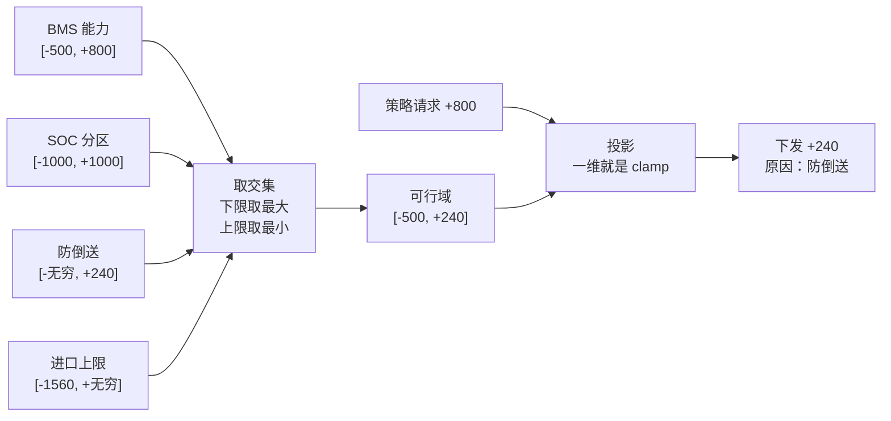
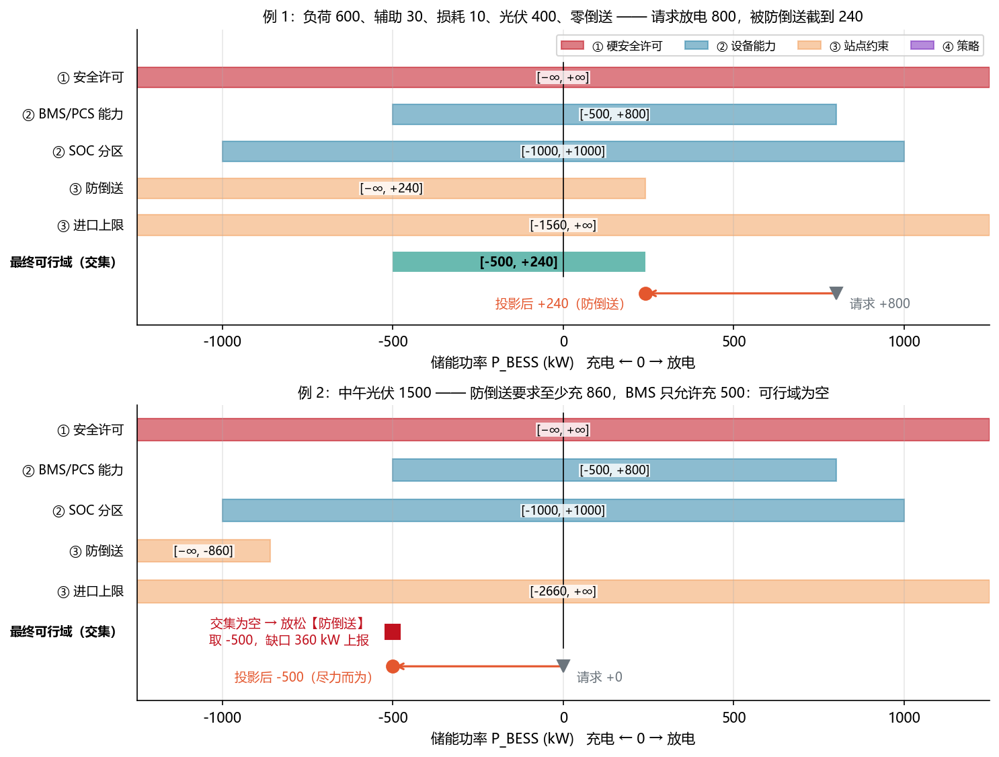
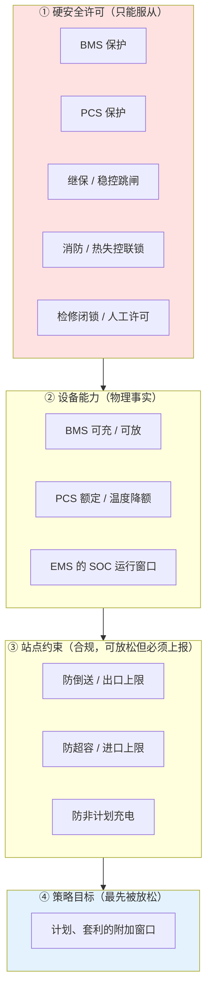
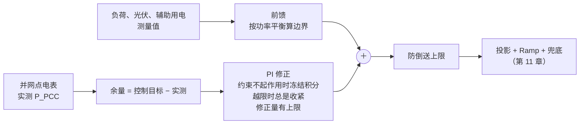
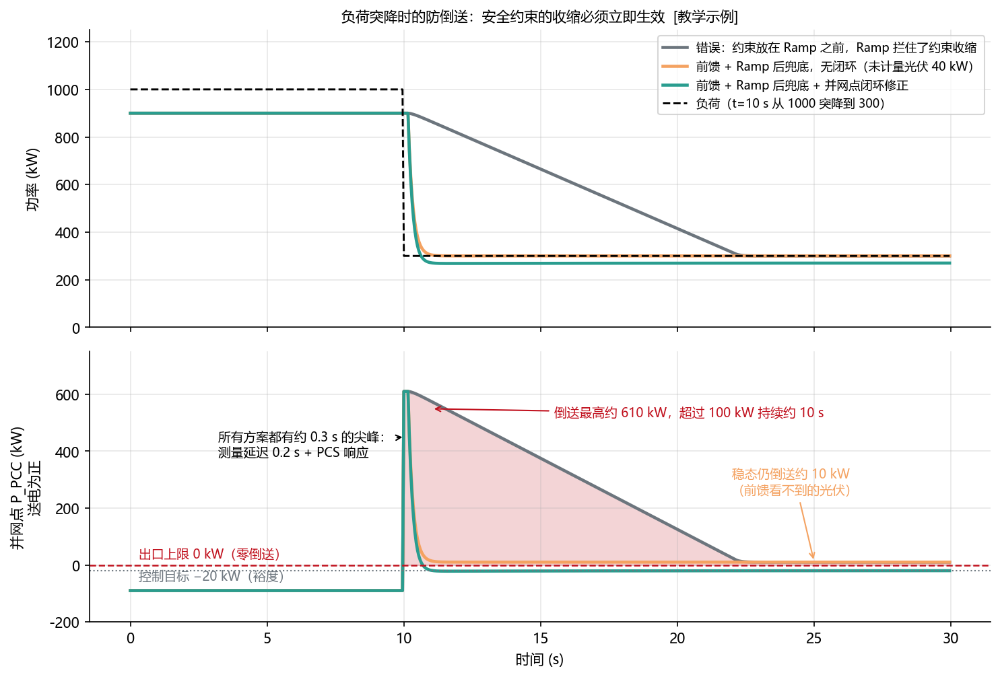
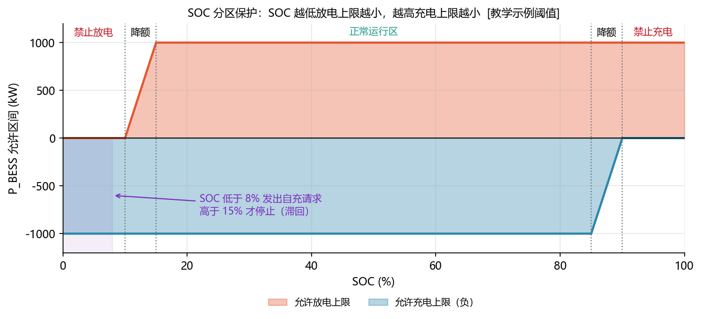
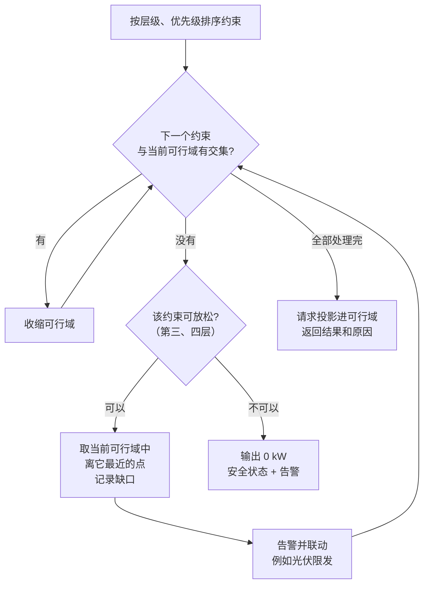
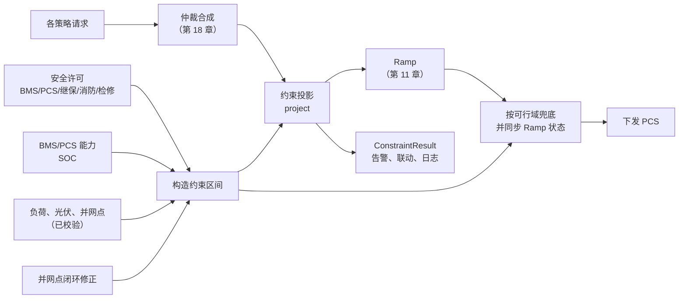

<!-- @AI_GENERATED -->
# 12 EMS 安全约束建模与可行域投影

> [课程首页](README.md) · 上一章：[11 EMS 功率控制基础函数：限幅、滤波、闭环与状态机](11_控制基础函数.md) · 下一章：[13 峰谷套利计划：收益门槛、约束排程与实时跟踪](13_峰谷套利与计划曲线.md)

**一句话**：每个约束给出一个允许区间，所有区间取交集就是可行域，请求只能落在可行域里。

## 本章目标

读完本章，你应能：

1. 把安全许可、设备能力、站点约束和策略目标翻译成 `P_BESS` 区间；
2. 求多个区间的交集，并把请求投影到最终可行域；
3. 区分不可放松冲突与可放松冲突，计算未满足缺口并记录原因；
4. 处理数据失效、负荷突降、SOC 分区和并网点闭环修正。

## 本章边界与前置

本章限定单控制周期的一维有功 `P_BESS` 可行域；P-Q 联合投影在第 17 章，多 PCS 分配在第 18 章，跨时段计划和 SOC 优化在第 13、16 章，保护装置本体和现场定值以项目规程为准。本章依赖第 07 章功率平衡和第 11 章控制原语。

**前置**：第 07 章（站点功率平衡）、第 11 章（clamp、Ramp、PI 与抗积分饱和）。


---

## 12.1 现场场景【必懂】

中午 11 点，一座工厂的光储电站。套利策略想让储能放电 800 kW，此刻的数据是：

| 量 | 数值 `[教学示例]` |
|---|---:|
| BMS 允许放电 / 充电 | 800 kW / 500 kW |
| PCS 额定功率 | 1000 kW |
| 工厂负荷 | 600 kW |
| 站内辅助用电（空调、照明、控制电源） | 30 kW |
| 变压器、线路损耗 | 10 kW |
| 光伏 | 400 kW |
| 并网协议 | **不允许向电网倒送** |

BMS 说“可以放 800”，PCS 说“可以放 1000”，那到底能放多少？答案是 **240 kW**。再多放 1 kW，这 1 kW 就会穿过并网点流进电网，违反并网协议，严重时触发防逆流保护跳闸。

一个小时后光伏涨到 1500 kW。这时即使储能一点不放，也会倒送；储能必须**充电**至少 860 kW，而 BMS 只允许充 500 kW。这一次，所有约束**不可能同时满足**。

本章回答三个问题：240 这个数是怎么算出来的；约束一多，怎么系统地合并；合并不出结果时怎么办。

---

## 12.2 可行域：每个约束都是一个区间【必懂】

### 原理

储能的有功功率 `P_BESS` 是一维的数（放电为正、充电为负）。任何一个约束，无论来自 BMS、并网协议还是 SOC，最终都可以翻译成一句话：**`P_BESS` 必须落在 [下限, 上限] 之间**。



两步：

1. **求交集**：下限取所有下限里最大的，上限取所有上限里最小的；
2. **投影**：请求在可行域内就原样通过，在外面就拉回最近的边界。一维情况下投影就是第 11 章的 `clamp`。



图中标注对照表：

| 编号 | 位置 | 标注 | 对应正文 |
|---|---|---|---|
| ① | 例1约束区间 | −500、+800、−1000、+1000、+240、−1560 | 多约束交集 |
| ② | 例1请求与投影 | 请求 +800 → 投影 +240 | 防倒送上限 |
| ③ | 例2冲突 | −860、−500、缺口 360 | 光伏富余与 BMS 充电能力冲突 |
| ④ | 最终交集 | [−500,+240] | 例1最终可行域 |

上图例 1 就是 12.1 的场景：五个约束叠在一起，交集是 `[−500, +240]`，请求 +800 被投影到 +240，起作用的约束是“防倒送”。例 2 是一小时后的场景：防倒送要求 `P_BESS ≤ −860`，BMS 要求 `P_BESS ≥ −500`，**交集为空**，12.9 节专门讲怎么处理。

### 手算

```text
下限 = max(−500, −1000, −∞, −1560) = −500
上限 = min(+800, +1000, +240, +∞)  = +240
可行域 = [−500, +240]
请求 +800 → clamp(800, −500, 240) = +240
```

> **软件类比**：云平台的权限判定。一个请求要同时通过用户策略、资源策略、组织策略，每条策略都能收窄允许范围，最终权限是所有策略的交集。
>
> **类比失效点**：权限系统可以直接返回 403，EMS 不行。每个控制周期**必须**给 PCS 一个功率值，“拒绝”也要落成一个具体的数（通常是可行域里最接近请求的点，或 0）。而且约束冲突时没有“拒绝”这个选项，只能决定先违反谁。

---

### 最小闭环：多个约束如何把请求压回可行域

把 12.1 的数字完整走一遍：

```text
输入：请求 P=800 kW
      BMS 区间 [-500, 800]
      PCS 区间 [-1000, 1000]
      SOC 区间 [-1000, 1000]
      防倒送区间 [-∞, 240]
      进口上限区间 [-1560, +∞]
算法：
  下限 = max(-500, -1000, -1000, -∞, -1560) = -500
  上限 = min(800, 1000, 1000, 240, +∞) = 240
  P_final = clamp(800, -500, 240) = 240 kW
输出：最终下发 240 kW，绑定约束“防倒送”，未满足 560 kW
```

| 中间量 | 含义 | 结果 |
|---|---|---:|
| `lo` | 所有下限的最大值 | -500 kW |
| `hi` | 所有上限的最小值 | 240 kW |
| `P_req` | 策略请求 | 800 kW |
| `P_final` | 投影后结果 | 240 kW |
| `unserved` | 请求与结果的差 | 560 kW |

对应脚本：`lab/examples/ch12_constraints_trace.py`。如果光伏升到 1500 kW，防倒送上限会变成 -860 kW，而设备下限只有 -500 kW，脚本之外的 12.9 冲突流程会记录光伏限发缺口 360 kW。


## 12.3 约束分层、优先级与数据失效处理

约束不是平级的。按“谁说了算、能不能商量”分成四层：

| 层 | 来源 | 典型内容 | EMS 能做什么 | 冲突时能否放松 |
|---|---|---|---|---|
| ① 硬安全许可 | BMS/PCS 保护、继电保护、消防、检修闭锁、人工安全许可 | 禁止充电、禁止放电、紧急停机、PCS 闭锁 | **只能服从**，读取状态并翻译成区间 | 不能 |
| ② 设备能力 | BMS 可充/可放功率、PCS 额定与降额、温度、EMS 的 SOC 运行窗口 | `[−可充, +可放]` | 按实时能力限幅 | 不能（放松 = 让设备越限） |
| ③ 站点约束 | 变压器/合同容量、并网协议、供电合同 | 防超容、防倒送（出口上限）、进口上限（需量）、防非计划充电 | 由站点功率平衡推出区间 | 可以，但必须上报 |
| ④ 策略目标 | 套利、计划、需量策略自己的附加要求 | “计划最小放电 500 kW”这类窗口 | 作为最低优先级的区间 | 可以 |



这和第 00 章 0.4 节的原则一致：**安全 > 合规 > 省钱 > 赚钱**。

### ① 为什么“安全许可”不是普通请求

新手常犯的错误是把 BMS 保护也写成一个“优先级 0 的控制请求”，然后丢进仲裁器和其他请求一起排序。这在概念上是错的：

- BMS、PCS、继保、消防系统有自己独立的保护逻辑，**不依赖 EMS 是否在线**，响应在毫秒级；
- EMS 对它们只有“读”的权利：读到“禁止放电”，就把上限设为 0；读到“PCS 闭锁”，就把区间设为 `[0, 0]`；
- 它们不参与仲裁，也不能被任何模式、任何人工指令在 EMS 层面“解除”。解除只能在保护系统本身完成（复归、人工确认）。

所以本章把它们建模为**外部许可/禁止条件**，放在最高层，并且标记为不可放松。

### ② 设备能力与 SOC 窗口

BMS 给出的可充/可放功率已经包含了电芯电压、温度、SOC 等保护考虑（第 04、05 章）。EMS 在此之外还会设一个**比 BMS 更窄的 SOC 运行窗口**（12.8 节），目的是让 EMS 先“软停”，而不是每天去碰 BMS 的硬保护。

### 数据失效时的保守处理

区间是用测量值算出来的。测量值失效（超时、冻结、越界，第 10 章）时，不能拿旧值继续算。常见的保守做法是：并网点或负荷数据失效时，防倒送上限取 0（禁止放电），进口上限对应的充电上限取 0（禁止充电），并告警。第 09 章流水线中的 `project` 就是这样处理的。

---

## 12.4 防倒送：推导储能放电上限【必懂】

### 原理：因果链

**倒送**是指站点向电网送电，即 `P_PCC > 0`。储能放出的电先被站内负荷、辅助用电和损耗“吃掉”，吃不完的部分才会从并网点流出去。光伏发的电也一样。所以：

```text
储能能放多少而不倒送 = 站内能吃掉多少 − 光伏已经占用了多少 + 允许倒送的额度
```

### 手算（12.1 的场景）

从第 07 章的功率平衡出发：

```text
P_PCC = P_PV + P_BESS − P_load − P_aux − P_loss
```

要求 `P_PCC ≤ P_export_limit`（零倒送时 `P_export_limit = 0`）：

```text
P_PV + P_BESS − P_load − P_aux − P_loss ≤ P_export_limit
P_BESS ≤ P_load + P_aux + P_loss − P_PV + P_export_limit
       = 600 + 30 + 10 − 400 + 0
       = 240 kW
```

回代验证：放电 240 kW 时，`P_PCC = 400 + 240 − 600 − 30 − 10 = 0`，正好不倒送。

### 公式与符号

```text
防倒送上限：P_BESS ≤ P_load + P_aux + P_loss − P_PV + P_export_limit
```

| 符号 | 含义 | 单位 | 示例值 |
|---|---|---|---|
| `P_load` | 站内负荷，消耗为正 | kW | 600 |
| `P_aux` | 站内辅助用电，消耗为正 | kW | 30 |
| `P_loss` | 从储能测量点到并网点之间的损耗 | kW | 10 |
| `P_PV` | 光伏发电，发电为正 | kW | 400 |
| `P_export_limit` | 出口上限（非负）；零倒送为 0 | kW | 0 |

### 三个要点

1. **上限可以是负数**。光伏 1500、负荷 600 时，上限是 `600 + 30 + 10 − 1500 = −860`，意思是储能**至少要充 860 kW** 才不倒送。防倒送不只是“少放点”，它可以强迫储能充电。
2. **倒送时要减少放电，而不是增加放电**。公式里 `P_BESS` 的系数是 +1：放电越多，`P_PCC` 越大。第 00 章 0.8 节的“电表方向接反导致越放越多”，就是把这个方向搞反了。
3. **防倒送 ≠ 防非计划充电**。防非计划充电是另一个约束：不允许从电网取电给储能充电，只允许吸收光伏富余。它**只限制充电**，不会强迫放电：

```text
防非计划充电：P_BESS ≥ −max(0, P_PV − P_load − P_aux − P_loss)
```

光伏 400、负荷 600 时，富余为负，下限是 0（禁止充电）；光伏 900 时，富余 300，允许最多充 300。注意它和“进口上限 = 0”不同：后者在没有光伏富余时会要求储能**放电**顶负荷。

> **软件类比**：防倒送上限就像一个“剩余配额”：总配额（站内消耗 + 出口额度）减去已经被别人占用的（光伏），剩下的才是储能能用的。
>
> **类比失效点**：配额系统里的“已占用”是准确的账本，而这里的负荷、光伏、损耗都是**测量值**，有误差、有延迟，还可能有没接进 EMS 的设备。所以只靠这个公式不够，还需要并网点实测闭环（12.6 节）。

### 防逆流保护【了解】

很多不允许倒送的项目，在并网点还装有**防逆流（逆功率）保护装置**：检测到反向功率超过定值并持续一段时间后，直接跳开并网开关或光伏回路。它的定值和延时由项目的接入方案和供电部门要求决定，本课程不给具体数值。对 EMS 的意义是：**防逆流保护是最后一道防线，EMS 的防倒送必须在它动作之前就把功率压下来**，否则结果就是全站脱网。

---

## 12.5 进口上限：防超容与需量【必懂】

### 原理

反过来，从电网取电太多也不行：

- **防超容**：变压器或供电合同有容量限制，长期过载会让变压器过热、保护动作；
- **需量控制**：取电功率的 15 分钟平均值决定基本电费（第 14 章）。

两者都表现为进口功率的上限 `P_import ≤ P_import_limit`，其中 `P_import = −P_PCC`（从电网取电为正，只在接入层和计费中使用）。

### 手算

负荷 1500 kW、辅助 30、损耗 10、无光伏，进口上限 1800 kW：

```text
P_import = P_load + P_aux + P_loss − P_PV − P_BESS ≤ P_import_limit
P_BESS ≥ P_load + P_aux + P_loss − P_PV − P_import_limit
       = 1500 + 30 + 10 − 0 − 1800
       = −260 kW
```

储能最多只能**充 260 kW**。如果套利策略此刻想以 600 kW 充电，会被削到 260 kW。这就是第 00 章 ② 的情形：**充电也会推高取电功率**。

同样，下限也可以是正数：负荷涨到 2100 kW 时，下限是 `2100 − 1800 = +300`，储能必须**至少放 300 kW** 才不超限。

```text
进口上限：P_BESS ≥ P_load + P_aux + P_loss − P_PV − P_import_limit
```

### 一个有用的结论：防倒送与进口上限不会互相冲突

两个区间来自同一组测量值：

```text
上限 − 下限 = (… + P_export_limit) − (… − P_import_limit) = P_export_limit + P_import_limit ≥ 0
```

所以它们的交集永远非空，宽度正好是“出口额度 + 进口额度”。现场的约束冲突，几乎总是**站点约束与设备能力**之间的冲突（储能不够大、不够满、不够空），而不是站点约束之间的冲突。

### 变压器容量的单位【了解】

变压器容量按视在功率 kVA 标定（第 02 章），而这里的进口上限是有功 kW。换算时要考虑功率因数和允许负载率，例如 `P_limit ≈ S_N × PF × 负载率`。具体取值要和电气专业确认，不能直接把 kVA 数填进 kW 配置里。

---

## 12.6 开环前馈 + 并网点闭环修正【必懂】

### 为什么两个都要

| | 开环前馈 | 并网点闭环 |
|---|---|---|
| 做法 | 按 12.4、12.5 的公式，用负荷、光伏测量值直接算边界 | 测量并网点实际功率，与限值比较，用 PI 修正边界 |
| 优点 | **快**：负荷一变，下个周期边界就变 | **准**：电表测的是结果，包含所有测不到的东西 |
| 缺点 | 依赖每一个测点都准、都在；漏掉一路光伏、CT 误差、损耗估计不准都会造成稳态误差 | **慢**：要等功率流过、电表测到、通信送上来；增益大了会振荡 |

两者组合：**前馈负责快速跟上变化，闭环负责消除前馈看不到的慢变误差**。



### 抗积分饱和：这里比第 11 章更容易踩坑

防倒送大部分时间**不起作用**（储能放电远小于上限）。此时并网点离限值有很大余量，如果 PI 照常积分，积分项会越攒越大（“边界还可以再放宽很多”）。等到负荷突降、约束真正起作用的那一刻，边界被放宽了几百 kW，第一拍就倒送。

`BoundCorrector` 的规则：

1. 约束不起作用且还有余量：**不积分**；
2. 已经越限（余量为负）：**无论是否判定为起作用，都积分收紧**；
3. 修正量有上下限：闭环只修正“小误差”，大变化交给前馈。

```python
# lab/ems_lab/constraints.py（节选）
class BoundCorrector:
    def __init__(self, kp, ki, max_correction_kw):
        self.pi = PIController(kp, ki, -max_correction_kw, max_correction_kw)

    def update(self, margin_kw, dt, active):
        # margin > 0：离限值还有余量；< 0：已越限
        e = margin_kw if (active or margin_kw < 0) else 0.0
        return self.pi.update(e, dt)   # > 0 放宽边界，< 0 收紧边界
```

上限类（防倒送）用 `upper = 前馈上限 + 修正量`；下限类（进口上限）用 `lower = 前馈下限 − 修正量`。

---

## 12.7 负荷突降时的防倒送动态【必懂】

### 场景

储能正在放电 900 kW，工厂负荷 1000 kW。t = 10 s，一条生产线停机，负荷突降到 300 kW。站内还有一台 40 kW 的小光伏没有接入 EMS（前馈公式看不到它）。控制目标留 20 kW 裕度：`P_PCC ≤ −20 kW`。以下参数全部是 `[教学示例]`：测量延迟 0.2 s，PCS 响应时间常数 0.15 s，Ramp 50 kW/s。



图中标注对照表：

| 编号 | 位置 | 标注 | 对应正文 |
|---|---|---|---|
| ① | 负荷曲线 | 1000 → 300 kW，t=10 s | 负荷突降 |
| ② | 控制参数 | 900 kW、0.2 s、0.15 s、50 kW/s | 请求、测量延迟、PCS响应、Ramp |
| ③ | 约束参考 | 0、−20 kW、40 kW | 出口上限、裕度、未计量光伏 |
| ④ | 错误方案 | 最高约 610 kW、超过 100 kW 约 10 s | Ramp 阻挡安全收缩 |

三条曲线由配套约束与控制实现仿真得到：

| 方案 | 结果 | 原因 |
|---|---|---|
| 灰：约束在 Ramp 之前，Ramp 之后不再兜底 | 倒送最高约 610 kW，超过 100 kW 持续约 10 s | 边界已经从 1000 降到 300，但 Ramp 只允许每秒降 50 kW |
| 橙：前馈 + Ramp 后兜底，没有闭环 | 快速压下，但稳态仍倒送约 10 kW | 前馈看不到 40 kW 小光伏 |
| 绿：前馈 + Ramp 后兜底 + 并网点闭环 | 快速压下，稳态停在目标 −20 kW | 闭环把前馈的误差修正掉（储能最终放约 270 kW） |

### 为什么必须快

- 倒送持续下去，防逆流保护会动作，全站脱网（12.4 节）；
- 并网协议通常对倒送有明确要求，违反会被供电部门通报或考核；
- 负荷突降在工厂里很常见：设备停机、空压机卸载、生产线换班，都是秒级的阶跃。

### 为什么 Ramp 不能拦住安全约束的收缩

Ramp 的作用是限制**主动**的功率变化，避免冲击电网和设备（第 11 章）。而这里的变化不是主动的：负荷变了，安全边界跟着变了，**现在的功率已经不安全了**。如果让 Ramp 管住“往安全方向的收缩”，就等于为了平滑而主动违反约束。

正确顺序和第 11 章 `limit_then_ramp` 一样：**限幅 → Ramp → 再按可行域兜底 → 把兜底结果同步回 Ramp 状态**。

### 无法消除的尖峰

图中三条曲线在 t = 10 s 都有一个约 0.3 s 的尖峰。这是物理延迟：负荷变化要先被测到（0.2 s），PCS 再按新指令调整（0.15 s）。EMS 算法再好也追不上已经发生的事。应对办法是：

1. **留裕度**：控制目标低于出口上限，吸收尖峰和测量误差；
2. **缩短数据路径**：并网点电表直采、提高刷新频率（第 10 章）；
3. **本地快速兜底**：部分 PCS 或专用控制装置支持本地防逆流，响应比 EMS 快；是否具备、怎么配置以设备手册为准；
4. **与防逆流保护配合**：保护的延时要能容忍这类短时尖峰，由电气专业整定。

---

## 12.8 SOC 分区保护与低 SOC 自充【必懂】

### SOC 分区

SOC 越低，越不应该继续放电；SOC 越高，越不应该继续充电。EMS 把这个规则翻译成区间，放在第 ② 层（阈值与第 05 章 `SocZones` 一致，均为 `[教学示例]`）：

| SOC | 放电上限 | 充电上限 |
|---|---|---|
| ≤ 10%（运行下限） | 0 | 额定 |
| 10%～15% | 线性降额，0 → 额定 | 额定 |
| 15%～85%（正常区） | 额定 | 额定 |
| 85%～90% | 额定 | 线性降额，额定 → 0 |
| ≥ 90%（运行上限） | 额定 | 0 |



图中标注对照表：

| 编号 | 位置 | 标注 | 对应正文 |
|---|---|---|---|
| ① | SOC 分区 | 10%、15%、85%、90% | 运行下限/预警区/运行上限 |
| ② | 功率边界 | ±1000 kW | 额定能力 |
| ③ | 自充说明 | SOC 低于 8% 请求自充，高于 15% 停止 | 滞回自充 |
| ④ | 纵轴边界 | 0 kW | 充放电方向分界 |

**为什么用线性过渡而不是台阶**：台阶会让功率在阈值处从 1000 kW 跳到 0，SOC 测量有噪声，功率就会在阈值附近来回跳。线性过渡让功率随 SOC 平滑减小；运行上下限处的启停再配合第 05 章的滞回许可（`SocPermissionGate`），防止抖动。

**手算**：SOC = 12.5%，额定 1000 kW：放电比例 = (12.5 − 10) / (15 − 10) = 50%，区间 `[−1000, +500]`。

### 低 SOC 自充

储能停在运行下限后，站内自耗电、一次调频等仍可能让 SOC 继续下降。SOC 太低会触及 BMS 的硬保护，也让储能失去应急能力。所以 EMS 通常有一个**低 SOC 自充**功能：SOC 低于 8% 时发出充电请求，高于 15% 才停止（第 11 章滞回，阈值为 `[教学示例]`）。

关键区别：**自充是一个请求，不是一个约束**。它和套利请求一样要经过可行域投影，进口上限照样可以把它削小。

**手算**：自充请求 −200 kW，此刻负荷 1700 kW、进口上限 1800 kW：

```text
进口上限推出的下限 = 1700 − 1800 = −100
投影结果 = clamp(−200, −100, …) = −100 kW
```

自充被削到 100 kW，原因是“进口上限”。自充相对于套利、需量的优先级由仲裁层决定（第 18 章）。

---

## 12.9 可行域为空：约束冲突怎么办【必懂】

### 冲突是正常现象

回到 12.1 的第二个场景：光伏 1500，防倒送要求 `P_BESS ≤ −860`，BMS 要求 `P_BESS ≥ −500`。无论输出什么，都会违反其中一条。第 11 章说过，`clamp` 遇到 `lower > upper` 时会直接报错，这是对的：**这不是一个限幅问题，而是一个决策问题**。

### 处理规则

1. **按优先级从高到低逐个加入约束**；
2. 某个约束与已有的可行域没有交集时：
   - 如果它可以放松（第 ③④ 层）：**放松它**，并在已有可行域里取**离它最近的那个点**（尽力而为）；
   - 如果它不能放松（第 ①② 层之间冲突）：说明输入数据本身矛盾，输出 0 kW，进入安全状态并告警；
3. **记录冲突和缺口**：哪个约束没满足、差多少 kW；
4. **上报和联动**：生成告警；能联动其他手段的要联动，例如通知光伏限发、提示人工切负荷；
5. **绝不静默**：不能只输出一个数而不告诉任何人。



### 手算（例 2）

```text
① 安全许可 [−∞, +∞]         → 可行域 [−∞, +∞]
② BMS [−500, +800]           → [−500, +800]
② SOC 60% [−1000, +1000]     → [−500, +800]
③ 防倒送 [−∞, −860]          → 与 [−500, +800] 无交集！
   防倒送可放松 → 取离它最近的点 −500，缺口 = −500 − (−860) = 360 kW
③ 进口上限 [−2660, +∞]       → [−500, −500]
最终：−500 kW（储能尽力满充），冲突：防倒送缺口 360 kW
```

这 360 kW 不会凭空消失，它会倒送到电网。正确的系统行为是：储能满功率充电，同时**通知光伏逆变器限发 360 kW**（第 00 章 ④′ 就是这样做的），并记录一条“储能充电能力不足，已联动光伏限发”的事件。

另一个常见冲突：负荷 2100 kW 超过进口上限 1800，要求储能至少放 300，但 SOC 低，BMS 只允许放 200。结果：放 200，缺口 100 kW，本周期需量可能超目标，告警提示运行人员（第 14 章）。

> **软件类比**：这像多个 SLO 同时告急时的**降级策略**：先保核心链路，其次保重要功能，最后才牺牲非关键功能；每一次降级都写日志、发告警。
>
> **类比失效点**：软件降级通常可以“暂停服务”，而电力系统里功率一直在流。放松防倒送不等于防倒送消失，缺口会真实地变成倒送功率，所以必须配合其他物理手段（光伏限发、切负荷）兜住。

---

## 12.10 约束结果必须带原因【必懂】

约束投影不能只返回一个数。事后复盘时，运维、调度、业主都会问：

- 策略想要多少？最终下发了多少？
- 是哪个约束改了它？那个约束的边界是按什么数算出来的？
- 有没有约束没满足？差多少？有没有联动其他手段？

所以投影函数返回一个结构化结果：

```python
@dataclass
class ConstraintResult:
    requested_kw: float        # 策略请求
    final_kw: float            # 投影后
    lower_kw: float            # 最终可行域
    upper_kw: float
    binding: str | None        # 把请求截断的约束名
    conflicts: list[Conflict]  # 被放松的约束及缺口
    safe_stop: bool = False    # 不可放松约束之间冲突
```

每个区间本身也带 `name` 和 `note`，`note` 里写着推导用到的数，例如：

```text
[防倒送] 上限 = 负荷 600 + 辅助 30 + 损耗 10 − 光伏 400 + 出口上限 0 = 240
请求 +800 kW 被【防倒送】限制为 +240 kW
```

第 09 章流水线里的 `ConstraintResult` 是这个结构的简化版，第 20 章会把它写进决策日志。

---

## 12.11 在 EMS 架构中的位置【必懂】



注意两点：约束区间**每个周期重新计算**（负荷、能力每时每刻在变）；投影只做**一次**，对象是仲裁后的**总请求**。不能让每个策略先各自限幅再相加（第 09 章已经演示过这样会超限）。

---

## 12.12 代码【必懂】

完整实现位于 `lab/ems_lab/constraints.py`；配套示例用于复现本章约束投影，所有手算结果均应纳入项目回归验证。

```python
# lab/ems_lab/constraints.py（节选）
def export_limit_interval(p_load_kw, p_pv_kw, p_export_limit_kw=0.0, p_aux_kw=0.0, p_loss_kw=0.0):
    """P_BESS ≤ P_load + P_aux + P_loss − P_PV + P_export_limit"""
    upper = p_load_kw + p_aux_kw + p_loss_kw - p_pv_kw + p_export_limit_kw
    return Interval(-INF, upper, "防倒送", Layer.SITE, note=...)


def project(request_kw, constraints):
    lo, hi = -INF, INF
    conflicts = []
    for c in sorted(constraints, key=lambda x: (x.layer, x.priority)):
        new_lo, new_hi = max(lo, c.lower_kw), min(hi, c.upper_kw)
        if new_lo <= new_hi:                       # 有交集：收缩
            lo, hi = new_lo, new_hi                # （实际代码还会记录边界来自哪个约束）
            continue
        shortfall = c.lower_kw - hi if c.lower_kw > hi else lo - c.upper_kw
        conflicts.append(Conflict(c.name, c.layer, c.lower_kw, c.upper_kw, shortfall))
        if not c.layer.relaxable:                  # ①② 之间冲突：安全停机
            return ConstraintResult(request_kw, 0.0, 0.0, 0.0, conflicts=conflicts, safe_stop=True)
        if c.lower_kw > hi:                        # 尽力而为：取离它最近的点
            lo = hi
        else:
            hi = lo
    final = clamp(request_kw, lo, hi)
    return ConstraintResult(request_kw, final, lo, hi, binding=..., conflicts=conflicts)
```

| 函数 / 类 | 作用 |
|---|---|
| `Layer` | 四层约束，`relaxable` 表示冲突时能否放松 |
| `Interval` | 一个约束的区间，带名称、层级、推导说明 |
| `intersect` | 纯交集，可能为空 |
| `permission_interval` | 安全许可 → 区间 |
| `device_interval` | BMS/PCS 可充可放 → 区间 |
| `soc_interval`、`SocZoneConfig` | SOC 分区 → 区间 |
| `LowSocRecharge` | 低 SOC 自充请求（带滞回） |
| `export_limit_interval` | 防倒送 → 放电上限 |
| `import_limit_interval` | 进口上限（防超容/需量）→ 充电上限 |
| `no_grid_charge_interval` | 防非计划充电 → 充电下限 |
| `BoundCorrector` | 并网点闭环修正，带抗积分饱和 |
| `project`、`ConstraintResult`、`Conflict` | 带原因的投影与冲突放松 |

---

## 12.13 常见误区【必懂】

| 误区 | 正确理解 |
|---|---|
| BMS 允许放 800，就能放 800 | 设备能力只是其中一个区间，站点约束往往更紧 |
| 防倒送就是“少放点” | 上限可以是负数，光伏富余时防倒送会强迫储能充电 |
| 防倒送和防非计划充电是一回事 | 前者限制并网点送电，后者只限制从电网取电充电 |
| 看到倒送就加大放电“抵消” | 放电越多倒送越多；方向搞反会形成正反馈 |
| 把 BMS 保护写成优先级最高的请求 | 安全许可是外部条件，只能服从，不参与仲裁 |
| 有前馈公式就够了 | 测不到、测不准的部分只能靠并网点闭环修正 |
| 负荷突降时 Ramp 让功率平滑下降更安全 | Ramp 只管主动变化；安全边界收缩必须立即兜底 |
| 可行域为空时取一个边界就行 | 必须按优先级放松、计算缺口、告警并联动，绝不静默 |
| 每个策略各自限幅后相加 | 投影对象是仲裁后的总请求，只做一次 |

## 12.14 现场真实故障【必懂】

**案例一：新增光伏逆变器没接入 EMS，防逆流保护频繁跳闸。**
现象：某厂区扩建了一台光伏逆变器，此后中午偶发并网点防逆流保护动作，全站脱网。
原因：新逆变器没有接入 EMS 点表，防倒送的前馈公式里少了这一路光伏，算出的放电上限偏大；EMS 只有前馈，没有并网点闭环，稳态一直小幅倒送，光伏一波动就越过保护定值。
教训：防倒送必须有并网点实测闭环修正；站内新增或改造设备要走点表变更流程；并网点实测功率与“前馈推算值”的偏差要做持续监视，偏差过大告警（第 20 章）。

**案例二：冲压机停机后倒送，Ramp 拦住了约束收缩。**
现象：储能大功率放电时，冲压线紧急停机，并网点倒送约十秒，被供电部门记录。
原因：流水线顺序是“限幅 → Ramp → 下发”，防倒送边界虽然立即降下来了，但 Ramp 以固定速率慢慢降低功率。
修复：改为“限幅 → Ramp → 按可行域兜底 → 同步 Ramp 状态”；在仿真中加入“负荷阶跃下降”测试用例（第 19 章）。

**案例三：约束冲突被静默处理。**
现象：春季光照好、工厂放假负荷低的几天，站点持续小功率倒送，EMS 界面却一切正常，没有任何告警。
原因：代码在可行域为空时直接取了设备能力的边界（满功率充电），既没有联动光伏限发，也没有记录冲突。储能充满之后，倒送进一步加大。
修复：冲突必须产生带缺口的事件和告警；缺口联动光伏限发；储能接近满电时提前预警“防倒送能力即将耗尽”。

---

## 12.15 自测

1. 负荷 800、辅助 20、损耗 10、光伏 300，零倒送。储能放电上限是多少？允许倒送 50 kW 时呢？
2. 负荷 400、光伏 1200、辅助和损耗忽略，零倒送。防倒送区间是什么？这对储能意味着什么？
3. 负荷 1600、无光伏、进口上限 1800。储能最多能充多少？负荷 1950 时呢？
4. 防非计划充电与“进口上限 = 0”有什么区别？举一个两者结果不同的例子。
5. 为什么防倒送既要前馈又要闭环？闭环为什么要在“约束不起作用”时冻结积分？
6. BMS 可充 300 kW，光伏富余要求储能至少充 450 kW 才不倒送。EMS 应该输出多少？还要做什么？
7. 为什么安全边界的收缩不能受 Ramp 限制？

<details>
<summary>参考答案</summary>

1. `800 + 20 + 10 − 300 + 0 = 530 kW`；允许倒送 50 kW 时为 580 kW。
2. 上限 `400 − 1200 = −800`，区间 `[−∞, −800]`：储能必须至少充 800 kW，否则就会倒送。
3. 下限 `1600 − 1800 = −200`，最多充 200 kW；负荷 1950 时下限为 +150，储能必须至少放 150 kW。
4. 防非计划充电只禁止从电网取电充电，下限 = −max(0, 光伏富余)，不会强迫放电；进口上限 = 0 要求进口功率不超过 0，没有光伏富余时会要求储能放电顶负荷。例：负荷 600、光伏 400，前者下限为 0（不充即可），后者下限为 +200（必须放 200）。
5. 前馈快但依赖测点完整准确，闭环准但慢，两者互补。约束不起作用时并网点离限值有大量余量，如果继续积分，修正量会一直放宽边界，约束一旦起作用第一拍就越限。
6. 输出 −300 kW（设备能力优先，尽力而为），记录“防倒送冲突，缺口 150 kW”，告警并联动光伏限发 150 kW。
7. Ramp 限制的是主动变化。边界收缩意味着当前功率已经不安全，按 Ramp 慢慢降就是在这段时间内主动违反约束；应当立即兜底，并把 Ramp 状态同步到兜底后的值。

</details>

---

## 12.16 深入【深入】

<details>
<summary>“逐层放松 + 取最近点”在数学上是什么</summary>

这是一个**字典序优化**：先在第 1 优先级的约束集合里找可行点；在此基础上，尽量减小第 2 优先级约束的违反量；依次类推。一维情况下，“离区间最近的点”就是区间与当前可行域之间距离最短的端点，所以可以用一次遍历完成。

它和“给每个约束设一个罚函数权重、求加权最小”的做法不同：权重法在权重设置不当时，可能为了少违反一点低优先级约束而多违反一点高优先级约束。EMS 的约束优先级是硬性的（安全 > 合规 > 经济），字典序更符合要求，也更容易解释。

</details>

<details>
<summary>多维可行域：P 和 Q、多台 PCS</summary>

本章只处理一维的 `P_BESS`。实际项目还会遇到：

- **P-Q 联合约束**：PCS 视在容量 `√(P² + Q²) ≤ S`，可行域是一个圆，不能对 P、Q 分别 clamp（第 17 章讲圆投影）；
- **多台 PCS / 多个电池簇**：总功率的可行域是各台可行域之和（区间相加：下限相加、上限相加），分配问题见第 18 章；
- **时间维度**：SOC 约束本质上是对“功率随时间累加”的约束，单周期的区间只是它的近似，计划层面的校验见第 13 章。

</details>

<details>
<summary>工程边界（原稿保留）</summary>

- 安全保护动作应被记录为外部许可/禁止条件或设备状态变化，而不是普通的“P0 控制请求”；
- 防超容、防倒送、防非计划充电的具体限值、裕度、动作时限，由接入方案、供电合同、调度规程和设备厂家共同决定，本章数字均为 `[教学示例]`；
- `P_loss` 只包含从储能测量点到并网点之间尚未体现在测量值中的损耗，不能重复扣除 PCS 损耗（附录 B）；
- `P_load` 是否已经包含 `P_aux`，必须在点表中声明，避免重复统计。

</details>

<!-- @AI_GENERATED: end -->
