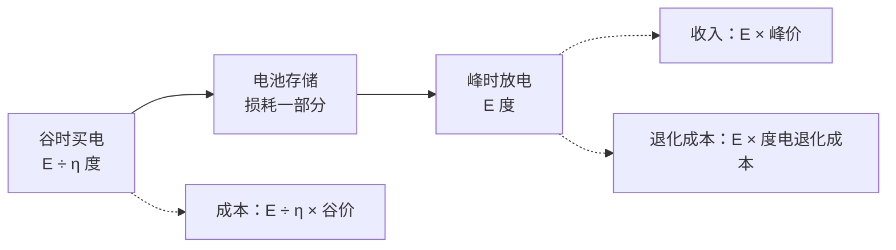
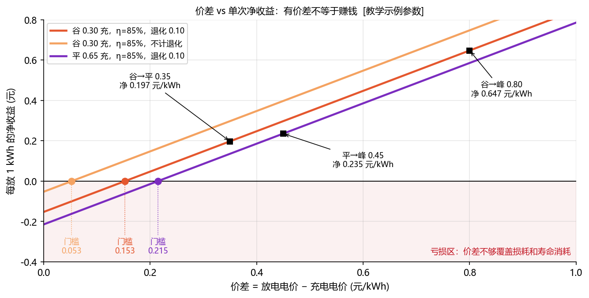
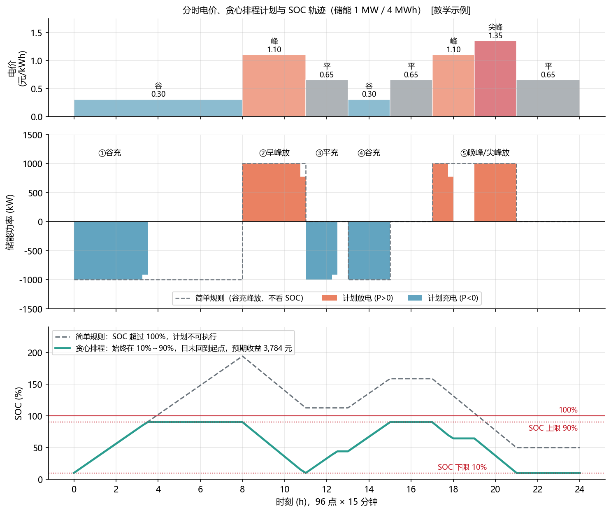
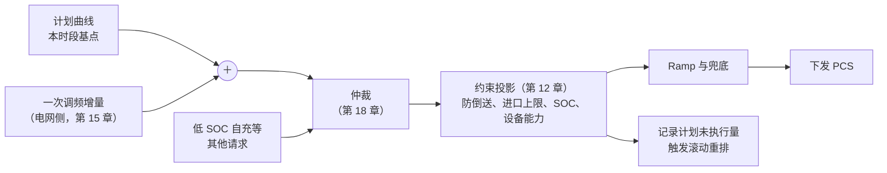
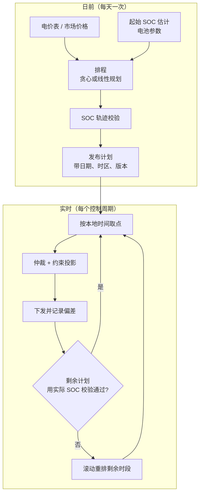

<!-- @AI_GENERATED -->
# 13 峰谷套利计划：收益门槛、约束排程与实时跟踪

> [课程首页](README.md) · 上一章：[12 EMS 安全约束建模与可行域投影](12_安全约束与可行域.md) · 下一章：[14 需量控制：周期计量、预算预测与削峰约束](14_需量管理.md)

**一句话**：峰谷套利是把便宜时段的电挪到贵的时段用，核心是算清价差够不够、电量排不排得下，并在执行中按实际 SOC 和约束滚动修正。

## 本章目标

读完本章，你应能：

1. 计算含效率和退化成本的单次套利收益及价差门槛；
2. 将分时电价展开成 96 点计划，并用 SOC 轨迹校验可执行性；
3. 解释贪心排程的适用范围、局限和线性规划边界；
4. 按本地日期/时区取计划点，并把防倒送、需量、调频削减反馈给滚动重排。

## 本章边界与假设

本章实现固定分时电价、15 分钟/96 点计划、线性效率与退化成本的教学模型；不实现求解器、完整 MPC、夏令时日历和真实电价政策。价格、容量、效率和退化成本均为教学示例；现场以最新政策、合同和项目配置为准。第 14 章承接需量，15～18 章承接调频、无功和仲裁。

**前置**：第 03 章（收益计算）、第 05a 章（SOC）、第 05b 章（可用能量与效率）、第 12 章（可行域）。


---

## 13.1 现场场景【必懂】

工商业储能的业主每天只问一个问题：**明天什么时候充、什么时候放、放多少？**

听起来很简单：“电价低就充，电价高就放”。但真做起来会碰到一串问题：

- 谷时有 8 个小时，储能满功率充 4 小时就满了，剩下 4 小时怎么办？
- 一天有两个峰，电只够放一个峰，先放哪个？中午平段要不要补充一次？
- 平段 0.65 元充、峰段 1.10 元放，扣掉损耗还赚不赚？
- 计划做好了，第二天早上 SOC 却不是计划假设的起点，还能不能执行？
- 计划要放电，此刻光伏很大，防倒送不让放，计划听谁的？

本章按“电价 → 收益 → 排程 → 校验 → 执行 → 叠加”的顺序回答它们。

---

## 13.2 分时电价机制【必懂】

### 为什么电价要分时段

第 00、01 章讲过：用电有峰谷，电网为了满足最高峰要建很多利用率很低的设备。分时电价用价格信号引导用户**把用电从高峰挪到低谷**，是国内工商业用户侧储能收益的主要来源。

常见的时段类型：

| 时段 | 含义 | 电价水平 |
|---|---|---|
| 尖峰 | 一年中负荷最紧张的月份里、峰段中最紧张的几个小时 | 最高 |
| 峰 | 日内用电高峰 | 高 |
| 平 | 一般时段 | 基准 |
| 谷 | 夜间或午间用电低谷 | 最低 |

时段怎么划分、各时段电价是平段的多少倍、哪些月份执行尖峰、午间是否设谷段，都由各省的销售电价政策规定，**而且会调整**。近年来光伏多的地区出现了午间谷段，这对储能来说意味着一天可能有两次充电机会。

本章使用的电价是 `[教学示例]`，不代表任何地区的真实电价，**以当地最新政策为准**：

| 时段 | 0～8 | 8～11 | 11～13 | 13～15 | 15～17 | 17～19 | 19～21 | 21～24 |
|---|---|---|---|---|---|---|---|---|
| 类型 | 谷 | 峰 | 平 | 谷 | 平 | 峰 | 尖峰 | 平 |
| 电价（元/kWh） | 0.30 | 1.10 | 0.65 | 0.30 | 0.65 | 1.10 | 1.35 | 0.65 |

### EMS 里的电价表

EMS 把时段表展开成**每 15 分钟一个电价**，共 96 个点，和计划曲线对齐：

```python
# lab/ems_lab/arbitrage.py（节选）
def tou_prices(periods, slots=96):
    """要求时段不重叠、覆盖全天；跨零点的时段拆成两段。"""
```

实现上有三点必须校验：**时段不能重叠、必须覆盖全天、跨零点的时段（例如 22:00～次日 6:00）要拆成两段**。电价表是配置数据，每次政策调整都要带版本号和生效日期，否则会出现“新政策已经生效，EMS 还在按旧时段充放”的故障。

### 电力现货价格【了解】

参与电力现货市场的储能（主要是电网侧）面对的是**每天都不一样**的 96 点（或更细）价格，而不是固定的时段表。但本章的收益计算、排程和校验方法完全适用，只是输入从“时段表展开”变成“市场出清价格”。

---

## 13.3 单次套利收益与价差门槛【必懂】

### 原理：损耗和寿命都要花钱

充进 1 度电，放不出 1 度电。PCS 变换、电池内阻、变压器都有损耗，**往返效率** η（放出电量 / 充入电量）通常小于 1（第 03、05 章）。而且每充放一次，电池寿命就消耗一点，这部分折算成**退化成本**。



### 手算（与第 03 章一致）

放出 1000 kWh，谷价 0.30、峰价 1.10，往返效率 85%，度电退化成本 0.10 元/kWh（均为 `[教学示例]`）：

```text
需要买入的电量 = 1000 / 0.85 = 1176.5 kWh
充电成本     = 1176.5 × 0.30 = 352.9 元
放电收入     = 1000 × 1.10   = 1100.0 元
退化成本     = 1000 × 0.10   = 100.0 元
净收益       = 1100.0 − 352.9 − 100.0 = 647.1 元
```

### 价差门槛

令每放 1 kWh 的净收益 ≥ 0：

```text
放电价 − 充电价 / η − 退化成本 ≥ 0
⇒ 价差 = 放电价 − 充电价 ≥ 充电价 × (1/η − 1) + 退化成本
```

| 符号 | 含义 | 单位 | 示例值 |
|---|---|---|---|
| η | 往返效率 | 无 | 0.85 |
| 充电价 | 充电时段电价 | 元/kWh | 0.30 |
| 退化成本 | 每放 1 kWh 消耗的电池寿命折算成的钱 | 元/kWh | 0.10 |

**手算**：

```text
谷充：0.30 × (1/0.85 − 1) + 0.10 = 0.30 × 0.176 + 0.10 ≈ 0.153 元/kWh
平充：0.65 × (1/0.85 − 1) + 0.10 = 0.65 × 0.176 + 0.10 ≈ 0.215 元/kWh
```

同样是价差，**充电电价越高，门槛越高**，因为损耗掉的那部分电更贵。



图中标注对照表：

| 编号 | 位置 | 标注 | 对应正文 |
|---|---|---|---|
| ① | 谷充曲线 | 谷价 0.30、η=0.85、退化 0.10、门槛 0.153 | 谷充门槛 |
| ② | 平充曲线 | 平价 0.65、门槛 0.215 | 平充门槛 |
| ③ | 无退化曲线 | 门槛 0.053 | 不计退化的对照 |
| ④ | 典型组合 | 价差 0.80/0.45/0.35，净收益 0.647/0.235/0.197 | 三组收益对照 |

| 组合 | 价差 | 门槛 | 每放 1 kWh 净收益 |
|---|---:|---:|---:|
| 谷 → 峰 | 0.80 | 0.153 | 0.647 |
| 平 → 峰 | 0.45 | 0.215 | 0.235 |
| 谷 → 平 | 0.35 | 0.153 | 0.197 |

橙线是“不计退化成本”的情况，门槛只有 0.053。很多早期的策略只看价差、不计退化，会在价差很小时也频繁充放，账面“赚钱”，实际在透支电池寿命。

> **软件类比**：这像评估一次缓存预热值不值得：预热要花资源（充电成本）、会有命中损失（效率）、还会消耗硬件寿命（退化），只有收益超过这些成本才做。
>
> **类比失效点**：缓存预热的成本基本固定，而储能的退化成本和放电深度、倍率、温度都有关，“每度电 0.10 元”只是线性近似。质保条款通常还会限制循环次数或累计吞吐量，超过了可能影响质保，以电池质保合同为准。

---

## 13.4 充放电时段选择：从规则到优化【必懂】

### 第一步：简单规则（会出问题）

最直观的写法：电价 ≤ 0.30 就满功率充，电价 ≥ 1.10 就满功率放。



图中标注对照表：

| 编号 | 位置 | 标注 | 对应正文 |
|---|---|---|---|
| ① | 电价曲线 | 0.30、0.65、1.10、1.35 元/kWh | 教学电价表 |
| ② | 计划参数 | 1 MW、4 MWh、96 点 | 计划与电池规模 |
| ③ | SOC边界 | 10%、90%、100% | 可行窗口与错误规则 |
| ④ | 计划收益 | 约 3784 元 | 贪心排程全天结果 |

图中虚线就是这条规则的结果：谷段 0～8 点满功率充 8 小时 = 8000 kWh，而电池只有 4000 kWh，**计划算出来的 SOC 冲到了 190%**。当然，实际执行时 BMS 会在满电时禁止充电，但这说明计划本身是不可执行的：它没有考虑电量约束，给不出正确的收益预期，也没法上报给任何人。

### 第二步：按电价排序的贪心

更好的思路：**先做最赚钱的那一笔，再做次赚钱的，直到电池排不下为止**。

具体做法（`greedy_plan`）：

1. 列出所有“在时段 c 充、在时段 d 放”的组合，算出每充 1 kWh 的净收益 `η × 放电价 − 充电价 − η × 退化成本`，只保留大于 0 的；
2. 按净收益从大到小处理每一对；
3. 每一对能安排多少，受三个限制：c 的剩余充电功率、d 的剩余放电功率、c 与 d 之间 SOC 的余量（先充后放时 SOC 不能超上限，先放后充时不能低于下限）；
4. 同一个时段只做一个方向；
5. 每一对都是“电池里存多少取多少”，所以日末 SOC 回到起点，第二天可以重复。

**手算：4 个时段的小例子**

电价 `[0.30, 1.10, 0.65, 1.35]`，电池 250 kWh，1000 kW，每个时段 15 分钟（满功率一个时段正好 250 kWh），为了看清逻辑，假设无损耗、无退化、SOC 可用 0～100%，起点 0：

| 步骤 | 候选对（充→放） | 每 kWh 收益 | 能安排多少 | SOC 轨迹 |
|---|---|---:|---|---|
| 1 | 0 → 3 | 1.05 | 满功率（250 kWh） | 0, 1, 1, 1, 0 |
| 2 | 0 → 1 | 0.80 | 0（时段 0 已满功率充） | 不变 |
| 3 | 2 → 3 | 0.70 | 0（时段 3 已满功率放） | 不变 |
| 4 | 2 → 1（先放后充） | 0.45 | 满功率（时段 1 到 2 之间 SOC 为 100%，有电可放） | 0, 1, 0, 1, 0 |

结果：充、放、充、放，收益 `250 × (1.05 + 0.45) = 375 元`。换一种配对看：`250 × (0.80 + 0.70) = 375 元`，完全一样。贪心先配了“0 → 3”，看起来配错了，但电池只关心电量进出，最终计划就是一个标准的两充两放。

**完整一天的结果**（上图实线，储能 1 MW / 4 MWh，单向效率 92%，往返约 84.6%，退化成本 0.10 元/kWh，SOC 10%～90%，全部 `[教学示例]`）：

| 时段 | 动作 | 电网侧电量 |
|---|---|---:|
| ① 0:00～3:30 谷 | 充电 | 3478 kWh |
| ② 8:00～11:00 峰 | 放电 | 2944 kWh |
| ③ 11:00～12:30 平 | 充电 | 1478 kWh |
| ④ 13:00～15:00 谷 | 充电 | 2000 kWh |
| ⑤ 17:00～18:00 峰、19:00～21:00 尖峰 | 放电 | 944 + 2000 kWh |

预期收益约 3784 元/天。几个值得注意的决策：

- **尖峰优先**：晚上电不够放满 17～21 点，贪心先放 1.35 元的尖峰，剩下的才放 1.10 元的峰；
- **午间谷段不够充满**：13～15 点满功率只能充 2000 kWh，于是再用 11～12:30 的平段补充 1478 kWh。平充 → 尖峰放的每 kWh 收益仍为正，值得做；
- **凌晨 3:30 以后空闲**：谷段电价都一样，贪心按时间顺序取了最早的时段。实际项目常把充电挪到靠近放电的时段（减少满电静置时间）或拉长时间、降低功率（对电池更友好），这属于同价时段内的二次优化。

### 第三步：线性规划【了解】

贪心是启发式算法，不保证全局最优，也不方便加入更多约束（需量、光伏预测、循环次数上限）。更系统的方法是**线性规划**：

```text
决策变量：每个时段的充电功率 c_k ≥ 0、放电功率 d_k ≥ 0
目标：    最大化 Σ (d_k × 电价_k − c_k × 电价_k − d_k × 退化成本) × Δt
约束：    c_k ≤ 可充上限，d_k ≤ 可放上限
          SOC_{k+1} = SOC_k + (c_k × η_充 − d_k / η_放) × Δt / 容量
          SOC_min ≤ SOC_k ≤ SOC_max
          （可选）日末 SOC ≥ 目标、进口功率 ≤ 需量目标 …
```

可以用 `scipy.optimize.linprog`、PuLP 等工具求解。本课程没有实现它，因为它需要额外依赖，且原理和贪心相同：**在功率和电量约束下找最赚钱的时段组合**。工程上还要处理“同一时段既充又放”这类线性规划允许、物理上无意义的解（通常因为效率小于 1 而不会出现在最优解里，但要校验）。

---

## 13.5 最小闭环：低价充电、高价放电的一次计划

以两个 1 小时时段为例：

```text
输入：电价 [0.30, 1.20] 元/kWh
      电池 2000 kWh，SOC=50%，SOC 窗口 10%～90%
      计划 [-500, +500] kW（充电为负、放电为正）
算法：每个时段用 SOC 公式更新，并检查功率/容量约束
输出：SOC 50% → 73.75% → 47.43%，计划可行
收益：(-500×0.30 + 500×1.20)×1 h = 450 元
```

| 时段 | 电价 | 功率 | 时段前 SOC | 时段后 SOC | 现金流 |
|---:|---:|---:|---:|---:|---:|
| 0 | 0.30 | -500 kW | 50.00% | 73.75% | -150 元 |
| 1 | 1.20 | +500 kW | 73.75% | 47.43% | +600 元 |

对应脚本：`lab/examples/ch13_arbitrage_trace.py`。它同时执行 `validate_plan()` 和收益计算，避免只算价差而忽略 SOC 可行性。


“一天做几次循环”由三件事决定：

| 因素 | 影响 |
|---|---|
| 电价结构 | 只有一个峰段：一充一放；两个峰段且中间有谷或平段：可能两充两放 |
| 第二次循环的价差 | 第二次往往用平段充电，门槛更高（13.3 节），要单独判断 |
| 电池寿命与质保 | 两充两放意味着循环次数翻倍，退化成本和质保限制都要算进去 |

本章例子里，第一次循环（谷 → 峰）每 kWh 净收益约 0.65 元，第二次循环（平/谷 → 峰/尖峰）因为用了一部分平段电，收益低一些。退化成本如果从 0.10 提高到 0.35，“平 0.65 充 → 峰 1.10 放”每 kWh 的净收益变成 `1.10 − 0.65 / 0.846 − 0.35 ≈ −0.018` 元，不再赚钱，贪心会自动跳过这种配对（平充 → 尖峰放仍然赚钱）。**是否两充两放不是写死的规则，而是价差和成本算出来的结果**。

---

## 13.6 功率与电量双重约束：SOC 轨迹校验【必懂】

### 为什么要校验

计划只写了每个时段的功率，但电池有两个约束：

- **功率约束**：每个点的充/放功率不能超过能力（第 12 章的区间）；
- **电量约束**：功率按时间累加起来，SOC 不能越过上下限。

只看功率会得到 13.4 节那种“SOC 190%”的计划。每一份计划在发布前都必须逐点推演 SOC：

```text
放电 P 持续 Δt：SOC 减少 P × Δt / η_放 / 容量
充电 P 持续 Δt：SOC 增加 P × Δt × η_充 / 容量
```

**手算**：容量 4000 kWh，单向效率 92%，以 1000 kW 放电 15 分钟：

```text
SOC 减少 = 1000 × 0.25 / 0.92 / 4000 = 6.8%
```

同样功率充电 15 分钟，SOC 只增加 `1000 × 0.25 × 0.92 / 4000 = 5.75%`。注意效率的方向：放电时电池要多出电，充电时电池只存进一部分。

### 代码

```python
# lab/ems_lab/arbitrage.py（节选）
def validate_plan(plan_kw, bat, soc0, dt_h=0.25, soc_end_min=None):
    soc = soc0
    for k, p in enumerate(plan_kw):
        if p > bat.p_max_discharge_kw:  ...  # 功率越限
        if -p > bat.p_max_charge_kw:    ...
        soc = soc_step(soc, p, dt_h, bat)
        if soc > bat.soc_max:           ...  # SOC 越上限
        if soc < bat.soc_min:           ...  # SOC 越下限
    # 可选：日末 SOC 是否给第二天留够电
```

返回的 `PlanCheck` 包含完整 SOC 轨迹和所有违规项（第几点、什么问题、数值多少），而不是一个布尔值。

### 起点 SOC 决定计划能不能执行

计划是按某个**假设的起始 SOC** 编的。如果执行时实际 SOC 不同，同一条计划可能越界。例：按 SOC 50% 编的“先放后充”计划，实际起点只有 20%，放到一半就触到 10% 下限（`test_plan_invalid_when_start_soc_differs`）。所以：

1. 日前编计划时，起始 SOC 用“前一天计划的日末值”，并留余量；
2. 当天执行前、以及执行中每隔一段时间，**用实际 SOC 重新校验剩余计划**；
3. 校验不通过时，按剩余时段重新排程（滚动优化），并记录原因。

---

## 13.7 计划曲线：96 点与跟踪【必懂】

### 计划曲线长什么样

```text
日期：2024-07-02（本地日期，时区 UTC+8）
第 0 点  00:00～00:15  −1000 kW
第 1 点  00:15～00:30  −1000 kW
…
第 32 点 08:00～08:15  +1000 kW
…
第 95 点 23:45～24:00  0 kW
```

每个点表示该 15 分钟内的**平均功率**（等价于电量 = 功率 × 0.25 h）。工商业储能的计划由 EMS 自己生成；电网侧储能的计划通常由调度或交易下发，跟踪精度直接关系到考核（第 16 章）。

### 按本地时间取点

```python
# lab/ems_lab/arbitrage.py（节选）
@dataclass(frozen=True)
class PlanCurve:
    plan_date: date        # 计划所属的本地日期
    points_kw: tuple       # 96 个点
    tz: tzinfo             # 计划使用的时区

    def slot_index(self, ts: datetime) -> int:
        if ts.tzinfo is None:
            raise ValueError("时间戳必须带时区")
        local = ts.astimezone(self.tz)
        if local.date() != self.plan_date:
            raise PlanDateMismatch(...)          # 跨日时不能继续用这条计划
        return (local.hour * 3600 + local.minute * 60 + local.second) // 900
```

三条规则：

1. 时间戳必须**带时区**，不带时区的 datetime 是跨日和时区故障的根源；
2. 计划有**日期**，不属于这一天的时刻直接报错，由上层切换到下一天的计划（或进入无计划的安全模式）；
3. 电价表、计划曲线、需量窗口（第 14 章）使用**同一个时钟**，并定期对时。

**手算**：UTC 时间 7 月 1 日 16:00 = 北京时间 7 月 2 日 00:00，属于 7 月 2 日计划的第 0 点；北京时间 08:14:59 属于第 32 点，08:15:00 属于第 33 点。

### 跟踪与偏差

执行后的储能功率不一定等于计划值：被约束削减、PCS 跟踪误差、被调频叠加。每个时段结束时计算偏差：

```text
偏差电量 = 实际电量 − 计划功率 × 0.25 h
相对偏差 = 偏差电量 / |计划电量|
```

例：计划 800 kW，实际该时段放出 190 kWh，计划电量 200 kWh，偏差 −10 kWh，−5%。工商业场景下，偏差主要影响收益预期和下一轮排程；电网侧场景下，偏差按调度规则考核。时段内的**电量闭环**（前半段少放了，后半段补一点）思路和第 14 章的需量预测一样：按剩余时间重新计算需要的功率。

---

## 13.8 计划与实时功能的叠加和优先级【必懂】

### 计划是基点，不是最终指令

计划曲线是提前一天做出来的，它不知道明天某一刻的负荷、光伏和电网频率。实时控制时，计划值只是一个**请求**，要和其他功能一起经过仲裁和约束：



**手算**：计划此刻放电 800 kW，负荷 600、光伏 400、零倒送：

```text
防倒送上限 = 600 − 400 = 200 kW
最终 = clamp(800, …, 200) = 200 kW，原因：防倒送
本时段计划未执行 600 kW × 0.25 h = 150 kWh
```

### 优先级原则

| 功能 | 相对计划的关系 |
|---|---|
| 安全许可、设备能力、SOC | 永远压过计划（第 12 章 ①②） |
| 防倒送、防超容、需量 | 压过计划（合规、省钱 优先于 赚钱） |
| 一次调频 | 在基点上**叠加**，由调度规程规定能否突破计划（第 15、16 章） |
| 套利计划 | 最低优先级：能执行多少执行多少，未执行的记录下来 |

两条实践要点：

1. **削减要可见**：计划被削减时，`ConstraintResult` 会给出原因。按时段汇总“计划 vs 实际 vs 削减原因”，业主才看得懂为什么今天少赚了；
2. **削减后要重排**：早峰放电被防倒送削减了 150 kWh，电池里就多了 150 kWh。滚动重排可以把它安排到晚峰放掉，否则第二天谷段开始时 SOC 偏高，充不满，损失会传到下一天。

---

## 13.9 在 EMS 架构中的位置【必懂】



---

## 13.10 代码【必懂】

完整实现位于 `lab/ems_lab/arbitrage.py`；配套示例用于复现本章计算，具体验证以课程测试和项目回归流程为准。

| 函数 / 类 | 作用 |
|---|---|
| `TouPeriod`、`tou_prices` | 分时电价时段 → 96 点电价（校验重叠、覆盖、跨零点） |
| `cycle_net_profit`、`CycleProfit` | 单次套利收益分解（参数顺序与第 03 章 `arbitrage_cycle` 一致） |
| `spread_threshold` | 价差门槛 |
| `BatterySpec`、`soc_step` | 电池参数与单步 SOC 推演 |
| `validate_plan`、`PlanCheck` | 功率与 SOC 双重校验，返回轨迹和违规项 |
| `rule_based_plan` | 简单规则（反面教材） |
| `greedy_plan`、`GreedyPlan` | 按价差配对的贪心排程 |
| `plan_energy_cost` | 计划的电费净收入 |
| `PlanCurve`、`PlanDateMismatch` | 带日期和时区的日计划，按本地时间取点 |
| `slot_deviation` | 时段跟踪偏差 |

---

## 13.11 常见误区【必懂】

| 误区 | 正确理解 |
|---|---|
| 有价差就赚钱 | 要超过门槛：效率损耗和退化成本都要扣 |
| 同样的价差，收益一样 | 充电电价越高，损耗越贵，门槛越高 |
| 谷段有多长就充多长 | 电量约束：电池满了就充不进去，计划必须推演 SOC |
| 两充两放一定比一充一放好 | 第二次循环价差更小、寿命消耗翻倍，要算出来再决定 |
| 计划编好就能执行 | 执行时要用实际 SOC 重新校验，不通过要重排 |
| 用 `datetime.now()` 取计划点 | 必须用带时区的时间，计划要带日期，跨日要切换 |
| 计划是最终指令 | 计划只是基点请求，要经过仲裁和约束，被削减要记录并重排 |

## 13.12 现场真实故障【必懂】

**案例一：计划跨日，谷时放电。**
现象：某项目每天 0～8 点本应充电，却有几天在凌晨放电，SOC 一路降到下限。
原因：计划按“UTC 日期”存储和取用，而现场是北京时间（UTC+8）。北京时间 0:00～8:00 对应 UTC 前一天的 16:00～24:00，程序取到了前一天计划的晚峰放电段。
教训：计划必须带本地日期和时区；取点时把时间戳换算到计划时区并核对日期（`PlanCurve.slot_index`）；测试要覆盖 23:45～00:15 的跨日切换。

**案例二：夏令时那一天整体错位一小时。**
现象：一个海外项目在夏令时切换日，充放电全部提前或推后了一小时，之后又自己恢复正常。
原因：代码假定每天固定 96 点、按“距离零点的分钟数”取点。夏令时切换日当天只有 23 或 25 个小时，按本地钟点计划应有 92 或 100 个点，固定 96 点的映射在切换时刻之后整体错位。
教训：有夏令时的地区，计划的时段划分要按目标市场的规则定义（按本地钟点还是按 UTC 连续时段），并专门测试切换日。国内不实行夏令时，但出海项目必须处理。

**案例三：SOC 起点不对，计划中途不可执行。**
现象：早峰放电刚进行一半，储能就因 SOC 到达下限停机，业主投诉早峰收益少了一半。
原因：日前计划假设 0 点 SOC 为 10%、谷段充满到 90%。但前一天晚峰的放电被需量控制和防倒送削减了，BMS 又在夜间做了一次 SOC 校准，实际情况与计划假设差异很大，计划没有在执行前用实际 SOC 重新校验。
教训：执行前和执行中定期用实际 SOC 校验剩余计划（`validate_plan`）；不通过时滚动重排，并把“计划与实际 SOC 偏差”作为运维指标监视（第 20 章）。

---

## 13.13 自测

1. 谷价 0.35、峰价 1.00、往返效率 88%、退化成本 0.08 元/kWh，放出 2000 kWh 的净收益是多少？价差门槛是多少？
2. 为什么同样 0.45 元的价差，“平 0.65 → 峰 1.10”比“谷 0.30 → 平 0.75”的净收益低？
3. 谷段 8 小时、储能 1 MW / 4 MWh、SOC 可用 10%～90%、单向效率 92%。满功率充电大约多少小时充满？
4. 按 SOC 50% 编好的计划，执行时实际 SOC 是 20%，会发生什么？EMS 应该怎么处理？
5. 北京时间 7 月 3 日 00:10 的时间戳，用 UTC 日期去找计划，会找到哪一天的哪一段？
6. 计划放电 600 kW，此刻负荷 900、光伏 500、零倒送，最终下发多少？本时段少放了多少电量？
7. 贪心排程为什么能保证日末 SOC 回到起点？

<details>
<summary>参考答案</summary>

1. 买入 `2000 / 0.88 = 2272.7 kWh`，成本 `795.5 元`；收入 `2000 元`；退化 `160 元`；净收益约 `1044.5 元`。门槛 `0.35 × (1/0.88 − 1) + 0.08 ≈ 0.128 元/kWh`。
2. 净收益 = 放电价 − 充电价 / η − 退化。价差相同时，充电价越高，`充电价 × (1/η − 1)` 这部分损耗成本越大。η = 0.85 时，平充多出的损耗成本约 `0.65 × 0.176 = 0.115`，谷充约 `0.30 × 0.176 = 0.053`。
3. 需要存进 `4000 × 80% = 3200 kWh`，电网侧要充 `3200 / 0.92 ≈ 3478 kWh`，1000 kW 约 3.5 小时。剩下的谷段时间储能已满，无法再充。
4. 计划中的放电段会让 SOC 提前触到下限，后面的放电无法执行，收益预期落空。EMS 应在执行前用实际 SOC 校验，校验不通过就按剩余时段重新排程，并记录偏差原因。
5. 北京时间 7 月 3 日 00:10 = UTC 7 月 2 日 16:10。用 UTC 日期会找到 7 月 2 日的计划；如果再按 UTC 钟点取点，取到的是 7 月 2 日计划中 16:00～16:15 那一点（本例电价表里的平段），而不是 7 月 3 日凌晨谷段的充电点。
6. 防倒送上限 `900 − 500 = 400 kW`，下发 400 kW；少放 `200 × 0.25 = 50 kWh`。
7. 每一对“充 → 放”都按“电池里存进多少就取出多少”安排：充 x kW 存进 `x × Δt × η_充`，对应放电功率 `x × η_充 × η_放`，取出同样的电池电量。所有配对的电池电量净变化都是 0。

</details>

---

## 13.14 深入【深入】

<details>
<summary>贪心为什么不一定最优</summary>

贪心每次只看“当前最赚钱的一对”，一旦某个时段的功率或 SOC 余量被占用，就不会回头调整。在 13.4 的 4 时段例子里它碰巧得到了最优解，但在更复杂的场景里（例如 SOC 余量在多个配对之间竞争、存在循环次数上限、需要同时考虑需量），先占用的配对可能挡住了总收益更高的组合。线性规划同时考虑所有时段，能给出全局最优解。工程上常见的做法是：线性规划做日前排程，贪心或规则作为求解失败时的兜底。

</details>

<details>
<summary>滚动优化（MPC）的思路</summary>

日前计划基于预测，预测总会错。滚动优化的做法是：每隔一段时间（例如每 15 分钟），用最新的 SOC、负荷和光伏预测，对“从现在到今天结束（或未来 24 小时）”重新求一次计划，但只执行最近的一个时段。它天然处理了“起点 SOC 不对”“计划被削减”“负荷预测偏差”等问题，代价是计算量和“计划频繁变化”带来的可解释性问题：每次重排都要记录原因和前后对比。

</details>

<details>
<summary>辅助用电与“站用电”对收益的影响【了解】</summary>

储能站的液冷、空调、控制电源等辅助用电，一部分是储能运行才产生的（和充放电相关），一部分是常年固定的。往返效率如果只按 PCS 交流端口计量，就没包含辅助用电；按并网点计量则包含。第 03、07 章讨论了计量点的选择。做收益测算时，辅助用电要按实际计量口径计入，否则收益会被高估。

</details>

<!-- @AI_GENERATED: end -->
