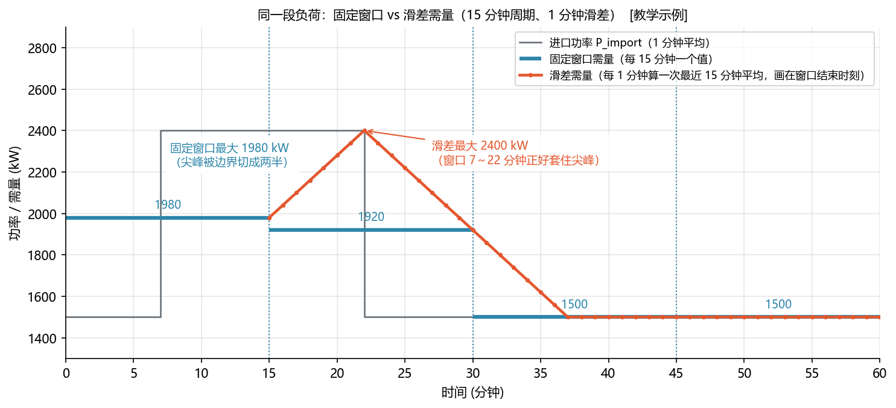
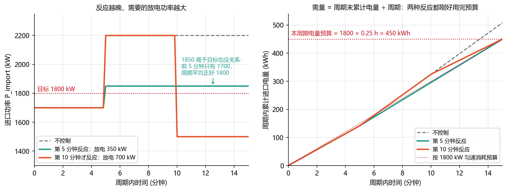
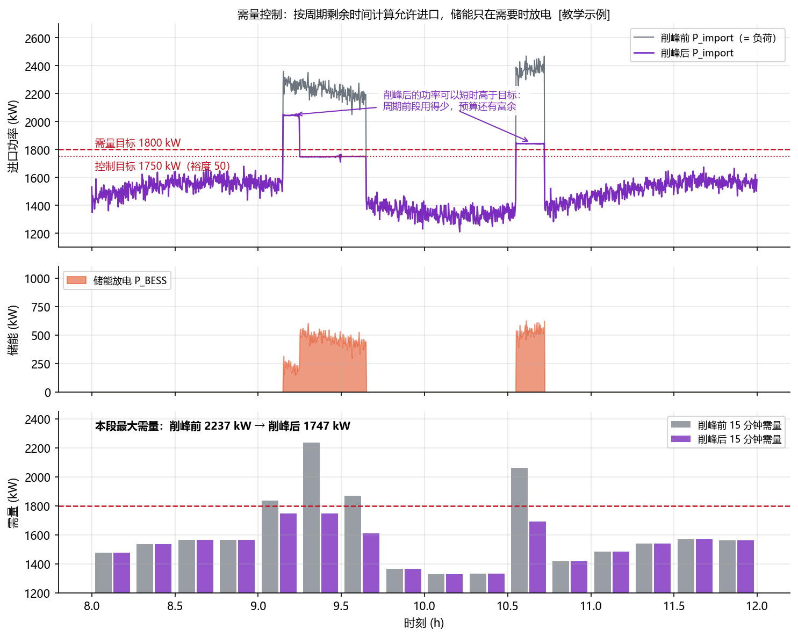
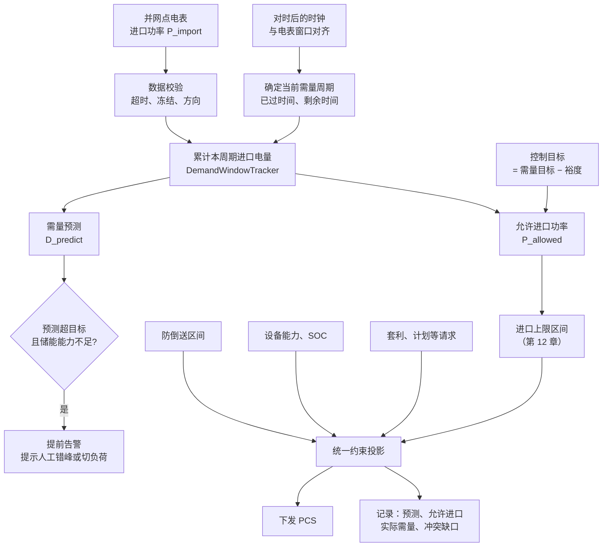

<!-- @AI_GENERATED -->
# 14 需量控制：周期计量、预算预测与削峰约束

> [课程首页](README.md) · 上一章：[13 峰谷套利计划：收益门槛、约束排程与实时跟踪](13_峰谷套利与计划曲线.md) · 下一章：[15 电网频率响应与储能一次调频](15_频率与一次调频.md)

**一句话**：需量是一个计量周期内的平均进口功率，一个月里最大的那一次决定基本电费；EMS 要用预算预测和可行域约束提前削峰。

## 本章目标

读完本章，你应能：

1. 区分容量电费、需量电费和进口计量口径；
2. 按固定窗口或滑差窗口计算需量，并处理窗口起点、时间和缺测边界；
3. 用剩余电量预算预测需量、计算允许进口和所需放电功率；
4. 将需量约束与防倒送、SOC、设备能力和套利充电统一投影。

## 本章边界与假设

本章默认进口为正、倒送不抵扣、需量周期和窗口方式由项目配置决定；在线实现重点覆盖固定窗口，滑差需量和多活跃窗口允许进口属于深入设计。单价、计收方式、核定需量、裕度和缺测处理以当地政策、电表设置和供电合同为准。本章依赖第 07 章功率平衡、第 10 章时间与数据质量、第 12 章约束和第 13 章计划。

**前置**：第 00 章 0.4 节 ②、第 03 章（需量电费节省）、第 12 章（进口上限区间）。


---

## 14.1 现场场景【必懂】

月底，工厂财务拿着电费单来问：储能装了半年，这个月基本电费怎么反而多了一万多？

翻 EMS 记录发现：整个月里 99.9% 的时间，取电都压在 1800 kW 以下。只有 17 号上午，空压机和一条新产线同时启动，那 15 分钟平均取电 2200 kW，储能当时 SOC 只剩 12%，没顶住。

**就这一个 15 分钟，让整个月的基本电费按 2200 kW 计算。**

本章讲清三件事：需量怎么算、为什么一次峰值决定整月、EMS 怎么提前判断并及时出手。

---

## 14.2 两部制电价：电度电费 + 基本电费【必懂】

国内大工业用户（以及部分一般工商业用户）通常执行**两部制电价**，电费由两部分组成：

| 部分 | 按什么计 | 反映什么 | 储能怎么省 |
|---|---|---|---|
| 电度电费 | 用了多少度电（kWh），分时计价 | 电能本身的成本 | 峰谷套利（第 13 章） |
| 基本电费 | 按**变压器容量**（kVA）或按**最大需量**（kW），按月计收 | 电网为你预留的供电能力 | 需量控制（本章） |

基本电费的逻辑是：电网必须随时准备好满足你的最大取电功率，这部分设备投资不管你用不用都要摊。

### 两种计收方式

```text
按容量：基本电费 = 变压器容量（kVA）× 容量电价（元/kVA·月）
按需量：基本电费 = 月最大需量（kW）× 需量电价（元/kW·月）
```

**手算**（单价均为 `[教学示例]`，以当地政策和供电合同为准）：变压器 2500 kVA，容量电价 24 元/kVA·月，需量电价 36 元/kW·月。

```text
按容量：2500 × 24 = 60,000 元/月（与实际用了多少无关）
按需量：月最大需量 2000 kW → 2000 × 36 = 72,000 元/月
        压到 1800 kW       → 1800 × 36 = 64,800 元/月
平衡点：60,000 / 36 ≈ 1667 kW
```

月最大需量长期低于约 1667 kW 时，按需量计收更省；否则按容量更省。用户通常可以按规定选择计收方式，这是业主和电力营销部门之间的事。对 EMS 来说，**只有按需量计收时，需量控制才有收益**。

计收方式、单价、是否有“核定需量”（按合同约定值计收、超出部分另行计价）、最低计收标准等规则，各地政策和供电合同不同，并会调整。EMS 只实现计算方法，参数全部可配置。

### 力调电费【了解】

两部制用户通常还要按月平均功率因数调整电费（俗称“力调电费”），功率因数低于考核标准要加收。它和无功有关，第 17 章会讨论储能能否帮忙改善功率因数。

---

## 14.3 需量是什么：一个周期内的平均功率【必懂】

### 定义

```text
需量 = 一个需量周期内的进口电量 ÷ 周期时长
```

需量周期常见为 15 分钟，由电能表设置和供电合同决定。三个要点：

1. **只算进口**：用从电网取电为正的 `P_import`（`P_import = −P_PCC`，附录 B）。本课程默认倒送的电量不抵扣进口需量，实际以电能表的计量方式为准；
2. **是平均值，不是瞬时值**：电机启动几秒钟的冲击电流对需量影响很小，持续 15 分钟的高负荷影响很大；
3. **是电量除以时间**：EMS 实现时要按时间累加电量（第 02 章的梯形积分），不能简单把采样值取平均（采样间隔不均匀时会出错）。

**手算**：前 7 分钟倒送 500 kW，后 8 分钟取电 1000 kW：

```text
进口电量 = 0 × 7/60 + 1000 × 8/60 = 133.3 kWh
需量 = 133.3 / 0.25 = 533 kW（而不是净值 (−3500 + 8000)/15 = 300 kW）
```

> **软件类比**：需量就像云厂商按“月内 95 分位带宽”或“峰值 QPS 档位”计费：不看你总共传了多少数据，而看你占用了多大的“管道”。
>
> **类比失效点**：带宽计费通常允许一部分尖峰被丢弃（95 分位），需量计费**不丢任何一个周期**，取的是最大值。而且功率流过去就无法撤回，没有“事后削峰”。

---

## 14.4 固定窗口与滑差【必懂】

同样是 15 分钟周期，电表有两种算法：

| 方式 | 怎么算 | 一小时算出几个值 |
|---|---|---|
| 固定窗口（区间式） | 0:00～0:15、0:15～0:30……各算一个平均值 | 4 个 |
| 滑差式 | 窗口长度不变，每隔一个滑差时间（例如 1 分钟）向后滑一次，每次算“最近 15 分钟平均” | 60 个 |



图中标注对照表：

| 编号 | 位置 | 标注 | 对应正文 |
|---|---|---|---|
| ① | 尖峰输入 | 1500、2400 kW；7～22 分钟 | 基础负荷与尖峰区间 |
| ② | 固定窗口 | 1980、1920 kW | 尖峰被边界切分 |
| ③ | 滑差窗口 | 2400 kW；15 分钟 | 窗口完整覆盖尖峰 |
| ④ | 时间参数 | 1 分钟滑差、15 分钟周期 | 计量方式 |

**手算**：基础负荷 1500 kW，第 7～22 分钟有一段 2400 kW 的尖峰，正好 15 分钟：

```text
固定窗口 [0, 15)：(7 × 1500 + 8 × 2400) / 15 = 1980 kW
固定窗口 [15, 30)：(7 × 2400 + 8 × 1500) / 15 = 1920 kW
滑差窗口 [7, 22)：全部是 2400 → 2400 kW
```

尖峰被固定窗口的边界“切成两半”，每个窗口只看到一部分；滑差窗口总有一个正好套住它。所以**同一段负荷，滑差方式的最大需量 ≥ 固定窗口方式**。

对 EMS 的要求：**按电表的方式算**。电表是滑差，EMS 却按固定窗口算，EMS 会以为自己控制住了（1980），电费单上却是 2400。周期长度、滑差时间、窗口起点，都以电能表设置和供电合同为准，调试时要找供电部门或电表厂家确认。

---

## 14.5 为什么一次峰值决定整月【必懂】

```text
月最大需量 = max(本月所有需量周期的需量)
```

一个月约有 2976 个 15 分钟周期（31 天），基本电费只看最大的那一个。

**手算**：本月其余时间都在 1700 kW 左右，只有一次 2200 kW：

```text
基本电费 = 2200 × 36 = 79,200 元
如果压住在 1800：1800 × 36 = 64,800 元
这一次失误的代价 = (2200 − 1800) × 36 = 14,400 元
```

这带来三个和普通控制功能不同的设计要求：

1. **可靠性比平均效果重要**：99.9% 的时间压住没有意义，要的是**每一个周期**都压住；
2. **要给需量留电**：储能如果在早上套利时把电放光，下午的负荷高峰就没电削峰了。需要为需量控制预留 SOC（第 18 章仲裁时讨论套利和需量的冲突）；
3. **本月已发生的最大需量是新的“免费额度”**：如果本月 5 号已经出现了 1900 kW 的需量，那么本月剩下的时间里，把需量压到 1900 以下**不再省钱**（按实际最大需量计收时）。EMS 可以把本月剩余时间的控制目标上调到 1900 附近，把电留给套利。这条规则依赖计费方式，必须和业主确认后才能启用。

---

## 14.6 需量预测与所需放电功率【必懂】

### 原理：按剩余时间算“预算”

需量控制不是看到瞬时功率超过 1800 就放电。周期前段取电少，后段就可以多取一点；反之亦然。关键是**周期结束时的平均值**。

```text
本周期电量预算 = 目标需量 × 周期时长
已用电量       = 从周期开始累计到现在的进口电量
剩余预算       = 预算 − 已用电量
允许的平均进口功率 = 剩余预算 ÷ 剩余时间
```

### 手算

目标 1800 kW，15 分钟周期。前 10 分钟平均取电 1700 kW，此刻负荷涨到 2200 kW，剩 5 分钟：

```text
已用电量 = 1700 × 10/60 = 283.3 kWh
需量预测（假设 2200 保持到周期末）
         = (283.3 + 2200 × 5/60) / 0.25 = (283.3 + 183.3) / 0.25 = 1866.7 kW  → 会超
预算     = 1800 × 0.25 = 450 kWh
允许进口 = (450 − 283.3) / (5/60) = 2000 kW
储能需要额外放电 = 2200 − 2000 = 200 kW
```

注意：允许进口是 2000 kW，**高于**目标 1800。因为前 10 分钟只用了 1700，省下了预算。

### 公式与符号

```text
D_predict = (E_elapsed + P_assumed × T_remain) / T_window
P_allowed = (D_target × T_window − E_elapsed) / T_remain
P_extra   = max(0, P_import_now − P_allowed)
```

| 符号 | 含义 | 单位 | 示例值 |
|---|---|---|---|
| `E_elapsed` | 本周期已累计进口电量 | kWh | 283.3 |
| `P_assumed` | 对剩余时间进口功率的假设（当前值、保守上界或预测） | kW | 2200 |
| `T_remain` | 本周期剩余时间 | h | 5/60 |
| `T_window` | 需量周期 | h | 0.25 |
| `D_target` | 控制目标需量 | kW | 1800 |

### 反应越晚，代价越大

同样是负荷在第 5 分钟从 1700 跳到 2200：

```text
第 5 分钟就反应：允许进口 = (450 − 141.7) / (10/60) = 1850 → 需要放 350 kW
第 10 分钟才反应：已用 141.7 + 183.3 = 325；允许 = (450 − 325) / (5/60) = 1500 → 需要放 700 kW
```



图中标注对照表：

| 编号 | 位置 | 标注 | 对应正文 |
|---|---|---|---|
| ① | 负荷阶跃 | 1700 → 2200 kW | 第5分钟负荷变化 |
| ② | 需量目标/预算 | 1800 kW、450 kWh | 15分钟窗口 |
| ③ | 早反应 | 第5分钟、350 kW | 剩余10分钟 |
| ④ | 晚反应 | 第10分钟、700 kW | 剩余5分钟 |

晚反应 5 分钟，需要的放电功率翻倍。如果储能只有 500 kW，晚反应就意味着这个周期必然超标。越接近周期末，同样的电量缺口需要的功率越大；周期最后几十秒，允许进口可能变得极大（前面用得少）或者变成负数（预算已经用完，无论如何都会超）。

### 代码

```python
# lab/ems_lab/demand.py（节选）
def predict_demand_kw(e_elapsed_kwh, p_assumed_kw, t_remain_s, window_s=900):
    e_total = e_elapsed_kwh + max(0.0, p_assumed_kw) * t_remain_s / 3600
    return e_total / (window_s / 3600)


def allowed_import_kw(e_elapsed_kwh, t_remain_s, target_kw, window_s=900):
    budget_kwh = target_kw * window_s / 3600 - e_elapsed_kwh
    return budget_kwh / (t_remain_s / 3600)       # 可能为负：本周期已经必然超标


class DemandWindowTracker:
    """每个控制周期 update(t_s, p_import_kw)：累加电量，跨窗口边界自动结算。"""
```

`allowed_import_kw` 的结果直接作为第 12 章 `import_limit_interval` 的进口上限，由统一的投影算出储能功率。需量控制不单独给 PCS 下指令。

---

## 14.7 目标设置与裕度【必懂】

### 目标从哪来

- 业主和供电部门约定的目标（例如申报的需量）；
- 历史月最大需量减去期望削减量；
- 储能能力决定的上限：储能 1000 kW、负荷尖峰 2800 kW，目标定在 1600 kW 是不现实的。

### 为什么要留裕度

EMS 算出来的需量和电表算出来的需量**不可能完全一样**：

| 误差来源 | 说明 |
|---|---|
| 计量误差 | EMS 用的测点（可能是另一块表或 PCS 测量）与计费电表有精度差异 |
| 窗口不对齐 | EMS 时钟与电表时钟有偏差，窗口起点不同（14.11 节） |
| 通信延迟 | 数据从电表到 EMS 要几秒到几十秒 |
| 执行延迟 | PCS 响应、Ramp 限制 |
| 负荷预测 | 剩余时间内负荷可能继续上涨 |

所以控制目标 = 需量目标 − 裕度：

```text
需量目标 1800 kW，裕度 50 kW → 控制目标 1750 kW   [教学示例]
```

裕度大小没有通用值，要根据测量链路、历史偏差和储能余量整定，并在运行中持续用电费单复核。

### 效果

下图用 `DemandWindowTracker` + 第 12 章 `project` 仿真了一个上午（`[教学示例]`）：储能平时不动，只在“允许进口”低于负荷时放电。



图中标注对照表：

| 编号 | 位置 | 标注 | 对应正文 |
|---|---|---|---|
| ① | 控制目标 | 1800 kW、1750 kW、裕度 50 kW | 目标与裕度 |
| ② | 需量结果 | 削峰前约 2237 kW → 削峰后约 1747 kW | 教学仿真结果 |

- 最大需量从约 2237 kW 降到约 1747 kW；
- 储能只在两段负荷高峰放电，其余时间完全不动，为套利或下一次削峰保留电量；
- 注意 9:10 和 10:35 附近，削峰后的瞬时功率**短时高于**目标：那是周期前段用电少、预算有富余，算法允许的。只要周期平均不超，瞬时超出没有关系。

---

## 14.8 需量约束与套利充电

### 最小闭环：逐分钟预算如何决定放电功率


`15 分钟`窗口、目标需量 `1800 kW`。前 10 分钟平均进口 1700 kW，第 10 分钟当前进口升到 2200 kW，剩余 5 分钟：

```text
已用电量 = 1700 × 10 / 60 = 283.33 kWh
无储能预测 = (283.33 + 2200 × 5/60) / 0.25 = 1866.67 kW
剩余预算 = 1800 × 0.25 − 283.33 = 166.67 kWh
允许进口 = 166.67 / (5/60) = 2000 kW
所需额外放电 = 2200 − 2000 = 200 kW
```

| 步骤 | 输入/状态 | 输出 |
|---|---|---:|
| 已累计电量 | 前 10 分钟 1700 kW | 283.33 kWh |
| 需量预测 | 当前进口 2200 kW | 1866.67 kW |
| 剩余预算 | 目标 1800 kW | 166.67 kWh |
| 允许进口 | 剩余 5 分钟 | 2000 kW |
| 储能动作 | 当前进口 2200 kW | 放电 200 kW |

对应脚本：`lab/examples/ch14_demand_trace.py`。它展示了需量控制不是“看到超限再处理”，而是根据窗口剩余时间提前计算预算。


这是第 00 章 ② 的情形：凌晨谷段，储能正以 600 kW 套利充电，夜班设备启动，负荷升到 1500 kW：

```text
进口功率 = 负荷 + 充电 = 1500 + 600 = 2100 kW > 1800
```

储能充电对电网来说就是一个负荷。需量控制在这里不需要“放电”，只需要**少充一点**：

```text
进口上限推出的下限 = 1500 − 1800 = −300 → 最多充 300 kW
```

这正是第 12 章进口上限区间的作用：它同时管住“需要放多少”和“最多能充多少”。常见的错误是只在“需要放电”时才启用需量控制，而套利充电不经过进口上限检查，结果需量恰恰在谷段充电时被推高。低 SOC 自充也一样要受进口上限约束（第 12 章 12.8 节）。

---

## 14.9 与防倒送同时生效【必懂】

需量管的是“别取太多”，防倒送管的是“别送出去”。两者都来自同一个功率平衡，同时生效时，储能的可行域是一个“夹在中间”的区间：

```text
进口上限 → P_BESS ≥ P_load − P_PV − P_import_limit     （下限）
防倒送   → P_BESS ≤ P_load − P_PV + P_export_limit     （上限）
```

（辅助用电和损耗省略。）**手算**：负荷 1500、无光伏、进口上限 1800、零倒送：

```text
可行域 = [1500 − 1800, 1500 + 0] = [−300, +1500]
再与设备能力 [−1000, +1000] 取交集 → [−300, +1000]
```

- 充电最多 300 kW（再多就超需量）；
- 放电最多 1500 kW（再多就倒送），此时设备能力 1000 更紧。

第 12 章已经证明，这两个区间的宽度是“出口额度 + 进口额度”，永远不会互相冲突。冲突只会发生在它们和设备能力之间，例如负荷 2900 kW 时需要放 1100 kW，而储能只能放 1000 kW：按第 12 章规则，放满 1000，记录缺口 100 kW 并告警。

---

## 14.10 需量控制在 EMS 中的流程【必懂】



两点说明：

1. 需量控制的输出是一个**区间**（进口上限），而不是一个功率指令，它和套利、计划、防倒送在同一次投影里合成；
2. 预测超目标且储能能力不足时要**提前告警**，给运行人员留出错峰、暂缓启动大设备的时间。等周期结束再告警就太晚了。

---

## 14.11 代码【必懂】

完整实现位于 `lab/ems_lab/demand.py`；配套示例用于复现本章需量计算，固定窗口与滑差在线边界以项目配置为准。

| 函数 / 类 | 作用 |
|---|---|
| `demand_power_kw` | 只计进口，倒送记 0 |
| `fixed_window_demands` | 固定窗口需量，可设窗口偏移（模拟窗口不对齐） |
| `sliding_window_demands` | 滑差需量 |
| `predict_demand_kw` | 需量预测 |
| `allowed_import_kw` | 剩余时间内允许的平均进口功率 |
| `required_extra_discharge_kw` | 储能需要额外放电的功率 |
| `control_target_kw` | 目标 − 裕度 |
| `monthly_max_demand` | 月最大需量 |
| `basic_charge_by_demand`、`basic_charge_by_capacity` | 两种基本电费计算 |
| `DemandWindowTracker` | 实时跟踪固定窗口：累计、预测、允许进口、跨窗口结算 |

---

## 14.12 常见误区【必懂】

| 误区 | 正确理解 |
|---|---|
| 瞬时功率一超过目标就放电 | 看的是周期平均；前段用得少，后段可以多用 |
| 需量控制只管放电 | 充电也会推高需量，进口上限要同时管住充电 |
| EMS 按固定窗口算就行 | 必须和电表方式一致；电表是滑差，EMS 也要按滑差算 |
| 这个月大部分时间都压住了 | 基本电费只看最大的那一个周期 |
| 目标就是需量目标本身 | 要减去裕度，吸收计量、时钟、通信、执行的误差 |
| 需量控制直接给 PCS 下指令 | 输出进口上限区间，和其他功能在同一次投影中合成 |
| 周期结束后发现超了再告警 | 预测超目标且储能不够时就要提前告警 |

## 14.13 现场真实故障【必懂】

**案例一：EMS 窗口与电表窗口不对齐。**
现象：EMS 记录的全月最大需量是 1980 kW，低于 2000 kW 的目标，电费单却是 2400 kW。
原因：电表的需量周期起点与 EMS 相差 7 分钟（EMS 以自己的整点对齐，电表以自己的时钟对齐）。一段 15 分钟的负荷尖峰在 EMS 的窗口里被切成两半（1980、1920），在电表的窗口里完整落在一个周期内（2400）。`test_window_misalignment_changes_result` 复现了这个情形。
教训：调试时必须确认电表的周期起点、周期长度和计算方式；EMS 时钟和电表时钟都要对时；部分电表可以提供需量周期同步信号或直接上送当前周期需量，是否具备以设备手册为准。

**案例二：电表时钟慢慢走偏。**
现象：投运头两个月需量控制效果很好，之后 EMS 和电费单的偏差逐月变大。
原因：电表内部时钟每天漂移一点，没有对时，几个月后窗口起点差了好几分钟；EMS 这边做了网络对时，两者渐行渐远。
教训：电表对时是供电部门或电表厂家的工作，EMS 侧要**监测**偏差：定期比较 EMS 计算的周期需量与电表上送的需量（如果电表支持），偏差超阈值就告警；裕度不能按“对齐时”的理想情况设置。

**案例三：通信延迟导致最后几分钟来不及反应。**
现象：负荷在周期最后 2 分钟突增，储能响应时已经晚了，该周期超标。
原因：并网点数据经过规约转换器转发，刷新周期约 30 秒；EMS 看到负荷上涨时已经过去了半分钟，加上 Ramp 和 PCS 响应，真正压下来时周期只剩几十秒，需要的放电功率超过了储能能力。
教训：需量控制的测点要尽量缩短链路、提高刷新频率（第 10 章）；预测时 `P_assumed` 取保守值（例如近期最大值而不是当前值）；接近周期末时提高介入的积极性；数据超时或冻结时按“负荷偏高”保守处理，并告警。

---

## 14.14 自测

1. 变压器 3150 kVA，容量电价 24 元/kVA·月，需量电价 36 元/kW·月（均为教学示例）。月最大需量低于多少时按需量计收更省？
2. 一段 2000 kW、持续 10 分钟的负荷尖峰，前后都是 1400 kW。固定窗口最坏情况和最好情况的需量分别是多少？滑差方式呢？
3. 目标 1800 kW，周期已过 12 分钟，已用电量 350 kWh，此刻进口 1900 kW。需量预测是多少？储能需要额外放多少？
4. 为什么同样的负荷突增，在周期第 2 分钟和第 12 分钟发现，需要的放电功率不同？
5. 凌晨负荷 1400 kW，套利想以 800 kW 充电，需量目标 1800 kW，零倒送。储能的可行域是什么（设备能力 ±1000）？
6. 本月 3 号已经出现 1950 kW 的需量，目标 1800。按实际最大需量计收时，剩余时间继续压在 1800 有没有收益？EMS 可以怎么调整？
7. 列举三个会让 EMS 计算的需量与电表不一致的原因。

<details>
<summary>参考答案</summary>

1. `3150 × 24 / 36 = 2100 kW`。月最大需量长期低于约 2100 kW 时按需量更省。
2. 固定窗口最坏：尖峰完整落在一个窗口里，`(10 × 2000 + 5 × 1400) / 15 = 1800 kW`；最好：被窗口边界平分成两个 5 分钟，`(5 × 2000 + 10 × 1400) / 15 = 1600 kW`。滑差：总有一个窗口完整套住尖峰，1800 kW。
3. 预测 `(350 + 1900 × 3/60) / 0.25 = (350 + 95) / 0.25 = 1780 kW`，低于 1800，不需要放电。允许进口 `(450 − 350) / (3/60) = 2000 kW`，高于当前 1900。
4. 所需放电功率 = 当前进口 − 剩余预算 / 剩余时间。越晚发现，已经多用掉的电量越多、剩余时间越短，剩余预算要摊到更短的时间里，需要的功率越大。
5. 进口上限下限 `1400 − 1800 = −400`，防倒送上限 `1400 + 0 = 1400`，与设备能力取交集得 `[−400, +1000]`。套利的 −800 会被削到 −400。
6. 没有收益：本月基本电费已经按不低于 1950 kW 计算。EMS 可以把本月剩余时间的控制目标上调到 1950 附近（仍留裕度），把储能电量留给套利；但要确认计费方式确实是按实际月最大需量计收，并在下月初恢复目标。
7. 任选三个：窗口起点不对齐；计算方式不同（固定窗口与滑差）；时钟漂移；EMS 测点与计费电表的精度差异；通信延迟与数据缺失；倒送是否计入的口径不同。

</details>

---

## 14.15 深入【深入】

<details>
<summary>滑差方式下的“允许进口”怎么算</summary>

固定窗口只有一个“当前周期”，允许进口按一个预算算即可。滑差方式下，**每一分钟都有一个新窗口**，此刻的取电会同时计入接下来 15 个滑差窗口。要保证所有这些窗口都不超标，允许进口要对每一个正在进行的窗口分别算：

```text
对于从 t−14 分钟到 t 分钟开始的每一个窗口 w：
    允许进口_w = (目标 × 15 分钟 − 窗口 w 已用电量) / 窗口 w 剩余时间
此刻允许进口 = 所有 w 中的最小值
```

它比固定窗口更保守，也更容易出现“某个窗口的预算已经用完”的情况。实现时可以用长度为 15 的环形缓冲区存每分钟电量。

</details>

<details>
<summary>把需量放进排程：滚动优化【了解】</summary>

第 13 章的线性规划可以直接加入需量约束：每个 15 分钟时段的进口功率 `P_load − P_PV − P_BESS ≤ 需量目标`，并在目标函数中加入 `需量电价 × 月最大需量` 的增量。难点在于它需要负荷预测，而且“月最大需量”是跨天的量。工程上常用的简化是：日前排程时给需量控制预留一段 SOC，实时控制时由本章的规则算法兜底。

</details>

<details>
<summary>工程边界（原稿保留）</summary>

- 本课程默认用进口为正的 `P_import` 计算需量，倒送不抵扣。如果项目采用出口计费、双向计费或其他计量规则，必须通过配置明确，不能直接套用；
- 需要在配置中明确：固定窗口还是滑差、周期长度、滑差时间、采样间隔和缺测处理、进口和出口是否分别计量、跨窗口边界如何处理、计费周期内如何取最大值；
- “误差 × 系数”这类简单比例补偿只能作为教学启发式，现场控制必须考虑剩余时间、周期积分、SOC、功率能力、Ramp、效率和执行延迟；
- 单价、计收方式、核定需量规则以当地政策和供电合同为准。

</details>

<!-- @AI_GENERATED: end -->
