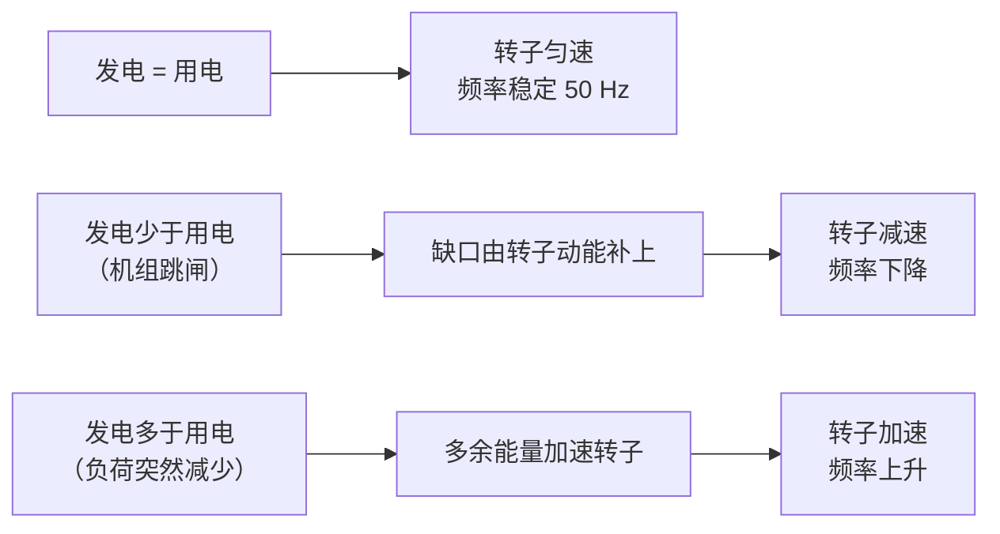
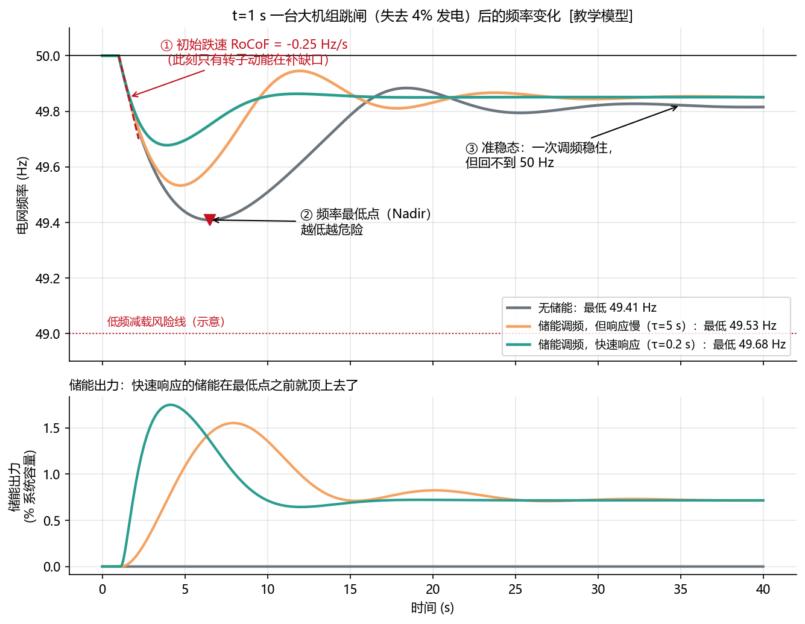
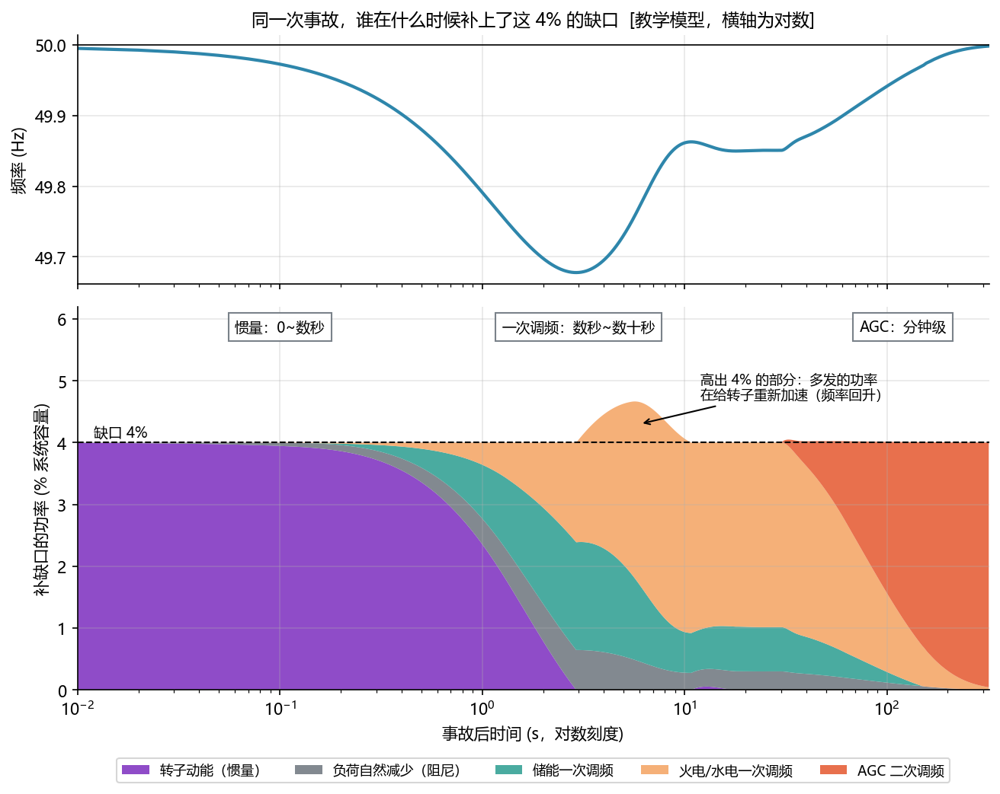
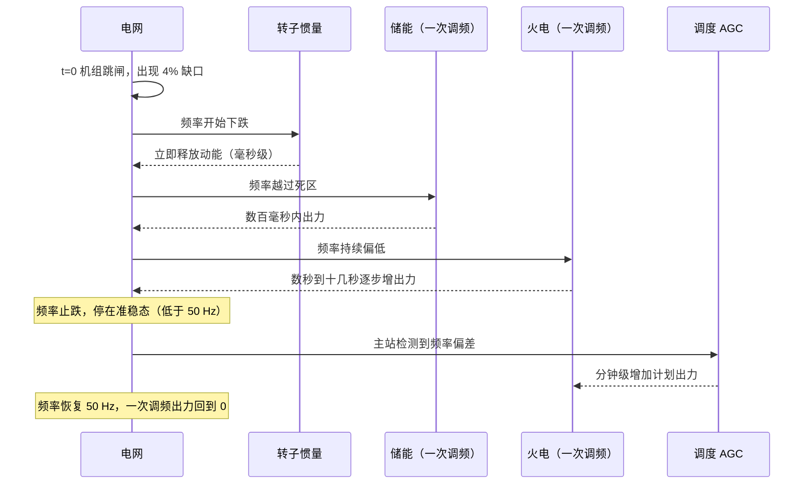
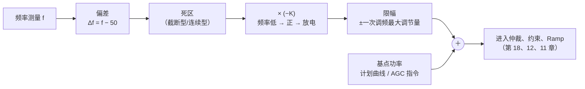
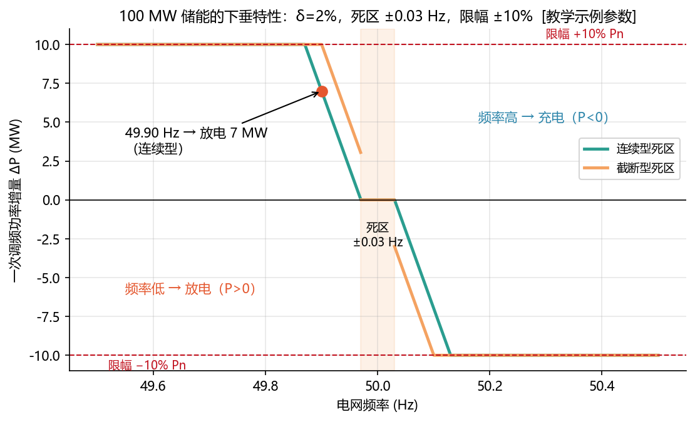
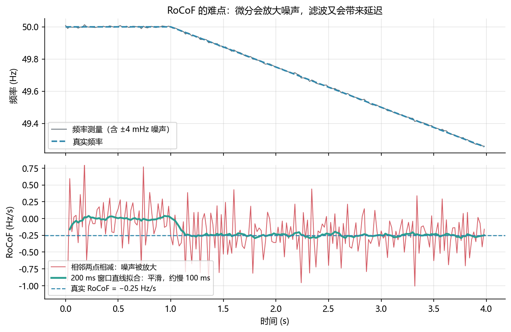
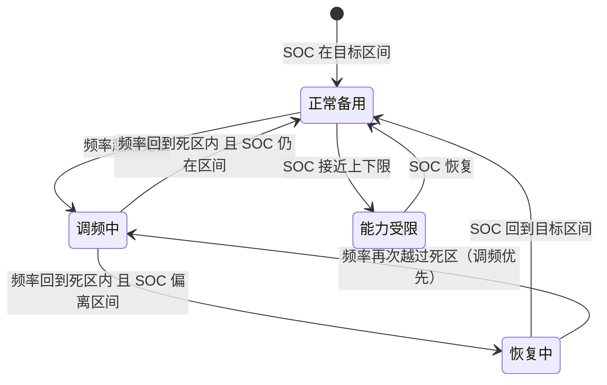

<!-- @AI_GENERATED -->
# 15 电网频率响应与储能一次调频

> [课程首页](README.md) · 上一章：[14 需量控制：周期计量、预算预测与削峰约束](14_需量管理.md) · 下一章：[16 AGC 二次调频、储能跟踪与调度考核](16_AGC与调度考核.md)

**一句话**：电网频率反映全网有功平衡，储能按死区、调差率和能力边界快速增减出力，但一次调频不能替代 AGC，也会消耗 SOC。

## 本章目标

读完本章，你应能：

1. 用摇摆方程计算初始 RoCoF，并解释惯量、一次调频和 AGC 的时间分层；
2. 按调差率、死区、限幅和方向计算一次调频增量；
3. 估算虚拟惯量/FFR 功率和调频事件的电量消耗；
4. 说明 EMS、PCS、快速控制装置在一次调频中的职责边界和 SOC 管理要求。

## 本章边界与假设

本章使用教学级频率动态、下垂和 RoCoF 模型；不提供现场整定值，不替代 GB/T 40595-2021 或省网调度规程，不实现 PCS 快速环、保护定值和完整电网动态仿真。死区、调差率、限幅、响应时间和能力上送均以项目协议与调度规程为准。本章依赖第 02 章有功/频率、第 11 章控制原语、第 16 章 AGC。

**前置**：第 02 章（有功与频率的关系）、第 11 章（死区、限幅、滤波）。


---

## 15.1 现场场景【必懂】

某天 14:00，电网中一台 1000 MW 的火电机组因故障跳闸。一瞬间，全网少了 1000 MW 发电，但用电一点没少。

接下来的几秒到几分钟里，电网频率会怎样变化？谁来补上这个缺口？储能在其中扮演什么角色？如果补得不够快，会发生什么？这一章回答这些问题。

---

## 15.2 频率为什么反映供需平衡【必懂】

### 原理：全网的发电机是一个“同步转动的巨大飞轮”

火电、水电、核电的发电机都是**同步发电机**：它们的转子必须和电网频率保持同步旋转。50 Hz 的电网里，两极发电机的转子每秒转 50 圈。全网成千上万台发电机的转速被电磁力“锁”在一起，像一个巨大的飞轮。

转子有质量，转起来就储存着**动能**。于是：



所以，**频率的变化就是全网有功不平衡的直接反映**：

- 频率在下降 → 发电不够；
- 频率在上升 → 发电过多；
- 下降得越快 → 缺口越大，或者系统“飞轮”越轻。

而且因为全网同步，**同一时刻在任何地方测到的频率几乎相同**。这使得分散在各地的储能站不需要通信，只看本地频率，就知道全网缺不缺电。

> **软件类比**：频率像一个全局共享资源池的**负载水位**：所有生产者（发电机）和消费者（负荷）都在读写同一个池子，任何一方的突变都会让水位立刻变化，每个节点都能本地观测到。
>
> **类比失效点**：负载水位只是一个指标，而频率本身就是物理状态。频率偏离太多，发电机和用电设备会被保护装置切除，从而引发连锁反应。

---

## 15.3 频率跌得有多快：摇摆方程【必懂】

描述“功率缺口”和“频率变化速度”之间关系的公式叫**摇摆方程**。在事故刚发生的瞬间，可以简化为：

```text
                 fn × ΔP
频率变化率  =  ───────────
                  2 × H
```

| 符号 | 含义 | 单位 | 本例 |
|---|---|---|---|
| fn | 额定频率 | Hz | 50 |
| ΔP | 功率缺口占系统容量的比例，发电不足为负 | 无（标幺值） | −0.04 |
| H | 系统惯性时间常数：满功率运行时，转子动能能撑几秒 | s | 4 |
| 频率变化率 | 常写作 RoCoF（Rate of Change of Frequency） | Hz/s | ? |

**手算**：系统容量 100 GW，失去 4 GW 发电（ΔP = −0.04），H = 4 s：

```text
RoCoF = 50 × (−0.04) / (2 × 4) = −0.25 Hz/s
```

如果没有任何调节，**2 秒后频率就会跌到 49.5 Hz**。

从公式可以直接读出两条结论：

1. **缺口越大，跌得越快**；
2. **H 越小，跌得越快**。光伏、风电通过电力电子设备并网，转子不和电网同步，基本不提供惯量。新能源比例越高，系统 H 越小，同样的事故下频率跌得越快。这正是电网越来越需要储能快速响应的根本原因。

---

## 15.4 一次事故的频率曲线【必懂】

下图用一个简化的电网模型（`lab/ems_lab/grid_sim.py`，参数均为 `[教学示例]`）模拟了 t = 1 s 时失去 4% 发电后的频率变化：



图中标注对照表：

| 编号 | 位置 | 标注 | 对应正文 |
|---|---|---|---|
| ① | 事故参数 | t=1 s、失去 4% 发电、响应 τ=5 s/0.2 s | 教学事故模型 |
| ② | 初始跌速 | RoCoF −0.25 Hz/s | 摇摆方程 |
| ③ | 频率曲线 | 无储能约 49.41 Hz、慢响应约 49.53 Hz、快响应约 49.68 Hz | Nadir 对比 |
| ④ | 参考线 | 50 Hz、49.0 Hz | 额定频率与风险线 |

先看灰线（无储能），它有三个关键特征：

| 特征 | 含义 | 为什么重要 |
|---|---|---|
| ① 初始跌速 RoCoF | 事故瞬间只有转子动能在补缺口，跌速由摇摆方程决定 | RoCoF 过大会触发部分保护装置动作，使更多电源脱网 |
| ② 最低点（Nadir） | 调节手段逐步顶上，频率停止下跌的那个点 | 最低点过低会触发**低频减载**：电网自动切除一部分用户，也就是停电 |
| ③ 准稳态 | 一次调频把功率重新平衡，频率停在一个低于 50 Hz 的值 | 一次调频只能“止跌”，**不能恢复到 50 Hz**，需要二次调频（第 16 章） |

再对比三条线：

- **灰线（无储能）**：最低点约 49.41 Hz；
- **橙线（储能参与，但响应慢，τ = 5 s）**：最低点约 49.53 Hz；
- **绿线（储能参与，快速响应，τ = 0.2 s）**：最低点约 49.68 Hz。

同样的储能容量，**响应越快，最低点抬得越高**。下半图显示，快速响应的储能在频率到达最低点之前就已经输出了大部分功率，而慢速响应的储能“赶到”时，最危险的时刻已经过去了。

---

## 15.5 调频分层：谁在什么时候补缺口【必懂】

电网不靠某一种手段，而是由几层调节按时间接力：



图中标注对照表：

| 编号 | 位置 | 标注 | 对应正文 |
|---|---|---|---|
| ① | 缺口参考线 | 4% | 事故功率缺口 |
| ② | 时间分层 | 0.1 s、3 s、120 s、320 s | 惯量、一次调频、AGC时间尺度与仿真范围 |
| ③ | 额定频率 | 50 Hz | 频率基准 |

| 层级 | 谁来做 | 多快 | 怎么做 | 能回到 50 Hz 吗 |
|---|---|---|---|---|
| 惯量响应 | 同步发电机转子（储能可模拟“虚拟惯量”） | 瞬时，0～数秒 | 物理本能：转子减速释放动能 | 不能，只是减缓下跌 |
| 一次调频 | 发电机调速器、储能、新能源 | 数秒～数十秒 | **各自根据本地频率**按比例增减出力 | 不能，留有稳态偏差 |
| 二次调频（AGC） | 调度主站统一计算，下发给各电站 | 数十秒～分钟 | 按全网偏差计算指令，下发给参与的电站 | **能**，把频率拉回 50 Hz |
| 三次调频 | 调度计划 | 分钟～小时 | 重新安排发电计划，释放前面几层的备用 | 恢复系统备用 |

图中最右侧可以看到：AGC 把缺口“接过去”之后，火电和储能的一次调频出力都回到了 0，频率回到 50 Hz。这意味着储能把调频中消耗的“备用”还给了系统，但电池里的电已经被用掉了一部分（15.9 节）。



> **软件类比**：这很像**多级缓存 + 自动扩缩容**：L1 缓存（惯量）瞬间扛住突发流量，本地限流器（一次调频）秒级止损，控制平面的扩容（AGC）分钟级真正补上容量，容量规划（三次调频）小时级重新安排资源。

---

## 15.6 下垂控制：一次调频的核心算法【必懂】

一次调频用的算法叫**下垂控制**：频率每偏离一点，出力就按固定比例变化一点。

### 调差率 δ：规程里的参数

国内规程通常用**调差率 δ**描述下垂的“陡峭程度”：

```text
      频率变化量 / 额定频率
δ = ────────────────────────
      出力变化量 / 额定功率
```

δ = 2% 的含义：频率变化**额定频率的 2%**（50 × 2% = 1 Hz），出力变化**100% 额定功率**。δ 越小，同样的频率偏差下出力越大，响应越“激进”。

代码里更方便用**下垂系数 K**（单位 kW/Hz），两者的换算：

```text
K = Pn / (δ × fn)
```

**手算**：100 MW 储能，δ = 2%：`K = 100 MW / (0.02 × 50 Hz) = 100 MW/Hz`，即频率每偏差 0.1 Hz，出力变化 10 MW。

### 完整的一次调频计算



```text
ΔP = clamp( −K × 死区(f − fn), −限幅, +限幅 )
储能总指令 = 基点功率 + ΔP
```

公式中的负号是方向约定的关键：**频率低（Δf < 0）→ ΔP > 0 → 放电**；频率高（Δf > 0）→ ΔP < 0 → 充电。

**手算**：100 MW 储能，δ = 2%，死区 ±0.03 Hz，限幅 ±10% Pn，当前频率 49.90 Hz：

| 步骤 | 连续型死区 | 截断型死区 |
|---|---|---|
| 偏差 Δf | −0.10 Hz | −0.10 Hz |
| 过死区后 | −0.10 + 0.03 = −0.07 Hz | −0.10 Hz |
| × (−K) | 0.07 × 100 = **+7 MW** | 0.10 × 100 = **+10 MW** |
| 限幅 ±10 MW | +7 MW | +10 MW |

同一个频率，两种死区的出力相差 3 MW（30%）。**死区类型、调差率、限幅、响应时间都以项目适用的规程为准**，国家标准 GB/T 40595-2021《并网电源一次调频技术规定及试验导则》对各类电源（含储能）提出了要求，具体省网调度规程还会进一步细化。本章参数均为 `[教学示例]`，不要直接用于现场。



图中标注对照表：

| 编号 | 位置 | 标注 | 对应正文 |
|---|---|---|---|
| ① | 图题 | 100 MW、δ=2%、额定频率 50 Hz | 下垂参数 |
| ② | 死区 | ±0.03 Hz | 连续/截断死区 |
| ③ | 限幅 | ±10 MW | 一次调频功率上限 |
| ④ | 工作点 | 49.90 Hz → +7 MW | 连续型死区示例 |
| ⑤ | 频率范围 | 49.5～50.5 Hz | 图示坐标范围 |

### 代码

```python
# lab/ems_lab/frequency.py（节选）
def droop_gain_kw_per_hz(p_rated_kw, droop_ratio, f_nominal_hz=50.0):
    return p_rated_kw / (droop_ratio * f_nominal_hz)


def primary_frequency_power(f_hz, cfg):
    delta_f = f_hz - cfg.f_nominal_hz
    if cfg.deadband_mode == "shift":
        effective = deadband_shift(delta_f, cfg.deadband_hz)
    else:
        effective = deadband_cut(delta_f, cfg.deadband_hz)
    k = droop_gain_kw_per_hz(cfg.p_rated_kw, cfg.droop_ratio, cfg.f_nominal_hz)
    delta_p = -k * effective          # 频率低 → 正功率 → 放电
    limit = cfg.limit_ratio * cfg.p_rated_kw
    return clamp(delta_p, -limit, limit)
```

---

## 15.7 最小闭环：频率序列如何变成调频功率

使用 `P_n=100 MW`、调差率 2%、连续型死区 0.03 Hz、功率限幅 10 MW：

| 拍 | 频率 | 死区后偏差 | 调频功率 |
|---:|---:|---:|---:|
| 0 | 50.00 Hz | 0 | 0 kW |
| 1 | 49.95 Hz | -0.02 Hz | +2000 kW |
| 2 | 49.90 Hz | -0.07 Hz | +7000 kW |
| 3 | 49.85 Hz | -0.12 Hz | +10000 kW（限幅） |
| 4 | 50.05 Hz | +0.02 Hz | -2000 kW |

算法链是：

```text
Δf = f − fn
→ 连续型死区
→ ΔP = −K × Δf_deadband
→ 限幅
```

对应脚本：`lab/examples/ch15_primary_frequency_trace.py`。脚本还把正向调频功率乘以 `dt`，计算这一小段时间消耗的电量。


| 特点 | 火电机组 | 电池储能 |
|---|---|---|
| 响应速度 | 调速器 + 锅炉/汽轮机，秒级到十几秒 | PCS 电力电子调节，通常百毫秒级 `[行业典型值]` |
| 调节方向 | 增出力受锅炉蓄热限制，减出力受最低稳燃负荷限制 | 放电、充电双向，可以从满充切到满放 |
| 调节精度 | 受机械惯性影响，有超调和滞后 | 基本按指令输出 |
| 持续能力 | 只要有燃料就能持续 | **受电池电量限制**，需要 SOC 管理 |

15.4 的图已经说明，速度带来的收益集中在**最低点**这一最危险的时刻。储能的短板是能量有限，所以一次调频必须和 SOC 管理（15.9）一起设计。

---

## 15.8 RoCoF、虚拟惯量与快速频率响应【了解】

### RoCoF 的测量难点

下垂只看“频率偏了多少”，而在事故初期，频率还没偏多少、却正在快速下跌。如果能根据**跌速**提前动作，就能更早地支撑频率。这需要实时计算 RoCoF，而它有一个天然的难点：



图中标注对照表：

| 编号 | 位置 | 标注 | 对应正文 |
|---|---|---|---|
| ① | 测量噪声 | ±0.004 Hz（4 mHz）、采样间隔 0.02 s（20 ms） | 相邻差分放大噪声 |
| ② | 拟合窗口 | 0.2 s（200 ms） | 滑动拟合与延迟 |
| ③ | 真实斜率 | −0.25 Hz/s；基准频率 50 Hz | 事故频率变化率 |

- 用相邻两点相减再除以时间间隔，测量噪声会被**放大**：4 mHz 的噪声、20 ms 的间隔，就能产生 ±0.2 Hz/s 的假 RoCoF；
- 用一段时间窗口内的数据做直线拟合，结果平滑得多，代价是大约半个窗口的延迟。

窗口长度的选择是在“抗噪”和“快速”之间取舍，由项目要求和实测数据决定。实现见 `RocofEstimator`。

### 虚拟惯量

储能可以按 RoCoF 输出功率，**模拟**同步发电机转子释放动能的行为：

```text
ΔP_惯量 = −2 × H_v × Sn / fn × RoCoF
```

`H_v` 是设定的虚拟惯性时间常数，`Sn` 是储能额定容量。频率跌得越快（RoCoF 越负），放电越多。**手算**：100 MW 储能，H_v = 4 s，RoCoF = −0.15 Hz/s：`ΔP = 2 × 4 × 100 / 50 × 0.15 = 2.4 MW`。

### 快速频率响应（FFR）

FFR 是一个统称，指比常规一次调频更快的频率支撑服务，触发方式可能是频率越限、RoCoF 越限或外部事件信号，常要求在很短的时间内输出预定功率并保持一段时间。**不同电网对 FFR 的定义、触发条件和验收方法差别很大**，本课程只把它当作“按项目配置的快速有功服务”，不假设统一规则。

虚拟惯量和 FFR 对时间极其敏感，通常在 PCS 或专用快速控制装置中实现，而不是放在 EMS 的常规控制循环里（15.10）。

---

## 15.9 SOC 管理：调频是要花电的【必懂】

一次调频的每一次放电都消耗电池电量，每一次充电都占用剩余容量。

**手算**：100 MW / 200 MWh 储能，一次事故中以 10 MW 放电 15 分钟：

```text
消耗电量 = 10 MW × 0.25 h = 2.5 MWh，约占总容量的 1.25%
```

单次事故消耗不大，但电网频率每天都在上下波动，储能持续小幅调节，SOC 会慢慢漂移。设计要点：

1. **保持双向能力**：频率可能下降也可能上升，SOC 太低就无法放电支撑，太高就无法充电吸收。承担调频任务的储能，SOC 宜维持在中间区间；
2. **事件后恢复**：频率恢复后，按设定的速率和时段把 SOC 拉回目标区间，并且恢复过程本身不能对电网造成新的扰动；
3. **能力边界要上报**：SOC 接近上下限时，一次调频的可调节能力下降，要如实反映到上送调度的可调容量中，而不是在事件发生时才发现“没电了”；
4. **与其他功能的配合**：一次调频叠加在计划/AGC 基点上，两者方向相反时怎么处理、谁优先，由调度规程规定，在仲裁层实现（第 16、18 章）。



---

## 15.10 一次调频在 EMS 架构中的位置【必懂】

一次调频要求秒级甚至更快的响应。从“频率变化”到“储能出力”，中间每一个环节都在消耗时间：


如果 EMS 控制周期是 1 秒，通信单程几百毫秒，再加上 PCS 自身的响应时间，端到端延迟很容易达到数秒。因此工程上常见两种架构：

| 架构 | 做法 | 优点 | 代价 |
|---|---|---|---|
| **EMS 集中计算** | EMS 采集频率、计算一次调频功率、下发 | 逻辑集中，与其他功能仲裁方便 | 延迟大，难以满足快速响应要求 |
| **本地快速控制** | PCS 或专用快速功率控制装置本地测频、本地计算、直接出力；EMS 负责参数下发、投退控制、状态监视和事件记录 | 延迟小 | EMS 要准确知道本地出力了多少，否则仲裁和约束会“算错账” |

选哪种由项目的响应时间要求、设备能力和调度要求决定。无论哪种，**EMS 都要负责**：参数的一致性（EMS 配置和 PCS 实际运行参数一致）、投退状态、SOC 管理、一次调频功率的记录和上送。

### 响应性能指标【了解】

调度对一次调频的考核通常关注下面几个时间和偏差指标（定义和限值以 GB/T 40595-2021 及所在电网调度规程为准）：

| 指标 | 含义 |
|---|---|
| 响应滞后时间 | 从频率越过死区，到出力开始变化的时间 |
| 上升时间 | 从频率越过死区，到出力达到目标变化量的一定比例（常用 90%）的时间 |
| 调节时间 | 从频率越过死区，到出力稳定在允许偏差范围内的时间 |
| 调节偏差 | 稳定后实际出力与理论出力（按下垂计算）的偏差 |

这些指标都依赖**高精度、带时标的数据记录**：频率、理论出力、实际出力都要按统一时钟记录。这是 EMS 的职责（第 10、20 章）。

---

## 15.11 常见误区【必懂】

| 误区 | 正确理解 |
|---|---|
| 一次调频能把频率拉回 50 Hz | 一次调频只能止跌，稳态偏差由二次调频（AGC）消除 |
| 下垂公式里的负号可有可无 | 负号决定方向：少了负号，频率低时储能反而充电，加剧事故 |
| 一次调频功率是储能的全部指令 | 它是叠加在计划/AGC 基点上的增量 |
| 调差率越小越好 | 调差率小意味着同样频差下出力更大，更快耗尽 SOC，还可能与其他电源的调节相互影响；按规程取值 |
| 在 EMS 1 秒周期里算一次调频就够了 | 要按端到端延迟预算核算，常常需要在本地快速实现 |

## 15.12 现场真实故障【必懂】

**案例一：调频考核“出力不足”。**
EMS 按连续型死区实现一次调频，而所在电网的考核按截断型计算理论出力。每次频率越过死区，实际出力都比考核的理论值少“死区宽度 × K”，被判调节偏差不合格。
**教训**：死区类型、调差率、限幅的定义要逐条对照调度规程，并用规程给出的试验方法做仿真验证（第 19 章）。

**案例二：频率数据冻结导致持续放电。**
一次通信故障后，电表上送的频率冻结在 49.92 Hz（死区外）。EMS 没有检测数据冻结，持续按 49.92 Hz 计算一次调频出力，储能一直放电到 SOC 下限。
**教训**：频率数据必须检查新鲜度和“长时间不变”的冻结状态，失效时一次调频应按规程退出或保持安全状态，并告警（第 10 章）。

**案例三：方向接反，频率低时充电。**
接入新的 PCS 时，PCS 的功率方向是“充电为正”，接入层没有换算。一次调频联调测试中，频率降低时储能开始充电，被试验人员当场发现。
**教训**：所有功率方向在接入层统一；一次调频上线前必须做**频率阶跃试验**，确认方向和幅值（第 00 章 0.8）。

---

## 15.13 自测

1. 为什么在电网任何地方测到的频率几乎相同？这对储能参与调频有什么好处？
2. 系统容量 50 GW，H = 5 s，失去 1.5 GW 发电，初始 RoCoF 是多少？
3. 一次调频能否把频率恢复到 50 Hz？为什么？
4. 200 MW 储能，δ = 1%，K 是多少？频率 49.95 Hz、连续型死区 ±0.03 Hz 时，一次调频功率是多少？
5. 同样容量的储能，为什么响应越快，频率最低点越高？
6. 以 20 MW 放电 30 分钟的调频事件，会消耗 100 MW / 200 MWh 储能多少 SOC？
7. 为什么一次调频常常不放在 EMS 的常规控制循环里实现？此时 EMS 负责什么？

<details>
<summary>参考答案</summary>

1. 同一个同步电网内，所有同步发电机的转速被电磁耦合锁定在一起，所以频率是全网统一的量。储能只需测量本地频率就能判断全网的有功平衡状态，不依赖通信。
2. ΔP = −1.5 / 50 = −0.03；RoCoF = 50 × (−0.03) / (2 × 5) = −0.15 Hz/s。
3. 不能。下垂控制的出力与频率偏差成正比，功率重新平衡时仍需要一个非零的频率偏差来“维持”这部分出力，所以会停在低于 50 Hz 的准稳态。消除偏差需要二次调频。
4. K = 200 / (0.01 × 50) = 400 MW/Hz。偏差 −0.05 Hz，过死区后 −0.02 Hz，ΔP = 400 × 0.02 = +8 MW（放电），前提是没有触及限幅。
5. 频率最低点出现在事故后几秒。响应快的储能在最低点之前就输出了大部分功率，减缓了下跌；响应慢的储能在最低点之后才到位，对最危险时刻的帮助有限。
6. 20 × 0.5 = 10 MWh，占 200 MWh 的 5%。
7. 从频率采样、通信、计算到 PCS 执行，端到端延迟可能达到数秒，难以满足快速响应要求。常见做法是由 PCS 或快速控制装置本地实现，EMS 负责参数一致性、投退控制、SOC 管理、状态监视、事件记录和数据上送。

</details>

---

## 15.14 深入【深入】

<details>
<summary>摇摆方程从哪来</summary>

转子动能 `E = ½ J ω²`（J 为转动惯量，ω 为角速度）。定义惯性时间常数 `H = E_额定 / S_额定`，即“额定转速下的动能够以额定功率输出多少秒”。

动能的变化率等于机械功率与电磁功率之差：`dE/dt = P_m − P_e = ΔP`。对 `E = H·S·(ω/ω₀)²` 求导，并在额定点附近线性化（ω ≈ ω₀），得到：

```text
2H · d(f/fn)/dt = ΔP（标幺值）
即 df/dt = fn · ΔP / (2H)
```

这就是 15.3 用到的公式。完整的模型还要加上负荷随频率变化的阻尼项 `−D·Δf/fn` 和各类调节器的输出。

</details>

<details>
<summary>准稳态频率偏差怎么算</summary>

准稳态时 `df/dt = 0`，所有调节量之和等于缺口：

```text
|ΔP| = D·x + K_火电·x + K_储能·(x − 死区)          x = |Δf| / fn
```

用本章模型的参数：缺口 0.04，负荷阻尼 D = 1，火电等效增益 10，储能容量 0.03、调差率 1%（增益 0.03 / 0.01 = 3），死区 0.03 Hz（标幺 0.0006）：

```text
无储能：0.04 = 11·x         → x = 0.00364 → Δf = −0.182 Hz → 49.82 Hz
有储能：0.04 = 11·x + 3·(x − 0.0006) → x = 0.00299 → Δf = −0.149 Hz → 49.85 Hz
```

与 15.4 图中曲线末端的数值一致。可见储能对**准稳态**的改善有限（容量占比小），但对**最低点**的改善明显（速度快）。

</details>

<details>
<summary>构网型储能与频率支撑【了解】</summary>

常规储能 PCS 是“跟网型”：先测量电网电压和频率，再按指令输出电流。它提供的惯量是“先测后算”的模拟惯量，存在测量和控制延迟。

“构网型”PCS 像同步发电机一样自己建立电压和频率，功率随电网变化**自然**响应，不依赖 RoCoF 测量，能提供更接近真实转子的惯量支撑。它是高比例新能源电网的重要研究和应用方向，第 06 章会介绍两者的区别。

</details>

<!-- @AI_GENERATED: end -->
