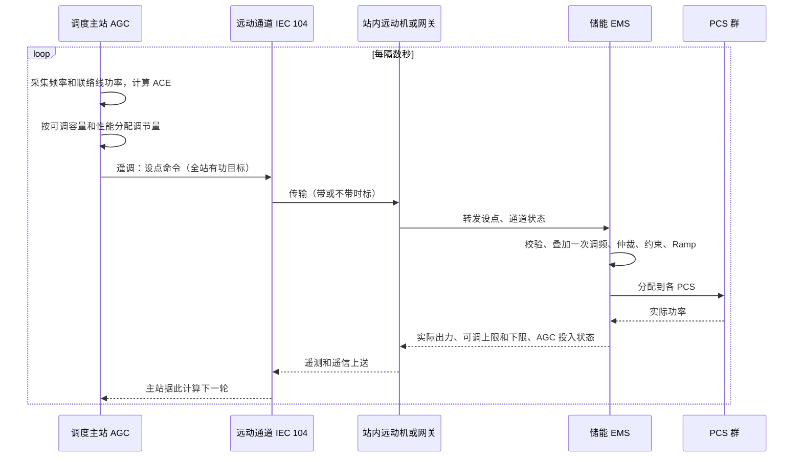
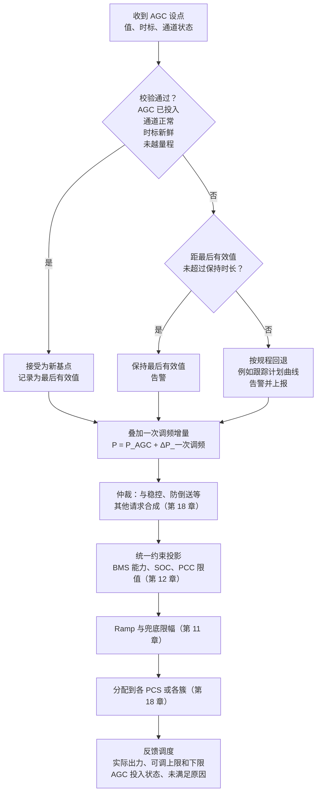
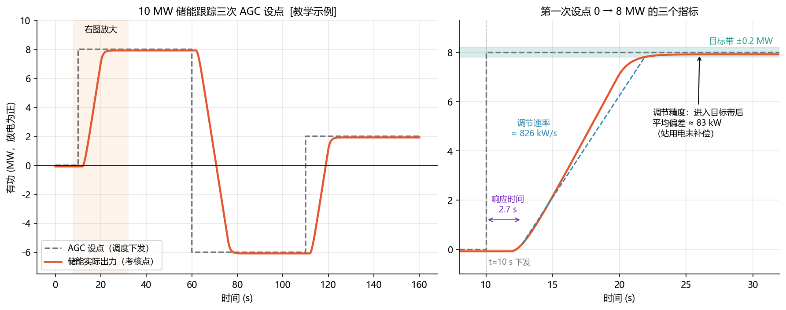
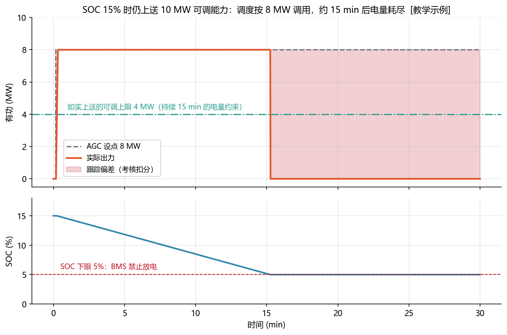
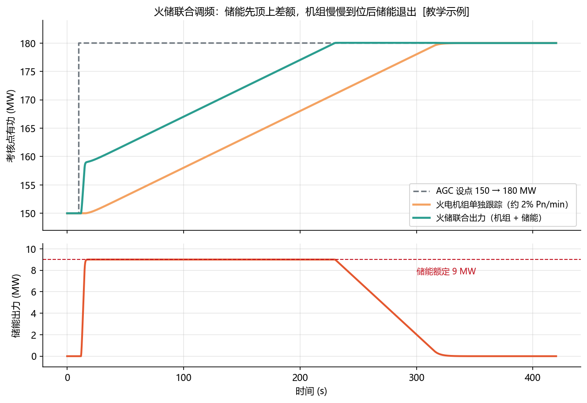
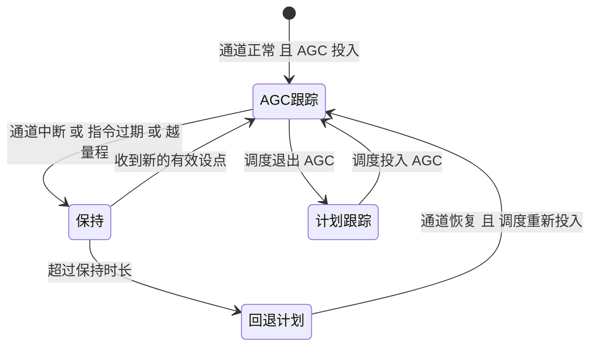

<!-- @AI_GENERATED -->
# 16 AGC 二次调频、储能跟踪与调度考核

> [课程首页](README.md) · 上一章：[15 电网频率响应与储能一次调频](15_频率与一次调频.md) · 下一章：[17 无功电压与 AVC](17_无功电压与AVC.md)

**一句话**：AGC 是调度主站周期性下发的有功设点，用来恢复频率和联络线计划；储能必须同时保证跟踪性能、真实可调能力和持续电量。

## 本章目标

读完本章，你应能：

1. 按约定计算 ACE，识别符号和单位差异；
2. 校验归一化/标度化 AGC 设点、时标、通道状态和保持/回退；
3. 把 AGC 基点与一次调频叠加，经仲裁、约束、Ramp 和 PCS 分配形成执行指令；
4. 计算响应时间、调节速率、调节精度、教学版综合指标和 SOC 约束下的真实可调能力。

## 本章边界与规则来源

本章的 ACE、考核指标和综合公式均为教学约定，不能替代当地“两个细则”、辅助服务市场规则或调度结算公式。章节实现聚焦站内接收校验、能力计算、教学跟踪仿真、事件记录和离线回放；不实现 IEC 104 协议栈、调度主站资源分配器和生产级联合控制。所有参数以当地规则和项目协议为准。

**前置**：第 15 章（调频分层、一次调频）、第 11 章（Ramp、限幅）、第 10 章（点表缩放与数据质量）。


---

## 16.1 现场场景【必懂】

某储能电站 10 MW / 20 MWh，投运第一个月参加 AGC。月底调度中心发来考核结果：调节速率很好，响应时间也很好，综合性能却只排在中游，还有几次被判“调节不合格”。

翻看记录发现三件事：一是并网点出力总比设点低 80 kW 左右，原因是站用电没有补偿；二是有一天下午 SOC 只剩 15%，EMS 仍向调度上送“可调上限 10 MW”，调度按 8 MW 调用，15 分钟后电池放空，出力归零；三是一次通道闪断后，EMS 一直执行一个 3 分钟前的旧设点。

这些都不是控制算法有多难，而是 EMS 对 AGC 这条链路的每一环有没有想清楚。本章把这条链路从调度主站一直讲到 PCS。

---

## 16.2 一次调频之后，为什么还要 AGC【必懂】

第 15 章讲过，一次调频按频率偏差比例出力，功率重新平衡时，**必须还剩一点频率偏差**来“维持”这份出力，所以频率停在一个低于 50 Hz 的准稳态。另外，一次调频是全网所有机组一起动作：A 省的机组跳闸，B 省、C 省的机组也在帮忙出力，联络线上的功率就偏离了双方约定的交换计划。

二次调频要解决的就是这两件事：

1. **频率回到 50 Hz**；
2. **联络线功率回到计划值**，也就是“谁的缺口谁来补”，把邻省帮忙多送的功率还回去。

做法是由调度主站统一计算，再把新的有功设点下发给参与 AGC 的电站。电站按设点增减出力后，一次调频的出力随着频率恢复而自然回到 0，“备用”被释放出来，准备应对下一次事故（第 15 章 15.5 的分层图最右侧）。


| | 一次调频 | 二次调频（AGC） |
|---|---|---|
| 谁决定出力 | 电站自己，看本地频率 | 调度主站，看全区域 ACE |
| 需要通信吗 | 不需要 | 需要调度远动通道 |
| 能消除频率偏差吗 | 不能 | 能 |
| 储能收到什么 | 频率测量值（本地） | 有功设点（遥调） |
| 在 EMS 里的形态 | 叠加增量 ΔP | 覆盖型基点 P_AGC |

> **软件类比**：一次调频像每个服务实例上的**本地限流器**，发现过载就自己按比例降级，但降级状态会一直保持；AGC 像**控制平面的自动扩缩容**，汇总全局指标后下发新的副本数，把系统拉回目标状态，本地限流器随之解除。
>
> **类比失效点**：扩缩容慢一点只是体验变差，AGC 跟踪慢了，频率偏差持续时间变长，电网安全裕度就一直被占用。而且 AGC 的“副本数”是连续的功率值，还要受电池电量这个会被耗尽的资源限制。

---

## 16.3 区域控制偏差 ACE【了解】

主站怎么知道“本区域该多发多少”？看**区域控制偏差 ACE**（Area Control Error）。一种常见形式是：

```text
ACE = ΔP_tie + B × Δf
```

| 符号 | 含义 | 单位 | 本节约定 |
|---|---|---|---|
| ΔP_tie | 联络线实际净送出 − 计划净送出 | MW | 送出为正 |
| Δf | 实测频率 − 50 Hz | Hz | 频率高为正 |
| B | 频率偏差系数：本区域“应该”为频率偏差承担多少功率 | MW/Hz | 取正数 |
| ACE | 大于 0 表示本区域发电偏多，小于 0 表示偏少 | MW | 本区域需要增发的量 = −ACE |

**手算一：本区域机组跳闸**（B = 1000 MW/Hz，`[教学示例]`）。频率跌到 49.95 Hz（Δf = −0.05 Hz），邻区一次调频帮忙，联络线比计划多受入 30 MW（ΔP_tie = −30 MW）：

```text
ACE = −30 + 1000 × (−0.05) = −80 MW    → 本区域缺 80 MW，AGC 要增发 80 MW
```

**手算二：邻区机组跳闸**。频率同样跌到 49.95 Hz，本区域机组一次调频多发了 50 MW，全部经联络线送给了邻区（ΔP_tie = +50 MW）：

```text
ACE = +50 + 1000 × (−0.05) = 0         → 不是本区域的缺口，本区域 AGC 不动
```

第二个例子体现了这种控制方式（常称联络线功率频率偏差控制，TBC）的设计思想：**各区域只补自己的缺口**，邻区的一次调频帮忙只是临时的，等邻区 AGC 补上缺口后自然退出。

**符号约定因电网而异**。有的教材和标准把 B 取成负数，写成 `ACE = ΔP_tie − 10B × Δf`（B 单位 MW/0.1 Hz）；有的把 ΔP_tie 定义成受入为正。算出来的物理含义相同，但符号可能完全相反。EMS 一般不直接计算 ACE，但如果要做仿真或和调度对数据，**先对齐符号定义再比较数字**。

> 【了解】除了 TBC，还有只看频率的定频率控制（FFC）和只看联络线的定联络线功率控制（FTC）。选哪种、B 取多少，由调度根据电网结构决定，和储能站的 EMS 实现无关。

---

## 16.4 调度主站如何计算并下发指令【必懂】

主站 AGC 程序大致按下面的节奏工作：

1. **每隔数秒**采集频率和各联络线功率，计算 ACE `[行业典型值：周期为数秒量级，以调度系统为准]`；
2. 对 ACE 做滤波，并按大小分区处理（偏差小时不动作，偏差大时加大调节力度）；
3. 把需要调整的总量，按各电站的**可调容量、调节速率、历史性能**等分配下去；
4. 通过**远动通道**把每个电站的新设点下发出去；
5. 采集电站上送的实际出力，判断跟踪情况，并用于考核。



### 遥调在 IEC 104 里长什么样【了解】

IEC 60870-5-104 用**设点命令**传遥调值，常见三种编码：

| 类型 | 含义 | EMS 要注意 |
|---|---|---|
| 归一化值 | −1～+1 之间的小数，乘以约定的满量程得到工程值 | 满量程是全站容量还是其他值，必须在点表写明 |
| 标度化值 | 16 位整数，乘以系数得到工程值 | 系数（例如 1 个单位 = 10 kW）配错会整体放大或缩小 |
| 短浮点值 | 直接是工程值 | 单位是 kW 还是 MW |

另外还有带时标的版本，以及“选择-执行”两步操作的方式。具体用哪一种、是否带时标、方向如何定义，都写在**调度点表和并网调度协议**里，由远动专业人员与调度核对，EMS 严格照着实现（第 10 章）。

> 设点的语义也要确认：大多数项目下发的是**全站有功目标值**（绝对值），不是“增加多少”的增量；考核点通常在并网点或主变高压侧的关口计量处，而不是 PCS 出口。

---

## 16.5 储能站收到 AGC 设点后的处理链【必懂】

收到设点只是开始。一条设点从远动机到 PCS 要经过下面这些环节，每一环都有它要防的问题：



| 环节 | 防的是什么 | 实现要点 |
|---|---|---|
| 校验 | 越量程、缩放错、NaN、旧指令 | 按点表校验范围；**用时标和通道状态判断新鲜度**，不要用“寄存器被写过”判断 |
| 保持/回退 | 通道闪断时乱动 | 保持时长、回退目标按调度规程配置 |
| 叠加一次调频 | 两个服务互相覆盖 | AGC 是基点，一次调频是增量；考核时一次调频贡献是否剔除，以细则为准 |
| 仲裁 | 与其他服务冲突 | 冲突时削减的部分要记录原因（第 18 章） |
| 约束 | 超出电池/PCS 能力、SOC 越限 | 对**合成后的总量**统一投影一次 |
| Ramp | 功率突变冲击电网和设备 | Ramp 不能慢到拖累调节速率考核，也不能快过并网要求 |
| 分配 | 离线 PCS、单机越限 | 按能力或 SOC 分配，分不完的部分上报 |
| 反馈 | 调度按错误能力调用 | 可调上限/下限要反映真实的功率和电量能力（16.8） |

### 代码：设点接收与校验

```python
# lab/ems_lab/agc.py（节选）
class AgcReceiver:
    def update(self, now, value_kw, stamp_s, link_ok=True, agc_enabled=True, schedule_kw=0.0):
        if not agc_enabled:
            return AgcSetpoint(schedule_kw, "AGC_OFF", "AGC 未投入：跟踪计划")
        if not link_ok or value_kw is None:
            return self._hold_or_fallback(now, schedule_kw, "调度通道中断")
        if stamp_s is None or now - stamp_s > self.cfg.max_age_s:
            # “寄存器在刷新”不等于“指令是新的”：以指令时标/通道状态判断
            return self._hold_or_fallback(now, schedule_kw, "指令时标过旧")
        if not self.cfg.p_min_kw <= value_kw <= self.cfg.p_max_kw:
            return self._hold_or_fallback(now, schedule_kw, f"设点 {value_kw:.0f} kW 越量程")
        self.last_valid_kw, self.last_valid_at = value_kw, now
        return AgcSetpoint(value_kw, "ACCEPTED", "有效设点")
```

越量程的设点**不要 clamp 成边界值去执行**。10 倍缩放错误的设点被 clamp 到满功率，看起来“在范围内”，实际是在执行一个错误指令。正确做法是拒绝、保持上一个有效值并告警。

---

## 16.6 调度考核：跟得快、跟得准、动得早【必懂】

### 依据

AGC 的考核和补偿，依据是国家能源局《电力并网运行管理规定》《电力辅助服务管理办法》，以及各区域、各省据此制定的实施细则（业内常称“两个细则”）和调频辅助服务市场规则。**指标定义、计算窗口、合格阈值、综合公式和补偿标准都以当地最新细则为准**，不同区域差别很大，而且会修订。本节只讲这些指标在衡量什么、EMS 怎么影响它们。

### 三个基本指标



图中标注对照表：

| 编号 | 位置 | 标注 | 对应正文 |
|---|---|---|---|
| ① | AGC阶跃 | 0→8 MW、t=10 s、延迟 2 s | 理想跟踪输入 |
| ② | 目标带 | ±0.2 MW、200 kW | 判定带 |
| ③ | 指标标注 | 响应约 2.7 s、速率约 826 kW/s、精度约 83 kW | 真实因素示例 |

| 指标 | 衡量什么 | 本课程的教学定义 `[教学示例]` | EMS 的影响因素 |
|---|---|---|---|
| 响应时间 | 动得早不早 | 从设点变化，到出力朝目标方向离开起点 ±判定带 | 通信延迟、EMS 周期、校验逻辑、PCS 启动 |
| 调节速率 | 跟得快不快 | 离开起点带到进入目标带之间的平均变化速率 | Ramp 配置、PCS 响应、一阶惯性 |
| 调节精度 | 跟得准不准 | 进入目标带后，实际出力与设点的平均偏差 | 站用电补偿、闭环修正、测量点是否一致 |

**手算：理想情况**（10 MW 储能，判定带 ±200 kW 即 2% Pn，`[教学示例]`）。t = 10 s 调度把设点从 0 改为 8000 kW，通信和 EMS 周期共延迟 2 s，Ramp 1000 kW/s，PCS 无惯性、无稳态偏差：

```text
响应时间 = 延迟 + 离开起点带所需时间 = 2 + 200 / 1000 = 2.2 s
进入目标带时刻 = 2 + (8000 − 200) / 1000 = 9.8 s（相对下发时刻）
调节速率 = (7800 − 200) / (9.8 − 2.2) = 1000 kW/s
调节精度 = 0 kW
```

**加上真实因素**（PCS 一阶惯性 τ = 1 s，站用电 80 kW 未补偿，考核点在并网点）：`simulate_tracking` 算得响应时间约 2.7 s，平均调节速率约 826 kW/s，调节精度约 83 kW。上图右侧就是这一段。

一阶惯性把速率拉低了约 17%，站用电让精度从 0 变成 83 kW。后者完全是 EMS 能消除的：以**考核点的实测功率**为目标做闭环修正（第 11 章 PI + 前馈），而不是只把设点原样转发给 PCS。

### 综合调频性能指标

各地通常把几个分项指标合成一个**综合调频性能指标**，用于排序、考核和补偿。一个只用来理解结构的例子：

```text
[教学示例]  k1 = 实际调节速率 / 标准速率        （封顶，防止速率一项独大）
            k2 = 1 − 调节偏差 / 允许偏差       （不低于 0）
            k3 = 1 − 响应时间 / 标准响应时间    （不低于 0）
            综合指标 = k1 × k2 × k3
```

**手算**（取整后的数字）：速率 800 kW/s、标准 500 kW/s → k1 = 1.6；精度 80 kW、允许 200 kW → k2 = 0.6；响应 2.5 s、标准 10 s → k3 = 0.75；综合指标 = 1.6 × 0.6 × 0.75 = **0.72**。

可以看到，在“相乘”的结构下，**任何一项差都会把整体拉下来**。储能的速率和响应时间天然有优势，精度却常常因为站用电、测量点不一致而吃亏，这正是 16.1 那座电站排名中游的原因。

> 部分地区的调频辅助服务按“调节里程 × 综合性能指标 × 价格”一类的方式结算，性能指标直接影响收入。具体结算公式、系数和上下限以当地规则为准，这里只说明“性能指标会乘进收入”这个关系。

---

### 最小闭环：AGC 设点如何变成考核指标

输入一个 8000 kW 阶跃设点，模型包含 2 s 通信延迟、1000 kW/s Ramp，最终得到：

| 阶段 | 输出 |
|---|---:|
| AGC 目标 | 8000 kW |
| 响应时间 | 2.0 s |
| 调节速率 | 1000 kW/s |
| 调节精度 | 0 kW |
| `k1`（相对 500 kW/s） | 2.00 |
| `k2`（允许误差 200 kW） | 1.00 |
| `k3`（标准 10 s） | 0.80 |
| 综合 `kp` | 1.60 |

完整链路是：

```text
AGC 设点
→ 延迟/Ramp/设备响应
→ 实际出力序列
→ evaluate_step
→ response_time / rate / accuracy
→ performance_index
```

对应脚本：`lab/examples/ch16_agc_trace.py`。


| 特点 | 燃煤机组 | 电池储能 |
|---|---|---|
| 调节速率 | 每分钟额定功率的百分之一到几 `[行业典型值]` | 秒级即可走完全功率 |
| 响应时间 | 数十秒量级 `[行业典型值]` | 主要是通信和 EMS 周期，数秒以内 |
| 调节精度 | 有超调、滞后、稳态波动 | 基本按设点输出 |
| 双向调节 | 受最低稳燃负荷和锅炉蓄热限制 | 可以从满放切到满充 |
| 持续能力 | 燃料充足就能持续 | **受电量限制** |

## 16.7 SOC 与持续能力：AGC 不是无限能量

最后一行是储能参与 AGC 的核心约束。AGC 指令不是围绕 0 对称波动的：负荷持续爬坡的时段，设点会长时间偏向放电；夜间负荷下降时，可能长时间偏向充电。SOC 会一路漂移，直到撞上限值。



图中标注对照表：

| 编号 | 位置 | 标注 | 对应正文 |
|---|---|---|---|
| ① | 能力上限 | 4 MW（持续15分钟的电量约束） | SOC 15%真实可调上限 |
| ② | AGC调用 | 8 MW | 调度调用设点 |
| ③ | SOC边界 | 20 MWh、15%起步、5%下限、约15 min | 电量耗尽与禁止放电 |

上图：SOC 15% 起步，调度按 8 MW 调用，约 15 分钟后 SOC 到达 BMS 下限 5%，放电被禁止，出力从 8 MW 掉到 0。此后每一个考核周期都是“调节不合格”，而且调度在这段时间里以为自己手上有 8 MW 调节资源，实际一点都没有。

应对措施：

1. **如实上送可调能力**（16.8），让调度在分配时就少分；
2. **SOC 恢复**：在调度规程允许的前提下，利用设点方向、非考核时段或计划曲线把 SOC 拉回中间区间，恢复过程本身要按规程申报或获得许可；
3. **提前降额**：SOC 接近限值时逐步收窄可调范围，而不是到限值才一刀切，避免出力断崖；
4. **记录**：SOC 导致的能力受限要带时标记录，便于和调度核对考核结果。

---

## 16.8 上送调度的可调能力必须真实【必懂】

调度分配 AGC 调节量时，依据的是电站上送的**可调上限、可调下限**（以及 AGC 投入状态、远方/就地状态）。上送的数字虚高，调度就会分配电站做不到的任务；上送偏低，电站白白损失调节收益。两种错误都不可接受。

可调能力要同时满足功率约束和电量约束：

```text
可调上限 = min( 当前可放功率, (SOC − SOC_下限) × 额定容量 ÷ 要求持续时间 )
可调下限 = −min( 当前可充功率, (SOC_上限 − SOC) × 额定容量 ÷ 要求持续时间 )
```

**手算**：10 MW / 20 MWh，SOC 15%，运行下限 10%、上限 90%，要求能以上报功率持续 15 分钟（0.25 h），参数均为 `[教学示例]`：

```text
放电方向：(0.15 − 0.10) × 20000 ÷ 0.25 = 4000 kW；与可放功率 10000 kW 取小 → 可调上限 +4000 kW
充电方向：(0.90 − 0.15) × 20000 ÷ 0.25 = 60000 kW；与可充功率 10000 kW 取小 → 可调下限 −10000 kW
```

应该上送 `[−10 MW, +4 MW]`，而不是 `[−10 MW, +10 MW]`。16.7 的事故就是后一种。

“要求持续时间”是否有、取多少，SOC 运行上下限怎么定，由调度要求和项目配置决定。这里要记住的原则是：**上送的能力 = EMS 真正能兑现的能力**，并且和第 05 章的能力模型、第 12 章的约束用同一套数据，不要在上送接口里另写一套估算。

---

## 16.9 火储联合调频【了解】

国内较早的储能调频项目多是**火储联合**：储能装在火电厂内，与机组共用一个考核关口。调度下发的仍是“机组（联合体）”的设点，储能负责补上“设点 − 机组实际出力”的差额。机组慢慢爬坡时储能先顶上去，机组到位后储能逐步退出。



图中标注对照表：

| 编号 | 位置 | 标注 | 对应正文 |
|---|---|---|---|
| ① | 火电机组 | 150→180 MW、约2% Pn/min | 机组慢速爬坡 |
| ② | 储能 | 9 MW | 联合调频储能能力 |
| ③ | 联合出力 | 300 MW机组 + 储能先顶差额 | 火储协同过程 |

上图：300 MW 机组以约 2% Pn/min 从 150 MW 升到 180 MW，配 9 MW 储能。联合出力在头几秒就跳上去了 9 MW，调节速率和响应时间指标大幅改善；机组到位后储能出力回到 0。

几个需要知道的结论：

- 储能容量通常只有机组的几个百分点，只能改善**动态过程**，改变不了机组的稳态能力；
- 储能补差额会持续消耗电量，差额长时间同向时同样会遇到 SOC 问题，需要与机组协调控制策略；
- 考核关口、计量方式、联合体的申报参数，以电厂与调度的并网协议为准；
- 控制逻辑常放在厂内专门的联合控制装置或 EMS 中，需要读取机组实时出力，数据延迟会直接影响补偿效果。

---

## 16.10 通信中断时怎么办【必懂】

调度通道中断时，EMS 手里只剩最后一个有效设点。继续执行它还是回退，**不是 EMS 开发者自己决定的**，要按调度规程和并网调度协议执行。常见的做法有：保持最后有效值一段时间，超时后回退到日前/日内计划曲线，或退出 AGC 并通知调度。



实现要点：

- 保持时长、回退目标、恢复条件都做成配置，数值来自规程；
- “通道恢复”不等于“马上跟踪新设点”：有的规程要求调度确认后才重新投入，恢复瞬间设点和实际出力可能相差很大，仍要经过 Ramp；
- 状态变化要上送遥信并记录事件，调度需要知道电站“此刻在不在 AGC 控制下”；
- 一次调频是本地功能，**不因调度通道中断而退出**（除非规程另有规定）。

---

## 16.11 代码：跟踪仿真与指标计算【必懂】

`lab/ems_lab/agc.py` 用最简单的模型把 AGC 链路串起来：设点序列 → 延迟 → 限幅与 Ramp → 一阶惯性 → 考核点出力，再用教学版定义算指标。

```python
# lab/ems_lab/agc.py（节选）
def simulate_tracking(commands, model, t_end_s, dt=0.1, p0_kw=0.0):
    ...
    for k in range(n):
        p_cmd[k] = command_at(commands, t[k], p0_kw)
        seen = command_at(commands, t[k] - model.delay_s, p0_kw)  # 延迟后才“看到”新设点
        dis_cap = 0.0 if soc <= model.soc_min else model.p_rated_kw  # SOC 到限，放电能力归零
        chg_cap = 0.0 if soc >= model.soc_max else model.p_rated_kw
        target = limit_then_ramp(seen, ramp, dt, chg_cap, dis_cap)   # 复用第 11 章
        p_exec += (target - p_exec) * min(1.0, dt / model.tau_s)      # PCS 一阶惯性
        soc -= p_exec * dt / 3600.0 / model.energy_kwh
        p_act[k] = p_exec + model.offset_kw                           # 考核点 = PCS 出力 + 偏差
    ...


def evaluate_step(t, p_act, t_cmd_s, t_next_s, p_start_kw, p_target_kw, band_kw):
    """响应时间、调节速率、调节精度。定义均为 [教学示例]。"""
    ...
```

| 函数 | 用途 |
|---|---|
| `ace_mw` | ACE = ΔP_tie + B·Δf（B 取正数的约定） |
| `decode_scaled` / `decode_normalized` | 遥调原始值 → 工程值 |
| `AgcReceiver` | 设点校验、保持、回退 |
| `regulation_capability` | 可调上限/下限（功率 + 电量约束） |
| `simulate_tracking` / `evaluate_step` / `performance_index` | 跟踪仿真与教学版指标 |
| `simulate_thermal_bess` | 火储联合（教学简化） |

配套验证覆盖了本章主要手算例子；在真实项目里，同样的指标计算可以拿来**离线回放**现场数据：调度考核结果出来之前，EMS 自己先算一遍，偏差大的时段立刻去查原因。

---

## 16.12 常见误区【必懂】

| 误区 | 正确理解 |
|---|---|
| AGC 设点就是 PCS 指令 | 设点是全站考核点的目标，要叠加一次调频、仲裁、约束、分配，并对考核点闭环修正 |
| 越量程的设点 clamp 一下就能执行 | 越量程说明编码、缩放或方向错了，应拒绝并保持上一有效值 |
| 寄存器在刷新，指令就是新的 | 网关可能在重复写缓存值，要看指令时标和通道状态 |
| 可调能力就是 PCS 额定功率 | 还要受 BMS 能力和剩余电量约束，SOC 低时要如实降低 |
| 储能速率快，考核一定好 | 综合指标常是各项相乘，精度差同样会拉低整体 |
| 通信中断后保持最后设点最安全 | 保持多久、回退到哪里由调度规程规定 |

## 16.13 现场真实故障【必懂】

**案例一：AGC 指令方向约定反。**
新站联调，调度下发“+5 MW”，储能开始以 5 MW 充电。调度点表按“发电为正”定义，而站内网关按 PCS 厂家“充电为正”的习惯做了转发，EMS 接入层没有换算。
**教训**：调度侧、网关、EMS、PCS 各自的方向约定逐一列表核对；上线前做**小功率双向阶跃试验**，调度看到的遥测方向与设点方向一致才能投入。方向换算只在接入层做一次（第 00 章 0.8）。

**案例二：遥调量程/缩放系数错。**
调度用归一化值下发，满量程约定为全站 10 MW，网关配置里误填了单台 PCS 的 2.5 MW。调度下发 0.8（即 8 MW），EMS 得到 2 MW，跟踪偏差持续 6 MW。另一个站相反，标度化系数多了一个 10 倍，设点被 EMS 的范围校验拦截才没有出事。
**教训**：满量程、系数、单位写进点表并由双方签字确认；接入层做范围校验，越量程拒绝执行并告警；用“调度下发值 − EMS 接收值”的比对作为联调检查项。

**案例三：指令刷新了，但时间戳是旧的。**
远动机与调度的通道中断，但远动机仍每秒把缓存的最后设点写入 EMS 的寄存器。EMS 只检查“寄存器是否在更新”，以为指令正常，持续执行 3 分钟前的设点。调度侧早已判定该站“通道中断”，并把调节量分给了其他电站，结果两边同时在调。
**教训**：新鲜度以**指令时标**和**通道状态**为准；时标过旧或通道状态异常时，进入“保持 → 回退”流程并告警（第 10 章数据质量）。

**案例四：SOC 耗尽导致考核扣分。**
即 16.1 和 16.7 的情况。EMS 上送的可调上限直接取 PCS 额定功率，没有考虑剩余电量。SOC 15% 时被调度按 8 MW 调用，15 分钟后放空，此后几十个考核周期全部不合格。
**修复**：可调上限/下限同时计算功率约束和电量约束；SOC 接近限值时提前收窄；按规程安排 SOC 恢复；能力受限事件带时标记录。

---

## 16.14 自测

1. 一次调频已经把频率稳住了，为什么还需要 AGC？AGC 要把哪两个量拉回计划值？
2. B = 800 MW/Hz，频率 49.96 Hz，联络线比计划多送出 32 MW，按本章约定 ACE 是多少？本区域 AGC 应该怎么动？
3. 调度用归一化值 0.6 下发设点，满量程 20 MW，工程值是多少？如果网关把满量程配成了 5 MW，EMS 会得到多少？
4. 延迟 1.5 s、Ramp 500 kW/s、无惯性，设点从 0 改为 4000 kW，判定带 100 kW。按本章教学定义，响应时间、进入目标带的时间、调节速率分别是多少？
5. 为什么站用电没有补偿会影响调节精度？EMS 应该怎么做？
6. 20 MW / 40 MWh 储能，SOC 20%，运行下限 10%，要求持续 30 分钟，可放功率 20 MW，可调上限应上送多少？
7. 调度通道中断时，EMS 能不能自己决定“保持最后设点 10 分钟”？一次调频要不要跟着退出？

<details>
<summary>参考答案</summary>

1. 一次调频按频率偏差比例出力，功率平衡时仍需要一个非零偏差来维持出力，所以频率回不到 50 Hz；而且全网机组都在一次调频，联络线功率偏离了计划。AGC 把**频率**和**联络线交换功率**拉回计划值。
2. ACE = 32 + 800 × (−0.04) = 0。频率偏低但本区域多送出的正好是按 B 应承担的份额，说明缺口在邻区，本区域 AGC 不动作。
3. 0.6 × 20 = 12 MW；满量程配成 5 MW 时得到 0.6 × 5 = 3 MW，比调度要求少 9 MW。
4. 响应时间 = 1.5 + 100/500 = 1.7 s；进入目标带（3900 kW）= 1.5 + 3900/500 = 9.3 s；调节速率 = (3900 − 100)/(9.3 − 1.7) = 500 kW/s。（离散仿真会有一个采样周期的误差。）
5. 考核点在并网点，站用电消耗的功率让并网点出力比 PCS 出力少一截，稳态偏差一直存在。EMS 应以考核点实测功率为目标做闭环修正（前馈补站用电 + PI 修正剩余误差），而不是把设点原样转发给 PCS。
6. 电量约束：(0.20 − 0.10) × 40 000 ÷ 0.5 = 8000 kW，与可放 20 000 kW 取小，上送 +8 MW。
7. 不能。保持时长、回退目标和恢复条件由调度规程和并网调度协议规定，EMS 按配置执行。一次调频是本地功能，一般不因调度通道中断退出，除非规程另有规定。

</details>

---

## 16.15 深入【深入】

<details>
<summary>ACE 的另一种常见写法</summary>

北美 NERC 体系常写成：

```text
ACE = (NI_A − NI_S) − 10B × (F_A − F_S)
```

NI 为净交换功率（送出为正），F 为频率，下标 A 为实际、S 为计划；B 为频率偏差设定值，单位 MW/0.1 Hz，**取负数**。于是 `−10B` 为正，和本章 `+B` 的写法物理含义一致。国内教材和调度系统也有各自的写法。结论仍然是：比较数字之前先对齐符号和单位。

</details>

<details>
<summary>为什么 B 要接近区域的“自然频率响应”</summary>

区域的自然频率响应系数 β（MW/Hz）= 负荷阻尼 + 所有机组一次调频的等效增益。邻区事故时，本区域一次调频多送出的功率约为 `β × |Δf|`。如果 B = β，ACE 恰好为 0，本区域 AGC 不会误动（16.3 手算二）。B 设得偏离 β 太多，邻区事故时本区域 AGC 也会跟着动，要么“帮倒忙”，要么过早撤回一次调频的支援。所以 B 的取值由调度根据实测频率响应特性定期整定。

</details>

<details>
<summary>主站 AGC 的分区控制思路</summary>

主站通常把 ACE 的大小分成几个区域：偏差很小时不调节（避免机组来回小幅动作）；偏差在正常范围内时按常规速率调节；偏差大时加大调节力度，甚至调用所有可调资源。各区的边界和策略由调度整定，属于主站的实现细节。EMS 能感知到的只是：不同时段下发设点的变化幅度和频度不同。仿真测试时可以用“小幅频繁变化”和“大幅阶跃”两类设点序列分别考察跟踪性能（第 19 章）。

</details>

<details>
<summary>EMS 周期、通信延迟与响应时间预算</summary>

从主站发出设点到考核点出力开始变化，延迟由几段组成：主站到站内远动机的通道传输、远动机到 EMS 的转发（常是轮询，等待时间最长可达一个轮询周期）、EMS 控制周期（最坏一个周期）、EMS 到 PCS 的下发、PCS 自身的响应。把每一段的最坏值加起来，就是响应时间的下限。**缩短轮询周期、设点变化时立即触发一次控制计算**（事件驱动而不是只靠固定周期），往往比优化算法更有效（第 09、10 章）。

</details>

<!-- @AI_GENERATED: end -->
