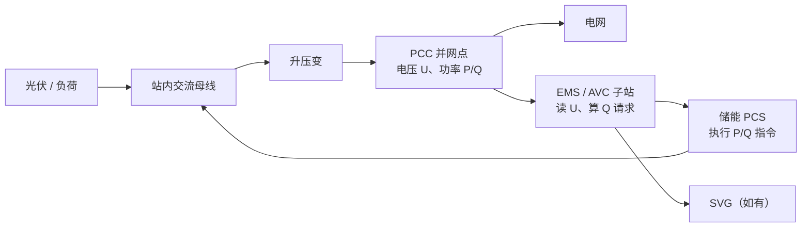
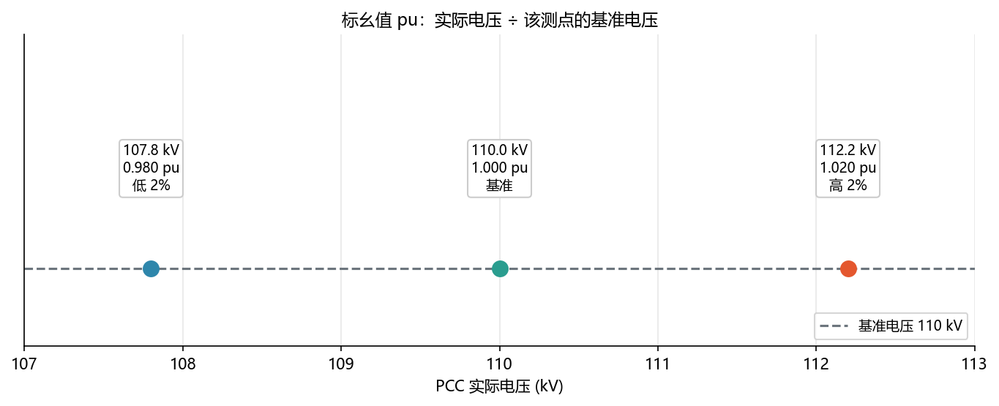
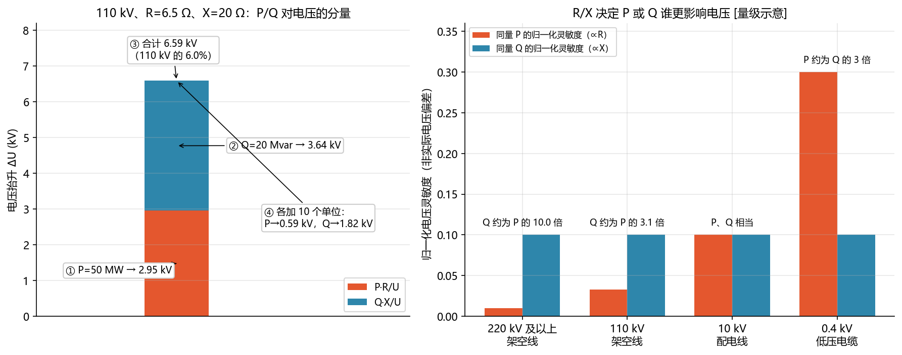
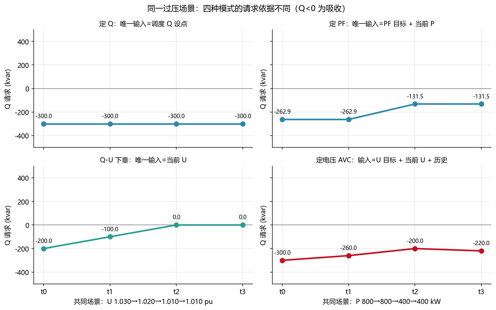
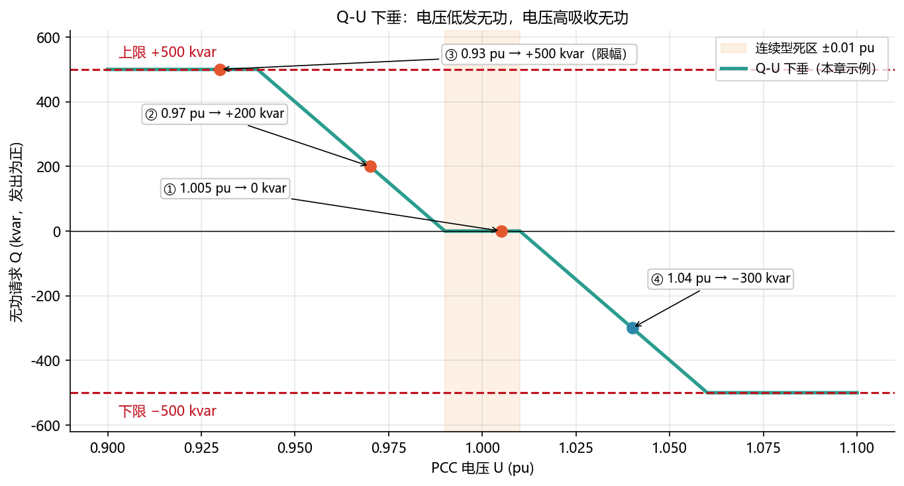
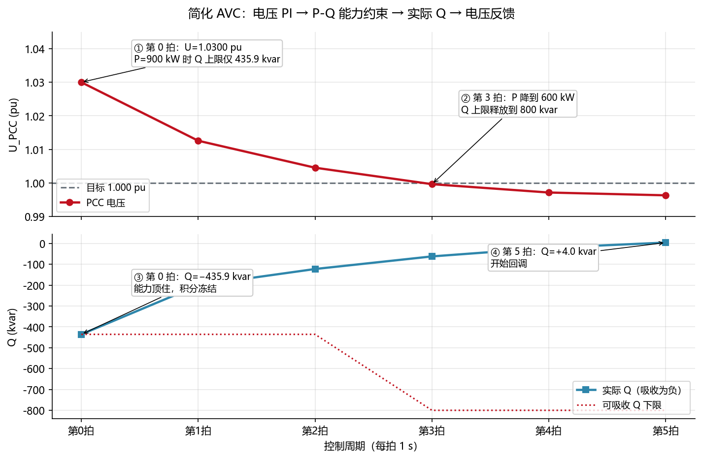
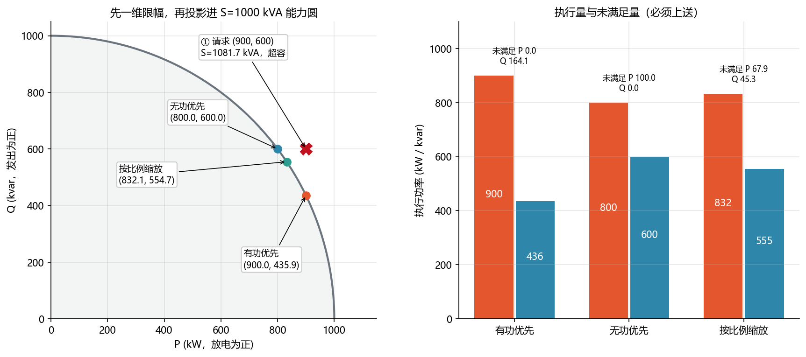

<!-- @AI_GENERATED -->
# 17 无功电压控制与 AVC：从 Q-U 下垂到 P-Q 能力投影

> [课程首页](README.md) · 上一章：[16 AGC 二次调频、储能跟踪与调度考核](16_AGC与调度考核.md) · 下一章：[18 EMS 命令仲裁与多 PCS 功率分配：从服务请求到可审计执行](18_命令仲裁与功率分配.md)

## 本章目标与边界

读完本章，你应能：

1. 统一 P/Q/pu 方向，解释 PCC 电压与无功请求的关系；
2. 计算定 Q、定 PF、Q-U 下垂和定电压 AVC 的请求；
3. 处理 PI、抗积分饱和、数据失效冻结和 P-Q 能力投影；
4. 区分本章请求生成与第 18 章多服务仲裁/多设备分配的职责。

本章的 `AvcController` 是教学级子站内环，不包含远动规约、PCS/SVG 多设备分配、OLTC 协调、方向反常闭锁或现场整定；现场以调度协议、接入批复、PCS 手册和点表为准。所有数值为 `[教学示例]`。


---

## 17.0 先看一座站：谁测量，谁控制【必懂】



| 对象 | 白话解释 | 本章的角色 |
|---|---|---|
| 并网点（Point of Common Coupling，PCC） | 场站与电网的交界处 | AVC 最关心的电压测点 |
| 储能变流器（PCS） | 把电池直流变成交流、执行功率命令 | 最终执行 P/Q 的设备 |
| 自动电压控制（Automatic Voltage Control，AVC）子站 | 场站内的电压控制程序/装置 | 根据 PCC 电压生成 Q 请求、分配和上送 |
| 静止无功发生器（SVG） | 专门快速发/吸无功的设备 | 不占 PCS 有功容量的无功资源 |
| 有载调压分接头（OLTC） | 能改变变压器变比的慢设备 | 调整长期电压水平 |

**一条控制链**：`PCC 电压 → 选择控制模式 → Q 请求 → P-Q 能力校核 → PCS/SVG 执行 → 实际 P/Q 回读 → 下一拍控制与上送`。

---

## 17.1 先过单位关：P、Q、S、PF 和 pu【必懂】

| 量 | 白话解释 | 单位 | 本章用途 |
|---|---|---|---|
| P | 真正输送/消耗能量的功率 | kW、MW | AGC、计划、放电任务 |
| Q | 用于建立电磁场、可影响电压的功率 | kvar、Mvar | AVC 的主要执行手段 |
| S | PCS 总电流允许的“总容量” | kVA、MVA | P 和 Q 共同争抢的上限 |
| PF | P 在 S 中的比例 | 无 | 定 PF 模式的目标 |
| pu | 相对基准值的比例单位 | 无 | 电压控制常用单位 |

本章统一：**储能向电网发出无功为正（Q>0），从电网吸收无功为负（Q<0）**。电压低通常要发无功；电压高通常要吸收无功。

### pu 是什么

不同站的 PCC 可能是 10、35 或 110 kV。控制算法若直接写 kV，参数难以比较；所以用实际电压除以该测点基准电压：

```text
u_pcc_pu = u_pcc_kv / u_base_kv
```



图中标注对照表：

| 编号 | 位置 | 标注 | 对应正文 |
|---|---|---|---|
| — | 左点 | 107.8 kV，0.98 pu，低 2% | 换算示例 |
| — | 中点 | 110 kV，1.0 pu，基准 | 换算示例 |
| — | 右点 | 112.2 kV，1.02 pu，高 2% | 换算示例 |

记住：`1.000 pu` 是基准，`0.010 pu` 是 1%，`1.030 pu` 是高 3%。因此后文的“死区 ±0.01 pu”就是“目标电压上下 ±1% 内不动作”。

---

## 17.2 共同业务场景：午后 PCC 电压偏高【必懂】

午后光伏大发，场站向电网送出大量有功，110 kV PCC 从 1.000 pu 升到 1.030 pu。调度要求场站参与调压。储能正在执行 AGC 放电任务，同时可通过**吸收无功（Q<0）**帮助降低 PCC 电压。

本章所有模式都放入这个场景：它们都可能产生 Q 请求，但**产生请求的依据不同**。

---

## 17.3 为什么调 Q 能影响 PCC 电压【必懂】

### 为什么需要

要理解为什么“电压高就吸收无功”，先要知道无功不是任意命令；它通过线路阻抗影响站侧和电网侧之间的电压差。

### 作用

下面近似式用于解释方向和做 AVC 前馈初值；它不是代替潮流计算的现场精确模型。

### 原理

```text
[储能站 PCC] ── R + jX ── [强电网]

ΔU ≈ (P × R + Q × X) / U
```

本章把“站向电网注入 P/Q”定义为正。高压线路通常 `X>R`，所以 Q×X 项常比 P×R 项更影响站侧 PCC 电压：发更多 Q，PCC 通常更高；吸收 Q，PCC 通常更低。低压电缆可能 `R≥X`，不能忽略 P 对电压的影响。

### 示例

110 kV 线路取 R=6.5 Ω、X=20 Ω；站向电网送 P=50 MW、Q=20 Mvar：无功分量为 `20000×20/110=3.64 kV`。



图中标注对照表：

| 编号 | 位置 | 标注 | 对应正文 |
|---|---|---|---|
| ① | 左图有功柱 | P=50 MW → 2.95 kV | 示例 |
| ② | 左图无功柱 | Q=20 Mvar → 3.64 kV | 手算 |
| ③ | 左图柱顶 | 合计 6.59 kV，110 kV 的 6.0% | 示例 |
| ④ | 左图右侧 | 各加 10 个单位：P→0.59 kV，Q→1.82 kV | 同量比较 |
| — | 右图 | R/X：0.1、0.325、1、3 | 量级示意 |

---

## 17.4 四种控制模式先比较【必懂】

| 模式 | 真正要保持什么 | Q 从哪里来 | 看 PCC 电压？ | 记住过去误差？ | 不保证什么 |
|---|---|---|---|---|---|
| 定 Q | 固定 Q | 调度/人工设点 | 否 | 否 | 不保证电压回到目标 |
| 定 PF | 固定 P/Q 比例 | PF 目标和当前 P | 否 | 否 | 不保证固定 Q 或固定电压 |
| Q-U 下垂 | 固定的“U→Q”规则 | 当前 U 查曲线 | 是 | 否 | 不保证精确跟踪 U 目标 |
| 定电压 AVC | PCC 电压目标 | U 目标与 U 实测的闭环 | 是 | 是，通常 PI | 不保证超出能力时仍能达标 |

### 共同输入：同一时间轴的比较实验

| 时刻 | PCC 电压 U | 有功 P | 调度 Q 设点 | PF 目标 | 电压目标 |
|---|---:|---:|---:|---:|---:|
| t0 | 1.030 pu | 800 kW | −300 kvar | 0.95、吸收 | 1.000 pu |
| t1 | 1.020 pu | 800 kW | −300 kvar | 0.95、吸收 | 1.000 pu |
| t2 | 1.010 pu | 400 kW | −300 kvar | 0.95、吸收 | 1.000 pu |
| t3 | 1.010 pu | 400 kW | −300 kvar | 0.95、吸收 | 1.000 pu |

同一张表让四种模式面对**同样的场景输入**；它们的唯一差别是“依据什么生成 Q 请求”。



图中标注对照表：

| 编号 | 位置 | 标注 | 对应正文 |
|---|---|---|---|
| — | 定 Q 面板 t0～t3 | Q=−300 kvar | 唯一依据是调度 Q 设点 |
| — | 定 PF 面板 | P=800 kW→Q=−262.9 kvar；P=400 kW→Q=−131.5 kvar | 唯一依据是 PF 目标+当前 P |
| — | Q-U 面板 | U=1.030→Q=−200；U=1.020→Q=−100；U=1.010→Q=0 | 唯一依据是当前 U |
| — | AVC 面板 | t0/t1/t2/t3：Q=−300、−260、−200、−220 kvar | 依据是 U 目标+当前 U+历史 |
| — | 所有面板 | Q 范围 −500～+500 kvar | 统一量程，允许横向比较 |

**图的结论**：t2 与 t3 的当前电压同为 1.010 pu。Q-U 下垂两拍都输出 0，因为它只看当前 U；AVC 在 t2 输出 −200、t3 输出 −220，因为它还保留了 t0、t1 的历史高压误差。

---

## 17.5 定 Q：执行明确的无功命令【必懂】

### 为什么需要

调度可能直接要求某站“吸收 300 kvar”或“发出 5 Mvar”。这时目标本身就是无功量，不需要 EMS 自己猜电压应该调到哪里。

### 作用

| 字段 | 内容 |
|---|---|
| 控制目标 | 固定无功设点 |
| 输入 | 调度/人工给定的 `q_setpoint_kvar` |
| 输出 | `q_request_kvar` |
| 是否使用电压反馈 | 否 |
| 是否有状态 | 否 |
| 不做什么 | 不随 PCC 电压自动回调 |
| 储能场景 | 调度临时无功指令或明确的站内无功计划 |

### 原理与示例

在共同场景中，调度要求吸收 300 kvar：`q_request_kvar = −300`。即使 PCC 电压从高变低，Q 仍保持 −300，直到调度改设点、模式切换或能力不足。

**定 Q 不做什么**：它不根据电压自动回调，因此它是“无功设点跟踪”，不是“电压闭环”。

---

## 17.6 定 PF：保持 P/Q 的比例【必懂】

### 为什么需要

有些并网协议考核功率因数。此时要求不是固定多少 Q，而是随着有功大小变化，保持 P 和 Q 的比例。

### 模式卡

| 字段 | 内容 |
|---|---|
| 控制目标 | 固定 P/Q 比例（PF 幅值与无功方向） |
| 输入 | `pf_target`、当前 `p_kw`、明确的无功方向 |
| 输出 | `q_request_kvar` |
| 是否使用电压反馈 | 否 |
| 是否有状态 | 否 |
| 不做什么 | 不保证固定 Q 或 PCC 电压达标 |
| 储能场景 | 并网 PF 考核窗口或合同约定的功率因数运行 |

### 原理

定 PF 的含义是：无功随当前有功按固定比例变化，而不是固定某个 Q。

**计算关系：** `Q = direction × |P| × tan(arccos(PF))`

其中 `PF` 只表达幅值，方向必须单独给出。本章 `direction = −1` 表示吸收无功。

### 示例

PF = 0.95、吸收无功时：P = 800 kW，Q = −262.9 kvar；P 变为 400 kW，Q = −131.5 kvar。

**定 PF 不做什么**：它不直接看 PCC 电压。电压高不高，只会间接影响它；P 越小，能提供的 Q 也越小。

---

## 17.7 Q-U 下垂：本地的即时响应【必懂】

### 为什么需要

当需要快速本地响应，或远方设点更新不够快时，PCS 可以根据本地 PCC 电压按固定曲线立即生成 Q 请求。

### 模式卡

| 字段 | 内容 |
|---|---|
| 控制目标 | 保持固定的本地“电压→无功”响应特性 |
| 输入 | 本拍 `u_pcc_pu`、参考电压、死区、斜率、Q 上限 |
| 输出 | `q_request_kvar` |
| 是否有状态 | 没有；同样的当前 U 必给出同样的 Q |
| 不做什么 | 不保证精确跟踪 PCC 电压目标 |
| 储能场景 | 本地快速响应，或规约允许的通信降级自治 |

### 原理

```text
Q = clamp( −K × deadband(U_pu − U_ref_pu), −Q_max, +Q_max )
```

它像条件反射：只看**本拍**电压，不保存历史偏差。电压高就多吸收，电压回落就少吸收；它不是 PI，也不承诺把电压精确拉到目标。

### 示例：先沿用共同过压场景

U_ref=1.000 pu，连续型死区±0.01 pu，K=10000 kvar/pu，Q 限幅±500 kvar。共同场景 t0 的 U=1.030 pu：

```text
偏差 = 1.030 − 1.000 = +0.030 pu
连续型过死区 = +0.030 − 0.010 = +0.020 pu
Q = −10000 × (+0.020) = −200 kvar
```

负号表示吸收无功，符合“电压高→吸收无功”。低压是同一曲线的另一侧：U=0.970 pu 时，Q=+200 kvar，表示发无功抬升电压。



图中标注对照表：

| 编号 | 位置 | 标注 | 对应正文 |
|---|---|---|---|
| ① | 死区内 | 1.005 pu→0 kvar | 死区 |
| ② | 低压斜线 | 0.97 pu→+200 kvar | 手算 |
| ③ | 限幅段 | 0.93 pu→+500 kvar | 限幅 |
| ④ | 高压斜线 | 1.04 pu→−300 kvar | 高压吸收 |
| — | 阴影/虚线 | 死区±0.01 pu；下限−500 kvar | 已知条件 |

---

## 17.8 定电压 AVC：以 U 为目标的闭环【必懂】

### 为什么需要

调度真正关心的是“PCC 电压保持在目标附近”，不是长期固定某个 Q。负荷、光伏和网架变化后，同样 Q 对电压的作用会变化，因此必须持续测量和修正。

### 作用

AVC 子站读取 `u_pcc_pu`，将它与 `u_target_pu` 比较，产生 Q 请求；之后检查 PCS/SVG 能力，读回实际 Q，再进入下一拍。

### 模式卡

| 字段 | 内容 |
|---|---|
| 控制目标 | PCC 电压跟踪 `u_target_pu` |
| 输入 | 电压目标、PCC 实测电压、上拍控制状态、可用 Q 范围 |
| 输出 | `q_request_kvar`，再经 P-Q 能力校核 |
| 是否有状态 | 有；积分记住历史误差 |
| 不做什么 | 超出设备能力时不能保证达标 |
| 储能场景 | 调度下发 PCC 电压目标且量测、PCS/SVG 资源可用时的日常自动调压 |

### 先看最小闭环：不谈 PI、不谈能力

只看三拍：目标始终为 1.000 pu。t0 测得 1.030 pu，AVC 先请求吸收无功；执行后 t1 电压回落到 1.020 pu，AVC 请求更少的吸收；t2 回落到 1.010 pu，再继续减小吸收。此时读者只需记住：**U 是目标，Q 是手段；每拍都重新测 U。**

### 为什么 AVC 还要记住历史

当前 U 同为 1.010 pu 时，刚启动的 AVC 只会请求 −100 kvar；若它刚经历 t0/t1 的持续过压，积分仍保存历史偏差，会请求 −200 kvar。Q-U 下垂在两种情况下都输出 0，因为它只看当前 U。这就是 AVC 与静态下垂的根本差别。

### 再看 PI、能力和工程边界

电压 PI 的最小形式为：

```text
e = U_target − U_meas
I_next = I_prev + Ki × e × dt
Q_request = clamp(Kp × e + I_next, Q_min, Q_max)
```

PI 的 P 项看当前误差，I 项记住历史误差。若 Q 顶在能力上限而误差仍要求向外调，则冻结积分；若 PCC 电压数据 bad/stale，则冻结积分且不产生新 Q 请求。

### 递进示例 A：先不考虑能力限制

目标 U=1.000 pu，实测 1.030 pu。电压高，所以 AVC 首拍产生负 Q（吸收无功）；电压回落后，负 Q 应逐步减小。与 Q-U 下垂不同，即使本拍 U 回到 1.000 pu，积分项仍可能保留历史动作，AVC 会继续回调，直到状态稳定。

### 递进示例 B：再加入 PCS 能力

PCS S=1000 kVA，同时 AGC 请求 P=900 kW。有功优先时可吸收 Q 的幅值只有 `√(1000²−900²)=435.9 kvar`。AVC 即使希望吸收更多，也必须先执行 −435.9 kvar，并冻结积分；P 降到600 kW后，Q 裕度才释放为800 kvar。



图中标注对照表：

| 编号 | 位置 | 标注 | 对应正文 |
|---|---|---|---|
| ① | 上图第0拍 | U=1.03 pu；P=900 kW；Q上限435.9 kvar | 递进示例B |
| ② | 上图第3拍 | P=600 kW；Q上限800 kvar | 裕度释放 |
| ③ | 下图第0拍 | Q=−435.9 kvar，能力顶住、积分冻结 | 抗饱和 |
| ④ | 下图第5拍 | Q=+4.0 kvar，开始回调 | 闭环回调 |
| — | 上图虚线 | U目标1.0 pu | 已知条件 |

---

## 17.9 为什么 Q 请求不一定能兑现：P-Q 能力【必懂】

PCS 的硬约束是交流电流，近似写为 `P²+Q²≤S²`。P 和 Q 不是各有一份 1000 的能力，而是共用一个总容量 S。

先做充/放和 Q 的一维上限，再做能力圆投影；选择有功优先、无功优先或比例缩放是业务规则。



图中标注对照表：

| 编号 | 位置 | 标注 | 对应正文 |
|---|---|---|---|
| ① | 请求点 | P=900，Q=600，S=1081.7 kVA，超出S=1000 kVA | 超容请求 |
| — | 有功优先 | Q执行435.9，未满足164.1 | 保AGC |
| — | 无功优先 | P执行800，未满足100 | 保电压 |
| — | 比例缩放 | P执行832.1、Q执行554.7；未满足67.9、45.3 | 保比例 |

因此应上送请求、最终 P/Q、未满足 P/Q、当前 S、优先策略和限幅原因；不能把“没有做到”的 Q 悄悄丢掉。

---

## 17.10 工程边界：设备协调、降级和验收【必懂】

| 情况 | EMS 正确动作 |
|---|---|
| PCC 电压数据 bad/stale | 冻结 AVC 积分，不产生新请求，进入规约定义的降级模式 |
| PCS 拒绝命令 | 以实际回读为准，记录 ACK 和原因，不能假设请求已执行 |
| Q 方向与电压响应持续相反 | 退出自动、冻结积分、告警并检查点表方向 |
| Q 长期接近上限 | 上送未满足量；SVG 优先补偿或按规程由 OLTC 调长期电压 |
| 通信失效 | 按项目规约保持/清零/转 Q-U 下垂，不能由代码猜测 |

PCS/SVG 是快设备，负责快速连续调节；OLTC 慢且有寿命，负责长期置换裕度。AVC 主站给目标，子站形成闭环，PCS/SVG 执行；主站不应直接把电压目标当作单台 PCS 的 Q 命令。

**上线验收**：在经许可的窗口下发小幅 +Q 阶跃，确认统一后的电表显示“发出”，且 PCC 电压按预期方向变化。方向错是 AVC 正反馈的高风险故障。

---

## 17.11 自包含模式示例【必懂】

```python
import math

# 110 kV PCC 的 pu：实际值/基准值
for u_kv in (107.8, 110.0, 112.2):
    print(f"{u_kv:.1f} kV -> {u_kv / 110:.3f} pu")

# 定Q：调度指定，电压变化也不修改它
print("定Q:", -300.0, "kvar")

# 定PF：P变小，Q按比例变小；负号表示吸收
for p_kw in (800.0, 400.0):
    q_kvar = -abs(p_kw) * math.tan(math.acos(0.95))
    print(f"定PF: P={p_kw:.0f} -> Q={q_kvar:.1f} kvar")

# Q-U下垂：只看当前电压；死区±1%，高压时吸收
for u_pu in (1.03, 1.02, 1.01, 1.00):
    err = u_pu - 1.00
    effective = max(0.0, err - 0.01)  # 这里只演示高压侧连续型死区
    q_kvar = max(-500.0, -10000.0 * effective)
    print(f"Q-U: U={u_pu:.2f} -> Q={q_kvar:.1f} kvar")
```

运行输出：

```text
107.8 kV -> 0.980 pu
110.0 kV -> 1.000 pu
112.2 kV -> 1.020 pu
定Q: -300.0 kvar
定PF: P=800 -> Q=-262.9 kvar
定PF: P=400 -> Q=-131.5 kvar
Q-U: U=1.03 -> Q=-200.0 kvar
Q-U: U=1.02 -> Q=-100.0 kvar
Q-U: U=1.01 -> Q=-0.0 kvar
Q-U: U=1.00 -> Q=-0.0 kvar
```

可运行的完整课程实现见 `lab/examples/ch17_modes_examples.py` 和 `lab/examples/ch17_avc_examples.py`。

---

## 17.12 要点回顾、案例与自测【必懂】

| 主题 | 记住这一条 |
|---|---|
| 定Q | 固定执行 Q 设点，不追踪电压 |
| 定PF | 保持 P/Q 比例，P 小时 Q 也小 |
| Q-U | 本地静态规则，只看当前电压，不记历史 |
| 定电压AVC | U 是目标，Q 是手段；持续测量和修正 |
| P-Q能力 | Q 请求必须和 P 一起校核 |
| pu | 是相对基准的比例；0.01 pu就是1% |

**案例：无功方向取反。** 现象：要求吸收无功后电压反而持续升高。原因：PCS 点表“吸收为正”，EMS 未转换；算法以为在吸收，设备实际在发出。正确做法：接入层统一方向、上线做 Q 阶跃验收、响应反向时退出自动并告警。

**自测**：

1. 112.2 kV 相对 110 kV 是多少 pu、偏高多少？
2. P 从800 kW降到400 kW，哪种模式的 Q 会约减半：定Q、定PF、Q-U还是AVC？
3. U=1.03 pu、Q-U死区±0.01 pu、K=10000 kvar/pu，Q是多少？方向代表什么？
4. 为什么定电压 AVC 在 Q 顶住能力时要冻结积分？
5. 为什么 S=1000 kVA 时 P=900 kW 会限制 Q？

<details><summary>答案</summary>

1. 1.02 pu，高2%。
2. 定PF。
3. −200 kvar，表示吸收无功以降低电压。
4. 避免累计无法执行的请求，能力恢复后造成过调。
5. P/Q共用交流电流，必须满足P²+Q²≤S²。

</details>

## 17.13 深入【深入】

连续时间的一阶电压 PI、精确潮流、标幺阻抗、SVG/OLTC 的完整协调和多场站耦合属于系统级设计。课程中的 `AvcController` 仅是教学级子站内环：它包含 PI、抗饱和和数据无效冻结，不包含远动规约、OLTC 控制或多设备经济分配。

<!-- @AI_GENERATED: end -->
