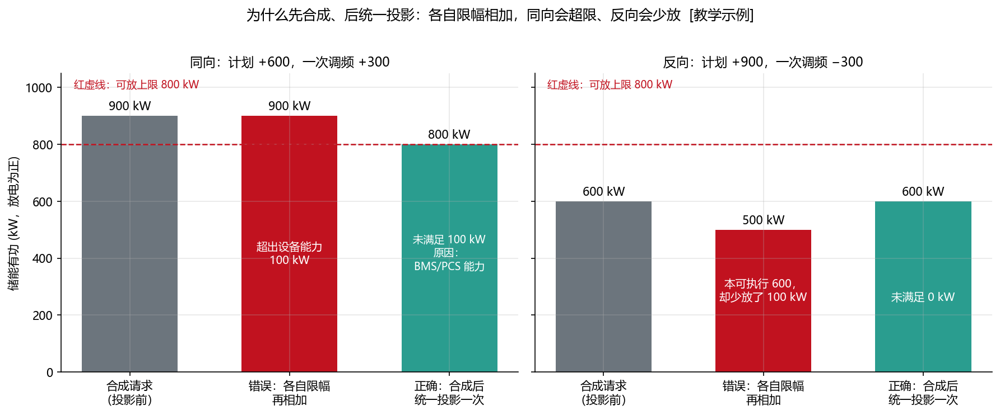
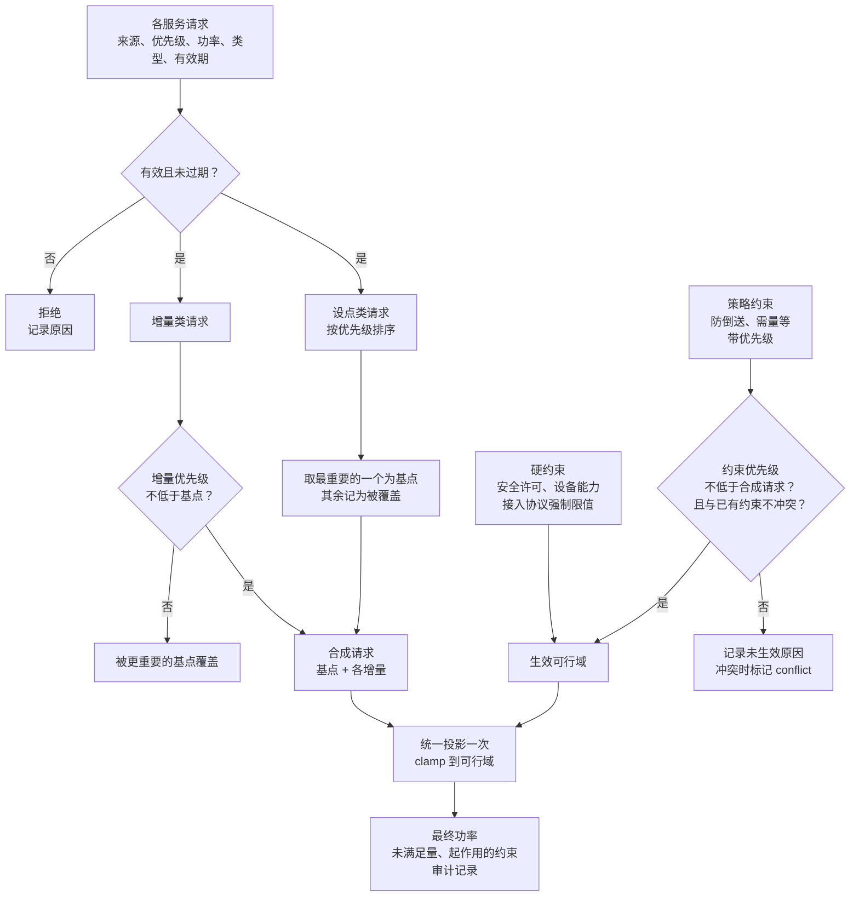
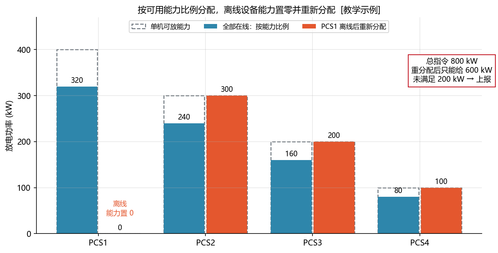
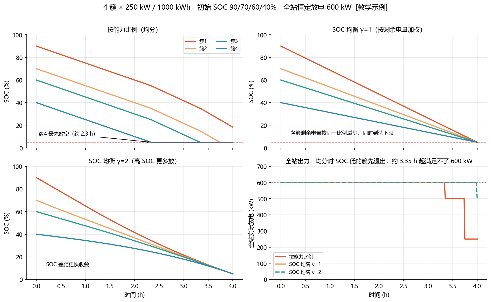

<!-- @AI_GENERATED -->
# 18 EMS 命令仲裁与多 PCS 功率分配：从服务请求到可审计执行

> [课程首页](README.md) · 上一章：[17 无功电压控制与 AVC：从 Q-U 下垂到 P-Q 能力投影](17_无功电压与AVC.md) · 下一章：[19 仿真与测试](19_仿真与测试.md)

## 本章目标与边界

读完本章，你应能：

1. 区分安全许可/设备能力与可组合服务请求；
2. 按覆盖、叠加、统一投影的顺序合成一个总请求，并计算未满足原因；
3. 按在线状态、方向能力和 SOC 将全站功率分配到多台 PCS/电池簇；
4. 输出带时刻、序号、约束、冲突和分配结果的可审计记录。

本章处理一维有功仲裁和多设备分配；P-Q 联合投影复用第 17 章，通信/保护/调度规约属于第 08～10、15～17 章，分钟级优化属于第 13～16 章。所有优先级、硬约束、分辨率和启停阈值均为项目配置或教学示例。


---

## 18.1 现场场景【必懂】

某工商业储能站同时参与了聚合商的调频服务。一个工作日下午：

- 调度（经聚合平台）下发 AGC 放电 500 kW；
- 一次调频因频率偏高，要求充电 50 kW；
- 厂区负荷只有 300 kW，接入方案不允许向电网倒送；
- 经济策略按电价想在这个时段充电；
- BMS 刚上报：一个电池簇温度偏高，可放功率降到 600 kW。

EMS 这一秒应该下发多少？谁的请求被满足了、谁被削减了、削减多少？调度和聚合平台看到“没跟上”时，EMS 能不能拿出记录解释？

---

## 18.2 请求来源：先分清“许可”和“请求”【必懂】

EMS 每个周期会收到很多“想让储能做什么”的输入。第一步是把它们分成两类：

| 类别 | 例子 | 本质 | 能否被仲裁覆盖 |
|---|---|---|---|
| **安全许可 / 禁止条件** | BMS 充放电许可和可充/可放功率、PCS 保护与可用功率、继保/稳控跳闸、消防和热失控联锁、检修闭锁、人工安全许可 | 定义“**能做什么**”的边界 | **不能**，任何服务都不能越过 |
| **可组合的服务请求** | 稳控紧急指令、FFR、一次调频、AGC、AVC、调度计划、防超容、防倒送、低 SOC 自充、防超需、峰谷套利、维护测试 | 表达“**想做什么**” | 可以被合成、削减、拒绝 |

安全许可不是一个“优先级最高的请求”。原稿特意强调：**硬件保护不应被称为“P0 EMS 请求”**。原因是请求可以被削减，而保护一旦被当成请求，就可能在某个配置错误下被“更高优先级”的东西覆盖。许可在代码里应该是**约束**（可行域的边界），在仲裁的最后一步强制生效（第 12 章）。

> **软件类比**：安全许可像操作系统的**权限模型**（文件权限、cgroup 配额），服务请求像应用发起的**系统调用**。调度器可以决定先服务哪个进程、给它多少 CPU，但无论哪个进程优先级多高，都越不过权限和配额。
>
> **类比失效点**：软件里越权通常会被拒绝并返回错误；储能里如果 EMS 下发了越界指令，PCS 或 BMS 可能直接保护跳闸，结果是整站失去所有服务能力，而不是“这一条请求失败”。

---

## 18.3 服务优先级 P1～P6【必懂】

可组合的服务按下面的优先级排序（取自课程原稿，**数字越小越重要**）：

| 优先级 | 服务 | 为什么排在这里 |
|---|---|---|
| **P1** | 电网紧急稳控服务 | 电网已处在事故状态，稳控系统要求的出力关系到大面积停电，秒级内必须执行 |
| **P2** | FFR 和快速电网支撑 | 事故初期抑制频率跌落，响应窗口以秒甚至更短计，错过就没有意义 |
| **P3** | 一次调频、AGC、AVC、调度计划 | 对电网的正常调节义务，受调度考核，属于并网运行的基本责任 |
| **P4** | 防超容、防倒送、低 SOC 等策略约束 | 保护站点和设备的运行边界、合同边界；多数情况下可以在短时间内让位于电网义务 |
| **P5** | 防超需和经济优化 | 影响电费和收益，不影响电网安全，时间窗口通常较长（例如 15 分钟需量周期） |
| **P6** | 维护、校准和容量测试 | 可以择时进行，任何其他服务需要时都应让路 |

几点说明：

1. **优先级必须是配置，不是散落在代码里的数字**。项目可以调整（例如某些用户侧项目，防超需的经济损失很大，会要求提高其优先级），但调整要经过评审并记录。
2. **P4 的“策略约束”有两种身份**。同一个“防倒送”，如果接入方案规定不允许倒送（有逆功率保护、合同明确禁止），它就是**硬约束**，放在安全许可那一类；如果只是“尽量不倒送，因为余电上网价格低”，它才是 P4 策略约束，可以让位于 P3 的调度指令。**配置时必须明确是哪一种**。
3. 本课程代码里的规则：**策略约束只约束重要性不高于它的请求**。P4 的防倒送会约束 P5 的经济策略，但不约束 P3 的 AGC。

```python
# lab/ems_lab/arbitration.py（节选）
class Priority(IntEnum):
    P1_GRID_EMERGENCY = 1  # 电网紧急稳控
    P2_FAST_SUPPORT = 2  # FFR 和快速电网支撑
    P3_DISPATCH = 3  # 一次调频、AGC、AVC、调度计划
    P4_STRATEGY_LIMIT = 4  # 防超容、防倒送、低 SOC 等策略约束
    P5_ECONOMIC = 5  # 防超需和经济优化
    P6_MAINTENANCE = 6  # 维护、校准、容量测试


@dataclass(frozen=True)
class Limit:
    name: str
    lo_kw: float
    hi_kw: float
    hard: bool = True             # 安全许可、设备能力、接入协议强制要求：永远生效
    priority: int | None = None   # 策略约束：只约束重要性不高于它的请求
```

---

## 18.4 三种组合方式：覆盖、叠加、分配【必懂】

不同服务之间不是简单“谁优先谁赢”，组合方式有三种：

| 方式 | 含义 | 例子 | 公式 |
|---|---|---|---|
| **覆盖** | 高优先级的基点替换低优先级的基点 | 稳控指令替换 AGC 设点；AGC 替换经济策略 | `P_基点 = 最重要的那个设点` |
| **叠加** | 增量加在基点上 | 计划/AGC 基点 + 一次调频增量 | `P_请求 = P_基点 + ΣΔP` |
| **分配** | 一个总目标拆给多台设备 | 全站 AGC 设点分给 4 台 PCS | `P_请求 = Σ P_i` |

覆盖和叠加发生在**仲裁**阶段，分配发生在**约束投影之后**（18.9）。

叠加有一个细节：**增量只能叠加在不比它更重要的基点上**。一次调频（P3）可以叠加在计划（P3）、经济策略（P5）上；但稳控（P1）下发紧急出力时，它连同一次调频一起覆盖，因为稳控计算的出力已经考虑了全局，不应再被本地增量改动。具体规则以调度规程为准，这里是课程的默认规则。

---

## 18.5 为什么先合成、后统一投影【必懂】

最常见的错误写法是：每个服务算出请求后**各自限幅**，然后相加下发。看上去每一项都“合规”，加起来却不对。



图中标注对照表：

| 编号 | 位置 | 标注 | 对应正文 |
|---|---|---|---|
| ① | 同向案例 | 600+300=900、各自结果 900、统一结果 800、超出 100 | 超出能力 100 |
| ② | 反向案例 | 900−300=600、各自结果 500、统一结果 600、少放 100 | 各自限幅少放 100 |
| ③ | 能力边界 | [−500,+800] kW | BMS 能力 |

**手算一：同向，各自限幅相加会超限**。BMS 允许 [−500, +800] kW。计划 +600，一次调频 +300：

| 做法 | 过程 | 结果 |
|---|---|---|
| 各自限幅再相加 | clamp(600) = 600，clamp(300) = 300，相加 900 | **900 kW，超出可放 800 kW** |
| 合成后统一投影 | 600 + 300 = 900，clamp(900) = 800 | **800 kW，未满足 100 kW，原因：BMS/PCS 能力** |

**手算二：反向，各自限幅相加会少放**。计划 +900，一次调频 −300：

| 做法 | 过程 | 结果 |
|---|---|---|
| 各自限幅再相加 | clamp(900) = 800，clamp(−300) = −300，相加 500 | **500 kW，本可执行 600 却少放 100** |
| 合成后统一投影 | 900 − 300 = 600，clamp(600) = 600 | **600 kW，未满足 0** |

两个错误方向相反：同向时越界（危险），反向时白白损失能力（考核扣分）。根本原因是：**约束是对最终下发的总功率的要求**，不是对每个分量的要求。所以流程只能是：

```text
生成各服务请求 → 覆盖、叠加得到一个总请求 → 对总请求做一次统一约束投影 → Ramp → 分配 → 下发
```

P、Q 同时存在时，统一投影就是第 17 章的 P-Q 联合投影，同样不能分别 clamp。

---

## 18.6 未满足功率必须反馈，不能静默丢弃【必懂】

投影削掉的部分叫**未满足功率**：`unserved = 合成请求 − 最终下发`，带方向。

它必须被记录并上报给提出请求的一方，原因有三：

1. **对调度**：调度看到储能没有跟上 AGC，如果 EMS 同时上报“受防倒送约束，未满足 200 kW”，调度可以把调节量分给别人；如果 EMS 什么都不说，调度只能按“性能差”处理；
2. **对上层策略**：经济策略被需量削减了 200 kW 充电，它应该知道，以便重新规划后续时段的 SOC；
3. **对运维**：长期存在的未满足量说明配置或能力模型有问题（例如 16.8 的可调能力上报虚高）。

未满足量要和**原因**一起记录：是哪一个约束在起作用（`limiting`）、哪些请求被覆盖或拒绝（`rejected`）、哪些策略约束没有生效（`skipped_limits`）。只有一个数字没有原因，排查时等于没有。

---

## 18.7 仲裁流程与代码【必懂】



```python
# lab/ems_lab/arbitration.py（节选）
def arbitrate(requests, limits, now=0.0, seq=0, default_kw=0.0):
    # ① 过滤无效/过期
    ...
    # ② 覆盖：基点只取最重要的一个；同级按来源名排序，保证结果确定、可复现
    setpoints = sorted((r for r in live if r.kind == "setpoint"), key=lambda r: (r.priority, r.source))
    base = setpoints[0] if setpoints else None
    ...
    # ③ 叠加：增量只能叠加在“不比它更重要”的基点上
    for r in (r for r in live if r.kind == "delta"):
        if base is not None and r.priority > base.priority:
            rejected.append((r.source, f"增量被 {base.source}（P{base.priority}）覆盖"))
            continue
        deltas.append((r.source, r.p_kw))
    composed = base_kw + sum(p for _, p in deltas)
    # ④ 生效约束：硬约束全部生效；策略约束只约束重要性不高于它的请求
    ...
    # ⑤ 统一投影：只做一次
    final = clamp(composed, lo, hi)
    return ArbitrationResult(..., composed_kw=composed, final_kw=final, unserved_kw=composed - final, ...)
```

两个实现细节值得注意：

- **结果必须确定**。同优先级的两个设点，用来源名做第二排序键，而不是依赖列表顺序或字典遍历顺序。同样的输入永远得到同样的输出，回放和测试才有意义；
- **硬约束互相矛盾**（例如两个许可给出不相交的区间）说明配置或数据出错，这时不猜，输出 0 并告警。策略约束与硬约束冲突时，策略约束不生效，并标记 `conflict` 上报。

---

## 18.8 典型冲突故事【必懂】

### 故事一：AGC 放电 vs 防倒送

负荷 300 kW，无光伏，AGC 要求放电 500 kW。由功率平衡 `P_PCC = P_PV + P_BESS − P_load`，防倒送（`P_PCC ≤ 0`）换算成储能约束：`P_BESS ≤ 0 − 0 + 300 = 300 kW`。

| 防倒送的身份 | 结果 | 记录 |
|---|---|---|
| 硬约束（接入方案禁止倒送） | 放电 300 kW | 未满足 200 kW，原因“防倒送”，上报调度 |
| P4 策略约束（尽量不倒送） | 放电 500 kW | 防倒送未生效，原因“P3 请求优先于该约束”，倒送 200 kW |

两种结果都对，取决于配置。**错误的做法**是：硬约束时静默地只放 300 kW，不告诉调度；或者 P4 策略约束时把 AGC 请求直接丢弃，按经济策略运行。AGC 充电方向的请求通常会减少倒送，但可能与“禁止从电网充电”、变压器进口容量、SOC 上限冲突，需要单独测试。

### 故事二：稳控放电 vs 低 SOC

稳控装置下发紧急放电 1000 kW（P1），同时 AGC 设点 500 kW、一次调频 −50 kW。SOC 很低，BMS 可放功率只有 200 kW。

```text
基点：稳控 1000 kW（AGC 被覆盖，一次调频增量被覆盖）
可行域：[−500, +200]（BMS）
最终：200 kW，未满足 800 kW，原因：BMS 可放（低 SOC）
```

稳控优先级再高，也越不过 BMS 许可。EMS 要做的是**在安全范围内给出最大响应**，并立即上报能力不足，让稳控系统和调度知道这里只有 200 kW。事件结束后执行 SOC 恢复。

### 故事三：经济策略 vs 需量

负荷 1500 kW，需量上限 1800 kW。经济策略（P5）想在低谷电价时段充电 500 kW。需量约束换算：取电 `P_load − P_BESS ≤ 1800` → `P_BESS ≥ 1500 − 1800 = −300 kW`。

```text
最终：充电 300 kW，未满足 −200 kW（少充 200），原因：需量
```

经济策略收到未满足量后，应该重新安排：这个时段少充的 200 kW，后面哪个时段补？还来不来得及在高峰前充满？这就是“未满足量要反馈给上层策略”的意义。

反过来，如果负荷升到 2200 kW，需量约束要求储能至少放电 400 kW，但 BMS 只允许放 200 kW，需量约束无法满足。代码中它不生效并标记 `conflict`，EMS 按 BMS 能力放 200 kW，同时告警“需量将越限”（第 14 章）。

### 回到 18.1 的那一秒

按接入方案，防倒送是硬约束：

```text
基点：AGC +500（P3）；经济策略（P5）被覆盖
增量：一次调频 −50（P3，可叠加）          → 合成请求 450 kW
可行域：BMS [−500, +600] ∩ 防倒送 (−∞, 300] = [−500, 300]
最终：300 kW，未满足 150 kW，起作用的约束：防倒送
```

审计记录里能看到：AGC 被采纳、一次调频已叠加、经济策略被覆盖、防倒送削减了 150 kW。聚合平台据此知道这一秒该站最多只能给 300 kW。

---

### 最小闭环：仲裁到 PCS 分配

把 18.1 场景压成一条可执行链：

```text
输入：AGC +500 kW，一次调频 −50 kW，经济策略 −200 kW
      全站设备能力 [-500, +600]，防倒送上限 +300 kW
① 基点覆盖/增量叠加：AGC +500 − 50 = +450 kW；经济请求被 P3 基点覆盖
② 统一约束投影：clamp(450, -500, 300) = +300 kW
③ 未满足量：450 − 300 = 150 kW，原因：防倒送
④ 按 PCS 能力分配：250:250:100 → 125、125、50 kW
⑤ 校验：各 PCS 之和 300，均未越限，离线设备为 0
```

| 阶段 | 输出 | 结果 |
|---|---|---:|
| 仲裁合成 | `composed_kw` | 450 kW |
| 统一投影 | `final_kw` | 300 kW |
| 未满足反馈 | `unserved_kw` | 150 kW |
| PCS1 | 分配值 | 125 kW |
| PCS2 | 分配值 | 125 kW |
| PCS3 | 分配值 | 50 kW |

对应脚本：`lab/examples/ch18_arbitration_allocation.py`。脚本先调用 `arbitrate()`，再调用 `allocate_by_capability()`，最后调用 `check_allocation()`；因此“仲裁完成”不等于“设备已经安全分配完成”。


## 18.9 功率分配：从全站指令到 PCS 执行

仲裁得到全站的一个功率，还要分给各台 PCS（或各个电池簇）。分配器只负责“分下去”，**分不完的部分同样是未满足量**，要上报。

### 按可用能力比例

最基本的规则：每台分得的功率与它**本方向**的可用能力成正比，这样所有设备同时到达上限，不会有一台先顶满。

**手算**：4 台 PCS 可放能力 400、300、200、100 kW（合计 1000），全站放电 800 kW：

```text
比例 800 / 1000 = 0.8 → 320、240、160、80 kW
```

### 离线设备能力置零并重新分配

PCS1 通信中断（或故障、检修），它的能力必须**置为 0**，不能继续按旧能力分给它（它执行不了，也可能在执行一个过期指令）。剩下 300 + 200 + 100 = 600 kW，小于 800：

```text
结果：0、300、200、100 kW，已分配 600 kW，未满足 200 kW → 上报
```



图中标注对照表：

| 编号 | 位置 | 标注 | 对应正文 |
|---|---|---|---|
| ① | 在线能力 | 400、300、200、100 kW | 四台 PCS 能力 |
| ② | 全在线分配 | 总指令 800 kW | 按能力比例分配 |
| ③ | 离线后 | 第一台离线=0、可分 600 kW、未满足 200 kW | 离线重分配 |

### SOC 均衡：放电时 SOC 高的多放，充电时 SOC 低的多充

各簇 SOC 不一致时，均分功率会让 SOC 低的簇先放空。一旦某簇到达下限退出，全站可用能力就下降一截。SOC 均衡按“**本方向还能放/充的电量**”加权：

```text
放电权重 = (SOC − SOC_下限) × 容量
充电权重 = (SOC_上限 − SOC) × 容量
```

**手算**：3 簇各 500 kW / 1000 kWh，SOC 70%、30%、30%，下限 10%、上限 90%（`[教学示例]`）。

- 放电 1000 kW：权重 0.6 : 0.2 : 0.2 → 600、200、200。簇 A 超过 500 kW 上限，**固定在 500**，余下 500 kW 按 0.2 : 0.2 再分 → 250、250。结果 **500、250、250**，迭代 2 轮。
- 充电 700 kW：权重 0.2 : 0.6 : 0.6 → **−100、−300、−300**。

第一个例子就是**余量迭代再分配**（常称 water-filling）：按权重分，超过单机上限的固定在上限，余量继续分给还有空间的设备，直到分完或所有设备都顶满。

```python
# lab/ems_lab/allocation.py（节选）
def water_fill(total_kw, caps, weights):
    alloc = {n: 0.0 for n in caps}
    active = [n for n in caps if caps[n] > 0 and weights.get(n, 0.0) > 0]
    remaining, it = total_kw, 0
    while remaining > 1e-9 and active:
        it += 1
        wsum = sum(weights[n] for n in active)
        share = {n: remaining * weights[n] / wsum for n in active}
        saturated = [n for n in active if alloc[n] + share[n] >= caps[n] - 1e-9]
        if not saturated:
            for n in active:
                alloc[n] += share[n]
            remaining = 0.0
            break
        for n in saturated:  # 顶到上限的设备先固定，余量留给下一轮
            remaining -= caps[n] - alloc[n]
            alloc[n] = caps[n]
        active = [n for n in active if n not in saturated]
    return alloc, it
```

下图对比了三种分配方式在 4 小时连续放电中的效果：



图中标注对照表：

| 编号 | 位置 | 标注 | 对应正文 |
|---|---|---|---|
| ① | 试验参数 | 4簇、250 kW、1000 kWh、SOC 90/70/60/40% | 连续放电场景 |
| ② | 时间点 | 2.3 h、3.35 h | 低 SOC 簇退出时间 |
| ③ | 全站请求 | 600 kW | 分配目标 |

- **按能力均分**：4 簇 SOC 差距始终是 50 个百分点。簇 4 约 2.3 h 放空，簇 3 约 3.35 h 放空，此后全站满足不了 600 kW；
- **SOC 均衡 γ = 1**：各簇剩余电量按同一比例减少，**同时**到达下限，4 h 内一直满足 600 kW；2 h 时 SOC 差距缩小到 25 个百分点；
- **SOC 均衡 γ = 2**（权重取平方，`[教学示例]` 参数）：SOC 高的簇分得更多，差距收敛更快。

γ 越大收敛越快，但 SOC 高的簇更早顶到功率上限，单簇负载更不均衡。选哪种，以及是否需要在静置时做簇间均衡，要结合 BMS 的均衡能力和电池厂家建议决定。

### 分配后的总和校验与取整

PCS 设定值有分辨率（例如 1 kW）。1000 kW 分给 3 台能力相同的 PCS，每台 333.33 kW，取整后 333 × 3 = 999 kW，**少了 1 kW**。每个周期少一点，闭环会补回来，但开环下发时总和不等于目标，审计也对不上。

做法：取整后把差额按分辨率逐个补给**余量最大**的设备，得到 334、333、333。然后做一次校验：

| 检查项 | 失败说明什么 |
|---|---|
| 各机之和 = 已分配总量 | 取整或补差逻辑有 bug |
| 请求 = 已分配 + 未满足 | 未满足量算错 |
| 单机不超过本方向能力 | 分配器越限 |
| 离线设备分配为 0 | 离线状态没有传到分配器 |
| 各机方向与总指令一致 | 出现“一台充、一台放”的环流 |

```python
def check_allocation(result, units, tol_kw=1e-6):
    """分配后校验：总和一致、单机不越限、离线设备为 0、方向一致。返回问题清单（空表示通过）。"""
```

最后一项“方向一致”是默认规则。有些项目会有意让簇间“一充一放”做均衡，那是单独设计的维护功能，不应该在正常分配中意外出现。

### 单机最小功率与启停台数【了解】

PCS 在很低负载率下效率差，部分设备还有最小稳定运行功率。全站功率小时，与其让 10 台 PCS 各出 20 kW，不如只开 1～2 台。常见两种策略：

- **最少台数**：开够扛住总功率的最少台数，负载率高、效率高；
- **分散运行**：在每台不低于最小运行功率的前提下尽量多开，利于 SOC 均衡和冗余，调节时响应更快。

**手算**（4 台 × 500 kW，最小运行功率 20% 即 100 kW，`[教学示例]`）：总功率 1200 kW，最少台数 3 台；分散运行 4 台（每台 300 kW）。总功率 250 kW，分散运行最多开 2 台（每台 125 kW），开 3 台每台只有 83 kW，低于 100 kW。

启停本身有时间代价（PCS 启动需要数秒到数十秒），频繁启停会影响快速服务的响应，通常配合滞回和最短运行/停机时间使用（第 11 章）。

---

## 18.10 仲裁结果的可审计字段【必懂】

仲裁器不能只返回一个数。每一次仲裁都应该生成一条记录，事后能回答“为什么这一秒下发了这个数”：

| 字段 | 含义 | 回答的问题 |
|---|---|---|
| `seq`、`t` | 序号、时刻 | 哪一次 |
| `base` | 基点来源和功率 | 谁的设点在起作用 |
| `deltas` | 叠加的增量及来源 | 还加了什么 |
| `composed_kw` | 合成请求（投影前） | 总共想要多少 |
| `priority` | 参与合成的最高优先级 | 按哪一级规则执行 |
| `bounds_kw` | 生效可行域 [lo, hi] | 被允许多少 |
| `final_kw` | 最终下发 | 实际给了多少 |
| `unserved_kw` | 未满足量 | 差多少 |
| `limiting` | 起作用的约束 | 被谁限了 |
| `rejected` | 被拒绝/覆盖的请求及原因 | 谁没被采纳，为什么 |
| `skipped_limits` | 未生效的策略约束及原因 | 哪些约束让路了 |
| `conflict` | 是否存在约束冲突 | 需不需要告警 |

分配器同样输出各机设定值、已分配、未满足和备注（离线、取整、权重退回）。两者加上第 09 章流水线的执行反馈，就是一条完整的决策链。

> **软件类比**：这相当于请求链路里的**结构化日志 + 分布式追踪**：一个 trace 从“谁发起请求”开始，记录经过的每一个中间件做了什么决定，直到最终响应。
>
> **类比失效点**：Web 请求失败可以重试，功率指令没有“重试”：这一秒没放出的电量就是没放，调度考核按时间窗统计。所以审计记录要足够及时，能在考核结果出来之前发现问题。

---

## 18.11 常见误区【必懂】

| 误区 | 正确理解 |
|---|---|
| BMS 保护是“最高优先级的请求” | 保护和许可是约束（可行域边界），不参与优先级比较 |
| 每个服务各自限幅就安全了 | 约束针对最终总功率，必须合成后统一投影一次 |
| 被约束削掉的功率不用管 | 未满足量和原因必须反馈给请求方 |
| 优先级高的服务一定能拿到它要的功率 | 优先级决定“谁的请求被采纳”，能给多少由可行域决定 |
| 防倒送一定比 AGC 优先（或一定比 AGC 次要） | 取决于它是接入协议的硬要求还是经济策略，必须在配置中明确 |
| 分配时按额定功率均分 | 按本方向实时可用能力；离线设备能力置 0；分不完要上报 |
| 取整误差很小可以忽略 | 取整后要补差并校验总和，否则开环下发和审计都对不上 |

## 18.12 现场真实故障【必懂】

**案例一：AGC 请求被静默丢弃。**
某用户侧储能参与聚合调频。EMS 的防倒送逻辑写在 AGC 之后，发现会倒送时直接把 AGC 设点替换成防倒送 PI 的输出，没有任何记录。聚合平台看到该站频繁“不跟踪”，扣了大量考核费用，还怀疑设备故障派人到现场排查。
**修复**：防倒送按配置作为硬约束或 P4 策略约束参与统一投影；未满足量和原因随遥测上送聚合平台，平台据此调整分配。

**案例二：离线 PCS 仍被分配功率。**
一台 PCS 通信中断，EMS 的能力模型仍保留它最后上报的可放 500 kW，分配器照常分给它 1/4 的功率。全站出力持续比设点少 25%，AGC 精度不合格。
**修复**：通信中断、故障、检修状态直接把该设备能力置 0，重新分配；设备状态进入分配器前先经过数据质量判断（第 10 章）。

**案例三：各自限幅相加导致 PCS 过流。**
早期版本中，计划跟踪和一次调频各自按 PCS 额定功率限幅后相加。一次频率事件中两者同向，合计下发超过 PCS 额定 12%，PCS 过流保护动作，整站跳闸，调频服务中断。
**修复**：改为合成后统一投影（18.5），并在测试中加入“同向叠加超限”“反向叠加”两个用例。

---

## 18.13 自测

1. 为什么 BMS 的充放电许可不能作为“P0 请求”参与仲裁？
2. BMS 允许 [−400, +600] kW。计划 +500，一次调频 +200，各自限幅相加和合成后投影分别得到多少？未满足多少？
3. 同上，计划 +700，一次调频 −250，两种做法分别得到多少？
4. 负荷 400 kW，光伏 100 kW，不允许倒送。AGC 要求放电 600 kW，防倒送为硬约束时最终下发多少？未满足多少？
5. 3 台 PCS 可放能力 500、300、200 kW，全站放电 600 kW，按能力比例各分多少？第 1 台离线后呢？
6. 2 簇各 400 kW / 1000 kWh，SOC 80%、40%，下限 10%。全站放电 500 kW，按 SOC 均衡（γ = 1）各分多少？
7. 一条仲裁审计记录至少应包含哪些信息，才能回答“这一秒为什么只放了 300 kW”？

<details>
<summary>参考答案</summary>

1. 请求可以被合成、削减、覆盖；许可定义的是“能做什么”的边界。把许可当请求，就存在被更高优先级（或配置错误的优先级）覆盖的可能，后果是设备保护动作甚至安全事故。许可应作为硬约束在最终投影中强制生效。
2. 各自限幅：500 + 200 = 700 kW，超出可放 600；合成后投影：700 → 600 kW，未满足 100 kW。
3. 各自限幅：clamp(700) = 600，600 − 250 = 350 kW；合成后投影：700 − 250 = 450 kW，在范围内，未满足 0。各自限幅少放了 100 kW。
4. `P_BESS ≤ 0 − 100 + 400 = 300 kW`，最终放电 300 kW，未满足 300 kW，原因“防倒送”，需上报。
5. 比例 600/1000 = 0.6 → 300、180、120 kW。第 1 台离线后剩余能力 300 + 200 = 500 < 600：分得 0、300、200，未满足 100 kW。
6. 权重 (0.8 − 0.1) : (0.4 − 0.1) = 0.7 : 0.3 → 350、150 kW，均未超过 400 kW。
7. 基点来源和功率、叠加的增量、合成请求、生效可行域、最终下发、未满足量、起作用的约束（例如“防倒送”）、被拒绝/覆盖的请求及原因、时刻和序号。

</details>

---

## 18.14 深入【深入】

<details>
<summary>有功和无功一起仲裁</summary>

本章代码只处理有功（一维）。实际 EMS 同时有 P 请求（AGC、一次调频、计划）和 Q 请求（AVC、Q-U 下垂、定 PF）。推荐的顺序是：P、Q 各自完成覆盖和叠加，得到 (P_请求, Q_请求)；一维硬约束（BMS 充放、无功上限、PCC 限值）分别作用在 P、Q 上；最后按当前优先策略（有功优先/无功优先/按比例）做 P-Q 联合投影（第 17 章 `project_pq`）。优先策略可以由仲裁结果决定，例如合成请求中最重要的是 P3 AVC 电压支撑，就切换为无功优先。

</details>

<details>
<summary>为什么不直接用优化求解器</summary>

多目标仲裁可以写成一个优化问题：在可行域内最小化“各服务未满足量 × 权重”之和。它在理论上更“最优”，但工程上有几个问题：结果对权重敏感，很难向调度解释“为什么削了 AGC 50 kW 而不是经济策略”；求解时间不确定，不适合秒级甚至更快的控制周期；求解失败时需要兜底。基于优先级的覆盖、叠加加上一次投影，规则简单、结果确定、易于审计，是多数项目的选择。优化方法更适合用在分钟级以上的计划层（第 13 章）。

</details>

<details>
<summary>SOC 均衡权重的动态特性</summary>

γ = 1 时，簇 i 的放电功率 `P_i = P × r_i / Σr`，其中 `r_i = (SOC_i − SOC_min) × E_i` 是剩余可放电量。于是 `dr_i/dt = −P × r_i / Σr`：所有簇的剩余电量按**同一比例**衰减，比值保持不变，同时放空。SOC 的绝对差距随总剩余电量等比例缩小，但比值不收敛。γ = 2 时，`dr_i/dt ∝ −r_i²`，剩余电量多的簇衰减更快，比值向 1 收敛。另一类常见做法是在均分的基础上叠加一个与“SOC 偏离平均值”成正比的修正量，本质上是一个比例控制器，调节参数时同样要注意单簇功率上限。

</details>

<details>
<summary>分配与 Ramp 的先后</summary>

一般先对全站总功率做 Ramp，再分配。如果先分配再对每台 Ramp，某台 PCS 离线导致重新分配时，其余 PCS 的设定值会突然跳变，而全站总量其实没变，各机 Ramp 会人为拖慢这次“平移”，造成全站出力短时下降。反过来，当某台 PCS 因故障从出力状态突然归零时，全站实际出力突降，其他 PCS 要“接过”这部分功率，这个接续过程是否受 Ramp 约束，要按并网要求确定。

</details>

<!-- @AI_GENERATED: end -->
