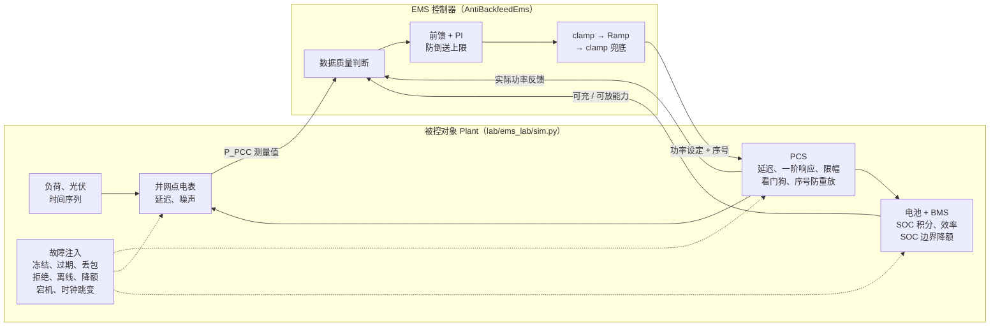
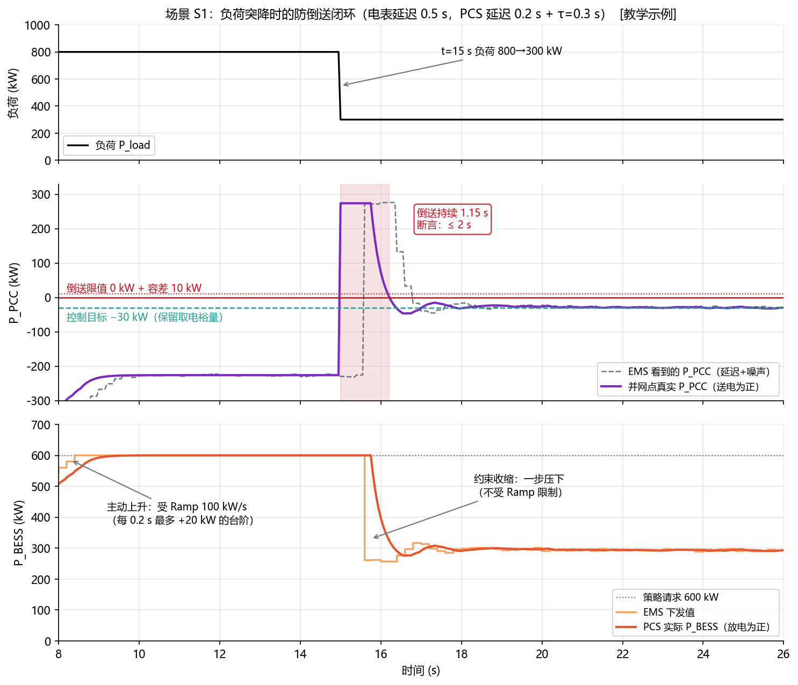
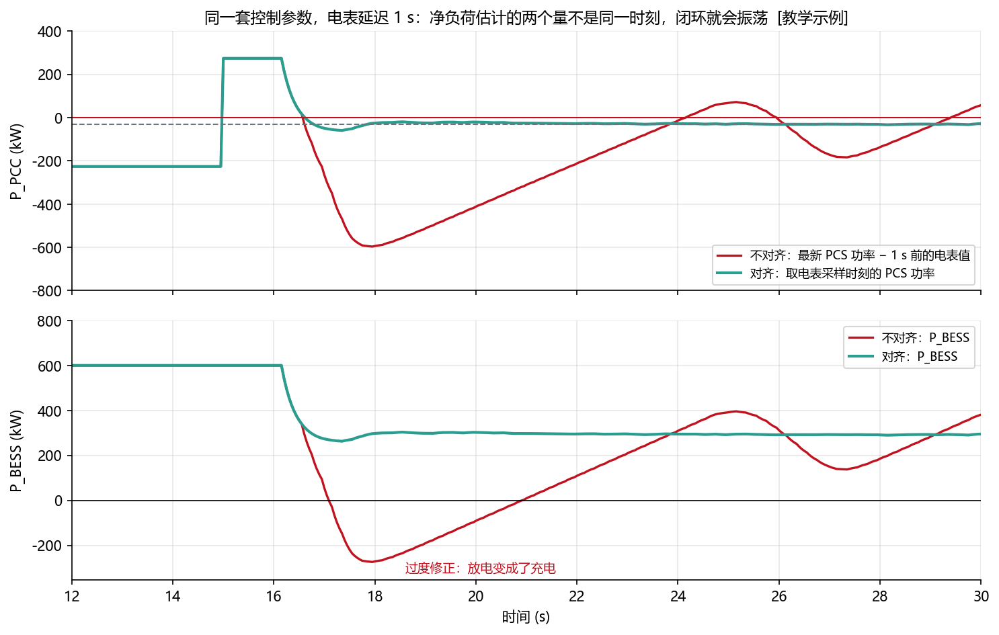
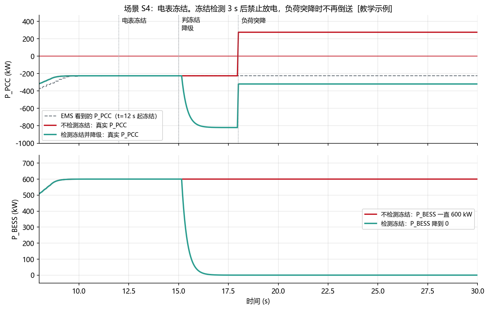

<!-- @AI_GENERATED -->
# 19 EMS 闭环仿真、故障注入与验收证据

> [课程首页](README.md) · 上一章：[18 命令仲裁与功率分配](18_命令仲裁与功率分配.md) · 下一章：[20 运维、可观测性与安全](20_运维可观测性与安全.md)

## 本章目标与边界

读完本章，你应能：

1. 建立含延迟、噪声、限幅、看门狗和故障注入的 EMS 级离散闭环模型；
2. 把负荷突降、数据异常、设备拒绝、离线、重启和时钟跳变写成可复现的场景；
3. 用带容差、统计窗口和持续时间的断言，把仿真输出转换成可复核的验收证据；
4. 用需求追踪和反例测试说明每条保护逻辑确实能够发现它声称要防的问题。

本章边界是 **EMS 级软件在环（SIL）**：`lab/ems_lab/sim.py` 用离散步长模拟负荷、PCS 一阶响应、电池 SOC、电表延迟和故障现象。它不替代 PWM/电流环、电磁暂态、电能质量、继保定值、HIL 实时仿真或现场 FAT/SAT/并网试验；参数仍需用现场实测数据校准。正文中的 `power_balance_residual_kw` 与 `Plant.step` 共享部分模型公式，不能把它当作完全独立的物理 oracle；`longest_excursion_s` 按离散采样点定义越限区间，边界规则必须和项目验收口径一致。

**一句话**：EMS 的指令一旦执行，能量就已经流过了，无法回滚。所以每个控制功能都要先在“会延迟、有噪声、会出故障”的仿真对象上跑通，并且每个测试场景都要对应一种真实发生过的现场事故。

**作为 EMS 开发，你会在哪里用到它**：

- 为防倒送、需量、调频、仲裁等功能写闭环场景测试，而不仅仅是单元测试；
- 设计故障注入：数据冻结、过期、丢包，设备拒绝、离线，控制器重启，时钟跳变；
- 编写带容差和持续时间的断言，输出能作为验收证据的测试记录；
- 准备 FAT、SAT 和并网试验，知道每一级验证在证明什么。

**前置**：第 09 章（控制流水线）、第 10 章（数据质量）、第 11 章（clamp、Ramp、PI）、第 12 章（可行域）。

通用的单元测试、mock、覆盖率等知识本章不再讲，重点放在 **EMS 特有的被控对象建模、场景设计和断言写法**。

---

## 19.1 为什么 EMS 不能“上线再测”【必懂】

| 软件系统 | EMS |
|---|---|
| 出错可以回滚版本、重放请求 | 能量已经流过，**无法回滚** |
| 灰度发布，影响一小部分用户 | 一个站只有一套设备，指令错了就是全站错 |
| 线上压测可以随时做 | 现场调试窗口很短，要协调调度、业主、设备厂家 |
| 错误的代价是用户体验、数据修复 | 设备损坏、保护跳闸、调度考核罚款、安全事故 |

> **软件类比**：EMS 更像支付系统的扣款环节：扣出去的钱不能“撤销提交”，所以上线前要在沙箱和对账环境中把各种异常路径都走一遍。
>
> **类比失效点**：支付沙箱可以做到和生产几乎一致；EMS 的仿真永远只是真实电站的简化，仿真通过**不等于**现场一定没问题（19.2）。

---

## 19.2 仿真能证明什么、不能证明什么【必懂】

本课程的仿真是 **EMS 级离散时间仿真**：把电站简化成“PCS 按一阶响应跟随指令、电池按功率积分 SOC、电表按延迟上报”，关注的是控制逻辑，而不是电力电子。

| 能证明 | 不能证明 |
|---|---|
| 功率方向、正负号是否正确 | PCS 内部的 PWM、电流环性能 |
| 约束、仲裁、优先级是否按设计工作 | 电磁暂态、谐波、电能质量 |
| 在给定的延迟和噪声下，闭环是否稳定 | 真实设备的延迟分布、非线性 |
| 数据异常、设备故障时是否正确降级 | 真实保护装置的动作 |
| 重启、恢复、重连逻辑是否安全 | 现场并网性能和调度考核指标 |
| 同样的输入能否得到同样的输出（可重复） | 模型参数本身是否贴近现场 |

最后一行最容易被忽略：**仿真结果可重复，只能说明代码是确定的，不能说明模型是对的**。模型参数（延迟、时间常数、效率）要用 FAT、SAT 的实测数据去校准。

---

## 19.3 验证阶梯：每一级发现什么问题【必懂】


| 阶段 | 在哪里做 | 被控对象是什么 | 主要发现的问题 |
|---|---|---|---|
| 单元测试 | 开发机 | 无 | 公式、边界、方向写错 |
| SIL 软件在环 | 开发机 / CI | 软件仿真模型（本章 `sim.py`） | 控制逻辑、时序、降级、恢复 |
| HIL 硬件在环【了解】 | 实验室 | 真实控制器 + 实时仿真器（如 RTDS、RT-LAB 等） | 真实通信时延、控制器性能、快速功能 |
| FAT 出厂验收 | 厂内 | 部分真实设备或模拟器 | 点表、协议、功能按合同是否齐全 |
| SAT 现场验收 | 电站 | 真实设备 | 方向、变比、现场延迟、设备真实行为 |
| 并网试验 | 电站 + 调度 | 真实电网 | 一次调频、AGC、AVC、电能质量等考核项 |

越往右，成本越高、窗口越短、问题越难改。**能在左边发现的问题，不要留到右边**。本章的仿真和测试属于 SIL 这一级。

---

## 19.4 闭环仿真的结构【必懂】



关键点是：**被控对象必须“不理想”**。如果 PCS 瞬间到位、电表没有延迟，任何控制逻辑都能通过测试，测试也就失去了意义。

| 被控对象参数 | 默认值 `[仿真配置]` | 模拟的现场现象 |
|---|---|---|
| PCS 指令延迟 | 0.2 s | 通信 + PCS 内部处理 |
| PCS 响应时间常数 τ | 0.3 s | 功率不是瞬间到位 |
| PCS 看门狗 | 5 s | 长时间收不到 EMS 写入，设定值回零 |
| 电表延迟 | 0.5 s | 采集、规约转换、上送 |
| 电表噪声 | 2 kW（标准差） | 测量误差、负荷随机波动 |
| 站用电 | 20 kW | 空调、照明、控制电源 |
| 损耗 | \|P_BESS\| 的 1% | 变压器、线路损耗 |
| 仿真步长 / EMS 周期 | 0.05 s / 0.2 s | 物理过程比控制周期细 |

> **软件类比**：这就是**混沌工程**：不是只 mock 一个“永远返回正确值”的依赖，而是 mock 一个会慢、会抖、会挂的依赖，看系统能不能扛住。

---

## 19.5 走一遍场景 S1：负荷突降时的防倒送【必懂】

**场景**：工厂负荷 800 kW，经济策略要求储能放电 600 kW；t = 15 s 时一台大设备停机，负荷降到 300 kW。项目不允许倒送，控制目标是并网点保持 −30 kW（保留 30 kW 取电裕量）。



**图中标注对照表**：

| 编号 | 位置 | 标注 | 对应正文 |
|---|---|---|---|
| ① | 负荷阶跃 | `t=15 s`，负荷 `800→300 kW` | S1 负荷突降 |
| ② | PCC 曲线 | 倒送峰值约 `274 kW`，容差 `10 kW`，持续 `1.15 s`，允许 `2 s` | 暂态断言 |
| ③ | 控制曲线 | 电表延迟 `0.5 s`；PCS 延迟 `0.2 s`，`τ=0.3 s`；Ramp `100 kW/s` | 延迟与变化率 |
| ④ | 稳态线 | 原请求 `600 kW`；目标 `−30 kW`，最终储能约 `294 kW` | 手算与仿真对照 |

**手算**：负荷突降后，储能应该放多少？由功率平衡 `P_PCC = P_BESS − P_load − P_aux − P_loss`：

```text
−30 = P_BESS − 300 − 20 − 0.01 × P_BESS
P_BESS = 290 / 0.99 ≈ 293 kW
```

仿真末端的储能功率约 294 kW，与手算一致（差异来自电表噪声）。

**读图**：

1. **15.0 s**：负荷突降，储能还在放 600 kW，并网点瞬间变成 **倒送约 274 kW**（600 − 300 − 20 − 6）；
2. **15.0～15.5 s**：电表有 0.5 s 延迟，EMS 还“看不见”倒送（灰色虚线）；
3. **约 15.7 s**：EMS 看到倒送，防倒送上限**一步压下**到约 260 kW。这是安全约束收缩，不受 Ramp 限制（第 11 章 11.4）；
4. **15.7～16.2 s**：PCS 延迟 0.2 s + 一阶响应，实际功率逐步下降；
5. 倒送超过容差（10 kW）的时间共 **1.15 s**，之后稳定在 −30 kW 附近。

这 1.15 s 的倒送是由电表延迟、EMS 周期、PCS 延迟和响应时间共同决定的，**控制算法再好也消不掉**。所以断言不能写成“永不倒送”，而要写成“倒送持续时间 ≤ 允许值”。允许值要小于并网点逆功率保护的动作延时（由项目保护定值决定），本章取 2 s `[项目配置示例]`。

### 断言要写成可复核的表达式

```python
checks = [
    check_le("倒送持续时间", longest_excursion_s(tr.t, tr.p_pcc, 0.0, TOL_KW), 2.0,
             "longest(P_PCC > 0 + 10 kW) <= 2.0 s"),
    check_le("稳态偏差", max(abs(p + 30) for p in window(tr.t, tr.p_pcc, 20)), 15.0,
             "max|P_PCC - (-30)| over t>=20 s <= 15 kW"),
    check_le("指令上升速率", max_rise_rate_kw_s(tr.decisions), 100.0,
             "max(ΔP_cmd/Δt) <= 100 kW/s"),
    check_le("功率平衡残差", power_balance_residual_kw(tr), 1e-6,
             "|P_PCC - (P_PV + P_BESS - P_load - P_aux - P_loss)| <= 1e-6 kW"),
]
```

每条断言都有 **容差**（10 kW、15 kW）、**时间范围**（t ≥ 20 s）和 **持续时间**（2 s）。现场验收时，调度或业主会问：“你说满足要求，依据是什么、误差多少、统计了多长时间？”断言就是答案。

---

### 最小闭环：仿真结果如何变成测试证据

以 S1 为例，输入是负荷 `800 → 300 kW` 的阶跃和储能原请求 `600 kW`；仿真对象加入 PCS 延迟、电表延迟、噪声和功率损耗；控制器输出最终功率。最后不只看一条曲线，而是计算可复核的指标：

| 指标 | 计算 | 通过条件 |
|---|---|---|
| 倒送持续时间 | `longest_excursion_s(P_PCC, 0, 10)` | ≤ 2 s |
| 稳态偏差 | `max(abs(P_PCC + 30))`，`t≥20 s` | ≤ 15 kW |
| 功率平衡残差 | 实测 PCC 与功率平衡式之差 | ≤ 1e-6 kW |
| 证据结论 | `evidence(checks)` | `PASS` |

对应脚本：`lab/examples/ch19_sim_trace.py`。它把“输入 → 仿真 → 断言 → PASS”完整跑一遍，适合计算机专业学生理解测试不是截图，而是带容差、时间范围和持续时间的可执行证明。


`lab/tests/test_sim_scenarios.py` 中的每个测试，文档字符串都写明了它防的是哪一种事故：

| 场景 | 注入 | 对应的现场事故 | 关键断言 | 相关章节 |
|---|---|---|---|---|
| S1 负荷突降 | 负荷 800 → 300 kW | 放电过多倒送，逆功率保护跳闸 | 倒送持续 ≤ 2 s；稳态偏差 ≤ 15 kW | 12 |
| S1b 时标对齐 | 电表延迟 1 s | 用“最新 PCS 功率”减“1 s 前的电表值”，闭环振荡 | 对齐时稳态波动 < 15 kW，不对齐时大 10 倍以上 | 10、12 |
| S2 SOC 下限 | SOC 从 13% 开始放电 | 放到下限以下，BMS 过放保护切断 | SOC ≥ 下限 − 0.2%；BMS 未动作；能量守恒 | 05 |
| S3 BMS 降额 | 可放能力 1000 → 200 kW | 按 Ramp 慢慢降，数秒超出 BMS 允许值 | 降额当周期下发 ≤ 200 kW | 11、12 |
| S4 电表异常 | 冻结 / 过期 / 失效 | 读到旧值，以为在取电，负荷突降后持续倒送 | 4 s 内降级告警；降级后不放电；不倒送 | 10 |
| S4b 反例 | 不做冻结检测 | 同上 | 持续倒送超过 10 s（证明检测有用） | 10 |
| S4c 丢包 | 30% 随机丢包 | 一次读失败就判故障，功率来回跳、告警刷屏 | 不降级、不告警，指标与无丢包相当 | 10 |
| S5 PCS 拒绝 | PCS 切就地模式 10 s | EMS 内部状态一路涨，切回远方时功率阶跃 | 拒绝期间内部状态与实测偏差 ≤ 20 kW | 09 |
| S6 PCS 离线 | 通信中断 5 s | 恢复时直接下发断线前的 600 kW | 离线时能力置 0；恢复后按 Ramp 回升 | 09、20 |
| S7 EMS 重启 | 宕机 10 s | 按旧快照重放 600 kW，功率从 0 跳到 600 | 序号延续；先降级确认数据；按 Ramp 回升 | 20 |
| S8 时钟跳变 | 墙钟跳快 30 s | 所有数据“年龄”变成 30 s，全站判过期 | 用单调时钟时不降级、不告警 | 10 |
| S9 一次调频 | 频率 49.9 / 50.1 Hz | 方向接反，频率低时充电 | 49.9 Hz 时 +70 kW，50.1 Hz 时 −70 kW | 15 |

### 反例测试：证明测试本身有效

S4b、S5、S7、S8 都带有**反例**：故意关掉某个保护措施（冻结检测、Ramp 同步、单调时钟），断言事故**会**发生。

如果关掉保护措施后测试仍然通过，说明这个测试根本测不到它声称要防的问题。这和软件里的“变异测试”是同一个思路。

### 两个值得细看的场景

**S1b：时标不对齐导致振荡。** 防倒送的前馈要估算净负荷：`净负荷 ≈ P_BESS − P_PCC`。如果电表有 1 s 延迟，而 EMS 用的是**最新的** PCS 功率和 **1 s 前**的电表值，两个量不是同一时刻的。负荷一变化，估算就错，PI 再去修正，结果来回振荡，放电甚至变成了充电：



**图中标注对照表**：

| 编号 | 位置 | 标注 | 对应正文 |
|---|---|---|---|
| ① | 输入配置 | 电表延迟 `1 s` | S1b 时标错位 |
| ② | PCC 曲线 | 目标 `−30 kW`，零点 `0 kW` | 对齐与不对齐结果 |
| ③ | 储能曲线 | 对齐与不对齐的 `P_BESS` | 使用同一采样时刻反馈 |

修复方法是取“与电表采样同一时刻”的 PCS 反馈（`_p_bess_at(sample_time)`）。这是第 10 章“采样时间 vs 接收时间”在控制算法中的直接后果。

**S4：电表冻结。** 冻结的数值看起来完全正常，时标也在刷新（网关缓存了旧值），只检查“数据是否过期”发现不了。需要检查“数值在一段时间内是否完全不变”：



**图中标注对照表**：

| 编号 | 位置 | 标注 | 对应正文 |
|---|---|---|---|
| ① | 故障输入 | `t=12 s` 起电表冻结 | `meter_freeze` 注入 |
| ② | 检测逻辑 | 冻结检测 `3 s`，告警约 `4 s` 内 | S4 质量降级 |
| ③ | 负荷事件 | `t=18 s` 负荷 `800→300 kW` | 突降时禁止放电 |
| ④ | 对照曲线 | 放电请求 `600 kW`，安全路径降至 `0 kW` | 检测冻结与否的差异 |

---

## 19.6 从场景到可执行断言与需求追踪【必懂】

前面的 S1～S9 不是“画出曲线就算完成”，而是要形成一条可以交给其他人复核的证据链：**需求 → 场景输入 → 被控对象故障 → 控制决策 → 断言 → evidence → 需求追踪表**。其中场景证据至少要固定随机种子、模型参数、故障区间、软件/配置版本和每条断言的实际值。

对于代码片段，还要区分“教学展示”和“可直接运行的脚本”。例如 S1 的断言片段依赖 `TOL_KW`、`tr`、`window`、`check_le`、`max_rise_rate_kw_s` 和 `power_balance_residual_kw`；它用于说明断言结构，完整可执行入口应以 `lab/examples/ch19_sim_trace.py` 及其测试为准，不能把省略上下文的片段误当成独立程序。

| 证据层 | 必须回答的问题 | S1 示例 |
|---|---|---|
| 场景输入 | 发生了什么、何时发生、单位是什么？ | `800→300 kW`，`t=15 s`，原请求 `600 kW` |
| 模型与故障 | 被控对象有哪些不理想因素？ | 电表 `0.5 s`、PCS `0.2 s`、`τ=0.3 s`、噪声、损耗 |
| 决策记录 | EMS 为什么改变了请求？ | 防倒送约束收缩，受 Ramp 规则影响的方向要记录 |
| 结果断言 | 允许多大误差、持续多久、在哪个窗口统计？ | `10 kW` 容差、`≤2 s`、稳态 `t≥20 s` |
| 证据归档 | 谁能复现这次结果？ | `evidence(checks)` 携带版本、配置、故障和实测值 |

因此，反例测试和需求追踪不是附属文档，而是验收闭环的一部分：S4b/S5/S7/S8 关闭相应保护后必须暴露预期事故；FR 编号则把设计、实现、测试和结果连接起来。若模型共享公式或采样定义与现场规程不同，应在证据中明确其适用边界，而不是只输出一个 `PASS`。

---

## 19.7 断言的写法【必懂】

| 规则 | 反例 | 正例 |
|---|---|---|
| 带容差 | `assert p_pcc <= 0` | `P_PCC <= 0 + 10 kW` |
| 带持续时间 | “任何时刻都不倒送” | “倒送超过容差的持续时间 ≤ 2 s” |
| 带统计时段 | “稳态误差小” | “t ≥ 20 s 内 \|P_PCC + 30\| ≤ 15 kW” |
| 带统计窗口 | 用瞬时斜率判 Ramp | “1 s 窗口内平均上升速率 ≤ 110 kW/s” |
| 检查守恒 | 只看结果对不对 | 功率平衡残差、ΔSOC × 容量 与 ∫P/η 一致 |
| 检查原因 | 只看数值被限了 | 检查 `binding` 中包含“防倒送” |

**为什么 Ramp 要按窗口判**：EMS 每 0.2 s 下发一次，指令是阶梯状的；PCS 按一阶响应跟随每个台阶，瞬时斜率会超过 100 kW/s。验收规范通常规定变化率的统计窗口，断言要和验收口径一致，否则会出现“仿真不通过、现场却合格”或者反过来的情况。

**守恒检查的价值**：功率平衡残差 ≠ 0，说明模型或记录字段错位（例如把 `p_cmd` 当成 `p_bess` 记录）。这种错误不会让单个断言失败，却会让所有结论都不可信。

---

## 19.8 故障注入清单【必懂】

`sim.py` 的 `Fault(kind, t_start, t_end, value)` 支持以下故障：

| kind | 现场表现 | EMS 的期望行为 |
|---|---|---|
| `meter_freeze` | 数值不变，时标照常刷新 | 冻结检测 → 降级 → 禁止放电 → 告警 |
| `meter_stale` | 数值和时标都停止更新 | 新鲜度检测 → 降级 |
| `meter_fail` | 读不到 | 通信失败 → 降级 |
| `meter_drop` | 随机丢包 | 容忍偶发丢包，不降级 |
| `pcs_reject` | PCS 就地模式，拒绝远方设定 | 告警；内部状态同步到实测 |
| `pcs_offline` | 通信中断且停机 | 能力置 0；恢复后从实测功率按 Ramp 回升 |
| `bms_derate` | 可放能力突降 | 当周期兜底限幅 |
| `clock_jump` | 墙钟跳变 | 用单调时钟算 dt 和数据年龄；墙钟只用于记录 |
| `ems_down` | EMS 进程宕机后重启 | 序号延续；先确认数据；不重放旧命令 |

故障要注入在**被控对象一侧**，而不是直接改 EMS 的内部变量。这样测试的是“EMS 能不能从外部现象识别故障”，与现场的真实情况一致。

---

## 19.9 测试结果即证据【必懂】

仿真测试的输出不应只有 PASS/FAIL，而应该是一份可以复核的证据：

```python
ev = evidence(tr, checks)
# {
#   "scenario": "负荷突降防倒送",
#   "sim_version": "ems_lab.sim 0.1",
#   "config_version": "cfg-demo-1",
#   "plant": {...全部被控对象参数...},
#   "ems": {...全部控制参数...},
#   "faults": [...注入的故障...],
#   "checks": [{"name": "倒送持续时间", "expression": "longest(P_PCC > 0 + 10 kW) <= 2.0 s",
#               "value": 1.15, "threshold": 2.0, "passed": true}, ...],
#   "verdict": "PASS"
# }
```

它回答了验收时最常被问到的问题：用的是哪个版本、哪套参数、注入了什么、判据是什么、实测多少。

### 需求追踪

每一条需求都应能追溯到设计、代码、测试和结果：

| 需求编号 | 需求 | 设计章节 | 代码 | 测试 | 结果 |
|---|---|---|---|---|---|
| FR-REV-001 | 负荷突降时倒送持续时间不超过 2 s | 12 | `AntiBackfeedEms.step` | `test_s1_load_drop_no_sustained_backfeed` | PASS，1.15 s |
| FR-DQ-003 | 电表冻结 4 s 内降级并禁止放电 | 10 | `_meter_quality` | `test_s4_meter_bad_degrades_before_load_drop` | PASS |
| FR-RST-001 | 重启后不重放旧命令 | 20 | `recover` | `test_s7_restart_does_not_replay_old_command` | PASS |

需求编号为 `[教学示例]`。现场项目中，这张表通常就是 FAT 测试大纲的骨架。

---

## 19.10 常见误区【必懂】

| 误区 | 正确理解 |
|---|---|
| 被控对象越理想越好测 | 理想对象让所有逻辑都能通过，测试失去意义 |
| 断言写成“永不越限” | 延迟决定了暂态越限不可避免，要限定持续时间 |
| 仿真步长等于控制周期 | 物理过程要比控制周期细，否则会漏掉周期之间的越限 |
| 仿真全部通过就可以上现场 | 仿真只证明逻辑；模型参数要用现场数据校准 |
| 只测正常路径 | EMS 的大部分事故发生在异常路径：数据异常、设备拒绝、重启恢复 |
| 测试只输出 PASS | 要输出版本、参数、判据和实测值，作为证据 |

## 19.11 现场真实故障【必懂】

**案例一：仿真全过，现场防倒送振荡。**
开发阶段的仿真里，电表延迟设成了 0.1 s。现场的电表经过通信管理机转发，实际延迟 1 s 左右，防倒送闭环来回振荡。
**原因**：前馈用了不同时刻的两个量（S1b），而仿真的延迟太小，没有暴露问题。
**教训**：被控对象参数要取现场可能出现的**最坏值**，并在 SAT 时实测延迟，回填到仿真模型中复测。

**案例二：通信恢复后功率阶跃。**
PCS 通信中断再恢复，EMS 直接把断线前的设定值写下去，功率从 0 瞬间跳到几百 kW，引起并网点越限。测试用例里只有“通信中断”，没有“通信恢复”。
**教训**：每个故障都要测“进入”和“退出”两个方向（S6、S7）。

**案例三：Ramp 验收口径不一致。**
仿真断言用相邻两个采样点的瞬时斜率判 Ramp，一直不通过，开发人员把 Ramp 调慢了一半。现场验收时按规定的统计窗口计算，结果响应速度不满足要求。
**教训**：断言口径必须与验收规范一致（19.7）。

---

## 19.12 自测

1. 为什么说“仿真结果可重复”不能证明模型是对的？
2. S1 场景中，负荷降到 300 kW、站用电 20 kW、损耗为储能功率的 1%，要让并网点保持 −30 kW，储能应放多少？
3. 为什么防倒送的断言不能写成“任何时刻都不倒送”？允许的倒送持续时间应该参考什么？
4. 反例测试（例如关掉冻结检测）有什么作用？
5. 为什么故障要注入在被控对象一侧，而不是直接修改 EMS 的内部变量？
6. 电表延迟 1 s 时，前馈用“最新 PCS 功率 − 最新电表值”估算净负荷，会出现什么问题？
7. SIL、HIL、FAT、SAT 分别主要发现什么类型的问题？

<details>
<summary>参考答案</summary>

1. 可重复只说明代码是确定的（同样的输入得到同样的输出）。如果模型参数（延迟、时间常数、效率）与现场差得很远，结果再稳定也不代表现场会这样运行。模型要用现场实测数据校准。
2. `−30 = P − 300 − 20 − 0.01P`，`P = 290 / 0.99 ≈ 293 kW`。
3. 电表延迟、控制周期、PCS 延迟和响应时间决定了负荷突变后必然有一段暂态倒送，控制算法无法消除。允许值应小于并网点逆功率保护的动作延时（由项目保护定值决定），并与并网协议要求一致。
4. 证明测试本身有效：如果关掉保护措施后测试仍然通过，说明这个测试根本测不到它声称要防的问题。
5. 现场的 EMS 只能从外部现象（数据不变、读不到、设备拒绝）识别故障。在被控对象一侧注入，测试的才是 EMS 真实的识别和处理能力。
6. 两个量不是同一时刻的，负荷一变化，净负荷估算就会出错；PI 再去修正这个错误的估计，闭环来回振荡，严重时放电变成充电。应使用与电表采样同一时刻的 PCS 反馈。
7. SIL：控制逻辑、时序、降级、恢复；HIL：真实控制器性能和真实通信时延；FAT：点表、协议、功能是否齐全；SAT：现场方向、变比、延迟和设备真实行为。

</details>

---

## 19.13 深入【深入】

<details>
<summary>为什么仿真步长要比控制周期小</summary>

本章仿真步长 0.05 s，EMS 周期 0.2 s。如果两者相等，被控对象每个周期只“动一次”，两个控制周期之间发生的越限（例如负荷突变后 0.1 s 内的倒送峰值）就被漏掉了。经验上，仿真步长取控制周期的 1/4～1/10，同时要小于被控对象最快的时间常数（这里 PCS τ = 0.3 s）。

</details>

<details>
<summary>确定性与随机性</summary>

电表噪声、丢包都是随机的，但仿真使用固定随机种子（`PlantConfig.seed`），保证每次运行结果完全一致，测试失败时可以复现。需要评估随机性影响时，另外用多个种子批量运行，统计指标的分布（例如倒送持续时间的最大值和 99 分位），而不是只看一次运行。

</details>

<details>
<summary>SIL 模型的常见扩展方向</summary>

- PCS：加入最小功率、启停时序、按电压和温度的能力降额（第 06 章）；
- 电池：用 OCV-SOC 曲线和内阻计算端电压，模拟 BMS 按电压限流（第 04、05 章）；
- 电网：接入第 15 章的频率模型，测试一次调频与防倒送、需量的叠加；
- 通信：按第 10 章的点表模拟寄存器编解码、字序和缩放，测试接入层；
- 多台 PCS：测试第 18 章的功率分配和离线重分配。

模型越复杂，维护成本越高。原则是：**只在某个现场问题需要时才增加相应的模型细节**。

</details>

<!-- @AI_GENERATED: end -->
