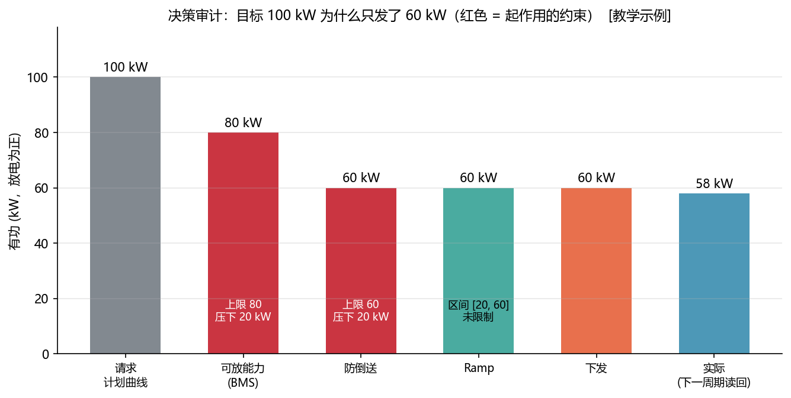
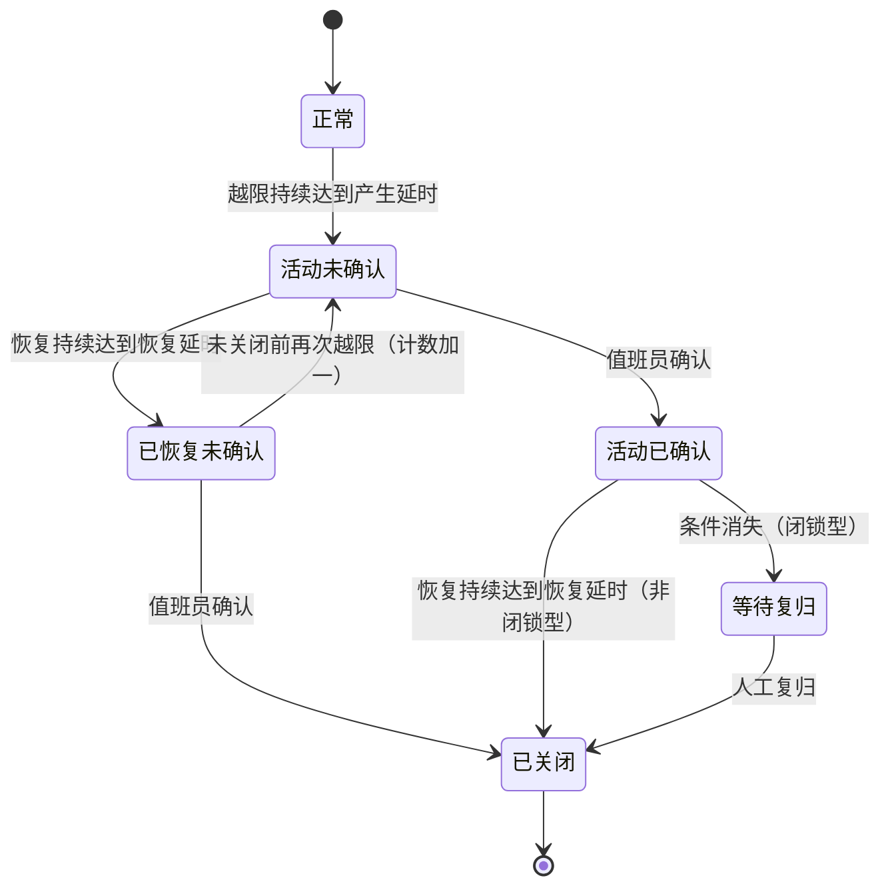
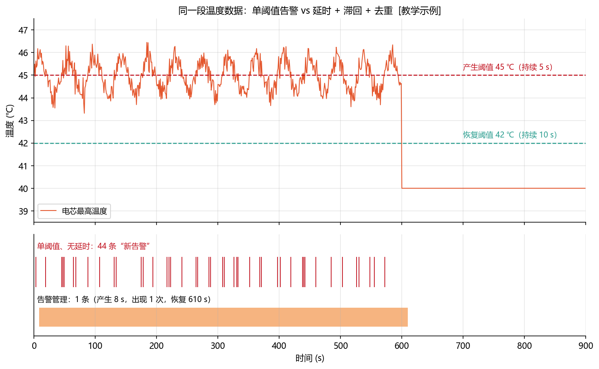
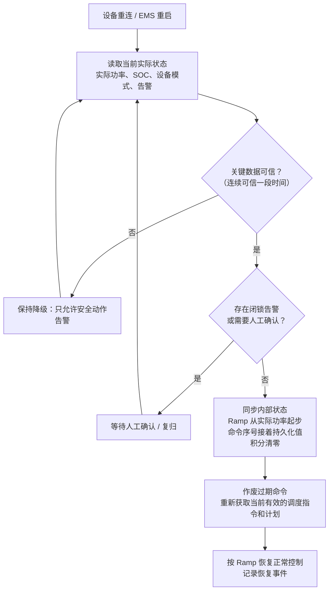
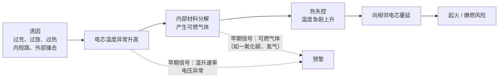
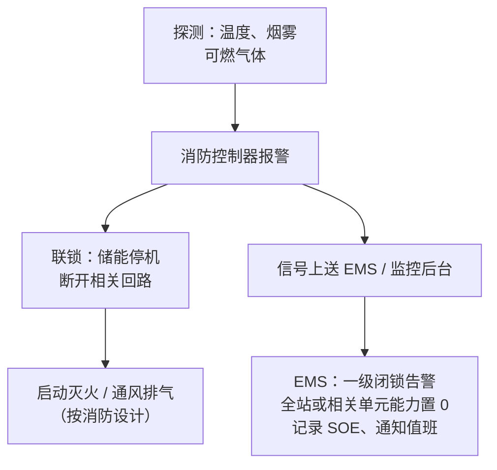

<!-- @AI_GENERATED -->
# 20 EMS 运维可观测性、安全审计与故障恢复

> [课程首页](README.md) · 上一章：[19 仿真与测试](19_仿真与测试.md) · 下一章：[21 综合项目](21_综合项目.md)

## 本章目标与边界

读完本章，你应能：

1. 区分日志、告警、事件和指标，并为控制决策建立可复盘的审计链；
2. 设计带分级、延时、滞回、去重、确认和闭锁复归的告警生命周期；
3. 用设备时标、配置版本、命令序号和质量位还原事故顺序并支撑恢复；
4. 定义可用率、效率、跟踪误差和通信成功率的统计口径，避免“数字正确但含义不一致”。

本章边界是 **EMS 软件的记录、判断、上报和恢复协同**。消防、急停、继保和热失控联锁由独立安全回路或专用设备完成，EMS 不覆盖、不延迟、不替代它们；协议栈、网络安全分区、时钟同步精度和配置审批以项目安全方案、设备规约及当地要求为准。本章代码是教学级观测与审计模型，不等同于生产级 SIEM、历史数据库或安全认证实现。

**一句话**：EMS 上线后，每一个“为什么”都要能从记录中找到答案：为什么只放了 60 kW、为什么没响应 AGC、事故时哪个设备先动作。同时 EMS 要清楚自己在电站安全体系中的位置：服从、记录、上报，而不是覆盖保护。

**前置**：第 08 章（部署与安全分区）、第 10 章（时间戳与数据质量）、第 11 章（滞回）、第 19 章（S6、S7 恢复场景）。

日志框架、监控系统、时序数据库这些通用技术本章不讲，重点讲 **EMS 场景下记什么、怎么判断、口径是什么**。

---

## 20.1 现场场景【必懂】

凌晨 2 点，调度来电：“你们站 1:47 的 AGC 指令是 +8 MW，实际只到了 +5 MW，为什么？”
第二天业主又问：“上个月往返效率只有 82%，合同写的是 85%，是不是设备有问题？”
一周后电池舱发生过温告警并停机，事故分析会上要求说清楚：温度、BMS 保护、PCS 跳闸、消防报警，到底哪个先发生。

这三个问题都不是靠翻程序日志能答出来的。它们分别需要：**决策审计**（20.3）、**有口径的 KPI**（20.8）和 **SOE 事件顺序记录**（20.5）。

---

## 20.2 日志、告警、事件、指标：四种不同的东西【必懂】

| 类型 | 回答的问题 | EMS 中的例子 | 谁看 | 保存 `[教学示例]` |
|---|---|---|---|---|
| 日志 | 程序做了什么 | 读 PCS 成功、周期耗时 12 ms、重连第 3 次 | 开发 | 数天～数周 |
| 告警 | 现在有什么需要人处理 | 电芯温度高、电表通信中断、PCS 降额 | 值班员 | 按项目要求长期保存 |
| 事件 | 什么时候发生了什么变化 | 防倒送开始限制、一次调频动作、模式切换、SOE | 运维、事故分析 | 长期 |
| 指标 | 一段时间表现如何 | 可用率、往返效率、跟踪误差、通信成功率 | 业主、管理 | 长期 |

常见的错误是把四种东西混在一起：告警写进日志文件，值班员看不到；每个周期的功率都当成“事件”存储，真正的状态变化淹没在海量记录里。

> **软件类比**：日志 ≈ 应用日志；告警 ≈ 值班告警（PagerDuty 一类）；事件 ≈ 审计事件 / 领域事件；指标 ≈ 监控指标（Prometheus 一类）。
>
> **类比失效点**：互联网系统的告警主要关心服务可用性；EMS 的告警直接关联人身和设备安全，一级告警（例如消防动作）必须有声光提示和人工处置闭环，不能只是一条消息推送。

---

## 20.3 控制决策审计：为什么只发了 60 kW【必懂】

第 09、12 章的流水线中，一个请求要依次经过多个约束。只记录“最终下发 60 kW”是不够的，必须记录**每一步把它压到了多少、是哪个约束起了作用**：



**图中标注对照表**：

| 编号 | 位置 | 标注 | 对应正文 |
|---|---|---|---|
| ① | 请求 | `100 kW` 计划请求 | 审计输入 |
| ② | BMS 限制 | `80 kW`，能力上限 `80 kW` | 第一处生效约束 |
| ③ | 防倒送 | `60 kW`，压下 `20 kW` | 第二处生效约束 |
| ④ | Ramp | 区间 `[20,60] kW` | 本例未限制 |
| ⑤ | 反馈 | 下发 `60 kW`，实际 `58 kW` | 下一周期回填 |

**手算**：计划曲线请求 100 kW，上周期下发 40 kW，Ramp 100 kW/s，周期 0.2 s：

| 步骤 | 允许区间 | 输入 | 输出 | 是否起作用 |
|---|---|---|---|---|
| 可放能力（BMS） | [−500, 80] | 100 | 80 | 是，压下 20 kW |
| 防倒送 | [−500, 60] | 80 | 60 | 是，压下 20 kW |
| Ramp | [40 − 20, 40 + 20] = [20, 60] | 60 | 60 | 否 |
| 下发 | | | 60 | |
| 实际（下一周期读回） | | | 58 | |

`DecisionAudit.explain()` 会把它写成一行人能读懂的话：

```text
请求 100 kW（计划曲线 100） → 可放能力(BMS) [-500, 80] 压到 80 → 防倒送 [-500, 60] 压到 60
→ Ramp [20, 60] 未限制 → 下发 60 kW → 实际 58 kW
```

### 审计记录的字段

```python
@dataclass
class DecisionAudit:
    cycle_id: int              # 控制周期编号
    seq: int                   # 命令序号（与 PCS 确认对应）
    t_mono_s: float            # 单调时间：排序、算间隔
    t_wall: str                # 墙钟：给人看、与调度/其他系统对时
    mode: str                  # 当前运行模式
    requests: list             # 各来源的请求（来源, kW）
    requested_kw: float        # 合成后的总请求
    steps: list[LimitStep]     # 每个约束：区间、前值、后值
    final_kw: float            # 下发值
    soc: float
    avail_charge_kw: float
    avail_discharge_kw: float
    data_quality: dict         # 关键数据的质量位
    config_version: str        # 当时生效的配置版本
    software_version: str
    ack: str | None            # 设备回应：接受 / 拒绝原因
    actual_kw: float | None    # 下一周期回填的实际值
```

两个容易忽略的字段：

- **`data_quality`**：同样是“只发了 0 kW”，原因可能是防倒送，也可能是电表数据冻结后降级。没有质量位，事后无法区分；
- **`config_version`**：参数改过之后，同样的输入会得到不同的输出。不记录版本，就无法复现当时的决策。

回到 20.1 的调度追问：查 1:47 前后的审计记录，看到“AGC 8000 → 可放能力(BMS) 压到 5000，SOC 16%”，就能直接回答：SOC 接近下限，BMS 限制了可放功率；同时要检查当时上送调度的“可调容量”是否如实反映了这个限制（第 16 章）。

---

## 20.4 告警管理【必懂】

### 分级

设备厂家各有各的告警等级定义，接入层要统一映射到站内分级：

| 级别 | 含义 | 例子 | 处置要求 `[教学示例]` |
|---|---|---|---|
| 一级（紧急） | 事故或紧急状态 | 消防动作、急停、保护跳闸、热失控预警 | 声光报警，立即处置，闭锁需人工复归 |
| 二级（异常） | 功能受影响 | 通信中断、数据失效、PCS 降额、可行域为空 | 尽快处置 |
| 三级（提示） | 需要关注趋势 | 温度偏高、SOC 偏低、跟踪偏差偏大 | 关注，定期处理 |

### 生命周期



两个关键概念：

- **确认 ≠ 解决**：确认只表示“有人看到了”，条件还在就仍然是活动告警；
- **闭锁型告警**：消防动作、急停这类告警，信号消失后也不能自动关闭，必须有人到现场确认、复归，EMS 才允许恢复运行。

### 防抖：延时 + 滞回 + 去重



**图中标注对照表**：

| 编号 | 位置 | 标注 | 对应正文 |
|---|---|---|---|
| ① | 产生阈值 | `45 ℃`，持续 `5 s` | 告警产生条件 |
| ② | 恢复阈值 | `42 ℃`，持续 `10 s` | 告警恢复条件 |
| ③ | 原始数据 | `44～46 ℃`，统计 `600 s` | 温度抖动输入 |
| ④ | 对照结果 | 无防抖约 `44` 条，管理后 `1` 条 | 延时、滞回、去重效果 |

同一段 10 分钟的电芯温度数据（在 44～46 ℃ 之间抖动）：

| 做法 | 告警条数 |
|---|---|
| 单阈值 45 ℃、无延时，每次穿越都算新告警 | 44 条 |
| 产生：超过 45 ℃ 持续 5 s；恢复：低于 42 ℃ 持续 10 s；未关闭期间再次越限只计数 | 1 条 |

三个手段各管一件事：

| 手段 | 防的是什么 |
|---|---|
| 产生延时 | 瞬时毛刺、测量噪声 |
| 滞回（产生 45 ℃、恢复 42 ℃） | 在阈值附近来回穿越（第 11 章 11.3） |
| 去重（按“告警码 + 设备”合并，计出现次数） | 同一个问题反复产生新告警 |

告警刷屏的真正危害是：**值班员会开始忽略告警**，而真正要命的那一条消防告警就混在几百条温度提示里。

### 代码

```python
TEMP_RULE = AlarmRule("CELL_T_HIGH", "电芯温度高", Severity.MINOR,
                      raise_at=45.0, clear_at=42.0, on_delay_s=5.0, off_delay_s=10.0)
FIRE_RULE = AlarmRule("FIRE", "消防动作", Severity.CRITICAL,
                      raise_at=0.5, clear_at=0.4, latched=True)   # 闭锁型

am = AlarmManager([TEMP_RULE, FIRE_RULE])
am.update(t, "电池舱1/簇3", "CELL_T_HIGH", value)   # 每个周期喂数据
am.ack(t, alarm_id, "值班员A")                        # 确认
am.reset(t, alarm_id, "站长")                         # 闭锁型：条件消失且已确认后才允许复归
```

---

### 最小闭环：从告警产生到关闭，再到 KPI

一次温度告警的可复核时间线：

| 时刻 | 温度 | 条件计时 | 状态 | 运维动作 |
|---:|---:|---:|---|---|
| 0 s | 47 ℃ | 开始计时 | 正常 | — |
| 5 s | 47 ℃ | 达到产生延时 | 活动未确认 | 产生告警 |
| 8 s | 47 ℃ | — | 活动已确认 | 值班员确认 |
| 10 s | 41 ℃ | 开始恢复计时 | 活动已确认 | — |
| 20 s | 41 ℃ | 达到恢复延时 | 已关闭 | 自动关闭 |

同一个事件还可以进入指标计算：例如停机区间 `[3600,7200]` 和 `[5400,9000]` 不能简单相加，重叠部分只能算一次：

```text
故障总时长 = 9000 − 3600 = 5400 s
可用率 = 1 − 5400 / 86400 = 93.75%
```

对应脚本：`lab/examples/ch20_observability_trace.py`，同时演示告警生命周期、约束审计和 KPI 计算。


## 20.5 SOE、故障录波与事故时间线【必懂】

### SOE：按设备时标还原事件顺序

**SOE（事件顺序记录）**是设备在状态变化时刻打上的毫秒级时标，用于事故后判断“谁先谁后”。

事故分析最常见的错误是**按 EMS 收到的顺序**判断先后。收到的顺序受轮询周期、网络和设备上送方式影响，与真实发生顺序可能完全相反：

| 设备时标 | 设备 | 事件 | EMS 收到时间 |
|---|---|---|---|
| 1 000 050 ms | BMS1 | 簇 3 电芯过温三级 | 1 002 300 ms |
| 1 000 080 ms | BMS1 | 簇 3 接触器断开 | 1 002 300 ms |
| 1 000 120 ms | PCS1 | 直流过流跳闸 | 1 001 900 ms |

按收到时间看，PCS 跳闸“最早”，容易得出“PCS 故障引起电池问题”的结论。按设备时标排序，真实顺序是：**电芯过温 → BMS 断开接触器 → PCS 因直流侧突变跳闸**，问题出在电池侧。

```python
def soe_sequence(events):
    """按设备时标排序；到达顺序受轮询和网络影响，不能用来判断先后。"""
    return sorted(events, key=lambda e: (e.t_ms, e.device, e.point))
```

SOE 可信的前提是**全站时钟同步**（第 10 章：NTP、PTP、IRIG-B 对时）。不同设备的时钟差几百毫秒，SOE 就失去了判断先后的意义。时钟同步状态本身也要作为告警监视。

### 故障录波【了解】

故障录波装置在故障前后以很高的采样率记录电压、电流波形，用于分析短路、保护动作、电能质量问题。它一般是独立装置，EMS 通常只需要：接收录波启动事件、记录录波文件索引、在事故报告中关联相应的录波。

---

## 20.6 参数与配置管理【必懂】

EMS 的行为由大量参数决定：约束限值、Ramp 速率、一次调频死区与调差率、告警阈值、点表缩放系数……参数改错的后果和代码写错一样严重。

### 参数分类

| 类别 | 例子 | 谁有权修改 |
|---|---|---|
| 设备额定参数 | PCS 额定功率、电池容量 | 设计确定，很少改 |
| 安全边界 | SOC 硬限值、变压器容量 | 需审批 |
| 调度 / 并网参数 | 一次调频死区、调差率、AGC 限值 | 按调度要求，需审批并留档 |
| 控制参数 | PI 增益、滤波时间常数 | 调试人员 |
| 策略参数 | 电价时段、需量目标 | 业主 / 运维 |
| 点表参数 | 地址、缩放系数、方向 | 接入调试，需核对试验 |

### 每次变更都要记录

```text
参数名、旧值、新值、修改人、审批人、原因、时间、生效方式（立即 / 下一周期 / 重启）、配置版本号
```

配置要有版本号，并且写进每一条决策审计记录（20.3），这样才能回答“那一刻用的是哪套参数”。变更必须可以回滚到上一个版本。

### EMS 配置与设备实际参数的一致性

很多参数不仅存在 EMS 里，还下发到设备执行（例如 PCS 本地实现的一次调频，第 15 章 15.10）。EMS 里的值不等于设备正在运行的值：下发可能失败，设备可能被人在本地改过，设备重启可能恢复了出厂值。

```python
expected = {"pfr_deadband_hz": 0.03, "pfr_droop": 0.02, "ramp_kw_s": 100.0}
readback = {"pfr_deadband_hz": 0.05, "pfr_droop": 0.02, "ramp_kw_s": None}
check_param_consistency(expected, readback)
# → 死区：数值不一致；Ramp：设备未上送或读取失败
```

**“没读到”不等于“一样”**，也要作为不一致处理。一致性核对应在启动时、参数下发后、设备重连后执行，不一致时告警。

---

## 20.7 故障恢复：不重放旧命令【必懂】

设备重连、EMS 重启是最容易出事故的时刻（第 19 章 S6、S7）。恢复流程：



要点：

1. **以实际状态为准**，而不是以宕机前的快照为准。宕机期间 PCS 看门狗可能已经把功率回零，SOC 也变了；
2. **命令序号要持久化并延续**，否则 PCS 可能按“序号不大于已执行序号”拒绝新命令，或者更糟，重复执行旧命令；
3. **旧命令一律作废**：调度指令、计划曲线都有有效期，要重新获取当前有效值；
4. **先确认数据，再闭环**：重启后的第一批数据可能不完整，按第 10 章的质量规则连续可信一段时间才退出降级；
5. **恢复本身要记录**：恢复开始、数据可信、人工确认、恢复正常，每一步都是事件。

> **软件类比**：这和分布式系统中节点重启后的恢复一样：不能假设重启前的内存状态仍然有效，要从权威数据源重新同步，并用幂等键（命令序号）防止重复执行。

---

## 20.8 运行 KPI：先定义口径【必懂】

KPI 争议大多不是算错了，而是**口径不一致**：统计周期、计量点、是否包含站用电、如何处理 SOC 首尾差。

| KPI | 定义 | 口径要写明的内容 |
|---|---|---|
| 可用率 | 1 − 不可用时长 / 统计时长 | 什么算不可用（停机、降额到多少、计划检修是否扣除）；重叠停运只算一次 |
| 往返效率 | 放电量 / 充电量（修正 SOC 首尾差） | 计量点（PCS 交流侧 / 并网点）、是否含站用电、统计周期 |
| 功率跟踪误差 | 指令与实际的平均 / 最大偏差、容差内比例 | 容差、采样周期、是否剔除 Ramp 过程 |
| 通信成功率 | 成功次数 / 总次数 | 按周期还是按点统计；丢包重试成功算不算成功 |
| 约束动作次数 | 某约束真正起作用的周期数 | 例如一天中防倒送限制了多少个周期 |
| 调频考核指标 | 按调度规程计算 | 以调度规程为准（第 15、16 章） |

**手算**：

- **可用率**：一天中有两段停运 1:00～2:00 和 1:30～2:30，重叠部分只算一次，共停运 1.5 h，可用率 = 1 − 1.5/24 = **93.75%**；
- **往返效率**：充电 1000 kWh、放电 850 kWh，期末 SOC 比期初高 2%（可用容量 1000 kWh，相当于多存了 20 kWh）：`(850 + 20) / 1000 = 87%`。不做修正会得到 85%，低估 2 个百分点；
- **跟踪误差**：指令 100 kW，4 个采样点实际为 98、101、80、100 kW，容差 5 kW：最大偏差 20 kW，平均偏差 5.75 kW，容差内比例 75%。

回到 20.1 业主的问题：先确认合同中的 85% 是在哪个计量点、是否包含站用电。并网点口径包含变压器损耗和站用电，通常比 PCS 交流侧口径低好几个百分点。**口径对齐之前，不要讨论设备有没有问题**。

---

## 20.9 储能安全：EMS 的位置【必懂】

### 热失控是怎么发展的【了解】



越早发现越好处置。早期信号（温升速率异常、单体电压异常、可燃气体浓度）由 BMS 和消防系统的探测器采集，EMS 要把它们作为最高优先级的告警展示和记录。具体的探测、联锁和灭火方式由项目消防设计和相关规范确定。

### 消防联锁与急停



联锁动作由消防系统、BMS、PCS 通过**硬接线或独立的安全回路**直接完成，**不依赖 EMS 软件**。EMS 收到信号时，设备可能已经停机了。

### EMS 能做什么、不能做什么

| EMS 应该做 | EMS 不能做 |
|---|---|
| 把消防、急停、检修闭锁作为强制许可条件，相关设备能力置 0 | 覆盖、屏蔽、延迟任何保护或联锁动作 |
| 一级告警声光提示，闭锁至人工复归 | 自动复归消防、急停类告警 |
| 记录 SOE，保存事故前后的数据 | 在未确认安全的情况下自动恢复运行 |
| 早期预警信号高优先级展示、趋势监视 | 为了完成调度指令而降低安全阈值 |
| 协助隔离：停止向故障单元分配功率（第 18 章） | 替代消防系统、BMS 做安全判断 |

这与第 12 章的原则一致：**硬安全许可不是普通请求，EMS 只能服从**。

---

## 20.10 网络安全【了解】

储能 EMS 位于电力监控系统的生产控制大区（第 08 章），网络安全要求直接影响软件设计：

- **账户与权限分级**：查看、操作、参数修改、系统管理分离；遥控和参数修改要二次确认；
- **操作审计**：谁在什么时间做了什么操作，从哪个终端操作，结果如何，全部记录且不能被普通账户删除；
- **远程运维受限**：不能随意开放远程访问，跨区数据只能按安全分区规则单向或经认证传输；
- **基线与补丁**：关闭不需要的服务和端口，禁用默认口令，外接存储介质受控；
- **配置与程序变更**：变更要审批、留档、可回滚（20.6）。

具体要求以《电力监控系统安全防护规定》及项目所在电网的安全防护方案为准。

---

## 20.11 常见误区【必懂】

| 误区 | 正确理解 |
|---|---|
| 日志打得越多越好排查 | 关键是记对东西：决策审计、质量位、配置版本 |
| 告警确认了就算处理完了 | 确认只表示有人看到，条件还在就仍是活动告警 |
| 按 EMS 收到的顺序判断事故先后 | 按设备时标（SOE）排序，前提是时钟同步 |
| EMS 里的参数就是设备在用的参数 | 要定期读回核对，读不到也算不一致 |
| 重启后恢复到宕机前的状态继续运行 | 以实际状态为准，旧命令作废，先确认数据 |
| 效率、可用率算出来就是结论 | 先对齐口径（计量点、统计周期、是否含站用电） |
| EMS 负责消防安全 | 联锁由独立安全回路完成，EMS 服从、记录、上报 |

## 20.12 现场真实故障【必懂】

**案例一：告警风暴淹没了真正的告警。**
某站温度告警阈值设得偏紧，且没有延时和滞回，夏天每天产生上千条温度告警，值班员习惯性批量确认。一次电池舱可燃气体探测告警混在其中，延迟了十几分钟才被注意到。
**教训**：告警必须做防抖和去重（20.4）；一级告警必须独立的声光提示，不能和提示类告警混在同一个列表里批量确认；定期评审告警数量，把“每天几千条”本身当作一个问题处理。

**案例二：参数“改了又回去了”。**
调试人员在 PCS 本地把一次调频死区从 0.05 Hz 改成 0.03 Hz，没有同步修改 EMS 的配置。EMS 重启后按自己的配置重新下发参数，死区又变回了 0.05 Hz，随后的调频考核不合格。
**教训**：参数只能有一个权威来源，变更走统一流程并留档；EMS 要定期读回设备参数核对一致性（20.6）。

**案例三：效率争议其实是口径问题。**
业主按并网点电表的月度电量计算往返效率，得到 82%；设备厂家按 PCS 交流侧计算，得到 88%。双方争执了几周，最后发现差值主要是变压器损耗和空调等站用电。
**教训**：KPI 必须写明计量点和统计口径（20.8），最好在合同阶段就约定清楚。

---

## 20.13 自测

1. 日志、告警、事件、指标分别回答什么问题？各举一个 EMS 的例子。
2. 决策审计记录中，为什么要记录数据质量位和配置版本？
3. 电芯温度在 45 ℃ 附近抖动，产生阈值 45 ℃，恢复阈值 42 ℃，产生延时 5 s。温度在 44～46 ℃ 之间抖动 10 分钟，会产生几条告警？为什么？
4. 什么是闭锁型告警？消防动作告警为什么必须是闭锁型？
5. 事故分析时，为什么不能按 EMS 收到事件的顺序判断先后？
6. 充电 2000 kWh、放电 1650 kWh，期末 SOC 比期初低 1%（可用容量 2000 kWh），往返效率约为多少？
7. EMS 重启后，为什么不能直接按宕机前的快照继续运行？

<details>
<summary>参考答案</summary>

1. 日志：程序做了什么（例如重连第 3 次）；告警：现在有什么需要人处理（例如电表通信中断）；事件：什么时候发生了什么变化（例如防倒送开始限制）；指标：一段时间表现如何（例如月度可用率）。
2. 同样的最终结果可能有不同原因：数据冻结导致的降级和防倒送限制，最终都可能表现为“少放电”，没有质量位就无法区分。配置版本决定了同样的输入会得到什么输出，不记录就无法复现当时的决策。
3. 只有 1 条。温度一直没有低于恢复阈值 42 ℃，告警产生后一直处于活动状态，再次越过 45 ℃ 只增加出现次数，不产生新告警。
4. 闭锁型告警在条件消失后不会自动关闭，必须人工确认并复归。消防动作意味着可能存在火灾风险，必须有人到现场确认安全后才能恢复运行，不能因为探测信号消失就自动恢复。
5. EMS 收到事件的顺序受轮询周期、网络延迟和设备上送方式影响，可能与真实发生顺序相反。应按设备打的毫秒级时标（SOE）排序，并且前提是全站时钟同步。
6. 期末少存了 1% × 2000 = 20 kWh，这部分电量是放出去的“库存”，不是本期充电转换来的，要扣除：`(1650 − 20) / 2000 = 81.5%`。
7. 宕机期间实际状态已经变化：PCS 看门狗可能已把功率回零、SOC 变了、调度指令可能已更新。按旧快照继续，会把旧功率瞬间下发造成阶跃，或执行已经过期的命令。应以实际状态为准，同步内部状态，旧命令作废，先确认数据再闭环。

</details>

---

## 20.14 深入【深入】

<details>
<summary>告警合理化【了解】</summary>

过程工业中有专门的告警管理方法论（例如 ISA-18.2 / IEC 62682 所描述的告警生命周期管理），核心思想可以借鉴到 EMS：

- 每条告警都要回答：需要操作员做什么？如果不需要任何操作，它就不应该是告警，而应该是事件或日志；
- 为每条告警定义原因、后果、处置方法、响应时间要求；
- 定期统计告警频率，处理“频繁告警”和“长期不恢复告警”；
- 告警风暴时（例如通信中断导致上百个点同时失效），只提示根因告警，抑制派生告警。

</details>

<details>
<summary>审计记录的存储量估算</summary>

每 0.2 s 一条决策审计、每条约 1 KB，一天约 43 万条、约 0.4 GB。常见做法：

- 全量审计保存较短时间（例如数周）；
- 只有“约束起作用”“模式切换”“设备拒绝”的周期长期保存；
- 事故前后一段时间的全量数据单独归档，随事故报告保存。

具体策略要与项目的数据保存要求和存储容量一起确定。

</details>

<details>
<summary>单调时钟与墙钟</summary>

控制计算（周期间隔、数据年龄、超时判断）用单调时钟，它不会因为校时而跳变；审计记录同时保存墙钟，用于人阅读和与调度、其他系统对时。第 19 章 S8 场景演示了墙钟跳变 30 s 时，只用墙钟会导致全站误判数据过期。

</details>

<!-- @AI_GENERATED: end -->
