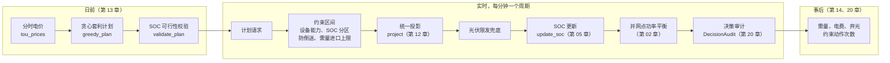
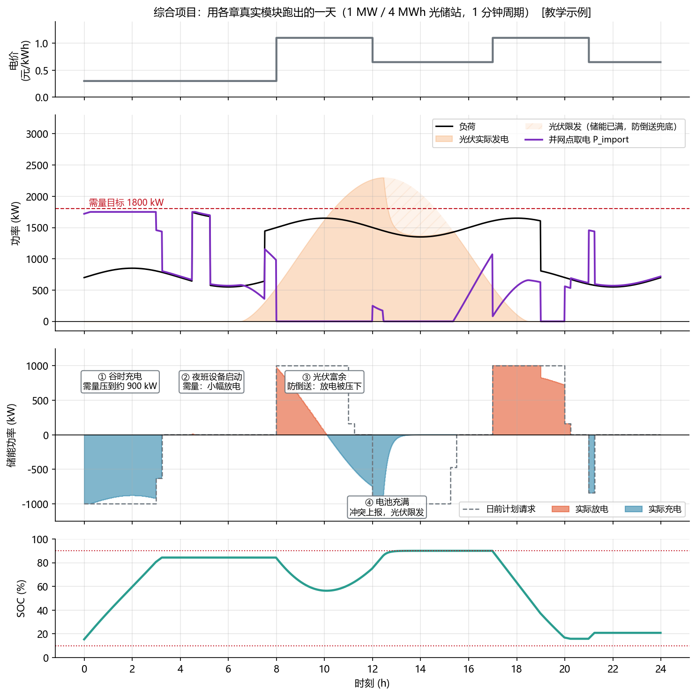
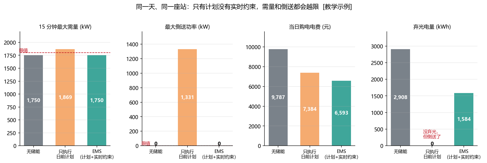

<!-- @AI_GENERATED -->
# 21 光储站 EMS 端到端综合项目与验收

> [课程首页](README.md) · 上一章：[20 运维、可观测性与安全](20_运维可观测性与安全.md) · 返回：[00 导读](00_导读_储能站的24小时.md)

## 本章目标与边界

读完本章，你应能：

1. 将日前计划、实时约束、SOC 更新、功率平衡、审计和事后 KPI 组装成一条端到端控制链；
2. 手算一个分钟周期，并用整天运行结果验证零倒送、需量、SOC、经济性和可追溯性；
3. 用无储能、只执行计划和实时 EMS 三组结果说明控制约束的价值；
4. 按 M0～M7 里程碑把教学参考实现扩展到数据质量、故障注入、多 PCS 和电网服务。

本章边界是 `lab/ems_lab/mini_ems.py` 的 **分钟级、EMS 级集成参考实现**。它验证模块组合、单周期可手算和全天验收，不模拟 PCS 动态、通信时延、电磁暂态、保护联锁或生产级高可用；这些内容分别由第 06、08、10、19、20 章和现场规程承接。表中的电价、容量、费用和验收阈值都是 `[教学示例]`，现场必须替换为项目配置、合同和调度规则。

**一句话**：把前 20 章的模块组装成一个完整的 EMS，让第 00 章那座光储站按“日前计划 → 实时约束 → 事后统计”真正跑完 24 小时，并用一组可重复的验收测试证明它是对的。

**完成本项目后，你能**：

- 把功率平衡、SOC、约束、需量、套利、审计这些分散的知识，组装成一条端到端可运行的控制链；
- 解释这一天中每一个“为什么只放了这么多”；
- 用对照组证明 EMS 的价值：没有实时约束会越限，没有储能会多花钱；
- 按里程碑逐步把参考实现扩展成更接近现场的系统（故障注入、多 PCS、电网服务）。

**前置**：全部章节。尤其是第 00 章（一天的故事）、第 12 章（可行域）、第 13 章（套利计划）、第 14 章（需量）、第 19 章（仿真与断言）、第 20 章（审计）。

---

## 21.1 项目全景【必懂】

第 00 章用十几行规则“演示”了一座光储站的一天。本章用前面各章**真实实现的模块**把它重新做一遍，参考实现在 `lab/ems_lab/mini_ems.py`：



| 环节 | 用到的模块 | 章节 |
|---|---|---|
| 分时电价展开、套利计划、计划校验 | `arbitrage.tou_prices`、`greedy_plan`、`validate_plan` | 13 |
| 设备能力、SOC 分区、防倒送、进口上限区间 | `constraints.device_interval`、`soc_interval`、`export_limit_interval`、`import_limit_interval` | 12 |
| 需量周期内允许的进口功率 | `demand.allowed_import_kw`、`control_target_kw` | 14 |
| 冲突时按优先级放松的统一投影 | `constraints.project` | 12 |
| SOC 更新（充电乘效率、放电除效率） | `battery.update_soc` | 05 |
| 并网点功率平衡 | `power.pcc_injection_kw` | 02 |
| 决策审计记录 | `observability.DecisionAudit`、`LimitStep` | 20 |
| 15 分钟需量统计 | `demand.fixed_window_demands` | 14 |

**参考实现的边界**：它是 **分钟级、EMS 级** 的仿真，没有 PCS 动态、通信延迟和故障注入（这些在第 19 章的 `sim.py` 中）。它的目的是验证“各章的模块能正确地组合在一起”，是后续扩展的起点。

---

## 21.2 场景配置【必懂】

| 参数 | 值 `[教学示例]` | 说明 |
|---|---|---|
| 储能 | 1 MW / 4 MWh，单向效率 95% | 与第 00 章相同 |
| 初始 SOC | 15% | |
| SOC 运行窗口 | 10%～90%，10%～15% 和 85%～90% 线性降额 | 第 05、12 章 |
| 退化成本 | 0.10 元/kWh（按放电量） | 第 03、13 章 |
| 站用电 | 20 kW | |
| 并网约束 | 零倒送 | 第 12 章 |
| 需量目标 / 控制裕度 | 1800 kW / 50 kW，控制目标 1750 kW | 第 14 章 |
| 分时电价 | 谷 0.30（0～8 时）、峰 1.10（8～12、17～21 时）、平 0.65 | 第 13 章 |
| 实时周期 | 1 分钟 | 教学简化；现场按功能取百毫秒～秒级 |

所有参数集中在 `StationConfig` 数据类中，带 `config_version` 字段，写进每一条审计记录（第 20 章 20.6）。

---

## 21.3 参考实现走读【必懂】

### 主循环

```python
# lab/ems_lab/mini_ems.py（节选）
for k in range(STEPS):                                    # 1440 个 1 分钟周期
    t = k * DT_S
    if t % 900 == 0:
        e_window_kwh = 0.0                                # 新的 15 分钟需量周期
    request = gp.plan_kw[int(k * DT_S // (SLOT_H * 3600))]  # 日前计划：96 点 → 每分钟

    intervals = [
        device_interval(cfg.p_max_kw, cfg.p_max_kw),                      # ② 设备能力
        soc_interval(soc, cfg.p_max_kw, cfg.soc_zones),                   # ② SOC 分区
        export_limit_interval(load[k], pv[k], cfg.export_limit_kw, cfg.p_aux_kw),   # ③ 防倒送
        import_limit_interval(load[k], pv[k],
                              allowed_import_kw(e_window_kwh, 900 - t % 900, target_kw),
                              cfg.p_aux_kw, name="需量控制", priority=1),  # ③ 需量
    ]
    r = project(request, intervals)                       # 统一投影，冲突按优先级放松
    p = r.final_kw

    # 电池满了、防倒送无法由储能满足：光伏限发兜底
    export = pcc_injection_kw(p, load[k], cfg.p_aux_kw, 0.0, pv[k])
    pv_used = pv[k] - max(0.0, export - cfg.export_limit_kw)

    soc = update_soc(soc, p, DT_S, cfg.capacity_kwh, cfg.eta, cfg.eta).soc
    p_pcc = pcc_injection_kw(p, load[k], cfg.p_aux_kw, 0.0, pv_used)
    e_window_kwh += max(0.0, -p_pcc) * DT_S / 3600        # 需量周期累计进口电量
    # ……写决策审计
```

注意三处与前面章节的呼应：

1. **先合成、后统一投影**：只有一个请求来源（日前计划），所有约束以区间形式交给 `project` 一次处理（第 09、12 章）；
2. **需量控制用的是“周期内剩余预算”**，而不是瞬时功率：本周期已经用掉的电量越多，允许的进口功率越小（第 14 章）；
3. **冲突不静默**：电池满了但光伏仍富余时，防倒送约束与 SOC 分区冲突。SOC 分区属于设备能力（第 ② 层），不可放松；防倒送属于站点约束（第 ③ 层），被放松并上报，再由光伏限发保证最终不倒送。

### 跑出来的一天



**图中标注对照表**：

| 编号 | 位置 | 标注 | 对应正文 |
|---|---|---|---|
| ① | 场景参数 | `1 MW / 4 MWh`，实时周期 `1 min` | 参考实现边界 |
| ② | 需量曲线 | 控制目标 `1750 kW`，需量目标 `1800 kW` | 需量约束 |
| ③ | 谷时段 | 约 `900 kW` 充电，夜班负荷约 `1100 kW` | 时段 ①② |
| ④ | 光伏与储能 | 计划 `1000 kW`，SOC 分区 `85%～90%` | 时段 ③④ |
| ⑤ | 站用电 | `20 kW` | 功率平衡输入 |

| 时段 | 发生了什么 | 起作用的约束 |
|---|---|---|
| ① 0:00～3:15 | 计划满功率 1000 kW 充电，但夜间负荷 800 kW 左右，取电会超过 1750 kW | **需量控制**把充电压到 900 kW 左右 |
| ② 4:30 | 夜班设备启动，负荷突增 1100 kW | **需量控制**：本周期预算不足，储能小幅放电 |
| ③ 8:00～10:00 | 峰时计划满功率放电，但光伏越来越大 | **防倒送**：放电量被压到“负荷 + 站用电 − 光伏” |
| 10:00～12:30 | 光伏超过负荷 | **防倒送**：下限变成“必须充电”，储能吸收余电 |
| ④ 12:30～15:30 | 电池充到 85% 以上，SOC 分区开始限制充电，最后充满 | **冲突上报**：防倒送被放松，光伏限发（图中斜线） |
| 17:00～20:15 | 晚峰放电；19:00 后负荷降到 800 kW 左右 | 17～19 时按计划满功率放电；19 时后 **防倒送** 把放电压到“负荷 + 站用电” |
| 21:00 | 平段补电，为第二天留电 | 计划执行 |

### 决策审计：每一个“为什么”

```text
10:00  请求 1000 kW（日前计划 1000） → BMS/PCS 能力 [-1000, 1000] 未限制 → SOC 分区 [-1000, 1000] 未限制
       → 防倒送 [-inf, 44.7] 压到 44.7 → 需量控制 [-1705.3, inf] 未限制 → 下发 44.7214 kW

12:30  请求 -1000 kW（日前计划 -1000） → BMS/PCS 能力 [-1000, 1000] 未限制
       → SOC 分区 [-672.1, 1000] 压到 -672.1 → 防倒送 [-inf, -837.4] 压到 -837.4
       → 需量控制 [-2587.4, inf] 未限制 → 冲突放松 [-672.055, -672.055] 压到 -672.055 → 下发 -672.055 kW
```

第二条记录说明：12:30 为了不倒送，储能需要至少充电 837 kW，但 SOC 已经进入降额区，最多只能充 672 kW。更高优先级的 SOC 分区胜出，缺口 165 kW 上报，由光伏限发补上。

### 对照组：证明 EMS 的价值



**图中标注对照表**：

| 编号 | 位置 | 标注 | 对应正文 |
|---|---|---|---|
| ① | 需量 | `1750 kW`、`1869 kW`、限值 `1800 kW` | EMS 与对照组 |
| ② | 倒送 | `0 kW`、`1331 kW` | 只执行计划会越限 |
| ③ | 电费 | `9787`、`7384`、`6593 元` | 当日购电电费 |
| ④ | 弃光 | `2908`、`1584 kWh` | 光伏限发与对照 |

| 指标 | 无储能 | 只执行日前计划 | EMS（计划 + 实时约束） |
|---|---:|---:|---:|
| 15 分钟最大需量 | 1750 kW | **1869 kW（超目标）** | 1750 kW |
| 最大倒送功率 | 0（光伏限发） | **1331 kW（违反并网协议）** | 0 |
| 当日购电电费 `[教学示例]` | 9787 元 | 7384 元 | 6593 元 |
| 弃光电量 | 2908 kWh | 0（但都倒送出去了） | 1584 kWh |

三个结论：

1. **只有计划、没有实时约束的储能是危险的**：需量超目标、大量倒送，两项都会带来罚款或违约；
2. **充电会推高需量**：只执行计划时的最大需量（1869 kW）比没有储能（1750 kW）还高，因为谷时满功率充电叠加了夜间负荷（第 14 章）；
3. **EMS 在满足全部约束的前提下仍然省钱**：比无储能少花约 3194 元/天的电度电费（未计需量电费和退化成本），并吸收了近一半原本要弃掉的光伏。

---

### 最小闭环：追踪一天中的一个分钟周期

综合项目学习的关键不是只会读 `run_day()`，而是能手算一拍。选取任意一个分钟周期，按以下顺序记录：

```text
日前计划请求
→ 当前 SOC / 设备能力
→ 防倒送区间
→ 需量剩余预算区间
→ project 统一投影
→ update_soc 更新 SOC
→ pcc_injection_kw 计算 PCC
→ DecisionAudit 记录原因和配置版本
```

| 步骤 | 输入 | 输出 |
|---|---|---|
| 计划 | 日前计划点 | `requested_kw` |
| 能力 | SOC、设备额定功率 | 设备/SOC 区间 |
| 站点约束 | 负荷、光伏、辅助用电 | 防倒送/需量区间 |
| 投影 | 所有区间 + 请求 | `final_kw`、冲突和绑定原因 |
| 状态更新 | `final_kw`、效率、时间 | 下一拍 SOC |
| 功率平衡 | 负荷、光伏、储能 | `P_PCC` |
| 审计 | 全部中间值 | 可复盘记录 |

对应脚本：`lab/examples/ch21_one_cycle_trace.py`。脚本还验证整天结果满足零倒送、需量目标和配置版本记录，形成“单周期可手算、全天可验收”的双层闭环。


参考实现的验收测试在 `lab/tests/test_mini_ems.py`，每条对应一项：

| 编号 | 验收项 | 判据 | 对照 / 反例 |
|---|---|---|---|
| A1 | 功率平衡 | 每个周期残差 ≤ 1e-6 kW | |
| A2 | 零倒送 | 全天最大倒送 ≤ 1e-6 kW | 只执行计划时倒送大于 1000 kW |
| A3 | 需量 | 最大 15 分钟需量 ≤ 控制目标 1750 kW | 只执行计划时超过 1800 kW，且高于无储能 |
| A4 | SOC 窗口 | 全天 SOC 在 [10%, 90%] 内 | |
| A5 | 可追溯 | 凡是下发值 ≠ 请求值，审计记录中都有起作用的约束 | |
| A6 | 冲突上报 | 冲突都被记录，且对应周期发生了光伏限发 | |
| A7 | 经济性 | 计划预期收益为正；电费低于无储能；弃光少于无储能 | |
| A8 | 可重复 | 两次运行逐点一致 | |
| A9 | 配置版本 | 每条审计记录都带配置版本 | |

运行：`cd lab && python -m pytest tests/test_mini_ems.py -q`。

你的实现无论结构怎么变，都应该能通过同一组验收测试。这正是第 19 章“测试即证据”的含义：**验收判据先于实现存在**。

---

## 21.4 从单周期手算到全天验收证据【必懂】

本节把一个分钟周期的手算、全天运行和验收测试连成同一条证据链。单周期追踪表回答“这一拍为什么得到这个功率”；全天 A1～A9 回答“连续运行是否始终满足边界”；无储能和只执行计划的对照组回答“这些约束是否真的创造了工程价值”。三者缺一不可：只看全天汇总会丢失原因，只看单周期无法发现累计 SOC/需量问题，只看 EMS 主组无法证明约束和测试有效。

验收报告至少应保存：`StationConfig.config_version`、输入负荷/光伏/价格序列、每周期审计记录、约束动作和冲突、SOC 首尾值、功率平衡残差、A1～A9 的实际值与阈值，以及两组对照结果。费用和弃光等经济结果必须注明 `[教学示例]`，不能直接作为现场结算结论。

---

## 21.5 里程碑：从参考实现走向现场系统【必懂】

参考实现只是起点。建议按下面的里程碑，把它逐步扩展成你自己的 EMS。每个里程碑都有明确的交付物和验收判据，完成一个再进入下一个。

| 里程碑 | 目标 | 用到的章节 / 模块 | 交付物 | 验收判据 |
|---|---|---|---|---|
| M0 约定 | 统一方向、单位、符号 | 附录 B；`site.pcc_from_meter`、`check_direction` | 接入层方向换算函数 + 方向核对测试 | 电表“进口为正”输入换算后，功率平衡测试全部通过 |
| M1 物理模型 | 电池、PCS、站点模型可信 | 05、06、07；`battery`、`pcs`、`site` | SOC、效率链、P-Q 能力模型 | 手算例子全部有测试；能量守恒残差 ≈ 0 |
| M2 数据接入 | 点表驱动的模拟设备 | 10；`datapoint` | Mock BMS/PCS/电表（寄存器编解码、质量位、时标） | 字序、缩放、冻结、过期都能被检出 |
| M3 约束与工具箱 | 可行域和控制函数 | 11、12；`control`、`constraints` | 约束区间库 + 统一投影 | 每个约束返回原因；空可行域按优先级处理 |
| M4 用户侧业务 | 套利 + 需量 + 防倒送 | 13、14；`arbitrage`、`demand`、`mini_ems` | 一天的运行（即本章参考实现） | 通过 A1～A9 |
| M5 电网服务（进阶） | 一次调频、AGC、无功 | 15、16、17；`frequency`、`agc`、`reactive` | 计划 + AGC + 一次调频叠加；Q-U 下垂 | 方向正确；P-Q 圆投影不越限；AGC 跟踪指标可计算 |
| M6 仲裁与分配 | 多来源、多 PCS | 18；`arbitration`、`allocation` | 多请求仲裁 + 4 台 PCS 按能力 / SOC 均衡分配 | 分配总和 = 仲裁结果；离线 PCS 能力重分配；未满足量上报 |
| M7 工程化 | 故障注入、告警、审计、KPI | 19、20；`sim`、`observability` | 故障场景测试 + 告警管理 + KPI 报告 | 通过第 19 章 S1～S9 同类场景；测试输出证据字典 |

### 建议的项目结构

```text
my-ems/
├── configs/
│   ├── station.toml          # StationConfig：设备额定、约束限值、电价、需量目标（带版本号）
│   └── points/               # 点表：地址、类型、缩放、方向（M2）
├── src/my_ems/
│   ├── models/               # 数据对象：Measurement、Capability、ControlRequest、PowerCommand（第 09 章）
│   ├── gateway/              # 接入层：寄存器解码、方向换算、质量位（第 10 章）
│   ├── estimation/           # SOC、可充/可放能力（第 05 章）
│   ├── strategies/           # 套利、需量、调频、AGC、无功（第 13～17 章）
│   ├── constraints/          # 约束区间与统一投影（第 12 章）
│   ├── arbitration/          # 仲裁与功率分配（第 18 章）
│   ├── execution/            # 下发、确认、序号、Ramp（第 09、11 章）
│   ├── observability/        # 审计、告警、SOE、KPI（第 20 章）
│   └── runtime/              # 控制周期调度：快环 / 慢环、单调时钟（第 09 章）
├── sim/                      # 被控对象模型与故障注入（第 19 章）
├── tests/
│   ├── unit/                 # 每个手算例子
│   ├── scenarios/            # 闭环场景：每个对应一种现场事故
│   └── acceptance/           # A1～A9 这类验收测试
└── reports/                  # 测试证据、KPI 报告
```

目录与第 08、09 章的软件分层一一对应。`lab/ems_lab/` 中的模块可以直接作为各目录的初始实现。

---

## 21.6 扩展练习【必懂】

按难度从低到高：

1. **改参数看影响**：把需量目标改成 1700 kW、把出口上限改成 200 kW，重新运行，观察约束动作次数和电费如何变化。哪些验收测试需要调整判据？为什么？
2. **滚动重排**：每小时用实际 SOC 调用 `validate_plan` 校验剩余计划，不可行时从当前时刻重新 `greedy_plan`（第 13 章现场故障）。
3. **接入第 19 章的被控对象**：把实时周期改成 1 秒，用 `sim.py` 的 PCS 延迟、电表延迟替换理想模型，再跑一遍 A1～A9。哪些判据需要加上容差和持续时间？
4. **故障注入**：12:00 注入电表冻结，验证 EMS 进入降级、禁止放电、不倒送（第 19 章 S4）。
5. **多 PCS**：把 1 MW 拆成 4 台 250 kW PCS，用 `allocation.allocate_soc_balance` 分配，其中一台在 14:00 离线。验证分配总和、离线重分配和各簇 SOC 差距。
6. **电网侧版本**：把场景换成 100 MW / 200 MWh 独立储能：日前计划 + 每 4 秒一次的 AGC 设点 + 一次调频增量，用 `arbitration.arbitrate` 合成，计算第 16 章的跟踪指标。
7. **最优化对比**：用线性规划替换贪心算法（第 13 章深入部分），比较两者的日收益差距和计算时间，讨论现场为什么不一定追求最优。

---

## 21.7 集成时最常见的坑【必懂】

| 坑 | 现象 | 预防 |
|---|---|---|
| 方向或单位不一致 | 某个模块用“进口为正”，结果约束方向全反 | 接入层统一换算；模块边界做方向断言（M0） |
| 两套 SOC 阈值 | `battery.SocZones` 和 `constraints.SocZoneConfig` 各写一套数，改了一个忘了另一个 | 阈值只在一处配置，其他地方引用 |
| 计划点与实时周期错位 | 96 点计划按“点号”取值，实时周期跨点时取错 | 按时间计算所属时段，并做跨日、时区检查（第 13 章） |
| 需量窗口不对齐 | EMS 的 15 分钟窗口和电表的窗口起点不同 | 以电表时钟对齐窗口起点（第 14 章） |
| 冲突被静默吞掉 | 投影结果“看起来正常”，其实某个约束没满足 | 冲突必须进入审计和告警（A6） |
| 没有对照组 | 说不清 EMS 带来了什么，也发现不了“只执行计划会越限” | 每个验收报告都带基线和对照组 |

---

## 21.8 学完之后【了解】

完成本课程和综合项目后，你已经具备 EMS 软件开发的领域基础。进入真实项目交付，还需要在下面这些方向上继续深入（详见 [README 的附录和补充资料](README.md#附录和补充资料) 中的工程边界说明）：

| 方向 | 内容 | 与本课程的衔接 |
|---|---|---|
| 并网规范与电能质量 | 高低电压穿越、电能质量、调频调压试验方法 | 第 06、15、17 章 |
| 协议栈与站控集成 | Modbus、IEC 104、IEC 61850 的实际实现与联调 | 第 10 章 |
| 安全与消防 | FMEA、故障树、消防联锁设计 | 第 04、20 章 |
| 实时部署与高可用 | 主备切换、看门狗、网络安全防护 | 第 08、20 章 |
| HIL 与现场验收 | 实时仿真、FAT/SAT 测试大纲编写 | 第 19 章 |
| 预测与优化调度 | 负荷 / 光伏预测、滚动优化、MPC | 第 13、14 章 |
| 电池寿命与市场 | 退化建模、电力现货与辅助服务市场、虚拟电厂 | 第 03、05、13、16 章 |

---

## 21.9 自检

1. 参考实现中，“只执行日前计划”的最大需量为什么比“没有储能”还高？
2. 12:30 的审计记录中出现了“冲突放松”，是哪两个约束冲突？为什么放松的是防倒送而不是 SOC 分区？最终怎么保证没有倒送？
3. 需量控制为什么用“本周期剩余预算”而不是瞬时进口功率来算允许值？
4. 为什么验收测试要带对照组和反例？
5. 如果把实时周期从 1 分钟改成 1 秒，并加入 PCS 延迟和电表延迟，A2“零倒送”的判据应该怎么改？

<details>
<summary>参考答案</summary>

1. 日前计划在谷时满功率 1000 kW 充电，而夜间负荷约 800 kW，加上站用电，取电接近 1870 kW，超过了没有储能时的最大需量（夜班设备启动时约 1750 kW）。充电本身就是负荷，会推高需量。
2. 防倒送要求储能至少充电 837 kW，而 SOC 已进入降额区，SOC 分区只允许最多充 672 kW。SOC 分区属于设备能力（第 ② 层），是物理事实，不可放松；防倒送属于站点约束（第 ③ 层），可以放松并上报。最终由光伏逆变器限发补上 165 kW 的缺口，保证并网点不倒送。
3. 需量按 15 分钟平均功率计算。瞬时功率偶尔超过目标不一定导致需量超标，关键是整个周期的累计电量。用剩余预算计算，可以在周期前段允许短时超过、在后段收紧，既不超需量，也不过度限制充电。
4. 对照组证明 EMS 的价值（相比无储能省了多少、相比只执行计划避免了哪些越限）；反例证明测试本身有效（关掉约束后测试能发现问题）。两者都是验收证据的一部分。
5. 加入延迟后，负荷或光伏突变时必然出现短暂倒送，判据要改成“倒送超过容差（例如 10 kW）的持续时间不超过允许值（小于逆功率保护延时）”，与第 19 章 S1 一致。

</details>

<!-- @AI_GENERATED: end -->
