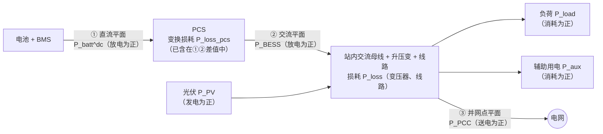
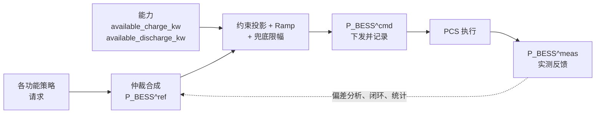
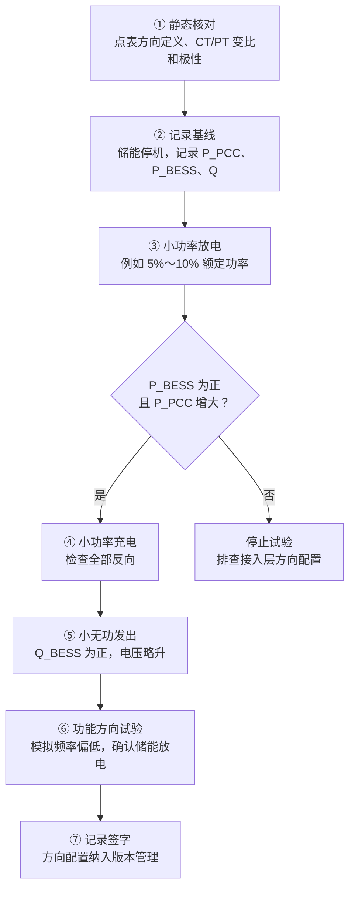

<!-- @AI_GENERATED -->
# 附录 B EMS 符号、功率方向与测量平面规范

> [课程首页](README.md) · [完整章节概览](README.md#全部章节概览) · [附录 A 术语词典](附录A_术语词典.md) · [附录 C 数学函数速查](附录C_数学函数速查.md)

**规范定位**：本附录是全课程功率方向、单位、测量平面、字段命名和功率平衡的单一事实源。正文可以解释不同业务，但不得另行定义一套正负号。

**一句话**：全课程只用一套功率方向；所有外部数据在接入层换算成这套方向，控制算法内部不再出现临时取反。

**一页速查**：

| 量 | 约定 | 代码字段 |
|---|---|---|
| `P_BESS` | 放电为正，充电为负 | `p_bess_kw` |
| `P_PCC` | 向电网送电为正，从电网取电为负 | `p_pcc_kw` |
| `P_import` | 从电网取电为正，`P_import = -P_PCC` | `p_import_kw` |
| `P_PV` | 发电为正 | `p_pv_kw` |
| `P_load/P_aux/P_loss` | 消耗为正，在功率平衡式中扣除 | `p_load_kw` / `p_aux_kw` / `p_loss_kw` |
| `Q_BESS/Q_PCC` | 向电网发出无功为正 | `q_bess_kvar` / `q_pcc_kvar` |
| 可充/可放能力 | 非负幅值，区间为 `[−available_charge, +available_discharge]` | `available_charge_kw` / `available_discharge_kw` |

`P_PCC = P_PV + P_BESS − P_load − P_aux − P_loss` 是本附录和第 07、12、19、21 章共同使用的核心平衡式。

---

## B.1 为什么需要一份方向规范【必懂】

`P`、`Q`、`S`、`U`、`I`、`f` 这些物理量符号在电力工程里是通用的，但**下标怎么写、哪个方向算正**，并没有一套覆盖所有厂商、标准和电表的统一写法：

- 电表和计费系统常用“从电网取电为正”；
- 很多 PCS 用“放电为正”，也有厂家用“充电为正”；
- IEEE 1547 规定分布式能源与电网互联的性能要求，IEC 61850-7-420 规定分布式能源（含储能）的信息模型，它们都**不替项目决定变量名和正负方向**（见 [README 的规范与边界说明](README.md#适用范围与工程边界)）。

所以每个项目都必须写明自己的约定。本课程的做法是“行业常见语义 + 项目明确约定”：选一套最符合电力系统习惯的方向固定下来，所有章节、代码、测试都遵守它。

> **软件类比**：这相当于在系统边界统一时区和编码。外部数据可以是 GBK、UTC+8、毫秒时间戳，进入系统后一律转成 UTF-8、UTC、秒；业务代码里再出现 `+8` 就是 bug。
>
> **类比失效点**：编码错了通常只是乱码，功率方向错了会让闭环控制变成**正反馈**：越想减少倒送，放电越多（第 00 章 0.8）。

---

## B.2 核心约定（先记住这张表）【必懂】

| 量 | 符号 | 代码字段 | 正方向 |
|---|---|---|---|
| 储能交流侧有功 | `P_BESS` | `p_bess_kw` | **放电为正**，充电为负 |
| 并网点净有功 | `P_PCC` | `p_pcc_kw` | **向电网送电为正**（倒送），取电为负 |
| 电表/计费进口功率 | `P_import` | `p_import_kw` | 从电网取电为正；`P_import = −P_PCC`，**只在接入层和需量计费中使用** |
| 负荷、辅助用电、损耗 | `P_load`、`P_aux`、`P_loss` | `p_load_kw`、`p_aux_kw`、`p_loss_kw` | 消耗为正 |
| 光伏 | `P_PV` | `p_pv_kw` | 发电为正 |
| 无功 | `Q_BESS`、`Q_PCC` | `q_bess_kvar`、`q_pcc_kvar` | **向电网发出无功为正**，吸收为负 |
| 可充 / 可放能力 | — | `available_charge_kw`、`available_discharge_kw` | **非负幅值** |

```text
功率平衡：P_PCC = P_PV + P_BESS − P_load − P_aux − P_loss
频率低 → 储能放电（P_BESS 增大，为正）
电压低 → 储能发出无功（Q_BESS 增大，为正）
```

这套约定的共同点是：**以“电网侧看进来”为参照，向外部交流网络注入为正**。储能放电、光伏发电、站点倒送、发出无功都在“注入”，所以都是正数；负荷、辅助用电、损耗是“消耗”，按正数记，在公式里减掉。

---

## B.3 符号表【必懂】

| 数学记号 | 代码字段 | 单位 | 正方向 | 含义 |
|---|---|---|---|---|
| `P_BESS` | `p_bess_kw` | kW | 放电为正 | BESS/PCS **交流端口**的有功功率（默认即 `P_BESS^ac`） |
| `P_batt^dc` | `p_batt_dc_kw` | kW | 放电为正 | 电池**直流端口**功率，不含 PCS 变换损耗；不能与 `P_BESS` 直接混用 |
| `P_BESS^ref` | `p_bess_ref_kw` | kW | 放电为正 | 策略层或仲裁层给出的参考值（“想要多少”） |
| `P_BESS^cmd` | `p_bess_cmd_kw` | kW | 放电为正 | 经过约束、Ramp 后**最终下发**给 PCS 的指令 |
| `P_BESS^meas` | `p_bess_meas_kw` | kW | 放电为正 | PCS 或电表反馈的**实测值** |
| `P_BESS^avail,dis` | `available_discharge_kw` | kW | 非负幅值 | 当前允许的最大放电功率（SOP 放电方向） |
| `P_BESS^avail,ch` | `available_charge_kw` | kW | 非负幅值 | 当前允许的最大充电功率（SOP 充电方向），**写成正数** |
| `P_PCC` | `p_pcc_kw` | kW | 向电网送电为正 | 并网点净有功；> 0 倒送，< 0 取电 |
| `P_import` | `p_import_kw` | kW | 从电网取电为正 | `P_import = −P_PCC`；只用于电表接入和需量计费 |
| `P_load` | `p_load_kw` | kW | 消耗为正 | 站内（PCC 下游）负荷 |
| `P_aux` | `p_aux_kw` | kW | 消耗为正 | **尚未包含在 `P_load` 中**的辅助用电（液冷、消防、照明、控制电源） |
| `P_loss` | `p_loss_kw` | kW | 消耗为正 | **尚未体现在测量值中**的损耗，默认指 PCS 交流口到 PCC 之间的变压器和线路损耗 |
| `P_PV` | `p_pv_kw` | kW | 发电为正 | 光伏交流侧出力；风电等其他注入型电源同理 |
| `P_export_limit` | `p_export_limit_kw` | kW | 非负 | 允许的最大倒送功率，零倒送时为 0 |
| `P_import_limit` | `p_import_limit_kw` | kW | 非负 | 允许的最大取电功率（需量目标、变压器容量等换算而来） |
| `Q_BESS` | `q_bess_kvar` | kvar | 发出为正 | 储能交流侧无功 |
| `Q_PCC` | `q_pcc_kvar` | kvar | 发出为正 | 并网点净无功，站点向电网发出为正 |
| `S_rated` | `s_rated_kva` | kVA | 非负 | PCS 或变压器视在容量 |
| `PF` | `pf` | — | 仅幅值 0～1 | `PF = abs(P) / S`，不携带方向，方向看 `Q` 的正负 |
| `U` | `u_pcc_kv` / `u_pu` | kV / p.u. | — | 电压有效值；三相系统默认线电压，标幺值须声明基准 |
| `f` | `f_hz` | Hz | — | 频率；偏差 `Δf = f − fn`，低于额定为负 |
| `SOC` | `soc` | 代码 0～1，正文 % | 增大表示电量增加 | 荷电状态，须声明容量基准（额定还是可用） |
| `E_usable` | `e_usable_kwh` | kWh | 非负 | 当前模型定义下的可用能量容量 |
| `η_ch`、`η_dis` | `eta_ch`、`eta_dis` | — | 0～1 | 充电、放电方向的单向效率，须声明属于哪两个测量平面之间 |
| `dt` | `dt` | s | 非负 | 控制或采样周期；换算电量时注意 s 和 h |

命名习惯：数学记号用大写加下标（`P_BESS`、`P_PCC`），代码字段用小写蛇形并带单位后缀（`p_bess_kw`、`q_pcc_kvar`）。**字段名里的单位后缀是强制的**，它能在代码审查中直接暴露 kW/MW 混用。

不推荐的写法：

| 写法 | 问题 | 本课程用 |
|---|---|---|
| `P_ESS` | 泛指所有储能技术，可作为外部资料的别名 | `P_BESS` |
| `P_grid` | 可能指电网侧、PCC 侧或电网模型内部功率，含义过宽 | `P_PCC` 或 `P_import`，并写明测量点 |
| `P_PCC^inj`、`P_PCC^imp`（原稿写法） | 上标繁琐，容易在代码中丢失 | `P_PCC`（送电为正）、`P_import`（取电为正） |
| 无后缀的 `power`、`p` | 看不出单位和测量点 | 带测量点和单位的字段名 |

---

## B.4 三个测量平面与损耗归属【必懂】

同一个“储能功率”，在直流侧、PCS 交流口、并网点测到的数值不一样，差值就是损耗和站内消耗。下图以放电为例，箭头方向是**正方向的参考方向**，实际功率可以反向：



| 平面 | 符号 | 测什么 | 典型数据来源 |
|---|---|---|---|
| ① 直流平面 | `P_batt^dc` | 电池本体进出的功率 | BMS 的簇电压 × 簇电流，或 PCS 直流侧测量 |
| ② 交流平面 | `P_BESS` | PCS 交流端口的功率 | PCS 上送的有功，或 PCS 出口电表 |
| ③ 并网点平面 | `P_PCC` | 整个站点与电网交换的净功率 | 并网点关口表 / 考核表 |

损耗归属规则：

1. `P_loss_pcs`（PCS 变换损耗）**已经体现在** `P_batt^dc` 与 `P_BESS` 的差值里。使用 `P_BESS` 建模时，不能再扣一次；
2. `P_loss` 默认只包含 **PCS 交流口到 PCC 之间**、没有被任何测量值覆盖的损耗，主要是升压变压器和集电线路损耗；
3. `P_aux` 只表示**没有包含在 `P_load` 里**的辅助用电。如果负荷电表已经计入辅助用电，`P_aux` 取 0；
4. 充电和放电方向的损耗、效率要分别取值，不能共用一个“总效率”；
5. 每个功率项都要在点表中声明：测量点、正方向、单位、采样时间、是否已含辅助用电、是否已含损耗。

放电方向的近似关系：

```text
P_BESS ≈ P_batt^dc − P_loss_pcs
P_PCC  = P_PV + P_BESS − P_load − P_aux − P_loss
```

> 【了解】如果电池侧建模（例如 SOC 按直流功率积分），交流侧指令要经过效率换算：放电时 `P_batt^dc ≈ P_BESS / η_pcs,dis`，充电时 `|P_batt^dc| ≈ |P_BESS| × η_pcs,ch`。效率随功率和温度变化，工程上以厂家效率曲线为准。

---

## B.5 功率平衡与由它推出的限值【必懂】

### 功率平衡

```text
P_PCC = P_PV + P_BESS − P_load − P_aux − P_loss
```

实现见 `lab/ems_lab/power.py` 的 `pcc_injection_kw(p_bess_kw, p_load_kw, p_aux_kw, p_loss_kw, p_pv_kw)`。

**手算**（负荷 100 kW，无光伏，忽略辅助用电和损耗）：

| `P_BESS` | `P_PCC` | `P_import` | 含义 |
|---:|---:|---:|---|
| 0 | −100 | +100 | 全部从电网取电 |
| +30 | −70 | +70 | 储能供 30，仍取电 70 |
| +120 | +20 | −20 | 放多了，向电网倒送 20 |
| −20 | −120 | +120 | 储能充电，取电增加到 120 |

### 防倒送：给放电加上限

防倒送要求 `P_PCC ≤ P_export_limit`（零倒送时 `P_export_limit = 0`）。代入功率平衡：

```text
P_BESS ≤ P_load + P_aux + P_loss − P_PV + P_export_limit
```

所以负荷突然下降、出现倒送时，应当**减少放电**（或增加充电），而不是增加放电。

### 取电上限：给充电加下限

需量控制、变压器容量要求 `P_import ≤ P_import_limit`，即 `P_PCC ≥ −P_import_limit`：

```text
P_BESS ≥ P_load + P_aux + P_loss − P_PV − P_import_limit
```

右边为正时，意味着储能必须放电才能把取电压到上限以下；右边为负时，它给出了允许的最大充电功率（取绝对值）。

两条限值和设备能力 `[−available_charge_kw, +available_discharge_kw]` 取交集，就是第 12 章的可行域。交集为空说明约束冲突，必须上报，不能随便取一个边界。

> **防倒送 ≠ 防非计划充电**。防倒送限制的是 `P_PCC` 向电网的正向输出；防非计划充电限制的是 `P_BESS < 0` 这种不该发生的充电。两个功能、两个开关、两套告警。

---

## B.6 参考值、指令、测量值、能力的区分【必懂】

不要把所有量都叫 `P_BESS`。同一个时刻，储能功率至少有四个不同含义的值：

| 记号 | 代码字段 | 谁产生 | 谁使用 | 典型错误 |
|---|---|---|---|---|
| `P_BESS^ref` | `p_bess_ref_kw` | 策略层、仲裁层 | 约束投影、Ramp | 把它直接下发，跳过约束 |
| `P_BESS^cmd` | `p_bess_cmd_kw` | 约束 + Ramp 之后 | 下发给 PCS；写入审计日志 | 把它当作实际出力参与功率平衡 |
| `P_BESS^meas` | `p_bess_meas_kw` | PCS/电表反馈 | 闭环控制、电量统计、考核 | 通信超时后用上一拍 cmd 代替 |
| `available_*_kw` | `available_charge_kw`、`available_discharge_kw` | BMS/PCS 能力、状态估计 | 限幅、可行域、分配 | 符号不统一，可充功率带负号 |



原则：**目标值不能当反馈值**。偏差 `P_BESS^cmd − P_BESS^meas` 本身就是重要的监控指标：持续偏大说明 PCS 在拒绝或修正指令，EMS 应当把它反映为能力变化，而不是继续加大指令。

无功同理：`q_bess_ref_kvar`、`q_bess_cmd_kvar`、`q_bess_meas_kvar`，以及由 P-Q 能力圆给出的可发出/可吸收无功幅值。

---

## B.7 接入层方向换算规则【必懂】

所有方向换算只发生在**数据接入层（数据网关）**，控制层只看到课程约定。

1. **点表必须声明方向**。每个功率类测点至少包含：测量点、单位、缩放系数、正方向（如“取电为正”“充电为正”“放电为正”）；
2. **读入即换算**。网关把原始值乘以缩放系数和方向系数（+1 或 −1），得到课程约定的值；控制代码中出现 `-p_meter` 这类临时取反，视为缺陷；
3. **`P_import` 只出现在两处**：电表接入（电表“取电为正”时，`P_PCC = −P_import`）和需量计费模块（由 `P_PCC` 算 `P_import = −P_PCC`）。其余模块一律使用 `P_PCC`；
4. **能力一律转为非负幅值**。BMS 若把可充功率上送为负数，网关取反后校验非负；`lab/ems_lab/control.py` 的 `clamp_power` 对负值直接报错；
5. **无功按厂家定义换算为“发出为正”**。点表中带符号的功率因数，按厂家说明换算成 `Q` 的符号；有 `Q` 测点时，以 `Q` 为准，不从 PF 反推方向；
6. **单位统一为 kW、kvar、kVA、kWh、s**。MW、W、MWh 在接入层换算，正文可以写 MW，代码不写；
7. **保留原始值用于追溯**。换算后的值和原始寄存器值、方向配置版本一起记录，便于现场排查“到底是谁取反了”。

```python
# 接入层示意（说明规则用，不属于 lab/ 的实现）
DIRECTION = {"export_positive": +1.0, "import_positive": -1.0}

def normalize_pcc_kw(raw_value, scale, convention):
    """把电表原始读数换算为 P_PCC（向电网送电为正，单位 kW）。"""
    return DIRECTION[convention] * raw_value * scale
```

---

## B.8 无功与功率因数的方向【必懂】

- `Q_BESS > 0`：储能向电网**发出**无功，倾向于**抬高**并网点电压；
- `Q_BESS < 0`：储能从电网**吸收**无功，倾向于**压低**并网点电压；
- `PF = |P| / S` 只有幅值；
- “超前/滞后”这对说法依赖于采用**发电机惯例**还是**负荷惯例**，同一个物理状态在两种惯例下叫法相反。因此课程**不用超前/滞后表达方向**，一律以 `Q` 的正负为准；接入厂家数据时，先查清对方用的是哪种惯例，再换算。

定功率因数控制时，给定幅值 `PF` 和有功 `P`，无功幅值为 `|P| × tan(arccos PF)`，符号由项目要求（发出还是吸收）决定，见 [附录 C](附录C_数学函数速查.md) C.19。

---

## B.9 上线前的方向核对试验【必懂】

方向核对是 SAT 的必做项目，应在任何闭环功能（防倒送、需量、一次调频、AVC）投入之前完成。下列功率幅值为 `[教学示例]`，具体以调试方案和调度要求为准。



| 步骤 | 操作 | 期望结果 | 不符合时的常见原因 |
|---|---|---|---|
| ① 静态核对 | 对照厂家手册核对每个功率测点的方向定义、缩放、CT/PT 变比和接线极性 | 点表配置与手册一致 | 手册版本不对；CT 极性接反 |
| ② 基线 | 储能停机，记录 `P_PCC`、`P_BESS`、`Q_PCC` | `P_BESS ≈ 0`；`P_PCC ≈ P_PV − P_load − P_aux − P_loss` | 负荷或光伏测点缺失、重复计入 |
| ③ 小功率放电 | 手动下发小功率放电指令 | `P_BESS^meas > 0`；`P_PCC` 增大约同样数值；`P_import` 减小 | `P_PCC` 反而减小：电表方向反；`P_BESS` 为负：PCS 方向反 |
| ④ 小功率充电 | 手动下发小功率充电指令 | 与③全部反向；SOC 缓慢上升 | SOC 下降：SOC 或电流方向定义反 |
| ⑤ 无功 | 下发小的发出无功指令 | `Q_BESS^meas > 0`；`Q_PCC` 增大；并网点电压略升 | 无功或 PF 符号惯例不一致 |
| ⑥ 功能方向 | 在测试模式下注入模拟频率（低于额定且超出死区），或按规程做频率阶跃试验 | 一次调频功率为正（放电） | 下垂公式缺负号；接入层方向错 |
| ⑦ 归档 | 记录试验数据、方向配置版本、参与人员 | 可追溯 | — |

投运后还应保留一条**在线合理性校验**：储能出力变化 `ΔP_BESS` 与并网点变化 `ΔP_PCC` 应当同号、量级相近（差值约为损耗和负荷波动）。如果持续出现反向组合（例如放电增加而 `P_PCC` 明显减小），说明方向很可能反了，应告警并退出相关闭环。

---

## B.10 常见错误【必懂】

| 错误 | 后果 | 正确做法 |
|---|---|---|
| 电表“取电为正”的读数直接当作 `P_PCC` | 防倒送、需量闭环整体反向，形成正反馈（第 00 章 0.8） | 接入层换算 `P_PCC = −P_import` |
| 控制代码中临时写 `-p` 取反 | 与接入层换算叠加后变成双重取反 | 控制层禁止临时取反，方向只在接入层处理 |
| 可充功率用负数进入限幅 | 可行域算错或直接报错 | 能力统一为非负幅值，区间写成 `[−可充, +可放]` |
| 直流侧功率与交流侧负荷直接相加 | 平衡式误差等于 PCS 损耗 | 统一到同一测量平面，必要时做效率换算 |
| 用 `P_BESS` 建模又扣一次 PCS 损耗 | 损耗重复计入 | `P_loss` 只含 PCS 交流口到 PCC 之间未测到的部分 |
| `P_load` 已含辅助用电，公式里又减 `P_aux` | 负荷被多算 | 在点表中声明包含关系，`P_aux` 只计未包含的部分 |
| 通信超时时用 `cmd` 代替 `meas` | 闭环“以为执行到位”，偏差被掩盖 | 数据失效时冻结闭环并告警（第 10 章） |
| 用 PF 的正负判断无功方向 | 不同厂家惯例不同，方向可能反 | 以 `Q` 的正负为准，PF 只看幅值 |
| 把 Ramp 的“上升”理解成“放电增大” | 从 −500 kW 到 0 kW 也是上升，限速用错方向 | 上升/下降指代数值增大/减小（第 11 章） |
| 防倒送和防非计划充电共用一个开关 | 一个功能投退影响另一个 | 分成两个独立功能和告警 |
| 字段不带单位后缀 | kW 与 MW 混用，差 1000 倍 | 字段名强制带 `_kw`、`_kvar`、`_kwh` 等后缀 |

---

## B.11 与原稿的差异【了解】

本附录由原稿 `_原稿备份_v1/01_术语与功率方向规范.md` 改写，主要变化：

- 并网点符号由 `P_PCC^inj` 改为 `P_PCC`（向电网送电为正），字段由 `p_pcc_inj_kw` 改为 `p_pcc_kw`；电表进口功率由 `P_PCC^imp` 改为 `P_import`，字段为 `p_import_kw`，并限定只在接入层和需量计费中使用；
- 功率平衡式加入光伏 `P_PV`；
- 新增无功方向（发出为正）和超前/滞后说明；
- 测量平面示意图由字符画改为 Mermaid；
- 更正原稿错字：“Battery Management IOSystem”应为 **Battery Management System**；“`P_BESS^reFf`”应为 **`P_BESS^ref`**。

完整的新旧对应关系见 [README 的补充资料说明](README.md#附录和补充资料)。


## B.12 规范字段与测试索引

| 规范主题 | 代码入口 | 验证入口 | 失败时应关注 |
|---|---|---|---|
| PCC 功率平衡 | `ems_lab.power.pcc_injection_kw` | `test_power.py`、`test_site.py` | 测量平面、站用电和损耗是否重复计算 |
| 充放电能力符号 | `ems_lab.control.clamp_power` | `test_control.py`、`test_constraints.py` | 可充/可放是否被误写成带符号能力 |
| 电表方向与质量 | `ems_lab.datapoint` | `test_datapoint.py`、第 19 章 S4 | 取电为正是否在接入层转换为 `P_PCC` |
| P/Q 联合能力 | `ems_lab.reactive` | `test_reactive.py` | 是否分别 clamp 导致 P-Q 圆被破坏 |
| 现场方向核对 | 第 B.9 节七步试验 | SAT 记录与第 19 章场景测试 | 方向配置版本、CT/PT 极性、点表缩放 |

本附录只规定软件内部统一语义，不替代厂家点表、项目设计、调度规程、保护定值或现场签字记录。出现冲突时先停止相关闭环，再核对测量点、原始值、方向配置版本和设备手册。

<!-- @AI_GENERATED: end -->
